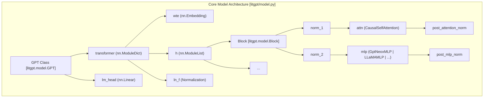
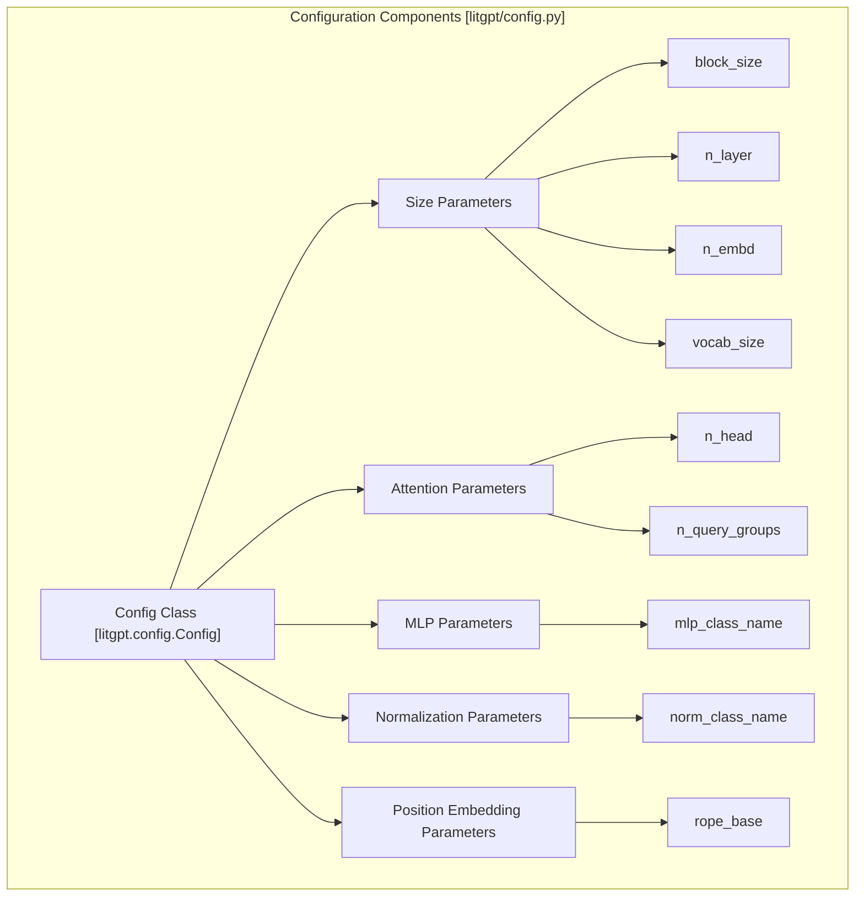
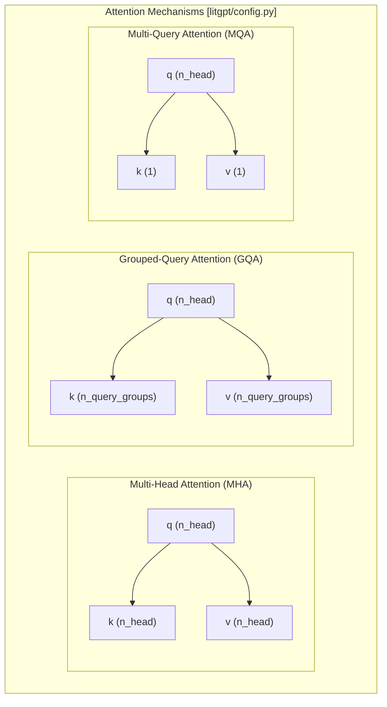
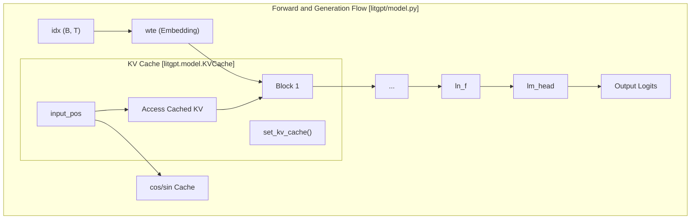

<!-- source: DeepWiki mcp.deepwiki.com · repo Lightning-AI/litgpt · page 2 Core Architecture · fetched 2026-10-21 -->

# Core Architecture

Relevant source files

The following files were used as context for generating this wiki page:

- [README.md](README.md)
- [litgpt/adapter.py](litgpt/adapter.py)
- [litgpt/adapter_v2.py](litgpt/adapter_v2.py)
- [litgpt/config.py](litgpt/config.py)
- [litgpt/lora.py](litgpt/lora.py)
- [litgpt/model.py](litgpt/model.py)
- [tests/test_model.py](tests/test_model.py)
- [tutorials/download_model_weights.md](tutorials/download_model_weights.md)

This document details the fundamental architecture of LitGPT, covering the model design, configuration system, and how core components interact to create a flexible, high-performance language model implementation.

## Model Architecture Overview

LitGPT implements decoder-only transformer language models with a focus on readability and efficiency. Every model is written from scratch to maximize performance and remove layers of abstraction [README.md:106-107](). The system is designed with minimal abstraction layers, making it easy to understand and modify while maintaining high performance [litgpt/model.py:3-7]().

Sources: [litgpt/model.py:22-37](), [litgpt/model.py:261-328]()

The architecture consists of:

- **GPT Class**: The main model class that ties everything together [litgpt/model.py:22-37]().
- **Transformer Module**: Contains the embedding layer (`wte`), transformer blocks (`h`), and final layer norm (`ln_f`) [litgpt/model.py:29-35]().
- **Transformer Blocks**: Each containing attention, MLP, layer norms, and residual connections [litgpt/model.py:261-328]().
- **Language Model Head**: Maps from the model's hidden dimensions to vocabulary logits [litgpt/model.py:28]().

For details, see [Model Architecture](#2.3).

## Configuration System

LitGPT uses a flexible configuration system defined by the `Config` dataclass [litgpt/config.py:26](). This system enables supporting many model variants with a single codebase by defining parameters like `n_layer`, `n_embd`, and `n_head` [litgpt/config.py:31-46]().

Sources: [litgpt/config.py:26-117](), [litgpt/config.py:118-184]()

Key features of the configuration system:
- **Comprehensive Parameters**: Controls all aspects of model architecture and behavior.
- **Factory Methods**: `from_name()`, `from_file()`, and `from_checkpoint()` for flexible initialization [litgpt/config.py:187-210]().
- **Dynamic Computation**: Automatically computes dependent parameters like `head_size` and `intermediate_size` in `__post_init__` [litgpt/config.py:122-143]().

For details, see [Config System](#2.1).

## Attention Mechanism

The `CausalSelfAttention` class [litgpt/model.py:331]() is a versatile implementation supporting multiple attention patterns by adjusting `n_query_groups` [litgpt/config.py:48-68]().

Sources: [litgpt/model.py:331-389](), [litgpt/config.py:48-68]()

Key attention features:
- **Flexible Query Groups**: Controlled via the `n_query_groups` parameter [litgpt/config.py:68]().
- **Rotary Position Embeddings (RoPE)**: Applied to the query and key projections using cached `cos` and `sin` values [litgpt/model.py:365-366]().
- **Flash Attention**: Utilizes `torch.nn.functional.scaled_dot_product_attention` for optimized performance [litgpt/model.py:417-427]().

For details, see [Model Architecture](#2.3).

## Forward Pass and Generation

The model's forward pass processes tokens through transformer layers. It supports efficient inference via a KV cache system [litgpt/model.py:124-146]().

Sources: [litgpt/model.py:85-179](), [litgpt/model.py:456-487]()

The forward pass includes logic for:
- **KV Caching**: Triggered when `input_pos` is provided [litgpt/model.py:124]().
- **Chunked Logits**: Optional `lm_head_chunk_size` to save memory during training [litgpt/model.py:168-175]().

## Weight Loading and Conversion

LitGPT provides scripts to convert checkpoints between Hugging Face and LitGPT formats. This involves mapping layer names and reassembling QKV matrices [litgpt/scripts/convert_hf_checkpoint.py:19]().

Sources: [litgpt/scripts/convert_hf_checkpoint.py:23-450](), [litgpt/scripts/convert_lit_checkpoint.py:18-240]()

For details, see [Checkpoint Conversion](#2.4).

## Tokenization and Prompts

- **Tokenizer**: Supports multiple backends (HuggingFace, SentencePiece) via the `Tokenizer` class [litgpt/tokenizer.py:23](). For details, see [Tokenizer](#2.2).
- **Prompt Styles**: Handles model-specific formatting (e.g., Llama 3, Alpaca) through the `PromptStyle` system [litgpt/prompts.py:15](). For details, see [Prompt Styles](#2.5).

## Parameter-Efficient Fine-tuning (PEFT)

LitGPT implements several PEFT methods by wrapping or modifying core model components:

| Method | Implementation File | Key Mechanism |
|--------|---------------------|---------------|
| **LoRA** | [litgpt/lora.py]() | Trainable low-rank matrices `lora_A` and `lora_B` [litgpt/lora.py:125-126](). |
| **Adapter** | [litgpt/adapter.py]() | Attention over learned prompt embeddings `adapter_wte` [litgpt/adapter.py:73](). |
| **Adapter V2** | [litgpt/adapter_v2.py]() | Adds `adapter_scale` and `adapter_bias` to linear layers [litgpt/adapter_v2.py:54-55](). |

Sources: [litgpt/lora.py:9-435](), [litgpt/adapter.py:1-129](), [litgpt/adapter_v2.py:1-188]()

For more information, see [Fine-tuning](#3).

---

