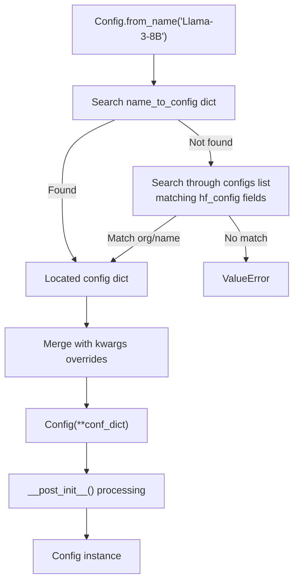
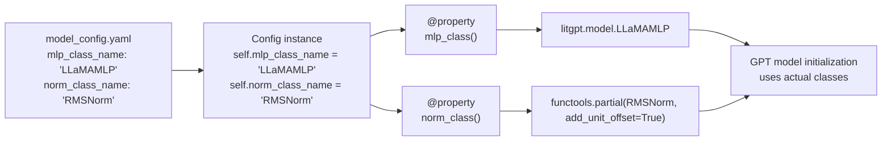
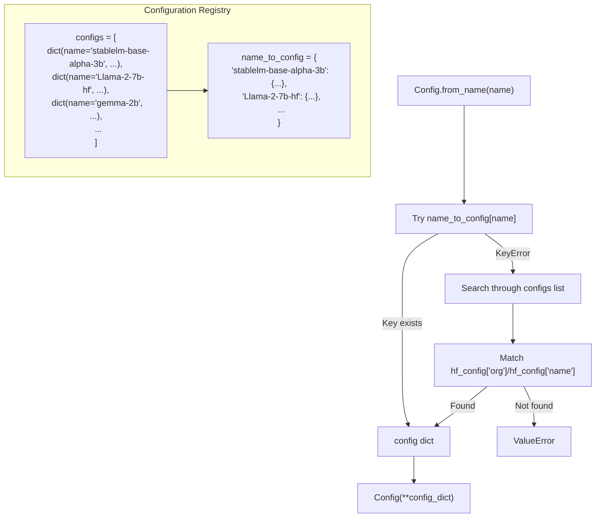
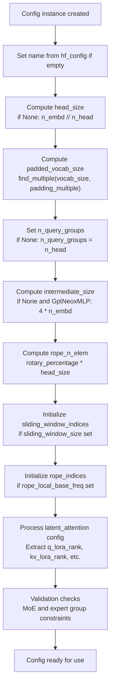

<!-- source: DeepWiki mcp.deepwiki.com · repo Lightning-AI/litgpt · page 2.1 Config System · fetched 2026-10-21 -->

# Config System

<details>
<summary>Relevant source files</summary>

The following files were used as context for generating this wiki page:

- [README.md](README.md)
- [litgpt/config.py](litgpt/config.py)
- [litgpt/parser_config.py](litgpt/parser_config.py)
- [litgpt/tokenizer.py](litgpt/tokenizer.py)
- [tests/test_config.py](tests/test_config.py)
- [tests/test_config_hub.py](tests/test_config_hub.py)
- [tests/test_merge_lora.py](tests/test_merge_lora.py)
- [tests/test_model.py](tests/test_model.py)
- [tests/test_rope.py](tests/test_rope.py)
- [tests/test_tokenizer.py](tests/test_tokenizer.py)
- [tutorials/download_model_weights.md](tutorials/download_model_weights.md)

</details>


## Purpose and Scope

The Config System provides the central mechanism for defining and loading model architecture configurations in LitGPT. It encapsulates all structural parameters for supported language models (layer counts, embedding dimensions, attention mechanisms, etc.) and provides multiple loading strategies to instantiate configurations from predefined templates, YAML files, or checkpoint directories.

For information about how these configurations are used during model initialization, see [Model Architecture](#2.3). For checkpoint format conversion that preserves configuration metadata, see [Checkpoint Conversion](#2.4).

**Sources:** [litgpt/config.py:1-234]()

---

## Config Dataclass Structure

The `Config` dataclass in [litgpt/config.py:25-117]() serves as the single source of truth for model architecture parameters. It contains over 50 fields organized into logical groups.

### Core Architecture Parameters

| Parameter Category | Key Fields | Description |
|-------------------|------------|-------------|
| **Size Parameters** | `block_size`, `n_layer`, `n_embd`, `vocab_size`, `padded_vocab_size` | Define model dimensions and context length |
| **Attention Structure** | `n_head`, `head_size`, `n_query_groups`, `attn_bias` | Configure attention mechanism (MHA/MQA/GQA) |
| **Transformer Block** | `norm_class_name`, `norm_eps`, `parallel_residual`, `shared_attention_norm` | Control block architecture and normalization |
| **MLP Configuration** | `mlp_class_name`, `intermediate_size`, `bias`, `gelu_approximate` | Define feed-forward network structure |
| **Rotary Embeddings** | `rope_base`, `rotary_percentage`, `rope_condense_ratio`, `rope_adjustments` | Configure RoPE parameters |
| **MoE Parameters** | `n_expert`, `n_expert_per_token`, `n_expert_groups` | Mixture-of-Experts settings |
| **Special Features** | `sliding_window_size`, `attention_logit_softcapping`, `final_logit_softcapping` | Advanced features like sliding window attention |

**Sources:** [litgpt/config.py:26-108]()

### Configuration Metadata

Each `Config` instance includes:
- `name`: Human-readable model identifier (e.g., "Llama-3-8B") [litgpt/config.py:27]()
- `hf_config`: Dictionary with `org` and `name` fields mapping to Hugging Face model IDs [litgpt/config.py:28]()

---

## Configuration Loading Methods

The `Config` class provides three primary loading mechanisms, each suited to different use cases:

### Method 1: from_name()



**from_name() workflow**

The `from_name()` class method [litgpt/config.py:168-186]() loads predefined configurations by model name. It first checks the `name_to_config` dictionary, then falls back to searching through the `configs` list by matching against `hf_config["name"]` or the full `org/name` pattern.

```python
# Example usage
config = Config.from_name("Llama-3-8B", n_layer=16)  # Override n_layer
```

**Sources:** [litgpt/config.py:168-186]()

### Method 2: from_file()

The `from_file()` class method [litgpt/config.py:188-195]() loads configuration from YAML files. This is commonly used with configuration recipes in the `config_hub/` directory.

```python
# Example usage
config = Config.from_file("config_hub/finetune/llama-3-8b/lora.yaml")
```

The method uses `yaml.safe_load()` to parse the file and validates that it's not empty before instantiation.

**Sources:** [litgpt/config.py:188-195]()

### Method 3: from_checkpoint()

The `from_checkpoint()` class method [litgpt/config.py:197-204]() automatically determines the appropriate configuration when loading from a checkpoint directory:

1. **First priority**: Looks for `model_config.yaml` in the checkpoint directory.
2. **Fallback**: Attempts to match the directory name against `name_to_config`.
3. **Error**: Raises `FileNotFoundError` if neither approach succeeds.

```python
# Example usage
config = Config.from_checkpoint(Path("checkpoints/meta-llama/Llama-3-8B"))
```

**Sources:** [litgpt/config.py:197-204](), [tests/test_config.py:72-101]()

---

## Dynamic Class Resolution

The Config system uses dynamic property resolution to convert string-based class names into actual Python class types at runtime. This keeps configurations serializable while maintaining type safety during model instantiation.



**Dynamic class resolution flow**

### mlp_class Property

The `mlp_class` property [litgpt/config.py:206-211]() dynamically imports and returns the MLP class type based on `mlp_class_name`:

```python
@property
def mlp_class(self) -> Type:
    import litgpt.model
    return getattr(litgpt.model, self.mlp_class_name)
```

Supported MLP class names include:
- `"GptNeoxMLP"`: Standard GPT-NeoX feed-forward network.
- `"LLaMAMLP"`: LLaMA-style gated FFN with SiLU activation.
- `"GemmaMLP"`: Gemma-style gated FFN with GELU activation.
- `"LLaMAMoE"`: Mixture-of-Experts implementation.

**Sources:** [litgpt/config.py:206-211]()

### norm_class Property

The `norm_class` property [litgpt/config.py:213-232]() provides resolution with model-specific customizations:

```python
@property
def norm_class(self) -> Type:
    from functools import partial
    import torch
    
    if self.norm_class_name == "RMSNorm":
        from litgpt.model import RMSNorm
        return partial(RMSNorm, add_unit_offset="Gemma" in self.name)
    
    if self.norm_class_name == "LayerNorm" and "OLMo" in self.name:
        return partial(torch.nn.LayerNorm, elementwise_affine=False)
    
    return getattr(torch.nn, self.norm_class_name)
```

This property handles special cases:
- **Gemma models**: Adds unit offset to `RMSNorm` [litgpt/config.py:222]().
- **OLMo models**: Uses non-affine `LayerNorm` to match reference implementation [litgpt/config.py:225]().

**Sources:** [litgpt/config.py:213-232]()

---

## Predefined Model Configurations

LitGPT maintains an extensive library of predefined configurations for 20+ model families. The configuration registry uses a two-tier system:



**Configuration lookup mechanism**

### Configuration Dictionary Structure

Each configuration dictionary in the `configs` list contains:

```python
dict(
    name="Llama-3-8B",  # Primary identifier
    hf_config=dict(org="meta-llama", name="Meta-Llama-3-8B"),  # HF mapping
    block_size=8192,
    vocab_size=128000,
    padded_vocab_size=128256,
    n_layer=32,
    n_head=32,
    n_query_groups=8,
    # ... additional parameters
)
```

### Major Model Families

The `configs` list [litgpt/config.py:238-1584]() includes configurations for:

| Model Family | Example Configs | Defining Characteristics |
|--------------|----------------|-------------------------|
| **Stability AI** | `stablelm-base-alpha-3b` | Various sizes with `GptNeoxMLP` |
| **EleutherAI Pythia** | `pythia-14m`, `pythia-12b` | Research-focused scaling series |
| **Falcon** | `falcon-7b`, `Falcon3-1B` | Multi-query attention variants |
| **LLaMA 2/3/3.1** | `Llama-2-7b`, `Llama-3-8B`, `Llama-3.1-405B` | `LLaMAMLP` with `RMSNorm` |
| **Phi** | `phi-2`, `Phi-3-mini`, `phi-4` | Microsoft's compact models |
| **Mistral/Mixtral** | `Mistral-7B`, `Mixtral-8x7B` | MoE architectures |
| **Gemma** | `gemma-2b`, `gemma-2-9b` | Google's models with special norm handling |
| **Qwen** | `Qwen2.5-7B`, `Qwen3-4B` | Alibaba's model series |

**Sources:** [litgpt/config.py:238-1584](), [README.md:106-176](), [tutorials/download_model_weights.md:8-55]()

---

## Configuration Post-Processing

The `__post_init__()` method [litgpt/config.py:118-167]() performs automatic computation of derived parameters and validation after a Config instance is created.

### Post-Initialization Flow



**Configuration post-processing steps**

### Key Computations

1. **Vocabulary Padding** [litgpt/config.py:127-131]():
   ```python
   if self.padded_vocab_size is None:
       self.padded_vocab_size = find_multiple(self.vocab_size, self.padding_multiple)
   ```
   Ensures vocabulary size is optimally aligned for hardware.

2. **Query Groups** [litgpt/config.py:134-137]():
   ```python
   if self.n_query_groups is not None:
       assert self.n_head % self.n_query_groups == 0
   else:
       self.n_query_groups = self.n_head  # Default to MHA
   ```
   Sets up multi-query or grouped-query attention.

3. **Intermediate Size** [litgpt/config.py:140-143]():
   ```python
   if self.intermediate_size is None:
       if self.mlp_class_name == "LLaMAMLP":
           raise ValueError(f"The config {self.name!r}, needs to set the `intermediate_size`")
       self.intermediate_size = 4 * self.n_embd  # Default for GptNeoxMLP
   ```

4. **RoPE Elements** [litgpt/config.py:145]():
   ```python
   self.rope_n_elem = int(self.rotary_percentage * self.head_size)
   ```

**Sources:** [litgpt/config.py:118-167]()

---

## Integration with Model Architecture

The Config system integrates deeply with the `GPT` model class to instantiate the complete model architecture.

### Usage in GPT Class

The `GPT` class uses the Config instance to:

1. **Set model dimensions**:
   - `config.padded_vocab_size` for embedding and output layer sizes.
   - `config.n_embd` for hidden dimension.
   - `config.n_layer` for transformer block count.

2. **Instantiate normalization**:
   - Calls `config.norm_class(config.n_embd, eps=config.norm_eps)`.
   - Dynamically resolves to `RMSNorm`, `LayerNorm`, etc.

3. **Configure RoPE cache**:
   - Uses `config.rope_n_elem`, `config.rope_base`, `config.rope_condense_ratio`.
   - Applies `config.rope_adjustments` for LLaMA 3.1-style scaling [tests/test_rope.py:140]().

4. **Set context length**:
   - `config.block_size` determines maximum sequence length.

**Sources:** [litgpt/config.py:25-167](), [tests/test_model.py:79-88](), [tests/test_rope.py:1-184]()

---

## Summary

The Config System provides:

1. **Centralized architecture definition** via the `Config` dataclass.
2. **Flexible loading** through `from_name()`, `from_file()`, and `from_checkpoint()`.
3. **Dynamic type resolution** with `mlp_class` and `norm_class` properties.
4. **Extensive model library** with 20+ predefined model families.
5. **Automatic post-processing** for derived parameters and validation.
6. **Seamless integration** with model instantiation and checkpoint conversion.

This design enables LitGPT to support diverse model architectures while maintaining a clean, consistent interface for configuration management.

**Sources:** [litgpt/config.py:1-1584](), [tests/test_config.py:1-117]()

---

