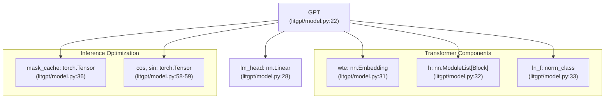
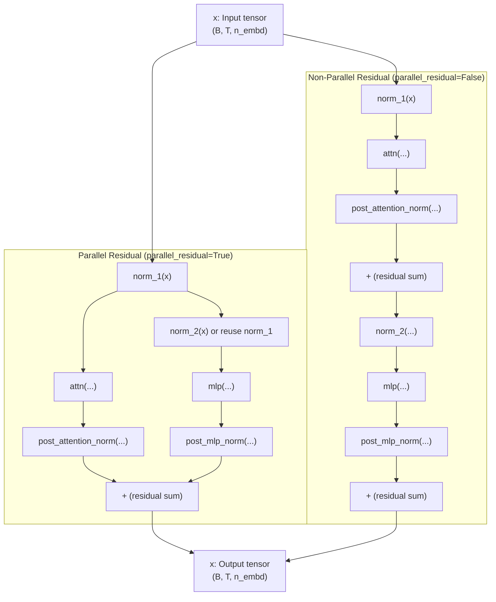
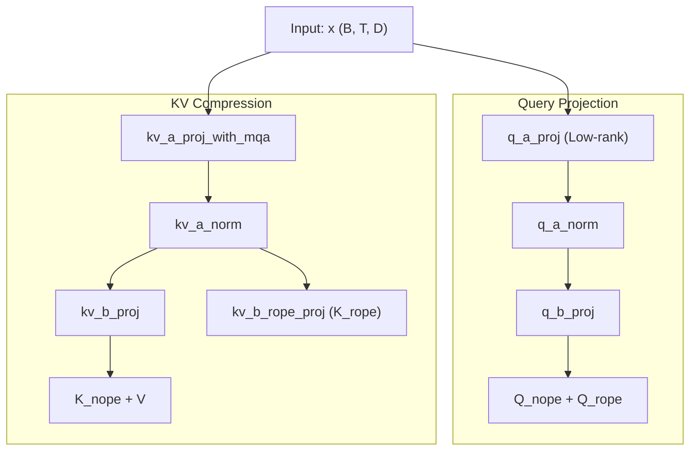

<!-- source: DeepWiki mcp.deepwiki.com · repo Lightning-AI/litgpt · page 2.3 Model Architecture · fetched 2026-10-21 -->

# Model Architecture

<details>
<summary>Relevant source files</summary>

The following files were used as context for generating this wiki page:

- [litgpt/adapter.py](litgpt/adapter.py)
- [litgpt/adapter_v2.py](litgpt/adapter_v2.py)
- [litgpt/lora.py](litgpt/lora.py)
- [litgpt/model.py](litgpt/model.py)
- [tests/test_deepseek_moe.py](tests/test_deepseek_moe.py)
- [tests/test_multihead_latent_attention.py](tests/test_multihead_latent_attention.py)
- [tests/test_yarn.py](tests/test_yarn.py)

</details>


This page documents the transformer-based model architecture implemented in LitGPT. The architecture is defined in [litgpt/model.py:1-1080]() and consists of a decoder-only transformer with configurable attention mechanisms (MHA/GQA/MQA/MLA), various MLP implementations, and rotary position embeddings (RoPE).

For configuration options that define model architecture parameters, see [Config System](2.1). For LoRA and Adapter extensions to the base architecture, see [LoRA Fine-tuning](3.1), [Adapter Fine-tuning](3.2), and [Adapter V2 Fine-tuning](3.3).

---

## Overall Architecture

The `GPT` class in [litgpt/model.py:22-261]() is the top-level model class that implements a decoder-only transformer architecture.

### GPT Class Structure



**Sources:** [litgpt/model.py:22-261]()

The `GPT` class contains:
- **Token embeddings** (`transformer.wte`): Maps token IDs to embedding vectors [litgpt/model.py:31]().
- **Transformer blocks** (`transformer.h`): Stack of `Block` modules [litgpt/model.py:32]().
- **Final normalization** (`transformer.ln_f`): Applied after all blocks [litgpt/model.py:33]().
- **Language modeling head** (`lm_head`): Projects to vocabulary size [litgpt/model.py:28]().

### Forward Pass

The forward method [litgpt/model.py:85-181]() processes input token IDs through the following steps:

| Step | Operation | Code Reference |
|------|-----------|----------------|
| 1 | Token embedding lookup | [litgpt/model.py:155]() |
| 2 | Optional embedding scaling | [litgpt/model.py:156-157]() |
| 3 | Pass through each transformer block | [litgpt/model.py:159-170]() |
| 4 | Final layer normalization | [litgpt/model.py:171]() |
| 5 | Language modeling head projection | [litgpt/model.py:172-181]() |

The method supports:
- **KV caching** via `input_pos` parameter for efficient autoregressive generation [litgpt/model.py:124-146]().
- **Chunked lm_head computation** via `lm_head_chunk_size` to reduce memory usage [litgpt/model.py:177-181]().
- **Optional logit softcapping** for models like Gemma 2 [litgpt/model.py:172-176]().

**Sources:** [litgpt/model.py:85-181]()

---

## Transformer Block

The `Block` class [litgpt/model.py:263-341]() implements a single transformer layer with configurable residual connection patterns.

### Block Architecture Diagram



**Sources:** [litgpt/model.py:263-341]()

### Residual Connection Patterns

The block supports two residual connection patterns controlled by `config.parallel_residual` [litgpt/model.py:329-341]():

- **Non-Parallel Residual** (default):
  ```python
  x = x + post_attention_norm(attn(norm_1(x)))
  x = x + post_mlp_norm(mlp(norm_2(x)))
  ```
- **Parallel Residual** (GPT-NeoX, Falcon):
  ```python
  x = x + attn_out + mlp_out
  ```

---

## Attention Mechanisms

LitGPT supports multiple attention variants, including the advanced **Multi-head Latent Attention (MLA)** used in DeepSeek models.

### Causal Self-Attention (MHA, GQA, MQA)

The `CausalSelfAttention` class [litgpt/model.py:344-534]() handles standard attention patterns.

| Attention Type | `n_head` | `n_query_groups` | Description |
|---------------|----------|------------------|-------------|
| **MHA** | N | N | Multi-Head: Standard attention. |
| **GQA** | N | M | Grouped-Query: K/V heads shared across groups of Q heads. |
| **MQA** | N | 1 | Multi-Query: Single K/V head shared across all Q heads. |

**Sources:** [litgpt/model.py:344-534](), [litgpt/config.py:46-68]()

### Multi-head Latent Attention (MLA)

The `MultiheadLatentAttention` class [litgpt/model.py:748-961]() implements the low-rank KV compression mechanism from DeepSeek-V2/V3. It significantly reduces KV cache memory by projecting keys and values into a latent space.



**Key MLA Components:**
- `q_a_proj` / `q_b_proj`: Low-rank query projection [litgpt/model.py:771-773]().
- `kv_a_proj_with_mqa`: Projects input to a compressed latent vector [litgpt/model.py:777]().
- `kv_b_proj`: Decompresses latent vector to non-rotary keys and values [litgpt/model.py:782]().

**Sources:** [litgpt/model.py:748-961](), [tests/test_multihead_latent_attention.py]()

---

## MLP Variants

LitGPT supports multiple MLP architectures specified by `config.mlp_class_name` [litgpt/config.py:86]().

| MLP Type | Activation | Structure |
|----------|-----------|-----------|
| `GptNeoxMLP` | GELU | Standard `fc → act → proj` [litgpt/model.py:537](). |
| `LLaMAMLP` | SiLU | Gated `(fc_1 * act) * fc_2 → proj` [litgpt/model.py:551](). |
| `LLaMAMoE` | SiLU | Mixture of Experts with router and Top-K [litgpt/model.py:583](). |

### Mixture of Experts (MoE)

The `LLaMAMoE` implementation [litgpt/model.py:583-722]() supports:
- **Expert Routing**: `GroupedTopkRouter` selects experts per token [litgpt/model.py:656]().
- **Shared Experts**: Always-active experts for common knowledge [litgpt/model.py:642]().
- **Fine-grained Experts**: Supports a large number of routed experts (e.g., DeepSeek) [litgpt/model.py:603]().

**Sources:** [litgpt/model.py:583-722](), [tests/test_deepseek_moe.py]()

---

## Rotary Position Embeddings (RoPE)

RoPE rotates query and key representations to encode relative positions.

### RoPE Implementation Details

- **`build_rope_cache`**: Precomputes `cos` and `sin` tables [litgpt/model.py:964-1040]().
- **YaRN Scaling**: Supports "Yet another RoPE extensioN" for long context via `rope_adjustments` [litgpt/model.py:1011-1026]().
- **`apply_rope`**: Performs the rotation using the cached tables [litgpt/model.py:1043-1080]().

**Sources:** [litgpt/model.py:964-1080](), [tests/test_yarn.py]()

---

## KV Caching

The KV cache stores `K` and `V` tensors to avoid redundant computation during generation.

- **Initialization**: `set_kv_cache` allocates buffers for all layers [litgpt/model.py:225-255]().
- **Update**: During `forward`, new KV pairs are written to the cache at `input_pos` [litgpt/model.py:447-454]().
- **Retrieval**: Attention mechanisms slice the cache up to `input_pos_maxp1` [litgpt/model.py:464-468]().

**Sources:** [litgpt/model.py:225-260](), [litgpt/model.py:421-456]()

---

