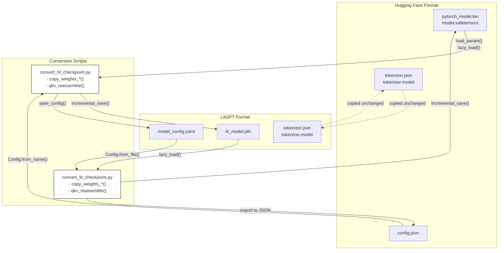
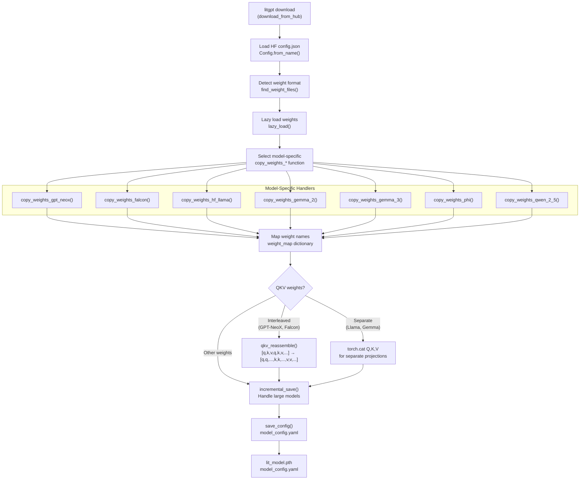
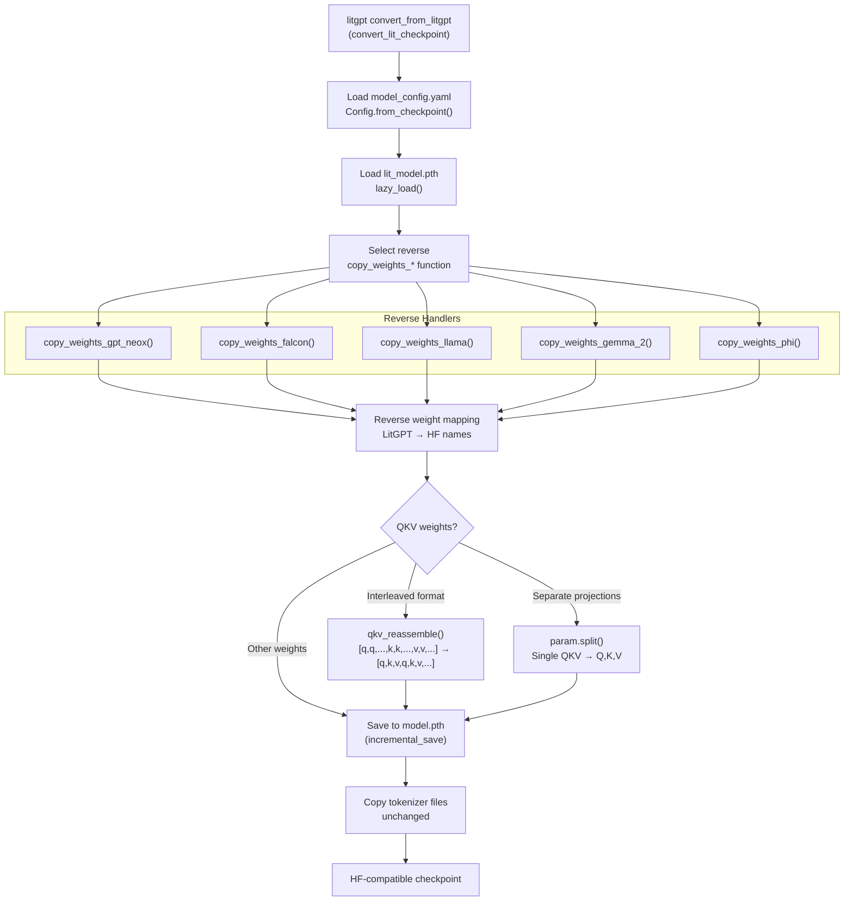

<!-- source: DeepWiki mcp.deepwiki.com · repo Lightning-AI/litgpt · page 2.4 Checkpoint Conversion · fetched 2026-10-21 -->

# Checkpoint Conversion

<details>
<summary>Relevant source files</summary>

The following files were used as context for generating this wiki page:

- [litgpt/scripts/convert_hf_checkpoint.py](litgpt/scripts/convert_hf_checkpoint.py)
- [litgpt/scripts/convert_lit_checkpoint.py](litgpt/scripts/convert_lit_checkpoint.py)
- [litgpt/scripts/convert_pretrained_checkpoint.py](litgpt/scripts/convert_pretrained_checkpoint.py)
- [litgpt/scripts/download.py](litgpt/scripts/download.py)
- [tests/convert/test_lit_checkpoint.py](tests/convert/test_lit_checkpoint.py)
- [tests/test_readme.py](tests/test_readme.py)

</details>


## Purpose and Scope

Checkpoint Conversion provides bidirectional translation between Hugging Face Transformers checkpoint format and LitGPT's native format. This enables LitGPT to use pretrained weights from the Hugging Face ecosystem and export trained models back to Hugging Face format for deployment or evaluation.

This page covers the technical details of checkpoint conversion. For downloading model weights, see the user-facing documentation in [litgpt/scripts/download.py:13-35](). For converting trained LitGPT models back to Hugging Face, see [litgpt/scripts/convert_lit_checkpoint.py:421-518]().

Sources: [litgpt/scripts/convert_hf_checkpoint.py:1-26](), [litgpt/scripts/convert_lit_checkpoint.py:1-16](), [litgpt/scripts/download.py:13-35]()

## Checkpoint Format Overview

### Hugging Face Format

Hugging Face checkpoints consist of:
- **Weight files**: `pytorch_model.bin` or `model.safetensors` (potentially sharded) [litgpt/scripts/download.py:63-72]()
- **Configuration**: `config.json` with model architecture details [litgpt/scripts/download.py:61]()
- **Tokenizer**: `tokenizer.json` or `tokenizer.model` [litgpt/scripts/download.py:61]()
- **Generation config**: `generation_config.json` with default generation parameters [litgpt/scripts/download.py:61]()

### LitGPT Format

LitGPT checkpoints consist of:
- **Weight file**: `lit_model.pth` with consolidated state dictionary [litgpt/scripts/convert_hf_checkpoint.py:877]()
- **Configuration**: `model_config.yaml` using LitGPT's `Config` dataclass [litgpt/scripts/convert_hf_checkpoint.py:882]()
- **Tokenizer files**: Copied directly from Hugging Face (unchanged) [litgpt/scripts/convert_hf_checkpoint.py:884]()

### Key Differences

| Aspect | Hugging Face | LitGPT |
|--------|-------------|---------|
| Weight organization | Model-specific layer names (e.g., `model.layers.{}.self_attn.q_proj`) | Unified naming scheme (e.g., `transformer.h.{}.attn.qkv`) |
| QKV weights | Separate Q, K, V projection matrices | Combined QKV matrix |
| Config format | JSON with model-specific schemas | YAML with unified `Config` dataclass |
| Weight sharding | Supports multi-file sharding | Single consolidated file |

Sources: [litgpt/scripts/convert_hf_checkpoint.py:139-184](), [litgpt/scripts/convert_lit_checkpoint.py:103-167](), [litgpt/scripts/convert_hf_checkpoint.py:870-886]()

## Conversion Architecture



**Diagram: Checkpoint Conversion Architecture**

The conversion system consists of two primary scripts:
- **`convert_hf_checkpoint.py`**: Converts Hugging Face checkpoints to LitGPT format [litgpt/scripts/convert_hf_checkpoint.py:811-886]()
- **`convert_lit_checkpoint.py`**: Converts LitGPT checkpoints back to Hugging Face format [litgpt/scripts/convert_lit_checkpoint.py:421-518]()

Both scripts share common utilities for lazy loading and weight mapping.

Sources: [litgpt/scripts/convert_hf_checkpoint.py:1-26](), [litgpt/scripts/convert_lit_checkpoint.py:1-16](), [litgpt/utils.py:1-100]()

## Hugging Face to LitGPT Conversion

### Conversion Process Flow



**Diagram: HuggingFace to LitGPT Conversion Flow**

Sources: [litgpt/scripts/convert_hf_checkpoint.py:28-80](), [litgpt/scripts/convert_hf_checkpoint.py:139-224](), [litgpt/scripts/convert_hf_checkpoint.py:811-886](), [litgpt/scripts/download.py:13-35]()

### Weight Mapping Strategy

Each model architecture requires a specific weight mapping dictionary that translates Hugging Face parameter names to LitGPT parameter names. The `layer_template()` function extracts layer indices from parameter names to handle per-layer mappings [litgpt/scripts/convert_hf_checkpoint.py:968-979]().

#### Example: Llama Weight Mapping

| Hugging Face Name | LitGPT Name |
|-------------------|-------------|
| `model.embed_tokens.weight` | `transformer.wte.weight` |
| `model.layers.{}.input_layernorm.weight` | `transformer.h.{}.norm_1.weight` |
| `model.layers.{}.self_attn.q_proj.weight` | Combined into `transformer.h.{}.attn.qkv.weight` |
| `model.layers.{}.self_attn.k_proj.weight` | Combined into `transformer.h.{}.attn.qkv.weight` |
| `model.layers.{}.self_attn.v_proj.weight` | Combined into `transformer.h.{}.attn.qkv.weight` |
| `model.layers.{}.self_attn.o_proj.weight` | `transformer.h.{}.attn.proj.weight` |
| `model.layers.{}.mlp.gate_proj.weight` | `transformer.h.{}.mlp.fc_1.weight` |
| `model.layers.{}.mlp.up_proj.weight` | `transformer.h.{}.mlp.fc_2.weight` |
| `model.layers.{}.mlp.down_proj.weight` | `transformer.h.{}.mlp.proj.weight` |
| `model.norm.weight` | `transformer.ln_f.weight` |
| `lm_head.weight` | `lm_head.weight` |

Sources: [litgpt/scripts/convert_hf_checkpoint.py:150-183](), [litgpt/scripts/convert_hf_checkpoint.py:188-224]()

### QKV Reassembly

Different model architectures store query, key, and value attention weights differently:

#### Interleaved Format (GPT-NeoX, Falcon)
Hugging Face stores QKV weights interleaved: `[q, k, v, q, k, v, ...]`
LitGPT requires grouped format: `[q, q, ..., k, k, ..., v, v, ...]`

The `qkv_reassemble()` function performs this transformation [litgpt/scripts/convert_hf_checkpoint.py:933-965]():

```python
def qkv_reassemble(param: torch.Tensor, config: Config) -> torch.Tensor:
    # Splits interleaved [q,k,v,q,k,v,...] 
    # Reassembles as [q,q,...,k,k,...,v,v,...]
```

Sources: [litgpt/scripts/convert_hf_checkpoint.py:933-965]()

#### Separate Projections (Llama, Gemma, Phi)
Hugging Face stores separate `q_proj`, `k_proj`, `v_proj` weight tensors.
LitGPT concatenates them into a single `qkv.weight` tensor.

For these models, the conversion:
1. Collects Q, K, V weights separately (possibly from different shard files) [litgpt/scripts/convert_hf_checkpoint.py:140]().
2. Uses `torch.cat()` to combine them: `torch.cat((q, k, v))` [litgpt/scripts/convert_hf_checkpoint.py:217]().
3. Stores the combined weight as `transformer.h.{}.attn.qkv.weight` [litgpt/scripts/convert_hf_checkpoint.py:223]().

Sources: [litgpt/scripts/convert_hf_checkpoint.py:209-223]()

### Model-Specific Conversion Functions

The conversion system provides specialized handlers for different model families:

| Function | Architectures | Key Characteristics |
|----------|---------------|---------------------|
| `copy_weights_gpt_neox()` | Pythia, StableLM (old) | Interleaved QKV, parallel residual |
| `copy_weights_falcon()` | Falcon 7B/40B/180B | Interleaved QKV, layer-dependent norm structure |
| `copy_weights_hf_llama()` | Llama 2/3, Mistral, Mixtral, OLMo | Separate Q/K/V, RMSNorm, optional MoE |
| `copy_weights_gemma_2()` | Gemma 2 | Separate Q/K/V, post-attention/MLP norms |
| `copy_weights_gemma_3()` | Gemma 3 | Separate Q/K/V, Q/K normalization |
| `copy_weights_phi()` | Phi 1.5/2/3/4 | Version-dependent QKV handling |
| `copy_weights_qwen_2_5()` | Qwen 2.5, QwQ | Similar to Llama with Qwen-specific details |

Sources: [litgpt/scripts/convert_hf_checkpoint.py:28-80](), [litgpt/scripts/convert_hf_checkpoint.py:81-137](), [litgpt/scripts/convert_hf_checkpoint.py:139-224](), [litgpt/scripts/convert_hf_checkpoint.py:226-292](), [litgpt/scripts/convert_hf_checkpoint.py:294-370](), [litgpt/scripts/convert_hf_checkpoint.py:447-543](), [litgpt/scripts/convert_hf_checkpoint.py:598-682]()

## LitGPT to Hugging Face Conversion

### Reverse Conversion Process



**Diagram: LitGPT to HuggingFace Conversion Flow**

Sources: [litgpt/scripts/convert_lit_checkpoint.py:18-100](), [litgpt/scripts/convert_lit_checkpoint.py:103-167](), [litgpt/scripts/convert_lit_checkpoint.py:421-518]()

### QKV Disassembly

The reverse conversion applies inverse transformations:

1. **For interleaved models (GPT-NeoX, Falcon)**: 
   - Input: `[q, q, ..., k, k, ..., v, v, ...]`
   - Output: `[q, k, v, q, k, v, ...]`
   - Uses the same `qkv_reassemble()` function in `convert_lit_checkpoint.py` [litgpt/scripts/convert_lit_checkpoint.py:59-62]().

2. **For separate projection models (Llama, Gemma)**:
   - Input: Single `transformer.h.{}.attn.qkv.weight` tensor
   - Uses `param.split((n_head * head_size, n_query_groups * head_size, n_query_groups * head_size))` [litgpt/scripts/convert_lit_checkpoint.py:151-161]().
   - Output: Three separate tensors `q_proj.weight`, `k_proj.weight`, `v_proj.weight`.

Sources: [litgpt/scripts/convert_lit_checkpoint.py:146-166](), [litgpt/scripts/convert_lit_checkpoint.py:194-215]()

## Implementation Details

### Layer Template Extraction

The `layer_template()` function extracts layer indices from parameter names to enable systematic weight mapping [litgpt/scripts/convert_hf_checkpoint.py:968-979]():

```python
def layer_template(name: str, num_matches: int = 1) -> Tuple:
    # Extracts layer indices from names like:
    # "model.layers.3.self_attn.q_proj.weight" → ("model.layers.{}.self_attn.q_proj.weight", 3)
```

Sources: [litgpt/scripts/convert_hf_checkpoint.py:968-979](), [litgpt/scripts/convert_lit_checkpoint.py:14]()

### Lazy Loading

The `lazy_load()` utility enables conversion of large models without loading all weights into memory at once [litgpt/utils.py:lazy_load]().

This is critical for models like Llama 3.1 405B where the full state dict would exceed system memory.

Sources: [litgpt/utils.py:lazy_load](), [litgpt/scripts/convert_hf_checkpoint.py:22]()

### Incremental Saving

The `incremental_save` class enables saving large checkpoints incrementally [litgpt/utils.py:incremental_save](). The saver accumulates tensors and periodically flushes them to disk, keeping memory usage bounded.

Sources: [litgpt/utils.py:incremental_save](), [litgpt/scripts/convert_hf_checkpoint.py:21]()

### Parameter Loading Helper

The `load_param()` function handles both eager and lazy-loaded parameters uniformly [litgpt/scripts/convert_hf_checkpoint.py:982-1001]():

```python
def load_param(param: Union[torch.Tensor, NotYetLoadedTensor], 
               name: str, 
               dtype: Optional[torch.dtype]) -> torch.Tensor:
    # If NotYetLoadedTensor, triggers actual loading
    # Optionally converts dtype
```

Sources: [litgpt/scripts/convert_hf_checkpoint.py:982-1001]()

## Pretrained Checkpoint Conversion

After pretraining from scratch, LitGPT provides a script to extract the model state-dict from the full training checkpoint (which includes optimizer states and metadata).

```python
def convert_pretrained_checkpoint(checkpoint_dir: Path, output_dir: Path) -> None:
    # Extracts "model" from full_checkpoint
    # Removes "_orig_mod." prefix from compiled models
    # Saves to lit_model.pth using incremental_save
```

Sources: [litgpt/scripts/convert_pretrained_checkpoint.py:12-52]()

## Command-Line Interface

### Automatic Conversion During Download

By default, `litgpt download` automatically converts checkpoints [litgpt/scripts/download.py:29]():

```bash
litgpt download microsoft/phi-2
```

To disable automatic conversion:

```bash
litgpt download microsoft/phi-2 --convert_checkpoint false
```

Sources: [litgpt/scripts/download.py:13-35](), [litgpt/scripts/download.py:95-98]()

### Manual HF to LitGPT Conversion

```bash
litgpt convert_to_litgpt checkpoints/microsoft/phi-2
```

Sources: [litgpt/scripts/convert_hf_checkpoint.py:811-886]()

### Manual LitGPT to HF Conversion

```bash
litgpt convert_from_litgpt checkpoints/my-finetuned-model out/hf-model
```

Sources: [litgpt/scripts/convert_lit_checkpoint.py:421-518]()

## Validation and Testing

The test suite validates conversion correctness by comparing LitGPT model outputs against Hugging Face reference implementations [tests/convert/test_lit_checkpoint.py:64-91]().

Tests cover all supported architectures including:
- GPT-NeoX (Pythia) [tests/convert/test_lit_checkpoint.py:94-127]()
- Falcon (7B, 40B, 180B) [tests/convert/test_lit_checkpoint.py:64-91]()
- Llama 2 and Llama 3 variants [tests/convert/test_lit_checkpoint.py:130-163]()
- Mixtral [tests/convert/test_lit_checkpoint.py:166-200]()
- Gemma, Gemma 2, and Gemma 3 [tests/convert/test_lit_checkpoint.py:29-31]()
- Phi and Phi-3 [tests/convert/test_lit_checkpoint.py:34]()
- Qwen 2.5 [tests/convert/test_lit_checkpoint.py:35]()

Sources: [tests/convert/test_lit_checkpoint.py:1-40](), [tests/convert/test_lit_checkpoint.py:64-163]()

---

