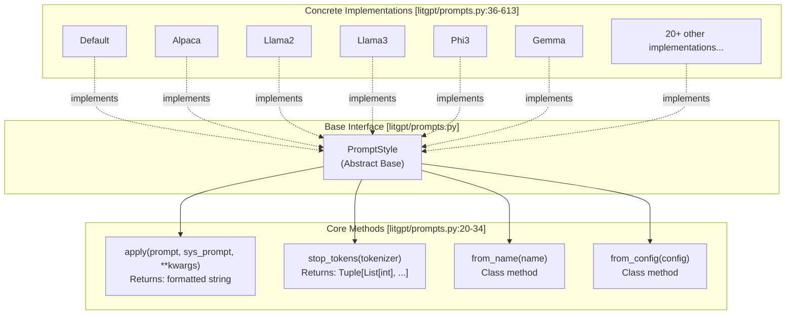
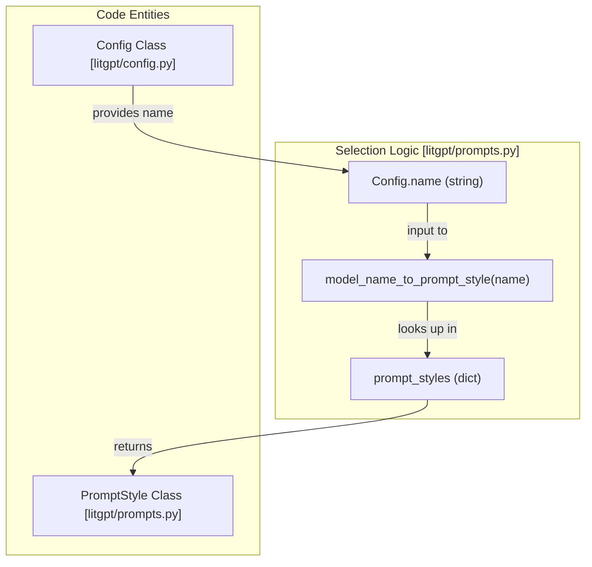
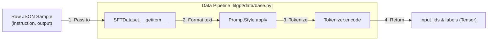

<!-- source: DeepWiki mcp.deepwiki.com · repo Lightning-AI/litgpt · page 2.5 Prompt Styles · fetched 2026-10-21 -->

# Prompt Styles

<details>
<summary>Relevant source files</summary>

The following files were used as context for generating this wiki page:

- [litgpt/data/base.py](litgpt/data/base.py)
- [litgpt/prompts.py](litgpt/prompts.py)
- [litgpt/scripts/merge_lora.py](litgpt/scripts/merge_lora.py)
- [tests/data/test_base.py](tests/data/test_base.py)
- [tests/test_prompts.py](tests/test_prompts.py)

</details>


The Prompt Styles system provides model-specific prompt formatting to ensure text inputs are properly structured according to each model's training conventions. Different language models expect different prompt formats (e.g., chat templates, instruction formats), and this system automatically applies the correct formatting based on the model being used.

For information about the Tokenizer system that works with prompt styles, see [Tokenizer](2.2). For model configuration, see [Config System](2.1).

&nbsp;

## Purpose and Scope

Each LLM has specific prompt formatting conventions established during training. For example, Llama 2 uses `[INST]` tags, Llama 3 uses header-based formatting, and Alpaca uses `### Instruction:` markers. The PromptStyle system abstracts these differences, allowing users to provide plain text prompts while ensuring the model receives properly formatted input.

The system consists of:
- A base `PromptStyle` interface defining the formatting contract.
- Concrete implementations for 20+ different models and instruction formats.
- Dynamic selection mechanisms that match prompt styles to model configurations.
- Integration with tokenization to handle special tokens.
- Persistence mechanisms for saving and loading styles to/from YAML files.

**Sources:** [litgpt/prompts.py:1-853](), [tests/test_prompts.py:1-200]()

&nbsp;

## Base Architecture

### PromptStyle Interface

The `PromptStyle` base class defines the core interface that all prompt formatters implement. It uses an abstract `apply` method to enforce model-specific formatting logic.



**Sources:** [litgpt/prompts.py:17-34]()

&nbsp;

### Key Methods

**`apply()`**: The primary method that transforms a plain prompt into the model-specific format. It accepts:
- `prompt`: The user's input text (string or list of messages).
- `sys_prompt`: Optional system prompt (model-dependent).
- `**kwargs`: Additional context like `input` for Alpaca-style formats.

**`stop_tokens()`**: Returns token IDs that should terminate generation. Most models return `([tokenizer.eos_id],)`, but some define additional stop sequences.

**`from_name()`**: Class method that instantiates a PromptStyle from a string identifier via the `prompt_styles` registry.

**`from_config()`**: Class method that selects the appropriate PromptStyle based on a model's `Config` object by calling `model_name_to_prompt_style()`.

**Sources:** [litgpt/prompts.py:17-34]()

&nbsp;

## Prompt Style Implementations

LitGPT implements prompt formatters for major model families. Each implementation encodes the specific formatting conventions of its target model.

### Common Patterns

#### Instruction-Based Formats

Models like Alpaca, FLAN, and Platypus use explicit instruction markers:

| Model | Format Pattern |
|-------|----------------|
| Alpaca | `### Instruction:\n{prompt}\n\n### Response:\n` |
| FLAN | `### Instruction:\n{prompt}\n\n### Response:\n` |
| Platypus | `### Instruction:\n\n{prompt}\n\n### Response:\n` |
| StableCode | `###Instruction\n{prompt}###Response\n` |

**Sources:** [litgpt/prompts.py:44-67](), [litgpt/prompts.py:278-286]()

&nbsp;

#### Conversation-Based Formats

Chat-oriented models use structured role tags:

| Model | Format Pattern |
|-------|----------------|
| Llama 2 | `[INST] <<SYS>>\n{sys}\n<</SYS>>\n\n{prompt} [/INST]` |
| Llama 3 | `<\|start_header_id\|>system<\|end_header_id\|>\n\n{sys}<\|eot_id\|>...` |
| Phi 3 | `<\|system\|>\n{sys}<\|end\|>\n<\|user\|>\n{prompt}<\|end\|>...` |
| StableLMZephyr | `<\|user\|>\n{prompt}<\|endoftext\|>\n<\|assistant\|>\n` |

**Sources:** [litgpt/prompts.py:155-168](), [litgpt/prompts.py:170-221](), [litgpt/prompts.py:320-333](), [litgpt/prompts.py:98-101]()

&nbsp;

#### Multi-Turn Support

The `Llama3` implementation supports multi-turn conversations by accepting a list of message dictionaries. It iterates through the messages and applies headers based on the `role` (system, user, assistant).

```python
# Example multi-turn message list
msgs = [
    {"role": "system", "content": "You are a travel assistant."},
    {"role": "user", "content": "What is France's capital?"},
    {"role": "assistant", "content": "The capital of France is Paris!"},
    {"role": "user", "content": "What can I do there?"},
]
```

**Sources:** [litgpt/prompts.py:170-221](), [tests/test_prompts.py:132-197]()

&nbsp;

## Dynamic Selection and Persistence

### Selection Mechanism

LitGPT provides dynamic selection based on the model configuration's name.



**Sources:** [litgpt/prompts.py:27-34](), [litgpt/prompts.py:656-853]()

### Persistence (YAML)

Prompt styles can be saved to and loaded from checkpoint directories. This ensures that the exact formatting used during training is preserved for inference.

- `save_prompt_style(style, checkpoint_dir)`: Writes a `prompt_style.yaml` file containing the `class_path`.
- `load_prompt_style(checkpoint_dir)`: Reads the YAML and dynamically imports the style class.
- `has_prompt_style(checkpoint_dir)`: Checks for the existence of the configuration file.

**Sources:** [litgpt/prompts.py:870-911](), [tests/test_prompts.py:108-130]()

&nbsp;

## Stop Tokens

Stop tokens define sequences that should terminate text generation. The `stop_tokens()` method returns a tuple of token ID lists.

### Multi-Condition Stops

**Llama 3**:
```python
return (
    [tokenizer.eos_id],
    [tokenizer.token_to_id("<|eot_id|>")],
)
```

**Falcon**:
```python
return (
    [tokenizer.eos_id],
    [tokenizer.token_to_id("User"), tokenizer.token_to_id(":")],
    [193, tokenizer.token_to_id("User")],  # 193: '\n'
)
```

**Sources:** [litgpt/prompts.py:107-115](), [litgpt/prompts.py:216-221]()

&nbsp;

## Data Processing Integration

Prompt styles are integrated into the data pipeline via the `SFTDataset` (Supervised Fine-Tuning Dataset).



**Sources:** [litgpt/data/base.py:39-109](), [tests/data/test_base.py:14-44]()

### Masking the Prompt
In `SFTDataset`, if `mask_prompt=True`, the tokens corresponding to the formatted prompt are replaced with `ignore_index` (default -100) in the labels tensor. This ensures the model is only trained to predict the response, not the instruction template.

**Sources:** [litgpt/data/base.py:93-97]()

&nbsp;

## Summary of Prompt Styles

| Class Name | Pattern Examples | Key Feature |
|------------|------------------|-------------|
| `Alpaca` | `alpaca`, `alpaca-7b` | Instruction/Input/Response |
| `Llama2` | `Llama-2-*-chat` | `[INST]` and `<<SYS>>` tags |
| `Llama3` | `Llama-3*`, `Llama-3.1*` | Multi-turn, header-based |
| `Gemma` | `gemma-2b-it`, `gemma-7b-it` | `<start_of_turn>` tags |
| `Phi3` | `Phi-3-mini-4k-instruct` | `<|system|>`, `<|user|>` |
| `Falcon` | `falcon-7b-instruct` | `Answer:` suffix |
| `Vicuna` | `vicuna-7b-v1.5` | `USER:`, `ASSISTANT:` |

**Sources:** [litgpt/prompts.py:656-853](), [tests/test_prompts.py:54-90]()

---

