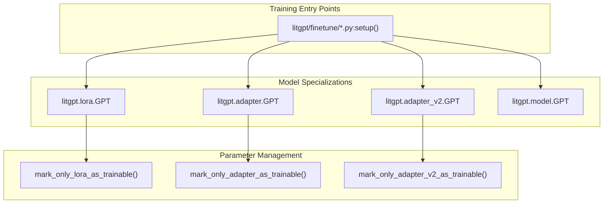
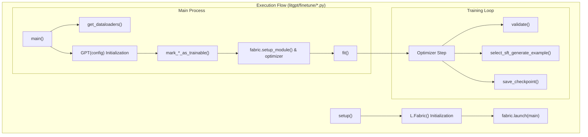

<!-- source: DeepWiki mcp.deepwiki.com · repo Lightning-AI/litgpt · page 3 Fine-tuning · fetched 2026-10-21 -->

# Fine-tuning

Relevant source files

The following files were used as context for generating this wiki page:

- [litgpt/finetune/adapter.py](litgpt/finetune/adapter.py)
- [litgpt/finetune/adapter_v2.py](litgpt/finetune/adapter_v2.py)
- [litgpt/finetune/lora.py](litgpt/finetune/lora.py)
- [tutorials/finetune_adapter.md](tutorials/finetune_adapter.md)
- [tutorials/finetune_full.md](tutorials/finetune_full.md)
- [tutorials/finetune_lora.md](tutorials/finetune_lora.md)
- [tutorials/inference.md](tutorials/inference.md)
- [tutorials/quantize.md](tutorials/quantize.md)

This page provides an overview of the fine-tuning capabilities in LitGPT. Fine-tuning allows you to adapt pre-trained language models to specific tasks or domains by updating model parameters using task-specific data. LitGPT offers several fine-tuning methods with different efficiency and performance characteristics, leveraging **Lightning Fabric** for scalable training infrastructure.

For pretraining language models from scratch, see [Pretraining](#4).

## Overview of Fine-tuning Methods

LitGPT supports four main approaches to fine-tuning:

| Method | Description | Memory Efficiency | Implementation | Details |
| :--- | :--- | :--- | :--- | :--- |
| **LoRA** | Low-Rank Adaptation using rank decomposition matrices | Very High | `litgpt/finetune/lora.py` | [LoRA Fine-tuning](#3.1) |
| **Adapter** | Attention-based adapters over learned prompts | High | `litgpt/finetune/adapter.py` | [Adapter Fine-tuning](#3.2) |
| **Adapter V2** | Enhanced adapters with bias, scale, and norm training | High | `litgpt/finetune/adapter_v2.py` | [Adapter V2 Fine-tuning](#3.3) |
| **Full** | Updates 100% of model parameters | Low | `litgpt/finetune/full.py` | [Full Fine-tuning](#3.4) |

### System Architecture and Code Entities
The following diagram maps the high-level fine-tuning concepts to the specific classes and functions implemented in the codebase.

Sources:
- [litgpt/finetune/lora.py:49-82]()
- [litgpt/finetune/adapter.py:48-71]()
- [litgpt/finetune/adapter_v2.py:49-73]()
- [litgpt/finetune/lora.py:23-23]()
- [litgpt/finetune/adapter.py:19-19]()
- [litgpt/finetune/adapter_v2.py:19-19]()

## Common Fine-tuning Workflow

All fine-tuning methods follow a unified execution flow orchestrated by `lightning.Fabric`. The process starts with `setup()` which configures the environment, followed by `main()` which initializes the model and data, and finally `fit()` which executes the training loop.

Sources:
- [litgpt/finetune/lora.py:166-180]()
- [litgpt/finetune/lora.py:183-267]()
- [litgpt/finetune/lora.py:268-334]()

## Parameter-Efficient Fine-tuning (PEFT)

LitGPT emphasizes efficiency through PEFT methods, allowing large models to be tuned on consumer hardware.

### LoRA Fine-tuning
LoRA approximates weight updates using low-rank matrices `lora_A` and `lora_B`. It is highly configurable, allowing users to target specific layers like `lora_query`, `lora_value`, or `lora_mlp`.
For details, see [LoRA Fine-tuning](#3.1).

### Adapter Fine-tuning
Adapter (V1) implements a form of prefix-tuning by prepending learnable adaption-prompts to attention block inputs. It uses a gating mechanism to control the influence of these prompts.
For details, see [Adapter Fine-tuning](#3.2).

### Adapter V2 Fine-tuning
Adapter V2 builds on V1 by adding trainable bias and scale parameters to linear layers and making normalization layers trainable, providing a middle ground between Adapter V1 and full fine-tuning.
For details, see [Adapter V2 Fine-tuning](#3.3).

Sources:
- [litgpt/finetune/lora.py:56-64]()
- [tutorials/finetune_adapter.md:3-9]()

## Full Fine-tuning
Full fine-tuning updates every parameter in the model. While it offers the most flexibility for the model to learn new knowledge, it requires significantly more VRAM and compute. LitGPT utilizes `FSDPStrategy` to shard model states across multiple GPUs to handle these requirements.
For details, see [Full Fine-tuning](#3.4).

Sources:
- [litgpt/finetune/full.py:86-98]()
- [tutorials/finetune_full.md:3-3]()

## Infrastructure and Optimization

### Training Infrastructure
LitGPT uses **Lightning Fabric** to manage distributed training. This includes support for `FSDPStrategy` and `ModelParallelStrategy`, gradient accumulation, and specialized optimizers.
For details, see [Training Infrastructure](#3.5).

### Memory Optimization
To further reduce the hardware barrier, LitGPT supports:
- **Quantization**: Integration with `bitsandbytes` (e.g., `bnb.nf4`, `bnb.nf4-dq`).
- **Precision**: Support for `bf16-true`, `bf16-mixed`, and `fp16-true`.
- **Activation Checkpointing**: Reducing activation memory at the cost of recomputation.
For details, see [Memory Optimization](#3.6).

Sources:
- [litgpt/finetune/lora.py:141-150]()
- [litgpt/finetune/adapter.py:127-132]()
- [tutorials/quantize.md:42-82]()

## Data Processing
Fine-tuning scripts typically use `litgpt.data.DataModule` abstractions. While `Alpaca` is the default, users can provide custom datasets via the `JSON` data module, which handles tokenization and prompt formatting.
For details, see [Data Processing](#5).

Sources:
- [litgpt/finetune/lora.py:113-113]()
- [tutorials/finetune_lora.md:93-119]()

---

