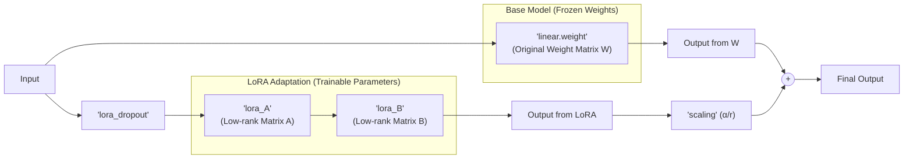
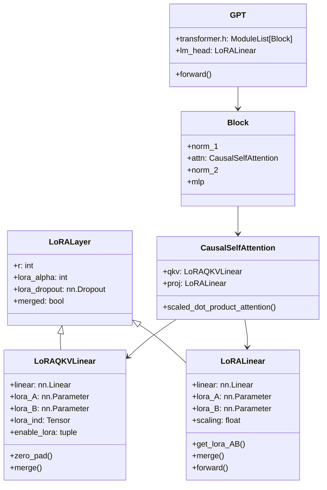
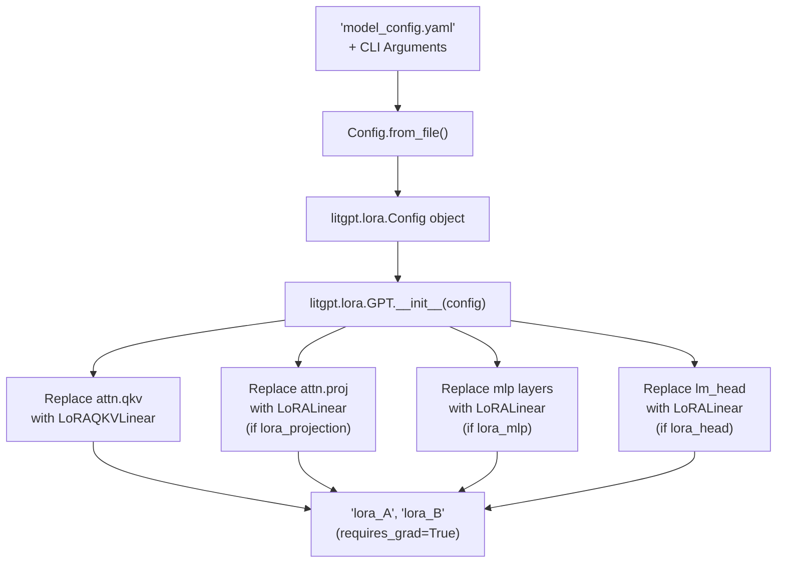

<!-- source: DeepWiki mcp.deepwiki.com · repo Lightning-AI/litgpt · page 3.1 LoRA Fine-tuning · fetched 2026-10-21 -->

# LoRA Fine-tuning

<details>
<summary>Relevant source files</summary>

The following files were used as context for generating this wiki page:

- [litgpt/adapter.py](litgpt/adapter.py)
- [litgpt/adapter_v2.py](litgpt/adapter_v2.py)
- [litgpt/finetune/adapter.py](litgpt/finetune/adapter.py)
- [litgpt/finetune/adapter_v2.py](litgpt/finetune/adapter_v2.py)
- [litgpt/finetune/lora.py](litgpt/finetune/lora.py)
- [litgpt/lora.py](litgpt/lora.py)
- [litgpt/model.py](litgpt/model.py)
- [tests/test_adapter.py](tests/test_adapter.py)
- [tests/test_adapter_v2.py](tests/test_adapter_v2.py)
- [tests/test_full.py](tests/test_full.py)
- [tests/test_lora.py](tests/test_lora.py)

</details>


This page explains the Low-Rank Adaptation (LoRA) fine-tuning method in LitGPT and its implementation. LoRA is a parameter-efficient fine-tuning technique that adds small trainable rank decomposition matrices to frozen model weights. For information about other fine-tuning approaches, see [Fine-tuning](#3), [Adapter Fine-tuning](#3.2), or [Full Fine-tuning](#3.4).

## What is LoRA?

LoRA (Low-Rank Adaptation) is a fine-tuning method that significantly reduces the number of trainable parameters by adding small, trainable rank decomposition matrices to otherwise frozen weights. Instead of fine-tuning all model parameters, LoRA keeps the pre-trained model weights frozen and injects trainable rank decomposition matrices into specific layers of the model.

**Natural Language to Code Entity Space: LoRA Logic**


### Key Benefits

- **Memory efficiency**: Requires significantly less memory compared to full fine-tuning (typically ~0.1-1% of base model parameters).
- **Training speed**: Trains faster as fewer parameters are updated and gradients are computed only for the low-rank matrices.
- **Model distribution**: Only the small LoRA weights need to be distributed instead of the entire model.
- **Composability**: Multiple LoRA modules can be trained for different tasks and applied to the same base model.

The mathematical formulation is: `h = Wx + BAx × (α/r)`, where:
- `W` is the frozen pretrained weight matrix.
- `B` (shape: `out_features × r`) and `A` (shape: `r × in_features`) are trainable low-rank matrices.
- `r` is the rank (`lora_r`, typically 1-8).
- `α` is the scaling factor (`lora_alpha`, typically 16).

Sources:
- [litgpt/lora.py:9-44]()
- [litgpt/lora.py:89-135]()

## LoRA Architecture in LitGPT

The LoRA implementation in LitGPT extends the base `GPT` model from [litgpt/model.py:22-38]() with additional low-rank matrices. The key class hierarchy is:

**Class Hierarchy Diagram**


### LoRA Components

1. **`LoRALayer`** [litgpt/lora.py:64-87](): Base class storing LoRA-specific attributes.
   - `r`: Rank of weight update matrices.
   - `lora_alpha`: Scaling factor (final scaling = `α/r`).
   - `lora_dropout`: Optional dropout applied before matrix A.
   - `merged`: Flag indicating if LoRA weights have been merged into base weights.

2. **`LoRALinear`** [litgpt/lora.py:89-201](): Standard linear layer replacement.
   - `linear`: Original `nn.Linear` layer with frozen weights.
   - `lora_A`: Trainable matrix of shape `(r, in_features)`.
   - `lora_B`: Trainable matrix of shape `(out_features, r)`, initialized to zero [litgpt/lora.py:136-136]().
   - `get_lora_AB()`: Computes `(B @ A) * scaling` [litgpt/lora.py:138-140]().
   - `merge()`: Adds LoRA weights to `linear.weight` [litgpt/lora.py:142-161]().

3. **`LoRAQKVLinear`** [litgpt/lora.py:204-426](): Specialized for attention QKV projections.
   - Handles concatenated query, key, and value projections.
   - `enable_lora`: Tuple `(lora_query, lora_key, lora_value)` for selective application.
   - `lora_ind`: Pre-computed indices where LoRA is applied in the QKV output [litgpt/lora.py:256-296]().
   - Supports Multi-Head Attention (MHA), Multi-Query Attention (MQA), and Grouped-Query Attention (GQA).
   - `zero_pad()`: Pads LoRA output to match full QKV dimension [litgpt/lora.py:324-331]().

4. **Application Points**: LoRA is applied by replacing standard layers in `GPT.__init__` [litgpt/lora.py:550-593]():
   - Attention QKV projection: `transformer.h[i].attn.qkv` (via `lora_query`, `lora_key`, `lora_value`).
   - Attention output projection: `transformer.h[i].attn.proj` (via `lora_projection`).
   - MLP layers: `transformer.h[i].mlp.fc` and `transformer.h[i].mlp.proj` (via `lora_mlp`).
   - Output head: `lm_head` (via `lora_head`).

Sources:
- [litgpt/lora.py:64-426]()
- [litgpt/lora.py:550-593]()
- [tests/test_lora.py:45-53]()

## LoRA Parameters and Configuration

The LoRA method is controlled by several key parameters defined in the specialized `Config` dataclass [litgpt/lora.py:516-547]():

| Parameter | Type | Description | Default |
|-----------|------|-------------|---------|
| `lora_r` | `int` | Rank of the low-rank decomposition matrices | 8 |
| `lora_alpha` | `int` | Scaling factor (applied as `α/r`) | 16 |
| `lora_dropout` | `float` | Dropout probability applied to LoRA input | 0.05 |
| `lora_query` | `bool` | Apply LoRA to query projection in attention | `True` |
| `lora_key` | `bool` | Apply LoRA to key projection in attention | `False` |
| `lora_value` | `bool` | Apply LoRA to value projection in attention | `True` |
| `lora_projection` | `bool` | Apply LoRA to attention output projection | `False` |
| `lora_mlp` | `bool` | Apply LoRA to MLP layers (`fc`, `proj`) | `False` |
| `lora_head` | `bool` | Apply LoRA to output head (`lm_head`) | `False` |

**Configuration and Layer Replacement Flow**


Sources:
- [litgpt/lora.py:516-547]()
- [litgpt/finetune/lora.py:55-63]()

## Fine-tuning Process with LoRA

The fine-tuning workflow is orchestrated by `setup()` [litgpt/finetune/lora.py:49-181]() and executed by `main()` [litgpt/finetune/lora.py:183-282]().

### 1. Model Initialization and Loading
The model is initialized using the LoRA-specific `Config` [litgpt/finetune/lora.py:118-129](). Pre-trained weights are loaded into the model with `strict=False` [litgpt/finetune/lora.py:213](), which allows the LoRA-specific parameters (`lora_A`, `lora_B`) to remain initialized (to Kaiming uniform and zero, respectively) while base weights are filled.

### 2. Freezing Weights
Only LoRA parameters are set to be trainable. This is handled by `mark_only_lora_as_trainable(model)` [litgpt/lora.py:682-686](), which iterates through all named parameters and sets `requires_grad=True` only if the name passes the `lora_filter` [litgpt/lora.py:689-691]().

### 3. Training and Checkpointing
Training is performed via the `fit()` function [litgpt/finetune/lora.py:284-434](). When saving, `save_lora_checkpoint()` [litgpt/finetune/lora.py:541-556]() is used to save only the trainable LoRA parameters, resulting in a significantly smaller `lit_model.pth.lora` file.

Sources:
- [litgpt/finetune/lora.py:49-282]()
- [litgpt/lora.py:682-691]()
- [litgpt/finetune/lora.py:541-556]()

## Weight Merging

LitGPT supports merging LoRA weights back into the base model weights to eliminate inference latency. This is mathematically equivalent to `W_merged = W_frozen + (B @ A) * (α/r)`.

**Weight Merging Flow**
```mermaid
flowchart TB
    Start["merge_lora_weights(model)"] --> Iterate["Iterate modules"]
    Iterate --> CheckLoRA{Is LoRALinear or\nLoRAQKVLinear?}
    
    CheckLoRA -->|Yes| CheckMerged{Is already merged?}
    CheckMerged -->|No| ComputeDelta["delta_w = get_lora_AB()"]
    
    ComputeDelta --> QuantCheck{Is base weight\nquantized (uint8)?}
    QuantCheck -->|Yes| Dequant["Dequantize base weights\n(bitsandbytes)"]
    QuantCheck -->|No| Add["base_weight += delta_w"]
    
    Dequant --> Add
    Add --> Requant["Requantize if needed"]
    Requant --> SetFlag["merged = True"]
    SetFlag --> Next["Next module"]
    
    CheckLoRA -->|No| Next
    CheckMerged -->|Yes| Next
    Next --> Iterate
```

### Implementation Details
- **`LoRALinear.merge()`**: Merges weights for standard linear layers [litgpt/lora.py:142-161](). It includes specialized logic for dequantizing 4-bit weights using `bitsandbytes` before addition if the model was quantized during training.
- **`LoRAQKVLinear.merge()`**: Merges weights for the QKV projection [litgpt/lora.py:394-415](). It correctly maps the low-rank updates to the corresponding query, key, or value segments of the combined weight matrix.
- **`merge_lora_weights(model)`**: A utility that recursively calls `.merge()` on all submodules [litgpt/lora.py:694-715]().

Sources:
- [litgpt/lora.py:142-161]()
- [litgpt/lora.py:394-415]()
- [litgpt/lora.py:694-715]()
- [tests/test_lora.py:55-97]()

## LoRAQKVLinear: Handling MHA, MQA, and GQA

The `LoRAQKVLinear` layer is a specialized implementation to handle the concatenated Query, Key, and Value projections in Transformer models.

- **Selective Adaptation**: Users can enable LoRA for Q, K, or V individually using `lora_query`, `lora_key`, and `lora_value` [litgpt/lora.py:207-209]().
- **Indexing**: The `lora_ind` tensor is calculated during initialization to track which rows of the output weight matrix should receive LoRA updates [litgpt/lora.py:256-296]().
- **Zero Padding**: Since LoRA might only apply to a subset of QKV, the `zero_pad()` method ensures the low-rank update is correctly aligned with the full projection dimensions [litgpt/lora.py:324-331]().

Sources:
- [litgpt/lora.py:204-426]()
- [tests/test_lora.py:99-173]()

---

