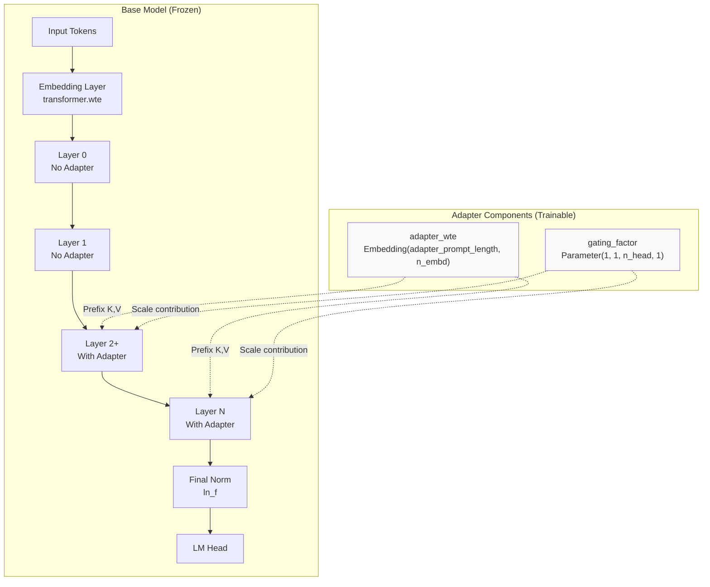
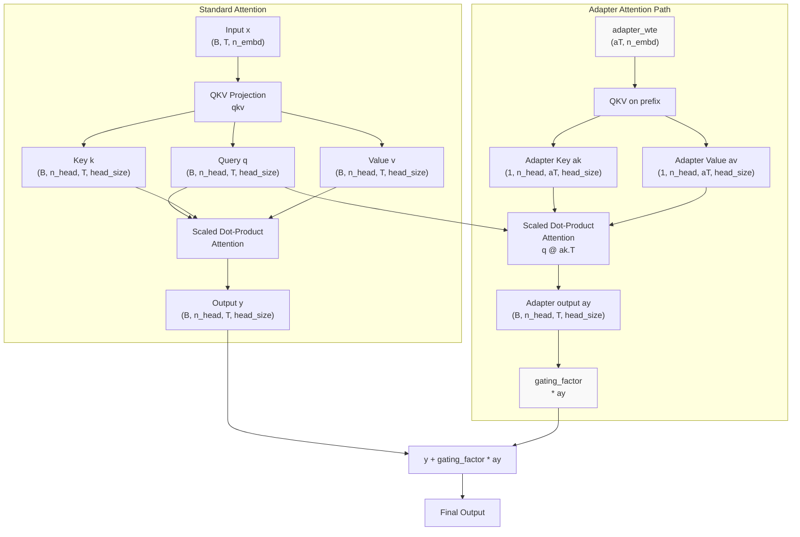
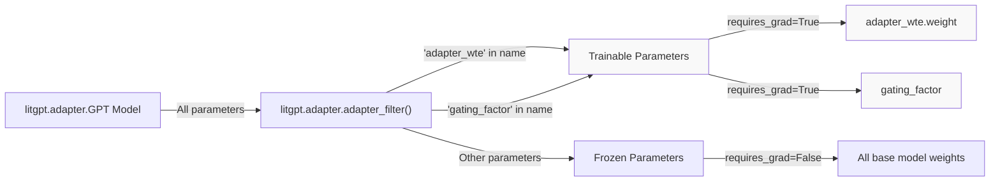

<!-- source: DeepWiki mcp.deepwiki.com · repo Lightning-AI/litgpt · page 3.2 Adapter Fine-tuning · fetched 2026-10-21 -->

# Adapter Fine-tuning

<details>
<summary>Relevant source files</summary>

The following files were used as context for generating this wiki page:

- [litgpt/adapter.py](litgpt/adapter.py)
- [litgpt/adapter_v2.py](litgpt/adapter_v2.py)
- [litgpt/finetune/adapter.py](litgpt/finetune/adapter.py)
- [litgpt/finetune/adapter_v2.py](litgpt/finetune/adapter_v2.py)
- [litgpt/finetune/lora.py](litgpt/finetune/lora.py)
- [litgpt/lora.py](litgpt/lora.py)
- [litgpt/model.py](litgpt/model.py)
- [tests/test_adapter.py](tests/test_adapter.py)
- [tests/test_adapter_v2.py](tests/test_adapter_v2.py)
- [tests/test_full.py](tests/test_full.py)
- [tests/test_lora.py](tests/test_lora.py)

</details>


This page documents the Adapter V1 fine-tuning method in LitGPT, which implements the LLaMA-Adapter approach for parameter-efficient fine-tuning using learned prompt embeddings and zero-initialized attention gating. For the Adapter V2 method, which adds bias/scale parameters to linear layers and trainable normalization, see [Adapter V2 Fine-tuning](#3.3). For the LoRA fine-tuning method, see [LoRA Fine-tuning](#3.1).

---

## Overview

Adapter fine-tuning is a parameter-efficient method that adds learnable prompt embeddings to selected transformer layers, controlled by a gating mechanism. The key characteristics are:

- **~1% trainable parameters**: Only adapter prompts and gating factors are trained [litgpt/finetune/adapter.py:181-182]().
- **Zero-init gating**: Gating factors start at zero, preserving pretrained model behavior initially [litgpt/adapter.py:75]().
- **Layer-selective**: Adapters activate only from `adapter_start_layer` onwards [litgpt/adapter.py:71]().
- **Attention-based integration**: Adapter prompts participate in scaled dot-product attention [litgpt/adapter.py:79-109]().

The method is implemented in [litgpt/adapter.py]() and the training script is in [litgpt/finetune/adapter.py]().

| Method | Trainable Params | Key Components |
|--------|-----------------|----------------|
| Adapter V1 | ~1% | Learned prompts + gating factors |
| LoRA | ~0.1-1% | Low-rank matrices A, B |
| Adapter V2 | ~2-3% | Bias/scale + norms + prompts |
| Full | 100% | All parameters |

**Sources:** [litgpt/adapter.py:1-130](), [litgpt/finetune/adapter.py:1-45]()

---

## Architecture

### Model Structure



**Diagram: Adapter Architecture Overview**

The adapter components are only active in layers >= `adapter_start_layer` (default: 2) [litgpt/adapter.py:27](). Each adapter layer contains:
- `adapter_wte`: Learned prompt embeddings of shape `(adapter_prompt_length, n_embd)` [litgpt/adapter.py:73]().
- `gating_factor`: Zero-initialized gating parameter of shape `(1, 1, n_head, 1)` [litgpt/adapter.py:75]().

**Sources:** [litgpt/adapter.py:24-57](), [litgpt/adapter.py:65-78]()

### Attention Mechanism with Adapter



**Diagram: Adapter Attention Computation**

The adapter attention is computed in parallel with the standard attention and added via the gating factor [litgpt/adapter.py:82-109]():
1. Standard attention: `y = super().scaled_dot_product_attention(q, k, v, mask)` [litgpt/adapter.py:82]().
2. Adapter attention: `ay = super().scaled_dot_product_attention(q, ak, av, amask)` [litgpt/adapter.py:108]().
3. Final output: `return y + self.gating_factor * ay` [litgpt/adapter.py:109]().

The `amask` is a boolean tensor of shape `(T, aT)` that allows all tokens to attend to all adapter prompt positions [litgpt/adapter.py:107]().

**Sources:** [litgpt/adapter.py:79-109]()

---

## Implementation Details

### Key Classes

**`litgpt.adapter.Config`**

Configuration dataclass extending `BaseConfig` with adapter-specific parameters [litgpt/adapter.py:25]():

```python
@dataclass
class Config(BaseConfig):
    adapter_prompt_length: int = 10      # Length of learned prompt
    adapter_start_layer: int = 2          # First layer with adapters
```

**Sources:** [litgpt/adapter.py:24-28]()

**`litgpt.adapter.GPT`**

Model class that replaces transformer blocks with adapter-enabled blocks [litgpt/adapter.py:30-44]():

| Attribute | Type | Description |
|-----------|------|-------------|
| `config` | `Config` | Model configuration [litgpt/adapter.py:35]() |
| `lm_head` | `nn.Linear` | Language model head (frozen) [litgpt/adapter.py:37]() |
| `transformer.wte` | `nn.Embedding` | Token embeddings (frozen) [litgpt/adapter.py:40]() |
| `transformer.h` | `nn.ModuleList[Block]` | Transformer blocks (with adapters) [litgpt/adapter.py:41]() |
| `transformer.ln_f` | `nn.Module` | Final normalization (frozen) [litgpt/adapter.py:42]() |

**Sources:** [litgpt/adapter.py:30-56]()

**`litgpt.adapter.CausalSelfAttention`**

Modified attention mechanism that adds adapter prompts [litgpt/adapter.py:65-77]():

| Attribute | Type | Layer Condition | Description |
|-----------|------|----------------|-------------|
| `adapter_wte` | `nn.Embedding` | `>= adapter_start_layer` | Learned prompt embeddings [litgpt/adapter.py:73]() |
| `gating_factor` | `Parameter` | `>= adapter_start_layer` | Zero-initialized gate [litgpt/adapter.py:75]() |
| `adapter_kv_cache` | `Optional[Tuple]` | `>= adapter_start_layer` | Cached adapter K,V for inference [litgpt/adapter.py:77]() |

The `scaled_dot_product_attention` method is overridden to compute both standard and adapter attention paths [litgpt/adapter.py:79-109]().

**Sources:** [litgpt/adapter.py:65-109]()

### Trainable Parameter Selection



**Diagram: Parameter Filtering for Training**

The `mark_only_adapter_as_trainable()` function sets `requires_grad=False` for all non-adapter parameters [litgpt/adapter.py:122-126]():

```python
def adapter_filter(key: str, value: Any) -> bool:
    return "adapter_wte" in key or "gating_factor" in key
```

This results in approximately 1% of total parameters being trainable. For a typical model, only `adapter_wte` and `gating_factor` have `requires_grad=True` [litgpt/adapter.py:128-130]().

**Sources:** [litgpt/adapter.py:122-130](), [tests/test_adapter.py:53-59]()

---

## Training Configuration

### Setup Function

The main entry point is `litgpt.finetune.adapter.setup()` [litgpt/finetune/adapter.py:48-71]():

| Parameter | Type | Default | Description |
|-----------|------|---------|-------------|
| `checkpoint_dir` | `Path` | - | Base model checkpoint directory |
| `out_dir` | `Path` | `"out/finetune/adapter"` | Output directory for checkpoints |
| `precision` | `Optional[str]` | Auto | Training precision (`"bf16-true"`, `"32-true"`) |
| `quantize` | `Optional[str]` | `None` | Quantization mode (`"bnb.nf4"`, `"bnb.nf4-dq"`) |
| `devices` | `Union[int, str]` | `1` | Number of GPUs |
| `num_nodes` | `int` | `1` | Number of compute nodes |
| `data` | `Optional[DataModule]` | `Alpaca()` | Data module for fine-tuning |
| `train` | `TrainArgs` | See below | Training arguments |
| `eval` | `EvalArgs` | See below | Evaluation arguments |
| `optimizer` | `Union[str, Dict]` | `"AdamW"` | Optimizer configuration |
| `seed` | `int` | `1337` | Random seed |

**Default Training Arguments [litgpt/finetune/adapter.py:56-64]():**
```python
TrainArgs(
    save_interval=1000,          # Save every 1000 steps
    log_interval=1,              # Log every iteration
    global_batch_size=16,        # Total batch size across devices
    micro_batch_size=1,          # Per-device batch size
    lr_warmup_steps=100,         # Learning rate warmup
    epochs=5,                    # Number of epochs
    max_seq_length=None          # Use model's max length
)
```

**Sources:** [litgpt/finetune/adapter.py:48-71]()

### Multi-GPU Strategy

For multi-GPU training, LitGPT uses `FSDPStrategy` (Fully Sharded Data Parallel) [litgpt/finetune/adapter.py:126-132]():
- **Auto-wrapping**: Each `Block` is wrapped separately [litgpt/finetune/adapter.py:127]().
- **Activation checkpointing**: Per-block to save memory [litgpt/finetune/adapter.py:128]().
- **Full state dict**: `state_dict_type="full"` for easier checkpoint management [litgpt/finetune/adapter.py:129]().
- **Limited gathers**: `limit_all_gathers=True` optimizes all-gather operations [litgpt/finetune/adapter.py:130]().

**Sources:** [litgpt/finetune/adapter.py:120-134]()

### Quantization Support

When `quantize` is specified, the model uses `BitsandbytesPrecision` [litgpt/finetune/adapter.py:111-118](). Linear layers are quantized, while adapter parameters remain in full precision. The optimizer is swapped to `instantiate_bnb_optimizer` which uses `PagedAdamW` for memory efficiency [litgpt/finetune/adapter.py:186]().

**Sources:** [litgpt/finetune/adapter.py:108-118](), [litgpt/finetune/adapter.py:185-195]()

---

## Training Process

### Training Loop

The training process follows these steps in `litgpt.finetune.adapter.main()` [litgpt/finetune/adapter.py:151-240]():
1. **Model Initialization**: The `litgpt.adapter.GPT` model is instantiated [litgpt/finetune/adapter.py:178]().
2. **Parameter Freezing**: `mark_only_adapter_as_trainable(model)` is called [litgpt/finetune/adapter.py:179]().
3. **Weight Loading**: Base weights are loaded from the checkpoint [litgpt/finetune/adapter.py:199]().
4. **Fabric Setup**: The model and optimizer are prepared via `fabric.setup_module` and `fabric.setup_optimizers` [litgpt/finetune/adapter.py:184-210]().
5. **Fit Execution**: The `fit()` function executes the training loop [litgpt/finetune/adapter.py:237]().

**Sources:** [litgpt/finetune/adapter.py:151-240](), [litgpt/finetune/adapter.py:243-340]()

### Checkpoint Format

Adapter checkpoints are saved with the `.pth.adapter` extension and contain only trainable parameters filtered by `adapter_filter` [litgpt/finetune/adapter.py:341-356]().

```python
# Checkpoint structure example
{
    "model": {
        "transformer.h.2.attn.adapter_wte.weight": tensor,
        "transformer.h.2.attn.gating_factor": tensor,
        # ...
    }
}
```

**Sources:** [litgpt/finetune/adapter.py:341-356](), [tests/test_adapter.py:53-59]()

### Validation and Evaluation

Periodic evaluation is performed during training:
- **`validate()`**: Computes cross-entropy loss on the validation set [litgpt/finetune/adapter.py:357-376]().
- **`generate_example()`**: Produces a text generation sample using `litgpt.generate.base.generate` to monitor qualitative progress [litgpt/finetune/adapter.py:379-397]().

**Sources:** [litgpt/finetune/adapter.py:357-397]()

---

## Memory and Performance

### Parameter Efficiency

Adapter V1 is significantly more efficient than full fine-tuning. For a typical 7B model, only about 168 parameters per layer are trainable when using default settings (e.g., `adapter_prompt_length=10`) [tests/test_adapter.py:107]().

### Performance Optimizations

- **KV Caching**: The `adapter_kv_cache` in `CausalSelfAttention` caches the keys and values of the adapter prompts during inference to avoid redundant computation [litgpt/adapter.py:77, 87-104]().
- **Torch Compile**: The adapter implementation is compatible with `torch.compile`, showing zero graph breaks in standard forward passes [tests/test_adapter.py:122-140]().

**Sources:** [litgpt/adapter.py:87-104](), [tests/test_adapter.py:122-140]()

---

**Sources:** [litgpt/adapter.py](), [litgpt/finetune/adapter.py](), [tests/test_adapter.py](), [litgpt/args.py]()

---

