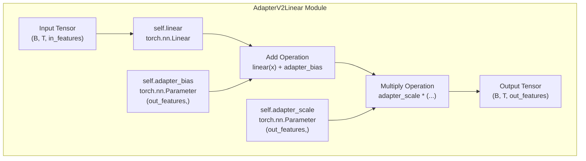
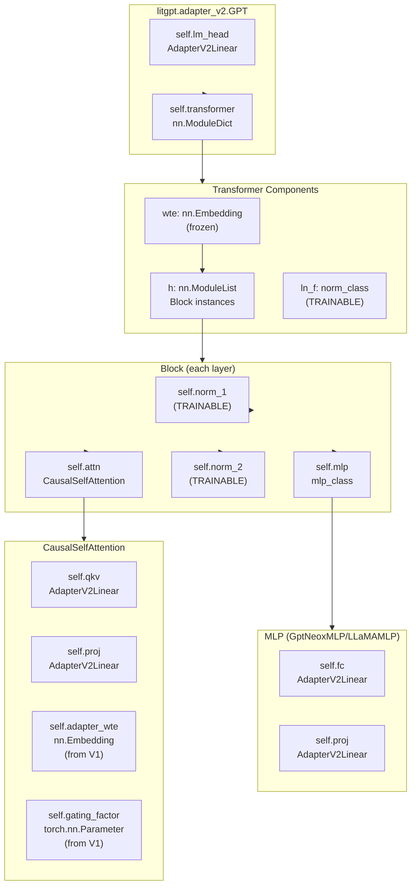
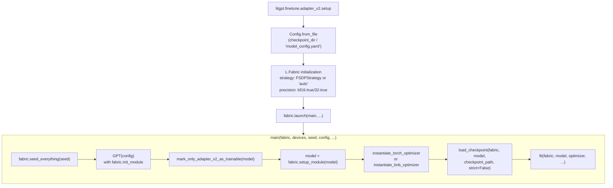
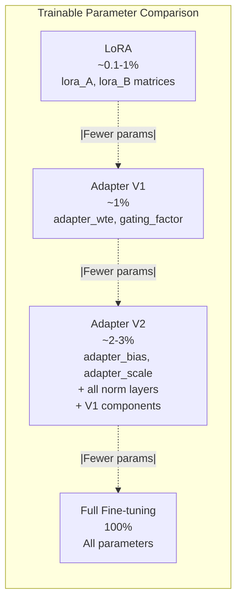

<!-- source: DeepWiki mcp.deepwiki.com · repo Lightning-AI/litgpt · page 3.3 Adapter V2 Fine-tuning · fetched 2026-10-21 -->

# Adapter V2 Fine-tuning

<details>
<summary>Relevant source files</summary>

The following files were used as context for generating this wiki page:

- [litgpt/adapter.py](litgpt/adapter.py)
- [litgpt/adapter_v2.py](litgpt/adapter_v2.py)
- [litgpt/finetune/adapter.py](litgpt/finetune/adapter.py)
- [litgpt/finetune/adapter_v2.py](litgpt/finetune/adapter_v2.py)
- [litgpt/finetune/lora.py](litgpt/finetune/lora.py)
- [litgpt/lora.py](litgpt/lora.py)
- [litgpt/model.py](litgpt/model.py)
- [tests/test_adapter.py](tests/test_adapter.py)
- [tests/test_adapter_v2.py](tests/test_adapter_v2.py)
- [tests/test_full.py](tests/test_full.py)
- [tests/test_lora.py](tests/test_lora.py)

</details>


## Purpose and Scope

This page documents the Adapter V2 parameter-efficient fine-tuning method in LitGPT, which extends the base Adapter method by adding bias and scale parameters to linear layers and making normalization layers trainable. This approach typically trains ~2-3% of model parameters.

For the original Adapter method (V1) using learned prompts with gating, see [Adapter Fine-tuning](#3.2). For other parameter-efficient methods like LoRA, see [LoRA Fine-tuning](#3.1). For full model fine-tuning, see [Full Fine-tuning](#3.4).

Sources: [litgpt/adapter_v2.py:1-9](), [litgpt/finetune/adapter_v2.py:1-46]()

---

## Method Overview

Adapter V2 builds upon the Adapter V1 approach (LLaMA-Adapter) by introducing additional trainable parameters while keeping the base model weights frozen. The key innovation is wrapping all linear layers with bias and scale parameters, and making all normalization layers trainable.

**Key characteristics:**
- **Trainable parameters**: ~2-3% of total model parameters.
- **Added components**: `adapter_bias` and `adapter_scale` tensors on each linear layer [litgpt/adapter_v2.py:54-55]().
- **Trainable norms**: All `norm_1`, `norm_2`, and `ln_f` layers have trainable weights [litgpt/adapter_v2.py:43-45]().
- **Inherits**: Gating mechanism and learned prompt embeddings from Adapter V1 [litgpt/adapter_v2.py:37-38]().
- **Checkpoint format**: Saved as `lit_model.pth.adapter_v2` files [litgpt/finetune/adapter_v2.py:252]().

Sources: [litgpt/adapter_v2.py:1-10](), [tests/test_adapter_v2.py:124]()

---

## Architecture Components

### AdapterV2Linear Layer

The `AdapterV2Linear` class wraps the standard `torch.nn.Linear` layer with additional bias and scale parameters:



**AdapterV2Linear Implementation Details**

The forward computation implements: `output = adapter_scale * (linear(x) + adapter_bias)` [litgpt/adapter_v2.py:58]().

| Component | Type | Shape | Trainable | Initialization |
|-----------|------|-------|-----------|----------------|
| `self.linear` | `torch.nn.Linear` | `(out_features, in_features)` | No (frozen) | From pretrained weights |
| `self.adapter_bias` | `torch.nn.Parameter` | `(out_features,)` | Yes | Zeros [litgpt/adapter_v2.py:54]() |
| `self.adapter_scale` | `torch.nn.Parameter` | `(out_features,)` | Yes | Ones [litgpt/adapter_v2.py:55]() |

Sources: [litgpt/adapter_v2.py:50-63]()

---

### Model Architecture Integration

Adapter V2 modifies the base model by replacing linear layers throughout the architecture:



**Trainable Components Summary**

The `adapter_filter` function identifies trainable parameters:

```python
# From litgpt/adapter_v2.py:34-47
def adapter_filter(key: str, value: Any) -> bool:
    adapter_substrings = (
        # regular adapter v1 parameters
        "adapter_wte",
        "gating_factor",
        # adapter v2: new bias and scale used in Linear
        "adapter_scale",
        "adapter_bias",
        # adapter v2: Norm parameters are now trainable
        "norm_1",
        "norm_2",
        "ln_f",
    )
    return any(s in key for s in adapter_substrings)
```

Sources: [litgpt/adapter_v2.py:34-47](), [litgpt/adapter_v2.py:65-105](), [tests/test_adapter_v2.py:45-77]()

---

## Training Workflow

### Setup and Initialization



**Key Functions and Their Roles**

| Function | File:Lines | Purpose |
|----------|-----------|---------|
| `setup` | [litgpt/finetune/adapter_v2.py:49-150]() | Entry point, initializes Fabric and configuration |
| `main` | [litgpt/finetune/adapter_v2.py:153-258]() | Sets up model, optimizer, loads checkpoint, runs training |
| `mark_only_adapter_v2_as_trainable` | [litgpt/adapter_v2.py:192-195]() | Sets `requires_grad=False` for frozen weights |
| `fit` | [litgpt/finetune/adapter_v2.py:260-434]() | Training loop with validation and checkpointing |

Sources: [litgpt/finetune/adapter_v2.py:49-258](), [litgpt/adapter_v2.py:192-195]()

---

### Training Loop Implementation

The `fit` function implements the core training loop with gradient accumulation and periodic validation:

```mermaid
graph TB
    Start["fit() begins"]
    GetDataloaders["get_dataloaders<br/>(train_dataloader, val_dataloader)"]
    InitMonitoring["ThroughputMonitor<br/>RunningMean for loss"]
    
    subgraph TrainingLoop["Training Loop: while step_count < max_steps"]
        IterNext["batch = next(train_iterator)"]
        Forward["logits = model(input_ids,<br/>lm_head_chunk_size=128)"]
        Loss["loss = chunked_cross_entropy<br/>(logits, targets[..., 1:])"]
        Backward["fabric.backward(loss / grad_accum)"]
        CheckAccum{"Accumulating?"}
        
        subgraph OptimStep["Optimizer Step"]
            OptimizerStep["optimizer.step()"]
            OptimizerZero["optimizer.zero_grad()"]
            SchedulerStep["scheduler.step()"]
            IncrementStep["step_count += 1"]
        end
        
        CheckLog{"Log interval?"}
        LogMetrics["Log metrics:<br/>loss, throughput, tokens"]
        
        CheckValidate{"Eval interval?"}
        Validate["validate(fabric, model,<br/>val_dataloader, eval)"]
        GenerateExample["generate_example(fabric,<br/>model, tokenizer, eval, data)"]
        
        CheckSave{"Save interval?"}
        SaveCheckpoint["save_adapter_v2_checkpoint<br/>(fabric, model, checkpoint_file)"]
    end
    
    FinalValidation["Final validation<br/>(if eval.final_validation)"]
    SaveFinal["Save final checkpoint:<br/>out_dir / 'final' / 'lit_model.pth.adapter_v2'"]
    
    Start --> GetDataloaders
    GetDataloaders --> InitMonitoring
    InitMonitoring --> TrainingLoop
    
    IterNext --> Forward
    Forward --> Loss
    Loss --> Backward
    Backward --> CheckAccum
    CheckAccum -->|No| OptimStep
    CheckAccum -->|Yes| IterNext
    
    OptimizerStep --> OptimizerZero
    OptimizerZero --> SchedulerStep
    SchedulerStep --> IncrementStep
    IncrementStep --> CheckLog
    
    CheckLog -->|Yes| LogMetrics
    CheckLog -->|No| CheckValidate
    LogMetrics --> CheckValidate
    
    CheckValidate -->|Yes| Validate
    CheckValidate -->|No| CheckSave
    Validate --> GenerateExample
    GenerateExample --> CheckSave
    
    CheckSave -->|Yes| SaveCheckpoint
    CheckSave -->|No| IterNext
    SaveCheckpoint --> IterNext
    
    TrainingLoop --> FinalValidation
    FinalValidation --> SaveFinal
```



**Checkpoint Saving**

Only adapter-specific parameters are saved, significantly reducing checkpoint size:

```python
# From save_adapter_v2_checkpoint in litgpt/finetune/adapter_v2.py:436-449
def save_adapter_v2_checkpoint(fabric: L.Fabric, model: torch.nn.Module, file_path: Path):
    cpu_state_dict = {}
    sharded_sd = model.state_dict()
    for param_name, param in sharded_sd.items():
        if not adapter_filter(param_name, param):
            continue
        if fabric.world_size > 1:
            cpu_state_dict[param_name] = param.cpu()
        else:
            cpu_state_dict[param_name] = param
    if fabric.global_rank == 0:
        torch.save(cpu_state_dict, file_path)
```

Sources: [litgpt/finetune/adapter_v2.py:260-434](), [litgpt/finetune/adapter_v2.py:436-449]()

---

## Configuration Parameters

### Adapter V2 Specific Config

The `Config` class in `litgpt.adapter_v2` inherits from `litgpt.adapter.Config` [litgpt/adapter_v2.py:28](), which adds:

| Parameter | Type | Default | Description |
|-----------|------|---------|-------------|
| `adapter_prompt_length` | `int` | 10 | Length of learned prompt embeddings (inherited from V1) [litgpt/adapter.py:26]() |
| `adapter_start_layer` | `int` | 2 | Layer index to begin applying adapter modules (inherited from V1) [litgpt/adapter.py:27]() |

Sources: [litgpt/adapter.py:24-28](), [litgpt/adapter_v2.py:27-32]()

---

### Training Arguments

The `setup` function accepts standard fine-tuning arguments [litgpt/finetune/adapter_v2.py:49-73]():

**Key Training Parameters**

| Parameter | Type | Default | Description |
|-----------|------|---------|-------------|
| `checkpoint_dir` | `Path` | Required | Path to pretrained model checkpoint |
| `out_dir` | `Path` | `"out/finetune/adapter-v2"` | Output directory for checkpoints and logs |
| `precision` | `str` | Auto-detected | Training precision: `"bf16-true"`, `"bf16-mixed"`, `"32-true"` |
| `quantize` | `str` | `None` | Quantization: `"bnb.nf4"`, `"bnb.nf4-dq"`, `"bnb.fp4"`, etc. |
| `devices` | `int/str` | 1 | Number of GPUs to use |
| `num_nodes` | `int` | 1 | Number of nodes for distributed training |
| `resume` | `bool` | `False` | Resume from latest checkpoint in `out_dir` |

Sources: [litgpt/finetune/adapter_v2.py:49-150](), [litgpt/args.py:8-95]()

---

## Comparison with Other Methods

### Trainable Parameters by Method



**Method Comparison Table**

| Aspect | LoRA | Adapter V1 | Adapter V2 | Full |
|--------|------|-----------|------------|------|
| **Trainable %** | 0.1-1% | ~1% | 2-3% | 100% |
| **Added to each Linear** | Low-rank matrices A, B | None | Bias + scale vectors | N/A |
| **Attention mechanism** | None | Learned prompts + gating | Learned prompts + gating | N/A |
| **Trainable norms** | No | No | Yes | Yes |
| **Checkpoint extension** | `.lora` | `.adapter` | `.adapter_v2` | `.pth` |
| **Memory overhead** | Low | Low | Low-Medium | High |

Sources: [litgpt/adapter_v2.py:34-47](), [tests/test_adapter_v2.py:124](), [tests/test_lora.py:239](), [tests/test_adapter.py:107]()

---

### Architecture Differences

**LoRA** (see [LoRA Fine-tuning](#3.1)):
- Adds parallel low-rank decomposition: `output = W·x + (B·A)·x` [litgpt/lora.py:37-40]().
- Only affects specified layers (query, key, value, projection, mlp, head).

**Adapter V1** (see [Adapter Fine-tuning](#3.2)):
- Adds learned prompt embeddings with gating mechanism [litgpt/adapter.py:72-75]().
- Modifies attention computation with additional keys/values [litgpt/adapter.py:82-109]().

**Adapter V2** (this method):
- Combines V1's gating mechanism with additional linear transformations.
- Transformation: `output = adapter_scale * (W·x + adapter_bias)` [litgpt/adapter_v2.py:58]().
- Makes all normalization layers trainable for better adaptation [litgpt/adapter_v2.py:43-45]().

Sources: [litgpt/lora.py:10-44](), [litgpt/adapter.py:65-109](), [litgpt/adapter_v2.py:50-58]()

---

## Multi-GPU Training Strategy

Adapter V2 supports distributed training using FSDP (Fully Sharded Data Parallel):

**Strategy Configuration**

```python
# From litgpt/finetune/adapter_v2.py:128-134
if devices * num_nodes > 1:
    strategy = FSDPStrategy(
        auto_wrap_policy={Block},
        activation_checkpointing_policy={Block},
        state_dict_type="full",
        limit_all_gathers=True,
        cpu_offload=False,
    )
```

Sources: [litgpt/finetune/adapter_v2.py:128-134]()

---

## Quantization Support

Adapter V2 supports 4-bit and 8-bit quantization using BitsAndBytes:

**Quantization Configuration**

| Quantize Option | Precision | Description |
|----------------|-----------|-------------|
| `"bnb.nf4"` | NF4 | 4-bit NormalFloat quantization |
| `"bnb.nf4-dq"` | NF4 + Double Quantization | More memory efficient |
| `"bnb.fp4"` | FP4 | 4-bit floating point |
| `"bnb.fp4-dq"` | FP4 + Double Quantization | More memory efficient |
| `"bnb.int8-training"` | INT8 | 8-bit integer quantization |

Sources: [litgpt/finetune/adapter_v2.py:111-120](), [tests/test_adapter_v2.py:386-522]()

---

## Checkpoint Management

### Loading Pretrained Checkpoints

When loading a pretrained base model checkpoint, Adapter V2 handles missing adapter parameters gracefully:

```python
# From litgpt/finetune/adapter_v2.py:217
load_checkpoint(fabric, model, checkpoint_path, strict=False)
```

The `strict=False` parameter allows loading base model weights while initializing adapter-specific parameters (bias, scale, gating) to their default values [litgpt/finetune/adapter_v2.py:217]().

Sources: [litgpt/finetune/adapter_v2.py:209-217]()

---

### Resume Training

The `resume` parameter enables continuing from a previous adapter training run [litgpt/finetune/adapter_v2.py:204-216]():

```python
# From litgpt/finetune/adapter_v2.py:204-217
if resume:
    resume_path = find_resume_path(out_dir, "lit_model.pth.adapter_v2")
    if resume_path:
        fabric.print(f"Resuming training from {resume_path}")
        load_checkpoint_update(fabric, resume_path, model, checkpoint_path, strict=False)
```

Sources: [litgpt/finetune/adapter_v2.py:204-217]()

---

### Checkpoint File Structure

Saved checkpoints contain only adapter-specific parameters [litgpt/finetune/adapter_v2.py:250-257]():

```
out_dir/
├── step-001000/
│   ├── lit_model.pth.adapter_v2       # Adapter weights only
│   ├── model_config.yaml              # Model configuration
│   ├── tokenizer.json                 # Tokenizer files
│   ├── tokenizer_config.json
│   ├── hyperparameters.yaml           # Training hyperparameters
│   └── prompt_style.yaml              # Prompt formatting
└── final/
    └── lit_model.pth.adapter_v2       # Final adapter weights
```

Sources: [tests/test_adapter_v2.py:109-117](), [litgpt/finetune/adapter_v2.py:250-257]()

---

## Testing and Validation

The test suite verifies Adapter V2 functionality:

**Key Test Cases**

| Test | File:Lines | Validates |
|------|-----------|-----------|
| `test_config_identical` | [tests/test_adapter_v2.py:33-43]() | Base model configuration compatibility |
| `test_adapter_v2_filter` | [tests/test_adapter_v2.py:45-76]() | Correct parameter filtering for saving |
| `test_adapter_v2_script` | [tests/test_adapter_v2.py:80-125]() | End-to-end training script workflow |
| `test_adapter_v2_gpt_init_weights` | [tests/test_adapter_v2.py:127-137]() | Proper weight initialization (zeros/ones) |
| `test_base_model_can_be_adapter_v2_loaded` | [tests/test_adapter_v2.py:140-149]() | Loading base model weights into AdapterV2 model |
| `test_adapter_v2_compile` | [tests/test_adapter_v2.py:151-169]() | `torch.compile` compatibility without graph breaks |

Sources: [tests/test_adapter_v2.py:1-522]()

---

