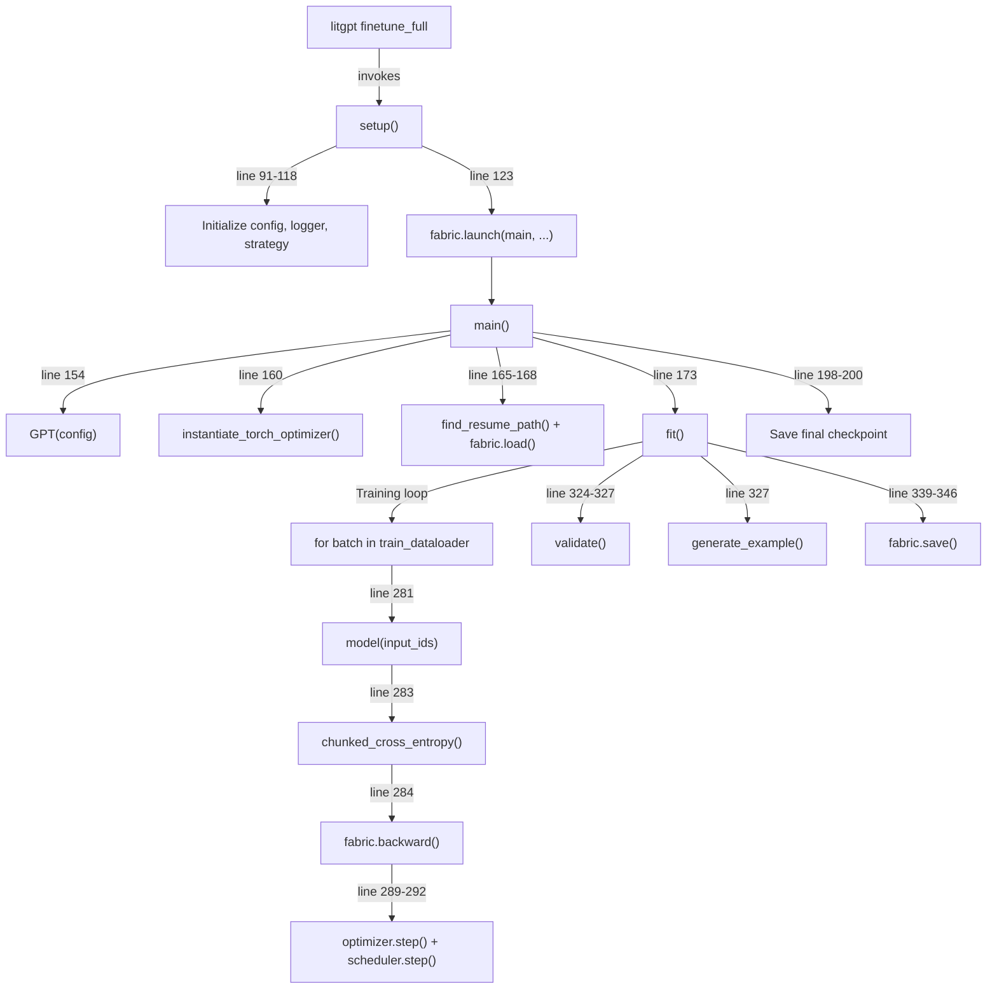
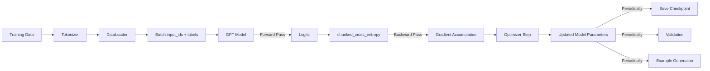
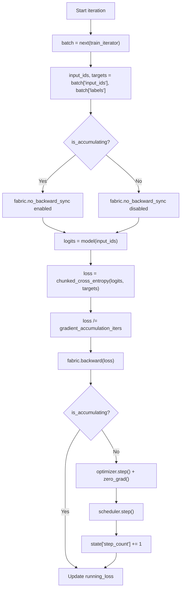

<!-- source: DeepWiki mcp.deepwiki.com · repo Lightning-AI/litgpt · page 3.4 Full Fine-tuning · fetched 2026-10-21 -->

# Full Fine-tuning

<details>
<summary>Relevant source files</summary>

The following files were used as context for generating this wiki page:

- [extensions/thunder/pretrain.py](extensions/thunder/pretrain.py)
- [litgpt/args.py](litgpt/args.py)
- [litgpt/finetune/full.py](litgpt/finetune/full.py)
- [litgpt/pretrain.py](litgpt/pretrain.py)
- [tests/test_adapter.py](tests/test_adapter.py)
- [tests/test_adapter_v2.py](tests/test_adapter_v2.py)
- [tests/test_full.py](tests/test_full.py)
- [tests/test_lora.py](tests/test_lora.py)
- [tutorials/finetune_adapter.md](tutorials/finetune_adapter.md)
- [tutorials/finetune_full.md](tutorials/finetune_full.md)
- [tutorials/finetune_lora.md](tutorials/finetune_lora.md)
- [tutorials/inference.md](tutorials/inference.md)
- [tutorials/quantize.md](tutorials/quantize.md)

</details>


Full fine-tuning updates all parameters of a pre-trained language model during the fine-tuning process. Unlike parameter-efficient methods (LoRA, Adapter V1, Adapter V2) that freeze most weights and only train small additional modules, full fine-tuning trains every weight in the model.

This page documents the implementation in [litgpt/finetune/full.py]() and how it differs from parameter-efficient methods.

## Key Characteristics

**All Parameters Trainable**: Full fine-tuning sets `requires_grad=True` for all model parameters. No parameter filtering is applied, unlike LoRA's `lora_filter` [litgpt/lora.py:34]() or Adapter's `adapter_filter` [litgpt/adapter_v2.py:24]().

**Standard Model Architecture**: Uses the base `GPT` class from [litgpt/model.py:26]() without architectural modifications. In contrast:
- LoRA uses `GPT` from [litgpt/lora.py:28]() with `LoRALinear` [litgpt/lora.py:32]() and `LoRAQKVLinear` [litgpt/lora.py:33]() layers.
- Adapter V1 uses `GPT` from [litgpt/adapter.py:24]() with attention-based adapter modules.
- Adapter V2 uses `GPT` from [litgpt/adapter_v2.py:23]() with `adapter_bias` and `adapter_scale` parameters [litgpt/adapter_v2.py:39-42]().

**Memory-Intensive**: Requires storing gradients and optimizer states for all parameters. For a 7B parameter model, this typically requires 8 GPUs with 40GB memory each [tutorials/finetune_full.md:23]().

Sources: [litgpt/finetune/full.py:1-190](), [litgpt/finetune/lora.py:1-46](), [litgpt/finetune/adapter_v2.py:1-46](), [tutorials/finetune_full.md:1-25]()

## System Architecture

### Full Fine-tuning Call Graph



Sources: [litgpt/finetune/full.py:44-123](), [litgpt/finetune/full.py:126-206](), [litgpt/finetune/full.py:208-351]()

### Training State Management

The training state dictionary maintains:
- `model`: The `GPT` instance wrapped by Fabric.
- `optimizer`: Optimizer instance (typically AdamW).
- `scheduler`: Learning rate scheduler.
- `iter_num`: Current iteration number.
- `step_count`: Current optimizer step count.

This state can be saved and resumed using `fabric.save()` and `fabric.load()` at [litgpt/finetune/full.py:165-168]().

Sources: [litgpt/finetune/full.py:163-168]()

### Fine-tuning Data Flow



Sources: [litgpt/finetune/full.py:208-351](), [litgpt/utils.py:30-45]()

## Comparison with Parameter-Efficient Methods

### Parameter Training Comparison

| Method | Model Class | Trainable Parameters | Filter Function | Special Layers |
|--------|-------------|----------------------|-----------------|----------------|
| Full Fine-tuning | `litgpt.model.GPT` | 100% | None | None |
| LoRA | `litgpt.lora.GPT` | ~0.1-1% | `lora_filter` | `LoRALinear`, `LoRAQKVLinear` |
| Adapter V1 | `litgpt.adapter.GPT` | ~1% | `adapter_filter` | `adapter_wte`, `gating_factor` |
| Adapter V2 | `litgpt.adapter_v2.GPT` | ~2-3% | `adapter_filter` | `adapter_bias`, `adapter_scale` |

Sources: [litgpt/finetune/full.py:154](), [litgpt/lora.py:28-37](), [litgpt/adapter.py:24](), [litgpt/adapter_v2.py:23-24]()

### Code-Level Differences

**Full Fine-tuning**:
```python
# No parameter filtering - all parameters trainable
model = GPT(config)
optimizer = instantiate_torch_optimizer(optimizer, model.parameters())
```
[litgpt/finetune/full.py:154-160]()

**LoRA Fine-tuning**:
```python
# Only LoRA parameters trainable
model = LoRAGPT(config)
mark_only_lora_as_trainable(model)
optimizer = torch.optim.SGD(model.parameters(), lr=1.0)
```
[tests/test_lora.py:47-78]()

**Adapter V2 Fine-tuning**:
```python
# Only adapter and norm parameters trainable
model = AdapterV2GPT(config)
# Requires specific filter for saving
fabric.save(save_path, {"model": model}, filter={"model": adapter_filter})
```
[tests/test_adapter_v2.py:47-49](), [tests/test_adapter_v2.py:129-130]()

### Checkpoint Saving Differences

**Full Fine-tuning**: Saves the entire model state dict with `fabric.save()` at [litgpt/finetune/full.py:200]():
```python
fabric.save(out_dir / "final" / "lit_model.pth", {"model": state["model"]})
```

**LoRA Fine-tuning**: Finetuning generates a `lit_model.pth.lora` file containing only LoRA weights to conserve space [tutorials/finetune_lora.md:139-140]().

**Adapter V2 Fine-tuning**: Saves only parameters matching the `adapter_filter` [tests/test_adapter_v2.py:49-50]().

Sources: [litgpt/finetune/full.py:200](), [tutorials/finetune_lora.md:139-140](), [tests/test_adapter_v2.py:45-51]()

## Key Components

### Core Functions

**`setup()`** [litgpt/finetune/full.py:44-123]()
- Loads model config from `model_config.yaml` [litgpt/finetune/full.py:95]().
- Initializes `FSDPStrategy` for multi-GPU training [litgpt/finetune/full.py:108-114]().
- Launches `main()` via `fabric.launch()` [litgpt/finetune/full.py:123]().

**`main()`** [litgpt/finetune/full.py:126-206]()
- Initializes `GPT(config)` model with `fabric.init_module(empty_init=True)` [litgpt/finetune/full.py:153-154]().
- Handles resume logic with `find_resume_path()` and `fabric.load()` [litgpt/finetune/full.py:165-168]().
- Calls `fit()` for training [litgpt/finetune/full.py:173]().

**`fit()`** [litgpt/finetune/full.py:208-351]()
- Implements training loop with gradient accumulation [litgpt/finetune/full.py:279-284]().
- Calls `validate()` every `eval.interval` steps [litgpt/finetune/full.py:324-326]().
- Saves checkpoints at `train.save_interval` steps [litgpt/finetune/full.py:339-346]().

**`validate()`** [litgpt/finetune/full.py:355-372]()
- Computes validation loss using `chunked_cross_entropy` [litgpt/finetune/full.py:367]().

**`generate_example()`** [litgpt/finetune/full.py:375-406]()
- Generates text completion for monitoring quality using `generate()` [litgpt/finetune/full.py:392]().

Sources: [litgpt/finetune/full.py:44-406]()

### Distributed Training Strategy

For multi-GPU training (`devices * num_nodes > 1`), full fine-tuning uses `FSDPStrategy`:

```python
strategy = FSDPStrategy(
    auto_wrap_policy={Block},
    activation_checkpointing_policy={Block},
    state_dict_type="full",
    limit_all_gathers=True,
    cpu_offload=False,
)
```

- `auto_wrap_policy={Block}`: Wraps each transformer `Block` as an FSDP unit [litgpt/finetune/full.py:109]().
- `activation_checkpointing_policy={Block}`: Checkpoints activations per block to save memory [litgpt/finetune/full.py:110]().
- `state_dict_type="full"`: Saves a consolidated state dict [litgpt/finetune/full.py:111]().

Sources: [litgpt/finetune/full.py:107-114]()

## Training Loop Implementation

### Gradient Accumulation

The training loop in `fit()` implements gradient accumulation:

```python
is_accumulating = state["iter_num"] % train.gradient_accumulation_iters(devices, num_nodes) != 0
with fabric.no_backward_sync(model, enabled=is_accumulating):
    logits = model(input_ids)
    loss = chunked_cross_entropy(logits[..., :-1, :], targets[..., 1:])
    fabric.backward(loss / train.gradient_accumulation_iters(devices, num_nodes))
```

- `gradient_accumulation_iters` = `global_batch_size // (micro_batch_size * devices * num_nodes)` [litgpt/args.py:58]().
- `fabric.no_backward_sync()` prevents synchronization during accumulation [litgpt/finetune/full.py:280]().

Sources: [litgpt/finetune/full.py:279-284](), [litgpt/args.py:56-60]()

### Training Loop Sequence



Sources: [litgpt/finetune/full.py:271-292]()

## Usage

### Command Line Interface

```bash
litgpt finetune_full tiiuae/falcon-7b \
  --data Alpaca \
  --out_dir out/full/my-model-finetuned
```

### Resource Requirements

Full fine-tuning is computationally intensive:
- Falcon-7B requires at least 8 GPUs with ~40 GB memory each [tutorials/finetune_full.md:23]().
- `bf16-true` precision can bring memory consumption down significantly compared to `32-true` [tutorials/quantize.md:23-35]().

Sources: [tutorials/finetune_full.md:18-34](), [tutorials/quantize.md:23-35]()

## Configuration

### TrainArgs

Full fine-tuning uses `TrainArgs` [litgpt/args.py:8-40]():

| Field | Type | Default | Description |
|-------|------|---------|-------------|
| `save_interval` | `int` | 1000 | Optimizer steps between checkpoint saves |
| `global_batch_size` | `int` | 64 | Total samples per optimizer step |
| `micro_batch_size` | `int` | 4 | Samples per device per iteration |
| `lr_warmup_steps` | `int` | 100 | Linear warmup steps |
| `epochs` | `int` | None | Number of training epochs |

Sources: [litgpt/args.py:8-40](), [litgpt/finetune/full.py:52-60]()

---

