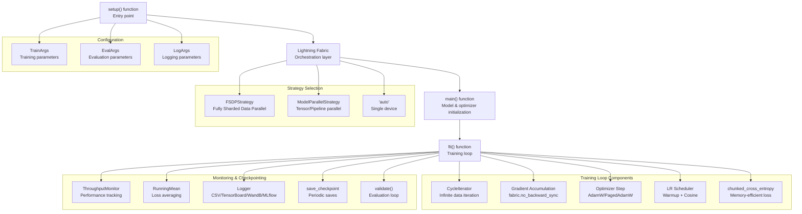
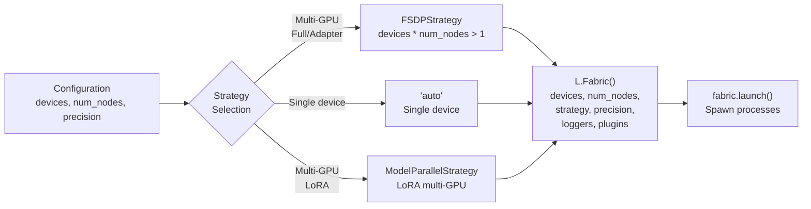
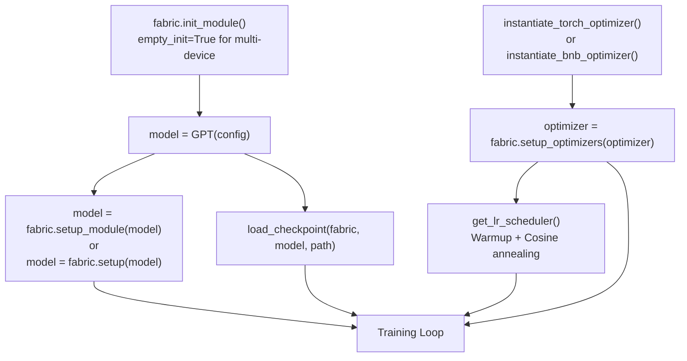
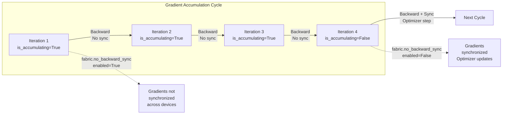
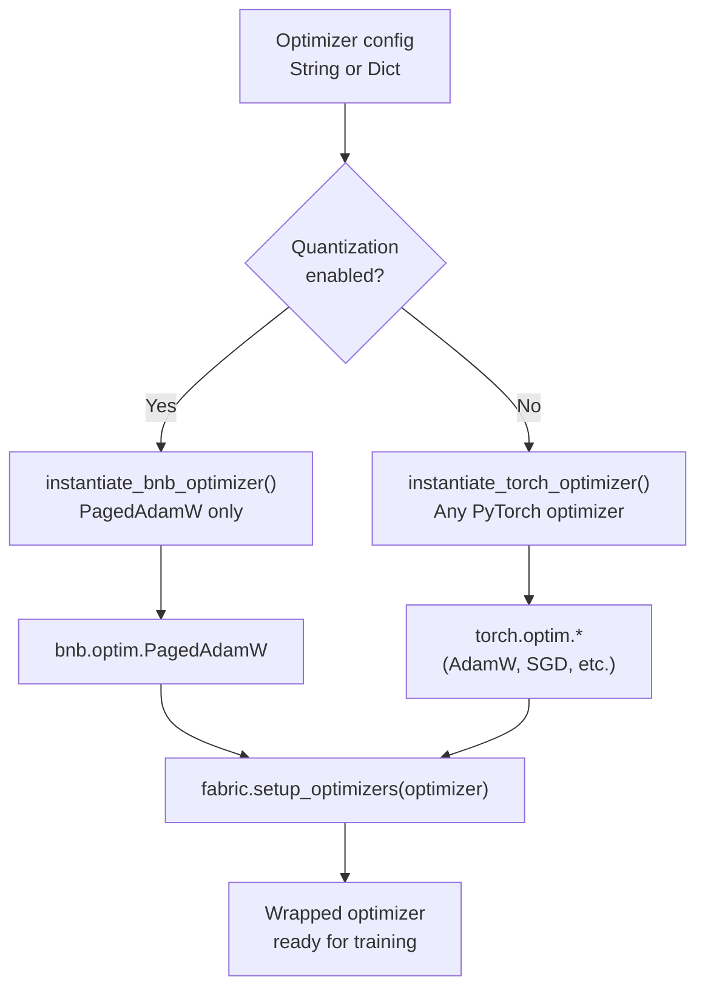

<!-- source: DeepWiki mcp.deepwiki.com · repo Lightning-AI/litgpt · page 3.5 Training Infrastructure · fetched 2026-10-21 -->

# Training Infrastructure

Relevant source files

The following files were used as context for generating this wiki page:

- [extensions/thunder/pretrain.py](extensions/thunder/pretrain.py)
- [litgpt/args.py](litgpt/args.py)
- [litgpt/finetune/adapter.py](litgpt/finetune/adapter.py)
- [litgpt/finetune/adapter_v2.py](litgpt/finetune/adapter_v2.py)
- [litgpt/finetune/full.py](litgpt/finetune/full.py)
- [litgpt/finetune/lora.py](litgpt/finetune/lora.py)
- [litgpt/pretrain.py](litgpt/pretrain.py)
- [litgpt/utils.py](litgpt/utils.py)
- [tests/test_utils.py](tests/test_utils.py)

## Purpose and Scope

This page documents the training infrastructure that powers all training methods in LitGPT, including pretraining ([Pretraining](#4)) and all fine-tuning approaches ([LoRA Fine-tuning](#3.1), [Adapter Fine-tuning](#3.2), [Adapter V2 Fine-tuning](#3.3), [Full Fine-tuning](#3.4)). The infrastructure is built on Lightning Fabric and provides a unified framework for distributed training, gradient accumulation, checkpointing, validation, and performance monitoring.

For memory optimization techniques applied during training, see [Memory Optimization](#3.6). For data loading and processing, see [DataModules](#5.1).

## Architecture Overview

**Sources:** [litgpt/finetune/lora.py:49-181](), [litgpt/finetune/full.py:44-124](), [litgpt/pretrain.py:48-174]()

## Lightning Fabric Integration

Lightning Fabric serves as the orchestration layer for all training in LitGPT. It handles device management, distributed strategies, precision control, and provides unified APIs for model/optimizer setup.

### Fabric Initialization

**Fabric Setup Pattern:**

| Component | Code Location | Purpose |
|-----------|---------------|---------|
| Strategy selection | [litgpt/finetune/full.py:108-116]() | Chooses FSDP for multi-GPU full finetuning |
| Strategy selection | [litgpt/finetune/lora.py:152-164]() | Chooses `ModelParallelStrategy` for multi-GPU LoRA |
| Fabric init | [litgpt/finetune/lora.py:166-173]() | Creates Fabric instance with config |
| Launch | [litgpt/finetune/lora.py:178-180]() | Spawns training processes |

**Sources:** [litgpt/finetune/lora.py:152-181](), [litgpt/finetune/full.py:108-124](), [litgpt/finetune/adapter.py:120-149](), [litgpt/pretrain.py:142-152]()

### Model and Optimizer Setup

After Fabric initialization, models and optimizers are setup through Fabric's APIs:

**Key Functions:**

- `fabric.init_module(empty_init=True)`: Context manager for lazy initialization on meta device (multi-GPU) [litgpt/finetune/full.py:153-154]().
- `fabric.setup_module(model)` or `fabric.setup(model)`: Wraps model for distributed training [litgpt/finetune/full.py:158]().
- `fabric.setup_optimizers(optimizer)`: Wraps optimizer for distributed training [litgpt/finetune/full.py:161]().
- `fabric.setup_dataloaders()`: Wraps dataloaders for distributed data loading [litgpt/finetune/lora.py:214]().

**Sources:** [litgpt/finetune/lora.py:209-235](), [litgpt/finetune/full.py:152-162](), [litgpt/pretrain.py:200-219]()

## Training Loop Structure

The training loop is implemented in the `fit()` function, which is consistent across all training methods with minor variations.

### Core Training Loop Flow

```mermaid
graph TB
    Start["fit() function entry"]
    Init["Initialize:<br/>- CycleIterator<br/>- ThroughputMonitor<br/>- RunningMean<br/>- Token counters"]
    
    LoopStart{{"Iterate while<br/>step_count < max_steps"}}
    NextBatch["batch = next(train_iterator)"]
    CheckEpoch{"Epoch limit<br/>reached?"}
    
    Accumulating{"is_accumulating =<br/>iter_num % gradient_accumulation_iters != 0"}
    
    NoSync["fabric.no_backward_sync(model,<br/>enabled=is_accumulating)"]
    Forward["logits = model(input_ids)"]
    Loss["loss = chunked_cross_entropy(logits, targets)"]
    Backward["fabric.backward(loss / gradient_accumulation_iters)"]
    
    UpdateLoss["running_loss.update(loss.detach())"]
    
    OptStep{"Not<br/>accumulating?"}
    OptimStep["optimizer.step()<br/>optimizer.zero_grad()<br/>scheduler.step()<br/>step_count += 1"]
    
    LogInterval{"iter_num %<br/>log_interval == 0?"}
    LogMetrics["Log metrics:<br/>loss, iter, step, epoch,<br/>iter_time, learning_rate"]
    
    EvalInterval{"step_count %<br/>eval.interval == 0?"}
    Validate["validate(fabric, model,<br/>val_dataloader, eval)"]
    GenerateExample["generate_example()<br/>Sample generation"]
    
    SaveInterval{"step_count %<br/>save_interval == 0?"}
    SaveCkpt["save_checkpoint()"]
    
    LoopEnd["Continue loop"]
    FinalSave["Save final checkpoint"]
    End["Return token_counts"]
    
    Start --> Init
    Init --> LoopStart
    LoopStart -->|Yes| NextBatch
    LoopStart -->|No| FinalSave
    NextBatch --> CheckEpoch
    CheckEpoch -->|Yes| FinalSave
    CheckEpoch -->|No| Accumulating
    
    Accumulating --> NoSync
    NoSync --> Forward
    Forward --> Loss
    Loss --> Backward
    Backward --> UpdateLoss
    
    UpdateLoss --> OptStep
    OptStep -->|Yes| OptimStep
    OptStep -->|No| LogInterval
    OptimStep --> LogInterval
    
    LogInterval -->|Yes| LogMetrics
    LogInterval -->|No| EvalInterval
    LogMetrics --> EvalInterval
    
    EvalInterval -->|Yes, not accumulating| Validate
    EvalInterval -->|No| SaveInterval
    Validate --> GenerateExample
    GenerateExample --> SaveInterval
    
    SaveInterval -->|Yes, not accumulating| SaveCkpt
    SaveInterval -->|No| LoopEnd
    SaveCkpt --> LoopEnd
    LoopEnd --> LoopStart
    
    FinalSave --> End
```

**Sources:** [litgpt/finetune/lora.py:285-435](), [litgpt/finetune/full.py:209-358](), [litgpt/pretrain.py:287-423]()

### Iteration vs Step Counting

LitGPT distinguishes between **iterations** and **steps**:

| Concept | Definition | Code Reference |
|---------|------------|----------------|
| **Iteration** (`iter_num`) | Each forward-backward pass | [litgpt/finetune/lora.py:339]() |
| **Step** (`step_count`) | Optimizer update | [litgpt/finetune/lora.py:363]() |
| **Gradient Accumulation** | Multiple iterations per step | [litgpt/args.py:56-60]() |

The relationship is: `gradient_accumulation_iters = global_batch_size / (micro_batch_size * devices * num_nodes)` [litgpt/args.py:58]().

**Sources:** [litgpt/args.py:56-67](), [litgpt/finetune/lora.py:350-364]()

## Gradient Accumulation

Gradient accumulation simulates larger batch sizes by accumulating gradients over multiple iterations before performing an optimizer step.

**Implementation:**

LitGPT uses `fabric.no_backward_sync` to control gradient synchronization across data-parallel ranks [litgpt/finetune/lora.py:351]().

**Key Details:**
- Loss is divided by `gradient_accumulation_iters` to average gradients correctly [litgpt/finetune/lora.py:354]().
- `fabric.no_backward_sync` prevents gradient synchronization when `enabled=True`.
- Optimizer step only occurs when `is_accumulating=False` [litgpt/finetune/lora.py:357]().

**Sources:** [litgpt/finetune/lora.py:350-364](), [litgpt/finetune/full.py:280-293](), [litgpt/pretrain.py:351-363]()

## Optimizer Setup

LitGPT supports standard PyTorch optimizers and quantized optimizers from BitsAndBytes.

### Optimizer Instantiation

**Optimizer Functions:**

| Function | Location | Purpose |
|----------|----------|---------|
| `instantiate_torch_optimizer()` | [litgpt/utils.py:643-676]() | Creates standard PyTorch optimizer from config |
| `instantiate_bnb_optimizer()` | [litgpt/utils.py:626-641]() | Creates BitsAndBytes PagedAdamW for quantized training |

**Usage Pattern:**

For quantized training (e.g., LoRA or Adapter), LitGPT checks for `BitsandbytesPrecision` before instantiating the optimizer [litgpt/finetune/lora.py:216-232](). Standard training uses `instantiate_torch_optimizer` [litgpt/finetune/full.py:160]().

**Sources:** [litgpt/finetune/lora.py:216-232](), [litgpt/utils.py:626-676]()

### Learning Rate Scheduling

All fine-tuning methods use a linear warmup followed by cosine annealing.

**Scheduler Implementation:**

The `get_lr_scheduler()` function creates a composite scheduler using `torch.optim.lr_scheduler.SequentialLR` [litgpt/finetune/lora.py:489-494]().

**Pretraining Alternative:**

Pretraining uses a manual learning rate calculation in `get_lr()` [litgpt/pretrain.py:463-475]():

| Phase | Formula | Code |
|-------|---------|------|
| Warmup | `lr * it / warmup_iters` | [litgpt/pretrain.py:465-466]() |
| After max_iters | `min_lr` | [litgpt/pretrain.py:468-469]() |
| Cosine decay | `min_lr + coeff * (lr - min_lr)` | [litgpt/pretrain.py:471-474]() |

**Sources:** [litgpt/finetune/lora.py:489-494](), [litgpt/finetune/full.py:415-420](), [litgpt/pretrain.py:463-475]()

## Distributed Training Strategies

LitGPT supports multiple distributed training strategies through Lightning Fabric.

### Strategy Selection Logic

| Strategy | Training Method | Configuration | Code Reference |
|----------|----------------|---------------|----------------|
| **FSDPStrategy** | Full, Adapter, Adapter V2, Pretrain | FSDP with block-level wrapping | [litgpt/finetune/full.py:108-114]() |
| **ModelParallelStrategy** | LoRA (multi-GPU) | Data parallel with custom parallelization | [litgpt/finetune/lora.py:158-162]() |
| **'auto'** | All methods (single device) | No explicit strategy | [litgpt/finetune/lora.py:164]() |

**FSDP Configuration:**
FSDP is configured to wrap transformer `Block` modules and enable activation checkpointing on those blocks [litgpt/finetune/full.py:109-110]().

**ModelParallel Configuration (LoRA):**
For LoRA, `ModelParallelStrategy` is used to apply a custom `parallelize_fn` [litgpt/finetune/lora.py:158-162]().

**Sources:** [litgpt/finetune/full.py:108-116](), [litgpt/finetune/lora.py:152-164](), [litgpt/finetune/adapter.py:120-136](), [litgpt/pretrain.py:142-145]()

### LoRA Parallelization Function

LoRA uses a custom parallelization function `parallelize_fn` that identifies trainable LoRA modules and applies sharding via `fully_shard` [litgpt/finetune/lora.py:517-538]().

**Sources:** [litgpt/finetune/lora.py:517-538]()

## Checkpoint Management

LitGPT provides comprehensive checkpoint management for saving and loading model states.

### Checkpoint Saving

| Method | Checkpoint File | Function | Code Reference |
|--------|----------------|----------|----------------|
| LoRA | `lit_model.pth.lora` | `save_lora_checkpoint()` | [litgpt/finetune/lora.py:541-556]() |
| Adapter V1 | `lit_model.pth.adapter` | `save_adapter_checkpoint()` | [litgpt/finetune/adapter.py:479-492]() |
| Adapter V2 | `lit_model.pth.adapter_v2` | `save_adapter_v2_checkpoint()` | [litgpt/finetune/adapter_v2.py:526-539]() |
| Full / Pretrain | `lit_model.pth` | `fabric.save()` | [litgpt/finetune/full.py:344-351](), [litgpt/pretrain.py:499-509]() |

**Saving LoRA Checkpoints:**
`save_lora_checkpoint` iterates through the model state dict and only saves parameters containing `"lora_"` in their name [litgpt/finetune/lora.py:543-545]().

**Sources:** [litgpt/finetune/lora.py:541-556](), [litgpt/finetune/adapter.py:479-492](), [litgpt/pretrain.py:499-509]()

### Checkpoint Loading

The `load_checkpoint()` utility in `litgpt/utils.py` handles loading logic based on the Fabric strategy:
- `FSDPStrategy`: Uses `fabric.load_raw()` [litgpt/utils.py:392]().
- `ModelParallelStrategy`: Uses `load_from_full_model_state_dict()` [litgpt/utils.py:394]().
- Standard: Uses `lazy_load()` and `model.load_state_dict()` [litgpt/utils.py:397-405]().

**Resume Training:**
Full finetuning and pretraining support resuming via `find_resume_path()` and `fabric.load(resume, state)` [litgpt/finetune/full.py:165-168]().

**Sources:** [litgpt/utils.py:389-405](), [litgpt/finetune/full.py:164-169](), [litgpt/pretrain.py:234-237]()

## Validation and Monitoring

### Validation Loop

The validation loop evaluates the model on a held-out dataset using `chunked_cross_entropy` [litgpt/finetune/lora.py:447](). It is called periodically based on `eval.interval` [litgpt/finetune/lora.py:402]().

**Generation Examples:**
During validation, `select_sft_generate_example` is used to pick an instruction for generation, and `generate()` produces the response [litgpt/finetune/lora.py:414-420]().

**Sources:** [litgpt/finetune/lora.py:438-457](), [litgpt/finetune/full.py:362-379](), [litgpt/pretrain.py:425-447]()

### Performance Monitoring

LitGPT tracks training performance using `ThroughputMonitor` and `RunningMean` [litgpt/finetune/lora.py:318-321]().

**Logger Selection:**
The `choose_logger` utility instantiates one of `CSVLogger`, `TensorBoardLogger`, `WandbLogger`, or `MLFlowLogger` based on user input [litgpt/utils.py:594-614]().

**Token Counting:**
LitGPT tracks token counts for raw tokens, tokens with prompt templates, and padded tokens [litgpt/finetune/lora.py:324-328]().

**Sources:** [litgpt/finetune/lora.py:318-321](), [litgpt/finetune/lora.py:373-399](), [litgpt/utils.py:594-614]()

## Training Configuration

Training behavior is controlled through dataclass configurations in `litgpt/args.py`.

### TrainArgs

`TrainArgs` defines core parameters like `global_batch_size`, `micro_batch_size`, and optimization settings [litgpt/args.py:8-40]().

**Key Methods:**
- `gradient_accumulation_iters(devices, num_nodes)`: Computes steps per update [litgpt/args.py:56-60]().
- `batch_size(devices, num_nodes)`: Computes per-rank batch size [litgpt/args.py:62-66]().
- `warmup_iters(...)`: Computes linear warmup duration [litgpt/args.py:68-74]().

**Sources:** [litgpt/args.py:8-76]()

### EvalArgs and LogArgs

`EvalArgs` manages validation intervals and generation settings [litgpt/args.py:78-95](). `LogArgs` provides specific fields for different logging backends like WandB and Lightning's `LitLogger` [litgpt/args.py:97-120]().

**Sources:** [litgpt/args.py:78-120]()

---

