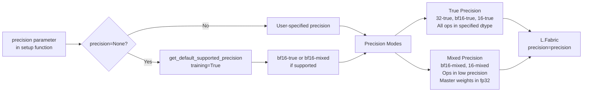
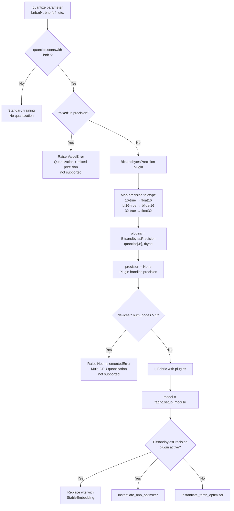

<!-- source: DeepWiki mcp.deepwiki.com · repo Lightning-AI/litgpt · page 3.6 Memory Optimization · fetched 2026-10-21 -->

# Memory Optimization

<details>
<summary>Relevant source files</summary>

The following files were used as context for generating this wiki page:

- [litgpt/utils.py](litgpt/utils.py)
- [tests/test_utils.py](tests/test_utils.py)
- [tutorials/convert_hf_checkpoint.md](tutorials/convert_hf_checkpoint.md)
- [tutorials/convert_lit_models.md](tutorials/convert_lit_models.md)
- [tutorials/finetune_adapter.md](tutorials/finetune_adapter.md)
- [tutorials/finetune_full.md](tutorials/finetune_full.md)
- [tutorials/finetune_lora.md](tutorials/finetune_lora.md)
- [tutorials/inference.md](tutorials/inference.md)
- [tutorials/oom.md](tutorials/oom.md)
- [tutorials/prepare_dataset.md](tutorials/prepare_dataset.md)
- [tutorials/quantize.md](tutorials/quantize.md)

</details>


Memory optimization is critical for training and fine-tuning large language models on resource-constrained hardware. This page documents the memory optimization techniques implemented in LitGPT, including mixed precision training, quantization, activation checkpointing, gradient accumulation, and distributed training strategies.

For information about training infrastructure and distributed strategies in general, see [Training Infrastructure](#3.5). For handling out-of-memory errors during execution, consult the troubleshooting techniques described in this document and [tutorials/oom.md]().

---

## Memory Optimization Techniques Overview

LitGPT implements multiple orthogonal memory optimization techniques that can be combined to fit large models on limited GPU memory. These techniques trade off memory usage, training speed, and numerical stability.

```mermaid
graph TB
    subgraph "Memory Reduction Techniques"
        Precision["Mixed Precision<br/>bf16-true, bf16-mixed, 16-true"]
        Quantization["Quantization<br/>BitsAndBytes 4-bit/8-bit"]
        Activation["Activation Checkpointing<br/>Recompute activations"]
        GradAccum["Gradient Accumulation<br/>Simulate larger batches"]
        SeqLength["Sequence Length Truncation<br/>max_seq_length parameter"]
        MicroBatch["Micro Batch Size<br/>Per-device batch size"]
    end
    
    subgraph "Distributed Techniques"
        FSDP["FSDP<br/>Fully Sharded Data Parallel"]
        CPUOffload["CPU Offloading<br/>Move parameters to CPU"]
        ModelParallel["Model Parallelism<br/>Tensor/Pipeline parallel"]
    end
    
    subgraph "Algorithmic Optimizations"
        ChunkedCE["Chunked Cross-Entropy<br/>Process loss in chunks"]
        KVCache["KV Cache Management<br/>Efficient inference caching"]
        Optimizer["Memory-Efficient Optimizers<br/>PagedAdamW, BitsAndBytes"]
    end
    
    Precision --> Memory["Reduced<br/>Memory Usage"]
    Quantization --> Memory
    Activation --> Memory
    GradAccum --> Memory
    SeqLength --> Memory
    MicroBatch --> Memory
    
    FSDP --> Memory
    CPUOffload --> Memory
    ModelParallel --> Memory
    
    ChunkedCE --> Memory
    KVCache --> Memory
    Optimizer --> Memory
    
    Memory --> Training["Successful<br/>Training"]
```



**Memory vs. Performance Tradeoffs**

| Technique | Memory Reduction | Speed Impact | Precision Impact | Use Case |
|-----------|-----------------|--------------|------------------|----------|
| `bf16-true` | ~50% | Faster | Minimal | Default choice |
| `bf16-mixed` | ~25% | Slightly faster | Minimal | More stable than true |
| Quantization (4-bit) | ~75% | Slower | Some degradation | Very limited memory |
| Activation Checkpointing | ~30-50% | ~20% slower | None | Multi-GPU training |
| Gradient Accumulation | Proportional | Minimal | None | Small batch fits memory |
| Sequence Truncation | Proportional | Faster | Task-dependent | Long sequences |
| FSDP | Scales with GPUs | Communication overhead | None | Multi-GPU sharding |

Sources: [litgpt/finetune/lora.py:48-180](), [litgpt/finetune/full.py:43-123](), [tutorials/oom.md:1-68]()

---

## Mixed Precision Training

Mixed precision training reduces memory footprint by storing model parameters and activations in lower precision formats (float16 or bfloat16) instead of float32.

### Precision Modes

LitGPT supports several precision modes through Lightning Fabric's precision plugin.



**Implementation**

The precision is configured in the `setup()` function of each training script. In [litgpt/finetune/lora.py:130-172](), LitGPT determines the precision to pass to `L.Fabric`.

```python
# From litgpt/finetune/lora.py
precision = precision or get_default_supported_precision(training=True)

fabric = L.Fabric(
    devices=devices,
    num_nodes=num_nodes,
    strategy=strategy,
    precision=precision,  # Applied here
    loggers=logger,
    plugins=plugins,
)
```

**Precision Selection Logic**

- `bf16-true`: All operations in bfloat16, including model weights and gradients. Uses 50% less memory than fp32 [tutorials/quantize.md:23-35]().
- `bf16-mixed`: Forward pass in bfloat16, master weights in fp32, automatic loss scaling. More stable but less memory reduction [tutorials/oom.md:48-49]().
- `16-true`/`16-mixed`: Same as bf16 but with float16. More prone to numerical instability [tutorials/oom.md:45-47]().
- `32-true`: Full precision training. Highest memory usage, best numerical stability [tutorials/quantize.md:15-21]().

Sources: [litgpt/finetune/lora.py:130-172](), [litgpt/finetune/full.py:96-117](), [tutorials/oom.md:41-49](), [tutorials/quantize.md:15-35]()

---

## Quantization with BitsAndBytes

Quantization reduces model precision to 4-bit or 8-bit integers, dramatically reducing memory usage at the cost of some computational overhead and potential quality degradation.

### BitsAndBytes Integration



**Quantization Configuration**

The `quantize` parameter accepts values such as `bnb.nf4`, `bnb.nf4-dq`, `bnb.fp4`, `bnb.fp4-dq`, and `bnb.int8` [tutorials/quantize.md:42-135]().

**Implementation Details**

When quantization is enabled, several special steps occur:

1. **BitsAndBytes Plugin Creation** at [litgpt/finetune/lora.py:139-149]():
```python
if quantize is not None and quantize.startswith("bnb."):
    if "mixed" in precision:
        raise ValueError("Quantization and mixed precision is not supported.")
    dtype = {"16-true": torch.float16, "bf16-true": torch.bfloat16, "32-true": torch.float32}[precision]
    plugins = BitsandbytesPrecision(quantize[4:], dtype)
    precision = None  # Plugin handles precision
```

2. **Stable Embedding Replacement** and **Optimizer Selection** at [litgpt/finetune/lora.py:217-228]():
```python
if isinstance(fabric.strategy.precision, BitsandbytesPrecision):
    optimizer = instantiate_bnb_optimizer(optimizer, model.parameters())
    
    from bitsandbytes.nn import StableEmbedding
    
    old_embedding = model.transformer.wte
    model.transformer.wte = StableEmbedding(old_embedding.num_embeddings, old_embedding.embedding_dim)
    with torch.no_grad():
        model.transformer.wte.weight.copy_(old_embedding.weight)
    model.transformer.wte = model.transformer.wte.to(
        device=old_embedding.weight.device, dtype=old_embedding.weight.dtype
    )
```

The `StableEmbedding` layer from BitsAndBytes is used for numerical stability during quantized training.

**Limitations**

- Quantization is not supported with mixed precision training [litgpt/finetune/lora.py:141]().
- Multi-GPU training with quantization is currently not supported [litgpt/finetune/lora.py:151-156]().

Sources: [litgpt/finetune/lora.py:139-156](), [litgpt/finetune/lora.py:217-231](), [tutorials/quantize.md:42-135](), [tests/test_utils.py:178-192]()

---

## Activation Checkpointing

Activation checkpointing (gradient checkpointing) reduces memory by not storing intermediate activations during the forward pass, instead recomputing them during the backward pass.

### Implementation in LitGPT

Activation checkpointing is typically enabled via distributed strategies like FSDP.

**FSDP Strategy with Activation Checkpointing** in [litgpt/finetune/full.py:106-113]():
```python
if devices * num_nodes > 1:
    strategy = FSDPStrategy(
        auto_wrap_policy={Block},
        activation_checkpointing_policy={Block},  # Enable checkpointing for Blocks
        state_dict_type="full",
        limit_all_gathers=True,
        cpu_offload=False,
    )
```

**Model Parallel Strategy with Manual Checkpointing** in [litgpt/finetune/lora.py:517-538]():
```python
def parallelize_fn(model, device_mesh, activation_checkpointing=True):
    from torch.distributed.algorithms._checkpoint.checkpoint_wrapper import checkpoint_wrapper
    
    if activation_checkpointing:
        model.transformer.h = torch.nn.ModuleList(
            [checkpoint_wrapper(el, preserve_rng_state=False) for el in model.transformer.h]
        )
    # ... shard modules ...
```

Sources: [litgpt/finetune/lora.py:517-538](), [litgpt/finetune/full.py:106-113](), [tutorials/oom.md:55-56]()

---

## Gradient Accumulation

Gradient accumulation simulates larger batch sizes by accumulating gradients over multiple micro-batches before an optimizer step.

### Calculation

The number of accumulation iterations is derived in `TrainArgs` at [litgpt/args.py:57-61]():
```python
def gradient_accumulation_iters(self, devices: int, num_nodes: int = 1) -> int:
    """Number of iterations between gradient synchronizations"""
    gradient_accumulation_iters = self.batch_size(devices, num_nodes) // self.micro_batch_size
    assert gradient_accumulation_iters > 0
    return gradient_accumulation_iters
```

### Training Loop Implementation

In [litgpt/finetune/lora.py:350-364](), the training loop manages synchronization:
```python
is_accumulating = iter_num % train.gradient_accumulation_iters(devices, num_nodes) != 0
with fabric.no_backward_sync(model, enabled=is_accumulating):
    logits = model(input_ids, lm_head_chunk_size=128)
    # ... compute loss ...
    fabric.backward(loss / train.gradient_accumulation_iters(devices, num_nodes))

if not is_accumulating:
    optimizer.step()
    optimizer.zero_grad()
    # ...
```

Sources: [litgpt/finetune/lora.py:350-364](), [litgpt/args.py:57-68](), [tutorials/oom.md:15-21]()

---

## Chunked Cross-Entropy

To avoid materializing the full `[batch, seq, vocab]` logits tensor, LitGPT uses `chunked_cross_entropy` to compute loss in smaller segments.

### Implementation

The function is utilized in the training step [litgpt/finetune/lora.py:352-356]():
```python
logits = model(input_ids, lm_head_chunk_size=128)
# shift the targets such that output n predicts token n+1
logits[-1] = logits[-1][..., :-1, :]
loss = chunked_cross_entropy(logits, targets[..., 1:])
```

`chunked_cross_entropy` is defined in [litgpt/utils.py:38-164] (referenced via `tests/test_utils.py:127-164` for behavior).

Sources: [litgpt/finetune/lora.py:352-356](), [tests/test_utils.py:127-164]()

---

## Sequence Length Management

Reducing the context length (`block_size`) significantly impacts memory due to the quadratic complexity of attention.

### Configuration

LitGPT dynamically calculates the `max_seq_length` based on the dataset and user constraints in [litgpt/finetune/lora.py:300-307]():
```python
longest_seq_length, longest_seq_ix = get_longest_seq_length(
    ConcatDataset([train_dataloader.dataset, val_dataloader.dataset])
)
model.max_seq_length = min(longest_seq_length, train.max_seq_length or float("inf"))
```

Users can override this via `--train.max_seq_length` to force truncation and save memory [tutorials/oom.md:35-37]().

Sources: [litgpt/finetune/lora.py:300-307](), [tutorials/oom.md:23-39](), [tutorials/prepare_dataset.md:35-37]()

---

## Memory-Efficient Optimizers

Standard `AdamW` stores two states per parameter. LitGPT supports 8-bit optimizers via `bitsandbytes`.

### Selection Logic

In [litgpt/finetune/lora.py:217-231]():
- If `BitsandbytesPrecision` is active, `instantiate_bnb_optimizer` is called to create `PagedAdamW` or `AdamW8bit`.
- Otherwise, `instantiate_torch_optimizer` creates standard `AdamW` or `SGD`.

Sources: [litgpt/finetune/lora.py:217-231](), [tutorials/oom.md:58-67](), [tests/test_utils.py:45-46]()

---

## Handling OOM Errors

When encountering `OutOfMemoryError`, LitGPT documentation suggests the following hierarchy of fixes [tutorials/oom.md:1-68]():

1.  **Reduce `micro_batch_size`**: Decrease the number of samples processed simultaneously [tutorials/oom.md:15-21]().
2.  **Reduce `max_seq_length`**: Truncate long samples in the dataset [tutorials/oom.md:23-39]().
3.  **Use Lower Precision**: Switch from `32-true` to `bf16-true` or `16-true` [tutorials/oom.md:41-49]().
4.  **Enable Sharding (FSDP)**: Increase `--devices` to shard memory across multiple GPUs [tutorials/oom.md:50-56]().
5.  **Enable CPU Offloading**: Set `cpu_offload=True` in the FSDP strategy [tutorials/oom.md:55-56]().
6.  **Switch Optimizers**: Use `SGD` or `BitsAndBytes` optimizers to reduce state memory [tutorials/oom.md:58-67]().

Sources: [tutorials/oom.md:1-68](), [tutorials/quantize.md:1-135]()

---

