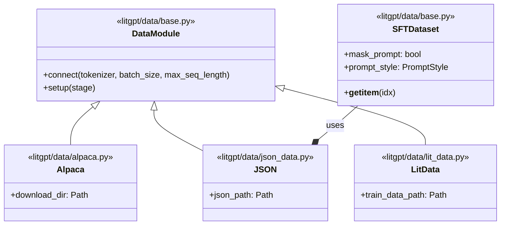
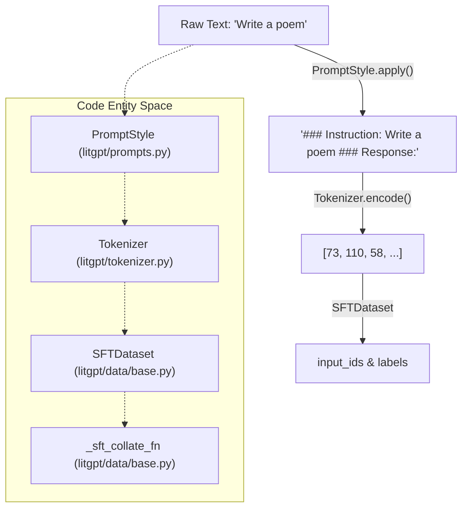

<!-- source: DeepWiki mcp.deepwiki.com · repo Lightning-AI/litgpt · page 5 Data Processing · fetched 2026-10-21 -->

# Data Processing

Relevant source files

The following files were used as context for generating this wiki page:

- [litgpt/data/__init__.py](litgpt/data/__init__.py)
- [litgpt/data/base.py](litgpt/data/base.py)
- [litgpt/data/prepare_slimpajama.py](litgpt/data/prepare_slimpajama.py)
- [litgpt/data/prepare_starcoder.py](litgpt/data/prepare_starcoder.py)
- [litgpt/prompts.py](litgpt/prompts.py)
- [litgpt/scripts/merge_lora.py](litgpt/scripts/merge_lora.py)
- [tests/data/test_base.py](tests/data/test_base.py)
- [tests/test_prompts.py](tests/test_prompts.py)

The Data Processing system in LitGPT is responsible for loading, tokenizing, and batching text data for language model pretraining and finetuning. This component serves as the bridge between raw text data and the training routines, ensuring data is properly formatted for efficient model training.

For information about model configuration, see [Config System](#2.1), and for information about tokenization implementation details, see [Tokenizer](#2.2).

## Core Architecture

The data processing system is built around a modular architecture with a common base class `DataModule` [litgpt/data/base.py:16-38]() and specialized implementations for different data formats and training scenarios.

### System to Code Mapping
The following diagram bridges the high-level data concepts to the specific classes and files in the codebase.

Sources:
- [litgpt/data/base.py:16-109]()
- [litgpt/data/__init__.py:3-37]()

### DataModule Interface
All data modules in LitGPT extend the `DataModule` base class [litgpt/data/base.py:16](). Key methods include:

1.  `connect(tokenizer, batch_size, max_seq_length)`: Links the module with a `Tokenizer` and sets training constraints [litgpt/data/base.py:20-29]().
2.  `setup(stage)`: Logic for splitting data or preparing internal state [litgpt/data/base.py:31-33]().

For deep technical details on these abstractions, see [DataModules](#5.1).

## Data Processing Workflow

The workflow from raw data to model-ready batches involves tokenization and, for finetuning, the application of `PromptStyle` templates.

### Natural Language to Token Space
This diagram shows how a raw instruction is transformed into the `input_ids` and `labels` used by the `Model`.

Sources:
- [litgpt/data/base.py:82-109]()
- [litgpt/prompts.py:17-22]()
- [litgpt/tokenizer.py:23-25]()

### Supervised Fine-Tuning (SFT) Dataset
The `SFTDataset` class [litgpt/data/base.py:39-109]() handles the conversion of instruction-output pairs. It applies a `PromptStyle` [litgpt/data/base.py:86]() and can optionally mask the instruction tokens in the labels using an `ignore_index` (default -100) so the model only learns to predict the response [litgpt/data/base.py:93-96]().

## Dataset Preparation and Pretraining

For large-scale pretraining, LitGPT uses a specialized preprocessing pipeline to convert raw text into binary chunks for high-performance I/O.

### Preprocessing Pipeline
Pretraining datasets like SlimPajama or Starcoder are processed into the `litdata` format. This involves:
1.  **Tokenization**: Converting text to integer IDs [litgpt/data/prepare_slimpajama.py:32]().
2.  **Chunking**: Grouping tokens into large binary files to optimize throughput [litgpt/data/prepare_starcoder.py:56]().
3.  **Recipes**: Using `DataChunkRecipe` to define how specific formats (e.g., `.zst`, `.parquet`) are read [litgpt/data/prepare_slimpajama.py:13](), [litgpt/data/prepare_starcoder.py:18]().

For details on these scripts and the binary format, see [Dataset Preparation](#5.2).

## Supported Datasets

LitGPT includes built-in DataModules for common datasets:

| Type | Datasets |
| :--- | :--- |
| **Finetuning (SFT)** | `Alpaca`, `Alpaca2k`, `AlpacaGPT4`, `Deita`, `FLAN`, `LIMA`, `LongForm` |
| **Pretraining** | `TinyLlama`, `TinyStories`, `OpenWebText`, `MicroLlama` |
| **Custom** | `JSON` (for local files), `TextFiles` (plain text) |

Sources:
- [litgpt/data/__init__.py:3-37]()

## Memory and Performance Optimization

1.  **Collating**: The `_sft_collate_fn` handles dynamic padding of sequences within a batch to the longest element [litgpt/data/base.py:122-132]().
2.  **Truncation**: Sequences are truncated to `max_seq_length` to prevent Out-Of-Memory (OOM) errors [litgpt/data/base.py:135-136]().
3.  **Prompt Masking**: By masking prompts in `SFTDataset`, compute is focused on the relevant response tokens [litgpt/data/base.py:95-96]().

Sources:
- [litgpt/data/base.py:112-148]()

---

