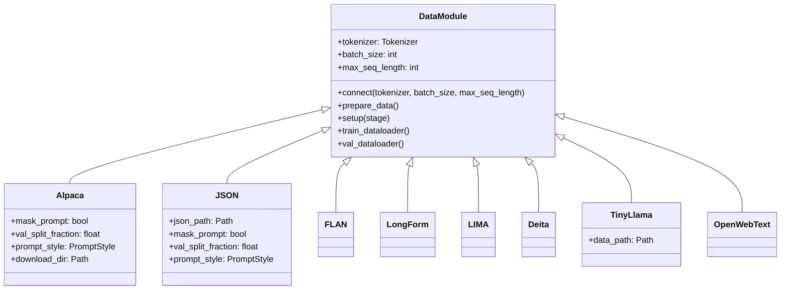
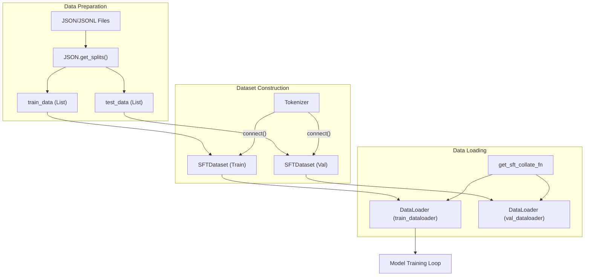
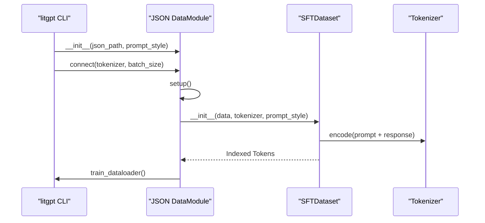

<!-- source: DeepWiki mcp.deepwiki.com · repo Lightning-AI/litgpt · page 5.1 DataModules · fetched 2026-10-21 -->

# DataModules

Relevant source files

The following files were used as context for generating this wiki page:

- [litgpt/data/alpaca.py](litgpt/data/alpaca.py)
- [litgpt/data/alpaca_2k.py](litgpt/data/alpaca_2k.py)
- [litgpt/data/alpaca_gpt4.py](litgpt/data/alpaca_gpt4.py)
- [litgpt/data/deita.py](litgpt/data/deita.py)
- [litgpt/data/flan.py](litgpt/data/flan.py)
- [litgpt/data/json_data.py](litgpt/data/json_data.py)
- [litgpt/data/lima.py](litgpt/data/lima.py)
- [litgpt/data/longform.py](litgpt/data/longform.py)
- [tests/data/test_alpaca.py](tests/data/test_alpaca.py)
- [tests/data/test_deita.py](tests/data/test_deita.py)
- [tests/data/test_json.py](tests/data/test_json.py)
- [tests/data/test_longform.py](tests/data/test_longform.py)
- [tests/data/test_openwebtext.py](tests/data/test_openwebtext.py)
- [tests/data/test_tinyllama.py](tests/data/test_tinyllama.py)

DataModules in LitGPT are responsible for loading, processing, and batching data for model training and evaluation. They provide a consistent interface across different data sources and formats, handling both pretraining and finetuning tasks. This document explains the DataModule system architecture, supported datasets, and how to create and use DataModules in your training workflows.

## DataModule Architecture

The DataModule system in LitGPT follows a unified architecture with a common interface that all specific implementations adhere to. This consistency makes it easy to swap different datasets while keeping the training code unchanged.

### Class Hierarchy

Sources: [litgpt/data/base.py:12-12](), [litgpt/data/alpaca.py:20-46](), [litgpt/data/json_data.py:18-43](), [litgpt/data/flan.py:21-45](), [litgpt/data/longform.py:19-39](), [litgpt/data/lima.py:16-43](), [litgpt/data/deita.py:16-40]().

### Core Interface Methods

Every DataModule implements these key methods:

1.  **`connect(tokenizer, batch_size, max_seq_length)`**: Associates the DataModule with a tokenizer and sets processing parameters [litgpt/data/json_data.py:69-74]().
2.  **`prepare_data()`**: Downloads or preprocesses data as needed. This runs once per node [litgpt/data/alpaca.py:60-62]().
3.  **`setup(stage)`**: Prepares training and validation datasets by instantiating `SFTDataset` or streaming datasets. This runs on every process [litgpt/data/json_data.py:76-94]().
4.  **`train_dataloader()`**: Returns a `DataLoader` for training data [litgpt/data/json_data.py:96-104]().
5.  **`val_dataloader()`**: Returns a `DataLoader` for validation data [litgpt/data/json_data.py:106-113]().

## Data Processing Flow

The following diagram illustrates the relationship between the DataModule, the Tokenizer, and the underlying SFTDataset.

Sources: [litgpt/data/json_data.py:76-113](), [litgpt/data/base.py:116-168](), [litgpt/data/json_data.py:115-136]().

## Types of DataModules

LitGPT provides specialized DataModules for different use cases:

### 1. Finetuning DataModules (SFT)

These DataModules are designed for Supervised Fine-Tuning, typically loading data into memory and using `SFTDataset` [litgpt/data/base.py:116-168]().

*   **Alpaca**: For the cleaned Alpaca dataset [litgpt/data/alpaca.py:20-21](). Variants include **Alpaca2k** [litgpt/data/alpaca_2k.py:12-12]() and **AlpacaGPT4** [litgpt/data/alpaca_gpt4.py:12-12]().
*   **JSON**: A flexible DataModule for any local `.json` or `.jsonl` files [litgpt/data/json_data.py:18-24]().
*   **FLAN**: Supports multiple subsets of the FLAN collection [litgpt/data/flan.py:21-22]().
*   **LongForm**: For the LongForm dataset, which uses a specific `_transform` to map "input" to "instruction" [litgpt/data/longform.py:19-20](), [litgpt/data/longform.py:87-89]().
*   **LIMA**: Requires an HF token for access and supports multi-turn conversation formatting [litgpt/data/lima.py:16-37]().
*   **Deita**: Specifically for the Deita-10k dataset [litgpt/data/deita.py:16-34]().

### 2. Pretraining DataModules

These use `litdata` for high-performance streaming of large-scale datasets.

*   **TinyLlama**: Orchestrates SlimPajama and Starcoder datasets using `CombinedStreamingDataset` [tests/data/test_tinyllama.py:8-33]().
*   **OpenWebText**: Preprocesses and streams the OpenWebText dataset [tests/data/test_openwebtext.py:10-58]().

## Custom JSON Datasets

The `JSON` DataModule is the primary tool for custom data. It supports two modes:
1.  **Single File**: A single `.json` or `.jsonl` file which is automatically split into train and validation sets based on `val_split_fraction` (defaults to 0.05) [litgpt/data/json_data.py:47-55]().
2.  **Directory**: A directory containing `train.json` (or `train.jsonl`) and `val.json` (or `val.jsonl`) [litgpt/data/json_data.py:129-132]().

Each entry in the JSON must contain `instruction` and `output` keys, with an optional `input` key [litgpt/data/json_data.py:22-24]().

### Data Flow for SFT

Sources: [litgpt/data/json_data.py:18-113](), [litgpt/data/base.py:116-168](), [tests/data/test_json.py:11-66]().

## Implementing Custom DataModules

To implement a new DataModule, you should inherit from `litgpt.data.DataModule` and define how the data is transformed.

### The `_transform` Pattern
Many built-in DataModules use a `_transform` function to map heterogeneous dataset schemas to the standard LitGPT schema (`instruction`, `input`, `output`).

*   **FLAN**: Maps `inputs` to `instruction` and `targets` to `output` [litgpt/data/flan.py:115-118]().
*   **LongForm**: Maps `input` to `instruction` [litgpt/data/longform.py:87-89]().
*   **LIMA**: Uses `format_dataset` to handle multi-turn conversations [litgpt/data/lima.py:119-130]().

### Example Implementation Structure
A custom DataModule typically follows this lifecycle:
1.  **`__post_init__`**: Resolve `PromptStyle` from name [litgpt/data/alpaca.py:48-51]().
2.  **`prepare_data`**: Download files or check existence [litgpt/data/alpaca.py:60-62]().
3.  **`setup`**: Load data and instantiate `SFTDataset` [litgpt/data/alpaca.py:64-91]().
4.  **`train_dataloader`**: Return a `DataLoader` using `get_sft_collate_fn` to handle padding and masking [litgpt/data/alpaca.py:93-101]().

Sources: [litgpt/data/alpaca.py:48-111](), [litgpt/data/base.py:12-25]().

## Summary Table of SFT Datasets

| Class | Source | Prompt Style | Key Feature |
| :--- | :--- | :--- | :--- |
| `Alpaca` | GitHub (Cleaned) | `alpaca` | Standard instruction tuning [litgpt/data/alpaca.py:16-27]() |
| `Alpaca2k` | HF (mhenrichsen) | `alpaca` | Small-scale testing [litgpt/data/alpaca_2k.py:12-19]() |
| `FLAN` | HF (Muennighoff) | `flan` | Multi-task (66 subsets) [litgpt/data/flan.py:21-39]() |
| `LIMA` | HF (GAIR) | `alpaca` | High quality, low quantity [litgpt/data/lima.py:16-33]() |
| `Deita` | HF (HuggingFaceH4) | `alpaca` | Data-efficient selection [litgpt/data/deita.py:16-33]() |
| `JSON` | Local File/Dir | User Defined | Custom data support [litgpt/data/json_data.py:18-31]() |

Sources: [litgpt/data/alpaca.py](), [litgpt/data/alpaca_2k.py](), [litgpt/data/flan.py](), [litgpt/data/lima.py](), [litgpt/data/deita.py](), [litgpt/data/json_data.py]().

---

