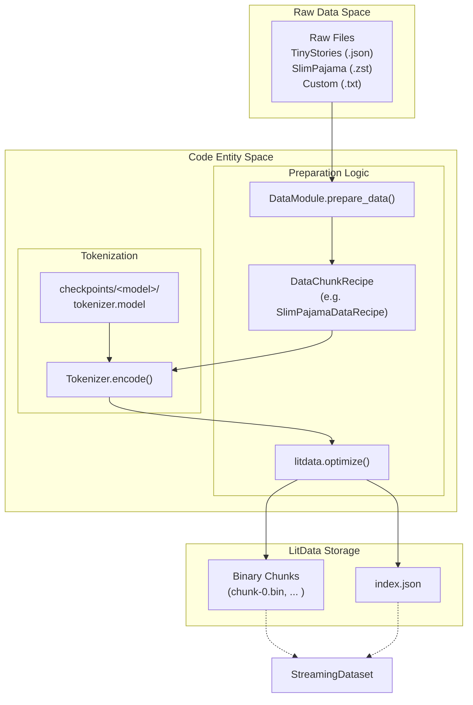
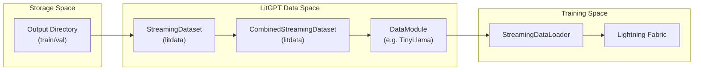

<!-- source: DeepWiki mcp.deepwiki.com · repo Lightning-AI/litgpt · page 5.2 Dataset Preparation · fetched 2026-10-21 -->

# Dataset Preparation

<details>
<summary>Relevant source files</summary>

The following files were used as context for generating this wiki page:

- [litgpt/data/__init__.py](litgpt/data/__init__.py)
- [litgpt/data/lit_data.py](litgpt/data/lit_data.py)
- [litgpt/data/openwebtext.py](litgpt/data/openwebtext.py)
- [litgpt/data/prepare_slimpajama.py](litgpt/data/prepare_slimpajama.py)
- [litgpt/data/prepare_starcoder.py](litgpt/data/prepare_starcoder.py)
- [litgpt/data/text_files.py](litgpt/data/text_files.py)
- [litgpt/data/tinyllama.py](litgpt/data/tinyllama.py)
- [litgpt/data/tinystories.py](litgpt/data/tinystories.py)
- [tests/data/test_lit_data.py](tests/data/test_lit_data.py)
- [tests/data/test_textfiles.py](tests/data/test_textfiles.py)
- [tests/data/test_tinystories.py](tests/data/test_tinystories.py)
- [tutorials/convert_hf_checkpoint.md](tutorials/convert_hf_checkpoint.md)
- [tutorials/convert_lit_models.md](tutorials/convert_lit_models.md)
- [tutorials/oom.md](tutorials/oom.md)
- [tutorials/prepare_dataset.md](tutorials/prepare_dataset.md)

</details>


## Purpose and Scope

This document covers the preprocessing scripts and workflows that transform raw datasets into training-ready formats for LitGPT. Dataset preparation involves tokenization, binary chunk creation, and format conversion to optimize data loading during training.

For information about the DataModule abstraction and built-in dataset implementations for finetuning (Alpaca, Dolly, LIMA, etc.), see [DataModules](#5.1). For the overall training infrastructure that consumes prepared datasets, see [Training Infrastructure](#3.5) and [Pretraining](#4).

## Overview

LitGPT requires different data preparation approaches depending on the training task:

| Task | Input Format | Output Format | Key Scripts / Classes |
|------|-------------|---------------|-------------|
| **Pretraining** | Raw text files (TXT, JSON, ZST) | Binary chunks (`litdata`) | `prepare_slimpajama.py`, `TextFiles`, `TinyStories` |
| **Finetuning** | JSON (instruction/input/output) | In-memory tokenization | `SFTDataset`, `Alpaca`, `JSON` |

The primary distinction is that pretraining datasets are typically too large to fit in memory and require efficient streaming from disk using the `litdata` format, while finetuning datasets are smaller and can be tokenized on-the-fly.

Sources: [litgpt/data/tinystories.py:19-23](), [litgpt/data/text_files.py:15-21](), [litgpt/data/prepare_slimpajama.py:13-34](), [tutorials/prepare_dataset.md:22-32]()

## Pretraining Dataset Preparation

### Preparation Pipeline



**Pretraining Data Preparation Workflow**

Sources: [litgpt/data/tinystories.py:47-79](), [litgpt/data/text_files.py:51-105](), [litgpt/data/prepare_slimpajama.py:36-57]()

### Tokenization Step

The tokenization step converts raw text into token IDs using a pretrained tokenizer. LitGPT's preparation scripts use the tokenizer from a base model (typically Llama) to ensure compatibility.

**Tokenizer Setup:**

```bash
# Download tokenizer only (no model weights)
litgpt download meta-llama/Llama-2-7b-hf \
  --tokenizer_only true
```

The `Tokenizer` class [litgpt/tokenizer.py]() is used within preparation scripts. For example, in `TinyStories.prepare_data`, the `tokenize` function is passed to `litdata.optimize` via `functools.partial` [litgpt/data/tinystories.py:61-68]().

Sources: [litgpt/data/tinystories.py:107-117](), [litgpt/data/text_files.py:135-139](), [litgpt/data/prepare_slimpajama.py:45-47]()

### Binary Chunk Creation and LitData

LitGPT utilizes the `litdata` library to create optimized binary chunks. This format enables high-performance streaming, shuffling, and multi-worker loading.

**Key Components:**
- `litdata.optimize`: The core function used to parallelize tokenization and chunk creation [litgpt/data/tinystories.py:61-68]().
- `TokensLoader`: A specialized loader for tokenized data that handles `block_size` requirements for LLMs [litgpt/data/tinystories.py:67]().
- `DataChunkRecipe`: A class-based approach used in `prepare_slimpajama.py` to define how items are prepared [litgpt/data/prepare_slimpajama.py:13-34]().

**SlimPajama Preparation Example:**
The `SlimPajamaDataRecipe` handles `.zst` files, skipping GitHub data to avoid overlap with Starcoder, and encodes text with `eos=True` [litgpt/data/prepare_slimpajama.py:24-33]().

**TextFiles Preparation:**
The `TextFiles` DataModule looks for `.txt` files and creates separate `train` and `val` binary directories [litgpt/data/text_files.py:55-70]().

Sources: [litgpt/data/prepare_slimpajama.py:13-34](), [litgpt/data/text_files.py:71-80](), [litgpt/data/tinystories.py:47-79]()

### Fast Development Mode

Preparation scripts like `prepare_slimpajama.py` support a `fast_dev_run` flag [litgpt/data/prepare_slimpajama.py:36-41](). This is passed to `litdata.processing.data_processor.DataProcessor` to process a small subset for testing [litgpt/data/prepare_slimpajama.py:48-57]().

Sources: [litgpt/data/prepare_slimpajama.py:41-57]()

## Finetuning Dataset Preparation

### JSON Format Requirements

Finetuning datasets typically use a JSON structure with `instruction`, `input`, and `output` fields [tutorials/prepare_dataset.md:351-377]().

```json
[
    {
        "instruction": "Write a limerick about a pelican.",
        "input": "",
        "output": "There once was a pelican so fine..."
    }
]
```

Unlike pretraining, these are usually processed on-the-fly by `SFTDataset` [litgpt/data/base.py](), which handles the formatting based on a `PromptStyle`.

Sources: [tutorials/prepare_dataset.md:351-377](), [litgpt/data/base.py:6-7]()

### Dataset Truncation and OOM

For memory efficiency, datasets can be truncated to a maximum sequence length using `--train.max_seq_length` [tutorials/prepare_dataset.md:35-38]().

**Memory Impact:**
Truncating the Alpaca dataset to 256 tokens can reduce the memory requirements of a Falcon 7B model from 23.52 GB to 15.73 GB [tutorials/oom.md:35-37]().

Sources: [tutorials/oom.md:23-40](), [tutorials/prepare_dataset.md:35-38]()

## Data Loading Integration



**Data Flow for Streaming Datasets**

For the `TinyLlama` dataset, `CombinedStreamingDataset` is used to mix SlimPajama (69.3%) and Starcoder (30.6%) data [litgpt/data/tinyllama.py:80-84](). The `TokensLoader` is configured with a `block_size` of `max_seq_length + 1` to accommodate next-token prediction [litgpt/data/tinyllama.py:47]().

Sources: [litgpt/data/tinyllama.py:59-89](), [litgpt/data/lit_data.py:51-63](), [litgpt/data/tinystories.py:80-91]()

## Summary of Prepared Datasets

| Name | Task | Size | Format |
|------|------|------|--------|
| **SlimPajama** | Pretraining | 627B tokens | LitData Chunks |
| **Starcoder** | Pretraining | ~1.1 TB | LitData Chunks |
| **TinyStories** | Pretraining | 4.9M stories | LitData Chunks |
| **OpenWebText** | Pretraining | 8M documents | LitData Chunks |
| **Alpaca** | Finetuning | 51k samples | JSON |

Sources: [tutorials/prepare_dataset.md:5-18](), [litgpt/data/openwebtext.py:14-16](), [litgpt/data/tinystories.py:19-23]()

---

