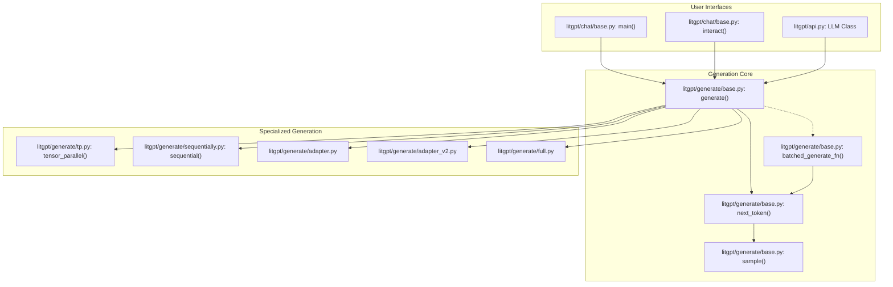
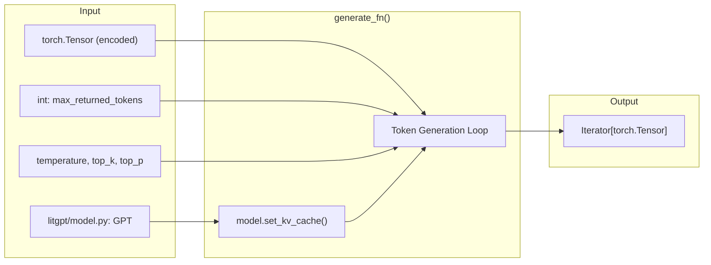

<!-- source: DeepWiki mcp.deepwiki.com · repo Lightning-AI/litgpt · page 6 Inference and Generation · fetched 2026-10-21 -->

# Inference and Generation

Relevant source files

The following files were used as context for generating this wiki page:

- [litgpt/api.py](litgpt/api.py)
- [litgpt/generate/adapter.py](litgpt/generate/adapter.py)
- [litgpt/generate/adapter_v2.py](litgpt/generate/adapter_v2.py)
- [litgpt/generate/base.py](litgpt/generate/base.py)
- [litgpt/generate/full.py](litgpt/generate/full.py)
- [tests/test_api.py](tests/test_api.py)
- [tutorials/python-api.md](tutorials/python-api.md)

This document explains how to use trained models for text generation and inference in LitGPT. It covers the core generation functionality, sampling methods, deployment strategies, and interfaces for generating text from models.

## Overview

LitGPT provides flexible inference and generation capabilities for language models, with support for various sampling methods, configuration options, and deployment strategies. The generation system can operate in both token-by-token mode for interactive applications and batch generation mode for efficiency.

Sources: [litgpt/generate/base.py:129-239](), [litgpt/chat/base.py:77-121](), [litgpt/api.py:38-51]()

## Core Generation System

The core of LitGPT's inference system is the `generate` function, which handles token generation given a model and input prompt. It's built around an autoregressive process that generates text one token at a time.

### Generate Function

The primary generation function takes a model, input tokens, and various sampling parameters to produce text:

At its core, the generation process:
1. Takes a model and prompt input.
2. Sets up the KV-cache for efficient inference [litgpt/generate/base.py:522-524]().
3. Generates tokens one by one using autoregressive prediction [litgpt/generate/base.py:173-205]().
4. Applies sampling strategies to each new token [litgpt/generate/base.py:84-86]().
5. Returns the concatenated tokens (prompt + generated).

Sources: [litgpt/generate/base.py:129-239](), [litgpt/api.py:214-228]()

### Token Sampling

LitGPT implements various sampling techniques to control the randomness and quality of generated text. The `sample` function in `litgpt/generate/base.py` [litgpt/generate/base.py:54-74]() handles:
- **Temperature**: Controls randomness by scaling logits (higher = more random) [litgpt/generate/base.py:67-68]().
- **Top-K**: Limits sampling to the K most likely tokens [litgpt/generate/base.py:61-64]().
- **Top-P (nucleus sampling)**: Samples from the smallest set of tokens whose cumulative probability exceeds the threshold [litgpt/generate/base.py:70-71]().

For details on these parameters and KV cache management, see [Generation Strategies](#6.1).

Sources: [litgpt/generate/base.py:39-74]()

## Python API

The `LLM` class in `litgpt/api.py` provides the high-level interface for interacting with models programmatically. It encapsulates model loading, device distribution, and generation methods.

Key capabilities include:
- **Model Loading**: `LLM.load("model-name")` automatically handles local checkpoints or hub downloads [litgpt/api.py:149-172]().
- **Distribution**: The `.distribute()` method allows moving models to GPUs with specific strategies [litgpt/api.py:184-212]().
- **Benchmarking**: The `.benchmark()` method estimates tokens/sec and memory usage [litgpt/api.py:276-310]().

For detailed usage and code examples, see [Python API](#6.2).

Sources: [litgpt/api.py:38-310](), [tutorials/python-api.md:1-115]()

## Deployment and Serving

LitGPT supports multiple ways to deploy models for production use.

### Serving Models

Deployment is primarily handled via **LitServe**, providing:
- **HTTP Endpoints**: Serve models as web services.
- **OpenAI Compatibility**: API endpoints that mimic the OpenAI interface.
- **Streaming**: Support for token-by-token response streaming.

For server configuration and deployment guides, see [Serving Models](#6.3).

### Multi-GPU Strategies

To handle large models, LitGPT offers specialized distribution strategies:
- **Sequential Strategy**: Loads different model parts onto different GPUs to fit models that exceed single-GPU memory [litgpt/generate/sequentially.py:32-133]().
- **Tensor Parallel Strategy**: Parallelizes computation across GPUs for higher performance [litgpt/generate/tp.py:33-99]().

Sources: [litgpt/api.py:184-212](), [tutorials/python-api.md:113-174]()

## Chat Interface

LitGPT provides a dedicated chat interface built on top of the core generation system. This interface manages the conversation state and formats the inputs/outputs appropriately using the `PromptStyle` system.

The chat interface [litgpt/chat/base.py:77-121]():
1. Loads a model and tokenizer.
2. Formats prompts according to the model's expected `PromptStyle` [litgpt/chat/base.py:99-101]().
3. Streams tokens to provide a responsive user experience [litgpt/chat/base.py:116-121]().

Sources: [litgpt/chat/base.py:77-121](), [litgpt/chat/base.py:151-272]()

## Performance Considerations

- **KV-Cache**: Avoids recomputing attention for previous tokens [litgpt/generate/base.py:522-524]().
- **Quantization**: Supports 4-bit and 8-bit quantization via `BitsandbytesPrecision` to reduce memory footprint [litgpt/generate/base.py:486-495]().
- **Compilation**: Uses `torch.compile` on the `next_token` function to reduce overhead [litgpt/generate/base.py:527-532]().

Sources: [litgpt/generate/base.py:486-532](), [litgpt/api.py:255-274]()

---

