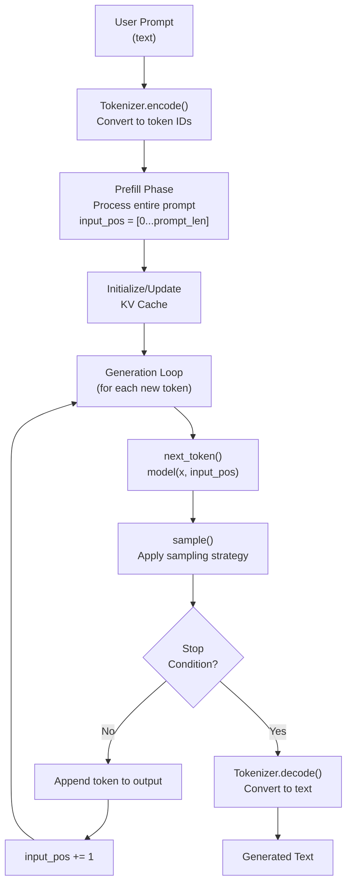
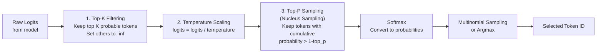
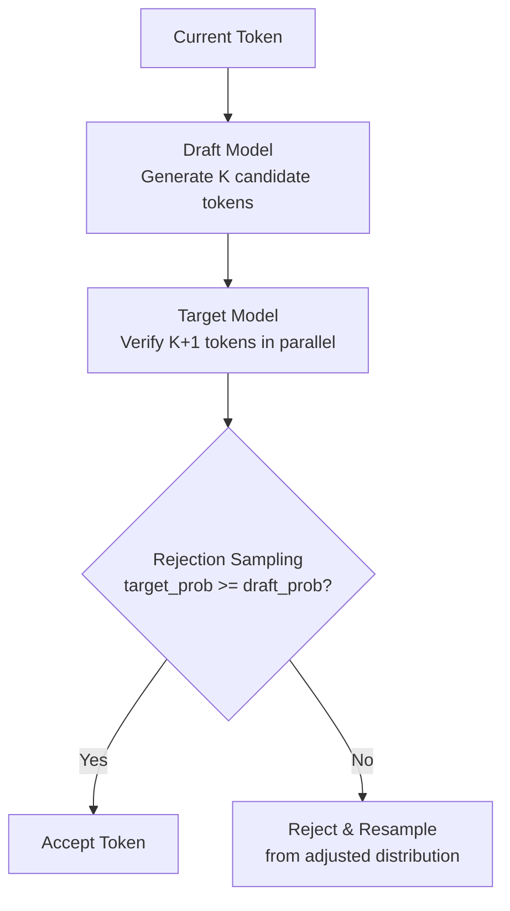
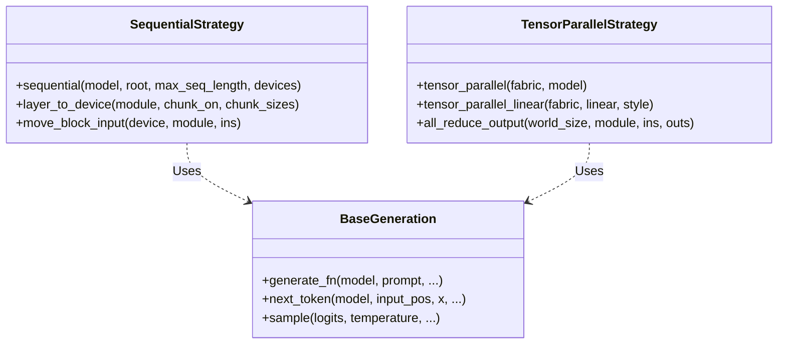

<!-- source: DeepWiki mcp.deepwiki.com · repo Lightning-AI/litgpt · page 6.1 Generation Strategies · fetched 2026-10-21 -->

# Generation Strategies

Relevant source files

The following files were used as context for generating this wiki page:

- [litgpt/generate/adapter.py](litgpt/generate/adapter.py)
- [litgpt/generate/adapter_v2.py](litgpt/generate/adapter_v2.py)
- [litgpt/generate/base.py](litgpt/generate/base.py)
- [litgpt/generate/full.py](litgpt/generate/full.py)
- [litgpt/generate/sequentially.py](litgpt/generate/sequentially.py)
- [litgpt/generate/speculative_decoding.py](litgpt/generate/speculative_decoding.py)
- [litgpt/generate/tp.py](litgpt/generate/tp.py)
- [tests/generate/test_main.py](tests/generate/test_main.py)
- [tests/generate/test_sequentially.py](tests/generate/test_sequentially.py)

## Purpose and Scope

This document describes the text generation pipeline in LitGPT, including the core generation loop, sampling methods, KV cache management, and multi-GPU distribution strategies. It covers both the low-level generation functions in `litgpt.generate.base` and high-level distribution logic found in specialized scripts for sequential and tensor parallel execution.

For information about the `LLM` class and Python API usage, see [Python API](6.2). For model serving and deployment, see [Serving Models](6.3).

---

## Core Generation Pipeline

### The Generation Loop

Text generation in LitGPT follows an autoregressive pattern where tokens are generated one at a time. The process begins with a prompt (conditioning sequence) and continues until a stopping condition is met.

**Sources:** [litgpt/generate/base.py:129-236](), [litgpt/generate/base.py:373-428]()

The generation process consists of two phases:

1. **Prefill Phase**: The entire prompt is processed in a single forward pass with `input_pos = torch.arange(0, prompt_size)` [litgpt/generate/base.py:180](). This populates the KV cache with the prompt's key-value pairs.
2. **Generation Phase**: Tokens are generated one at a time with `input_pos` incrementing by 1 after each iteration [litgpt/generate/base.py:229](). Each forward pass only processes the single new token, leveraging the KV cache to avoid recomputing previous tokens.

### Key Functions

| Function | Location | Purpose |
|----------|----------|---------|
| `generate()` | [litgpt/generate/base.py:373-428]() | Main generation function that returns all tokens at once |
| `generate_fn()` | [litgpt/generate/base.py:129-236]() | Iterator-based generation with stop token support |
| `batched_generate_fn()` | [litgpt/generate/base.py:240-371]() | Batch generation for multiple prompts |
| `next_token()` | [litgpt/generate/base.py:77-86]() | Logic to run the model and sample the next token |
| `sample()` | [litgpt/generate/base.py:54-74]() | Core sampling logic (temperature, top-k, top-p) |
| `speculative_decoding()` | [litgpt/generate/speculative_decoding.py:61-177]() | High-speed generation using draft/target model pairs |

**Sources:** [litgpt/generate/base.py:1-561](), [litgpt/generate/speculative_decoding.py:61-177]()

---

## Sampling Methods

Token sampling controls the randomness and diversity of generated text. LitGPT implements three sampling strategies applied in sequence:

**Sources:** [litgpt/generate/base.py:54-74]()

### Temperature
Temperature controls the randomness of predictions. The logits are scaled by dividing by temperature: `logits = logits / temperature` [litgpt/generate/base.py:68]().
- `temperature = 0.0`: Greedy decoding (always select most probable token) [litgpt/generate/base.py:74]().
- `temperature = 1.0`: Sample from the unmodified distribution.

### Top-K Sampling
Top-K sampling restricts the sampling pool to the K most probable tokens. This is implemented by finding the top K logits using `torch.topk()` and filling the rest with `-inf` [litgpt/generate/base.py:62-64]().

### Top-P Sampling (Nucleus Sampling)
Top-P sampling selects from the smallest set of tokens whose cumulative probability exceeds the threshold `top_p`. The implementation in `sample_top_p` sorts logits, calculates cumulative probabilities, and masks tokens falling outside the threshold [litgpt/generate/base.py:39-51]().

---

## KV Cache Management

The KV (key-value) cache is critical for efficient autoregressive generation. It stores the key and value tensors from previous tokens, eliminating the need to recompute them.

### Initialization and Management
The model's KV cache is typically managed via `model.set_kv_cache(batch_size=...)` [litgpt/generate/full.py:120-122](). In specialized strategies like sequential generation, the cache is built per block using `submodule.attn.build_kv_cache` [litgpt/generate/sequentially.py:65-67]().

For speculative decoding, both the draft and target models maintain separate KV caches to allow verification of multiple tokens at once [litgpt/generate/speculative_decoding.py:165-175]().

---

## Generation Strategies

LitGPT supports three primary distribution strategies for inference.

### 1. Default Strategy (Single Device)
The default strategy loads the entire model onto a single device (GPU, CPU, or MPS). This is the standard approach used in `litgpt.generate.base`.

### 2. Sequential Strategy
The sequential strategy partitions transformer layers across multiple devices. Layers execute sequentially: GPU 0 processes its chunk of layers, passes activations to GPU 1, and so on.

**Implementation Details:**
- **Layer Mapping**: `layer_to_device` creates an `OrderedDict` mapping block paths to device indices [litgpt/generate/sequentially.py:102-114]().
- **Forward Hooks**: `move_block_input` and `move_block_output` are registered as pre-forward and post-forward hooks to transfer tensors between devices on-the-fly [litgpt/generate/sequentially.py:89-91](), [litgpt/generate/sequentially.py:117-125]().

**Sources:** [litgpt/generate/sequentially.py:36-93]()

### 3. Tensor Parallel Strategy
Tensor parallelism splits individual weight matrices (QKV projections, MLP layers) across GPUs. All GPUs process the same tokens simultaneously, synchronizing via all-reduce operations.

**Implementation Details:**
- **Weight Splitting**: `tensor_parallel_linear` shards weights either "colwise" (output dimension) or "rowwise" (input dimension) [litgpt/generate/tp.py:33-51]().
- **Synchronization**: An `all_reduce_output` hook is registered on the output of sharded layers to sum the partial results across the world size [litgpt/generate/tp.py:78-81]().
- **Architecture Support**: Supports `LLaMAMLP`, `GptNeoxMLP`, and `LLaMAMoE` (expert slicing) [litgpt/generate/tp.py:53-70]().

**Sources:** [litgpt/generate/tp.py:33-99]()

---

## Specialized Generation Algorithms

### Speculative Decoding
Speculative decoding leverages a smaller, faster "draft" model to predict a sequence of $K$ tokens, which are then verified in parallel by a larger "target" model.

**Key Steps:**
1. **Drafting**: Draft model autoregressively generates `speculative_k` tokens [litgpt/generate/speculative_decoding.py:107-116]().
2. **Verification**: Target model processes the prompt and all candidate tokens in one forward pass [litgpt/generate/speculative_decoding.py:123-125]().
3. **Rejection Sampling**: Tokens are accepted if the target model's probability exceeds the draft's. If rejected, a new token is sampled from the difference of the distributions [litgpt/generate/speculative_decoding.py:138-162]().

**Sources:** [litgpt/generate/speculative_decoding.py:61-177]()

---

## Multi-GPU Coordination

### Code Entity Mapping
The following diagram maps the high-level distribution strategies to their core implementation functions.

**Sources:** [litgpt/generate/sequentially.py:36-93](), [litgpt/generate/tp.py:84-99](), [litgpt/generate/base.py:129-154]()

---

