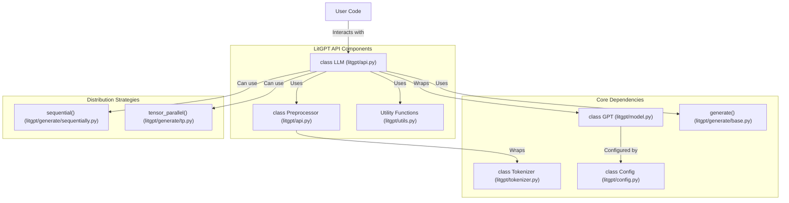
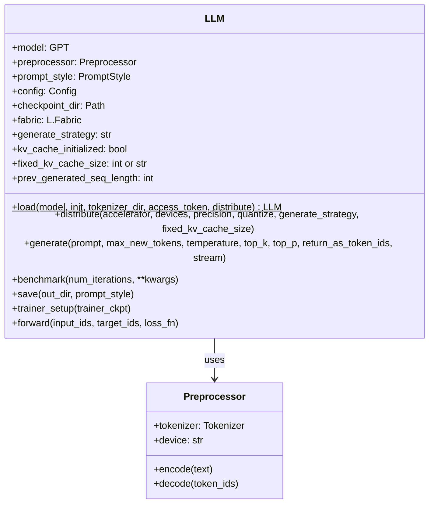
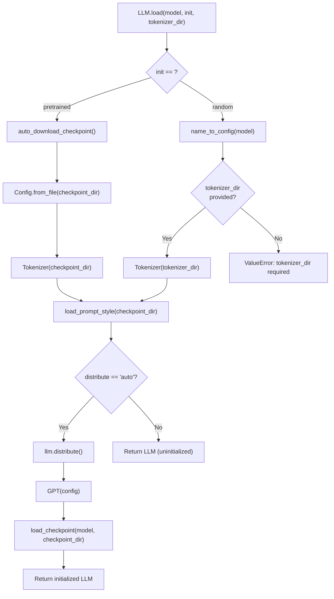
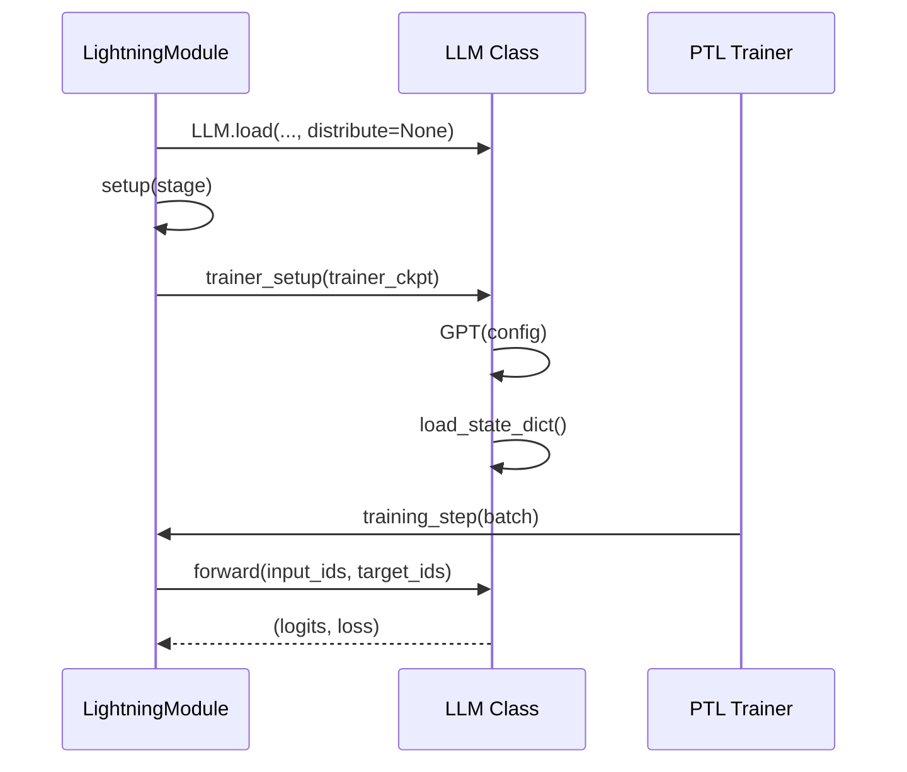

<!-- source: DeepWiki mcp.deepwiki.com · repo Lightning-AI/litgpt · page 6.2 Python API · fetched 2026-10-21 -->

# Python API

<details>
<summary>Relevant source files</summary>

The following files were used as context for generating this wiki page:

- [litgpt/api.py](litgpt/api.py)
- [tests/test_api.py](tests/test_api.py)
- [tests/test_trainer_support.py](tests/test_trainer_support.py)
- [tutorials/developer-docs/README.md](tutorials/developer-docs/README.md)
- [tutorials/developer-docs/python-api.md](tutorials/developer-docs/python-api.md)
- [tutorials/examples/ptl-trainer/README.md](tutorials/examples/ptl-trainer/README.md)
- [tutorials/examples/ptl-trainer/litgpt_ptl_medium.py](tutorials/examples/ptl-trainer/litgpt_ptl_medium.py)
- [tutorials/examples/ptl-trainer/litgpt_ptl_small.py](tutorials/examples/ptl-trainer/litgpt_ptl_small.py)
- [tutorials/python-api.md](tutorials/python-api.md)

</details>


The LitGPT Python API provides a high-level interface for loading, using, and distributing language models with minimal code. This document outlines the functionality of the `LLM` class, which serves as the primary entry point for working with models in LitGPT, along with related components for model inference and deployment.

For information about data processing, see [Data Processing](#5) and for fine-tuning approaches, see [Fine-tuning](#3).

## Overview

The LitGPT API is designed around the `LLM` class, which encapsulates a `GPT` model with its associated tokenizer and configuration. The API provides methods for model loading, text generation, multi-GPU distribution, benchmarking, and integration with PyTorch Lightning.

### Code-to-Entity Mapping: API Structure

Sources: [litgpt/api.py:38-73](), [litgpt/api.py:619-632]()

## LLM Class

The `LLM` class is a `torch.nn.Module` [litgpt/api.py:38]() that serves as the main interface for working with language models. It encapsulates the model, tokenizer, and configuration.


Sources: [litgpt/api.py:38-65](), [litgpt/api.py:619-632]()

### Key Methods

1.  **`load()`**: A class method that handles model downloading via `auto_download_checkpoint` [litgpt/api.py:177]() and initialization.
2.  **`distribute()`**: Sets up the execution environment using Lightning Fabric [litgpt/api.py:256-458]().
3.  **`generate()`**: The primary interface for text generation, supporting both standard and streaming output [litgpt/api.py:460-568]().
4.  **`benchmark()`**: Wraps generation to measure performance metrics like tokens/sec and memory usage [litgpt/api.py:576-616]().
5.  **`trainer_setup()`**: Prepares the internal `GPT` model for use within a PyTorch Lightning `Trainer` [litgpt/api.py:101-125]().
6.  **`forward()`**: Standard PyTorch forward pass, which can compute `chunked_cross_entropy` loss if `target_ids` are provided [litgpt/api.py:86-99]().

Sources: [litgpt/api.py:86-125](), [litgpt/api.py:149-254](), [litgpt/api.py:256-458](), [litgpt/api.py:460-616]()

## Model Loading

The `LLM.load()` method [litgpt/api.py:149]() supports loading from local paths or the Hugging Face Hub.

```python
# Load from HF Hub
llm = LLM.load("microsoft/phi-2")

# Load from local checkpoint
llm = LLM.load("path/to/checkpoint")

# Initialize with random weights (requires tokenizer_dir)
llm = LLM.load("pythia-160m", init="random", tokenizer_dir="EleutherAI/pythia-160m")
```

### Loading Process Flow

Sources: [litgpt/api.py:149-254](), [litgpt/api.py:177-185](), [litgpt/api.py:188-193]()

## Multi-GPU Distribution

The `distribute()` method [litgpt/api.py:256]() configures how the model is sharded or placed on devices.

*   **`generate_strategy`**:
    *   `None`: Standard single-device execution.
    *   `"sequential"`: Partitions the model layers across multiple GPUs to fit large models [litgpt/generate/sequentially.py:36-100]().
    *   `"tensor_parallel"`: Shards weights across GPUs for parallel execution [litgpt/generate/tp.py:84-99]().
*   **`fixed_kv_cache_size`**: Critical for performance. Setting this to `"max_model_supported"` or a specific integer allows for static memory allocation and potential `torch.compile` optimizations [litgpt/api.py:302-306]().

Sources: [litgpt/api.py:256-310](), [litgpt/generate/sequentially.py:36-100](), [litgpt/generate/tp.py:84-99]()

## Text Generation

The `generate()` method handles prompt formatting via `PromptStyle` and manages the KV cache.

```python
# Streaming example
for token in llm.generate("What is LitGPT?", stream=True):
    print(token, end="", flush=True)
```

### Generation Logic
1.  **Prompt Formatting**: Uses `self.prompt_style.apply(prompt)` [litgpt/api.py:504]().
2.  **KV Cache Management**: If `kv_cache_initialized` is false, it calls `model.set_kv_cache` [litgpt/api.py:530-534]().
3.  **Execution**: Calls `generate_fn` (standard) [litgpt/api.py:556]() or `stream_generate_fn` (streaming) [litgpt/api.py:540]().

Sources: [litgpt/api.py:460-568](), [litgpt/generate/base.py:129-236]()

## PyTorch Lightning Trainer Integration

LitGPT models can be integrated into standard Lightning training loops using the `trainer_setup()` method.

### Integration Workflow

Sources: [litgpt/api.py:101-125](), [tests/test_trainer_support.py:17-41](), [tutorials/examples/ptl-trainer/litgpt_ptl_small.py:10-35]()

## Benchmarking

The `benchmark()` method [litgpt/api.py:576]() provides detailed performance metrics:
*   **`Inference speed in tokens/sec`**: Measured across iterations.
*   **`Total GPU memory allocated in GB`**: Captured via `torch.cuda.max_memory_allocated` [litgpt/api.py:613]().
*   **`Seconds to first token`**: Time taken to produce the first output token [litgpt/api.py:603]().

Sources: [litgpt/api.py:576-616](), [litgpt/api.py:643-663]()

---

