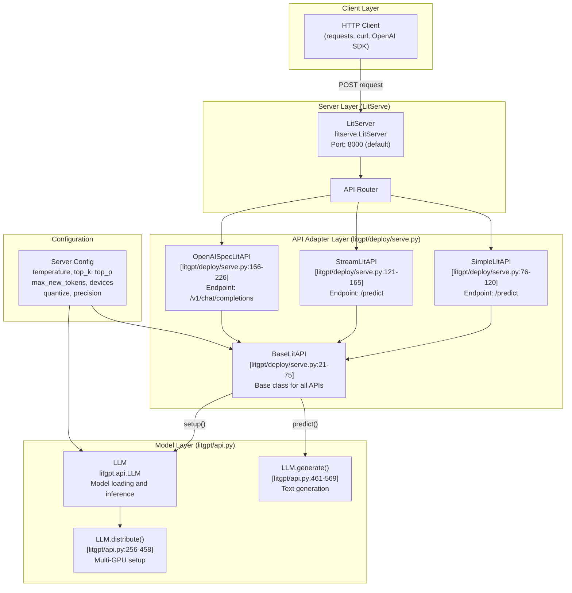
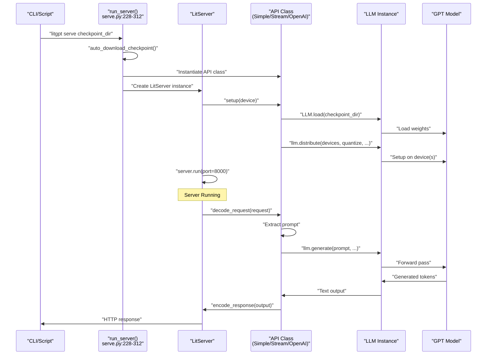
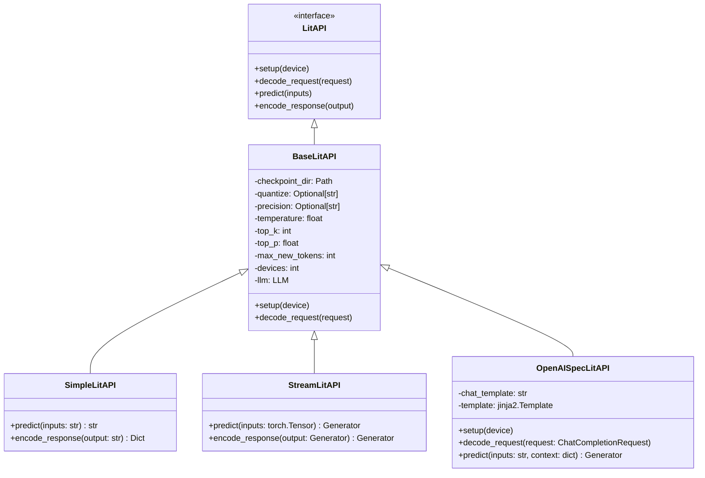
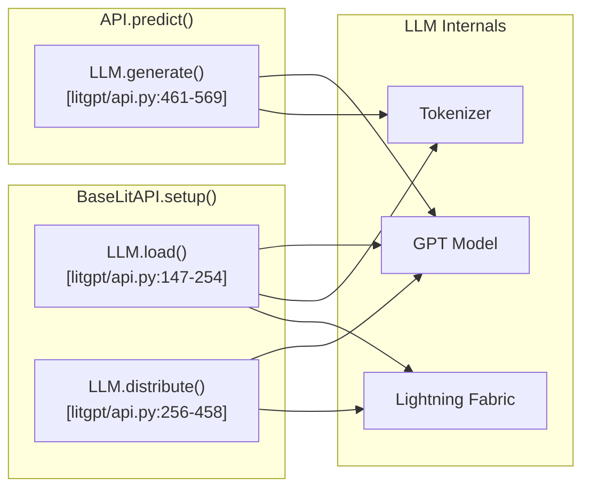

<!-- source: DeepWiki mcp.deepwiki.com · repo Lightning-AI/litgpt · page 6.3 Serving Models · fetched 2026-10-21 -->

# Serving Models

<details>
<summary>Relevant source files</summary>

The following files were used as context for generating this wiki page:

- [.lightning/workflows/tests.yaml](.lightning/workflows/tests.yaml)
- [litgpt/deploy/__init__.py](litgpt/deploy/__init__.py)
- [litgpt/deploy/serve.py](litgpt/deploy/serve.py)
- [tests/conftest.py](tests/conftest.py)
- [tests/test_serve.py](tests/test_serve.py)
- [tutorials/deploy.md](tutorials/deploy.md)

</details>


## Purpose and Scope

This page documents LitGPT's model serving infrastructure, which enables deployment of trained models as HTTP endpoints for production use. The serving system is built on top of [LitServe](https://github.com/Lightning-AI/LitServe) and provides multiple API styles including simple request-response, streaming, and OpenAI-compatible endpoints.

For information about generating text using the Python API without starting a server, see [Python API](#6.2). For information about generation strategies and sampling methods, see [Generation Strategies](#6.1).

**Sources:** [litgpt/deploy/serve.py:1-313](), [tutorials/deploy.md:1-145]()

## Serving Architecture

The serving system consists of three main layers: the HTTP server infrastructure (LitServe), API adapters that handle different response formats, and the underlying LLM model class that performs inference.

### Natural Language to Code Mapping
The following diagram bridges the conceptual serving flow to the specific classes and functions in the codebase.



**Sources:** [litgpt/deploy/serve.py:1-313](), [litgpt/api.py:37-254]()

## Serving Modes

LitGPT supports three distinct serving modes, each implemented as a separate API adapter class.

### Simple Mode (Non-Streaming)

The `SimpleLitAPI` class provides basic request-response serving where the entire generated text is returned in a single response.

| Component | Implementation |
|-----------|----------------|
| Class | `SimpleLitAPI` |
| File Location | [litgpt/deploy/serve.py:76-120]() |
| Endpoint | `/predict` |
| Request Format | `{"prompt": "string"}` |
| Response Format | `{"output": "string"}` |
| Streaming | No |

The `SimpleLitAPI.predict()` method at [litgpt/deploy/serve.py:106-114]() calls `self.llm.generate()` with default parameters and returns the complete output.

**Sources:** [litgpt/deploy/serve.py:76-120](), [tutorials/deploy.md:12-49]()

### Streaming Mode

The `StreamLitAPI` class enables token-by-token streaming responses, allowing clients to display partial results as they are generated.

| Component | Implementation |
|-----------|----------------|
| Class | `StreamLitAPI` |
| File Location | [litgpt/deploy/serve.py:121-165]() |
| Endpoint | `/predict` |
| Request Format | `{"prompt": "string"}` |
| Response Format | Server-Sent Events (SSE) with `{"output": "token"}` per chunk |
| Streaming | Yes |

The `StreamLitAPI.predict()` method at [litgpt/deploy/serve.py:151-159]() uses `stream=True` when calling `self.llm.generate()` and yields each token as it's produced.

**Sources:** [litgpt/deploy/serve.py:121-165](), [tutorials/deploy.md:52-81]()

### OpenAI-Compatible Mode

The `OpenAISpecLitAPI` class provides endpoints that conform to the OpenAI Chat Completions API specification, enabling drop-in compatibility with OpenAI client libraries.

| Component | Implementation |
|-----------|----------------|
| Class | `OpenAISpecLitAPI` |
| File Location | [litgpt/deploy/serve.py:166-226]() |
| Endpoint | `/v1/chat/completions` |
| Request Format | OpenAI Chat Completions format |
| Response Format | OpenAI Chat Completions response format |
| Streaming | Yes (configurable) |
| Chat Template | Loaded from `tokenizer_config.json` |

The implementation includes:

1. **Chat Template Rendering**: [litgpt/deploy/serve.py:199-211]() loads the Jinja2 chat template from `tokenizer_config.json` and falls back to a default template if none exists.
2. **Request Decoding**: [litgpt/deploy/serve.py:213-215]() applies the chat template to convert OpenAI-format messages into a prompt string.
3. **Parameter Extraction**: [litgpt/deploy/serve.py:217-226]() extracts generation parameters from the request context, including `temperature`, `top_p`, and `max_completion_tokens`.

**Sources:** [litgpt/deploy/serve.py:166-226](), [tutorials/deploy.md:84-136](), [tests/test_serve.py:180-213]()

## Server Lifecycle and Request Flow

The following sequence diagram illustrates the complete lifecycle from server startup to request processing.



**Sources:** [litgpt/deploy/serve.py:228-312](), [litgpt/api.py:147-254](), [litgpt/api.py:256-458]()

## Server Configuration

The `run_server()` function at [litgpt/deploy/serve.py:228-312]() accepts the following configuration parameters:

### Model and Checkpoint Configuration

| Parameter | Type | Description |
|-----------|------|-------------|
| `checkpoint_dir` | `Path` | Path to model checkpoint directory (can be auto-downloaded from HF Hub) |
| `access_token` | `Optional[str]` | HuggingFace API token for restricted models |

### Generation Parameters

| Parameter | Type | Default | Description |
|-----------|------|---------|-------------|
| `temperature` | `float` | `0.8` | Sampling temperature (higher = more random) |
| `top_k` | `int` | `50` | Top-k sampling parameter |
| `top_p` | `float` | `1.0` | Nucleus sampling parameter |
| `max_new_tokens` | `int` | `50` | Maximum tokens to generate per request |

### Server Configuration

| Parameter | Type | Default | Description |
|-----------|------|---------|-------------|
| `port` | `int` | `8000` | Network port for HTTP server |
| `stream` | `bool` | `False` | Enable streaming responses |
| `openai_spec` | `bool` | `False` | Enable OpenAI-compatible endpoints |
| `api_path` | `Optional[str]` | `"/predict"` | Custom API endpoint path |
| `timeout` | `int` | `30` | Request timeout in seconds |

### Hardware Configuration

| Parameter | Type | Default | Description |
|-----------|------|---------|-------------|
| `devices` | `int` | `1` | Number of GPUs to use |
| `accelerator` | `str` | `"auto"` | Device type: `"auto"`, `"cuda"`, `"cpu"`, or `"mps"` |
| `precision` | `Optional[str]` | Auto-detected | Precision mode (e.g., `"bf16-true"`, `"16-mixed"`) |
| `quantize` | `Optional[str]` | `None` | Quantization mode: `"bnb.nf4"`, `"bnb.fp4"`, `"bnb.int8"`, etc. |

**Sources:** [litgpt/deploy/serve.py:228-287]()

## Multi-GPU Serving

When `devices > 1`, the server uses the `generate_strategy="sequential"` approach to distribute model layers across GPUs. This is configured in the `BaseLitAPI.setup()` method at [litgpt/deploy/serve.py:50-69]().

```mermaid
graph TB
    subgraph "Single GPU Serving (devices=1)"
        Client1["Client Request"]
        Server1["LitServer"]
        API1["API Adapter"]
        Model1["Full Model<br/>on GPU 0"]
        
        Client1 --> Server1
        Server1 --> API1
        API1 --> Model1
    end
    
    subgraph "Multi-GPU Sequential Serving (devices>1)"
        Client2["Client Request"]
        Server2["LitServer"]
        API2["API Adapter<br/>generate_strategy='sequential'"]
        
        Layer0["Layers 0-N/4<br/>on GPU 0"]
        Layer1["Layers N/4-N/2<br/>on GPU 1"]
        Layer2["Layers N/2-3N/4<br/>on GPU 2"]
        Layer3["Layers 3N/4-N<br/>on GPU 3"]
        
        Client2 --> Server2
        Server2 --> API2
        API2 --> Layer0
        Layer0 --> Layer1
        Layer1 --> Layer2
        Layer2 --> Layer3
    end
```



The sequential strategy is automatically enabled when `devices > 1` in [litgpt/deploy/serve.py:67]():

```python
generate_strategy=("sequential" if self.devices is not None and self.devices > 1 else None)
```

This leverages the `LLM.distribute()` method's sequential generation capability, which partitions transformer blocks across available GPUs and processes them sequentially.

**Sources:** [litgpt/deploy/serve.py:50-69](), [litgpt/api.py:256-458](), [tests/test_serve.py:110-142]()

## API Adapter Implementation

All API adapters inherit from `BaseLitAPI`, which provides common initialization and setup logic.

### BaseLitAPI

The `BaseLitAPI` class at [litgpt/deploy/serve.py:21-75]() implements:

1. **Initialization** ([litgpt/deploy/serve.py:22-49]()): Stores configuration parameters including checkpoint directory, quantization settings, generation parameters, and device configuration.
2. **Setup** ([litgpt/deploy/serve.py:50-69]()): Called once per worker to initialize the model:
   - Parses device string to extract accelerator and device ID.
   - Loads model using `LLM.load()`.
   - Distributes model across devices using `LLM.distribute()`.
   - Automatically enables sequential strategy for multi-GPU setups.
3. **Request Decoding** ([litgpt/deploy/serve.py:71-73]()): Base implementation extracts the prompt from the request dictionary.

### API Adapter Class Hierarchy



**Sources:** [litgpt/deploy/serve.py:21-226]()

## Starting and Querying the Server

### Command-Line Interface

The server is started using the `litgpt serve` command:

```bash
# Basic usage
litgpt serve microsoft/phi-2

# With custom configuration
litgpt serve microsoft/phi-2 \
  --port 8000 \
  --devices 2 \
  --temperature 0.8 \
  --top_k 50 \
  --max_new_tokens 100

# Enable streaming
litgpt serve microsoft/phi-2 --stream true

# Enable OpenAI-compatible endpoints
litgpt serve HuggingFaceTB/SmolLM2-135M-Instruct --openai_spec true
```

**Sources:** [tutorials/deploy.md:16-22](), [litgpt/deploy/serve.py:228-312]()

### Querying Simple and Streaming Endpoints

For `SimpleLitAPI` (default mode):

```python
import requests
response = requests.post(
    "http://127.0.0.1:8000/predict",
    json={"prompt": "What do llamas eat?"}
)
print(response.json()["output"])
```

For `StreamLitAPI` (with `--stream true`):

```python
import requests, json
response = requests.post(
    "http://127.0.0.1:8000/predict",
    json={"prompt": "What do llamas eat?"},
    stream=True
)
for line in response.iter_lines(decode_unicode=True):
    if line:
        print(json.loads(line)["output"], end="")
```

**Sources:** [tutorials/deploy.md:31-81]()

### Querying OpenAI-Compatible Endpoints

Using curl:

```bash
curl -X POST http://127.0.0.1:8000/v1/chat/completions \
  -H "Content-Type: application/json" \
  -d '{
    "model": "SmolLM2-135M-Instruct",
    "messages": [{"role": "user", "content": "Hello!"}]
  }'
```

**Sources:** [tutorials/deploy.md:105-135](), [tests/test_serve.py:216-232]()

## Testing and Validation

The serving infrastructure includes comprehensive tests at [tests/test_serve.py:1-257]():

| Test | Purpose | Location |
|------|---------|----------|
| `test_simple()` | Validates basic server startup and health check | [tests/test_serve.py:40-72]() |
| `test_quantize()` | Tests server with quantized models | [tests/test_serve.py:75-107]() |
| `test_multi_gpu_serve()` | Validates multi-GPU sequential serving | [tests/test_serve.py:110-142]() |
| `test_serve_with_openai_spec()` | Tests OpenAI-compatible endpoints including streaming | [tests/test_serve.py:180-213]() |

**Sources:** [tests/test_serve.py:1-257]()

## Integration with LLM Class

The serving infrastructure relies heavily on the `LLM` class for model management.



The `LLM.load()` method with `distribute=None` is called first [litgpt/deploy/serve.py:59](), then `LLM.distribute()` is called [litgpt/deploy/serve.py:61]() to set up the device strategy. This allows the server to control device placement rather than having the LLM class automatically select devices.

**Sources:** [litgpt/deploy/serve.py:50-69](), [litgpt/api.py:147-254](), [litgpt/api.py:256-458]()

---

