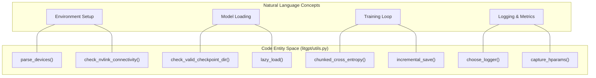

<!-- source: DeepWiki mcp.deepwiki.com · repo Lightning-AI/litgpt · page 7 Utilities · fetched 2026-10-21 -->

# Utilities

Relevant source files

The following files were used as context for generating this wiki page:

- [litgpt/utils.py](litgpt/utils.py)
- [tests/test_utils.py](tests/test_utils.py)

The LitGPT utilities system provides a collection of helper functions that support the core operations of training, inference, and deployment. These utility functions handle common tasks such as checkpoint management, configuration, logging, device management, and performance monitoring. This page documents the key utility functions available in the `litgpt/utils.py` file and how they facilitate various operations within the framework.

For detailed information on specific utility categories, see the following child pages:
- [Checkpoint Management](#7.1) — Loading, saving, incremental saves, and state dict utilities.
- [Training Utilities](#7.2) — Chunked cross-entropy, FLOP estimation, and performance monitoring.
- [Hardware and Environment](#7.3) — Hardware detection, GPU connectivity (NVLink/XGMI), and device parsing.
- [CLI Interface](#7.4) — Argument parsing, configuration files, and the `litgpt` command structure.

Sources: [litgpt/utils.py:1-43]()

## Overview

The utilities module serves as the backbone for many of LitGPT's operational features, providing functions to handle common tasks that occur across different components of the system.

```mermaid
graph TD
    subgraph "Utility Categories"
        CheckpointMgmt["Checkpoint Management"]
        ConfigMgmt["Configuration Management"]
        ModelUtils["Model Utilities"]
        TensorUtils["Tensor Operations"]
        DeviceUtils["Device Management"]
        LoggingUtils["Logging Utilities"]
        CLIUtils["CLI Interface"]
        FileUtils["File Utilities"]
        OptimizerUtils["Optimizer Utilities"]
        DataUtils["Data Processing"]
    end
    
    subgraph "Core LitGPT Components"
        Training["Training System"]
        Inference["Inference System"]
        Evaluation["Evaluation System"]
        Deployment["Deployment System"]
    end
    
    CheckpointMgmt --> Training
    CheckpointMgmt --> Inference
    ConfigMgmt --> Training
    ConfigMgmt --> Inference
    ConfigMgmt --> Evaluation
    ModelUtils --> Training
    ModelUtils --> Inference
    TensorUtils --> Training
    DeviceUtils --> Training
    DeviceUtils --> Inference
    LoggingUtils --> Training
    LoggingUtils --> Evaluation
    CLIUtils --> Training
    CLIUtils --> Inference
    CLIUtils --> Evaluation
    CLIUtils --> Deployment
    FileUtils --> Training
    FileUtils --> Inference
    OptimizerUtils --> Training
    DataUtils --> Training
    DataUtils --> Inference
```

Sources: [litgpt/utils.py:3-43]()

## Checkpoint and Configuration Management

The utility system provides functions for loading, saving, and validating model checkpoints, as well as managing configuration settings and capturing hyperparameters.

### Checkpoint Validation and Loading
The `check_valid_checkpoint_dir()` function verifies that a directory contains all necessary files (model weights, config, and tokenizer) [litgpt/utils.py:89-136](). For large models, LitGPT uses `incremental_save` to handle state dicts without doubling memory usage [litgpt/utils.py:188-255]().

### Configuration Capture
- `capture_hparams()`: Captures local variables from the caller's frame for logging purposes [litgpt/utils.py:493-518]().
- `save_config()`: Serializes the `Config` dataclass to a YAML file in the output directory [litgpt/utils.py:530-536]().

For details, see [Checkpoint Management](#7.1).

Sources: [litgpt/utils.py:89-136](), [litgpt/utils.py:188-255](), [litgpt/utils.py:493-536]()

## Model and Training Utilities

### Computational Efficiency
LitGPT includes `chunked_cross_entropy()` to compute loss in smaller blocks, preventing OOM errors during the backward pass on long sequences [litgpt/utils.py:305-354](). It also provides `num_parameters()` which correctly accounts for quantized `bitsandbytes` layers [litgpt/utils.py:70-79]().

### Performance Estimation
Functions like `estimate_flops()` and `flops_per_param()` help users understand the throughput and computational cost of their specific hardware setup [litgpt/utils.py:357-384]().

For details, see [Training Utilities](#7.2).

Sources: [litgpt/utils.py:70-79](), [litgpt/utils.py:305-384]()

## Hardware and Device Management

### GPU Topology
The utility `check_nvlink_connectivity()` inspects the system via `nvidia-smi` or `rocm-smi` to determine if GPUs are connected via high-speed interconnects like NVLink or XGMI, issuing warnings if slow PCIe bottlenecks are detected [litgpt/utils.py:675-781]().

### Device Selection
`parse_devices()` standardizes how users specify hardware (e.g., `devices=2` vs `devices=[0, 1]`) to ensure consistent behavior across different training scripts [litgpt/utils.py:639-663]().

For details, see [Hardware and Environment](#7.3).

Sources: [litgpt/utils.py:639-663](), [litgpt/utils.py:675-781]()

## CLI and Logging

### Logger Selection
The `choose_logger()` function acts as a factory for initializing standard loggers like `WandbLogger`, `TensorBoardLogger`, or `MLFlowLogger` based on user strings [litgpt/utils.py:547-563]().

### The CLI Wrapper
LitGPT uses a custom `CLI()` wrapper to automatically generate command-line interfaces from function signatures, facilitating the `litgpt download`, `litgpt finetune`, and other commands [litgpt/utils.py:484-490]().

For details, see [CLI Interface](#7.4).

Sources: [litgpt/utils.py:484-490](), [litgpt/utils.py:547-563]()

## Utility Function Interaction

The following diagram bridges the natural language concepts of the training/inference pipeline to the specific code entities in `litgpt/utils.py`.

Sources: [litgpt/utils.py:44-878]()

## Optimizer and Path Utilities

### Optimizer Instantiation
`instantiate_torch_optimizer()` and `instantiate_bnb_optimizer()` provide a unified interface to create standard or 8-bit optimizers, filtering arguments to match the specific class requirements [litgpt/utils.py:574-624]().

### Path Resolution
`init_out_dir()` ensures that output directories are created correctly, including support for the `LIGHTNING_ARTIFACTS_DIR` environment variable used in cloud environments [litgpt/utils.py:48-53]().

Sources: [litgpt/utils.py:48-53](), [litgpt/utils.py:574-624]()

---

