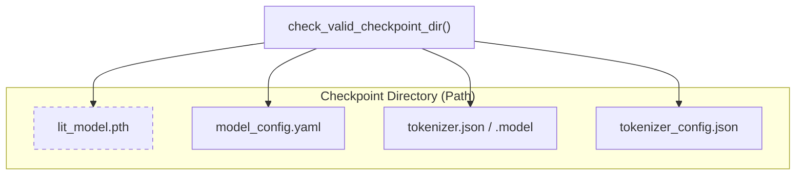
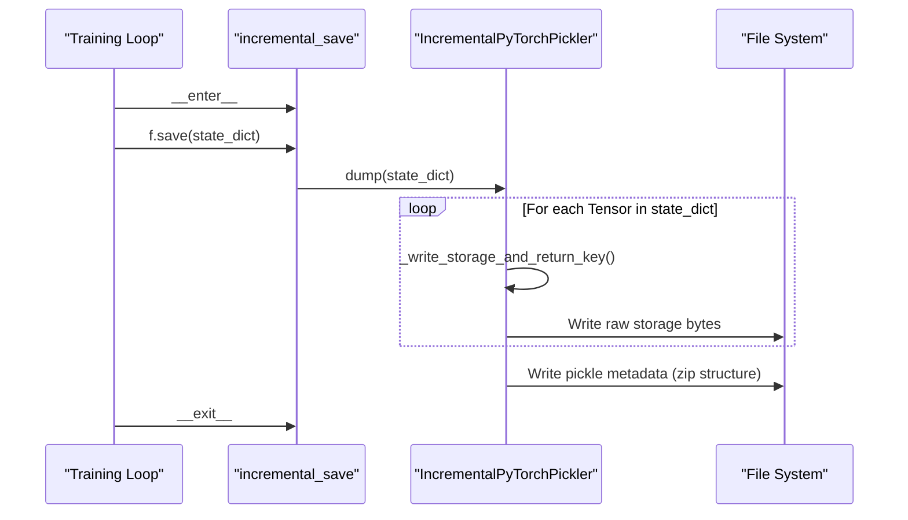
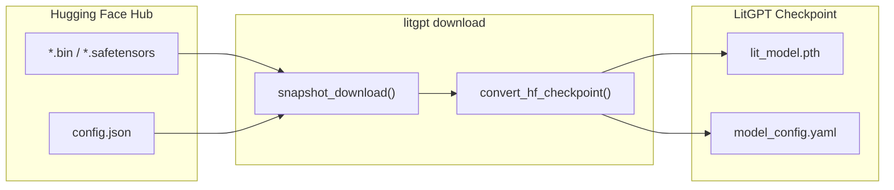

<!-- source: DeepWiki mcp.deepwiki.com · repo Lightning-AI/litgpt · page 7.1 Checkpoint Management · fetched 2026-10-21 -->

# Checkpoint Management

Relevant source files

The following files were used as context for generating this wiki page:

- [litgpt/scripts/download.py](litgpt/scripts/download.py)
- [litgpt/utils.py](litgpt/utils.py)
- [tests/convert/test_lit_checkpoint.py](tests/convert/test_lit_checkpoint.py)
- [tests/test_readme.py](tests/test_readme.py)
- [tests/test_utils.py](tests/test_utils.py)

LitGPT provides a robust system for managing model checkpoints, encompassing loading, saving, incremental persistence for large models, and state dict utilities. This system is designed to handle both standard full-model weights and parameter-efficient fine-tuning (PEFT) weights like LoRA or Adapters.

## 1. Checkpoint Directory Structure

A valid LitGPT checkpoint directory is a self-contained unit containing weights, configuration, and tokenizer data. The `check_valid_checkpoint_dir` function enforces this structure [litgpt/utils.py:89-137]().

### Required Components
- `lit_model.pth`: The model weights in PyTorch format.
- `model_config.yaml`: The serialized `Config` dataclass [litgpt/utils.py:98-99]().
- `tokenizer.json` or `tokenizer.model`: The tokenizer vocabulary and merge files [litgpt/utils.py:103-104]().
- `tokenizer_config.json`: Metadata for the tokenizer [litgpt/utils.py:105-105]().

Sources: [litgpt/utils.py:89-137](), [tests/test_utils.py:55-102]()

## 2. Saving Mechanisms

LitGPT implements specialized saving routines to handle large models without exceeding system memory.

### 2.1. Incremental Saving
The `incremental_save` utility is a context manager that uses a custom pickler to stream tensors to disk one by one [litgpt/utils.py:252-300](). This prevents the need to duplicate the entire state dict in memory before serialization.

- **`SavingProxyForTensor`**: A proxy class that intercepts tensor serialization to handle storage out-of-band [litgpt/utils.py:167-191]().
- **`IncrementalPyTorchPickler`**: A specialized `pickle.Pickler` that coordinates the writing of tensor storages to the file [litgpt/utils.py:214-250]().

Sources: [litgpt/utils.py:167-300](), [tests/test_utils.py:104-125]()

## 3. Loading and Resuming

### 3.1. Resuming Training
The `find_resume_path` function automates the discovery of training checkpoints within an output directory [litgpt/utils.py:56-67]().

| Mode | Behavior |
| :--- | :--- |
| `resume=True` | Searches for `step-*/*.pth` and raises `FileNotFoundError` if none exist [litgpt/utils.py:63-67](). |
| `resume="auto"` | Returns the latest checkpoint found via glob or `None` if directory is empty [litgpt/utils.py:61-62](). |
| `resume=Path` | Directly returns the provided path [litgpt/utils.py:57-58](). |

Sources: [litgpt/utils.py:56-67](), [tests/test_utils.py:339-364]()

### 3.2. Checkpoint Loading Strategies
Loading is handled via `load_checkpoint`, which adapts based on the Lightning Fabric strategy [litgpt/utils.py:386-392]().

- **FSDP**: Uses `fabric.load_raw()` to handle sharded states.
- **Standard**: Uses `lazy_load` (a wrapper around `torch.load` with `map_location='cpu'`) followed by `model.load_state_dict()` [litgpt/utils.py:30-30]().

## 4. State Dict Utilities

LitGPT provides utilities to manipulate state dicts, particularly for PEFT methods.

### 4.1. Weight Conversion
The `convert_lit_checkpoint` function is used to convert internal LitGPT checkpoints to standard formats or unwrap nested state dicts (e.g., removing the `"model"` key if present) [tests/convert/test_lit_checkpoint.py:26-37]().

### 4.2. State Dict Filtering
Functions like `get_default_supported_precision` and various model-specific `copy_weights_*` functions facilitate the mapping between Hugging Face parameter names and LitGPT parameter names [tests/convert/test_lit_checkpoint.py:29-35]().

| Utility | Purpose |
| :--- | :--- |
| `lazy_load` | Loads checkpoints to CPU first to avoid GPU OOM [litgpt/utils.py:30](). |
| `check_file_size_on_cpu_and_warn` | Warns if loading a large model on a machine with low RAM [litgpt/utils.py:638-651](). |
| `num_parameters` | Calculates parameter counts, including support for `bitsandbytes` 4-bit layers [litgpt/utils.py:70-79](). |

Sources: [litgpt/utils.py:70-79](), [litgpt/utils.py:638-651](), [tests/convert/test_lit_checkpoint.py:42-61]()

## 5. Checkpoint Download and Preparation

The `download_from_hub` script in `litgpt/scripts/download.py` manages the end-to-end flow of fetching weights from Hugging Face and immediately converting them to the LitGPT format [litgpt/scripts/download.py:13-98]().

Sources: [litgpt/scripts/download.py:13-98](), [tests/test_readme.py:54-61]()

## 6. Checkpoint Management Workflow

The system bridges high-level CLI commands to low-level file operations:

1.  **Discovery**: `extend_checkpoint_dir` resolves short names or relative paths to absolute checkpoint directories [litgpt/utils.py:627-635]().
2.  **Validation**: `check_valid_checkpoint_dir` ensures all metadata and weights are present [litgpt/utils.py:89-137]().
3.  **Loading**: `GPT.from_name` or `GPT.from_checkpoint` instantiates the model with the correct configuration [tests/convert/test_lit_checkpoint.py:43-44]().
4.  **Persistence**: `incremental_save` writes the results of training/fine-tuning back to disk [litgpt/utils.py:252-300]().

Sources: [litgpt/utils.py:627-635](), [litgpt/utils.py:89-137](), [litgpt/utils.py:252-300]()

---

