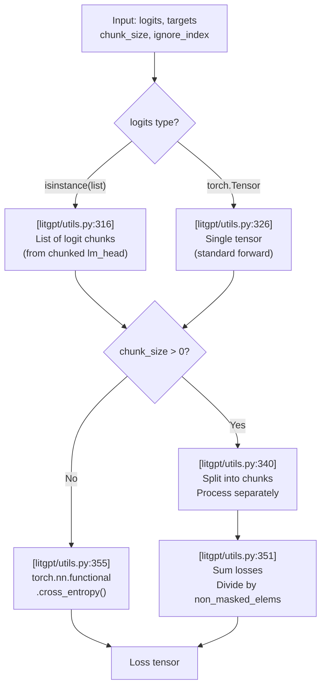
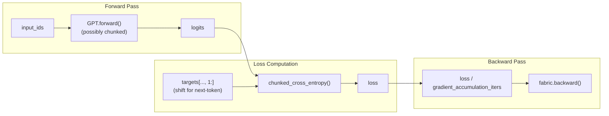
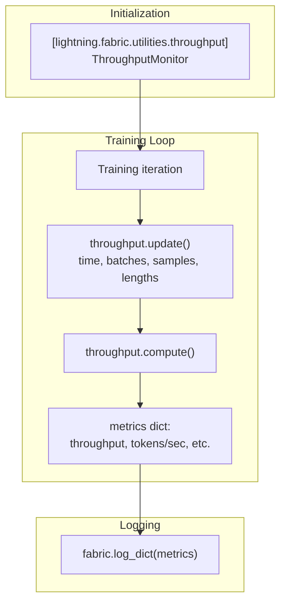
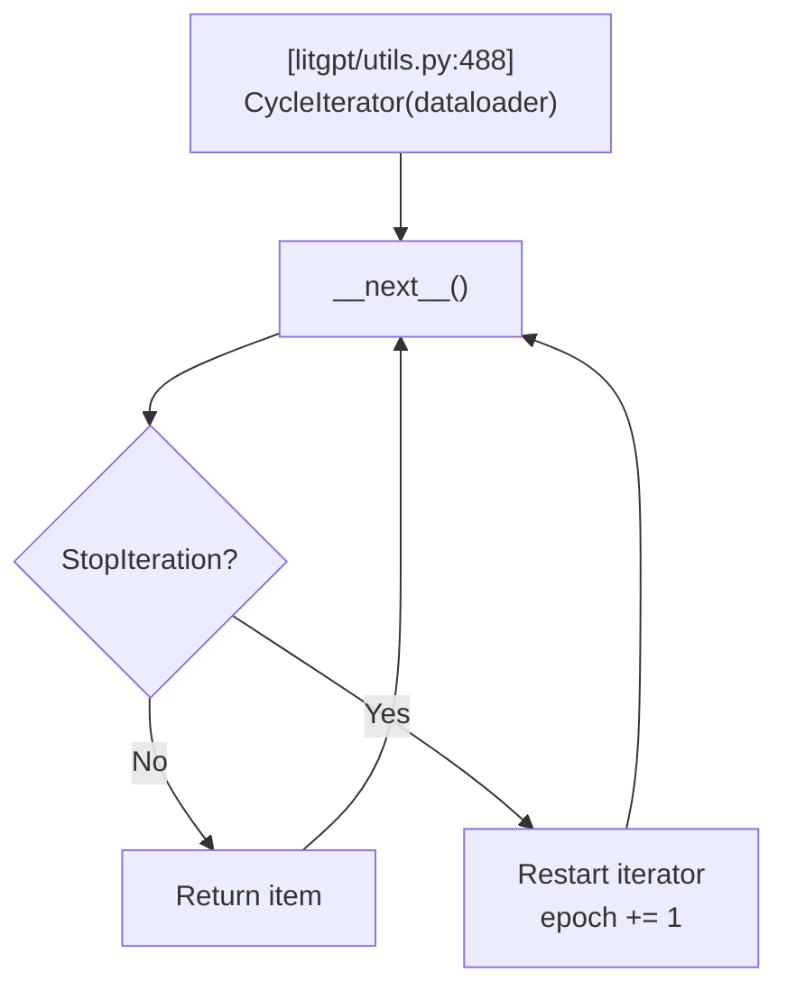
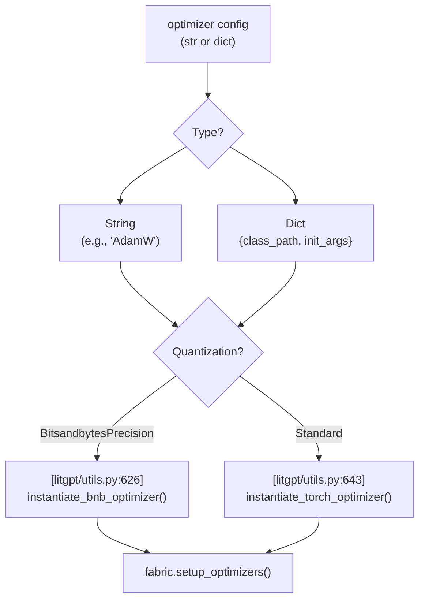
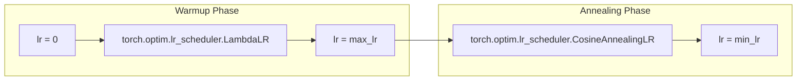
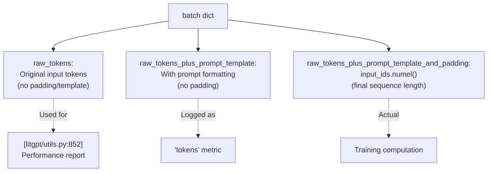

<!-- source: DeepWiki mcp.deepwiki.com · repo Lightning-AI/litgpt · page 7.2 Training Utilities · fetched 2026-10-21 -->

# Training Utilities

<details>
<summary>Relevant source files</summary>

The following files were used as context for generating this wiki page:

- [extensions/thunder/pretrain.py](extensions/thunder/pretrain.py)
- [litgpt/args.py](litgpt/args.py)
- [litgpt/finetune/full.py](litgpt/finetune/full.py)
- [litgpt/pretrain.py](litgpt/pretrain.py)
- [litgpt/utils.py](litgpt/utils.py)
- [tests/test_utils.py](tests/test_utils.py)

</details>


## Purpose and Scope

This document covers training-specific utility functions that support model training and fine-tuning operations in LitGPT. These utilities provide memory-efficient loss computation, performance monitoring, learning rate scheduling, and training loop helpers. For checkpoint saving and loading utilities, see [Checkpoint Management](7.1). For hardware detection utilities, see [Hardware and Environment](7.3). For the actual training loop implementations, see [Training Infrastructure](3.5) and [Pretraining](4).

## Loss Computation

### Chunked Cross-Entropy

The `chunked_cross_entropy` function provides memory-efficient loss computation by processing logits in chunks, which is critical when training with long sequence lengths to avoid OOM (Out of Memory) errors during the backward pass.



**Implementation Details**

The function handles three scenarios:

1.  **Chunked logits with chunking**: When the language model head is already chunked (for fine-tuning with memory constraints), it processes each chunk separately [litgpt/utils.py:316-324]().
2.  **Regular logits with chunking**: When logits are provided as a single tensor, it splits them into chunks of size `chunk_size` and processes each chunk [litgpt/utils.py:326-348]().
3.  **No chunking**: When `chunk_size=0`, it computes loss in a single pass using standard PyTorch functions [litgpt/utils.py:355-358]().

The key insight is that chunking forces memory deallocation between chunks, reducing peak memory usage during the backward pass at the cost of slightly more computation.

**Sources**: [litgpt/utils.py:308-358](), [tests/test_utils.py:129-164]()

### Usage in Training

The training scripts utilize this utility within their `fit` or `main` loops to calculate the loss for next-token prediction.



**Sources**: [litgpt/finetune/full.py:303-307](), [litgpt/pretrain.py:353-355](), [extensions/thunder/pretrain.py:49-53]()

## Performance Monitoring

### FLOP Estimation

The `estimate_flops` and `flops_per_param` functions calculate theoretical FLOPs (floating-point operations) for model training, enabling MFU (model FLOP utilization) calculations.

| Function | Purpose | Parameters |
| :--- | :--- | :--- |
| `flops_per_param` | Computes FLOPs per training sequence | `max_seq_length`, `n_layer`, `n_embd`, `n_params` |
| `estimate_flops` | Estimates total FLOPs considering frozen/trainable params | `model`, `training` (bool) |

**FLOP Calculation Formula**:
LitGPT follows standard LLM FLOP estimation where each parameter operation involves 1 multiply and 1 add (2 FLOPs). During training, this is multiplied by 3 (forward + backward + gradient computation) for trainable parameters and by 2 (forward + backward) for frozen parameters [litgpt/utils.py:476-482]().

**Sources**: [litgpt/utils.py:455-486]()

### Throughput Monitoring

The `ThroughputMonitor` from Lightning Fabric is used to track training speed metrics. It is integrated into the training loops to provide real-time performance statistics.



**Sources**: [litgpt/pretrain.py:310-319](), [extensions/thunder/pretrain.py:284-293]()

### Performance Reporting

The `create_finetuning_performance_report` function generates a formatted summary of fine-tuning performance, including token counts and memory usage.

```python
{
    "raw_tokens": int,                                    # Actual input tokens
    "raw_tokens_plus_prompt_template": int,               # With prompt formatting
    "raw_tokens_plus_prompt_template_and_padding": int    # With padding to max_seq_length
}
```

**Sources**: [litgpt/utils.py:852-873](), [litgpt/finetune/full.py:188-189]()

## Training Loop Helpers

### CycleIterator

The `CycleIterator` class provides infinite iteration over a dataloader, automatically restarting when the dataset is exhausted. Unlike `itertools.cycle`, it does not cache values, making it memory-efficient for large datasets.



**Key Features**:
- Tracks `epoch` count automatically [litgpt/utils.py:504-507]().
- No value caching, re-instantiates the internal iterator [litgpt/utils.py:513-516]().

**Sources**: [litgpt/utils.py:488-517](), [tests/test_utils.py:193-206]()

### Parameter Counting

The `num_parameters` function counts model parameters with optional filtering by `requires_grad`. It specifically supports `bitsandbytes` 4-bit layers by checking `quant_state` [litgpt/utils.py:74-76]().

| Call | Returns |
| :--- | :--- |
| `num_parameters(model)` | Total parameter count |
| `num_parameters(model, requires_grad=True)` | Trainable parameters |
| `num_parameters(model, requires_grad=False)` | Frozen parameters |

**Sources**: [litgpt/utils.py:70-80](), [tests/test_utils.py:165-191]()

## Optimizer Configuration

### Optimizer Instantiation Flow

LitGPT supports both standard PyTorch optimizers and memory-efficient `bitsandbytes` optimizers.



**Sources**: [litgpt/utils.py:626-676](), [litgpt/finetune/full.py:160-161]()

### Torch Optimizer Instantiation

The `instantiate_torch_optimizer` function dynamically imports the optimizer class and filters initialization arguments to match the specific optimizer's `__init__` signature [litgpt/utils.py:663-672]().

**Sources**: [litgpt/utils.py:643-675]()

### BitsAndBytes Optimizer

The `instantiate_bnb_optimizer` function creates a memory-efficient `PagedAdamW` optimizer when quantization is enabled [litgpt/utils.py:638](). It is restricted to AdamW variants.

**Sources**: [litgpt/utils.py:626-640]()

## Learning Rate Scheduling

### Scheduler Architecture

Fine-tuning scripts typically use a `SequentialLR` scheduler consisting of a linear warmup followed by cosine annealing.



**Implementation**:
The `get_lr_scheduler` function combines these two phases using `milestones` at the `warmup_steps` point [litgpt/finetune/full.py:465-470]().

**Pretraining variant**:
The pretraining script uses a manual `get_lr` function for more granular control over token-based scheduling [litgpt/pretrain.py:463-475]().

**Sources**: [litgpt/finetune/full.py:463-470](), [litgpt/pretrain.py:463-475]()

## Training Metrics and Logging

### Metrics Dictionary Structure

Training loops construct a standardized metrics dictionary for logging via `fabric.log_dict`.

| Metric | Description | Source |
| :--- | :--- | :--- |
| `loss` | Current training loss | `running_loss.compute()` [litgpt/pretrain.py:382]() |
| `iter` | Current iteration number | Loop index |
| `step` | Current optimizer step | `state["step_count"]` |
| `learning_rate` | Current LR | `scheduler.get_last_lr()` |
| `tokens` | Total tokens processed | `token_counts["raw_tokens_plus_prompt_template"]` |

**Running Loss Computation**:
LitGPT uses `torchmetrics.aggregation.RunningMean` to track loss over the gradient accumulation window [litgpt/pretrain.py:19](), [litgpt/pretrain.py:321]().

**Sources**: [litgpt/pretrain.py:375-401](), [litgpt/finetune/full.py:319-338]()

### Token Counting

Training loops track multiple token counts to provide detailed performance reports.



**Sources**: [litgpt/finetune/full.py:330-334](), [litgpt/utils.py:852-873]()

---

