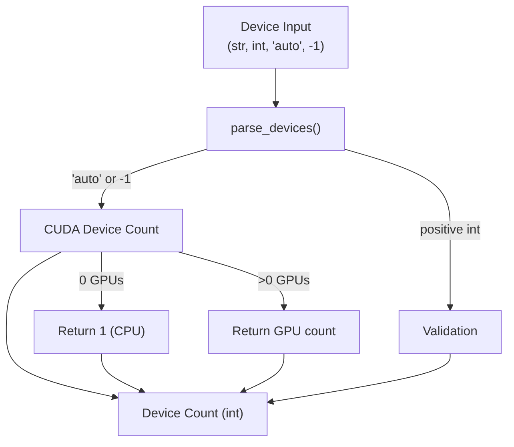
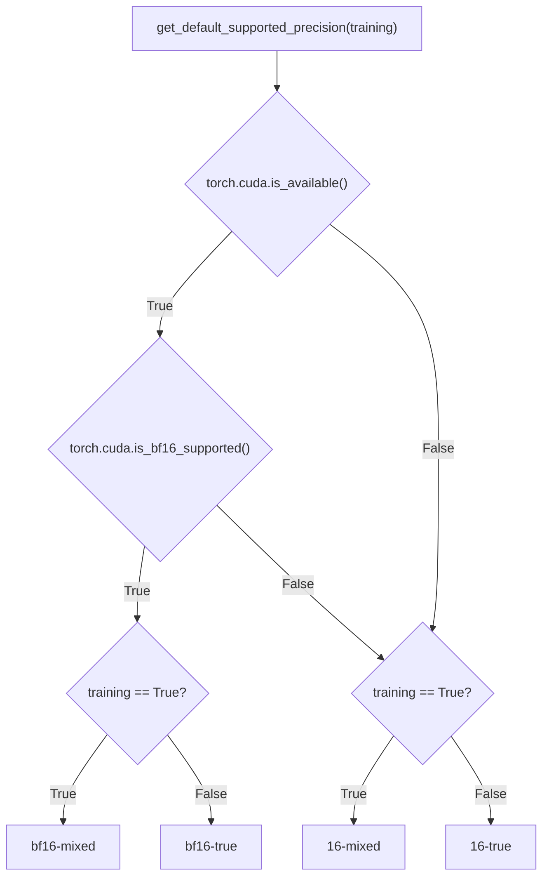
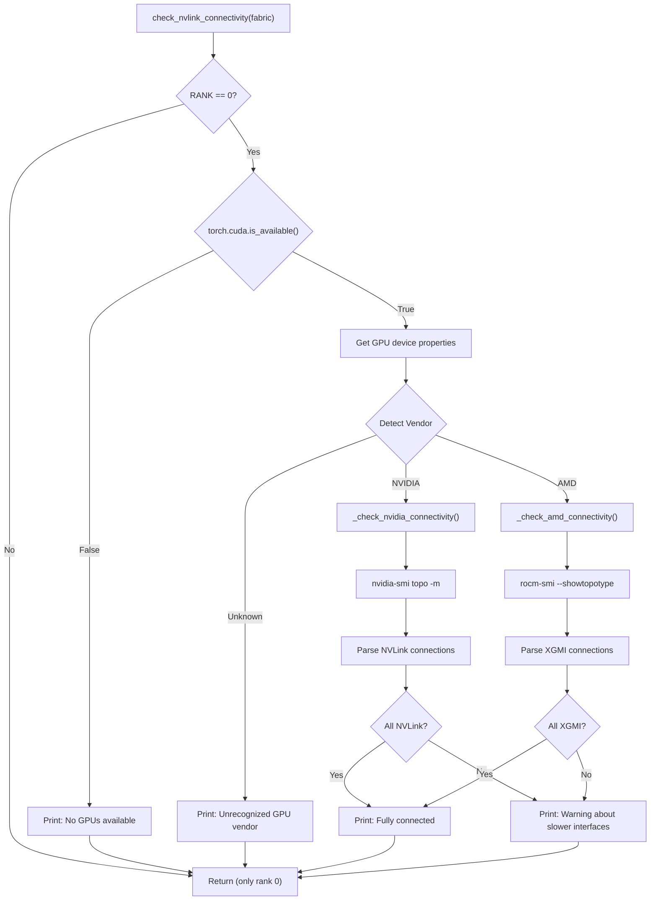
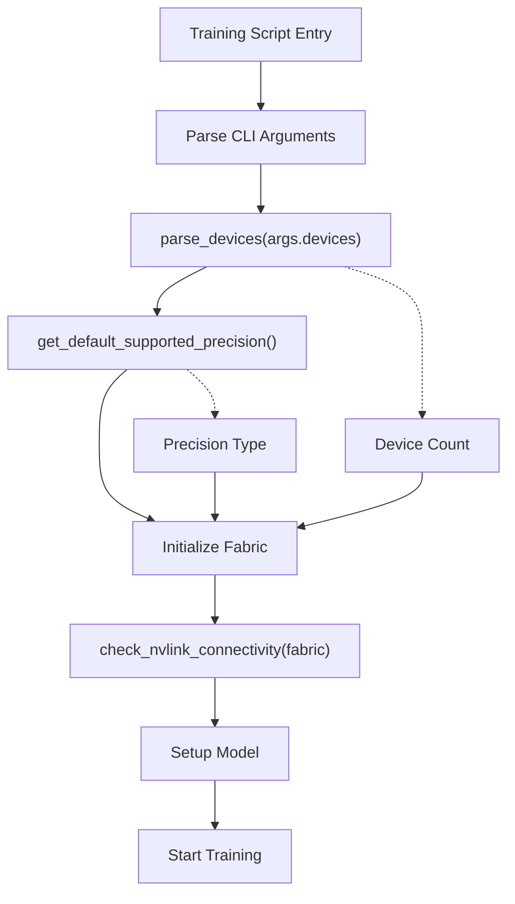

<!-- source: DeepWiki mcp.deepwiki.com · repo Lightning-AI/litgpt · page 7.3 Hardware and Environment · fetched 2026-10-21 -->

# Hardware and Environment

<details>
<summary>Relevant source files</summary>

The following files were used as context for generating this wiki page:

- [litgpt/constants.py](litgpt/constants.py)
- [litgpt/types.py](litgpt/types.py)
- [litgpt/utils.py](litgpt/utils.py)
- [tests/test_utils.py](tests/test_utils.py)

</details>


This page documents the hardware detection, GPU connectivity validation, and environment setup utilities in LitGPT. These utilities ensure optimal performance by detecting hardware capabilities, validating multi-GPU configurations, and configuring the execution environment appropriately.

For training-specific utilities such as learning rate scheduling and FLOP estimation, see [Training Utilities](7.2). For checkpoint management and loading utilities, see [Checkpoint Management](7.1).

## Overview

LitGPT provides utilities to:
- Parse and validate device specifications.
- Detect hardware capabilities (bf16 support, CUDA availability).
- Check GPU interconnect topology (NVLink for NVIDIA, XGMI for AMD).
- Configure execution environments for training and inference.

These utilities are critical for distributed training performance and help users identify suboptimal hardware configurations before running expensive workloads.

Sources: [litgpt/utils.py:1-2401]()

## Device Detection and Parsing

### Device Specification Parsing

The `parse_devices()` function normalizes device specifications from various formats into a consistent integer count:

**Device Parsing Flow**


**Function Signature and Behavior:**

| Input | Behavior | Output |
|-------|----------|--------|
| `"auto"` or `-1` | Auto-detect CUDA device count | GPU count or 1 (CPU) |
| Positive integer | Pass through (validated later by Fabric) | Same integer |
| `0` or negative (except -1) | Raise ValueError | Error |

The implementation at [litgpt/utils.py:657-662]() handles these cases:

```python
def parse_devices(devices: str | int) -> int:
    if devices in (-1, "auto"):
        return torch.cuda.device_count() or 1
    if isinstance(devices, int) and devices > 0:
        return devices
    raise ValueError(f"Devices must be 'auto' or a positive integer, got: {devices!r}")
```

**Usage Example:**
- CLI: `litgpt finetune --devices auto`
- Python API: `fabric = L.Fabric(devices=parse_devices("auto"))`

Sources: [litgpt/utils.py:657-662](), [tests/test_utils.py:228-243]()

## Hardware Capability Detection

### Precision Support Detection

The `get_default_supported_precision()` function detects the optimal precision format supported by the hardware:

**Precision Selection Logic**


**Precision Selection Logic:**

| Hardware | Training | Precision |
|----------|----------|-----------|
| CUDA + BF16 support | Yes | `bf16-mixed` |
| CUDA + BF16 support | No | `bf16-true` |
| CUDA (no BF16) | Yes | `16-mixed` |
| CUDA (no BF16) | No | `16-true` |
| CPU | Yes | `bf16-mixed` |
| CPU | No | `bf16-true` |

The function defaults to bf16 for CPU since it maintains consistency across environments.

Sources: [litgpt/utils.py:417-434]()

## GPU Connectivity Validation

### Overview

Multi-GPU training performance depends heavily on GPU interconnect technology. LitGPT validates GPU connectivity to warn users about suboptimal configurations before starting expensive training runs.

**Connectivity Check Pipeline**


The validation runs only on rank 0 to avoid redundant subprocess calls across all processes in distributed training.

Sources: [litgpt/utils.py:808-834]()

### NVIDIA NVLink Detection

The `_check_nvidia_connectivity()` function parses `nvidia-smi topo -m` output to validate NVLink connections:

**Detection Algorithm:**
1. Execute `nvidia-smi topo -m` command.
2. Locate GPU topology matrix in output.
3. Extract GPU count from header row.
4. Parse connection type for each GPU pair.
5. Validate all inter-GPU connections use NVLink (contain "NV").

**Connection Types Recognized:**
- `NV#` - NVLink connection with # links bonded (e.g., `NV12`).
- `SYS` - Connection via PCIe and SMP interconnect (slow).
- `PHB` - Connection via PCIe and Host Bridge (slow).
- `PXB` - Connection via multiple PCIe bridges (slow).
- `X` - Self-connection (ignored).

**Implementation Details:**
The parser at [litgpt/utils.py:836-869]() uses regex to identify GPU column headers (`GPU\d+`) and validates each connection contains the "NV" prefix.

Sources: [litgpt/utils.py:836-869](), [tests/test_utils.py:531-679]()

### AMD XGMI Detection

The `_check_amd_connectivity()` function parses `rocm-smi --showtopotype` output for AMD GPUs:

**Detection Algorithm:**
1. Execute `rocm-smi --showtopotype` command.
2. Locate "Link Type between two GPUs" section.
3. Extract GPU count from header.
4. Parse connection matrix.
5. Validate connections are XGMI or self-connections (0).

**Implementation Details:**
The parser at [litgpt/utils.py:871-914]() extracts GPU rows matching `GPU\d+` and validates connections are "XGMI" or "0".

Sources: [litgpt/utils.py:871-914](), [tests/test_utils.py:713-744]()

## Environment Configuration

### Environment Variables

LitGPT respects several environment variables for configuration:

| Variable | Purpose | Usage |
|----------|---------|-------|
| `LIGHTNING_ARTIFACTS_DIR` | Prefix for relative output paths | Used by `init_out_dir()` |
| `HF_TOKEN` | Hugging Face authentication | Used for checkpoint downloads |
| `RANK` | Process rank in distributed training | Used by connectivity checks |

**Output Directory Resolution:**

The `init_out_dir()` function at [litgpt/utils.py:48-53]() resolves output paths:

```python
def init_out_dir(out_dir: Path) -> Path:
    if not isinstance(out_dir, Path):
        out_dir = Path(out_dir)
    if not out_dir.is_absolute() and "LIGHTNING_ARTIFACTS_DIR" in os.environ:
        return Path(os.getenv("LIGHTNING_ARTIFACTS_DIR")) / out_dir
    return out_dir
```

Sources: [litgpt/utils.py:48-53](), [tests/test_utils.py:338-350]()

## Test Infrastructure

### GPU Connectivity Tests

The test suite validates connectivity detection across different GPU topologies by mocking subprocess calls:

**Connectivity Test Cases**

| Test Case | File Location | Purpose |
|-----------|---------------|---------|
| All NVLink connected | [tests/test_utils.py:542-549]() | Validates fully connected topology detection |
| Partial NVLink | [tests/test_utils.py:569-579]() | Ensures warning for mixed connections |
| No NVLink | [tests/test_utils.py:604-614]() | Validates warning for PCIe-only |
| AMD XGMI | [tests/test_utils.py:737-744]() | Validates AMD GPU detection |
| No GPUs | [tests/test_utils.py:748-752]() | Handles no GPU scenario |

Sources: [tests/test_utils.py:508-764]()

### Device Parsing Tests

Device specification parsing is tested across multiple scenarios in [tests/test_utils.py:228-243]():

- **Auto-detection**: Mocks `torch.cuda.device_count` to return 0 (fallback to 1/CPU) or >0.
- **Explicit Count**: Validates positive integers pass through.
- **Invalid Input**: Ensures `ValueError` is raised for 0 or negative integers (except -1).

Sources: [tests/test_utils.py:228-243]()

## Integration with Training Infrastructure

### Training Setup Flow

Hardware utilities integrate into the training setup process to ensure the environment is correctly configured before model initialization.

**Training Hardware Initialization**


Training scripts call the connectivity check after Fabric initialization. The check is informational and does not block training, allowing users to proceed if they accept performance trade-offs.

Sources: [litgpt/utils.py:417-914]()

---

