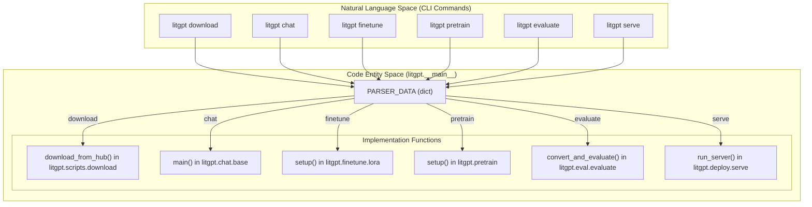
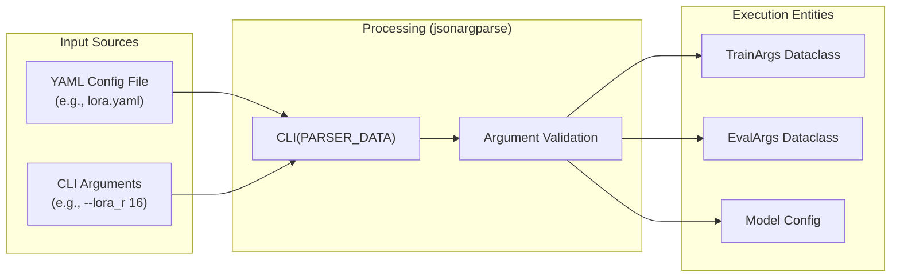

<!-- source: DeepWiki mcp.deepwiki.com · repo Lightning-AI/litgpt · page 7.4 CLI Interface · fetched 2026-10-21 -->

# CLI Interface

Relevant source files

The following files were used as context for generating this wiki page:

- [litgpt/__init__.py](litgpt/__init__.py)
- [litgpt/__main__.py](litgpt/__main__.py)
- [litgpt/chat/base.py](litgpt/chat/base.py)
- [litgpt/eval/evaluate.py](litgpt/eval/evaluate.py)
- [litgpt/finetune/lora_legacy.py](litgpt/finetune/lora_legacy.py)
- [litgpt/scripts/validate.py](litgpt/scripts/validate.py)
- [tests/test_args.py](tests/test_args.py)
- [tests/test_chat.py](tests/test_chat.py)
- [tests/test_cli.py](tests/test_cli.py)
- [tests/test_evaluate.py](tests/test_evaluate.py)
- [tests/test_validate.py](tests/test_validate.py)
- [tutorials/0_to_litgpt.md](tutorials/0_to_litgpt.md)
- [tutorials/evaluation.md](tutorials/evaluation.md)

The LitGPT CLI provides a unified entry point for all model-related operations, including downloading, fine-tuning, pretraining, inference, evaluation, and deployment. It leverages `jsonargparse` to provide a robust argument parsing system that supports both command-line flags and YAML configuration files.

## Command Architecture

The CLI is structured as a single entry point `litgpt` which delegates to specific functional modules based on the subcommand provided.

### Entry Point and Dispatch
The main entry point is defined in `litgpt.__main__:main` [litgpt/__main__.py:65-84](). It uses a mapping called `PARSER_DATA` to associate subcommands with their respective implementation functions [litgpt/__main__.py:33-56]().

### CLI Entity Mapping
The following diagram maps CLI subcommands to their internal implementation functions and file locations.

Sources: [litgpt/__main__.py:8-31](), [litgpt/__main__.py:33-56]()

## Core Subcommands

### 1. Download
The `download` command handles fetching weights and tokenizers from the Hugging Face Hub.
*   **Implementation**: `download_from_hub` in `litgpt.scripts.download`.
*   **Key Logic**: It supports listing available models via `litgpt download list` and can be restricted to tokenizers only using `--tokenizer_only true` [tutorials/0_to_litgpt.md:94-97]().
*   **Automation**: It often triggers an internal conversion from Hugging Face format to LitGPT format immediately after download [tutorials/0_to_litgpt.md:173-177]().

### 2. Chat
The `chat` command provides an interactive REPL for communicating with a model.
*   **Implementation**: `litgpt.chat.base.main` [litgpt/chat/base.py:152-164]().
*   **Data Flow**:
    1.  Loads the checkpoint using `load_checkpoint` [litgpt/chat/base.py:24]().
    2.  Applies `PromptStyle` to the user input [litgpt/chat/base.py:81]().
    3.  Encodes via `Tokenizer.encode` [litgpt/chat/base.py:82]().
    4.  Generates tokens using a streaming iterator `tokenizer.decode_stream` [litgpt/chat/base.py:102]().
*   **Special Handling**: If an unmerged LoRA checkpoint is detected, it automatically calls `merge_lora` before starting the session [litgpt/chat/base.py:17](), [tests/test_chat.py:161-162]().

### 3. Finetune
LitGPT provides several fine-tuning entry points, with `litgpt finetune` defaulting to LoRA.
*   **Sub-variants**:
    *   `finetune_lora`: [litgpt/finetune/lora.py]()
    *   `finetune_full`: [litgpt/finetune/full.py]()
    *   `finetune_adapter`: [litgpt/finetune/adapter.py]()
*   **Argument Parsing**: Uses `TrainArgs`, `EvalArgs`, and `LogArgs` dataclasses to group related hyperparameters [litgpt/finetune/lora_legacy.py:19]().

### 4. Evaluate
The `evaluate` command integrates with the `lm-evaluation-harness`.
*   **Implementation**: `convert_and_evaluate` in `litgpt.eval.evaluate` [litgpt/eval/evaluate.py:26-39]().
*   **Conversion Step**: Since `lm-eval` expects Hugging Face formatted checkpoints, this command performs a temporary internal conversion to a `pytorch_model.bin` compatible format [litgpt/eval/evaluate.py:94-103]().
*   **Tasks**: Users can specify multiple tasks via a CSV string, e.g., `--tasks "hellaswag,truthfulqa_mc2,mmlu"` [tutorials/evaluation.md:30-34]().

### 5. Validate
The `validate` command is a "pre-flight" check utility to ensure environment and checkpoint readiness.
*   **Implementation**: `validate_setup` in `litgpt.scripts.validate` [litgpt/scripts/validate.py:23-28]().
*   **Checks Performed**:
    1.  Directory structure validation via `check_valid_checkpoint_dir` [litgpt/scripts/validate.py:55-58]().
    2.  Config integrity check [litgpt/scripts/validate.py:68-77]().
    3.  Tokenizer round-trip test [litgpt/scripts/validate.py:90-96]().
    4.  Checkpoint weight/shape matching via `validate_checkpoint` [litgpt/scripts/validate.py:110]().
    5.  Memory estimation using `estimate_model_memory` [litgpt/scripts/validate.py:127]().

## Argument Parsing and Configuration

LitGPT uses `jsonargparse.CLI` to generate the interface [litgpt/__main__.py:80](). This allows for high flexibility:

1.  **Direct Flags**: Parameters can be passed as `--param value`.
2.  **Nested Arguments**: Parameters for dataclasses use dot notation, e.g., `--train.max_tokens 1000` [tests/test_cli.py:47-51]().
3.  **YAML Configs**: The `--config` flag allows loading all parameters from a local or remote YAML file [litgpt/__main__.py:69]().

### Configuration Flow Diagram

Sources: [litgpt/__main__.py:68-80](), [litgpt/finetune/lora_legacy.py:66-76]()

## Summary of CLI Capabilities

| Command Category | Commands | Key Classes/Functions |
| :--- | :--- | :--- |
| **Data/Weights** | `download`, `validate` | `download_from_hub`, `validate_checkpoint` |
| **Training** | `pretrain`, `finetune_*` | `TrainArgs`, `FSDPStrategy`, `Fabric` |
| **Inference** | `chat`, `generate_*` | `generate_fn`, `Tokenizer.decode_stream` |
| **Deployment** | `serve` | `run_server`, `LitServe` |
| **Benchmarking** | `evaluate` | `convert_and_evaluate`, `HFLM` |

Sources: [litgpt/__main__.py:33-56](), [litgpt/eval/evaluate.py:26-39](), [litgpt/scripts/validate.py:23-43](), [litgpt/chat/base.py:152-164]()

---

