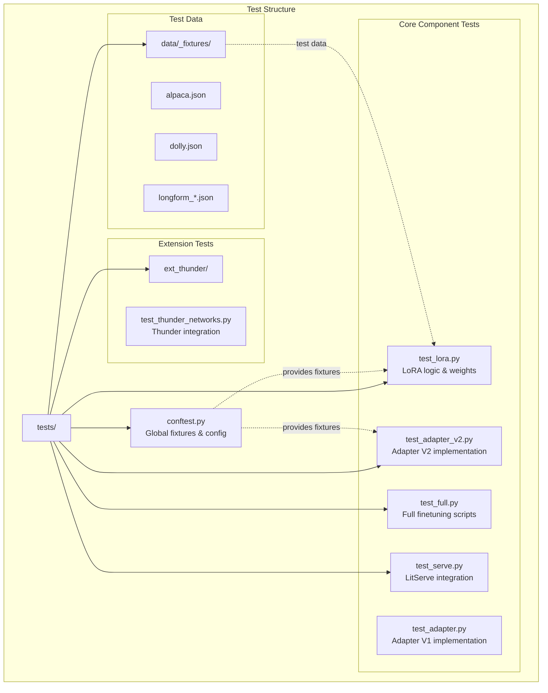
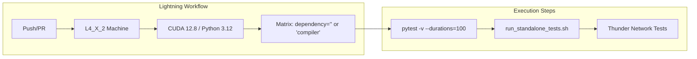
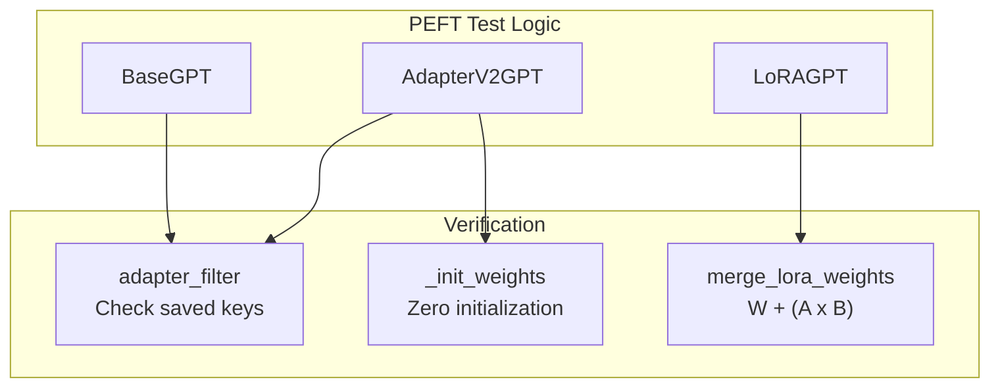

<!-- source: DeepWiki mcp.deepwiki.com · repo Lightning-AI/litgpt · page 8 Testing and CI · fetched 2026-10-21 -->

# Testing and CI

<details>
<summary>Relevant source files</summary>

The following files were used as context for generating this wiki page:

- [.github/workflows/check-links.yml](.github/workflows/check-links.yml)
- [.github/workflows/cpu-tests.yml](.github/workflows/cpu-tests.yml)
- [.github/workflows/mkdocs-deploy.yml](.github/workflows/mkdocs-deploy.yml)
- [.github/workflows/publish-pkg.yml](.github/workflows/publish-pkg.yml)
- [.lightning/workflows/tests.yaml](.lightning/workflows/tests.yaml)
- [CONTRIBUTING.md](CONTRIBUTING.md)
- [litgpt/deploy/serve.py](litgpt/deploy/serve.py)
- [tests/conftest.py](tests/conftest.py)
- [tests/test_adapter.py](tests/test_adapter.py)
- [tests/test_adapter_v2.py](tests/test_adapter_v2.py)
- [tests/test_ci.py](tests/test_ci.py)
- [tests/test_full.py](tests/test_full.py)
- [tests/test_lora.py](tests/test_lora.py)
- [tests/test_serve.py](tests/test_serve.py)
- [tutorials/deploy.md](tutorials/deploy.md)
- [tutorials/mkdocs.yml](tutorials/mkdocs.yml)

</details>


## Purpose and Scope

This document describes LitGPT's testing infrastructure and continuous integration (CI) workflows. It covers the pytest-based test framework, reusable test fixtures, CI workflows for CPU and GPU testing across multiple platforms, test execution strategies, and caching mechanisms. For information about training infrastructure, see [Training Infrastructure](#3.5). For hardware and environment utilities, see [Hardware and Environment](#7.3).

## Test Framework and Dependencies

LitGPT uses pytest as its testing framework with several specialized plugins. The CI environment utilizes `uv` for fast dependency resolution and environment management [.github/workflows/cpu-tests.yml:50-61]().

| Dependency | Purpose |
|------------|---------|
| `pytest` | Core test framework used in `pytest -v litgpt/ tests/` [.github/workflows/cpu-tests.yml:123]() |
| `pytest-timeout` | Timeout protection (set to 180s) [.github/workflows/cpu-tests.yml:123]() |
| `lightning-utilities` | Used to set oldest dependencies for backward compatibility testing [.github/workflows/cpu-tests.yml:113]() |
| `uv` | Package management and caching in CI [.github/workflows/cpu-tests.yml:92-98]() |

**Sources:** [.github/workflows/cpu-tests.yml:1-144]()

## Test Organization



**Test Directory Organization:**

Tests are organized in the `tests/` directory:
- **Core Component Tests**: Detailed validation of model variants like `LoRA` [tests/test_lora.py:1-37](), `AdapterV2` [tests/test_adapter_v2.py:1-31](), and `Full` finetuning [tests/test_full.py:1-15]().
- **Deployment Tests**: Validation of `litgpt serve` using subprocesses and HTTP requests [tests/test_serve.py:22-35]().
- **Extension tests**: Tests for optional integrations like Lightning Thunder [tests/ext_thunder/test_thunder_networks.py]().
- **conftest.py**: Global pytest configuration and shared fixtures [tests/conftest.py:1-15]().

**Sources:** [tests/conftest.py:1-140](), [tests/test_lora.py:1-44](), [tests/test_serve.py:1-21]()

## Pytest Fixtures

The [tests/conftest.py]() file provides reusable fixtures for common test scenarios:

### Checkpoint Fixtures

The `fake_checkpoint_dir` fixture creates a temporary mock checkpoint directory [tests/conftest.py:36-44]():

```python
@pytest.fixture()
def fake_checkpoint_dir(tmp_path):
    os.chdir(tmp_path)
    checkpoint_dir = tmp_path / "checkpoints" / "tmp"
    checkpoint_dir.mkdir(parents=True)
    (checkpoint_dir / "lit_model.pth").touch()
    (checkpoint_dir / "model_config.yaml").touch()
    (checkpoint_dir / "tokenizer.json").touch()
    (checkpoint_dir / "tokenizer_config.json").touch()
    return checkpoint_dir
```

### Test Data Fixtures

| Fixture | Purpose | Files Created |
|---------|---------|---------------|
| `alpaca_path` | Alpaca dataset fixture | `alpaca.json` [tests/conftest.py:117-121]() |
| `dolly_path` | Dolly dataset fixture | `dolly.json` [tests/conftest.py:124-128]() |
| `longform_path` | Long-form dataset fixture | `train.json`, `val.json` [tests/conftest.py:131-138]() |

### Mock Objects

The `MockTokenizer` class provides a simple character-to-ASCII tokenizer for testing without requiring heavy external model files [tests/conftest.py:91-109]():

```python
class MockTokenizer:
    def encode(self, text: str, bos: bool | None = None, eos: bool = False, max_length: int = -1) -> torch.Tensor:
        output = []
        if bos: output.append(self.bos_id)
        output.extend([ord(c) for c in text])
        # ...
```

### Auto-Cleanup Fixtures

- `reclaim_cuda_memory`: Automatically calls `gc.collect()` and `torch.cuda.empty_cache()` after GPU tests [tests/conftest.py:22-33]().
- `restore_default_dtype`: Resets torch default dtype to `float32` [tests/conftest.py:67-71]().
- `destroy_process_group`: Cleans up `torch.distributed` state [tests/conftest.py:73-81]().

**Sources:** [tests/conftest.py:22-138]()

## CI/CD Workflows

LitGPT employs a multi-tier CI strategy covering multiple OS, Python versions, and hardware backends.

### GitHub Actions CPU Tests

The CPU test workflow is defined in [.github/workflows/cpu-tests.yml]() and consists of:

#### 1. testing-imports Job
Verifies that all modules are importable with only minimal dependencies [ .github/workflows/cpu-tests.yml:39-72](). It uses a shell script to generate and run import statements for every `.py` file in the package [.github/workflows/cpu-tests.yml:65-71]().

#### 2. pytester Job
Runs the full suite across a matrix [.github/workflows/cpu-tests.yml:76-88]():
- **OS**: `ubuntu-22.04`, `windows-2022`, `macOS-14`.
- **Python**: `3.10`, `3.11`, `3.12`, `3.13`.
- **Dependencies**: Tests both `latest` and `oldest` supported versions [.github/workflows/cpu-tests.yml:85-86]().

### Lightning.ai GPU Tests

GPU tests run on specialized hardware (2x L4 GPUs) via [.lightning/workflows/tests.yaml]().



**Key Steps:**
- Installs LitGPT with `[extra,test]` or `[compiler,extra,test]` [.lightning/workflows/tests.yaml:41-45]().
- Executes `run_standalone_tests.sh` with `PL_RUN_STANDALONE_TESTS=1` to test distributed code in isolated processes [.lightning/workflows/tests.yaml:56-57]().
- Validates `lightning-thunder` integration when the `compiler` matrix item is active [.lightning/workflows/tests.yaml:59-78]().

**Sources:** [.github/workflows/cpu-tests.yml:1-130](), [.lightning/workflows/tests.yaml:1-79]()

## Testing LoRA and Adapters

LitGPT includes specific tests to verify parameter-efficient fine-tuning (PEFT) implementations.

### LoRA Weight Merging
Tests in [tests/test_lora.py:55-97]() verify that:
1. LoRA weights are initialized separately from the base model.
2. `merge_lora_weights(model)` correctly updates `linear.weight` with the product of `lora_A` and `lora_B` [tests/test_lora.py:87-97]().
3. Multiple calls to `merge()` are idempotent [tests/test_lora.py:90-92]().

### Adapter V2 Implementation
Tests verify that `AdapterV2GPT` correctly adds `adapter_bias` and `adapter_scale` to linear layers compared to the base `GPT` model [tests/test_adapter_v2.py:33-43](). It also validates the `adapter_filter` which determines which weights are saved in a checkpoint [tests/test_adapter_v2.py:45-77]().



**Sources:** [tests/test_lora.py:55-97](), [tests/test_adapter_v2.py:33-77]()

## Deployment Testing

The serving infrastructure is tested by spawning a `litgpt serve` process and checking its health via HTTP [.github/workflows/cpu-tests.yml]().

**Test Flow in `test_simple` [tests/test_serve.py:40-72]():**
1. Generates a dummy model and `model_config.yaml`.
2. Starts `litgpt serve` using `subprocess.Popen` [tests/test_serve.py:60]().
3. Uses `_wait_and_check_response` to poll `http://127.0.0.1:8000` [tests/test_serve.py:22-34]().
4. Kills the process tree after verification [tests/test_serve.py:70]().

**Sources:** [tests/test_serve.py:22-141]()

## Link and Package Validation

- **Check Hyperlinks**: A dedicated workflow `check-links.yml` uses `pytest-check-links` to verify all URLs in `README.md` and `tutorials/` [.github/workflows/check-links.yml:25-31]().
- **PyPI Distribution**: The `publish-pkg.yml` workflow builds source and wheel distributions, runs `twine check`, and uploads artifacts [.github/workflows/publish-pkg.yml:29-39]().
- **Documentation**: `mkdocs-deploy.yml` builds the documentation using `mkdocs-material` and deploys to GitHub Pages [.github/workflows/mkdocs-deploy.yml:25-35]().

**Sources:** [.github/workflows/check-links.yml:1-35](), [.github/workflows/publish-pkg.yml:1-79](), [.github/workflows/mkdocs-deploy.yml:1-39]()

---

