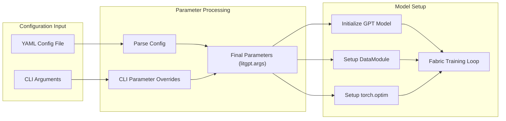
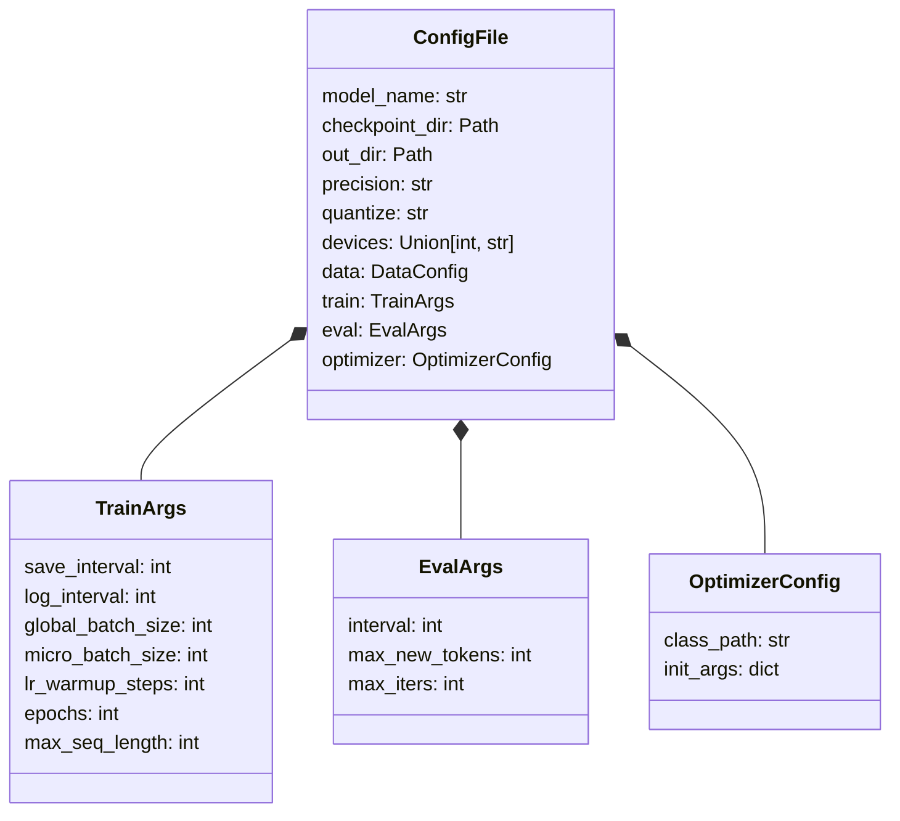

<!-- source: DeepWiki mcp.deepwiki.com · repo Lightning-AI/litgpt · page 9 Configuration Hub · fetched 2026-10-21 -->

# Configuration Hub

<details>
<summary>Relevant source files</summary>

The following files were used as context for generating this wiki page:

- [config_hub/finetune/README.md](config_hub/finetune/README.md)
- [config_hub/finetune/falcon-7b/lora.yaml](config_hub/finetune/falcon-7b/lora.yaml)
- [config_hub/finetune/falcon-7b/qlora.yaml](config_hub/finetune/falcon-7b/qlora.yaml)
- [config_hub/finetune/gemma-2b/full.yaml](config_hub/finetune/gemma-2b/full.yaml)
- [config_hub/finetune/gemma-2b/lora.yaml](config_hub/finetune/gemma-2b/lora.yaml)
- [config_hub/finetune/gemma-2b/qlora.yaml](config_hub/finetune/gemma-2b/qlora.yaml)
- [config_hub/finetune/gemma-7b/lora.yaml](config_hub/finetune/gemma-7b/lora.yaml)
- [config_hub/finetune/gemma-7b/qlora.yaml](config_hub/finetune/gemma-7b/qlora.yaml)
- [config_hub/finetune/gemma2-2b/lora.yaml](config_hub/finetune/gemma2-2b/lora.yaml)
- [config_hub/finetune/gemma2-2b/qlora.yaml](config_hub/finetune/gemma2-2b/qlora.yaml)
- [config_hub/finetune/gemma2-9b/lora.yaml](config_hub/finetune/gemma2-9b/lora.yaml)
- [config_hub/finetune/gemma2-9b/qlora.yaml](config_hub/finetune/gemma2-9b/qlora.yaml)
- [config_hub/finetune/llama-2-7b/full.yaml](config_hub/finetune/llama-2-7b/full.yaml)
- [config_hub/finetune/llama-2-7b/lora.yaml](config_hub/finetune/llama-2-7b/lora.yaml)
- [config_hub/finetune/llama-2-7b/qlora.yaml](config_hub/finetune/llama-2-7b/qlora.yaml)
- [config_hub/finetune/llama-3-8b/full.yaml](config_hub/finetune/llama-3-8b/full.yaml)
- [config_hub/finetune/llama-3-8b/lora.yaml](config_hub/finetune/llama-3-8b/lora.yaml)
- [config_hub/finetune/llama-3-8b/qlora.yaml](config_hub/finetune/llama-3-8b/qlora.yaml)
- [config_hub/finetune/llama-3.1-8b/full.yaml](config_hub/finetune/llama-3.1-8b/full.yaml)
- [config_hub/finetune/llama-3.1-8b/lora.yaml](config_hub/finetune/llama-3.1-8b/lora.yaml)
- [config_hub/finetune/llama-3.1-8b/qlora.yaml](config_hub/finetune/llama-3.1-8b/qlora.yaml)
- [config_hub/finetune/llama-3.2-1B/full.yaml](config_hub/finetune/llama-3.2-1B/full.yaml)
- [config_hub/finetune/llama-3.2-1B/lora.yaml](config_hub/finetune/llama-3.2-1B/lora.yaml)
- [config_hub/finetune/llama-3.2-1B/qlora.yaml](config_hub/finetune/llama-3.2-1B/qlora.yaml)
- [config_hub/finetune/llama-3.2-3B/full.yaml](config_hub/finetune/llama-3.2-3B/full.yaml)
- [config_hub/finetune/llama-3.2-3B/lora.yaml](config_hub/finetune/llama-3.2-3B/lora.yaml)
- [config_hub/finetune/llama-3.2-3B/qlora.yaml](config_hub/finetune/llama-3.2-3B/qlora.yaml)
- [config_hub/finetune/mistral-7b-v0.2/lora.yaml](config_hub/finetune/mistral-7b-v0.2/lora.yaml)
- [config_hub/finetune/mistral-7b-v0.2/qlora.yaml](config_hub/finetune/mistral-7b-v0.2/qlora.yaml)
- [config_hub/finetune/mistral-7b/lora.yaml](config_hub/finetune/mistral-7b/lora.yaml)
- [config_hub/finetune/mistral-7b/qlora.yaml](config_hub/finetune/mistral-7b/qlora.yaml)
- [config_hub/finetune/phi-2/full.yaml](config_hub/finetune/phi-2/full.yaml)
- [config_hub/finetune/phi-2/lora.yaml](config_hub/finetune/phi-2/lora.yaml)
- [config_hub/finetune/phi-2/qlora.yaml](config_hub/finetune/phi-2/qlora.yaml)
- [config_hub/finetune/phi-3/full.yaml](config_hub/finetune/phi-3/full.yaml)
- [config_hub/finetune/phi-3/lora.yaml](config_hub/finetune/phi-3/lora.yaml)
- [config_hub/finetune/phi-3/qlora.yaml](config_hub/finetune/phi-3/qlora.yaml)
- [config_hub/finetune/stablelm-base-alpha-3b/full.yaml](config_hub/finetune/stablelm-base-alpha-3b/full.yaml)
- [config_hub/finetune/stablelm-base-alpha-3b/lora.yaml](config_hub/finetune/stablelm-base-alpha-3b/lora.yaml)
- [config_hub/finetune/stablelm-base-alpha-3b/qlora.yaml](config_hub/finetune/stablelm-base-alpha-3b/qlora.yaml)
- [config_hub/finetune/tiny-llama/full.yaml](config_hub/finetune/tiny-llama/full.yaml)
- [config_hub/finetune/tiny-llama/lora.yaml](config_hub/finetune/tiny-llama/lora.yaml)
- [config_hub/finetune/tiny-llama/qlora.yaml](config_hub/finetune/tiny-llama/qlora.yaml)
- [config_hub/pretrain/debug.yaml](config_hub/pretrain/debug.yaml)
- [config_hub/pretrain/microllama.yaml](config_hub/pretrain/microllama.yaml)
- [config_hub/pretrain/tinyllama.yaml](config_hub/pretrain/tinyllama.yaml)
- [config_hub/pretrain/tinystories.yaml](config_hub/pretrain/tinystories.yaml)

</details>


The Configuration Hub in LitGPT provides a collection of pre-defined YAML configuration files for common training, fine-tuning, and inference workflows. These configurations have been benchmarked and optimized to work with specific model architectures and hardware setups, serving as both ready-to-use recipes and as templates that can be customized for specific needs.

For information about the general configuration system and how individual parameters work, see [Config System](#2.1).

## Organization and Purpose

The Configuration Hub is organized into directories based on task categories:

```
config_hub/
├── finetune/
│   ├── falcon-7b/
│   │   ├── lora.yaml
│   │   └── qlora.yaml
│   ├── gemma-2b/
│   │   ├── full.yaml
│   │   ├── lora.yaml
│   │   └── qlora.yaml
│   ├── llama-3-8b/
│   │   ├── full.yaml
│   │   ├── lora.yaml
│   │   └── qlora.yaml
│   └── ...
└── pretrain/
    ├── debug.yaml
    ├── tinyllama.yaml
    ├── tinystories.yaml
    └── microllama.yaml
```

Each model directory under `finetune/` contains configurations for different fine-tuning methods:
- `full.yaml`: Full fine-tuning (all parameters trainable)
- `lora.yaml`: LoRA fine-tuning (low-rank adaptation)
- `qlora.yaml`: Quantized LoRA fine-tuning (typically using `bnb.nf4`)

The `pretrain/` directory contains configurations for pretraining models from scratch on different datasets, including specialized setups like `tinystories.yaml` for small-scale experiments.

Sources: [config_hub/finetune/README.md:1-45](), [config_hub/pretrain/debug.yaml:1-115](), [config_hub/pretrain/tinyllama.yaml:1-115](), [config_hub/pretrain/tinystories.yaml:1-131]()

## How Configuration Files Are Used

Configuration files serve as input to the LitGPT CLI commands, defining all parameters for a training run. The system uses a hierarchical merging strategy where CLI arguments override YAML settings.

### Configuration Data Flow


Sources: [config_hub/pretrain/debug.yaml:1-7](), [config_hub/finetune/llama-2-7b/full.yaml:1-32]()

## Configuration File Anatomy

LitGPT configuration files are structured to map directly to the internal `TrainArgs`, `EvalArgs`, and `DataModule` structures.

### Config Structure Mapping


Key sections include:
1. **Model Identification**: `model_name` or `model_config` to define architecture [config_hub/pretrain/debug.yaml:1-7]().
2. **Data**: `data` section often using `class_path` to instantiate specific `DataModule` types like `litgpt.data.Alpaca2k` [config_hub/finetune/llama-2-7b/full.yaml:23-31]().
3. **Training**: Parameters for the loop, including `micro_batch_size` and `global_batch_size` for gradient accumulation [config_hub/finetune/llama-3-8b/lora.yaml:65-69]().
4. **LoRA Specifics**: In `lora.yaml` files, settings like `lora_r`, `lora_alpha`, and boolean flags for target layers (e.g., `lora_query`, `lora_mlp`) [config_hub/finetune/tiny-llama/lora.yaml:19-44]().

Sources: [config_hub/pretrain/debug.yaml:1-115](), [config_hub/finetune/llama-2-7b/full.yaml:1-108](), [config_hub/finetune/tiny-llama/lora.yaml:1-133]()

## Using Configuration Files

Configuration files are invoked via the `--config` flag. This allows for reproducible experiments and easy sharing of training recipes.

```bash
# Fine-tuning with LoRA using a hub config
litgpt finetune lora --config config_hub/finetune/llama-3-8b/lora.yaml

# Overriding specific parameters for local hardware
litgpt finetune lora \
  --config config_hub/finetune/llama-3-8b/lora.yaml \
  --train.micro_batch_size 1 \
  --devices 1
```

Sources: [config_hub/finetune/README.md:1-5](), [config_hub/finetune/llama-3-8b/lora.yaml:68-69]()

## Fine-tuning Configurations

The fine-tuning configurations are optimized for specific memory envelopes and performance targets.

| Method | Key Configuration Parameters | Memory Impact |
| :--- | :--- | :--- |
| **Full** | `precision: bf16-true`, no `quantize` | Highest (Updates all weights) |
| **LoRA** | `lora_r: 32`, `lora_alpha: 16`, target layers | Medium (Updates adapter weights) |
| **QLoRA** | `quantize: bnb.nf4`, `lora_r: 32` | Lowest (4-bit base + adapters) |

### Performance and Cost Benchmarks
The `config_hub/finetune/README.md` provides detailed benchmarks on Lightning AI Studios using A10G GPUs:
- **Falcon-7B QLoRA**: ~9.44 GB Peak Memory [config_hub/finetune/README.md:14]().
- **Llama-3-8B LoRA**: ~19.73 GB Peak Memory [config_hub/finetune/README.md:38]().
- **Gemma-2-9B QLoRA**: ~20.92 GB Peak Memory [config_hub/finetune/README.md:30]().

Sources: [config_hub/finetune/README.md:10-40](), [config_hub/finetune/tiny-llama/qlora.yaml:11-20]()

## Pretraining Configurations

Pretraining configurations allow for training from scratch or continued pretraining.

1. **debug.yaml**: Uses `pythia-14m` and `TinyStories` for rapid pipeline verification [config_hub/pretrain/debug.yaml:3-27]().
2. **tinyllama.yaml**: Replicates the TinyLlama 1.1B setup, including `max_tokens: 3000000000000` (3T tokens) and specific learning rate schedules [config_hub/pretrain/tinyllama.yaml:3-50]().
3. **tinystories.yaml**: Demonstrates a custom `model_config` block, manually defining layers, heads, and embedding sizes (e.g., `n_layer: 6`, `n_head: 6`) rather than using a named model [config_hub/pretrain/tinystories.yaml:5-23]().

Sources: [config_hub/pretrain/debug.yaml:1-115](), [config_hub/pretrain/tinyllama.yaml:1-115](), [config_hub/pretrain/tinystories.yaml:1-131]()

## Customizing for Hardware Constraints

If a hub configuration results in an Out-of-Memory (OOM) error, users should modify the following in order of preference:
1. **Micro Batch Size**: Reduce `train.micro_batch_size` (e.g., to 1) [config_hub/finetune/README.md:3]().
2. **Quantization**: Switch to `qlora.yaml` or set `quantize: bnb.nf4` [config_hub/finetune/tiny-llama/qlora.yaml:11]().
3. **LoRA Rank**: Lower `lora_r` from 32 to 16 or 8 [config_hub/finetune/README.md:3]().
4. **Target Layers**: Disable LoRA for specific projections like `lora_mlp: false` or `lora_projection: false` [config_hub/finetune/llama-3-8b/lora.yaml:38-41]().

Sources: [config_hub/finetune/README.md:1-5](), [config_hub/finetune/llama-3-8b/lora.yaml:19-44]()

---

