# Page: Overview

# Overview

<details>
<summary>Relevant source files</summary>

The following files were used as context for generating this wiki page:

- [.pre-commit-config.yaml](.pre-commit-config.yaml)
- [README.md](README.md)
- [litgpt/__init__.py](litgpt/__init__.py)
- [litgpt/__main__.py](litgpt/__main__.py)
- [litgpt/config.py](litgpt/config.py)
- [litgpt/finetune/lora_legacy.py](litgpt/finetune/lora_legacy.py)
- [litgpt/scripts/validate.py](litgpt/scripts/validate.py)
- [pyproject.toml](pyproject.toml)
- [tests/test_cli.py](tests/test_cli.py)
- [tests/test_model.py](tests/test_model.py)
- [tests/test_validate.py](tests/test_validate.py)
- [tutorials/download_model_weights.md](tutorials/download_model_weights.md)

</details>


LitGPT is a hackable, production-ready implementation of state-of-the-art open-source large language models (LLMs). It provides from-scratch implementations of 20+ model architectures with optimized training, finetuning, and deployment capabilities. The codebase emphasizes transparency and control, avoiding abstraction layers in favor of explicit, modifiable code.

This page provides a high-level introduction to LitGPT's architecture, components, and capabilities. For detailed information about specific subsystems:
- Model configuration and architecture: [Core Architecture](#2)
- Training methods: [Fine-tuning](#3) and [Pretraining](#4)
- Text generation and deployment: [Inference and Generation](#6)
- Dataset handling: [Data Processing](#5)

**Sources:** [README.md:1-60](), [pyproject.toml:9-16]()

---

## Key Capabilities

LitGPT supports three primary workflows:

| Workflow | Description | Key Features |
|----------|-------------|--------------|
| **Pretraining** | Train models from scratch | Custom datasets, 3T+ token support, TinyLlama example |
| **Finetuning** | Adapt pretrained models | LoRA, QLoRA, Adapter V1/V2, full finetuning |
| **Deployment** | Serve models for inference | Python API (`LLM` class), HTTP server (LitServe), OpenAI-compatible endpoints |

Additional capabilities include:
- **Checkpoint conversion**: Bidirectional conversion between LitGPT and Hugging Face formats [litgpt/scripts/convert_hf_checkpoint.py:24-31](), [litgpt/scripts/convert_lit_checkpoint.py:25-30]().
- **Quantization**: BitsAndBytes 4-bit/8-bit, mixed precision (FP16/BF16) [litgpt/finetune/lora_legacy.py:53-58]().
- **Distributed training**: FSDP, multi-GPU/TPU support via Lightning Fabric [litgpt/finetune/lora_legacy.py:158-164]().
- **Evaluation**: Integration with lm-evaluation-harness for benchmarks [litgpt/__main__.py:53-53]().

**Sources:** [README.md:52-85](), [README.md:215-230](), [litgpt/__main__.py:33-56]()

---

## Supported Models

LitGPT includes configurations for 20+ model families from various organizations:

| Model Family | Sizes | Organization | Reference |
|--------------|-------|--------------|-----------|
| Llama 3, 3.1, 3.2, 3.3 | 1B-405B | Meta AI | [README.md:111-111]() |
| Phi (1.5, 2, 3, 4) | 1.3B-14B | Microsoft | [tutorials/download_model_weights.md:36-42]() |
| Gemma/Gemma 2/Gemma 3 | 1B-27B | Google | [README.md:113-114](), [tutorials/download_model_weights.md:18-20]() |
| Qwen2.5/Qwen3 | 0.5B-235B | Alibaba | [README.md:116-117](), [tutorials/download_model_weights.md:45-52]() |
| Mistral/Mixtral | 7B-8x22B | Mistral AI | [tutorials/download_model_weights.md:30-32]() |
| Falcon/Falcon 3 | 1B-180B | TII UAE | [README.md:132-133]() |
| R1 Distill Llama | 8B, 70B | DeepSeek AI | [README.md:118-118]() |

Full list: Use `litgpt download list` CLI command or see [tutorials/download_model_weights.md:8-61]().

**Sources:** [README.md:106-176](), [litgpt/config.py:26-117](), [tutorials/download_model_weights.md:8-61]()

---

## System Architecture

### High-Level Component Diagram

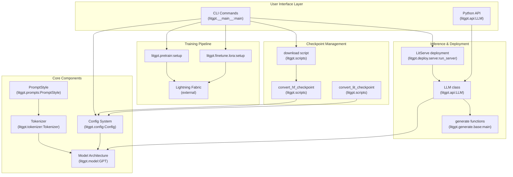

**Component Descriptions:**

- **Config System**: The `Config` dataclass [litgpt/config.py:26-117]() defines model architectures with parameters like `n_layer`, `n_embd`, and `n_head`. It includes logic for calculating `padded_vocab_size` [litgpt/config.py:127-131]() and `head_size` [litgpt/config.py:122-124]().
- **Tokenizer**: The `Tokenizer` class [litgpt/tokenizer.py:12-183]() (referenced in [litgpt/__init__.py:10]()) provides a unified interface for model-specific tokenization.
- **Model Architecture**: The `GPT` class [litgpt/model.py:39-39]() implements the transformer blocks, supporting various MLP variants [litgpt/config.py:92-92]() and attention mechanisms like MHA, GQA, and MQA [litgpt/config.py:48-68]().
- **Deployment Infrastructure**: The `serve` subcommand [litgpt/__main__.py:54-54]() uses LitServe [pyproject.toml:55-55]() to expose models via HTTP.

**Sources:** [litgpt/config.py:26-160](), [litgpt/__main__.py:33-56](), [litgpt/__init__.py:6-11]()

---

## Model Lifecycle and Data Flow

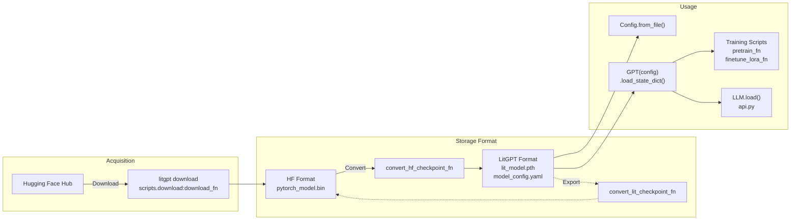

**Key Classes and Functions:**

1. **Config Loading**:
   - `Config.from_file(path)`: Loads configuration from a YAML file [litgpt/finetune/lora_legacy.py:117-128]().
   - `Config.from_name(name)`: Loads predefined configurations for known models [tests/test_model.py:148-148]().

2. **Checkpoint Validation**:
   - `validate_checkpoint()`: Compares a saved checkpoint against a model instance to ensure keys and shapes match [litgpt/scripts/validate.py:102-113](), [tests/test_validate.py:45-51]().
   - `estimate_model_memory()`: Calculates GPU memory requirements for a given `Config` [litgpt/scripts/validate.py:125-138](), [tests/test_validate.py:162-171]().

3. **Checkpoint Conversion**:
   - `convert_hf_checkpoint_fn`: Entry point for HF to LitGPT conversion [litgpt/__main__.py:24-24]().
   - `convert_lit_checkpoint_fn`: Entry point for LitGPT to HF conversion [litgpt/__main__.py:25-25]().

**Sources:** [litgpt/scripts/validate.py:23-43](), [litgpt/__main__.py:33-56](), [tests/test_validate.py:35-52]()

---

## User Interaction Patterns

LitGPT provides two primary interfaces:

### Command-Line Interface (CLI)

The CLI is the primary entry point for workflows. It is powered by `jsonargparse` [litgpt/__main__.py:6-6]() and supports subcommands for all major features:

```bash
# List available models
litgpt download list

# Download and convert model weights
litgpt download microsoft/phi-2

# Interactive chat
litgpt chat microsoft/phi-2

# Finetune with LoRA
litgpt finetune_lora microsoft/phi-2 --data Alpaca

# Serve the model
litgpt serve microsoft/phi-2
```

**Sources:** [litgpt/__main__.py:33-56](), [tests/test_cli.py:10-30](), [tutorials/download_model_weights.md:3-3]()

### Python API

The `LLM` class [litgpt/api.py:6-6]() provides a high-level programmatic interface:

```python
from litgpt import LLM

# Load model (auto-downloads if needed)
llm = LLM.load("microsoft/phi-2")

# Generate text
text = llm.generate("Fix the spelling: Every fall, the family goes to the mountains.")
print(text)
```

**Sources:** [README.md:68-76](), [litgpt/__init__.py:6-6]()

---

## Training Methods

LitGPT implements several training approaches with different parameter efficiency tradeoffs:

| Method | Subcommand | Description | Implementation |
|--------|------------|-------------|----------------|
| **LoRA** | `finetune_lora` | Low-Rank Adaptation | [litgpt/finetune/lora_legacy.py:49-108]() |
| **Adapter** | `finetune_adapter` | Attention-based adapters | [litgpt/__main__.py:39-39]() |
| **Adapter V2** | `finetune_adapter_v2` | Bias/Scale adapters | [litgpt/__main__.py:40-40]() |
| **Full** | `finetune_full` | All parameters trainable | [litgpt/__main__.py:38-38]() |

All methods leverage Lightning Fabric [litgpt/finetune/lora_legacy.py:168-175]() for distributed training and support quantization via `bitsandbytes` [litgpt/finetune/lora_legacy.py:140-150]().

**Sources:** [litgpt/__main__.py:33-56](), [litgpt/finetune/lora_legacy.py:49-81](), [pyproject.toml:43-46]()

---

## File Organization

- `litgpt/api.py`: The `LLM` high-level API [litgpt/__init__.py:6-6]().
- `litgpt/config.py`: Architecture definitions and named configs [litgpt/config.py:26-26]().
- `litgpt/model.py`: Core `GPT` model implementation [litgpt/model.py:39-39]().
- `litgpt/tokenizer.py`: Tokenizer handling [litgpt/tokenizer.py:12-12]().
- `litgpt/finetune/`: Training loop implementations for different methods.
- `litgpt/scripts/`: CLI utilities for downloading and converting checkpoints.
- `litgpt/deploy/`: Serving infrastructure using LitServe [litgpt/__main__.py:9-9]().

**Sources:** [pyproject.toml:88-96](), [litgpt/__main__.py:8-31]()

---

# Page: Core Architecture

# Core Architecture

<details>
<summary>Relevant source files</summary>

The following files were used as context for generating this wiki page:

- [README.md](README.md)
- [litgpt/adapter.py](litgpt/adapter.py)
- [litgpt/adapter_v2.py](litgpt/adapter_v2.py)
- [litgpt/config.py](litgpt/config.py)
- [litgpt/lora.py](litgpt/lora.py)
- [litgpt/model.py](litgpt/model.py)
- [tests/test_model.py](tests/test_model.py)
- [tutorials/download_model_weights.md](tutorials/download_model_weights.md)

</details>


This document details the fundamental architecture of LitGPT, covering the model design, configuration system, and how core components interact to create a flexible, high-performance language model implementation.

## Model Architecture Overview

LitGPT implements decoder-only transformer language models with a focus on readability and efficiency. Every model is written from scratch to maximize performance and remove layers of abstraction [README.md:106-107](). The system is designed with minimal abstraction layers, making it easy to understand and modify while maintaining high performance [litgpt/model.py:3-7]().

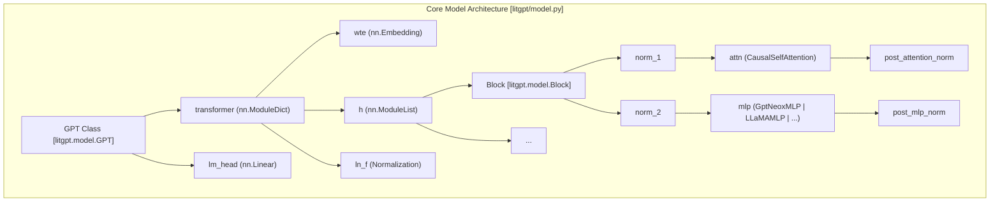

Sources: [litgpt/model.py:22-37](), [litgpt/model.py:261-328]()

The architecture consists of:

- **GPT Class**: The main model class that ties everything together [litgpt/model.py:22-37]().
- **Transformer Module**: Contains the embedding layer (`wte`), transformer blocks (`h`), and final layer norm (`ln_f`) [litgpt/model.py:29-35]().
- **Transformer Blocks**: Each containing attention, MLP, layer norms, and residual connections [litgpt/model.py:261-328]().
- **Language Model Head**: Maps from the model's hidden dimensions to vocabulary logits [litgpt/model.py:28]().

For details, see [Model Architecture](#2.3).

## Configuration System

LitGPT uses a flexible configuration system defined by the `Config` dataclass [litgpt/config.py:26](). This system enables supporting many model variants with a single codebase by defining parameters like `n_layer`, `n_embd`, and `n_head` [litgpt/config.py:31-46]().

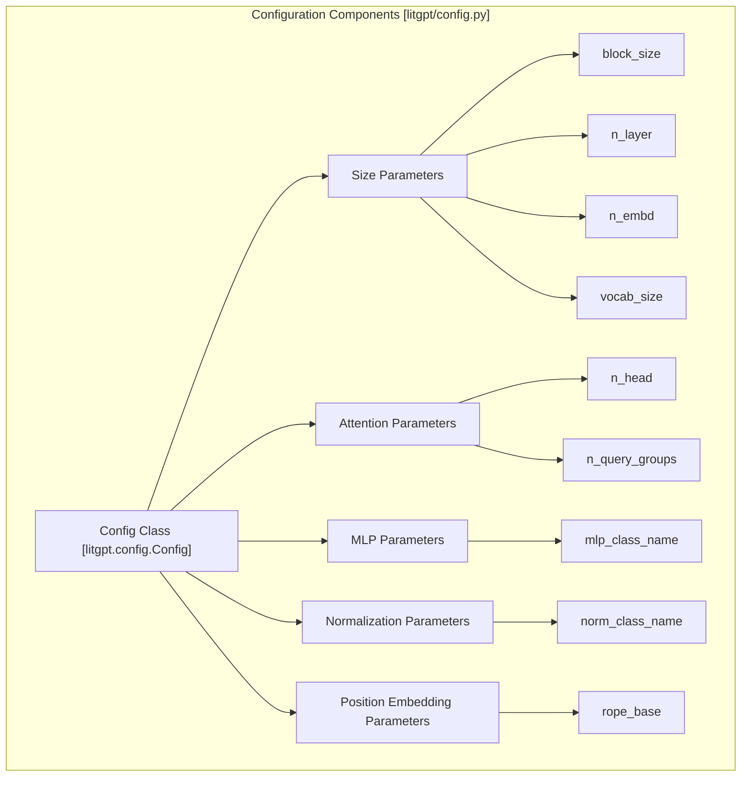

Sources: [litgpt/config.py:26-117](), [litgpt/config.py:118-184]()

Key features of the configuration system:
- **Comprehensive Parameters**: Controls all aspects of model architecture and behavior.
- **Factory Methods**: `from_name()`, `from_file()`, and `from_checkpoint()` for flexible initialization [litgpt/config.py:187-210]().
- **Dynamic Computation**: Automatically computes dependent parameters like `head_size` and `intermediate_size` in `__post_init__` [litgpt/config.py:122-143]().

For details, see [Config System](#2.1).

## Attention Mechanism

The `CausalSelfAttention` class [litgpt/model.py:331]() is a versatile implementation supporting multiple attention patterns by adjusting `n_query_groups` [litgpt/config.py:48-68]().

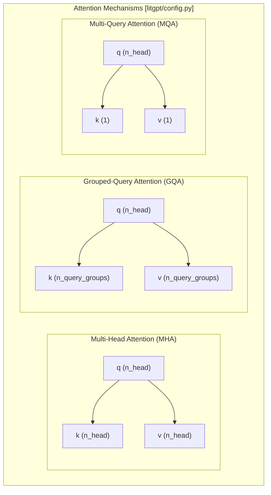

Sources: [litgpt/model.py:331-389](), [litgpt/config.py:48-68]()

Key attention features:
- **Flexible Query Groups**: Controlled via the `n_query_groups` parameter [litgpt/config.py:68]().
- **Rotary Position Embeddings (RoPE)**: Applied to the query and key projections using cached `cos` and `sin` values [litgpt/model.py:365-366]().
- **Flash Attention**: Utilizes `torch.nn.functional.scaled_dot_product_attention` for optimized performance [litgpt/model.py:417-427]().

For details, see [Model Architecture](#2.3).

## Forward Pass and Generation

The model's forward pass processes tokens through transformer layers. It supports efficient inference via a KV cache system [litgpt/model.py:124-146]().

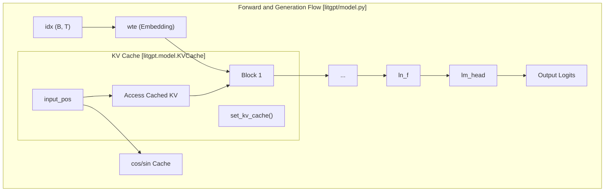

Sources: [litgpt/model.py:85-179](), [litgpt/model.py:456-487]()

The forward pass includes logic for:
- **KV Caching**: Triggered when `input_pos` is provided [litgpt/model.py:124]().
- **Chunked Logits**: Optional `lm_head_chunk_size` to save memory during training [litgpt/model.py:168-175]().

## Weight Loading and Conversion

LitGPT provides scripts to convert checkpoints between Hugging Face and LitGPT formats. This involves mapping layer names and reassembling QKV matrices [litgpt/scripts/convert_hf_checkpoint.py:19]().

Sources: [litgpt/scripts/convert_hf_checkpoint.py:23-450](), [litgpt/scripts/convert_lit_checkpoint.py:18-240]()

For details, see [Checkpoint Conversion](#2.4).

## Tokenization and Prompts

- **Tokenizer**: Supports multiple backends (HuggingFace, SentencePiece) via the `Tokenizer` class [litgpt/tokenizer.py:23](). For details, see [Tokenizer](#2.2).
- **Prompt Styles**: Handles model-specific formatting (e.g., Llama 3, Alpaca) through the `PromptStyle` system [litgpt/prompts.py:15](). For details, see [Prompt Styles](#2.5).

## Parameter-Efficient Fine-tuning (PEFT)

LitGPT implements several PEFT methods by wrapping or modifying core model components:

| Method | Implementation File | Key Mechanism |
|--------|---------------------|---------------|
| **LoRA** | [litgpt/lora.py]() | Trainable low-rank matrices `lora_A` and `lora_B` [litgpt/lora.py:125-126](). |
| **Adapter** | [litgpt/adapter.py]() | Attention over learned prompt embeddings `adapter_wte` [litgpt/adapter.py:73](). |
| **Adapter V2** | [litgpt/adapter_v2.py]() | Adds `adapter_scale` and `adapter_bias` to linear layers [litgpt/adapter_v2.py:54-55](). |

Sources: [litgpt/lora.py:9-435](), [litgpt/adapter.py:1-129](), [litgpt/adapter_v2.py:1-188]()

For more information, see [Fine-tuning](#3).

---

# Page: Config System

# Config System

<details>
<summary>Relevant source files</summary>

The following files were used as context for generating this wiki page:

- [README.md](README.md)
- [litgpt/config.py](litgpt/config.py)
- [litgpt/parser_config.py](litgpt/parser_config.py)
- [litgpt/tokenizer.py](litgpt/tokenizer.py)
- [tests/test_config.py](tests/test_config.py)
- [tests/test_config_hub.py](tests/test_config_hub.py)
- [tests/test_merge_lora.py](tests/test_merge_lora.py)
- [tests/test_model.py](tests/test_model.py)
- [tests/test_rope.py](tests/test_rope.py)
- [tests/test_tokenizer.py](tests/test_tokenizer.py)
- [tutorials/download_model_weights.md](tutorials/download_model_weights.md)

</details>


## Purpose and Scope

The Config System provides the central mechanism for defining and loading model architecture configurations in LitGPT. It encapsulates all structural parameters for supported language models (layer counts, embedding dimensions, attention mechanisms, etc.) and provides multiple loading strategies to instantiate configurations from predefined templates, YAML files, or checkpoint directories.

For information about how these configurations are used during model initialization, see [Model Architecture](#2.3). For checkpoint format conversion that preserves configuration metadata, see [Checkpoint Conversion](#2.4).

**Sources:** [litgpt/config.py:1-234]()

---

## Config Dataclass Structure

The `Config` dataclass in [litgpt/config.py:25-117]() serves as the single source of truth for model architecture parameters. It contains over 50 fields organized into logical groups.

### Core Architecture Parameters

| Parameter Category | Key Fields | Description |
|-------------------|------------|-------------|
| **Size Parameters** | `block_size`, `n_layer`, `n_embd`, `vocab_size`, `padded_vocab_size` | Define model dimensions and context length |
| **Attention Structure** | `n_head`, `head_size`, `n_query_groups`, `attn_bias` | Configure attention mechanism (MHA/MQA/GQA) |
| **Transformer Block** | `norm_class_name`, `norm_eps`, `parallel_residual`, `shared_attention_norm` | Control block architecture and normalization |
| **MLP Configuration** | `mlp_class_name`, `intermediate_size`, `bias`, `gelu_approximate` | Define feed-forward network structure |
| **Rotary Embeddings** | `rope_base`, `rotary_percentage`, `rope_condense_ratio`, `rope_adjustments` | Configure RoPE parameters |
| **MoE Parameters** | `n_expert`, `n_expert_per_token`, `n_expert_groups` | Mixture-of-Experts settings |
| **Special Features** | `sliding_window_size`, `attention_logit_softcapping`, `final_logit_softcapping` | Advanced features like sliding window attention |

**Sources:** [litgpt/config.py:26-108]()

### Configuration Metadata

Each `Config` instance includes:
- `name`: Human-readable model identifier (e.g., "Llama-3-8B") [litgpt/config.py:27]()
- `hf_config`: Dictionary with `org` and `name` fields mapping to Hugging Face model IDs [litgpt/config.py:28]()

---

## Configuration Loading Methods

The `Config` class provides three primary loading mechanisms, each suited to different use cases:

### Method 1: from_name()

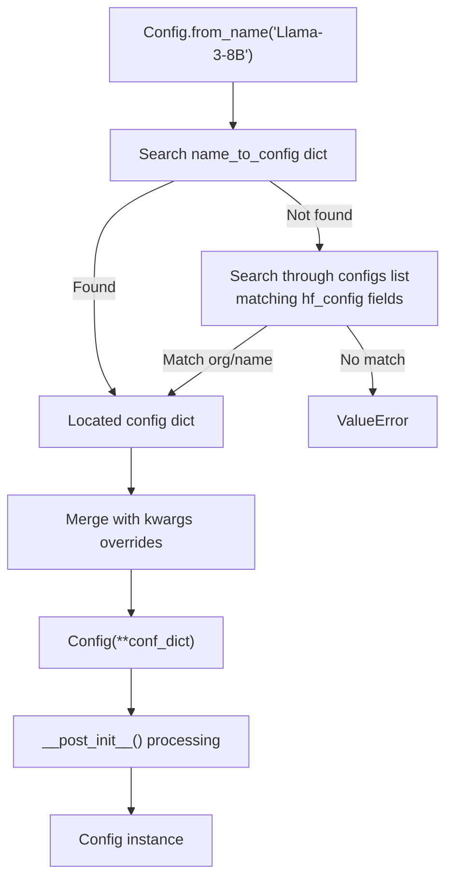

**from_name() workflow**

The `from_name()` class method [litgpt/config.py:168-186]() loads predefined configurations by model name. It first checks the `name_to_config` dictionary, then falls back to searching through the `configs` list by matching against `hf_config["name"]` or the full `org/name` pattern.

```python
# Example usage
config = Config.from_name("Llama-3-8B", n_layer=16)  # Override n_layer
```

**Sources:** [litgpt/config.py:168-186]()

### Method 2: from_file()

The `from_file()` class method [litgpt/config.py:188-195]() loads configuration from YAML files. This is commonly used with configuration recipes in the `config_hub/` directory.

```python
# Example usage
config = Config.from_file("config_hub/finetune/llama-3-8b/lora.yaml")
```

The method uses `yaml.safe_load()` to parse the file and validates that it's not empty before instantiation.

**Sources:** [litgpt/config.py:188-195]()

### Method 3: from_checkpoint()

The `from_checkpoint()` class method [litgpt/config.py:197-204]() automatically determines the appropriate configuration when loading from a checkpoint directory:

1. **First priority**: Looks for `model_config.yaml` in the checkpoint directory.
2. **Fallback**: Attempts to match the directory name against `name_to_config`.
3. **Error**: Raises `FileNotFoundError` if neither approach succeeds.

```python
# Example usage
config = Config.from_checkpoint(Path("checkpoints/meta-llama/Llama-3-8B"))
```

**Sources:** [litgpt/config.py:197-204](), [tests/test_config.py:72-101]()

---

## Dynamic Class Resolution

The Config system uses dynamic property resolution to convert string-based class names into actual Python class types at runtime. This keeps configurations serializable while maintaining type safety during model instantiation.

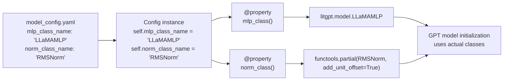

**Dynamic class resolution flow**

### mlp_class Property

The `mlp_class` property [litgpt/config.py:206-211]() dynamically imports and returns the MLP class type based on `mlp_class_name`:

```python
@property
def mlp_class(self) -> Type:
    import litgpt.model
    return getattr(litgpt.model, self.mlp_class_name)
```

Supported MLP class names include:
- `"GptNeoxMLP"`: Standard GPT-NeoX feed-forward network.
- `"LLaMAMLP"`: LLaMA-style gated FFN with SiLU activation.
- `"GemmaMLP"`: Gemma-style gated FFN with GELU activation.
- `"LLaMAMoE"`: Mixture-of-Experts implementation.

**Sources:** [litgpt/config.py:206-211]()

### norm_class Property

The `norm_class` property [litgpt/config.py:213-232]() provides resolution with model-specific customizations:

```python
@property
def norm_class(self) -> Type:
    from functools import partial
    import torch
    
    if self.norm_class_name == "RMSNorm":
        from litgpt.model import RMSNorm
        return partial(RMSNorm, add_unit_offset="Gemma" in self.name)
    
    if self.norm_class_name == "LayerNorm" and "OLMo" in self.name:
        return partial(torch.nn.LayerNorm, elementwise_affine=False)
    
    return getattr(torch.nn, self.norm_class_name)
```

This property handles special cases:
- **Gemma models**: Adds unit offset to `RMSNorm` [litgpt/config.py:222]().
- **OLMo models**: Uses non-affine `LayerNorm` to match reference implementation [litgpt/config.py:225]().

**Sources:** [litgpt/config.py:213-232]()

---

## Predefined Model Configurations

LitGPT maintains an extensive library of predefined configurations for 20+ model families. The configuration registry uses a two-tier system:

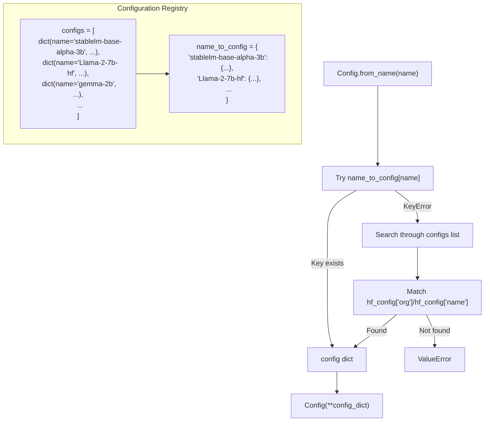

**Configuration lookup mechanism**

### Configuration Dictionary Structure

Each configuration dictionary in the `configs` list contains:

```python
dict(
    name="Llama-3-8B",  # Primary identifier
    hf_config=dict(org="meta-llama", name="Meta-Llama-3-8B"),  # HF mapping
    block_size=8192,
    vocab_size=128000,
    padded_vocab_size=128256,
    n_layer=32,
    n_head=32,
    n_query_groups=8,
    # ... additional parameters
)
```

### Major Model Families

The `configs` list [litgpt/config.py:238-1584]() includes configurations for:

| Model Family | Example Configs | Defining Characteristics |
|--------------|----------------|-------------------------|
| **Stability AI** | `stablelm-base-alpha-3b` | Various sizes with `GptNeoxMLP` |
| **EleutherAI Pythia** | `pythia-14m`, `pythia-12b` | Research-focused scaling series |
| **Falcon** | `falcon-7b`, `Falcon3-1B` | Multi-query attention variants |
| **LLaMA 2/3/3.1** | `Llama-2-7b`, `Llama-3-8B`, `Llama-3.1-405B` | `LLaMAMLP` with `RMSNorm` |
| **Phi** | `phi-2`, `Phi-3-mini`, `phi-4` | Microsoft's compact models |
| **Mistral/Mixtral** | `Mistral-7B`, `Mixtral-8x7B` | MoE architectures |
| **Gemma** | `gemma-2b`, `gemma-2-9b` | Google's models with special norm handling |
| **Qwen** | `Qwen2.5-7B`, `Qwen3-4B` | Alibaba's model series |

**Sources:** [litgpt/config.py:238-1584](), [README.md:106-176](), [tutorials/download_model_weights.md:8-55]()

---

## Configuration Post-Processing

The `__post_init__()` method [litgpt/config.py:118-167]() performs automatic computation of derived parameters and validation after a Config instance is created.

### Post-Initialization Flow

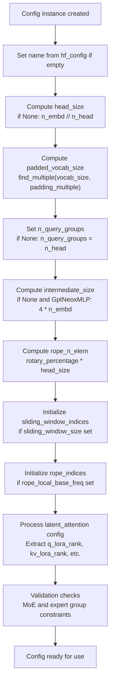

**Configuration post-processing steps**

### Key Computations

1. **Vocabulary Padding** [litgpt/config.py:127-131]():
   ```python
   if self.padded_vocab_size is None:
       self.padded_vocab_size = find_multiple(self.vocab_size, self.padding_multiple)
   ```
   Ensures vocabulary size is optimally aligned for hardware.

2. **Query Groups** [litgpt/config.py:134-137]():
   ```python
   if self.n_query_groups is not None:
       assert self.n_head % self.n_query_groups == 0
   else:
       self.n_query_groups = self.n_head  # Default to MHA
   ```
   Sets up multi-query or grouped-query attention.

3. **Intermediate Size** [litgpt/config.py:140-143]():
   ```python
   if self.intermediate_size is None:
       if self.mlp_class_name == "LLaMAMLP":
           raise ValueError(f"The config {self.name!r}, needs to set the `intermediate_size`")
       self.intermediate_size = 4 * self.n_embd  # Default for GptNeoxMLP
   ```

4. **RoPE Elements** [litgpt/config.py:145]():
   ```python
   self.rope_n_elem = int(self.rotary_percentage * self.head_size)
   ```

**Sources:** [litgpt/config.py:118-167]()

---

## Integration with Model Architecture

The Config system integrates deeply with the `GPT` model class to instantiate the complete model architecture.

### Usage in GPT Class

The `GPT` class uses the Config instance to:

1. **Set model dimensions**:
   - `config.padded_vocab_size` for embedding and output layer sizes.
   - `config.n_embd` for hidden dimension.
   - `config.n_layer` for transformer block count.

2. **Instantiate normalization**:
   - Calls `config.norm_class(config.n_embd, eps=config.norm_eps)`.
   - Dynamically resolves to `RMSNorm`, `LayerNorm`, etc.

3. **Configure RoPE cache**:
   - Uses `config.rope_n_elem`, `config.rope_base`, `config.rope_condense_ratio`.
   - Applies `config.rope_adjustments` for LLaMA 3.1-style scaling [tests/test_rope.py:140]().

4. **Set context length**:
   - `config.block_size` determines maximum sequence length.

**Sources:** [litgpt/config.py:25-167](), [tests/test_model.py:79-88](), [tests/test_rope.py:1-184]()

---

## Summary

The Config System provides:

1. **Centralized architecture definition** via the `Config` dataclass.
2. **Flexible loading** through `from_name()`, `from_file()`, and `from_checkpoint()`.
3. **Dynamic type resolution** with `mlp_class` and `norm_class` properties.
4. **Extensive model library** with 20+ predefined model families.
5. **Automatic post-processing** for derived parameters and validation.
6. **Seamless integration** with model instantiation and checkpoint conversion.

This design enables LitGPT to support diverse model architectures while maintaining a clean, consistent interface for configuration management.

**Sources:** [litgpt/config.py:1-1584](), [tests/test_config.py:1-117]()

---

# Page: Tokenizer

# Tokenizer

<details>
<summary>Relevant source files</summary>

The following files were used as context for generating this wiki page:

- [litgpt/parser_config.py](litgpt/parser_config.py)
- [litgpt/tokenizer.py](litgpt/tokenizer.py)
- [tests/test_config_hub.py](tests/test_config_hub.py)
- [tests/test_rope.py](tests/test_rope.py)
- [tests/test_tokenizer.py](tests/test_tokenizer.py)

</details>


## Purpose and Scope

The `Tokenizer` class provides text-to-token-ID conversion and vice versa, enabling language models to process textual input and generate textual output. It abstracts over multiple tokenization backends (HuggingFace Tokenizers and SentencePiece), handles special token insertion (BOS/EOS), and applies model-specific decoding fixes.

For information about model configuration, see [Config System](2.1). For prompt formatting that wraps tokenization, see [Prompt Styles](2.5).

**Sources:** [litgpt/tokenizer.py:13-183]()

---

## System Architecture

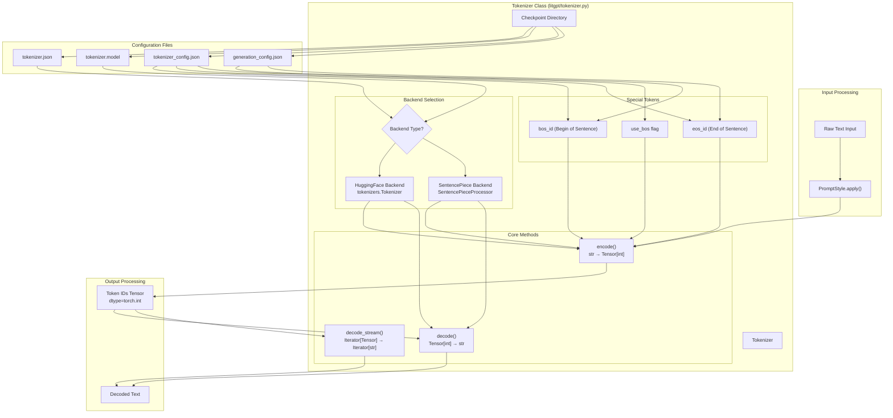

**Tokenizer Architecture**

This diagram shows how the `Tokenizer` class orchestrates text-to-token conversion by loading configuration from checkpoint directories, selecting the appropriate backend, and managing special token insertion/removal.

**Sources:** [litgpt/tokenizer.py:13-183]()

---

## Initialization and Backend Selection

The `Tokenizer` class initializes by loading configuration files from a checkpoint directory. The backend is selected based on which tokenizer files are present:

| File | Backend | Priority |
|------|---------|----------|
| `tokenizer.json` | HuggingFace Tokenizers | High (takes precedence) |
| `tokenizer.model` | SentencePiece | Low (fallback) |

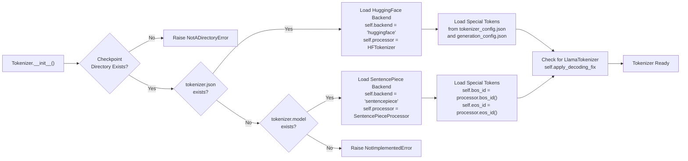

**Tokenizer Initialization Flow**

**Sources:** [litgpt/tokenizer.py:14-71]()

### Checkpoint Directory Structure

The tokenizer expects a directory containing one or more of the following files:

- **tokenizer.json**: HuggingFace tokenizer vocabulary and configuration [litgpt/tokenizer.py:25-29]().
- **tokenizer.model**: SentencePiece model file [litgpt/tokenizer.py:60-64]().
- **tokenizer_config.json**: Configuration including `bos_token`, `eos_token`, `add_bos_token`, and `tokenizer_class` [litgpt/tokenizer.py:31-41]().
- **generation_config.json**: Contains `bos_token_id` and `eos_token_id` as fallback. LitGPT attempts to fix invalid JSON in this file automatically [litgpt/tokenizer.py:42-58]().

**Sources:** [litgpt/tokenizer.py:24-68](), [litgpt/tokenizer.py:74-76]()

---

## Special Token Handling

Special tokens mark sequence boundaries and influence model behavior. The Tokenizer manages two primary special tokens:

### BOS (Beginning of Sentence) Token

The `bos_id` is loaded from configuration files. The `use_bos` flag determines whether to automatically prepend the BOS token during encoding.

**Logic for `use_bos`:**
- Llama-3 models: Always `True` [litgpt/tokenizer.py:104-105]().
- SmolLM2-Instruct models: `True` [litgpt/tokenizer.py:106-107]().
- Models with `add_bos_token` in config: Use config value [litgpt/tokenizer.py:108-109]().
- LlamaTokenizer models without explicit config: `True` [litgpt/tokenizer.py:112]().
- Otherwise: `False` [litgpt/tokenizer.py:99]().

**Sources:** [litgpt/tokenizer.py:97-113]()

### EOS (End of Sentence) Token

The `eos_id` marks sequence termination. It can be explicitly added during encoding by setting `eos=True` in the `encode()` method.

**Sources:** [litgpt/tokenizer.py:35-58](), [litgpt/tokenizer.py:140-144]()

### Token Handling in encode()

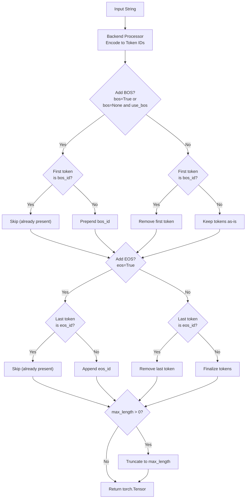

**Special Token Handling in encode() Method**

**Sources:** [litgpt/tokenizer.py:114-148]()

---

## Encoding: Text to Token IDs

The `encode()` method converts text strings to token ID tensors:

```python
def encode(
    self,
    string: str,
    device: torch.device | None = None,
    bos: bool | None = None,
    eos: bool = False,
    max_length: int = -1,
) -> torch.Tensor
```

### Parameters

| Parameter | Type | Default | Description |
|-----------|------|---------|-------------|
| `string` | `str` | Required | Input text to tokenize |
| `device` | `torch.device \| None` | `None` | Device for output tensor |
| `bos` | `bool \| None` | `None` | Add BOS token (None uses `self.use_bos`) |
| `eos` | `bool` | `False` | Add EOS token |
| `max_length` | `int` | `-1` | Truncate to max length (-1 for no limit) |

**Sources:** [litgpt/tokenizer.py:114-121]()

### Backend-Specific Processing

- **HuggingFace Backend**: Uses `self.processor.encode(string).ids` [litgpt/tokenizer.py:123]().
- **SentencePiece Backend**: Uses `self.processor.encode(string)` [litgpt/tokenizer.py:125]().

**Sources:** [litgpt/tokenizer.py:122-127]()

---

## Decoding: Token IDs to Text

### Standard Decoding

The `decode()` method converts token ID tensors back to text:

```python
def decode(self, tensor: torch.Tensor) -> str
```

Accepts both scalar tensors (single token) and 1D tensors (token sequences) [litgpt/tokenizer.py:151]().

**Sources:** [litgpt/tokenizer.py:150-167]()

### LLaMA Tokenizer Decoding Fix

LLaMA tokenizers strip leading spaces if decoding a single token at a time. LitGPT applies a fix by prepending a dummy token during single-token decoding and removing it from the result [litgpt/tokenizer.py:70-76]().

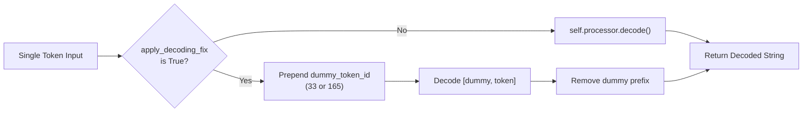

**LLaMA Tokenizer Decoding Fix**

The dummy token ID is typically `33` (`\x1e`), but for Salamandra tokenizers it's `165` [litgpt/tokenizer.py:153-157]().

**Sources:** [litgpt/tokenizer.py:70-76](), [litgpt/tokenizer.py:152-167]()

### Streaming Decoding

For real-time token generation, `decode_stream()` yields text incrementally [litgpt/tokenizer.py:169-183]().

**Backend-Specific Behavior:**

- **HuggingFace Backend**: Decodes each token independently and yields immediately [litgpt/tokenizer.py:173-174]().
- **SentencePiece Backend**: Accumulates all tokens and re-decodes the entire sequence each time, yielding only the new suffix to handle context-dependent spacing [litgpt/tokenizer.py:176-183]().

**Sources:** [litgpt/tokenizer.py:169-183]()

---

## Integration and Validation

### token_to_id() Method

Converts string tokens to their integer IDs:

```python
def token_to_id(self, token: str) -> int
```

Backend dispatch:
- **HuggingFace**: `self.processor.token_to_id(token)` [litgpt/tokenizer.py:88]().
- **SentencePiece**: `self.processor.piece_to_id(token)` [litgpt/tokenizer.py:90]().

**Sources:** [litgpt/tokenizer.py:86-95]()

### Testing against HuggingFace

The test suite validates `Tokenizer` behavior against `transformers.AutoTokenizer` for supported configurations [tests/test_tokenizer.py:42-108]().

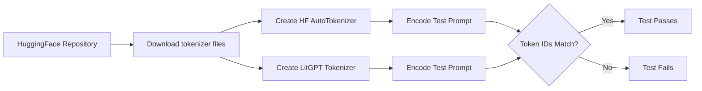

**Tokenizer Validation Strategy**

Tests verify vocabulary size, BOS/EOS ID consistency, and identical encoding/decoding results [tests/test_tokenizer.py:71-108]().

**Sources:** [tests/test_tokenizer.py:19-108]()

---

# Page: Model Architecture

# Model Architecture

<details>
<summary>Relevant source files</summary>

The following files were used as context for generating this wiki page:

- [litgpt/adapter.py](litgpt/adapter.py)
- [litgpt/adapter_v2.py](litgpt/adapter_v2.py)
- [litgpt/lora.py](litgpt/lora.py)
- [litgpt/model.py](litgpt/model.py)
- [tests/test_deepseek_moe.py](tests/test_deepseek_moe.py)
- [tests/test_multihead_latent_attention.py](tests/test_multihead_latent_attention.py)
- [tests/test_yarn.py](tests/test_yarn.py)

</details>


This page documents the transformer-based model architecture implemented in LitGPT. The architecture is defined in [litgpt/model.py:1-1080]() and consists of a decoder-only transformer with configurable attention mechanisms (MHA/GQA/MQA/MLA), various MLP implementations, and rotary position embeddings (RoPE).

For configuration options that define model architecture parameters, see [Config System](2.1). For LoRA and Adapter extensions to the base architecture, see [LoRA Fine-tuning](3.1), [Adapter Fine-tuning](3.2), and [Adapter V2 Fine-tuning](3.3).

---

## Overall Architecture

The `GPT` class in [litgpt/model.py:22-261]() is the top-level model class that implements a decoder-only transformer architecture.

### GPT Class Structure

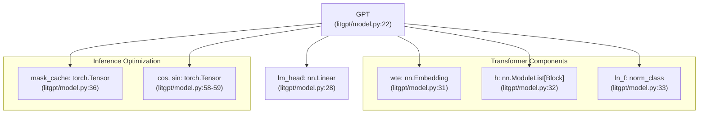

**Sources:** [litgpt/model.py:22-261]()

The `GPT` class contains:
- **Token embeddings** (`transformer.wte`): Maps token IDs to embedding vectors [litgpt/model.py:31]().
- **Transformer blocks** (`transformer.h`): Stack of `Block` modules [litgpt/model.py:32]().
- **Final normalization** (`transformer.ln_f`): Applied after all blocks [litgpt/model.py:33]().
- **Language modeling head** (`lm_head`): Projects to vocabulary size [litgpt/model.py:28]().

### Forward Pass

The forward method [litgpt/model.py:85-181]() processes input token IDs through the following steps:

| Step | Operation | Code Reference |
|------|-----------|----------------|
| 1 | Token embedding lookup | [litgpt/model.py:155]() |
| 2 | Optional embedding scaling | [litgpt/model.py:156-157]() |
| 3 | Pass through each transformer block | [litgpt/model.py:159-170]() |
| 4 | Final layer normalization | [litgpt/model.py:171]() |
| 5 | Language modeling head projection | [litgpt/model.py:172-181]() |

The method supports:
- **KV caching** via `input_pos` parameter for efficient autoregressive generation [litgpt/model.py:124-146]().
- **Chunked lm_head computation** via `lm_head_chunk_size` to reduce memory usage [litgpt/model.py:177-181]().
- **Optional logit softcapping** for models like Gemma 2 [litgpt/model.py:172-176]().

**Sources:** [litgpt/model.py:85-181]()

---

## Transformer Block

The `Block` class [litgpt/model.py:263-341]() implements a single transformer layer with configurable residual connection patterns.

### Block Architecture Diagram

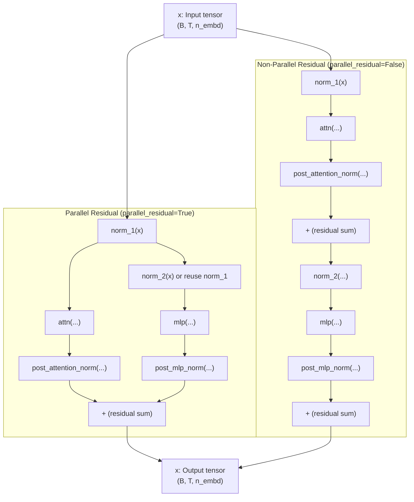

**Sources:** [litgpt/model.py:263-341]()

### Residual Connection Patterns

The block supports two residual connection patterns controlled by `config.parallel_residual` [litgpt/model.py:329-341]():

- **Non-Parallel Residual** (default):
  ```python
  x = x + post_attention_norm(attn(norm_1(x)))
  x = x + post_mlp_norm(mlp(norm_2(x)))
  ```
- **Parallel Residual** (GPT-NeoX, Falcon):
  ```python
  x = x + attn_out + mlp_out
  ```

---

## Attention Mechanisms

LitGPT supports multiple attention variants, including the advanced **Multi-head Latent Attention (MLA)** used in DeepSeek models.

### Causal Self-Attention (MHA, GQA, MQA)

The `CausalSelfAttention` class [litgpt/model.py:344-534]() handles standard attention patterns.

| Attention Type | `n_head` | `n_query_groups` | Description |
|---------------|----------|------------------|-------------|
| **MHA** | N | N | Multi-Head: Standard attention. |
| **GQA** | N | M | Grouped-Query: K/V heads shared across groups of Q heads. |
| **MQA** | N | 1 | Multi-Query: Single K/V head shared across all Q heads. |

**Sources:** [litgpt/model.py:344-534](), [litgpt/config.py:46-68]()

### Multi-head Latent Attention (MLA)

The `MultiheadLatentAttention` class [litgpt/model.py:748-961]() implements the low-rank KV compression mechanism from DeepSeek-V2/V3. It significantly reduces KV cache memory by projecting keys and values into a latent space.

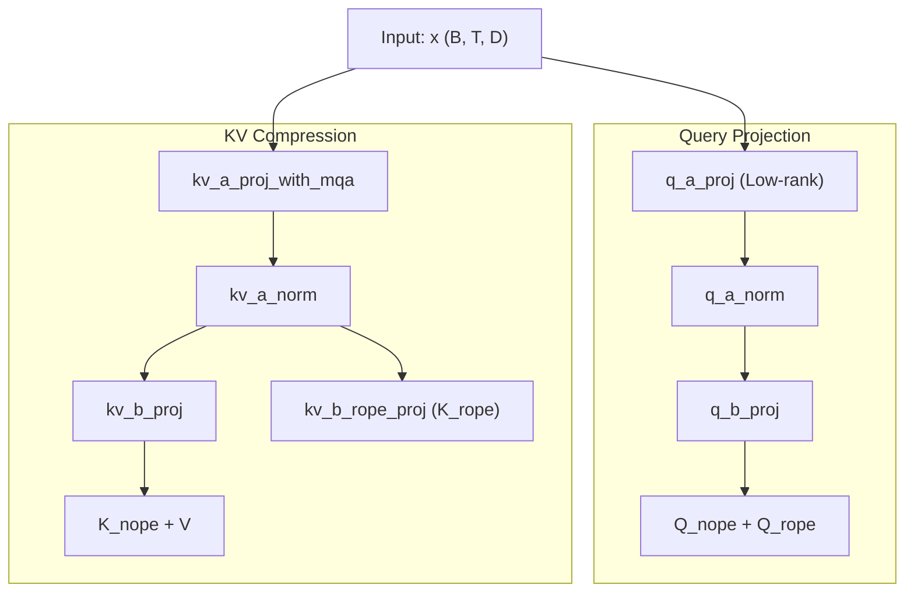

**Key MLA Components:**
- `q_a_proj` / `q_b_proj`: Low-rank query projection [litgpt/model.py:771-773]().
- `kv_a_proj_with_mqa`: Projects input to a compressed latent vector [litgpt/model.py:777]().
- `kv_b_proj`: Decompresses latent vector to non-rotary keys and values [litgpt/model.py:782]().

**Sources:** [litgpt/model.py:748-961](), [tests/test_multihead_latent_attention.py]()

---

## MLP Variants

LitGPT supports multiple MLP architectures specified by `config.mlp_class_name` [litgpt/config.py:86]().

| MLP Type | Activation | Structure |
|----------|-----------|-----------|
| `GptNeoxMLP` | GELU | Standard `fc → act → proj` [litgpt/model.py:537](). |
| `LLaMAMLP` | SiLU | Gated `(fc_1 * act) * fc_2 → proj` [litgpt/model.py:551](). |
| `LLaMAMoE` | SiLU | Mixture of Experts with router and Top-K [litgpt/model.py:583](). |

### Mixture of Experts (MoE)

The `LLaMAMoE` implementation [litgpt/model.py:583-722]() supports:
- **Expert Routing**: `GroupedTopkRouter` selects experts per token [litgpt/model.py:656]().
- **Shared Experts**: Always-active experts for common knowledge [litgpt/model.py:642]().
- **Fine-grained Experts**: Supports a large number of routed experts (e.g., DeepSeek) [litgpt/model.py:603]().

**Sources:** [litgpt/model.py:583-722](), [tests/test_deepseek_moe.py]()

---

## Rotary Position Embeddings (RoPE)

RoPE rotates query and key representations to encode relative positions.

### RoPE Implementation Details

- **`build_rope_cache`**: Precomputes `cos` and `sin` tables [litgpt/model.py:964-1040]().
- **YaRN Scaling**: Supports "Yet another RoPE extensioN" for long context via `rope_adjustments` [litgpt/model.py:1011-1026]().
- **`apply_rope`**: Performs the rotation using the cached tables [litgpt/model.py:1043-1080]().

**Sources:** [litgpt/model.py:964-1080](), [tests/test_yarn.py]()

---

## KV Caching

The KV cache stores `K` and `V` tensors to avoid redundant computation during generation.

- **Initialization**: `set_kv_cache` allocates buffers for all layers [litgpt/model.py:225-255]().
- **Update**: During `forward`, new KV pairs are written to the cache at `input_pos` [litgpt/model.py:447-454]().
- **Retrieval**: Attention mechanisms slice the cache up to `input_pos_maxp1` [litgpt/model.py:464-468]().

**Sources:** [litgpt/model.py:225-260](), [litgpt/model.py:421-456]()

---

# Page: Checkpoint Conversion

# Checkpoint Conversion

<details>
<summary>Relevant source files</summary>

The following files were used as context for generating this wiki page:

- [litgpt/scripts/convert_hf_checkpoint.py](litgpt/scripts/convert_hf_checkpoint.py)
- [litgpt/scripts/convert_lit_checkpoint.py](litgpt/scripts/convert_lit_checkpoint.py)
- [litgpt/scripts/convert_pretrained_checkpoint.py](litgpt/scripts/convert_pretrained_checkpoint.py)
- [litgpt/scripts/download.py](litgpt/scripts/download.py)
- [tests/convert/test_lit_checkpoint.py](tests/convert/test_lit_checkpoint.py)
- [tests/test_readme.py](tests/test_readme.py)

</details>


## Purpose and Scope

Checkpoint Conversion provides bidirectional translation between Hugging Face Transformers checkpoint format and LitGPT's native format. This enables LitGPT to use pretrained weights from the Hugging Face ecosystem and export trained models back to Hugging Face format for deployment or evaluation.

This page covers the technical details of checkpoint conversion. For downloading model weights, see the user-facing documentation in [litgpt/scripts/download.py:13-35](). For converting trained LitGPT models back to Hugging Face, see [litgpt/scripts/convert_lit_checkpoint.py:421-518]().

Sources: [litgpt/scripts/convert_hf_checkpoint.py:1-26](), [litgpt/scripts/convert_lit_checkpoint.py:1-16](), [litgpt/scripts/download.py:13-35]()

## Checkpoint Format Overview

### Hugging Face Format

Hugging Face checkpoints consist of:
- **Weight files**: `pytorch_model.bin` or `model.safetensors` (potentially sharded) [litgpt/scripts/download.py:63-72]()
- **Configuration**: `config.json` with model architecture details [litgpt/scripts/download.py:61]()
- **Tokenizer**: `tokenizer.json` or `tokenizer.model` [litgpt/scripts/download.py:61]()
- **Generation config**: `generation_config.json` with default generation parameters [litgpt/scripts/download.py:61]()

### LitGPT Format

LitGPT checkpoints consist of:
- **Weight file**: `lit_model.pth` with consolidated state dictionary [litgpt/scripts/convert_hf_checkpoint.py:877]()
- **Configuration**: `model_config.yaml` using LitGPT's `Config` dataclass [litgpt/scripts/convert_hf_checkpoint.py:882]()
- **Tokenizer files**: Copied directly from Hugging Face (unchanged) [litgpt/scripts/convert_hf_checkpoint.py:884]()

### Key Differences

| Aspect | Hugging Face | LitGPT |
|--------|-------------|---------|
| Weight organization | Model-specific layer names (e.g., `model.layers.{}.self_attn.q_proj`) | Unified naming scheme (e.g., `transformer.h.{}.attn.qkv`) |
| QKV weights | Separate Q, K, V projection matrices | Combined QKV matrix |
| Config format | JSON with model-specific schemas | YAML with unified `Config` dataclass |
| Weight sharding | Supports multi-file sharding | Single consolidated file |

Sources: [litgpt/scripts/convert_hf_checkpoint.py:139-184](), [litgpt/scripts/convert_lit_checkpoint.py:103-167](), [litgpt/scripts/convert_hf_checkpoint.py:870-886]()

## Conversion Architecture

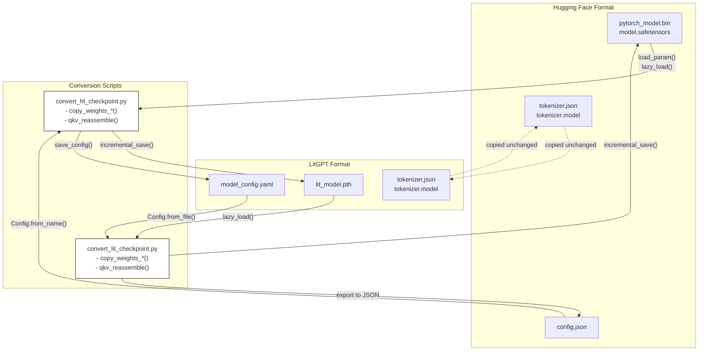

**Diagram: Checkpoint Conversion Architecture**

The conversion system consists of two primary scripts:
- **`convert_hf_checkpoint.py`**: Converts Hugging Face checkpoints to LitGPT format [litgpt/scripts/convert_hf_checkpoint.py:811-886]()
- **`convert_lit_checkpoint.py`**: Converts LitGPT checkpoints back to Hugging Face format [litgpt/scripts/convert_lit_checkpoint.py:421-518]()

Both scripts share common utilities for lazy loading and weight mapping.

Sources: [litgpt/scripts/convert_hf_checkpoint.py:1-26](), [litgpt/scripts/convert_lit_checkpoint.py:1-16](), [litgpt/utils.py:1-100]()

## Hugging Face to LitGPT Conversion

### Conversion Process Flow

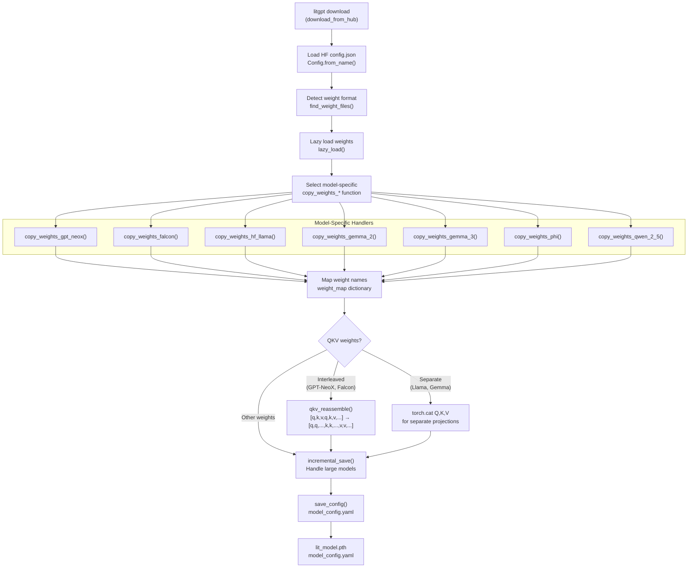

**Diagram: HuggingFace to LitGPT Conversion Flow**

Sources: [litgpt/scripts/convert_hf_checkpoint.py:28-80](), [litgpt/scripts/convert_hf_checkpoint.py:139-224](), [litgpt/scripts/convert_hf_checkpoint.py:811-886](), [litgpt/scripts/download.py:13-35]()

### Weight Mapping Strategy

Each model architecture requires a specific weight mapping dictionary that translates Hugging Face parameter names to LitGPT parameter names. The `layer_template()` function extracts layer indices from parameter names to handle per-layer mappings [litgpt/scripts/convert_hf_checkpoint.py:968-979]().

#### Example: Llama Weight Mapping

| Hugging Face Name | LitGPT Name |
|-------------------|-------------|
| `model.embed_tokens.weight` | `transformer.wte.weight` |
| `model.layers.{}.input_layernorm.weight` | `transformer.h.{}.norm_1.weight` |
| `model.layers.{}.self_attn.q_proj.weight` | Combined into `transformer.h.{}.attn.qkv.weight` |
| `model.layers.{}.self_attn.k_proj.weight` | Combined into `transformer.h.{}.attn.qkv.weight` |
| `model.layers.{}.self_attn.v_proj.weight` | Combined into `transformer.h.{}.attn.qkv.weight` |
| `model.layers.{}.self_attn.o_proj.weight` | `transformer.h.{}.attn.proj.weight` |
| `model.layers.{}.mlp.gate_proj.weight` | `transformer.h.{}.mlp.fc_1.weight` |
| `model.layers.{}.mlp.up_proj.weight` | `transformer.h.{}.mlp.fc_2.weight` |
| `model.layers.{}.mlp.down_proj.weight` | `transformer.h.{}.mlp.proj.weight` |
| `model.norm.weight` | `transformer.ln_f.weight` |
| `lm_head.weight` | `lm_head.weight` |

Sources: [litgpt/scripts/convert_hf_checkpoint.py:150-183](), [litgpt/scripts/convert_hf_checkpoint.py:188-224]()

### QKV Reassembly

Different model architectures store query, key, and value attention weights differently:

#### Interleaved Format (GPT-NeoX, Falcon)
Hugging Face stores QKV weights interleaved: `[q, k, v, q, k, v, ...]`
LitGPT requires grouped format: `[q, q, ..., k, k, ..., v, v, ...]`

The `qkv_reassemble()` function performs this transformation [litgpt/scripts/convert_hf_checkpoint.py:933-965]():

```python
def qkv_reassemble(param: torch.Tensor, config: Config) -> torch.Tensor:
    # Splits interleaved [q,k,v,q,k,v,...] 
    # Reassembles as [q,q,...,k,k,...,v,v,...]
```

Sources: [litgpt/scripts/convert_hf_checkpoint.py:933-965]()

#### Separate Projections (Llama, Gemma, Phi)
Hugging Face stores separate `q_proj`, `k_proj`, `v_proj` weight tensors.
LitGPT concatenates them into a single `qkv.weight` tensor.

For these models, the conversion:
1. Collects Q, K, V weights separately (possibly from different shard files) [litgpt/scripts/convert_hf_checkpoint.py:140]().
2. Uses `torch.cat()` to combine them: `torch.cat((q, k, v))` [litgpt/scripts/convert_hf_checkpoint.py:217]().
3. Stores the combined weight as `transformer.h.{}.attn.qkv.weight` [litgpt/scripts/convert_hf_checkpoint.py:223]().

Sources: [litgpt/scripts/convert_hf_checkpoint.py:209-223]()

### Model-Specific Conversion Functions

The conversion system provides specialized handlers for different model families:

| Function | Architectures | Key Characteristics |
|----------|---------------|---------------------|
| `copy_weights_gpt_neox()` | Pythia, StableLM (old) | Interleaved QKV, parallel residual |
| `copy_weights_falcon()` | Falcon 7B/40B/180B | Interleaved QKV, layer-dependent norm structure |
| `copy_weights_hf_llama()` | Llama 2/3, Mistral, Mixtral, OLMo | Separate Q/K/V, RMSNorm, optional MoE |
| `copy_weights_gemma_2()` | Gemma 2 | Separate Q/K/V, post-attention/MLP norms |
| `copy_weights_gemma_3()` | Gemma 3 | Separate Q/K/V, Q/K normalization |
| `copy_weights_phi()` | Phi 1.5/2/3/4 | Version-dependent QKV handling |
| `copy_weights_qwen_2_5()` | Qwen 2.5, QwQ | Similar to Llama with Qwen-specific details |

Sources: [litgpt/scripts/convert_hf_checkpoint.py:28-80](), [litgpt/scripts/convert_hf_checkpoint.py:81-137](), [litgpt/scripts/convert_hf_checkpoint.py:139-224](), [litgpt/scripts/convert_hf_checkpoint.py:226-292](), [litgpt/scripts/convert_hf_checkpoint.py:294-370](), [litgpt/scripts/convert_hf_checkpoint.py:447-543](), [litgpt/scripts/convert_hf_checkpoint.py:598-682]()

## LitGPT to Hugging Face Conversion

### Reverse Conversion Process

```mermaid
graph TB
    Command["litgpt convert_from_litgpt<br/>(convert_lit_checkpoint)"]
    
    LoadLitConfig["Load model_config.yaml<br/>Config.from_checkpoint()"]
    
    LoadLitWeights["Load lit_model.pth<br/>lazy_load()"]
    
    SelectHandler["Select reverse<br/>copy_weights_* function"]
    
    subgraph Handlers["Reverse Handlers"]
        GPTNeoX["copy_weights_gpt_neox()"]
        Falcon["copy_weights_falcon()"]
        Llama["copy_weights_llama()"]
        Gemma2["copy_weights_gemma_2()"]
        Phi["copy_weights_phi()"]
    end
    
    ReverseMap["Reverse weight mapping<br/>LitGPT → HF names"]
    
    QKVCheck{"QKV weights?"}
    
    QKVReassemble["qkv_reassemble()<br/>[q,q,...,k,k,...,v,v,...] → [q,k,v,q,k,v,...]"]
    
    SplitQKV["param.split()<br/>Single QKV → Q,K,V"]
    
    SaveHF["Save to model.pth<br/>(incremental_save)"]
    
    CopyTokenizer["Copy tokenizer files<br/>unchanged"]
    
    Output["HF-compatible checkpoint"]
    
    Command --> LoadLitConfig
    LoadLitConfig --> LoadLitWeights
    LoadLitWeights --> SelectHandler
    
    SelectHandler --> GPTNeoX
    SelectHandler --> Falcon
    SelectHandler --> Llama
    SelectHandler --> Gemma2
    SelectHandler --> Phi
    
    GPTNeoX --> ReverseMap
    Falcon --> ReverseMap
    Llama --> ReverseMap
    Gemma2 --> ReverseMap
    Phi --> ReverseMap
    
    ReverseMap --> QKVCheck
    QKVCheck -->|"Interleaved format"| QKVReassemble
    QKVCheck -->|"Separate projections"| SplitQKV
    QKVCheck -->|"Other weights"| SaveHF
    
    QKVReassemble --> SaveHF
    SplitQKV --> SaveHF
    
    SaveHF --> CopyTokenizer
    CopyTokenizer --> Output
```

**Diagram: LitGPT to HuggingFace Conversion Flow**

Sources: [litgpt/scripts/convert_lit_checkpoint.py:18-100](), [litgpt/scripts/convert_lit_checkpoint.py:103-167](), [litgpt/scripts/convert_lit_checkpoint.py:421-518]()

### QKV Disassembly

The reverse conversion applies inverse transformations:

1. **For interleaved models (GPT-NeoX, Falcon)**: 
   - Input: `[q, q, ..., k, k, ..., v, v, ...]`
   - Output: `[q, k, v, q, k, v, ...]`
   - Uses the same `qkv_reassemble()` function in `convert_lit_checkpoint.py` [litgpt/scripts/convert_lit_checkpoint.py:59-62]().

2. **For separate projection models (Llama, Gemma)**:
   - Input: Single `transformer.h.{}.attn.qkv.weight` tensor
   - Uses `param.split((n_head * head_size, n_query_groups * head_size, n_query_groups * head_size))` [litgpt/scripts/convert_lit_checkpoint.py:151-161]().
   - Output: Three separate tensors `q_proj.weight`, `k_proj.weight`, `v_proj.weight`.

Sources: [litgpt/scripts/convert_lit_checkpoint.py:146-166](), [litgpt/scripts/convert_lit_checkpoint.py:194-215]()

## Implementation Details

### Layer Template Extraction

The `layer_template()` function extracts layer indices from parameter names to enable systematic weight mapping [litgpt/scripts/convert_hf_checkpoint.py:968-979]():

```python
def layer_template(name: str, num_matches: int = 1) -> Tuple:
    # Extracts layer indices from names like:
    # "model.layers.3.self_attn.q_proj.weight" → ("model.layers.{}.self_attn.q_proj.weight", 3)
```

Sources: [litgpt/scripts/convert_hf_checkpoint.py:968-979](), [litgpt/scripts/convert_lit_checkpoint.py:14]()

### Lazy Loading

The `lazy_load()` utility enables conversion of large models without loading all weights into memory at once [litgpt/utils.py:lazy_load]().

This is critical for models like Llama 3.1 405B where the full state dict would exceed system memory.

Sources: [litgpt/utils.py:lazy_load](), [litgpt/scripts/convert_hf_checkpoint.py:22]()

### Incremental Saving

The `incremental_save` class enables saving large checkpoints incrementally [litgpt/utils.py:incremental_save](). The saver accumulates tensors and periodically flushes them to disk, keeping memory usage bounded.

Sources: [litgpt/utils.py:incremental_save](), [litgpt/scripts/convert_hf_checkpoint.py:21]()

### Parameter Loading Helper

The `load_param()` function handles both eager and lazy-loaded parameters uniformly [litgpt/scripts/convert_hf_checkpoint.py:982-1001]():

```python
def load_param(param: Union[torch.Tensor, NotYetLoadedTensor], 
               name: str, 
               dtype: Optional[torch.dtype]) -> torch.Tensor:
    # If NotYetLoadedTensor, triggers actual loading
    # Optionally converts dtype
```

Sources: [litgpt/scripts/convert_hf_checkpoint.py:982-1001]()

## Pretrained Checkpoint Conversion

After pretraining from scratch, LitGPT provides a script to extract the model state-dict from the full training checkpoint (which includes optimizer states and metadata).

```python
def convert_pretrained_checkpoint(checkpoint_dir: Path, output_dir: Path) -> None:
    # Extracts "model" from full_checkpoint
    # Removes "_orig_mod." prefix from compiled models
    # Saves to lit_model.pth using incremental_save
```

Sources: [litgpt/scripts/convert_pretrained_checkpoint.py:12-52]()

## Command-Line Interface

### Automatic Conversion During Download

By default, `litgpt download` automatically converts checkpoints [litgpt/scripts/download.py:29]():

```bash
litgpt download microsoft/phi-2
```

To disable automatic conversion:

```bash
litgpt download microsoft/phi-2 --convert_checkpoint false
```

Sources: [litgpt/scripts/download.py:13-35](), [litgpt/scripts/download.py:95-98]()

### Manual HF to LitGPT Conversion

```bash
litgpt convert_to_litgpt checkpoints/microsoft/phi-2
```

Sources: [litgpt/scripts/convert_hf_checkpoint.py:811-886]()

### Manual LitGPT to HF Conversion

```bash
litgpt convert_from_litgpt checkpoints/my-finetuned-model out/hf-model
```

Sources: [litgpt/scripts/convert_lit_checkpoint.py:421-518]()

## Validation and Testing

The test suite validates conversion correctness by comparing LitGPT model outputs against Hugging Face reference implementations [tests/convert/test_lit_checkpoint.py:64-91]().

Tests cover all supported architectures including:
- GPT-NeoX (Pythia) [tests/convert/test_lit_checkpoint.py:94-127]()
- Falcon (7B, 40B, 180B) [tests/convert/test_lit_checkpoint.py:64-91]()
- Llama 2 and Llama 3 variants [tests/convert/test_lit_checkpoint.py:130-163]()
- Mixtral [tests/convert/test_lit_checkpoint.py:166-200]()
- Gemma, Gemma 2, and Gemma 3 [tests/convert/test_lit_checkpoint.py:29-31]()
- Phi and Phi-3 [tests/convert/test_lit_checkpoint.py:34]()
- Qwen 2.5 [tests/convert/test_lit_checkpoint.py:35]()

Sources: [tests/convert/test_lit_checkpoint.py:1-40](), [tests/convert/test_lit_checkpoint.py:64-163]()

---

# Page: Prompt Styles

# Prompt Styles

<details>
<summary>Relevant source files</summary>

The following files were used as context for generating this wiki page:

- [litgpt/data/base.py](litgpt/data/base.py)
- [litgpt/prompts.py](litgpt/prompts.py)
- [litgpt/scripts/merge_lora.py](litgpt/scripts/merge_lora.py)
- [tests/data/test_base.py](tests/data/test_base.py)
- [tests/test_prompts.py](tests/test_prompts.py)

</details>


The Prompt Styles system provides model-specific prompt formatting to ensure text inputs are properly structured according to each model's training conventions. Different language models expect different prompt formats (e.g., chat templates, instruction formats), and this system automatically applies the correct formatting based on the model being used.

For information about the Tokenizer system that works with prompt styles, see [Tokenizer](2.2). For model configuration, see [Config System](2.1).

&nbsp;

## Purpose and Scope

Each LLM has specific prompt formatting conventions established during training. For example, Llama 2 uses `[INST]` tags, Llama 3 uses header-based formatting, and Alpaca uses `### Instruction:` markers. The PromptStyle system abstracts these differences, allowing users to provide plain text prompts while ensuring the model receives properly formatted input.

The system consists of:
- A base `PromptStyle` interface defining the formatting contract.
- Concrete implementations for 20+ different models and instruction formats.
- Dynamic selection mechanisms that match prompt styles to model configurations.
- Integration with tokenization to handle special tokens.
- Persistence mechanisms for saving and loading styles to/from YAML files.

**Sources:** [litgpt/prompts.py:1-853](), [tests/test_prompts.py:1-200]()

&nbsp;

## Base Architecture

### PromptStyle Interface

The `PromptStyle` base class defines the core interface that all prompt formatters implement. It uses an abstract `apply` method to enforce model-specific formatting logic.

```mermaid
graph TB
    subgraph "Base Interface [litgpt/prompts.py]"
        PromptStyle["PromptStyle<br/>(Abstract Base)"]
    end
    
    subgraph "Core Methods [litgpt/prompts.py:20-34]"
        apply["apply(prompt, sys_prompt, **kwargs)<br/>Returns: formatted string"]
        stop_tokens["stop_tokens(tokenizer)<br/>Returns: Tuple[List[int], ...]"]
        from_name["from_name(name)<br/>Class method"]
        from_config["from_config(config)<br/>Class method"]
    end
    
    subgraph "Concrete Implementations [litgpt/prompts.py:36-613]"
        Default["Default"]
        Alpaca["Alpaca"]
        Llama2["Llama2"]
        Llama3["Llama3"]
        Phi3["Phi3"]
        Gemma["Gemma"]
        Others["20+ other implementations..."]
    end
    
    PromptStyle --> apply
    PromptStyle --> stop_tokens
    PromptStyle --> from_name
    PromptStyle --> from_config
    
    Default -.implements.-> PromptStyle
    Alpaca -.implements.-> PromptStyle
    Llama2 -.implements.-> PromptStyle
    Llama3 -.implements.-> PromptStyle
    Phi3 -.implements.-> PromptStyle
    Gemma -.implements.-> PromptStyle
    Others -.implements.-> PromptStyle
```

**Sources:** [litgpt/prompts.py:17-34]()

&nbsp;

### Key Methods

**`apply()`**: The primary method that transforms a plain prompt into the model-specific format. It accepts:
- `prompt`: The user's input text (string or list of messages).
- `sys_prompt`: Optional system prompt (model-dependent).
- `**kwargs`: Additional context like `input` for Alpaca-style formats.

**`stop_tokens()`**: Returns token IDs that should terminate generation. Most models return `([tokenizer.eos_id],)`, but some define additional stop sequences.

**`from_name()`**: Class method that instantiates a PromptStyle from a string identifier via the `prompt_styles` registry.

**`from_config()`**: Class method that selects the appropriate PromptStyle based on a model's `Config` object by calling `model_name_to_prompt_style()`.

**Sources:** [litgpt/prompts.py:17-34]()

&nbsp;

## Prompt Style Implementations

LitGPT implements prompt formatters for major model families. Each implementation encodes the specific formatting conventions of its target model.

### Common Patterns

#### Instruction-Based Formats

Models like Alpaca, FLAN, and Platypus use explicit instruction markers:

| Model | Format Pattern |
|-------|----------------|
| Alpaca | `### Instruction:\n{prompt}\n\n### Response:\n` |
| FLAN | `### Instruction:\n{prompt}\n\n### Response:\n` |
| Platypus | `### Instruction:\n\n{prompt}\n\n### Response:\n` |
| StableCode | `###Instruction\n{prompt}###Response\n` |

**Sources:** [litgpt/prompts.py:44-67](), [litgpt/prompts.py:278-286]()

&nbsp;

#### Conversation-Based Formats

Chat-oriented models use structured role tags:

| Model | Format Pattern |
|-------|----------------|
| Llama 2 | `[INST] <<SYS>>\n{sys}\n<</SYS>>\n\n{prompt} [/INST]` |
| Llama 3 | `<\|start_header_id\|>system<\|end_header_id\|>\n\n{sys}<\|eot_id\|>...` |
| Phi 3 | `<\|system\|>\n{sys}<\|end\|>\n<\|user\|>\n{prompt}<\|end\|>...` |
| StableLMZephyr | `<\|user\|>\n{prompt}<\|endoftext\|>\n<\|assistant\|>\n` |

**Sources:** [litgpt/prompts.py:155-168](), [litgpt/prompts.py:170-221](), [litgpt/prompts.py:320-333](), [litgpt/prompts.py:98-101]()

&nbsp;

#### Multi-Turn Support

The `Llama3` implementation supports multi-turn conversations by accepting a list of message dictionaries. It iterates through the messages and applies headers based on the `role` (system, user, assistant).

```python
# Example multi-turn message list
msgs = [
    {"role": "system", "content": "You are a travel assistant."},
    {"role": "user", "content": "What is France's capital?"},
    {"role": "assistant", "content": "The capital of France is Paris!"},
    {"role": "user", "content": "What can I do there?"},
]
```

**Sources:** [litgpt/prompts.py:170-221](), [tests/test_prompts.py:132-197]()

&nbsp;

## Dynamic Selection and Persistence

### Selection Mechanism

LitGPT provides dynamic selection based on the model configuration's name.

```mermaid
graph TB
    subgraph "Selection Logic [litgpt/prompts.py]"
        ModelName["Config.name (string)"]
        Match["model_name_to_prompt_style(name)"]
        Registry["prompt_styles (dict)"]
    end
    
    subgraph "Code Entities"
        ConfigClass["Config Class [litgpt/config.py]"]
        PromptStyleClass["PromptStyle Class [litgpt/prompts.py]"]
    end
    
    ConfigClass -- "provides name" --> ModelName
    ModelName -- "input to" --> Match
    Match -- "looks up in" --> Registry
    Registry -- "returns" --> PromptStyleClass
```

**Sources:** [litgpt/prompts.py:27-34](), [litgpt/prompts.py:656-853]()

### Persistence (YAML)

Prompt styles can be saved to and loaded from checkpoint directories. This ensures that the exact formatting used during training is preserved for inference.

- `save_prompt_style(style, checkpoint_dir)`: Writes a `prompt_style.yaml` file containing the `class_path`.
- `load_prompt_style(checkpoint_dir)`: Reads the YAML and dynamically imports the style class.
- `has_prompt_style(checkpoint_dir)`: Checks for the existence of the configuration file.

**Sources:** [litgpt/prompts.py:870-911](), [tests/test_prompts.py:108-130]()

&nbsp;

## Stop Tokens

Stop tokens define sequences that should terminate text generation. The `stop_tokens()` method returns a tuple of token ID lists.

### Multi-Condition Stops

**Llama 3**:
```python
return (
    [tokenizer.eos_id],
    [tokenizer.token_to_id("<|eot_id|>")],
)
```

**Falcon**:
```python
return (
    [tokenizer.eos_id],
    [tokenizer.token_to_id("User"), tokenizer.token_to_id(":")],
    [193, tokenizer.token_to_id("User")],  # 193: '\n'
)
```

**Sources:** [litgpt/prompts.py:107-115](), [litgpt/prompts.py:216-221]()

&nbsp;

## Data Processing Integration

Prompt styles are integrated into the data pipeline via the `SFTDataset` (Supervised Fine-Tuning Dataset).

```mermaid
graph LR
    subgraph "Data Pipeline [litgpt/data/base.py]"
        SFTDataset["SFTDataset.__getitem__"]
        PromptStyleApply["PromptStyle.apply"]
        TokenizerEncode["Tokenizer.encode"]
    end

    RawData["Raw JSON Sample<br/>(instruction, output)"]
    
    RawData -- "1. Pass to" --> SFTDataset
    SFTDataset -- "2. Format text" --> PromptStyleApply
    PromptStyleApply -- "3. Tokenize" --> TokenizerEncode
    TokenizerEncode -- "4. Return" --> TensorOutput["input_ids & labels (Tensor)"]
```

**Sources:** [litgpt/data/base.py:39-109](), [tests/data/test_base.py:14-44]()

### Masking the Prompt
In `SFTDataset`, if `mask_prompt=True`, the tokens corresponding to the formatted prompt are replaced with `ignore_index` (default -100) in the labels tensor. This ensures the model is only trained to predict the response, not the instruction template.

**Sources:** [litgpt/data/base.py:93-97]()

&nbsp;

## Summary of Prompt Styles

| Class Name | Pattern Examples | Key Feature |
|------------|------------------|-------------|
| `Alpaca` | `alpaca`, `alpaca-7b` | Instruction/Input/Response |
| `Llama2` | `Llama-2-*-chat` | `[INST]` and `<<SYS>>` tags |
| `Llama3` | `Llama-3*`, `Llama-3.1*` | Multi-turn, header-based |
| `Gemma` | `gemma-2b-it`, `gemma-7b-it` | `<start_of_turn>` tags |
| `Phi3` | `Phi-3-mini-4k-instruct` | `<|system|>`, `<|user|>` |
| `Falcon` | `falcon-7b-instruct` | `Answer:` suffix |
| `Vicuna` | `vicuna-7b-v1.5` | `USER:`, `ASSISTANT:` |

**Sources:** [litgpt/prompts.py:656-853](), [tests/test_prompts.py:54-90]()

---

# Page: Fine-tuning

# Fine-tuning

<details>
<summary>Relevant source files</summary>

The following files were used as context for generating this wiki page:

- [litgpt/finetune/adapter.py](litgpt/finetune/adapter.py)
- [litgpt/finetune/adapter_v2.py](litgpt/finetune/adapter_v2.py)
- [litgpt/finetune/lora.py](litgpt/finetune/lora.py)
- [tutorials/finetune_adapter.md](tutorials/finetune_adapter.md)
- [tutorials/finetune_full.md](tutorials/finetune_full.md)
- [tutorials/finetune_lora.md](tutorials/finetune_lora.md)
- [tutorials/inference.md](tutorials/inference.md)
- [tutorials/quantize.md](tutorials/quantize.md)

</details>


This page provides an overview of the fine-tuning capabilities in LitGPT. Fine-tuning allows you to adapt pre-trained language models to specific tasks or domains by updating model parameters using task-specific data. LitGPT offers several fine-tuning methods with different efficiency and performance characteristics, leveraging **Lightning Fabric** for scalable training infrastructure.

For pretraining language models from scratch, see [Pretraining](#4).

## Overview of Fine-tuning Methods

LitGPT supports four main approaches to fine-tuning:

| Method | Description | Memory Efficiency | Implementation | Details |
| :--- | :--- | :--- | :--- | :--- |
| **LoRA** | Low-Rank Adaptation using rank decomposition matrices | Very High | `litgpt/finetune/lora.py` | [LoRA Fine-tuning](#3.1) |
| **Adapter** | Attention-based adapters over learned prompts | High | `litgpt/finetune/adapter.py` | [Adapter Fine-tuning](#3.2) |
| **Adapter V2** | Enhanced adapters with bias, scale, and norm training | High | `litgpt/finetune/adapter_v2.py` | [Adapter V2 Fine-tuning](#3.3) |
| **Full** | Updates 100% of model parameters | Low | `litgpt/finetune/full.py` | [Full Fine-tuning](#3.4) |

### System Architecture and Code Entities
The following diagram maps the high-level fine-tuning concepts to the specific classes and functions implemented in the codebase.

```mermaid
graph TD
    subgraph "Training Entry Points"
        CLI["litgpt/finetune/*.py:setup()"]
    end

    subgraph "Model Specializations"
        LORA["litgpt.lora.GPT"]
        ADV1["litgpt.adapter.GPT"]
        ADV2["litgpt.adapter_v2.GPT"]
        FULL["litgpt.model.GPT"]
    end

    subgraph "Parameter Management"
        MLORA["mark_only_lora_as_trainable()"]
        MADV1["mark_only_adapter_as_trainable()"]
        MADV2["mark_only_adapter_v2_as_trainable()"]
    end

    CLI --> LORA
    CLI --> ADV1
    CLI --> ADV2
    CLI --> FULL

    LORA --> MLORA
    ADV1 --> MADV1
    ADV2 --> MADV2
```

Sources:
- [litgpt/finetune/lora.py:49-82]()
- [litgpt/finetune/adapter.py:48-71]()
- [litgpt/finetune/adapter_v2.py:49-73]()
- [litgpt/finetune/lora.py:23-23]()
- [litgpt/finetune/adapter.py:19-19]()
- [litgpt/finetune/adapter_v2.py:19-19]()

## Common Fine-tuning Workflow

All fine-tuning methods follow a unified execution flow orchestrated by `lightning.Fabric`. The process starts with `setup()` which configures the environment, followed by `main()` which initializes the model and data, and finally `fit()` which executes the training loop.

```mermaid
flowchart TD
    subgraph "Execution Flow (litgpt/finetune/*.py)"
        START["setup()"] --> FABRIC["L.Fabric() Initialization"]
        FABRIC --> LAUNCH["fabric.launch(main)"]
        
        subgraph "Main Process"
            main["main()"] --> DATA["get_dataloaders()"]
            main --> MODEL["GPT(config) Initialization"]
            MODEL --> MARK["mark_*_as_trainable()"]
            MARK --> SETUP["fabric.setup_module() & optimizer"]
            SETUP --> FIT["fit()"]
        end

        subgraph "Training Loop"
            FIT --> STEP["Optimizer Step"]
            STEP --> EVAL["validate()"]
            STEP --> GEN["select_sft_generate_example()"]
            STEP --> SAVE["save_checkpoint()"]
        end
    end
```

Sources:
- [litgpt/finetune/lora.py:166-180]()
- [litgpt/finetune/lora.py:183-267]()
- [litgpt/finetune/lora.py:268-334]()

## Parameter-Efficient Fine-tuning (PEFT)

LitGPT emphasizes efficiency through PEFT methods, allowing large models to be tuned on consumer hardware.

### LoRA Fine-tuning
LoRA approximates weight updates using low-rank matrices `lora_A` and `lora_B`. It is highly configurable, allowing users to target specific layers like `lora_query`, `lora_value`, or `lora_mlp`.
For details, see [LoRA Fine-tuning](#3.1).

### Adapter Fine-tuning
Adapter (V1) implements a form of prefix-tuning by prepending learnable adaption-prompts to attention block inputs. It uses a gating mechanism to control the influence of these prompts.
For details, see [Adapter Fine-tuning](#3.2).

### Adapter V2 Fine-tuning
Adapter V2 builds on V1 by adding trainable bias and scale parameters to linear layers and making normalization layers trainable, providing a middle ground between Adapter V1 and full fine-tuning.
For details, see [Adapter V2 Fine-tuning](#3.3).

Sources:
- [litgpt/finetune/lora.py:56-64]()
- [tutorials/finetune_adapter.md:3-9]()

## Full Fine-tuning
Full fine-tuning updates every parameter in the model. While it offers the most flexibility for the model to learn new knowledge, it requires significantly more VRAM and compute. LitGPT utilizes `FSDPStrategy` to shard model states across multiple GPUs to handle these requirements.
For details, see [Full Fine-tuning](#3.4).

Sources:
- [litgpt/finetune/full.py:86-98]()
- [tutorials/finetune_full.md:3-3]()

## Infrastructure and Optimization

### Training Infrastructure
LitGPT uses **Lightning Fabric** to manage distributed training. This includes support for `FSDPStrategy` and `ModelParallelStrategy`, gradient accumulation, and specialized optimizers.
For details, see [Training Infrastructure](#3.5).

### Memory Optimization
To further reduce the hardware barrier, LitGPT supports:
- **Quantization**: Integration with `bitsandbytes` (e.g., `bnb.nf4`, `bnb.nf4-dq`).
- **Precision**: Support for `bf16-true`, `bf16-mixed`, and `fp16-true`.
- **Activation Checkpointing**: Reducing activation memory at the cost of recomputation.
For details, see [Memory Optimization](#3.6).

Sources:
- [litgpt/finetune/lora.py:141-150]()
- [litgpt/finetune/adapter.py:127-132]()
- [tutorials/quantize.md:42-82]()

## Data Processing
Fine-tuning scripts typically use `litgpt.data.DataModule` abstractions. While `Alpaca` is the default, users can provide custom datasets via the `JSON` data module, which handles tokenization and prompt formatting.
For details, see [Data Processing](#5).

Sources:
- [litgpt/finetune/lora.py:113-113]()
- [tutorials/finetune_lora.md:93-119]()

---

# Page: LoRA Fine-tuning

# LoRA Fine-tuning

<details>
<summary>Relevant source files</summary>

The following files were used as context for generating this wiki page:

- [litgpt/adapter.py](litgpt/adapter.py)
- [litgpt/adapter_v2.py](litgpt/adapter_v2.py)
- [litgpt/finetune/adapter.py](litgpt/finetune/adapter.py)
- [litgpt/finetune/adapter_v2.py](litgpt/finetune/adapter_v2.py)
- [litgpt/finetune/lora.py](litgpt/finetune/lora.py)
- [litgpt/lora.py](litgpt/lora.py)
- [litgpt/model.py](litgpt/model.py)
- [tests/test_adapter.py](tests/test_adapter.py)
- [tests/test_adapter_v2.py](tests/test_adapter_v2.py)
- [tests/test_full.py](tests/test_full.py)
- [tests/test_lora.py](tests/test_lora.py)

</details>


This page explains the Low-Rank Adaptation (LoRA) fine-tuning method in LitGPT and its implementation. LoRA is a parameter-efficient fine-tuning technique that adds small trainable rank decomposition matrices to frozen model weights. For information about other fine-tuning approaches, see [Fine-tuning](#3), [Adapter Fine-tuning](#3.2), or [Full Fine-tuning](#3.4).

## What is LoRA?

LoRA (Low-Rank Adaptation) is a fine-tuning method that significantly reduces the number of trainable parameters by adding small, trainable rank decomposition matrices to otherwise frozen weights. Instead of fine-tuning all model parameters, LoRA keeps the pre-trained model weights frozen and injects trainable rank decomposition matrices into specific layers of the model.

**Natural Language to Code Entity Space: LoRA Logic**
```mermaid
flowchart LR
    subgraph "Base Model (Frozen Weights)"
        W["'linear.weight'\n(Original Weight Matrix W)"]
    end
    
    subgraph "LoRA Adaptation (Trainable Parameters)"
        A["'lora_A'\n(Low-rank Matrix A)"]
        B["'lora_B'\n(Low-rank Matrix B)"]
    end
    
    Input --> W --> WOutput["Output from W"]
    Input --> LoraDropout["'lora_dropout'"] --> A --> B --> LoRAOutput["Output from LoRA"]
    WOutput --> Add(("+"))
    LoRAOutput --> Scale["'scaling' (α/r)"] --> Add
    Add --> FinalOutput["Final Output"]
```

### Key Benefits

- **Memory efficiency**: Requires significantly less memory compared to full fine-tuning (typically ~0.1-1% of base model parameters).
- **Training speed**: Trains faster as fewer parameters are updated and gradients are computed only for the low-rank matrices.
- **Model distribution**: Only the small LoRA weights need to be distributed instead of the entire model.
- **Composability**: Multiple LoRA modules can be trained for different tasks and applied to the same base model.

The mathematical formulation is: `h = Wx + BAx × (α/r)`, where:
- `W` is the frozen pretrained weight matrix.
- `B` (shape: `out_features × r`) and `A` (shape: `r × in_features`) are trainable low-rank matrices.
- `r` is the rank (`lora_r`, typically 1-8).
- `α` is the scaling factor (`lora_alpha`, typically 16).

Sources:
- [litgpt/lora.py:9-44]()
- [litgpt/lora.py:89-135]()

## LoRA Architecture in LitGPT

The LoRA implementation in LitGPT extends the base `GPT` model from [litgpt/model.py:22-38]() with additional low-rank matrices. The key class hierarchy is:

**Class Hierarchy Diagram**
```mermaid
classDiagram
    class LoRALayer {
        +r: int
        +lora_alpha: int
        +lora_dropout: nn.Dropout
        +merged: bool
    }
    
    class LoRALinear {
        +linear: nn.Linear
        +lora_A: nn.Parameter
        +lora_B: nn.Parameter
        +scaling: float
        +get_lora_AB()
        +merge()
        +forward()
    }
    
    class LoRAQKVLinear {
        +linear: nn.Linear
        +lora_A: nn.Parameter
        +lora_B: nn.Parameter
        +lora_ind: Tensor
        +enable_lora: tuple
        +zero_pad()
        +merge()
    }
    
    class CausalSelfAttention {
        +qkv: LoRAQKVLinear
        +proj: LoRALinear
        +scaled_dot_product_attention()
    }
    
    class Block {
        +norm_1
        +attn: CausalSelfAttention
        +norm_2
        +mlp
    }
    
    class GPT {
        +transformer.h: ModuleList[Block]
        +lm_head: LoRALinear
        +forward()
    }
    
    LoRALayer <|-- LoRALinear
    LoRALayer <|-- LoRAQKVLinear
    CausalSelfAttention --> LoRAQKVLinear
    CausalSelfAttention --> LoRALinear
    Block --> CausalSelfAttention
    GPT --> Block
```

### LoRA Components

1. **`LoRALayer`** [litgpt/lora.py:64-87](): Base class storing LoRA-specific attributes.
   - `r`: Rank of weight update matrices.
   - `lora_alpha`: Scaling factor (final scaling = `α/r`).
   - `lora_dropout`: Optional dropout applied before matrix A.
   - `merged`: Flag indicating if LoRA weights have been merged into base weights.

2. **`LoRALinear`** [litgpt/lora.py:89-201](): Standard linear layer replacement.
   - `linear`: Original `nn.Linear` layer with frozen weights.
   - `lora_A`: Trainable matrix of shape `(r, in_features)`.
   - `lora_B`: Trainable matrix of shape `(out_features, r)`, initialized to zero [litgpt/lora.py:136-136]().
   - `get_lora_AB()`: Computes `(B @ A) * scaling` [litgpt/lora.py:138-140]().
   - `merge()`: Adds LoRA weights to `linear.weight` [litgpt/lora.py:142-161]().

3. **`LoRAQKVLinear`** [litgpt/lora.py:204-426](): Specialized for attention QKV projections.
   - Handles concatenated query, key, and value projections.
   - `enable_lora`: Tuple `(lora_query, lora_key, lora_value)` for selective application.
   - `lora_ind`: Pre-computed indices where LoRA is applied in the QKV output [litgpt/lora.py:256-296]().
   - Supports Multi-Head Attention (MHA), Multi-Query Attention (MQA), and Grouped-Query Attention (GQA).
   - `zero_pad()`: Pads LoRA output to match full QKV dimension [litgpt/lora.py:324-331]().

4. **Application Points**: LoRA is applied by replacing standard layers in `GPT.__init__` [litgpt/lora.py:550-593]():
   - Attention QKV projection: `transformer.h[i].attn.qkv` (via `lora_query`, `lora_key`, `lora_value`).
   - Attention output projection: `transformer.h[i].attn.proj` (via `lora_projection`).
   - MLP layers: `transformer.h[i].mlp.fc` and `transformer.h[i].mlp.proj` (via `lora_mlp`).
   - Output head: `lm_head` (via `lora_head`).

Sources:
- [litgpt/lora.py:64-426]()
- [litgpt/lora.py:550-593]()
- [tests/test_lora.py:45-53]()

## LoRA Parameters and Configuration

The LoRA method is controlled by several key parameters defined in the specialized `Config` dataclass [litgpt/lora.py:516-547]():

| Parameter | Type | Description | Default |
|-----------|------|-------------|---------|
| `lora_r` | `int` | Rank of the low-rank decomposition matrices | 8 |
| `lora_alpha` | `int` | Scaling factor (applied as `α/r`) | 16 |
| `lora_dropout` | `float` | Dropout probability applied to LoRA input | 0.05 |
| `lora_query` | `bool` | Apply LoRA to query projection in attention | `True` |
| `lora_key` | `bool` | Apply LoRA to key projection in attention | `False` |
| `lora_value` | `bool` | Apply LoRA to value projection in attention | `True` |
| `lora_projection` | `bool` | Apply LoRA to attention output projection | `False` |
| `lora_mlp` | `bool` | Apply LoRA to MLP layers (`fc`, `proj`) | `False` |
| `lora_head` | `bool` | Apply LoRA to output head (`lm_head`) | `False` |

**Configuration and Layer Replacement Flow**
```mermaid
flowchart TB
    ConfigFile["'model_config.yaml'\n+ CLI Arguments"] --> ConfigFromFile["Config.from_file()"]
    ConfigFromFile --> ConfigObj["litgpt.lora.Config object"]
    
    ConfigObj --> GPTInit["litgpt.lora.GPT.__init__(config)"]
    
    GPTInit --> ReplaceQKV["Replace attn.qkv\nwith LoRAQKVLinear"]
    GPTInit --> ReplaceProj["Replace attn.proj\nwith LoRALinear\n(if lora_projection)"]
    GPTInit --> ReplaceMLP["Replace mlp layers\nwith LoRALinear\n(if lora_mlp)"]
    GPTInit --> ReplaceHead["Replace lm_head\nwith LoRALinear\n(if lora_head)"]
    
    ReplaceQKV --> TrainableParams["'lora_A', 'lora_B'\n(requires_grad=True)"]
    ReplaceProj --> TrainableParams
    ReplaceMLP --> TrainableParams
    ReplaceHead --> TrainableParams
```

Sources:
- [litgpt/lora.py:516-547]()
- [litgpt/finetune/lora.py:55-63]()

## Fine-tuning Process with LoRA

The fine-tuning workflow is orchestrated by `setup()` [litgpt/finetune/lora.py:49-181]() and executed by `main()` [litgpt/finetune/lora.py:183-282]().

### 1. Model Initialization and Loading
The model is initialized using the LoRA-specific `Config` [litgpt/finetune/lora.py:118-129](). Pre-trained weights are loaded into the model with `strict=False` [litgpt/finetune/lora.py:213](), which allows the LoRA-specific parameters (`lora_A`, `lora_B`) to remain initialized (to Kaiming uniform and zero, respectively) while base weights are filled.

### 2. Freezing Weights
Only LoRA parameters are set to be trainable. This is handled by `mark_only_lora_as_trainable(model)` [litgpt/lora.py:682-686](), which iterates through all named parameters and sets `requires_grad=True` only if the name passes the `lora_filter` [litgpt/lora.py:689-691]().

### 3. Training and Checkpointing
Training is performed via the `fit()` function [litgpt/finetune/lora.py:284-434](). When saving, `save_lora_checkpoint()` [litgpt/finetune/lora.py:541-556]() is used to save only the trainable LoRA parameters, resulting in a significantly smaller `lit_model.pth.lora` file.

Sources:
- [litgpt/finetune/lora.py:49-282]()
- [litgpt/lora.py:682-691]()
- [litgpt/finetune/lora.py:541-556]()

## Weight Merging

LitGPT supports merging LoRA weights back into the base model weights to eliminate inference latency. This is mathematically equivalent to `W_merged = W_frozen + (B @ A) * (α/r)`.

**Weight Merging Flow**
```mermaid
flowchart TB
    Start["merge_lora_weights(model)"] --> Iterate["Iterate modules"]
    Iterate --> CheckLoRA{Is LoRALinear or\nLoRAQKVLinear?}
    
    CheckLoRA -->|Yes| CheckMerged{Is already merged?}
    CheckMerged -->|No| ComputeDelta["delta_w = get_lora_AB()"]
    
    ComputeDelta --> QuantCheck{Is base weight\nquantized (uint8)?}
    QuantCheck -->|Yes| Dequant["Dequantize base weights\n(bitsandbytes)"]
    QuantCheck -->|No| Add["base_weight += delta_w"]
    
    Dequant --> Add
    Add --> Requant["Requantize if needed"]
    Requant --> SetFlag["merged = True"]
    SetFlag --> Next["Next module"]
    
    CheckLoRA -->|No| Next
    CheckMerged -->|Yes| Next
    Next --> Iterate
```

### Implementation Details
- **`LoRALinear.merge()`**: Merges weights for standard linear layers [litgpt/lora.py:142-161](). It includes specialized logic for dequantizing 4-bit weights using `bitsandbytes` before addition if the model was quantized during training.
- **`LoRAQKVLinear.merge()`**: Merges weights for the QKV projection [litgpt/lora.py:394-415](). It correctly maps the low-rank updates to the corresponding query, key, or value segments of the combined weight matrix.
- **`merge_lora_weights(model)`**: A utility that recursively calls `.merge()` on all submodules [litgpt/lora.py:694-715]().

Sources:
- [litgpt/lora.py:142-161]()
- [litgpt/lora.py:394-415]()
- [litgpt/lora.py:694-715]()
- [tests/test_lora.py:55-97]()

## LoRAQKVLinear: Handling MHA, MQA, and GQA

The `LoRAQKVLinear` layer is a specialized implementation to handle the concatenated Query, Key, and Value projections in Transformer models.

- **Selective Adaptation**: Users can enable LoRA for Q, K, or V individually using `lora_query`, `lora_key`, and `lora_value` [litgpt/lora.py:207-209]().
- **Indexing**: The `lora_ind` tensor is calculated during initialization to track which rows of the output weight matrix should receive LoRA updates [litgpt/lora.py:256-296]().
- **Zero Padding**: Since LoRA might only apply to a subset of QKV, the `zero_pad()` method ensures the low-rank update is correctly aligned with the full projection dimensions [litgpt/lora.py:324-331]().

Sources:
- [litgpt/lora.py:204-426]()
- [tests/test_lora.py:99-173]()

---

# Page: Adapter Fine-tuning

# Adapter Fine-tuning

<details>
<summary>Relevant source files</summary>

The following files were used as context for generating this wiki page:

- [litgpt/adapter.py](litgpt/adapter.py)
- [litgpt/adapter_v2.py](litgpt/adapter_v2.py)
- [litgpt/finetune/adapter.py](litgpt/finetune/adapter.py)
- [litgpt/finetune/adapter_v2.py](litgpt/finetune/adapter_v2.py)
- [litgpt/finetune/lora.py](litgpt/finetune/lora.py)
- [litgpt/lora.py](litgpt/lora.py)
- [litgpt/model.py](litgpt/model.py)
- [tests/test_adapter.py](tests/test_adapter.py)
- [tests/test_adapter_v2.py](tests/test_adapter_v2.py)
- [tests/test_full.py](tests/test_full.py)
- [tests/test_lora.py](tests/test_lora.py)

</details>


This page documents the Adapter V1 fine-tuning method in LitGPT, which implements the LLaMA-Adapter approach for parameter-efficient fine-tuning using learned prompt embeddings and zero-initialized attention gating. For the Adapter V2 method, which adds bias/scale parameters to linear layers and trainable normalization, see [Adapter V2 Fine-tuning](#3.3). For the LoRA fine-tuning method, see [LoRA Fine-tuning](#3.1).

---

## Overview

Adapter fine-tuning is a parameter-efficient method that adds learnable prompt embeddings to selected transformer layers, controlled by a gating mechanism. The key characteristics are:

- **~1% trainable parameters**: Only adapter prompts and gating factors are trained [litgpt/finetune/adapter.py:181-182]().
- **Zero-init gating**: Gating factors start at zero, preserving pretrained model behavior initially [litgpt/adapter.py:75]().
- **Layer-selective**: Adapters activate only from `adapter_start_layer` onwards [litgpt/adapter.py:71]().
- **Attention-based integration**: Adapter prompts participate in scaled dot-product attention [litgpt/adapter.py:79-109]().

The method is implemented in [litgpt/adapter.py]() and the training script is in [litgpt/finetune/adapter.py]().

| Method | Trainable Params | Key Components |
|--------|-----------------|----------------|
| Adapter V1 | ~1% | Learned prompts + gating factors |
| LoRA | ~0.1-1% | Low-rank matrices A, B |
| Adapter V2 | ~2-3% | Bias/scale + norms + prompts |
| Full | 100% | All parameters |

**Sources:** [litgpt/adapter.py:1-130](), [litgpt/finetune/adapter.py:1-45]()

---

## Architecture

### Model Structure

```mermaid
graph TB
    subgraph "Base Model (Frozen)"
        Input["Input Tokens"]
        Embed["Embedding Layer<br/>transformer.wte"]
        L0["Layer 0<br/>No Adapter"]
        L1["Layer 1<br/>No Adapter"]
        L2["Layer 2+<br/>With Adapter"]
        Ln["Layer N<br/>With Adapter"]
        LnF["Final Norm<br/>ln_f"]
        Head["LM Head"]
    end
    
    subgraph "Adapter Components (Trainable)"
        AdapterWte["adapter_wte<br/>Embedding(adapter_prompt_length, n_embd)"]
        GatingFactor["gating_factor<br/>Parameter(1, 1, n_head, 1)"]
    end
    
    Input --> Embed
    Embed --> L0
    L0 --> L1
    L1 --> L2
    L2 --> Ln
    Ln --> LnF
    LnF --> Head
    
    AdapterWte -.->|"Prefix K,V"| L2
    GatingFactor -.->|"Scale contribution"| L2
    AdapterWte -.->|"Prefix K,V"| Ln
    GatingFactor -.->|"Scale contribution"| Ln
    
    style AdapterWte fill:#f9f9f9
    style GatingFactor fill:#f9f9f9
```

**Diagram: Adapter Architecture Overview**

The adapter components are only active in layers >= `adapter_start_layer` (default: 2) [litgpt/adapter.py:27](). Each adapter layer contains:
- `adapter_wte`: Learned prompt embeddings of shape `(adapter_prompt_length, n_embd)` [litgpt/adapter.py:73]().
- `gating_factor`: Zero-initialized gating parameter of shape `(1, 1, n_head, 1)` [litgpt/adapter.py:75]().

**Sources:** [litgpt/adapter.py:24-57](), [litgpt/adapter.py:65-78]()

### Attention Mechanism with Adapter

```mermaid
graph TB
    subgraph "Standard Attention"
        X["Input x<br/>(B, T, n_embd)"]
        QKV["QKV Projection<br/>qkv"]
        Q["Query q<br/>(B, n_head, T, head_size)"]
        K["Key k<br/>(B, n_head, T, head_size)"]
        V["Value v<br/>(B, n_head, T, head_size)"]
        SDPA1["Scaled Dot-Product<br/>Attention"]
        Y1["Output y<br/>(B, n_head, T, head_size)"]
    end
    
    subgraph "Adapter Attention Path"
        AdapterWte["adapter_wte<br/>(aT, n_embd)"]
        AdapterQKV["QKV on prefix"]
        AK["Adapter Key ak<br/>(1, n_head, aT, head_size)"]
        AV["Adapter Value av<br/>(1, n_head, aT, head_size)"]
        SDPA2["Scaled Dot-Product<br/>Attention<br/>q @ ak.T"]
        AY["Adapter output ay<br/>(B, n_head, T, head_size)"]
        Gate["gating_factor<br/>* ay"]
    end
    
    X --> QKV
    QKV --> Q
    QKV --> K
    QKV --> V
    Q --> SDPA1
    K --> SDPA1
    V --> SDPA1
    SDPA1 --> Y1
    
    AdapterWte --> AdapterQKV
    AdapterQKV --> AK
    AdapterQKV --> AV
    Q --> SDPA2
    AK --> SDPA2
    AV --> SDPA2
    SDPA2 --> AY
    AY --> Gate
    
    Y1 --> Sum["y + gating_factor * ay"]
    Gate --> Sum
    Sum --> Output["Final Output"]
    
    style AdapterWte fill:#f9f9f9
    style Gate fill:#f9f9f9
```

**Diagram: Adapter Attention Computation**

The adapter attention is computed in parallel with the standard attention and added via the gating factor [litgpt/adapter.py:82-109]():
1. Standard attention: `y = super().scaled_dot_product_attention(q, k, v, mask)` [litgpt/adapter.py:82]().
2. Adapter attention: `ay = super().scaled_dot_product_attention(q, ak, av, amask)` [litgpt/adapter.py:108]().
3. Final output: `return y + self.gating_factor * ay` [litgpt/adapter.py:109]().

The `amask` is a boolean tensor of shape `(T, aT)` that allows all tokens to attend to all adapter prompt positions [litgpt/adapter.py:107]().

**Sources:** [litgpt/adapter.py:79-109]()

---

## Implementation Details

### Key Classes

**`litgpt.adapter.Config`**

Configuration dataclass extending `BaseConfig` with adapter-specific parameters [litgpt/adapter.py:25]():

```python
@dataclass
class Config(BaseConfig):
    adapter_prompt_length: int = 10      # Length of learned prompt
    adapter_start_layer: int = 2          # First layer with adapters
```

**Sources:** [litgpt/adapter.py:24-28]()

**`litgpt.adapter.GPT`**

Model class that replaces transformer blocks with adapter-enabled blocks [litgpt/adapter.py:30-44]():

| Attribute | Type | Description |
|-----------|------|-------------|
| `config` | `Config` | Model configuration [litgpt/adapter.py:35]() |
| `lm_head` | `nn.Linear` | Language model head (frozen) [litgpt/adapter.py:37]() |
| `transformer.wte` | `nn.Embedding` | Token embeddings (frozen) [litgpt/adapter.py:40]() |
| `transformer.h` | `nn.ModuleList[Block]` | Transformer blocks (with adapters) [litgpt/adapter.py:41]() |
| `transformer.ln_f` | `nn.Module` | Final normalization (frozen) [litgpt/adapter.py:42]() |

**Sources:** [litgpt/adapter.py:30-56]()

**`litgpt.adapter.CausalSelfAttention`**

Modified attention mechanism that adds adapter prompts [litgpt/adapter.py:65-77]():

| Attribute | Type | Layer Condition | Description |
|-----------|------|----------------|-------------|
| `adapter_wte` | `nn.Embedding` | `>= adapter_start_layer` | Learned prompt embeddings [litgpt/adapter.py:73]() |
| `gating_factor` | `Parameter` | `>= adapter_start_layer` | Zero-initialized gate [litgpt/adapter.py:75]() |
| `adapter_kv_cache` | `Optional[Tuple]` | `>= adapter_start_layer` | Cached adapter K,V for inference [litgpt/adapter.py:77]() |

The `scaled_dot_product_attention` method is overridden to compute both standard and adapter attention paths [litgpt/adapter.py:79-109]().

**Sources:** [litgpt/adapter.py:65-109]()

### Trainable Parameter Selection

```mermaid
graph LR
    Model["litgpt.adapter.GPT Model"]
    Filter["litgpt.adapter.adapter_filter()"]
    Trainable["Trainable Parameters"]
    Frozen["Frozen Parameters"]
    
    Model -->|"All parameters"| Filter
    Filter -->|"'adapter_wte' in name"| Trainable
    Filter -->|"'gating_factor' in name"| Trainable
    Filter -->|"Other parameters"| Frozen
    
    Trainable -->|"requires_grad=True"| AdapterWte["adapter_wte.weight"]
    Trainable -->|"requires_grad=True"| GatingFactor["gating_factor"]
    
    Frozen -->|"requires_grad=False"| BaseWeights["All base model weights"]
    
    style Trainable fill:#f9f9f9
    style AdapterWte fill:#f9f9f9
    style GatingFactor fill:#f9f9f9
```

**Diagram: Parameter Filtering for Training**

The `mark_only_adapter_as_trainable()` function sets `requires_grad=False` for all non-adapter parameters [litgpt/adapter.py:122-126]():

```python
def adapter_filter(key: str, value: Any) -> bool:
    return "adapter_wte" in key or "gating_factor" in key
```

This results in approximately 1% of total parameters being trainable. For a typical model, only `adapter_wte` and `gating_factor` have `requires_grad=True` [litgpt/adapter.py:128-130]().

**Sources:** [litgpt/adapter.py:122-130](), [tests/test_adapter.py:53-59]()

---

## Training Configuration

### Setup Function

The main entry point is `litgpt.finetune.adapter.setup()` [litgpt/finetune/adapter.py:48-71]():

| Parameter | Type | Default | Description |
|-----------|------|---------|-------------|
| `checkpoint_dir` | `Path` | - | Base model checkpoint directory |
| `out_dir` | `Path` | `"out/finetune/adapter"` | Output directory for checkpoints |
| `precision` | `Optional[str]` | Auto | Training precision (`"bf16-true"`, `"32-true"`) |
| `quantize` | `Optional[str]` | `None` | Quantization mode (`"bnb.nf4"`, `"bnb.nf4-dq"`) |
| `devices` | `Union[int, str]` | `1` | Number of GPUs |
| `num_nodes` | `int` | `1` | Number of compute nodes |
| `data` | `Optional[DataModule]` | `Alpaca()` | Data module for fine-tuning |
| `train` | `TrainArgs` | See below | Training arguments |
| `eval` | `EvalArgs` | See below | Evaluation arguments |
| `optimizer` | `Union[str, Dict]` | `"AdamW"` | Optimizer configuration |
| `seed` | `int` | `1337` | Random seed |

**Default Training Arguments [litgpt/finetune/adapter.py:56-64]():**
```python
TrainArgs(
    save_interval=1000,          # Save every 1000 steps
    log_interval=1,              # Log every iteration
    global_batch_size=16,        # Total batch size across devices
    micro_batch_size=1,          # Per-device batch size
    lr_warmup_steps=100,         # Learning rate warmup
    epochs=5,                    # Number of epochs
    max_seq_length=None          # Use model's max length
)
```

**Sources:** [litgpt/finetune/adapter.py:48-71]()

### Multi-GPU Strategy

For multi-GPU training, LitGPT uses `FSDPStrategy` (Fully Sharded Data Parallel) [litgpt/finetune/adapter.py:126-132]():
- **Auto-wrapping**: Each `Block` is wrapped separately [litgpt/finetune/adapter.py:127]().
- **Activation checkpointing**: Per-block to save memory [litgpt/finetune/adapter.py:128]().
- **Full state dict**: `state_dict_type="full"` for easier checkpoint management [litgpt/finetune/adapter.py:129]().
- **Limited gathers**: `limit_all_gathers=True` optimizes all-gather operations [litgpt/finetune/adapter.py:130]().

**Sources:** [litgpt/finetune/adapter.py:120-134]()

### Quantization Support

When `quantize` is specified, the model uses `BitsandbytesPrecision` [litgpt/finetune/adapter.py:111-118](). Linear layers are quantized, while adapter parameters remain in full precision. The optimizer is swapped to `instantiate_bnb_optimizer` which uses `PagedAdamW` for memory efficiency [litgpt/finetune/adapter.py:186]().

**Sources:** [litgpt/finetune/adapter.py:108-118](), [litgpt/finetune/adapter.py:185-195]()

---

## Training Process

### Training Loop

The training process follows these steps in `litgpt.finetune.adapter.main()` [litgpt/finetune/adapter.py:151-240]():
1. **Model Initialization**: The `litgpt.adapter.GPT` model is instantiated [litgpt/finetune/adapter.py:178]().
2. **Parameter Freezing**: `mark_only_adapter_as_trainable(model)` is called [litgpt/finetune/adapter.py:179]().
3. **Weight Loading**: Base weights are loaded from the checkpoint [litgpt/finetune/adapter.py:199]().
4. **Fabric Setup**: The model and optimizer are prepared via `fabric.setup_module` and `fabric.setup_optimizers` [litgpt/finetune/adapter.py:184-210]().
5. **Fit Execution**: The `fit()` function executes the training loop [litgpt/finetune/adapter.py:237]().

**Sources:** [litgpt/finetune/adapter.py:151-240](), [litgpt/finetune/adapter.py:243-340]()

### Checkpoint Format

Adapter checkpoints are saved with the `.pth.adapter` extension and contain only trainable parameters filtered by `adapter_filter` [litgpt/finetune/adapter.py:341-356]().

```python
# Checkpoint structure example
{
    "model": {
        "transformer.h.2.attn.adapter_wte.weight": tensor,
        "transformer.h.2.attn.gating_factor": tensor,
        # ...
    }
}
```

**Sources:** [litgpt/finetune/adapter.py:341-356](), [tests/test_adapter.py:53-59]()

### Validation and Evaluation

Periodic evaluation is performed during training:
- **`validate()`**: Computes cross-entropy loss on the validation set [litgpt/finetune/adapter.py:357-376]().
- **`generate_example()`**: Produces a text generation sample using `litgpt.generate.base.generate` to monitor qualitative progress [litgpt/finetune/adapter.py:379-397]().

**Sources:** [litgpt/finetune/adapter.py:357-397]()

---

## Memory and Performance

### Parameter Efficiency

Adapter V1 is significantly more efficient than full fine-tuning. For a typical 7B model, only about 168 parameters per layer are trainable when using default settings (e.g., `adapter_prompt_length=10`) [tests/test_adapter.py:107]().

### Performance Optimizations

- **KV Caching**: The `adapter_kv_cache` in `CausalSelfAttention` caches the keys and values of the adapter prompts during inference to avoid redundant computation [litgpt/adapter.py:77, 87-104]().
- **Torch Compile**: The adapter implementation is compatible with `torch.compile`, showing zero graph breaks in standard forward passes [tests/test_adapter.py:122-140]().

**Sources:** [litgpt/adapter.py:87-104](), [tests/test_adapter.py:122-140]()

---

**Sources:** [litgpt/adapter.py](), [litgpt/finetune/adapter.py](), [tests/test_adapter.py](), [litgpt/args.py]()

---

# Page: Adapter V2 Fine-tuning

# Adapter V2 Fine-tuning

<details>
<summary>Relevant source files</summary>

The following files were used as context for generating this wiki page:

- [litgpt/adapter.py](litgpt/adapter.py)
- [litgpt/adapter_v2.py](litgpt/adapter_v2.py)
- [litgpt/finetune/adapter.py](litgpt/finetune/adapter.py)
- [litgpt/finetune/adapter_v2.py](litgpt/finetune/adapter_v2.py)
- [litgpt/finetune/lora.py](litgpt/finetune/lora.py)
- [litgpt/lora.py](litgpt/lora.py)
- [litgpt/model.py](litgpt/model.py)
- [tests/test_adapter.py](tests/test_adapter.py)
- [tests/test_adapter_v2.py](tests/test_adapter_v2.py)
- [tests/test_full.py](tests/test_full.py)
- [tests/test_lora.py](tests/test_lora.py)

</details>


## Purpose and Scope

This page documents the Adapter V2 parameter-efficient fine-tuning method in LitGPT, which extends the base Adapter method by adding bias and scale parameters to linear layers and making normalization layers trainable. This approach typically trains ~2-3% of model parameters.

For the original Adapter method (V1) using learned prompts with gating, see [Adapter Fine-tuning](#3.2). For other parameter-efficient methods like LoRA, see [LoRA Fine-tuning](#3.1). For full model fine-tuning, see [Full Fine-tuning](#3.4).

Sources: [litgpt/adapter_v2.py:1-9](), [litgpt/finetune/adapter_v2.py:1-46]()

---

## Method Overview

Adapter V2 builds upon the Adapter V1 approach (LLaMA-Adapter) by introducing additional trainable parameters while keeping the base model weights frozen. The key innovation is wrapping all linear layers with bias and scale parameters, and making all normalization layers trainable.

**Key characteristics:**
- **Trainable parameters**: ~2-3% of total model parameters.
- **Added components**: `adapter_bias` and `adapter_scale` tensors on each linear layer [litgpt/adapter_v2.py:54-55]().
- **Trainable norms**: All `norm_1`, `norm_2`, and `ln_f` layers have trainable weights [litgpt/adapter_v2.py:43-45]().
- **Inherits**: Gating mechanism and learned prompt embeddings from Adapter V1 [litgpt/adapter_v2.py:37-38]().
- **Checkpoint format**: Saved as `lit_model.pth.adapter_v2` files [litgpt/finetune/adapter_v2.py:252]().

Sources: [litgpt/adapter_v2.py:1-10](), [tests/test_adapter_v2.py:124]()

---

## Architecture Components

### AdapterV2Linear Layer

The `AdapterV2Linear` class wraps the standard `torch.nn.Linear` layer with additional bias and scale parameters:

```mermaid
graph TB
    subgraph AdapterV2Linear["AdapterV2Linear Module"]
        Input["Input Tensor<br/>(B, T, in_features)"]
        Linear["self.linear<br/>torch.nn.Linear"]
        Bias["self.adapter_bias<br/>torch.nn.Parameter<br/>(out_features,)"]
        Scale["self.adapter_scale<br/>torch.nn.Parameter<br/>(out_features,)"]
        Add["Add Operation<br/>linear(x) + adapter_bias"]
        Multiply["Multiply Operation<br/>adapter_scale * (...)"]
        Output["Output Tensor<br/>(B, T, out_features)"]
    end
    
    Input --> Linear
    Linear --> Add
    Bias --> Add
    Add --> Multiply
    Scale --> Multiply
    Multiply --> Output
```

**AdapterV2Linear Implementation Details**

The forward computation implements: `output = adapter_scale * (linear(x) + adapter_bias)` [litgpt/adapter_v2.py:58]().

| Component | Type | Shape | Trainable | Initialization |
|-----------|------|-------|-----------|----------------|
| `self.linear` | `torch.nn.Linear` | `(out_features, in_features)` | No (frozen) | From pretrained weights |
| `self.adapter_bias` | `torch.nn.Parameter` | `(out_features,)` | Yes | Zeros [litgpt/adapter_v2.py:54]() |
| `self.adapter_scale` | `torch.nn.Parameter` | `(out_features,)` | Yes | Ones [litgpt/adapter_v2.py:55]() |

Sources: [litgpt/adapter_v2.py:50-63]()

---

### Model Architecture Integration

Adapter V2 modifies the base model by replacing linear layers throughout the architecture:

```mermaid
graph TB
    subgraph GPT["litgpt.adapter_v2.GPT"]
        LMHead["self.lm_head<br/>AdapterV2Linear"]
        Transformer["self.transformer<br/>nn.ModuleDict"]
    end
    
    subgraph TransformerComponents["Transformer Components"]
        WTE["wte: nn.Embedding<br/>(frozen)"]
        Blocks["h: nn.ModuleList<br/>Block instances"]
        LNF["ln_f: norm_class<br/>(TRAINABLE)"]
    end
    
    subgraph Block["Block (each layer)"]
        Norm1["self.norm_1<br/>(TRAINABLE)"]
        Attn["self.attn<br/>CausalSelfAttention"]
        Norm2["self.norm_2<br/>(TRAINABLE)"]
        MLP["self.mlp<br/>mlp_class"]
    end
    
    subgraph CausalSelfAttention["CausalSelfAttention"]
        QKV["self.qkv<br/>AdapterV2Linear"]
        Proj["self.proj<br/>AdapterV2Linear"]
        AdapterWTE["self.adapter_wte<br/>nn.Embedding<br/>(from V1)"]
        GatingFactor["self.gating_factor<br/>torch.nn.Parameter<br/>(from V1)"]
    end
    
    subgraph MLPLayer["MLP (GptNeoxMLP/LLaMAMLP)"]
        FC["self.fc<br/>AdapterV2Linear"]
        ProjMLP["self.proj<br/>AdapterV2Linear"]
    end
    
    GPT --> Transformer
    Transformer --> TransformerComponents
    WTE --> Blocks
    Blocks --> Block
    Block --> Norm1
    Block --> Attn
    Block --> Norm2
    Block --> MLP
    Attn --> CausalSelfAttention
    MLP --> MLPLayer
```

**Trainable Components Summary**

The `adapter_filter` function identifies trainable parameters:

```python
# From litgpt/adapter_v2.py:34-47
def adapter_filter(key: str, value: Any) -> bool:
    adapter_substrings = (
        # regular adapter v1 parameters
        "adapter_wte",
        "gating_factor",
        # adapter v2: new bias and scale used in Linear
        "adapter_scale",
        "adapter_bias",
        # adapter v2: Norm parameters are now trainable
        "norm_1",
        "norm_2",
        "ln_f",
    )
    return any(s in key for s in adapter_substrings)
```

Sources: [litgpt/adapter_v2.py:34-47](), [litgpt/adapter_v2.py:65-105](), [tests/test_adapter_v2.py:45-77]()

---

## Training Workflow

### Setup and Initialization

```mermaid
graph TD
    Entry["litgpt.finetune.adapter_v2.setup"]
    LoadConfig["Config.from_file<br/>(checkpoint_dir / 'model_config.yaml')"]
    InitFabric["L.Fabric initialization<br/>strategy: FSDPStrategy or 'auto'<br/>precision: bf16-true/32-true"]
    Launch["fabric.launch(main, ...)"]
    
    subgraph MainFunction["main(fabric, devices, seed, config, ...)"]
        SeedEverything["fabric.seed_everything(seed)"]
        InitModel["GPT(config)<br/>with fabric.init_module"]
        MarkTrainable["mark_only_adapter_v2_as_trainable(model)"]
        SetupModule["model = fabric.setup_module(model)"]
        InitOptimizer["instantiate_torch_optimizer<br/>or instantiate_bnb_optimizer"]
        LoadCheckpoint["load_checkpoint(fabric, model,<br/>checkpoint_path, strict=False)"]
        FitFunction["fit(fabric, model, optimizer, ...)"]
    end
    
    Entry --> LoadConfig
    LoadConfig --> InitFabric
    InitFabric --> Launch
    Launch --> MainFunction
    SeedEverything --> InitModel
    InitModel --> MarkTrainable
    MarkTrainable --> SetupModule
    SetupModule --> InitOptimizer
    InitOptimizer --> LoadCheckpoint
    LoadCheckpoint --> FitFunction
```

**Key Functions and Their Roles**

| Function | File:Lines | Purpose |
|----------|-----------|---------|
| `setup` | [litgpt/finetune/adapter_v2.py:49-150]() | Entry point, initializes Fabric and configuration |
| `main` | [litgpt/finetune/adapter_v2.py:153-258]() | Sets up model, optimizer, loads checkpoint, runs training |
| `mark_only_adapter_v2_as_trainable` | [litgpt/adapter_v2.py:192-195]() | Sets `requires_grad=False` for frozen weights |
| `fit` | [litgpt/finetune/adapter_v2.py:260-434]() | Training loop with validation and checkpointing |

Sources: [litgpt/finetune/adapter_v2.py:49-258](), [litgpt/adapter_v2.py:192-195]()

---

### Training Loop Implementation

The `fit` function implements the core training loop with gradient accumulation and periodic validation:

```mermaid
graph TB
    Start["fit() begins"]
    GetDataloaders["get_dataloaders<br/>(train_dataloader, val_dataloader)"]
    InitMonitoring["ThroughputMonitor<br/>RunningMean for loss"]
    
    subgraph TrainingLoop["Training Loop: while step_count < max_steps"]
        IterNext["batch = next(train_iterator)"]
        Forward["logits = model(input_ids,<br/>lm_head_chunk_size=128)"]
        Loss["loss = chunked_cross_entropy<br/>(logits, targets[..., 1:])"]
        Backward["fabric.backward(loss / grad_accum)"]
        CheckAccum{"Accumulating?"}
        
        subgraph OptimStep["Optimizer Step"]
            OptimizerStep["optimizer.step()"]
            OptimizerZero["optimizer.zero_grad()"]
            SchedulerStep["scheduler.step()"]
            IncrementStep["step_count += 1"]
        end
        
        CheckLog{"Log interval?"}
        LogMetrics["Log metrics:<br/>loss, throughput, tokens"]
        
        CheckValidate{"Eval interval?"}
        Validate["validate(fabric, model,<br/>val_dataloader, eval)"]
        GenerateExample["generate_example(fabric,<br/>model, tokenizer, eval, data)"]
        
        CheckSave{"Save interval?"}
        SaveCheckpoint["save_adapter_v2_checkpoint<br/>(fabric, model, checkpoint_file)"]
    end
    
    FinalValidation["Final validation<br/>(if eval.final_validation)"]
    SaveFinal["Save final checkpoint:<br/>out_dir / 'final' / 'lit_model.pth.adapter_v2'"]
    
    Start --> GetDataloaders
    GetDataloaders --> InitMonitoring
    InitMonitoring --> TrainingLoop
    
    IterNext --> Forward
    Forward --> Loss
    Loss --> Backward
    Backward --> CheckAccum
    CheckAccum -->|No| OptimStep
    CheckAccum -->|Yes| IterNext
    
    OptimizerStep --> OptimizerZero
    OptimizerZero --> SchedulerStep
    SchedulerStep --> IncrementStep
    IncrementStep --> CheckLog
    
    CheckLog -->|Yes| LogMetrics
    CheckLog -->|No| CheckValidate
    LogMetrics --> CheckValidate
    
    CheckValidate -->|Yes| Validate
    CheckValidate -->|No| CheckSave
    Validate --> GenerateExample
    GenerateExample --> CheckSave
    
    CheckSave -->|Yes| SaveCheckpoint
    CheckSave -->|No| IterNext
    SaveCheckpoint --> IterNext
    
    TrainingLoop --> FinalValidation
    FinalValidation --> SaveFinal
```

**Checkpoint Saving**

Only adapter-specific parameters are saved, significantly reducing checkpoint size:

```python
# From save_adapter_v2_checkpoint in litgpt/finetune/adapter_v2.py:436-449
def save_adapter_v2_checkpoint(fabric: L.Fabric, model: torch.nn.Module, file_path: Path):
    cpu_state_dict = {}
    sharded_sd = model.state_dict()
    for param_name, param in sharded_sd.items():
        if not adapter_filter(param_name, param):
            continue
        if fabric.world_size > 1:
            cpu_state_dict[param_name] = param.cpu()
        else:
            cpu_state_dict[param_name] = param
    if fabric.global_rank == 0:
        torch.save(cpu_state_dict, file_path)
```

Sources: [litgpt/finetune/adapter_v2.py:260-434](), [litgpt/finetune/adapter_v2.py:436-449]()

---

## Configuration Parameters

### Adapter V2 Specific Config

The `Config` class in `litgpt.adapter_v2` inherits from `litgpt.adapter.Config` [litgpt/adapter_v2.py:28](), which adds:

| Parameter | Type | Default | Description |
|-----------|------|---------|-------------|
| `adapter_prompt_length` | `int` | 10 | Length of learned prompt embeddings (inherited from V1) [litgpt/adapter.py:26]() |
| `adapter_start_layer` | `int` | 2 | Layer index to begin applying adapter modules (inherited from V1) [litgpt/adapter.py:27]() |

Sources: [litgpt/adapter.py:24-28](), [litgpt/adapter_v2.py:27-32]()

---

### Training Arguments

The `setup` function accepts standard fine-tuning arguments [litgpt/finetune/adapter_v2.py:49-73]():

**Key Training Parameters**

| Parameter | Type | Default | Description |
|-----------|------|---------|-------------|
| `checkpoint_dir` | `Path` | Required | Path to pretrained model checkpoint |
| `out_dir` | `Path` | `"out/finetune/adapter-v2"` | Output directory for checkpoints and logs |
| `precision` | `str` | Auto-detected | Training precision: `"bf16-true"`, `"bf16-mixed"`, `"32-true"` |
| `quantize` | `str` | `None` | Quantization: `"bnb.nf4"`, `"bnb.nf4-dq"`, `"bnb.fp4"`, etc. |
| `devices` | `int/str` | 1 | Number of GPUs to use |
| `num_nodes` | `int` | 1 | Number of nodes for distributed training |
| `resume` | `bool` | `False` | Resume from latest checkpoint in `out_dir` |

Sources: [litgpt/finetune/adapter_v2.py:49-150](), [litgpt/args.py:8-95]()

---

## Comparison with Other Methods

### Trainable Parameters by Method

```mermaid
graph LR
    subgraph ParameterComparison["Trainable Parameter Comparison"]
        LoRA["LoRA<br/>~0.1-1%<br/>lora_A, lora_B matrices"]
        AdapterV1["Adapter V1<br/>~1%<br/>adapter_wte, gating_factor"]
        AdapterV2["Adapter V2<br/>~2-3%<br/>adapter_bias, adapter_scale<br/>+ all norm layers<br/>+ V1 components"]
        Full["Full Fine-tuning<br/>100%<br/>All parameters"]
    end
    
    LoRA -."|Fewer params|".-> AdapterV1
    AdapterV1 -."|Fewer params|".-> AdapterV2
    AdapterV2 -."|Fewer params|".-> Full
```

**Method Comparison Table**

| Aspect | LoRA | Adapter V1 | Adapter V2 | Full |
|--------|------|-----------|------------|------|
| **Trainable %** | 0.1-1% | ~1% | 2-3% | 100% |
| **Added to each Linear** | Low-rank matrices A, B | None | Bias + scale vectors | N/A |
| **Attention mechanism** | None | Learned prompts + gating | Learned prompts + gating | N/A |
| **Trainable norms** | No | No | Yes | Yes |
| **Checkpoint extension** | `.lora` | `.adapter` | `.adapter_v2` | `.pth` |
| **Memory overhead** | Low | Low | Low-Medium | High |

Sources: [litgpt/adapter_v2.py:34-47](), [tests/test_adapter_v2.py:124](), [tests/test_lora.py:239](), [tests/test_adapter.py:107]()

---

### Architecture Differences

**LoRA** (see [LoRA Fine-tuning](#3.1)):
- Adds parallel low-rank decomposition: `output = W·x + (B·A)·x` [litgpt/lora.py:37-40]().
- Only affects specified layers (query, key, value, projection, mlp, head).

**Adapter V1** (see [Adapter Fine-tuning](#3.2)):
- Adds learned prompt embeddings with gating mechanism [litgpt/adapter.py:72-75]().
- Modifies attention computation with additional keys/values [litgpt/adapter.py:82-109]().

**Adapter V2** (this method):
- Combines V1's gating mechanism with additional linear transformations.
- Transformation: `output = adapter_scale * (W·x + adapter_bias)` [litgpt/adapter_v2.py:58]().
- Makes all normalization layers trainable for better adaptation [litgpt/adapter_v2.py:43-45]().

Sources: [litgpt/lora.py:10-44](), [litgpt/adapter.py:65-109](), [litgpt/adapter_v2.py:50-58]()

---

## Multi-GPU Training Strategy

Adapter V2 supports distributed training using FSDP (Fully Sharded Data Parallel):

**Strategy Configuration**

```python
# From litgpt/finetune/adapter_v2.py:128-134
if devices * num_nodes > 1:
    strategy = FSDPStrategy(
        auto_wrap_policy={Block},
        activation_checkpointing_policy={Block},
        state_dict_type="full",
        limit_all_gathers=True,
        cpu_offload=False,
    )
```

Sources: [litgpt/finetune/adapter_v2.py:128-134]()

---

## Quantization Support

Adapter V2 supports 4-bit and 8-bit quantization using BitsAndBytes:

**Quantization Configuration**

| Quantize Option | Precision | Description |
|----------------|-----------|-------------|
| `"bnb.nf4"` | NF4 | 4-bit NormalFloat quantization |
| `"bnb.nf4-dq"` | NF4 + Double Quantization | More memory efficient |
| `"bnb.fp4"` | FP4 | 4-bit floating point |
| `"bnb.fp4-dq"` | FP4 + Double Quantization | More memory efficient |
| `"bnb.int8-training"` | INT8 | 8-bit integer quantization |

Sources: [litgpt/finetune/adapter_v2.py:111-120](), [tests/test_adapter_v2.py:386-522]()

---

## Checkpoint Management

### Loading Pretrained Checkpoints

When loading a pretrained base model checkpoint, Adapter V2 handles missing adapter parameters gracefully:

```python
# From litgpt/finetune/adapter_v2.py:217
load_checkpoint(fabric, model, checkpoint_path, strict=False)
```

The `strict=False` parameter allows loading base model weights while initializing adapter-specific parameters (bias, scale, gating) to their default values [litgpt/finetune/adapter_v2.py:217]().

Sources: [litgpt/finetune/adapter_v2.py:209-217]()

---

### Resume Training

The `resume` parameter enables continuing from a previous adapter training run [litgpt/finetune/adapter_v2.py:204-216]():

```python
# From litgpt/finetune/adapter_v2.py:204-217
if resume:
    resume_path = find_resume_path(out_dir, "lit_model.pth.adapter_v2")
    if resume_path:
        fabric.print(f"Resuming training from {resume_path}")
        load_checkpoint_update(fabric, resume_path, model, checkpoint_path, strict=False)
```

Sources: [litgpt/finetune/adapter_v2.py:204-217]()

---

### Checkpoint File Structure

Saved checkpoints contain only adapter-specific parameters [litgpt/finetune/adapter_v2.py:250-257]():

```
out_dir/
├── step-001000/
│   ├── lit_model.pth.adapter_v2       # Adapter weights only
│   ├── model_config.yaml              # Model configuration
│   ├── tokenizer.json                 # Tokenizer files
│   ├── tokenizer_config.json
│   ├── hyperparameters.yaml           # Training hyperparameters
│   └── prompt_style.yaml              # Prompt formatting
└── final/
    └── lit_model.pth.adapter_v2       # Final adapter weights
```

Sources: [tests/test_adapter_v2.py:109-117](), [litgpt/finetune/adapter_v2.py:250-257]()

---

## Testing and Validation

The test suite verifies Adapter V2 functionality:

**Key Test Cases**

| Test | File:Lines | Validates |
|------|-----------|-----------|
| `test_config_identical` | [tests/test_adapter_v2.py:33-43]() | Base model configuration compatibility |
| `test_adapter_v2_filter` | [tests/test_adapter_v2.py:45-76]() | Correct parameter filtering for saving |
| `test_adapter_v2_script` | [tests/test_adapter_v2.py:80-125]() | End-to-end training script workflow |
| `test_adapter_v2_gpt_init_weights` | [tests/test_adapter_v2.py:127-137]() | Proper weight initialization (zeros/ones) |
| `test_base_model_can_be_adapter_v2_loaded` | [tests/test_adapter_v2.py:140-149]() | Loading base model weights into AdapterV2 model |
| `test_adapter_v2_compile` | [tests/test_adapter_v2.py:151-169]() | `torch.compile` compatibility without graph breaks |

Sources: [tests/test_adapter_v2.py:1-522]()

---

# Page: Full Fine-tuning

# Full Fine-tuning

<details>
<summary>Relevant source files</summary>

The following files were used as context for generating this wiki page:

- [extensions/thunder/pretrain.py](extensions/thunder/pretrain.py)
- [litgpt/args.py](litgpt/args.py)
- [litgpt/finetune/full.py](litgpt/finetune/full.py)
- [litgpt/pretrain.py](litgpt/pretrain.py)
- [tests/test_adapter.py](tests/test_adapter.py)
- [tests/test_adapter_v2.py](tests/test_adapter_v2.py)
- [tests/test_full.py](tests/test_full.py)
- [tests/test_lora.py](tests/test_lora.py)
- [tutorials/finetune_adapter.md](tutorials/finetune_adapter.md)
- [tutorials/finetune_full.md](tutorials/finetune_full.md)
- [tutorials/finetune_lora.md](tutorials/finetune_lora.md)
- [tutorials/inference.md](tutorials/inference.md)
- [tutorials/quantize.md](tutorials/quantize.md)

</details>


Full fine-tuning updates all parameters of a pre-trained language model during the fine-tuning process. Unlike parameter-efficient methods (LoRA, Adapter V1, Adapter V2) that freeze most weights and only train small additional modules, full fine-tuning trains every weight in the model.

This page documents the implementation in [litgpt/finetune/full.py]() and how it differs from parameter-efficient methods.

## Key Characteristics

**All Parameters Trainable**: Full fine-tuning sets `requires_grad=True` for all model parameters. No parameter filtering is applied, unlike LoRA's `lora_filter` [litgpt/lora.py:34]() or Adapter's `adapter_filter` [litgpt/adapter_v2.py:24]().

**Standard Model Architecture**: Uses the base `GPT` class from [litgpt/model.py:26]() without architectural modifications. In contrast:
- LoRA uses `GPT` from [litgpt/lora.py:28]() with `LoRALinear` [litgpt/lora.py:32]() and `LoRAQKVLinear` [litgpt/lora.py:33]() layers.
- Adapter V1 uses `GPT` from [litgpt/adapter.py:24]() with attention-based adapter modules.
- Adapter V2 uses `GPT` from [litgpt/adapter_v2.py:23]() with `adapter_bias` and `adapter_scale` parameters [litgpt/adapter_v2.py:39-42]().

**Memory-Intensive**: Requires storing gradients and optimizer states for all parameters. For a 7B parameter model, this typically requires 8 GPUs with 40GB memory each [tutorials/finetune_full.md:23]().

Sources: [litgpt/finetune/full.py:1-190](), [litgpt/finetune/lora.py:1-46](), [litgpt/finetune/adapter_v2.py:1-46](), [tutorials/finetune_full.md:1-25]()

## System Architecture

### Full Fine-tuning Call Graph

```mermaid
graph TD
    CLI["litgpt finetune_full"] -->|"invokes"| setup["setup()"]
    setup -->|"line 91-118"| Initialize["Initialize config, logger, strategy"]
    setup -->|"line 123"| launch["fabric.launch(main, ...)"]
    launch --> main["main()"]
    
    main -->|"line 154"| InitModel["GPT(config)"]
    main -->|"line 160"| InstantiateOpt["instantiate_torch_optimizer()"]
    main -->|"line 165-168"| Resume["find_resume_path() + fabric.load()"]
    main -->|"line 173"| fit["fit()"]
    
    fit -->|"Training loop"| TrainLoop["for batch in train_dataloader"]
    TrainLoop -->|"line 281"| Forward["model(input_ids)"]
    Forward -->|"line 283"| Loss["chunked_cross_entropy()"]
    Loss -->|"line 284"| Backward["fabric.backward()"]
    Backward -->|"line 289-292"| OptStep["optimizer.step() + scheduler.step()"]
    
    fit -->|"line 324-327"| validate["validate()"]
    fit -->|"line 327"| genex["generate_example()"]
    fit -->|"line 339-346"| SaveCkpt["fabric.save()"]
    
    main -->|"line 198-200"| FinalSave["Save final checkpoint"]
```

Sources: [litgpt/finetune/full.py:44-123](), [litgpt/finetune/full.py:126-206](), [litgpt/finetune/full.py:208-351]()

### Training State Management

The training state dictionary maintains:
- `model`: The `GPT` instance wrapped by Fabric.
- `optimizer`: Optimizer instance (typically AdamW).
- `scheduler`: Learning rate scheduler.
- `iter_num`: Current iteration number.
- `step_count`: Current optimizer step count.

This state can be saved and resumed using `fabric.save()` and `fabric.load()` at [litgpt/finetune/full.py:165-168]().

Sources: [litgpt/finetune/full.py:163-168]()

### Fine-tuning Data Flow

```mermaid
flowchart LR
    Input["Training Data"] --> Tokenizer["Tokenizer"]
    Tokenizer --> DataLoader["DataLoader"]
    DataLoader --> BatchInput["Batch input_ids + labels"]
    BatchInput --> Model["GPT Model"]
    Model -->|"Forward Pass"| Logits["Logits"]
    Logits --> Loss["chunked_cross_entropy"]
    Loss -->|"Backward Pass"| GradAccum["Gradient Accumulation"]
    GradAccum --> Optimizer["Optimizer Step"]
    Optimizer --> ModelUpdate["Updated Model Parameters"]
    ModelUpdate -->|"Periodically"| Checkpoint["Save Checkpoint"]
    ModelUpdate -->|"Periodically"| Validate["Validation"]
    ModelUpdate -->|"Periodically"| Generate["Example Generation"]
```

Sources: [litgpt/finetune/full.py:208-351](), [litgpt/utils.py:30-45]()

## Comparison with Parameter-Efficient Methods

### Parameter Training Comparison

| Method | Model Class | Trainable Parameters | Filter Function | Special Layers |
|--------|-------------|----------------------|-----------------|----------------|
| Full Fine-tuning | `litgpt.model.GPT` | 100% | None | None |
| LoRA | `litgpt.lora.GPT` | ~0.1-1% | `lora_filter` | `LoRALinear`, `LoRAQKVLinear` |
| Adapter V1 | `litgpt.adapter.GPT` | ~1% | `adapter_filter` | `adapter_wte`, `gating_factor` |
| Adapter V2 | `litgpt.adapter_v2.GPT` | ~2-3% | `adapter_filter` | `adapter_bias`, `adapter_scale` |

Sources: [litgpt/finetune/full.py:154](), [litgpt/lora.py:28-37](), [litgpt/adapter.py:24](), [litgpt/adapter_v2.py:23-24]()

### Code-Level Differences

**Full Fine-tuning**:
```python
# No parameter filtering - all parameters trainable
model = GPT(config)
optimizer = instantiate_torch_optimizer(optimizer, model.parameters())
```
[litgpt/finetune/full.py:154-160]()

**LoRA Fine-tuning**:
```python
# Only LoRA parameters trainable
model = LoRAGPT(config)
mark_only_lora_as_trainable(model)
optimizer = torch.optim.SGD(model.parameters(), lr=1.0)
```
[tests/test_lora.py:47-78]()

**Adapter V2 Fine-tuning**:
```python
# Only adapter and norm parameters trainable
model = AdapterV2GPT(config)
# Requires specific filter for saving
fabric.save(save_path, {"model": model}, filter={"model": adapter_filter})
```
[tests/test_adapter_v2.py:47-49](), [tests/test_adapter_v2.py:129-130]()

### Checkpoint Saving Differences

**Full Fine-tuning**: Saves the entire model state dict with `fabric.save()` at [litgpt/finetune/full.py:200]():
```python
fabric.save(out_dir / "final" / "lit_model.pth", {"model": state["model"]})
```

**LoRA Fine-tuning**: Finetuning generates a `lit_model.pth.lora` file containing only LoRA weights to conserve space [tutorials/finetune_lora.md:139-140]().

**Adapter V2 Fine-tuning**: Saves only parameters matching the `adapter_filter` [tests/test_adapter_v2.py:49-50]().

Sources: [litgpt/finetune/full.py:200](), [tutorials/finetune_lora.md:139-140](), [tests/test_adapter_v2.py:45-51]()

## Key Components

### Core Functions

**`setup()`** [litgpt/finetune/full.py:44-123]()
- Loads model config from `model_config.yaml` [litgpt/finetune/full.py:95]().
- Initializes `FSDPStrategy` for multi-GPU training [litgpt/finetune/full.py:108-114]().
- Launches `main()` via `fabric.launch()` [litgpt/finetune/full.py:123]().

**`main()`** [litgpt/finetune/full.py:126-206]()
- Initializes `GPT(config)` model with `fabric.init_module(empty_init=True)` [litgpt/finetune/full.py:153-154]().
- Handles resume logic with `find_resume_path()` and `fabric.load()` [litgpt/finetune/full.py:165-168]().
- Calls `fit()` for training [litgpt/finetune/full.py:173]().

**`fit()`** [litgpt/finetune/full.py:208-351]()
- Implements training loop with gradient accumulation [litgpt/finetune/full.py:279-284]().
- Calls `validate()` every `eval.interval` steps [litgpt/finetune/full.py:324-326]().
- Saves checkpoints at `train.save_interval` steps [litgpt/finetune/full.py:339-346]().

**`validate()`** [litgpt/finetune/full.py:355-372]()
- Computes validation loss using `chunked_cross_entropy` [litgpt/finetune/full.py:367]().

**`generate_example()`** [litgpt/finetune/full.py:375-406]()
- Generates text completion for monitoring quality using `generate()` [litgpt/finetune/full.py:392]().

Sources: [litgpt/finetune/full.py:44-406]()

### Distributed Training Strategy

For multi-GPU training (`devices * num_nodes > 1`), full fine-tuning uses `FSDPStrategy`:

```python
strategy = FSDPStrategy(
    auto_wrap_policy={Block},
    activation_checkpointing_policy={Block},
    state_dict_type="full",
    limit_all_gathers=True,
    cpu_offload=False,
)
```

- `auto_wrap_policy={Block}`: Wraps each transformer `Block` as an FSDP unit [litgpt/finetune/full.py:109]().
- `activation_checkpointing_policy={Block}`: Checkpoints activations per block to save memory [litgpt/finetune/full.py:110]().
- `state_dict_type="full"`: Saves a consolidated state dict [litgpt/finetune/full.py:111]().

Sources: [litgpt/finetune/full.py:107-114]()

## Training Loop Implementation

### Gradient Accumulation

The training loop in `fit()` implements gradient accumulation:

```python
is_accumulating = state["iter_num"] % train.gradient_accumulation_iters(devices, num_nodes) != 0
with fabric.no_backward_sync(model, enabled=is_accumulating):
    logits = model(input_ids)
    loss = chunked_cross_entropy(logits[..., :-1, :], targets[..., 1:])
    fabric.backward(loss / train.gradient_accumulation_iters(devices, num_nodes))
```

- `gradient_accumulation_iters` = `global_batch_size // (micro_batch_size * devices * num_nodes)` [litgpt/args.py:58]().
- `fabric.no_backward_sync()` prevents synchronization during accumulation [litgpt/finetune/full.py:280]().

Sources: [litgpt/finetune/full.py:279-284](), [litgpt/args.py:56-60]()

### Training Loop Sequence

```mermaid
graph TB
    Start["Start iteration"] --> LoadBatch["batch = next(train_iterator)"]
    LoadBatch --> Extract["input_ids, targets = batch['input_ids'], batch['labels']"]
    Extract --> CheckAccum{"is_accumulating?"}
    
    CheckAccum -->|"Yes"| NoSync["fabric.no_backward_sync enabled"]
    CheckAccum -->|"No"| YesSync["fabric.no_backward_sync disabled"]
    
    NoSync --> Forward["logits = model(input_ids)"]
    YesSync --> Forward
    
    Forward --> ComputeLoss["loss = chunked_cross_entropy(logits, targets)"]
    ComputeLoss --> ScaleLoss["loss /= gradient_accumulation_iters"]
    ScaleLoss --> Backward["fabric.backward(loss)"]
    
    Backward --> CheckAccumAgain{"is_accumulating?"}
    CheckAccumAgain -->|"Yes"| UpdateMetrics["Update running_loss"]
    CheckAccumAgain -->|"No"| OptimizerStep["optimizer.step() + zero_grad()"]
    
    OptimizerStep --> SchedulerStep["scheduler.step()"]
    SchedulerStep --> IncrementStep["state['step_count'] += 1"]
    IncrementStep --> UpdateMetrics
```

Sources: [litgpt/finetune/full.py:271-292]()

## Usage

### Command Line Interface

```bash
litgpt finetune_full tiiuae/falcon-7b \
  --data Alpaca \
  --out_dir out/full/my-model-finetuned
```

### Resource Requirements

Full fine-tuning is computationally intensive:
- Falcon-7B requires at least 8 GPUs with ~40 GB memory each [tutorials/finetune_full.md:23]().
- `bf16-true` precision can bring memory consumption down significantly compared to `32-true` [tutorials/quantize.md:23-35]().

Sources: [tutorials/finetune_full.md:18-34](), [tutorials/quantize.md:23-35]()

## Configuration

### TrainArgs

Full fine-tuning uses `TrainArgs` [litgpt/args.py:8-40]():

| Field | Type | Default | Description |
|-------|------|---------|-------------|
| `save_interval` | `int` | 1000 | Optimizer steps between checkpoint saves |
| `global_batch_size` | `int` | 64 | Total samples per optimizer step |
| `micro_batch_size` | `int` | 4 | Samples per device per iteration |
| `lr_warmup_steps` | `int` | 100 | Linear warmup steps |
| `epochs` | `int` | None | Number of training epochs |

Sources: [litgpt/args.py:8-40](), [litgpt/finetune/full.py:52-60]()

---

# Page: Training Infrastructure

# Training Infrastructure

<details>
<summary>Relevant source files</summary>

The following files were used as context for generating this wiki page:

- [extensions/thunder/pretrain.py](extensions/thunder/pretrain.py)
- [litgpt/args.py](litgpt/args.py)
- [litgpt/finetune/adapter.py](litgpt/finetune/adapter.py)
- [litgpt/finetune/adapter_v2.py](litgpt/finetune/adapter_v2.py)
- [litgpt/finetune/full.py](litgpt/finetune/full.py)
- [litgpt/finetune/lora.py](litgpt/finetune/lora.py)
- [litgpt/pretrain.py](litgpt/pretrain.py)
- [litgpt/utils.py](litgpt/utils.py)
- [tests/test_utils.py](tests/test_utils.py)

</details>


## Purpose and Scope

This page documents the training infrastructure that powers all training methods in LitGPT, including pretraining ([Pretraining](#4)) and all fine-tuning approaches ([LoRA Fine-tuning](#3.1), [Adapter Fine-tuning](#3.2), [Adapter V2 Fine-tuning](#3.3), [Full Fine-tuning](#3.4)). The infrastructure is built on Lightning Fabric and provides a unified framework for distributed training, gradient accumulation, checkpointing, validation, and performance monitoring.

For memory optimization techniques applied during training, see [Memory Optimization](#3.6). For data loading and processing, see [DataModules](#5.1).

## Architecture Overview

```mermaid
graph TB
    Setup["setup() function<br/>Entry point"]
    Fabric["Lightning Fabric<br/>Orchestration layer"]
    Main["main() function<br/>Model & optimizer initialization"]
    Fit["fit() function<br/>Training loop"]
    
    subgraph "Configuration"
        TrainArgs["TrainArgs<br/>Training parameters"]
        EvalArgs["EvalArgs<br/>Evaluation parameters"]
        LogArgs["LogArgs<br/>Logging parameters"]
    end
    
    subgraph "Strategy Selection"
        FSDP["FSDPStrategy<br/>Fully Sharded Data Parallel"]
        ModelParallel["ModelParallelStrategy<br/>Tensor/Pipeline parallel"]
        Auto["'auto'<br/>Single device"]
    end
    
    subgraph "Training Loop Components"
        Iterator["CycleIterator<br/>Infinite data iteration"]
        GradAccum["Gradient Accumulation<br/>fabric.no_backward_sync"]
        Optimizer["Optimizer Step<br/>AdamW/PagedAdamW"]
        Scheduler["LR Scheduler<br/>Warmup + Cosine"]
        Loss["chunked_cross_entropy<br/>Memory-efficient loss"]
    end
    
    subgraph "Monitoring & Checkpointing"
        ThroughputMon["ThroughputMonitor<br/>Performance tracking"]
        RunningMean["RunningMean<br/>Loss averaging"]
        Logger["Logger<br/>CSV/TensorBoard/WandB/MLflow"]
        SaveCkpt["save_checkpoint<br/>Periodic saves"]
        Validate["validate()<br/>Evaluation loop"]
    end
    
    Setup --> TrainArgs
    Setup --> EvalArgs
    Setup --> LogArgs
    Setup --> Fabric
    
    Fabric --> FSDP
    Fabric --> ModelParallel
    Fabric --> Auto
    
    Fabric --> Main
    Main --> Fit
    
    Fit --> Iterator
    Fit --> GradAccum
    Fit --> Loss
    Fit --> Optimizer
    Fit --> Scheduler
    Fit --> ThroughputMon
    Fit --> RunningMean
    Fit --> Logger
    Fit --> SaveCkpt
    Fit --> Validate
```

**Sources:** [litgpt/finetune/lora.py:49-181](), [litgpt/finetune/full.py:44-124](), [litgpt/pretrain.py:48-174]()

## Lightning Fabric Integration

Lightning Fabric serves as the orchestration layer for all training in LitGPT. It handles device management, distributed strategies, precision control, and provides unified APIs for model/optimizer setup.

### Fabric Initialization

```mermaid
graph LR
    Config["Configuration<br/>devices, num_nodes, precision"]
    StrategySelect{Strategy<br/>Selection}
    FSDPStrat["FSDPStrategy<br/>devices * num_nodes > 1"]
    AutoStrat["'auto'<br/>Single device"]
    ModelParallelStrat["ModelParallelStrategy<br/>LoRA multi-GPU"]
    
    Fabric["L.Fabric()<br/>devices, num_nodes,<br/>strategy, precision,<br/>loggers, plugins"]
    
    Launch["fabric.launch()<br/>Spawn processes"]
    
    Config --> StrategySelect
    StrategySelect -->|"Multi-GPU<br/>Full/Adapter"| FSDPStrat
    StrategySelect -->|"Single device"| AutoStrat
    StrategySelect -->|"Multi-GPU<br/>LoRA"| ModelParallelStrat
    
    FSDPStrat --> Fabric
    AutoStrat --> Fabric
    ModelParallelStrat --> Fabric
    
    Fabric --> Launch
```

**Fabric Setup Pattern:**

| Component | Code Location | Purpose |
|-----------|---------------|---------|
| Strategy selection | [litgpt/finetune/full.py:108-116]() | Chooses FSDP for multi-GPU full finetuning |
| Strategy selection | [litgpt/finetune/lora.py:152-164]() | Chooses `ModelParallelStrategy` for multi-GPU LoRA |
| Fabric init | [litgpt/finetune/lora.py:166-173]() | Creates Fabric instance with config |
| Launch | [litgpt/finetune/lora.py:178-180]() | Spawns training processes |

**Sources:** [litgpt/finetune/lora.py:152-181](), [litgpt/finetune/full.py:108-124](), [litgpt/finetune/adapter.py:120-149](), [litgpt/pretrain.py:142-152]()

### Model and Optimizer Setup

After Fabric initialization, models and optimizers are setup through Fabric's APIs:

```mermaid
graph TB
    InitModel["fabric.init_module()<br/>empty_init=True for multi-device"]
    CreateModel["model = GPT(config)"]
    
    SetupModel["model = fabric.setup_module(model)<br/>or<br/>model = fabric.setup(model)"]
    
    CreateOpt["instantiate_torch_optimizer()<br/>or instantiate_bnb_optimizer()"]
    SetupOpt["optimizer = fabric.setup_optimizers(optimizer)"]
    
    Scheduler["get_lr_scheduler()<br/>Warmup + Cosine annealing"]
    
    LoadCkpt["load_checkpoint(fabric, model, path)"]
    
    InitModel --> CreateModel
    CreateModel --> SetupModel
    CreateModel --> LoadCkpt
    
    CreateOpt --> SetupOpt
    SetupOpt --> Scheduler
    
    SetupModel --> TrainingLoop["Training Loop"]
    SetupOpt --> TrainingLoop
    Scheduler --> TrainingLoop
    LoadCkpt --> TrainingLoop
```

**Key Functions:**

- `fabric.init_module(empty_init=True)`: Context manager for lazy initialization on meta device (multi-GPU) [litgpt/finetune/full.py:153-154]().
- `fabric.setup_module(model)` or `fabric.setup(model)`: Wraps model for distributed training [litgpt/finetune/full.py:158]().
- `fabric.setup_optimizers(optimizer)`: Wraps optimizer for distributed training [litgpt/finetune/full.py:161]().
- `fabric.setup_dataloaders()`: Wraps dataloaders for distributed data loading [litgpt/finetune/lora.py:214]().

**Sources:** [litgpt/finetune/lora.py:209-235](), [litgpt/finetune/full.py:152-162](), [litgpt/pretrain.py:200-219]()

## Training Loop Structure

The training loop is implemented in the `fit()` function, which is consistent across all training methods with minor variations.

### Core Training Loop Flow

```mermaid
graph TB
    Start["fit() function entry"]
    Init["Initialize:<br/>- CycleIterator<br/>- ThroughputMonitor<br/>- RunningMean<br/>- Token counters"]
    
    LoopStart{{"Iterate while<br/>step_count < max_steps"}}
    NextBatch["batch = next(train_iterator)"]
    CheckEpoch{"Epoch limit<br/>reached?"}
    
    Accumulating{"is_accumulating =<br/>iter_num % gradient_accumulation_iters != 0"}
    
    NoSync["fabric.no_backward_sync(model,<br/>enabled=is_accumulating)"]
    Forward["logits = model(input_ids)"]
    Loss["loss = chunked_cross_entropy(logits, targets)"]
    Backward["fabric.backward(loss / gradient_accumulation_iters)"]
    
    UpdateLoss["running_loss.update(loss.detach())"]
    
    OptStep{"Not<br/>accumulating?"}
    OptimStep["optimizer.step()<br/>optimizer.zero_grad()<br/>scheduler.step()<br/>step_count += 1"]
    
    LogInterval{"iter_num %<br/>log_interval == 0?"}
    LogMetrics["Log metrics:<br/>loss, iter, step, epoch,<br/>iter_time, learning_rate"]
    
    EvalInterval{"step_count %<br/>eval.interval == 0?"}
    Validate["validate(fabric, model,<br/>val_dataloader, eval)"]
    GenerateExample["generate_example()<br/>Sample generation"]
    
    SaveInterval{"step_count %<br/>save_interval == 0?"}
    SaveCkpt["save_checkpoint()"]
    
    LoopEnd["Continue loop"]
    FinalSave["Save final checkpoint"]
    End["Return token_counts"]
    
    Start --> Init
    Init --> LoopStart
    LoopStart -->|Yes| NextBatch
    LoopStart -->|No| FinalSave
    NextBatch --> CheckEpoch
    CheckEpoch -->|Yes| FinalSave
    CheckEpoch -->|No| Accumulating
    
    Accumulating --> NoSync
    NoSync --> Forward
    Forward --> Loss
    Loss --> Backward
    Backward --> UpdateLoss
    
    UpdateLoss --> OptStep
    OptStep -->|Yes| OptimStep
    OptStep -->|No| LogInterval
    OptimStep --> LogInterval
    
    LogInterval -->|Yes| LogMetrics
    LogInterval -->|No| EvalInterval
    LogMetrics --> EvalInterval
    
    EvalInterval -->|Yes, not accumulating| Validate
    EvalInterval -->|No| SaveInterval
    Validate --> GenerateExample
    GenerateExample --> SaveInterval
    
    SaveInterval -->|Yes, not accumulating| SaveCkpt
    SaveInterval -->|No| LoopEnd
    SaveCkpt --> LoopEnd
    LoopEnd --> LoopStart
    
    FinalSave --> End
```

**Sources:** [litgpt/finetune/lora.py:285-435](), [litgpt/finetune/full.py:209-358](), [litgpt/pretrain.py:287-423]()

### Iteration vs Step Counting

LitGPT distinguishes between **iterations** and **steps**:

| Concept | Definition | Code Reference |
|---------|------------|----------------|
| **Iteration** (`iter_num`) | Each forward-backward pass | [litgpt/finetune/lora.py:339]() |
| **Step** (`step_count`) | Optimizer update | [litgpt/finetune/lora.py:363]() |
| **Gradient Accumulation** | Multiple iterations per step | [litgpt/args.py:56-60]() |

The relationship is: `gradient_accumulation_iters = global_batch_size / (micro_batch_size * devices * num_nodes)` [litgpt/args.py:58]().

**Sources:** [litgpt/args.py:56-67](), [litgpt/finetune/lora.py:350-364]()

## Gradient Accumulation

Gradient accumulation simulates larger batch sizes by accumulating gradients over multiple iterations before performing an optimizer step.

```mermaid
graph LR
    subgraph "Gradient Accumulation Cycle"
        Iter1["Iteration 1<br/>is_accumulating=True"]
        Iter2["Iteration 2<br/>is_accumulating=True"]
        Iter3["Iteration 3<br/>is_accumulating=True"]
        Iter4["Iteration 4<br/>is_accumulating=False"]
    end
    
    Iter1 -->|"Backward<br/>No sync"| Iter2
    Iter2 -->|"Backward<br/>No sync"| Iter3
    Iter3 -->|"Backward<br/>No sync"| Iter4
    Iter4 -->|"Backward + Sync<br/>Optimizer step"| NextCycle["Next Cycle"]
    
    Iter1 -.->|"fabric.no_backward_sync<br/>enabled=True"| NoSync["Gradients not<br/>synchronized<br/>across devices"]
    Iter4 -.->|"fabric.no_backward_sync<br/>enabled=False"| Sync["Gradients<br/>synchronized<br/>Optimizer updates"]
```

**Implementation:**

LitGPT uses `fabric.no_backward_sync` to control gradient synchronization across data-parallel ranks [litgpt/finetune/lora.py:351]().

**Key Details:**
- Loss is divided by `gradient_accumulation_iters` to average gradients correctly [litgpt/finetune/lora.py:354]().
- `fabric.no_backward_sync` prevents gradient synchronization when `enabled=True`.
- Optimizer step only occurs when `is_accumulating=False` [litgpt/finetune/lora.py:357]().

**Sources:** [litgpt/finetune/lora.py:350-364](), [litgpt/finetune/full.py:280-293](), [litgpt/pretrain.py:351-363]()

## Optimizer Setup

LitGPT supports standard PyTorch optimizers and quantized optimizers from BitsAndBytes.

### Optimizer Instantiation

```mermaid
graph TB
    Config["Optimizer config<br/>String or Dict"]
    
    Quantized{"Quantization<br/>enabled?"}
    
    BnB["instantiate_bnb_optimizer()<br/>PagedAdamW only"]
    Torch["instantiate_torch_optimizer()<br/>Any PyTorch optimizer"]
    
    BnBOptimizer["bnb.optim.PagedAdamW"]
    TorchOptimizer["torch.optim.*<br/>(AdamW, SGD, etc.)"]
    
    SetupOpt["fabric.setup_optimizers(optimizer)"]
    
    Wrapped["Wrapped optimizer<br/>ready for training"]
    
    Config --> Quantized
    Quantized -->|Yes| BnB
    Quantized -->|No| Torch
    
    BnB --> BnBOptimizer
    Torch --> TorchOptimizer
    
    BnBOptimizer --> SetupOpt
    TorchOptimizer --> SetupOpt
    
    SetupOpt --> Wrapped
```

**Optimizer Functions:**

| Function | Location | Purpose |
|----------|----------|---------|
| `instantiate_torch_optimizer()` | [litgpt/utils.py:643-676]() | Creates standard PyTorch optimizer from config |
| `instantiate_bnb_optimizer()` | [litgpt/utils.py:626-641]() | Creates BitsAndBytes PagedAdamW for quantized training |

**Usage Pattern:**

For quantized training (e.g., LoRA or Adapter), LitGPT checks for `BitsandbytesPrecision` before instantiating the optimizer [litgpt/finetune/lora.py:216-232](). Standard training uses `instantiate_torch_optimizer` [litgpt/finetune/full.py:160]().

**Sources:** [litgpt/finetune/lora.py:216-232](), [litgpt/utils.py:626-676]()

### Learning Rate Scheduling

All fine-tuning methods use a linear warmup followed by cosine annealing.

**Scheduler Implementation:**

The `get_lr_scheduler()` function creates a composite scheduler using `torch.optim.lr_scheduler.SequentialLR` [litgpt/finetune/lora.py:489-494]().

**Pretraining Alternative:**

Pretraining uses a manual learning rate calculation in `get_lr()` [litgpt/pretrain.py:463-475]():

| Phase | Formula | Code |
|-------|---------|------|
| Warmup | `lr * it / warmup_iters` | [litgpt/pretrain.py:465-466]() |
| After max_iters | `min_lr` | [litgpt/pretrain.py:468-469]() |
| Cosine decay | `min_lr + coeff * (lr - min_lr)` | [litgpt/pretrain.py:471-474]() |

**Sources:** [litgpt/finetune/lora.py:489-494](), [litgpt/finetune/full.py:415-420](), [litgpt/pretrain.py:463-475]()

## Distributed Training Strategies

LitGPT supports multiple distributed training strategies through Lightning Fabric.

### Strategy Selection Logic

| Strategy | Training Method | Configuration | Code Reference |
|----------|----------------|---------------|----------------|
| **FSDPStrategy** | Full, Adapter, Adapter V2, Pretrain | FSDP with block-level wrapping | [litgpt/finetune/full.py:108-114]() |
| **ModelParallelStrategy** | LoRA (multi-GPU) | Data parallel with custom parallelization | [litgpt/finetune/lora.py:158-162]() |
| **'auto'** | All methods (single device) | No explicit strategy | [litgpt/finetune/lora.py:164]() |

**FSDP Configuration:**
FSDP is configured to wrap transformer `Block` modules and enable activation checkpointing on those blocks [litgpt/finetune/full.py:109-110]().

**ModelParallel Configuration (LoRA):**
For LoRA, `ModelParallelStrategy` is used to apply a custom `parallelize_fn` [litgpt/finetune/lora.py:158-162]().

**Sources:** [litgpt/finetune/full.py:108-116](), [litgpt/finetune/lora.py:152-164](), [litgpt/finetune/adapter.py:120-136](), [litgpt/pretrain.py:142-145]()

### LoRA Parallelization Function

LoRA uses a custom parallelization function `parallelize_fn` that identifies trainable LoRA modules and applies sharding via `fully_shard` [litgpt/finetune/lora.py:517-538]().

**Sources:** [litgpt/finetune/lora.py:517-538]()

## Checkpoint Management

LitGPT provides comprehensive checkpoint management for saving and loading model states.

### Checkpoint Saving

| Method | Checkpoint File | Function | Code Reference |
|--------|----------------|----------|----------------|
| LoRA | `lit_model.pth.lora` | `save_lora_checkpoint()` | [litgpt/finetune/lora.py:541-556]() |
| Adapter V1 | `lit_model.pth.adapter` | `save_adapter_checkpoint()` | [litgpt/finetune/adapter.py:479-492]() |
| Adapter V2 | `lit_model.pth.adapter_v2` | `save_adapter_v2_checkpoint()` | [litgpt/finetune/adapter_v2.py:526-539]() |
| Full / Pretrain | `lit_model.pth` | `fabric.save()` | [litgpt/finetune/full.py:344-351](), [litgpt/pretrain.py:499-509]() |

**Saving LoRA Checkpoints:**
`save_lora_checkpoint` iterates through the model state dict and only saves parameters containing `"lora_"` in their name [litgpt/finetune/lora.py:543-545]().

**Sources:** [litgpt/finetune/lora.py:541-556](), [litgpt/finetune/adapter.py:479-492](), [litgpt/pretrain.py:499-509]()

### Checkpoint Loading

The `load_checkpoint()` utility in `litgpt/utils.py` handles loading logic based on the Fabric strategy:
- `FSDPStrategy`: Uses `fabric.load_raw()` [litgpt/utils.py:392]().
- `ModelParallelStrategy`: Uses `load_from_full_model_state_dict()` [litgpt/utils.py:394]().
- Standard: Uses `lazy_load()` and `model.load_state_dict()` [litgpt/utils.py:397-405]().

**Resume Training:**
Full finetuning and pretraining support resuming via `find_resume_path()` and `fabric.load(resume, state)` [litgpt/finetune/full.py:165-168]().

**Sources:** [litgpt/utils.py:389-405](), [litgpt/finetune/full.py:164-169](), [litgpt/pretrain.py:234-237]()

## Validation and Monitoring

### Validation Loop

The validation loop evaluates the model on a held-out dataset using `chunked_cross_entropy` [litgpt/finetune/lora.py:447](). It is called periodically based on `eval.interval` [litgpt/finetune/lora.py:402]().

**Generation Examples:**
During validation, `select_sft_generate_example` is used to pick an instruction for generation, and `generate()` produces the response [litgpt/finetune/lora.py:414-420]().

**Sources:** [litgpt/finetune/lora.py:438-457](), [litgpt/finetune/full.py:362-379](), [litgpt/pretrain.py:425-447]()

### Performance Monitoring

LitGPT tracks training performance using `ThroughputMonitor` and `RunningMean` [litgpt/finetune/lora.py:318-321]().

**Logger Selection:**
The `choose_logger` utility instantiates one of `CSVLogger`, `TensorBoardLogger`, `WandbLogger`, or `MLFlowLogger` based on user input [litgpt/utils.py:594-614]().

**Token Counting:**
LitGPT tracks token counts for raw tokens, tokens with prompt templates, and padded tokens [litgpt/finetune/lora.py:324-328]().

**Sources:** [litgpt/finetune/lora.py:318-321](), [litgpt/finetune/lora.py:373-399](), [litgpt/utils.py:594-614]()

## Training Configuration

Training behavior is controlled through dataclass configurations in `litgpt/args.py`.

### TrainArgs

`TrainArgs` defines core parameters like `global_batch_size`, `micro_batch_size`, and optimization settings [litgpt/args.py:8-40]().

**Key Methods:**
- `gradient_accumulation_iters(devices, num_nodes)`: Computes steps per update [litgpt/args.py:56-60]().
- `batch_size(devices, num_nodes)`: Computes per-rank batch size [litgpt/args.py:62-66]().
- `warmup_iters(...)`: Computes linear warmup duration [litgpt/args.py:68-74]().

**Sources:** [litgpt/args.py:8-76]()

### EvalArgs and LogArgs

`EvalArgs` manages validation intervals and generation settings [litgpt/args.py:78-95](). `LogArgs` provides specific fields for different logging backends like WandB and Lightning's `LitLogger` [litgpt/args.py:97-120]().

**Sources:** [litgpt/args.py:78-120]()

---

# Page: Memory Optimization

# Memory Optimization

<details>
<summary>Relevant source files</summary>

The following files were used as context for generating this wiki page:

- [litgpt/utils.py](litgpt/utils.py)
- [tests/test_utils.py](tests/test_utils.py)
- [tutorials/convert_hf_checkpoint.md](tutorials/convert_hf_checkpoint.md)
- [tutorials/convert_lit_models.md](tutorials/convert_lit_models.md)
- [tutorials/finetune_adapter.md](tutorials/finetune_adapter.md)
- [tutorials/finetune_full.md](tutorials/finetune_full.md)
- [tutorials/finetune_lora.md](tutorials/finetune_lora.md)
- [tutorials/inference.md](tutorials/inference.md)
- [tutorials/oom.md](tutorials/oom.md)
- [tutorials/prepare_dataset.md](tutorials/prepare_dataset.md)
- [tutorials/quantize.md](tutorials/quantize.md)

</details>


Memory optimization is critical for training and fine-tuning large language models on resource-constrained hardware. This page documents the memory optimization techniques implemented in LitGPT, including mixed precision training, quantization, activation checkpointing, gradient accumulation, and distributed training strategies.

For information about training infrastructure and distributed strategies in general, see [Training Infrastructure](#3.5). For handling out-of-memory errors during execution, consult the troubleshooting techniques described in this document and [tutorials/oom.md]().

---

## Memory Optimization Techniques Overview

LitGPT implements multiple orthogonal memory optimization techniques that can be combined to fit large models on limited GPU memory. These techniques trade off memory usage, training speed, and numerical stability.

```mermaid
graph TB
    subgraph "Memory Reduction Techniques"
        Precision["Mixed Precision<br/>bf16-true, bf16-mixed, 16-true"]
        Quantization["Quantization<br/>BitsAndBytes 4-bit/8-bit"]
        Activation["Activation Checkpointing<br/>Recompute activations"]
        GradAccum["Gradient Accumulation<br/>Simulate larger batches"]
        SeqLength["Sequence Length Truncation<br/>max_seq_length parameter"]
        MicroBatch["Micro Batch Size<br/>Per-device batch size"]
    end
    
    subgraph "Distributed Techniques"
        FSDP["FSDP<br/>Fully Sharded Data Parallel"]
        CPUOffload["CPU Offloading<br/>Move parameters to CPU"]
        ModelParallel["Model Parallelism<br/>Tensor/Pipeline parallel"]
    end
    
    subgraph "Algorithmic Optimizations"
        ChunkedCE["Chunked Cross-Entropy<br/>Process loss in chunks"]
        KVCache["KV Cache Management<br/>Efficient inference caching"]
        Optimizer["Memory-Efficient Optimizers<br/>PagedAdamW, BitsAndBytes"]
    end
    
    Precision --> Memory["Reduced<br/>Memory Usage"]
    Quantization --> Memory
    Activation --> Memory
    GradAccum --> Memory
    SeqLength --> Memory
    MicroBatch --> Memory
    
    FSDP --> Memory
    CPUOffload --> Memory
    ModelParallel --> Memory
    
    ChunkedCE --> Memory
    KVCache --> Memory
    Optimizer --> Memory
    
    Memory --> Training["Successful<br/>Training"]
```

**Memory vs. Performance Tradeoffs**

| Technique | Memory Reduction | Speed Impact | Precision Impact | Use Case |
|-----------|-----------------|--------------|------------------|----------|
| `bf16-true` | ~50% | Faster | Minimal | Default choice |
| `bf16-mixed` | ~25% | Slightly faster | Minimal | More stable than true |
| Quantization (4-bit) | ~75% | Slower | Some degradation | Very limited memory |
| Activation Checkpointing | ~30-50% | ~20% slower | None | Multi-GPU training |
| Gradient Accumulation | Proportional | Minimal | None | Small batch fits memory |
| Sequence Truncation | Proportional | Faster | Task-dependent | Long sequences |
| FSDP | Scales with GPUs | Communication overhead | None | Multi-GPU sharding |

Sources: [litgpt/finetune/lora.py:48-180](), [litgpt/finetune/full.py:43-123](), [tutorials/oom.md:1-68]()

---

## Mixed Precision Training

Mixed precision training reduces memory footprint by storing model parameters and activations in lower precision formats (float16 or bfloat16) instead of float32.

### Precision Modes

LitGPT supports several precision modes through Lightning Fabric's precision plugin.

```mermaid
graph LR
    Config["precision parameter<br/>in setup function"] --> Default{"precision=None?"}
    Default -->|Yes| GetDefault["get_default_supported_precision<br/>training=True"]
    Default -->|No| UserChoice["User-specified precision"]
    
    GetDefault --> BF16["bf16-true or bf16-mixed<br/>if supported"]
    UserChoice --> Modes
    BF16 --> Modes
    
    Modes["Precision Modes"]
    Modes --> True["True Precision<br/>32-true, bf16-true, 16-true<br/>All ops in specified dtype"]
    Modes --> Mixed["Mixed Precision<br/>bf16-mixed, 16-mixed<br/>Ops in low precision<br/>Master weights in fp32"]
    
    True --> FabricSetup["L.Fabric<br/>precision=precision"]
    Mixed --> FabricSetup
```

**Implementation**

The precision is configured in the `setup()` function of each training script. In [litgpt/finetune/lora.py:130-172](), LitGPT determines the precision to pass to `L.Fabric`.

```python
# From litgpt/finetune/lora.py
precision = precision or get_default_supported_precision(training=True)

fabric = L.Fabric(
    devices=devices,
    num_nodes=num_nodes,
    strategy=strategy,
    precision=precision,  # Applied here
    loggers=logger,
    plugins=plugins,
)
```

**Precision Selection Logic**

- `bf16-true`: All operations in bfloat16, including model weights and gradients. Uses 50% less memory than fp32 [tutorials/quantize.md:23-35]().
- `bf16-mixed`: Forward pass in bfloat16, master weights in fp32, automatic loss scaling. More stable but less memory reduction [tutorials/oom.md:48-49]().
- `16-true`/`16-mixed`: Same as bf16 but with float16. More prone to numerical instability [tutorials/oom.md:45-47]().
- `32-true`: Full precision training. Highest memory usage, best numerical stability [tutorials/quantize.md:15-21]().

Sources: [litgpt/finetune/lora.py:130-172](), [litgpt/finetune/full.py:96-117](), [tutorials/oom.md:41-49](), [tutorials/quantize.md:15-35]()

---

## Quantization with BitsAndBytes

Quantization reduces model precision to 4-bit or 8-bit integers, dramatically reducing memory usage at the cost of some computational overhead and potential quality degradation.

### BitsAndBytes Integration

```mermaid
graph TB
    Quantize["quantize parameter<br/>bnb.nf4, bnb.fp4, etc."] --> Check{"quantize.startswith<br/>'bnb.'?"}
    Check -->|No| NoQuant["Standard training<br/>No quantization"]
    Check -->|Yes| ValidateMixed{"'mixed' in precision?"}
    
    ValidateMixed -->|Yes| Error["Raise ValueError<br/>Quantization + mixed precision<br/>not supported"]
    ValidateMixed -->|No| CreatePlugin["BitsandbytesPrecision plugin"]
    
    CreatePlugin --> DtypeMap["Map precision to dtype<br/>16-true → float16<br/>bf16-true → bfloat16<br/>32-true → float32"]
    DtypeMap --> Plugin["plugins = BitsandbytesPrecision<br/>quantize[4:], dtype"]
    Plugin --> SetNone["precision = None<br/>Plugin handles precision"]
    
    SetNone --> MultiGPU{"devices * num_nodes > 1?"}
    MultiGPU -->|Yes| NotSupported["Raise NotImplementedError<br/>Multi-GPU quantization<br/>not supported"]
    MultiGPU -->|No| FabricSetup["L.Fabric with plugins"]
    
    FabricSetup --> ModelSetup["model = fabric.setup_module"]
    ModelSetup --> CheckPlugin{"BitsandbytesPrecision<br/>plugin active?"}
    CheckPlugin -->|Yes| ReplaceEmbed["Replace wte with<br/>StableEmbedding"]
    CheckPlugin -->|Yes| BnBOptim["instantiate_bnb_optimizer"]
    CheckPlugin -->|No| StandardOptim["instantiate_torch_optimizer"]
```

**Quantization Configuration**

The `quantize` parameter accepts values such as `bnb.nf4`, `bnb.nf4-dq`, `bnb.fp4`, `bnb.fp4-dq`, and `bnb.int8` [tutorials/quantize.md:42-135]().

**Implementation Details**

When quantization is enabled, several special steps occur:

1. **BitsAndBytes Plugin Creation** at [litgpt/finetune/lora.py:139-149]():
```python
if quantize is not None and quantize.startswith("bnb."):
    if "mixed" in precision:
        raise ValueError("Quantization and mixed precision is not supported.")
    dtype = {"16-true": torch.float16, "bf16-true": torch.bfloat16, "32-true": torch.float32}[precision]
    plugins = BitsandbytesPrecision(quantize[4:], dtype)
    precision = None  # Plugin handles precision
```

2. **Stable Embedding Replacement** and **Optimizer Selection** at [litgpt/finetune/lora.py:217-228]():
```python
if isinstance(fabric.strategy.precision, BitsandbytesPrecision):
    optimizer = instantiate_bnb_optimizer(optimizer, model.parameters())
    
    from bitsandbytes.nn import StableEmbedding
    
    old_embedding = model.transformer.wte
    model.transformer.wte = StableEmbedding(old_embedding.num_embeddings, old_embedding.embedding_dim)
    with torch.no_grad():
        model.transformer.wte.weight.copy_(old_embedding.weight)
    model.transformer.wte = model.transformer.wte.to(
        device=old_embedding.weight.device, dtype=old_embedding.weight.dtype
    )
```

The `StableEmbedding` layer from BitsAndBytes is used for numerical stability during quantized training.

**Limitations**

- Quantization is not supported with mixed precision training [litgpt/finetune/lora.py:141]().
- Multi-GPU training with quantization is currently not supported [litgpt/finetune/lora.py:151-156]().

Sources: [litgpt/finetune/lora.py:139-156](), [litgpt/finetune/lora.py:217-231](), [tutorials/quantize.md:42-135](), [tests/test_utils.py:178-192]()

---

## Activation Checkpointing

Activation checkpointing (gradient checkpointing) reduces memory by not storing intermediate activations during the forward pass, instead recomputing them during the backward pass.

### Implementation in LitGPT

Activation checkpointing is typically enabled via distributed strategies like FSDP.

**FSDP Strategy with Activation Checkpointing** in [litgpt/finetune/full.py:106-113]():
```python
if devices * num_nodes > 1:
    strategy = FSDPStrategy(
        auto_wrap_policy={Block},
        activation_checkpointing_policy={Block},  # Enable checkpointing for Blocks
        state_dict_type="full",
        limit_all_gathers=True,
        cpu_offload=False,
    )
```

**Model Parallel Strategy with Manual Checkpointing** in [litgpt/finetune/lora.py:517-538]():
```python
def parallelize_fn(model, device_mesh, activation_checkpointing=True):
    from torch.distributed.algorithms._checkpoint.checkpoint_wrapper import checkpoint_wrapper
    
    if activation_checkpointing:
        model.transformer.h = torch.nn.ModuleList(
            [checkpoint_wrapper(el, preserve_rng_state=False) for el in model.transformer.h]
        )
    # ... shard modules ...
```

Sources: [litgpt/finetune/lora.py:517-538](), [litgpt/finetune/full.py:106-113](), [tutorials/oom.md:55-56]()

---

## Gradient Accumulation

Gradient accumulation simulates larger batch sizes by accumulating gradients over multiple micro-batches before an optimizer step.

### Calculation

The number of accumulation iterations is derived in `TrainArgs` at [litgpt/args.py:57-61]():
```python
def gradient_accumulation_iters(self, devices: int, num_nodes: int = 1) -> int:
    """Number of iterations between gradient synchronizations"""
    gradient_accumulation_iters = self.batch_size(devices, num_nodes) // self.micro_batch_size
    assert gradient_accumulation_iters > 0
    return gradient_accumulation_iters
```

### Training Loop Implementation

In [litgpt/finetune/lora.py:350-364](), the training loop manages synchronization:
```python
is_accumulating = iter_num % train.gradient_accumulation_iters(devices, num_nodes) != 0
with fabric.no_backward_sync(model, enabled=is_accumulating):
    logits = model(input_ids, lm_head_chunk_size=128)
    # ... compute loss ...
    fabric.backward(loss / train.gradient_accumulation_iters(devices, num_nodes))

if not is_accumulating:
    optimizer.step()
    optimizer.zero_grad()
    # ...
```

Sources: [litgpt/finetune/lora.py:350-364](), [litgpt/args.py:57-68](), [tutorials/oom.md:15-21]()

---

## Chunked Cross-Entropy

To avoid materializing the full `[batch, seq, vocab]` logits tensor, LitGPT uses `chunked_cross_entropy` to compute loss in smaller segments.

### Implementation

The function is utilized in the training step [litgpt/finetune/lora.py:352-356]():
```python
logits = model(input_ids, lm_head_chunk_size=128)
# shift the targets such that output n predicts token n+1
logits[-1] = logits[-1][..., :-1, :]
loss = chunked_cross_entropy(logits, targets[..., 1:])
```

`chunked_cross_entropy` is defined in [litgpt/utils.py:38-164] (referenced via `tests/test_utils.py:127-164` for behavior).

Sources: [litgpt/finetune/lora.py:352-356](), [tests/test_utils.py:127-164]()

---

## Sequence Length Management

Reducing the context length (`block_size`) significantly impacts memory due to the quadratic complexity of attention.

### Configuration

LitGPT dynamically calculates the `max_seq_length` based on the dataset and user constraints in [litgpt/finetune/lora.py:300-307]():
```python
longest_seq_length, longest_seq_ix = get_longest_seq_length(
    ConcatDataset([train_dataloader.dataset, val_dataloader.dataset])
)
model.max_seq_length = min(longest_seq_length, train.max_seq_length or float("inf"))
```

Users can override this via `--train.max_seq_length` to force truncation and save memory [tutorials/oom.md:35-37]().

Sources: [litgpt/finetune/lora.py:300-307](), [tutorials/oom.md:23-39](), [tutorials/prepare_dataset.md:35-37]()

---

## Memory-Efficient Optimizers

Standard `AdamW` stores two states per parameter. LitGPT supports 8-bit optimizers via `bitsandbytes`.

### Selection Logic

In [litgpt/finetune/lora.py:217-231]():
- If `BitsandbytesPrecision` is active, `instantiate_bnb_optimizer` is called to create `PagedAdamW` or `AdamW8bit`.
- Otherwise, `instantiate_torch_optimizer` creates standard `AdamW` or `SGD`.

Sources: [litgpt/finetune/lora.py:217-231](), [tutorials/oom.md:58-67](), [tests/test_utils.py:45-46]()

---

## Handling OOM Errors

When encountering `OutOfMemoryError`, LitGPT documentation suggests the following hierarchy of fixes [tutorials/oom.md:1-68]():

1.  **Reduce `micro_batch_size`**: Decrease the number of samples processed simultaneously [tutorials/oom.md:15-21]().
2.  **Reduce `max_seq_length`**: Truncate long samples in the dataset [tutorials/oom.md:23-39]().
3.  **Use Lower Precision**: Switch from `32-true` to `bf16-true` or `16-true` [tutorials/oom.md:41-49]().
4.  **Enable Sharding (FSDP)**: Increase `--devices` to shard memory across multiple GPUs [tutorials/oom.md:50-56]().
5.  **Enable CPU Offloading**: Set `cpu_offload=True` in the FSDP strategy [tutorials/oom.md:55-56]().
6.  **Switch Optimizers**: Use `SGD` or `BitsAndBytes` optimizers to reduce state memory [tutorials/oom.md:58-67]().

Sources: [tutorials/oom.md:1-68](), [tutorials/quantize.md:1-135]()

---

# Page: Pretraining

# Pretraining

<details>
<summary>Relevant source files</summary>

The following files were used as context for generating this wiki page:

- [.gitignore](.gitignore)
- [config_hub/pretrain/debug.yaml](config_hub/pretrain/debug.yaml)
- [config_hub/pretrain/tinyllama.yaml](config_hub/pretrain/tinyllama.yaml)
- [config_hub/pretrain/tinystories.yaml](config_hub/pretrain/tinystories.yaml)
- [extensions/thunder/pretrain.py](extensions/thunder/pretrain.py)
- [litgpt/args.py](litgpt/args.py)
- [litgpt/finetune/full.py](litgpt/finetune/full.py)
- [litgpt/pretrain.py](litgpt/pretrain.py)
- [tests/test_pretrain.py](tests/test_pretrain.py)
- [tutorials/finetune.md](tutorials/finetune.md)
- [tutorials/pretrain.md](tutorials/pretrain.md)
- [tutorials/pretrain_tinyllama.md](tutorials/pretrain_tinyllama.md)

</details>


## Purpose and Scope

This document covers pretraining language models from scratch in LitGPT. Pretraining refers to the initial training phase where a model learns language patterns from large unlabeled text corpora. This differs from fine-tuning, which adapts a pretrained model to specific tasks using smaller, task-specific datasets.

For information about adapting existing pretrained models, see [Fine-tuning](#3), [LoRA Fine-tuning](#3.1), [Adapter Fine-tuning](#3.2), or [Full Fine-tuning](#3.4).

**Sources:** [litgpt/pretrain.py:1-527](), [tutorials/pretrain_tinyllama.md:1-200]()

---

## Overview

Pretraining in LitGPT trains transformer models from randomly initialized weights using massive text corpora. The reference implementation replicates the [TinyLlama](https://github.com/jzhang38/TinyLlama/) training setup: a 1.1B parameter model trained on ~3 trillion tokens over 3 epochs using a mixture of SlimPajama (893 GB) and Starcoder (290 GB) datasets [tutorials/pretrain_tinyllama.md:9-28]().

Key characteristics:
- Trains on **tokens** rather than epochs (controlled by `max_tokens` parameter) [litgpt/args.py:25-27]()
- Uses **causal language modeling** objective (predicting next token) [litgpt/pretrain.py:348-355]()
- Requires **distributed training** for practical model sizes [litgpt/pretrain.py:142-147]()
- Supports **resume training** from checkpoints [litgpt/pretrain.py:234-237]()
- Uses **cosine learning rate schedule** with linear warmup [litgpt/pretrain.py:463-475]()

**Sources:** [litgpt/pretrain.py:48-174](), [tutorials/pretrain_tinyllama.md:9-28](), [litgpt/args.py:25-27]()

---

## Pretraining Workflow

```mermaid
graph TB
    subgraph "1. Setup"
        Config["Config.from_name()"]
        ModelInit["GPT(config)<br/>initialize_weights()"]
        DataPrep["prepare_slimpajama.py<br/>prepare_starcoder.py"]
    end
    
    subgraph "2. Training Infrastructure"
        Fabric["L.Fabric<br/>FSDPStrategy"]
        Optimizer["instantiate_torch_optimizer()"]
        Dataloaders["get_dataloaders()"]
    end
    
    subgraph "3. Training Loop (fit)"
        Iterator["CycleIterator<br/>train_dataloader"]
        LRSchedule["get_lr()<br/>warmup + cosine"]
        Forward["model(input_ids)"]
        Loss["chunked_cross_entropy()"]
        Backward["fabric.backward()"]
        OptStep["optimizer.step()"]
        GradClip["fabric.clip_gradients()"]
    end
    
    subgraph "4. Monitoring & Checkpointing"
        Validation["validate()"]
        Metrics["ThroughputMonitor<br/>measure_flops()"]
        Checkpoint["save_checkpoint()"]
    end
    
    Config --> ModelInit
    ModelInit --> Fabric
    DataPrep --> Dataloaders
    
    Fabric --> Iterator
    Fabric --> Optimizer
    Dataloaders --> Iterator
    
    Iterator --> LRSchedule
    LRSchedule --> Forward
    Forward --> Loss
    Loss --> Backward
    Backward --> GradClip
    GradClip --> OptStep
    OptStep --> Iterator
    
    OptStep --> Validation
    OptStep --> Metrics
    OptStep --> Checkpoint
    
    Checkpoint -.Resume.-> Iterator
```

**Sources:** [litgpt/pretrain.py:176-285](), [litgpt/pretrain.py:287-423](), [litgpt/pretrain.py:450-459]()

---

## Entry Point and CLI

The pretraining script is invoked via the `litgpt pretrain` command:

```bash
litgpt pretrain --config config_hub/pretrain/tinyllama.yaml
```

Or with inline arguments:

```bash
litgpt pretrain tiny-llama-1.1b \
  --train.global_batch_size 512 \
  --train.micro_batch_size 4 \
  --train.max_tokens 3000000000000
```

The `setup()` function at [litgpt/pretrain.py:48-174]() serves as the entry point, accepting these key parameters:

| Parameter | Type | Description |
|-----------|------|-------------|
| `model_name` | `str` | Model architecture (e.g., "tiny-llama-1.1b") |
| `model_config` | `Config` | Alternative to `model_name` for custom configs |
| `out_dir` | `Path` | Checkpoint and log output directory |
| `precision` | `str` | Training precision ("bf16-true", "bf16-mixed", "32-true") |
| `initial_checkpoint_dir` | `Path` | Optional checkpoint to continue pretraining from |
| `resume` | `bool/Path` | Resume from interrupted training |
| `data` | `DataModule` | Data configuration (default: `TinyLlama`) |
| `train` | `TrainArgs` | Training hyperparameters |
| `eval` | `EvalArgs` | Evaluation configuration |
| `devices` | `int/str` | Number of GPUs ("auto" uses all available) |
| `num_nodes` | `int` | Number of machines |

**Sources:** [litgpt/pretrain.py:48-174](), [tutorials/pretrain_tinyllama.md:101-127](), [litgpt/args.py:8-98]()

---

## Model Initialization

Unlike fine-tuning which loads pretrained weights, pretraining initializes models from scratch using GPT-NeoX initialization scheme [litgpt/pretrain.py:477-497]().

```mermaid
graph LR
    subgraph "Model Creation Space"
        ConfigLoad["Config.from_name()"]
        EmptyInit["fabric.init_module(empty_init=True)"]
        GPTInit["litgpt.model.GPT"]
    end
    
    subgraph "Weight Initialization Space"
        InitWeights["litgpt.pretrain.initialize_weights()"]
        EmbedInit["Embeddings & Linear<br/>std = sqrt(2.0/5/n_embd)"]
        ProjInit["Attention/MLP Projections<br/>std = 1/sqrt(n_embd)/n_layer"]
        ResetParams["litgpt.utils.reset_parameters()"]
    end
    
    subgraph "Configuration Space"
        TieEmbed["train.tie_embeddings"]
        MaxSeqLen["train.max_seq_length"]
        Compile["torch.compile()"]
    end
    
    ConfigLoad --> EmptyInit
    EmptyInit --> GPTInit
    GPTInit --> InitWeights
    
    InitWeights --> EmbedInit
    InitWeights --> ProjInit
    ProjInit --> ResetParams
    
    ResetParams --> TieEmbed
    TieEmbed --> MaxSeqLen
    MaxSeqLen --> Compile
```

The initialization logic at [litgpt/pretrain.py:477-497]() implements the scheme:

1. **Standard layers** (embeddings, linear): Initialize with `std = sqrt(2.0 / 5 / n_embd)` [litgpt/pretrain.py:486]().
2. **Output projections** (attention output, MLP output): Initialize with `std = (1 / sqrt(n_embd)) / n_layer` [litgpt/pretrain.py:494]().

Key functions:
- `initialize_weights()` at [litgpt/pretrain.py:477-497]() sets up initialization callables.
- `reset_parameters()` utility triggers the actual weight initialization [litgpt/pretrain.py:214]().
- Optional `tie_embeddings` at [litgpt/pretrain.py:205-206]() shares weights between token embeddings and language model head.

**Sources:** [litgpt/pretrain.py:199-214](), [litgpt/pretrain.py:477-497](), [litgpt/utils.py:43]()

---

## Training Arguments

The `TrainArgs` dataclass at [litgpt/args.py:8-76]() controls training behavior:

| Argument | Default | Description |
|----------|---------|-------------|
| `global_batch_size` | 64 | Total batch size across all GPUs [litgpt/args.py:15]() |
| `micro_batch_size` | 4 | Batch size per GPU rank [litgpt/args.py:17]() |
| `max_tokens` | None | Total number of tokens to train on [litgpt/args.py:26]() |
| `lr_warmup_steps` | 100 | Iterations with LR warmup active [litgpt/args.py:19]() |
| `min_lr` | 6e-5 | Minimum learning rate for cosine decay [litgpt/args.py:39]() |
| `max_norm` | None | Gradient clipping threshold [litgpt/args.py:38]() |

**Gradient accumulation** is automatically calculated by `gradient_accumulation_iters(devices, num_nodes)` at [litgpt/args.py:56-60]().

**Sources:** [litgpt/args.py:8-76](), [litgpt/pretrain.py:56-66]()

---

## Data Pipeline

### Dataset Preparation

Raw text datasets must be preprocessed into binary token chunks before training:

```mermaid
graph LR
    subgraph "Natural Language Space"
        SlimPajama["SlimPajama-627B"]
        Starcoder["Starcoderdata"]
    end
    
    subgraph "Code Entity Space"
        PrepSlim["litgpt.data.prepare_slimpajama.py"]
        PrepStar["litgpt.data.prepare_starcoder.py"]
        Tokenizer["litgpt.tokenizer.Tokenizer"]
        Binary["litdata format chunks"]
        StreamData["litgpt.data.TinyLlama"]
    end
    
    SlimPajama --> PrepSlim
    Starcoder --> PrepStar
    
    PrepSlim --> Tokenizer
    PrepStar --> Tokenizer
    
    Tokenizer --> Binary
    Binary --> StreamData
```

Preprocessing commands from [tutorials/pretrain_tinyllama.md:72-95]():
```bash
# Starcoder
python litgpt/data/prepare_starcoder.py \
  --input_dir data/starcoderdata-raw \
  --output_dir data/starcoder \
  --tokenizer_path checkpoints/meta-llama/Llama-2-7b-hf

# SlimPajama
python litgpt/data/prepare_slimpajama.py \
  --input_dir data/slimpajama-raw/train \
  --output_dir data/slimpajama/train \
  --tokenizer_path checkpoints/meta-llama/Llama-2-7b-hf
```

**Sources:** [tutorials/pretrain_tinyllama.md:31-99](), [litgpt/data/prepare_slimpajama.py:1-100](), [litgpt/data/prepare_starcoder.py:1-100]()

### DataModule and DataLoader

The `TinyLlama` DataModule handles binary data loading [litgpt/data/__init__.py](). The `get_dataloaders()` function at [litgpt/pretrain.py:450-459]() connects the DataModule with the tokenizer and returns dataloaders wrapped in a `CycleIterator` at [litgpt/pretrain.py:326]() for infinite token streaming.

**Sources:** [litgpt/pretrain.py:450-459](), [litgpt/pretrain.py:326](), [litgpt/utils.py:30]()

---

## Training Loop

The core training loop in `fit()` at [litgpt/pretrain.py:287-423]() manages the forward/backward passes and optimization steps.

```mermaid
graph TB
    Start["Start Iteration"]
    
    GetLR["litgpt.pretrain.get_lr()"]
    LoadBatch["CycleIterator.next()"]
    
    CheckAccum{"iter % grad_accum != 0"}
    
    Forward["GPT.forward()"]
    Loss["litgpt.utils.chunked_cross_entropy()"]
    Backward["fabric.backward()"]
    
    ClipGrad["fabric.clip_gradients()"]
    OptStep["optimizer.step()"]
    
    CheckLog{"Log Interval?"}
    CheckVal{"Validation Interval?"}
    CheckSave{"Save Interval?"}
    
    Start --> GetLR
    GetLR --> LoadBatch
    LoadBatch --> CheckAccum
    
    CheckAccum -->|Yes| Forward
    Forward --> Loss
    Loss --> Backward
    
    Backward --> CheckAccum
    CheckAccum -->|No Accumulation| ClipGrad
    ClipGrad --> OptStep
    
    OptStep --> CheckLog
    CheckLog --> CheckVal
    CheckVal --> CheckSave
    CheckSave --> Start
```

**Key operations:**
1. **Loss computation**: Uses `chunked_cross_entropy()` at [litgpt/pretrain.py:354]() for memory efficiency.
2. **Gradient clipping**: Clips to `max_norm` at [litgpt/pretrain.py:360]().
3. **Validation**: Periodic evaluation via `validate()` at [litgpt/pretrain.py:425-447]().

**Sources:** [litgpt/pretrain.py:287-423](), [litgpt/utils.py:34]()

---

## Learning Rate Schedule

Pretraining uses a cosine schedule with linear warmup, implemented in `get_lr()` at [litgpt/pretrain.py:463-475]():

1. **Warmup**: Linear increase from 0 to base LR over `warmup_iters` [litgpt/pretrain.py:465-466]().
2. **Cosine Decay**: Smooth reduction from base LR to `min_lr` over the remaining iterations [litgpt/pretrain.py:469-473]().

**Sources:** [litgpt/pretrain.py:463-475](), [litgpt/args.py:68-74]()

---

## Distributed Training with FSDP

LitGPT uses **Fully Sharded Data Parallel (FSDP)** for multi-GPU setups [litgpt/pretrain.py:142-147]():
- **Strategy**: `FSDPStrategy` with `auto_wrap_policy={Block}` [litgpt/pretrain.py:143]().
- **Sharding**: `HYBRID_SHARD` strategy for efficiency [litgpt/pretrain.py:143]().
- **Sync Control**: `fabric.no_backward_sync()` is used during gradient accumulation [litgpt/pretrain.py:352]().

**Sources:** [litgpt/pretrain.py:142-147](), [litgpt/pretrain.py:351-355]()

---

## Performance Monitoring

Throughput is monitored using `ThroughputMonitor` and `measure_flops()` at [litgpt/pretrain.py:310-318]().
- **MFU (Model FLOPs Utilization)**: Measures the percentage of theoretical peak hardware performance achieved [tutorials/pretrain_tinyllama.md:26]().
- **Metrics**: Logged every `log_interval` iterations, including loss, learning rate, and throughput [litgpt/pretrain.py:375-401]().

**Sources:** [litgpt/pretrain.py:310-318](), [litgpt/pretrain.py:375-401](), [tutorials/pretrain_tinyllama.md:15-28]()

---

## Advanced: Thunder Compiler Extension

The `extensions/thunder/pretrain.py` script provides an optimized pretraining path using the **Lightning Thunder** compiler [extensions/thunder/pretrain.py:1-520]().

- **JIT Compilation**: Uses `jit()` on the `forward_and_loss` function [extensions/thunder/pretrain.py:162-164]().
- **Custom Strategy**: Supports `ThunderFSDPStrategy` and `ThunderDDPStrategy` [extensions/thunder/pretrain.py:137-149]().
- **Optimized Kernels**: Leverages Unsloth kernels for cross-entropy and other operations [extensions/thunder/pretrain.py:52]().

**Sources:** [extensions/thunder/pretrain.py:1-520](), [extensions/thunder/pretrain.py:48-54](), [extensions/thunder/pretrain.py:136-156]()

---

# Page: Data Processing

# Data Processing

<details>
<summary>Relevant source files</summary>

The following files were used as context for generating this wiki page:

- [litgpt/data/__init__.py](litgpt/data/__init__.py)
- [litgpt/data/base.py](litgpt/data/base.py)
- [litgpt/data/prepare_slimpajama.py](litgpt/data/prepare_slimpajama.py)
- [litgpt/data/prepare_starcoder.py](litgpt/data/prepare_starcoder.py)
- [litgpt/prompts.py](litgpt/prompts.py)
- [litgpt/scripts/merge_lora.py](litgpt/scripts/merge_lora.py)
- [tests/data/test_base.py](tests/data/test_base.py)
- [tests/test_prompts.py](tests/test_prompts.py)

</details>


The Data Processing system in LitGPT is responsible for loading, tokenizing, and batching text data for language model pretraining and finetuning. This component serves as the bridge between raw text data and the training routines, ensuring data is properly formatted for efficient model training.

For information about model configuration, see [Config System](#2.1), and for information about tokenization implementation details, see [Tokenizer](#2.2).

## Core Architecture

The data processing system is built around a modular architecture with a common base class `DataModule` [litgpt/data/base.py:16-38]() and specialized implementations for different data formats and training scenarios.

### System to Code Mapping
The following diagram bridges the high-level data concepts to the specific classes and files in the codebase.

```mermaid
classDiagram
    class DataModule {
        <<litgpt/data/base.py>>
        +connect(tokenizer, batch_size, max_seq_length)
        +setup(stage)
    }
    
    class SFTDataset {
        <<litgpt/data/base.py>>
        +mask_prompt: bool
        +prompt_style: PromptStyle
        +__getitem__(idx)
    }

    class Alpaca {
        <<litgpt/data/alpaca.py>>
        +download_dir: Path
    }
    
    class JSON {
        <<litgpt/data/json_data.py>>
        +json_path: Path
    }

    class LitData {
        <<litgpt/data/lit_data.py>>
        +train_data_path: Path
    }
    
    DataModule <|-- Alpaca
    DataModule <|-- JSON
    DataModule <|-- LitData
    SFTDataset --* JSON : uses
```

Sources:
- [litgpt/data/base.py:16-109]()
- [litgpt/data/__init__.py:3-37]()

### DataModule Interface
All data modules in LitGPT extend the `DataModule` base class [litgpt/data/base.py:16](). Key methods include:

1.  `connect(tokenizer, batch_size, max_seq_length)`: Links the module with a `Tokenizer` and sets training constraints [litgpt/data/base.py:20-29]().
2.  `setup(stage)`: Logic for splitting data or preparing internal state [litgpt/data/base.py:31-33]().

For deep technical details on these abstractions, see [DataModules](#5.1).

## Data Processing Workflow

The workflow from raw data to model-ready batches involves tokenization and, for finetuning, the application of `PromptStyle` templates.

### Natural Language to Token Space
This diagram shows how a raw instruction is transformed into the `input_ids` and `labels` used by the `Model`.

```mermaid
flowchart TD
    Raw["Raw Text: 'Write a poem'"] -- "PromptStyle.apply()" --> Templated["'### Instruction: Write a poem ### Response:'"]
    Templated -- "Tokenizer.encode()" --> Tokens["[73, 110, 58, ...]"]
    Tokens -- "SFTDataset" --> Batch["input_ids & labels"]
    
    subgraph CodeEntities["Code Entity Space"]
        PS["PromptStyle (litgpt/prompts.py)"]
        TK["Tokenizer (litgpt/tokenizer.py)"]
        DS["SFTDataset (litgpt/data/base.py)"]
        CF["_sft_collate_fn (litgpt/data/base.py)"]
    end

    Raw -.-> PS
    PS -.-> TK
    TK -.-> DS
    DS -.-> CF
```

Sources:
- [litgpt/data/base.py:82-109]()
- [litgpt/prompts.py:17-22]()
- [litgpt/tokenizer.py:23-25]()

### Supervised Fine-Tuning (SFT) Dataset
The `SFTDataset` class [litgpt/data/base.py:39-109]() handles the conversion of instruction-output pairs. It applies a `PromptStyle` [litgpt/data/base.py:86]() and can optionally mask the instruction tokens in the labels using an `ignore_index` (default -100) so the model only learns to predict the response [litgpt/data/base.py:93-96]().

## Dataset Preparation and Pretraining

For large-scale pretraining, LitGPT uses a specialized preprocessing pipeline to convert raw text into binary chunks for high-performance I/O.

### Preprocessing Pipeline
Pretraining datasets like SlimPajama or Starcoder are processed into the `litdata` format. This involves:
1.  **Tokenization**: Converting text to integer IDs [litgpt/data/prepare_slimpajama.py:32]().
2.  **Chunking**: Grouping tokens into large binary files to optimize throughput [litgpt/data/prepare_starcoder.py:56]().
3.  **Recipes**: Using `DataChunkRecipe` to define how specific formats (e.g., `.zst`, `.parquet`) are read [litgpt/data/prepare_slimpajama.py:13](), [litgpt/data/prepare_starcoder.py:18]().

For details on these scripts and the binary format, see [Dataset Preparation](#5.2).

## Supported Datasets

LitGPT includes built-in DataModules for common datasets:

| Type | Datasets |
| :--- | :--- |
| **Finetuning (SFT)** | `Alpaca`, `Alpaca2k`, `AlpacaGPT4`, `Deita`, `FLAN`, `LIMA`, `LongForm` |
| **Pretraining** | `TinyLlama`, `TinyStories`, `OpenWebText`, `MicroLlama` |
| **Custom** | `JSON` (for local files), `TextFiles` (plain text) |

Sources:
- [litgpt/data/__init__.py:3-37]()

## Memory and Performance Optimization

1.  **Collating**: The `_sft_collate_fn` handles dynamic padding of sequences within a batch to the longest element [litgpt/data/base.py:122-132]().
2.  **Truncation**: Sequences are truncated to `max_seq_length` to prevent Out-Of-Memory (OOM) errors [litgpt/data/base.py:135-136]().
3.  **Prompt Masking**: By masking prompts in `SFTDataset`, compute is focused on the relevant response tokens [litgpt/data/base.py:95-96]().

Sources:
- [litgpt/data/base.py:112-148]()

---

# Page: DataModules

# DataModules

<details>
<summary>Relevant source files</summary>

The following files were used as context for generating this wiki page:

- [litgpt/data/alpaca.py](litgpt/data/alpaca.py)
- [litgpt/data/alpaca_2k.py](litgpt/data/alpaca_2k.py)
- [litgpt/data/alpaca_gpt4.py](litgpt/data/alpaca_gpt4.py)
- [litgpt/data/deita.py](litgpt/data/deita.py)
- [litgpt/data/flan.py](litgpt/data/flan.py)
- [litgpt/data/json_data.py](litgpt/data/json_data.py)
- [litgpt/data/lima.py](litgpt/data/lima.py)
- [litgpt/data/longform.py](litgpt/data/longform.py)
- [tests/data/test_alpaca.py](tests/data/test_alpaca.py)
- [tests/data/test_deita.py](tests/data/test_deita.py)
- [tests/data/test_json.py](tests/data/test_json.py)
- [tests/data/test_longform.py](tests/data/test_longform.py)
- [tests/data/test_openwebtext.py](tests/data/test_openwebtext.py)
- [tests/data/test_tinyllama.py](tests/data/test_tinyllama.py)

</details>


DataModules in LitGPT are responsible for loading, processing, and batching data for model training and evaluation. They provide a consistent interface across different data sources and formats, handling both pretraining and finetuning tasks. This document explains the DataModule system architecture, supported datasets, and how to create and use DataModules in your training workflows.

## DataModule Architecture

The DataModule system in LitGPT follows a unified architecture with a common interface that all specific implementations adhere to. This consistency makes it easy to swap different datasets while keeping the training code unchanged.

### Class Hierarchy

```mermaid
classDiagram
    class DataModule {
        +tokenizer: Tokenizer
        +batch_size: int
        +max_seq_length: int
        +connect(tokenizer, batch_size, max_seq_length)
        +prepare_data()
        +setup(stage)
        +train_dataloader()
        +val_dataloader()
    }
    
    DataModule <|-- Alpaca
    DataModule <|-- JSON
    DataModule <|-- FLAN
    DataModule <|-- LongForm
    DataModule <|-- LIMA
    DataModule <|-- Deita
    DataModule <|-- TinyLlama
    DataModule <|-- OpenWebText
    
    class Alpaca {
        +mask_prompt: bool
        +val_split_fraction: float
        +prompt_style: PromptStyle
        +download_dir: Path
    }
    
    class JSON {
        +json_path: Path
        +mask_prompt: bool
        +val_split_fraction: float
        +prompt_style: PromptStyle
    }

    class TinyLlama {
        +data_path: Path
    }
```

Sources: [litgpt/data/base.py:12-12](), [litgpt/data/alpaca.py:20-46](), [litgpt/data/json_data.py:18-43](), [litgpt/data/flan.py:21-45](), [litgpt/data/longform.py:19-39](), [litgpt/data/lima.py:16-43](), [litgpt/data/deita.py:16-40]().

### Core Interface Methods

Every DataModule implements these key methods:

1.  **`connect(tokenizer, batch_size, max_seq_length)`**: Associates the DataModule with a tokenizer and sets processing parameters [litgpt/data/json_data.py:69-74]().
2.  **`prepare_data()`**: Downloads or preprocesses data as needed. This runs once per node [litgpt/data/alpaca.py:60-62]().
3.  **`setup(stage)`**: Prepares training and validation datasets by instantiating `SFTDataset` or streaming datasets. This runs on every process [litgpt/data/json_data.py:76-94]().
4.  **`train_dataloader()`**: Returns a `DataLoader` for training data [litgpt/data/json_data.py:96-104]().
5.  **`val_dataloader()`**: Returns a `DataLoader` for validation data [litgpt/data/json_data.py:106-113]().

## Data Processing Flow

The following diagram illustrates the relationship between the DataModule, the Tokenizer, and the underlying SFTDataset.

```mermaid
flowchart TD
    subgraph "Data Preparation"
        A["JSON/JSONL Files"] --> B["JSON.get_splits()"]
        B --> C["train_data (List)"]
        B --> D["test_data (List)"]
    end

    subgraph "Dataset Construction"
        C --> E["SFTDataset (Train)"]
        D --> F["SFTDataset (Val)"]
        G["Tokenizer"] -- "connect()" --> E
        G -- "connect()" --> F
    end

    subgraph "Data Loading"
        E --> H["DataLoader (train_dataloader)"]
        F --> I["DataLoader (val_dataloader)"]
        J["get_sft_collate_fn"] --> H
        J --> I
    end

    H --> K["Model Training Loop"]
```

Sources: [litgpt/data/json_data.py:76-113](), [litgpt/data/base.py:116-168](), [litgpt/data/json_data.py:115-136]().

## Types of DataModules

LitGPT provides specialized DataModules for different use cases:

### 1. Finetuning DataModules (SFT)

These DataModules are designed for Supervised Fine-Tuning, typically loading data into memory and using `SFTDataset` [litgpt/data/base.py:116-168]().

*   **Alpaca**: For the cleaned Alpaca dataset [litgpt/data/alpaca.py:20-21](). Variants include **Alpaca2k** [litgpt/data/alpaca_2k.py:12-12]() and **AlpacaGPT4** [litgpt/data/alpaca_gpt4.py:12-12]().
*   **JSON**: A flexible DataModule for any local `.json` or `.jsonl` files [litgpt/data/json_data.py:18-24]().
*   **FLAN**: Supports multiple subsets of the FLAN collection [litgpt/data/flan.py:21-22]().
*   **LongForm**: For the LongForm dataset, which uses a specific `_transform` to map "input" to "instruction" [litgpt/data/longform.py:19-20](), [litgpt/data/longform.py:87-89]().
*   **LIMA**: Requires an HF token for access and supports multi-turn conversation formatting [litgpt/data/lima.py:16-37]().
*   **Deita**: Specifically for the Deita-10k dataset [litgpt/data/deita.py:16-34]().

### 2. Pretraining DataModules

These use `litdata` for high-performance streaming of large-scale datasets.

*   **TinyLlama**: Orchestrates SlimPajama and Starcoder datasets using `CombinedStreamingDataset` [tests/data/test_tinyllama.py:8-33]().
*   **OpenWebText**: Preprocesses and streams the OpenWebText dataset [tests/data/test_openwebtext.py:10-58]().

## Custom JSON Datasets

The `JSON` DataModule is the primary tool for custom data. It supports two modes:
1.  **Single File**: A single `.json` or `.jsonl` file which is automatically split into train and validation sets based on `val_split_fraction` (defaults to 0.05) [litgpt/data/json_data.py:47-55]().
2.  **Directory**: A directory containing `train.json` (or `train.jsonl`) and `val.json` (or `val.jsonl`) [litgpt/data/json_data.py:129-132]().

Each entry in the JSON must contain `instruction` and `output` keys, with an optional `input` key [litgpt/data/json_data.py:22-24]().

### Data Flow for SFT

```mermaid
sequenceDiagram
    participant CLI as "litgpt CLI"
    participant DM as "JSON DataModule"
    participant SFT as "SFTDataset"
    participant Tok as "Tokenizer"

    CLI->>DM: __init__(json_path, prompt_style)
    CLI->>DM: connect(tokenizer, batch_size)
    DM->>DM: setup()
    DM->>SFT: __init__(data, tokenizer, prompt_style)
    SFT->>Tok: encode(prompt + response)
    SFT-->>DM: Indexed Tokens
    DM->>CLI: train_dataloader()
```

Sources: [litgpt/data/json_data.py:18-113](), [litgpt/data/base.py:116-168](), [tests/data/test_json.py:11-66]().

## Implementing Custom DataModules

To implement a new DataModule, you should inherit from `litgpt.data.DataModule` and define how the data is transformed.

### The `_transform` Pattern
Many built-in DataModules use a `_transform` function to map heterogeneous dataset schemas to the standard LitGPT schema (`instruction`, `input`, `output`).

*   **FLAN**: Maps `inputs` to `instruction` and `targets` to `output` [litgpt/data/flan.py:115-118]().
*   **LongForm**: Maps `input` to `instruction` [litgpt/data/longform.py:87-89]().
*   **LIMA**: Uses `format_dataset` to handle multi-turn conversations [litgpt/data/lima.py:119-130]().

### Example Implementation Structure
A custom DataModule typically follows this lifecycle:
1.  **`__post_init__`**: Resolve `PromptStyle` from name [litgpt/data/alpaca.py:48-51]().
2.  **`prepare_data`**: Download files or check existence [litgpt/data/alpaca.py:60-62]().
3.  **`setup`**: Load data and instantiate `SFTDataset` [litgpt/data/alpaca.py:64-91]().
4.  **`train_dataloader`**: Return a `DataLoader` using `get_sft_collate_fn` to handle padding and masking [litgpt/data/alpaca.py:93-101]().

Sources: [litgpt/data/alpaca.py:48-111](), [litgpt/data/base.py:12-25]().

## Summary Table of SFT Datasets

| Class | Source | Prompt Style | Key Feature |
| :--- | :--- | :--- | :--- |
| `Alpaca` | GitHub (Cleaned) | `alpaca` | Standard instruction tuning [litgpt/data/alpaca.py:16-27]() |
| `Alpaca2k` | HF (mhenrichsen) | `alpaca` | Small-scale testing [litgpt/data/alpaca_2k.py:12-19]() |
| `FLAN` | HF (Muennighoff) | `flan` | Multi-task (66 subsets) [litgpt/data/flan.py:21-39]() |
| `LIMA` | HF (GAIR) | `alpaca` | High quality, low quantity [litgpt/data/lima.py:16-33]() |
| `Deita` | HF (HuggingFaceH4) | `alpaca` | Data-efficient selection [litgpt/data/deita.py:16-33]() |
| `JSON` | Local File/Dir | User Defined | Custom data support [litgpt/data/json_data.py:18-31]() |

Sources: [litgpt/data/alpaca.py](), [litgpt/data/alpaca_2k.py](), [litgpt/data/flan.py](), [litgpt/data/lima.py](), [litgpt/data/deita.py](), [litgpt/data/json_data.py]().

---

# Page: Dataset Preparation

# Dataset Preparation

<details>
<summary>Relevant source files</summary>

The following files were used as context for generating this wiki page:

- [litgpt/data/__init__.py](litgpt/data/__init__.py)
- [litgpt/data/lit_data.py](litgpt/data/lit_data.py)
- [litgpt/data/openwebtext.py](litgpt/data/openwebtext.py)
- [litgpt/data/prepare_slimpajama.py](litgpt/data/prepare_slimpajama.py)
- [litgpt/data/prepare_starcoder.py](litgpt/data/prepare_starcoder.py)
- [litgpt/data/text_files.py](litgpt/data/text_files.py)
- [litgpt/data/tinyllama.py](litgpt/data/tinyllama.py)
- [litgpt/data/tinystories.py](litgpt/data/tinystories.py)
- [tests/data/test_lit_data.py](tests/data/test_lit_data.py)
- [tests/data/test_textfiles.py](tests/data/test_textfiles.py)
- [tests/data/test_tinystories.py](tests/data/test_tinystories.py)
- [tutorials/convert_hf_checkpoint.md](tutorials/convert_hf_checkpoint.md)
- [tutorials/convert_lit_models.md](tutorials/convert_lit_models.md)
- [tutorials/oom.md](tutorials/oom.md)
- [tutorials/prepare_dataset.md](tutorials/prepare_dataset.md)

</details>


## Purpose and Scope

This document covers the preprocessing scripts and workflows that transform raw datasets into training-ready formats for LitGPT. Dataset preparation involves tokenization, binary chunk creation, and format conversion to optimize data loading during training.

For information about the DataModule abstraction and built-in dataset implementations for finetuning (Alpaca, Dolly, LIMA, etc.), see [DataModules](#5.1). For the overall training infrastructure that consumes prepared datasets, see [Training Infrastructure](#3.5) and [Pretraining](#4).

## Overview

LitGPT requires different data preparation approaches depending on the training task:

| Task | Input Format | Output Format | Key Scripts / Classes |
|------|-------------|---------------|-------------|
| **Pretraining** | Raw text files (TXT, JSON, ZST) | Binary chunks (`litdata`) | `prepare_slimpajama.py`, `TextFiles`, `TinyStories` |
| **Finetuning** | JSON (instruction/input/output) | In-memory tokenization | `SFTDataset`, `Alpaca`, `JSON` |

The primary distinction is that pretraining datasets are typically too large to fit in memory and require efficient streaming from disk using the `litdata` format, while finetuning datasets are smaller and can be tokenized on-the-fly.

Sources: [litgpt/data/tinystories.py:19-23](), [litgpt/data/text_files.py:15-21](), [litgpt/data/prepare_slimpajama.py:13-34](), [tutorials/prepare_dataset.md:22-32]()

## Pretraining Dataset Preparation

### Preparation Pipeline

```mermaid
graph TB
    subgraph "Raw Data Space"
        RawFiles["Raw Files<br>TinyStories (.json)<br>SlimPajama (.zst)<br>Custom (.txt)"]
    end
    
    subgraph "Code Entity Space"
        subgraph "Preparation Logic"
            DM_Prepare["DataModule.prepare_data()"]
            Recipe["DataChunkRecipe<br>(e.g. SlimPajamaDataRecipe)"]
            Optimize["litdata.optimize()"]
        end
        
        subgraph "Tokenization"
            TK["Tokenizer.encode()"]
            TK_Dir["checkpoints/&lt;model&gt;/<br>tokenizer.model"]
        end
    end
    
    subgraph "LitData Storage"
        Chunks["Binary Chunks<br>(chunk-0.bin, ... )"]
        Index["index.json"]
    end
    
    RawFiles --> DM_Prepare
    DM_Prepare --> Recipe
    Recipe --> TK
    TK_Dir --> TK
    TK --> Optimize
    Optimize --> Chunks
    Optimize --> Index
    
    Chunks -.-> StreamingDataset["StreamingDataset"]
    Index -.-> StreamingDataset
```

**Pretraining Data Preparation Workflow**

Sources: [litgpt/data/tinystories.py:47-79](), [litgpt/data/text_files.py:51-105](), [litgpt/data/prepare_slimpajama.py:36-57]()

### Tokenization Step

The tokenization step converts raw text into token IDs using a pretrained tokenizer. LitGPT's preparation scripts use the tokenizer from a base model (typically Llama) to ensure compatibility.

**Tokenizer Setup:**

```bash
# Download tokenizer only (no model weights)
litgpt download meta-llama/Llama-2-7b-hf \
  --tokenizer_only true
```

The `Tokenizer` class [litgpt/tokenizer.py]() is used within preparation scripts. For example, in `TinyStories.prepare_data`, the `tokenize` function is passed to `litdata.optimize` via `functools.partial` [litgpt/data/tinystories.py:61-68]().

Sources: [litgpt/data/tinystories.py:107-117](), [litgpt/data/text_files.py:135-139](), [litgpt/data/prepare_slimpajama.py:45-47]()

### Binary Chunk Creation and LitData

LitGPT utilizes the `litdata` library to create optimized binary chunks. This format enables high-performance streaming, shuffling, and multi-worker loading.

**Key Components:**
- `litdata.optimize`: The core function used to parallelize tokenization and chunk creation [litgpt/data/tinystories.py:61-68]().
- `TokensLoader`: A specialized loader for tokenized data that handles `block_size` requirements for LLMs [litgpt/data/tinystories.py:67]().
- `DataChunkRecipe`: A class-based approach used in `prepare_slimpajama.py` to define how items are prepared [litgpt/data/prepare_slimpajama.py:13-34]().

**SlimPajama Preparation Example:**
The `SlimPajamaDataRecipe` handles `.zst` files, skipping GitHub data to avoid overlap with Starcoder, and encodes text with `eos=True` [litgpt/data/prepare_slimpajama.py:24-33]().

**TextFiles Preparation:**
The `TextFiles` DataModule looks for `.txt` files and creates separate `train` and `val` binary directories [litgpt/data/text_files.py:55-70]().

Sources: [litgpt/data/prepare_slimpajama.py:13-34](), [litgpt/data/text_files.py:71-80](), [litgpt/data/tinystories.py:47-79]()

### Fast Development Mode

Preparation scripts like `prepare_slimpajama.py` support a `fast_dev_run` flag [litgpt/data/prepare_slimpajama.py:36-41](). This is passed to `litdata.processing.data_processor.DataProcessor` to process a small subset for testing [litgpt/data/prepare_slimpajama.py:48-57]().

Sources: [litgpt/data/prepare_slimpajama.py:41-57]()

## Finetuning Dataset Preparation

### JSON Format Requirements

Finetuning datasets typically use a JSON structure with `instruction`, `input`, and `output` fields [tutorials/prepare_dataset.md:351-377]().

```json
[
    {
        "instruction": "Write a limerick about a pelican.",
        "input": "",
        "output": "There once was a pelican so fine..."
    }
]
```

Unlike pretraining, these are usually processed on-the-fly by `SFTDataset` [litgpt/data/base.py](), which handles the formatting based on a `PromptStyle`.

Sources: [tutorials/prepare_dataset.md:351-377](), [litgpt/data/base.py:6-7]()

### Dataset Truncation and OOM

For memory efficiency, datasets can be truncated to a maximum sequence length using `--train.max_seq_length` [tutorials/prepare_dataset.md:35-38]().

**Memory Impact:**
Truncating the Alpaca dataset to 256 tokens can reduce the memory requirements of a Falcon 7B model from 23.52 GB to 15.73 GB [tutorials/oom.md:35-37]().

Sources: [tutorials/oom.md:23-40](), [tutorials/prepare_dataset.md:35-38]()

## Data Loading Integration

```mermaid
graph LR
    subgraph "Storage Space"
        BinaryDir["Output Directory<br>(train/val)"]
    end

    subgraph "LitGPT Data Space"
        StreamingDS["StreamingDataset<br>(litdata)"]
        CombinedDS["CombinedStreamingDataset<br>(litdata)"]
        DataModule["DataModule<br>(e.g. TinyLlama)"]
    end

    subgraph "Training Space"
        DataLoader["StreamingDataLoader"]
        Fabric["Lightning Fabric"]
    end

    BinaryDir --> StreamingDS
    StreamingDS --> CombinedDS
    CombinedDS --> DataModule
    DataModule --> DataLoader
    DataLoader --> Fabric
```

**Data Flow for Streaming Datasets**

For the `TinyLlama` dataset, `CombinedStreamingDataset` is used to mix SlimPajama (69.3%) and Starcoder (30.6%) data [litgpt/data/tinyllama.py:80-84](). The `TokensLoader` is configured with a `block_size` of `max_seq_length + 1` to accommodate next-token prediction [litgpt/data/tinyllama.py:47]().

Sources: [litgpt/data/tinyllama.py:59-89](), [litgpt/data/lit_data.py:51-63](), [litgpt/data/tinystories.py:80-91]()

## Summary of Prepared Datasets

| Name | Task | Size | Format |
|------|------|------|--------|
| **SlimPajama** | Pretraining | 627B tokens | LitData Chunks |
| **Starcoder** | Pretraining | ~1.1 TB | LitData Chunks |
| **TinyStories** | Pretraining | 4.9M stories | LitData Chunks |
| **OpenWebText** | Pretraining | 8M documents | LitData Chunks |
| **Alpaca** | Finetuning | 51k samples | JSON |

Sources: [tutorials/prepare_dataset.md:5-18](), [litgpt/data/openwebtext.py:14-16](), [litgpt/data/tinystories.py:19-23]()

---

# Page: Inference and Generation

# Inference and Generation

<details>
<summary>Relevant source files</summary>

The following files were used as context for generating this wiki page:

- [litgpt/api.py](litgpt/api.py)
- [litgpt/generate/adapter.py](litgpt/generate/adapter.py)
- [litgpt/generate/adapter_v2.py](litgpt/generate/adapter_v2.py)
- [litgpt/generate/base.py](litgpt/generate/base.py)
- [litgpt/generate/full.py](litgpt/generate/full.py)
- [tests/test_api.py](tests/test_api.py)
- [tutorials/python-api.md](tutorials/python-api.md)

</details>


This document explains how to use trained models for text generation and inference in LitGPT. It covers the core generation functionality, sampling methods, deployment strategies, and interfaces for generating text from models.

## Overview

LitGPT provides flexible inference and generation capabilities for language models, with support for various sampling methods, configuration options, and deployment strategies. The generation system can operate in both token-by-token mode for interactive applications and batch generation mode for efficiency.

```mermaid
flowchart TD
    subgraph "User Interfaces"
        CLI["litgpt/chat/base.py: main()"]
        Chat["litgpt/chat/base.py: interact()"]
        API["litgpt/api.py: LLM Class"]
    end

    subgraph "Generation Core"
        Generate["litgpt/generate/base.py: generate()"]
        NextToken["litgpt/generate/base.py: next_token()"]
        Sample["litgpt/generate/base.py: sample()"]
        BatchedGen["litgpt/generate/base.py: batched_generate_fn()"]
    end

    subgraph "Specialized Generation"
        TPGenerate["litgpt/generate/tp.py: tensor_parallel()"]
        SeqGenerate["litgpt/generate/sequentially.py: sequential()"]
        AdapterGen["litgpt/generate/adapter.py"]
        AdapterV2Gen["litgpt/generate/adapter_v2.py"]
        FullGen["litgpt/generate/full.py"]
    end

    CLI --> Generate
    Chat --> Generate
    API --> Generate
    Generate --> NextToken
    NextToken --> Sample
    Generate -.-> BatchedGen
    BatchedGen --> NextToken
    
    Generate --> TPGenerate
    Generate --> SeqGenerate
    Generate --> AdapterGen
    Generate --> AdapterV2Gen
    Generate --> FullGen
```

Sources: [litgpt/generate/base.py:129-239](), [litgpt/chat/base.py:77-121](), [litgpt/api.py:38-51]()

## Core Generation System

The core of LitGPT's inference system is the `generate` function, which handles token generation given a model and input prompt. It's built around an autoregressive process that generates text one token at a time.

### Generate Function

The primary generation function takes a model, input tokens, and various sampling parameters to produce text:

```mermaid
flowchart LR
    subgraph "Input"
        Model["litgpt/model.py: GPT"]
        Prompt["torch.Tensor (encoded)"]
        MaxTokens["int: max_returned_tokens"]
        Params["temperature, top_k, top_p"]
    end

    subgraph "generate_fn()"
        TokenLoop["Token Generation Loop"]
        SetupKVCache["model.set_kv_cache()"]
    end

    subgraph "Output"
        GeneratedTokens["Iterator[torch.Tensor]"]
    end

    Model --> SetupKVCache
    Prompt --> TokenLoop
    MaxTokens --> TokenLoop
    Params --> TokenLoop
    
    SetupKVCache --> TokenLoop
    TokenLoop --> GeneratedTokens
```

At its core, the generation process:
1. Takes a model and prompt input.
2. Sets up the KV-cache for efficient inference [litgpt/generate/base.py:522-524]().
3. Generates tokens one by one using autoregressive prediction [litgpt/generate/base.py:173-205]().
4. Applies sampling strategies to each new token [litgpt/generate/base.py:84-86]().
5. Returns the concatenated tokens (prompt + generated).

Sources: [litgpt/generate/base.py:129-239](), [litgpt/api.py:214-228]()

### Token Sampling

LitGPT implements various sampling techniques to control the randomness and quality of generated text. The `sample` function in `litgpt/generate/base.py` [litgpt/generate/base.py:54-74]() handles:
- **Temperature**: Controls randomness by scaling logits (higher = more random) [litgpt/generate/base.py:67-68]().
- **Top-K**: Limits sampling to the K most likely tokens [litgpt/generate/base.py:61-64]().
- **Top-P (nucleus sampling)**: Samples from the smallest set of tokens whose cumulative probability exceeds the threshold [litgpt/generate/base.py:70-71]().

For details on these parameters and KV cache management, see [Generation Strategies](#6.1).

Sources: [litgpt/generate/base.py:39-74]()

## Python API

The `LLM` class in `litgpt/api.py` provides the high-level interface for interacting with models programmatically. It encapsulates model loading, device distribution, and generation methods.

Key capabilities include:
- **Model Loading**: `LLM.load("model-name")` automatically handles local checkpoints or hub downloads [litgpt/api.py:149-172]().
- **Distribution**: The `.distribute()` method allows moving models to GPUs with specific strategies [litgpt/api.py:184-212]().
- **Benchmarking**: The `.benchmark()` method estimates tokens/sec and memory usage [litgpt/api.py:276-310]().

For detailed usage and code examples, see [Python API](#6.2).

Sources: [litgpt/api.py:38-310](), [tutorials/python-api.md:1-115]()

## Deployment and Serving

LitGPT supports multiple ways to deploy models for production use.

### Serving Models

Deployment is primarily handled via **LitServe**, providing:
- **HTTP Endpoints**: Serve models as web services.
- **OpenAI Compatibility**: API endpoints that mimic the OpenAI interface.
- **Streaming**: Support for token-by-token response streaming.

For server configuration and deployment guides, see [Serving Models](#6.3).

### Multi-GPU Strategies

To handle large models, LitGPT offers specialized distribution strategies:
- **Sequential Strategy**: Loads different model parts onto different GPUs to fit models that exceed single-GPU memory [litgpt/generate/sequentially.py:32-133]().
- **Tensor Parallel Strategy**: Parallelizes computation across GPUs for higher performance [litgpt/generate/tp.py:33-99]().

Sources: [litgpt/api.py:184-212](), [tutorials/python-api.md:113-174]()

## Chat Interface

LitGPT provides a dedicated chat interface built on top of the core generation system. This interface manages the conversation state and formats the inputs/outputs appropriately using the `PromptStyle` system.

The chat interface [litgpt/chat/base.py:77-121]():
1. Loads a model and tokenizer.
2. Formats prompts according to the model's expected `PromptStyle` [litgpt/chat/base.py:99-101]().
3. Streams tokens to provide a responsive user experience [litgpt/chat/base.py:116-121]().

Sources: [litgpt/chat/base.py:77-121](), [litgpt/chat/base.py:151-272]()

## Performance Considerations

- **KV-Cache**: Avoids recomputing attention for previous tokens [litgpt/generate/base.py:522-524]().
- **Quantization**: Supports 4-bit and 8-bit quantization via `BitsandbytesPrecision` to reduce memory footprint [litgpt/generate/base.py:486-495]().
- **Compilation**: Uses `torch.compile` on the `next_token` function to reduce overhead [litgpt/generate/base.py:527-532]().

Sources: [litgpt/generate/base.py:486-532](), [litgpt/api.py:255-274]()

---

# Page: Generation Strategies

# Generation Strategies

<details>
<summary>Relevant source files</summary>

The following files were used as context for generating this wiki page:

- [litgpt/generate/adapter.py](litgpt/generate/adapter.py)
- [litgpt/generate/adapter_v2.py](litgpt/generate/adapter_v2.py)
- [litgpt/generate/base.py](litgpt/generate/base.py)
- [litgpt/generate/full.py](litgpt/generate/full.py)
- [litgpt/generate/sequentially.py](litgpt/generate/sequentially.py)
- [litgpt/generate/speculative_decoding.py](litgpt/generate/speculative_decoding.py)
- [litgpt/generate/tp.py](litgpt/generate/tp.py)
- [tests/generate/test_main.py](tests/generate/test_main.py)
- [tests/generate/test_sequentially.py](tests/generate/test_sequentially.py)

</details>


## Purpose and Scope

This document describes the text generation pipeline in LitGPT, including the core generation loop, sampling methods, KV cache management, and multi-GPU distribution strategies. It covers both the low-level generation functions in `litgpt.generate.base` and high-level distribution logic found in specialized scripts for sequential and tensor parallel execution.

For information about the `LLM` class and Python API usage, see [Python API](6.2). For model serving and deployment, see [Serving Models](6.3).

---

## Core Generation Pipeline

### The Generation Loop

Text generation in LitGPT follows an autoregressive pattern where tokens are generated one at a time. The process begins with a prompt (conditioning sequence) and continues until a stopping condition is met.

```mermaid
graph TB
    Input["User Prompt<br/>(text)"]
    Tokenize["Tokenizer.encode()<br/>Convert to token IDs"]
    Prefill["Prefill Phase<br/>Process entire prompt<br/>input_pos = [0...prompt_len]"]
    KVCache["Initialize/Update<br/>KV Cache"]
    
    GenerateLoop["Generation Loop<br/>(for each new token)"]
    NextToken["next_token()<br/>model(x, input_pos)"]
    Sample["sample()<br/>Apply sampling strategy"]
    CheckStop{"Stop<br/>Condition?"}
    
    AppendToken["Append token to output"]
    UpdatePos["input_pos += 1"]
    
    Decode["Tokenizer.decode()<br/>Convert to text"]
    Output["Generated Text"]
    
    Input --> Tokenize
    Tokenize --> Prefill
    Prefill --> KVCache
    KVCache --> GenerateLoop
    
    GenerateLoop --> NextToken
    NextToken --> Sample
    Sample --> CheckStop
    
    CheckStop -->|No| AppendToken
    AppendToken --> UpdatePos
    UpdatePos --> GenerateLoop
    
    CheckStop -->|Yes| Decode
    Decode --> Output
```

**Sources:** [litgpt/generate/base.py:129-236](), [litgpt/generate/base.py:373-428]()

The generation process consists of two phases:

1. **Prefill Phase**: The entire prompt is processed in a single forward pass with `input_pos = torch.arange(0, prompt_size)` [litgpt/generate/base.py:180](). This populates the KV cache with the prompt's key-value pairs.
2. **Generation Phase**: Tokens are generated one at a time with `input_pos` incrementing by 1 after each iteration [litgpt/generate/base.py:229](). Each forward pass only processes the single new token, leveraging the KV cache to avoid recomputing previous tokens.

### Key Functions

| Function | Location | Purpose |
|----------|----------|---------|
| `generate()` | [litgpt/generate/base.py:373-428]() | Main generation function that returns all tokens at once |
| `generate_fn()` | [litgpt/generate/base.py:129-236]() | Iterator-based generation with stop token support |
| `batched_generate_fn()` | [litgpt/generate/base.py:240-371]() | Batch generation for multiple prompts |
| `next_token()` | [litgpt/generate/base.py:77-86]() | Logic to run the model and sample the next token |
| `sample()` | [litgpt/generate/base.py:54-74]() | Core sampling logic (temperature, top-k, top-p) |
| `speculative_decoding()` | [litgpt/generate/speculative_decoding.py:61-177]() | High-speed generation using draft/target model pairs |

**Sources:** [litgpt/generate/base.py:1-561](), [litgpt/generate/speculative_decoding.py:61-177]()

---

## Sampling Methods

Token sampling controls the randomness and diversity of generated text. LitGPT implements three sampling strategies applied in sequence:

```mermaid
graph LR
    Logits["Raw Logits<br/>from model"]
    TopK["1. Top-K Filtering<br/>Keep top K probable tokens<br/>Set others to -inf"]
    Temp["2. Temperature Scaling<br/>logits = logits / temperature"]
    TopP["3. Top-P Sampling<br/>(Nucleus Sampling)<br/>Keep tokens with cumulative<br/>probability > 1-top_p"]
    Softmax["Softmax<br/>Convert to probabilities"]
    MultinomialSample["Multinomial Sampling<br/>or Argmax"]
    Token["Selected Token ID"]
    
    Logits --> TopK
    TopK --> Temp
    Temp --> TopP
    TopP --> Softmax
    Softmax --> MultinomialSample
    MultinomialSample --> Token
```

**Sources:** [litgpt/generate/base.py:54-74]()

### Temperature
Temperature controls the randomness of predictions. The logits are scaled by dividing by temperature: `logits = logits / temperature` [litgpt/generate/base.py:68]().
- `temperature = 0.0`: Greedy decoding (always select most probable token) [litgpt/generate/base.py:74]().
- `temperature = 1.0`: Sample from the unmodified distribution.

### Top-K Sampling
Top-K sampling restricts the sampling pool to the K most probable tokens. This is implemented by finding the top K logits using `torch.topk()` and filling the rest with `-inf` [litgpt/generate/base.py:62-64]().

### Top-P Sampling (Nucleus Sampling)
Top-P sampling selects from the smallest set of tokens whose cumulative probability exceeds the threshold `top_p`. The implementation in `sample_top_p` sorts logits, calculates cumulative probabilities, and masks tokens falling outside the threshold [litgpt/generate/base.py:39-51]().

---

## KV Cache Management

The KV (key-value) cache is critical for efficient autoregressive generation. It stores the key and value tensors from previous tokens, eliminating the need to recompute them.

### Initialization and Management
The model's KV cache is typically managed via `model.set_kv_cache(batch_size=...)` [litgpt/generate/full.py:120-122](). In specialized strategies like sequential generation, the cache is built per block using `submodule.attn.build_kv_cache` [litgpt/generate/sequentially.py:65-67]().

For speculative decoding, both the draft and target models maintain separate KV caches to allow verification of multiple tokens at once [litgpt/generate/speculative_decoding.py:165-175]().

---

## Generation Strategies

LitGPT supports three primary distribution strategies for inference.

### 1. Default Strategy (Single Device)
The default strategy loads the entire model onto a single device (GPU, CPU, or MPS). This is the standard approach used in `litgpt.generate.base`.

### 2. Sequential Strategy
The sequential strategy partitions transformer layers across multiple devices. Layers execute sequentially: GPU 0 processes its chunk of layers, passes activations to GPU 1, and so on.

**Implementation Details:**
- **Layer Mapping**: `layer_to_device` creates an `OrderedDict` mapping block paths to device indices [litgpt/generate/sequentially.py:102-114]().
- **Forward Hooks**: `move_block_input` and `move_block_output` are registered as pre-forward and post-forward hooks to transfer tensors between devices on-the-fly [litgpt/generate/sequentially.py:89-91](), [litgpt/generate/sequentially.py:117-125]().

**Sources:** [litgpt/generate/sequentially.py:36-93]()

### 3. Tensor Parallel Strategy
Tensor parallelism splits individual weight matrices (QKV projections, MLP layers) across GPUs. All GPUs process the same tokens simultaneously, synchronizing via all-reduce operations.

**Implementation Details:**
- **Weight Splitting**: `tensor_parallel_linear` shards weights either "colwise" (output dimension) or "rowwise" (input dimension) [litgpt/generate/tp.py:33-51]().
- **Synchronization**: An `all_reduce_output` hook is registered on the output of sharded layers to sum the partial results across the world size [litgpt/generate/tp.py:78-81]().
- **Architecture Support**: Supports `LLaMAMLP`, `GptNeoxMLP`, and `LLaMAMoE` (expert slicing) [litgpt/generate/tp.py:53-70]().

**Sources:** [litgpt/generate/tp.py:33-99]()

---

## Specialized Generation Algorithms

### Speculative Decoding
Speculative decoding leverages a smaller, faster "draft" model to predict a sequence of $K$ tokens, which are then verified in parallel by a larger "target" model.

```mermaid
graph TD
    Start["Current Token"]
    Draft["Draft Model<br/>Generate K candidate tokens"]
    Target["Target Model<br/>Verify K+1 tokens in parallel"]
    Verify{"Rejection Sampling<br/>target_prob >= draft_prob?"}
    Accept["Accept Token"]
    Reject["Reject & Resample<br/>from adjusted distribution"]
    
    Start --> Draft
    Draft --> Target
    Target --> Verify
    Verify -- Yes --> Accept
    Verify -- No --> Reject
```

**Key Steps:**
1. **Drafting**: Draft model autoregressively generates `speculative_k` tokens [litgpt/generate/speculative_decoding.py:107-116]().
2. **Verification**: Target model processes the prompt and all candidate tokens in one forward pass [litgpt/generate/speculative_decoding.py:123-125]().
3. **Rejection Sampling**: Tokens are accepted if the target model's probability exceeds the draft's. If rejected, a new token is sampled from the difference of the distributions [litgpt/generate/speculative_decoding.py:138-162]().

**Sources:** [litgpt/generate/speculative_decoding.py:61-177]()

---

## Multi-GPU Coordination

### Code Entity Mapping
The following diagram maps the high-level distribution strategies to their core implementation functions.

```mermaid
classDiagram
    class SequentialStrategy {
        +sequential(model, root, max_seq_length, devices)
        +layer_to_device(module, chunk_on, chunk_sizes)
        +move_block_input(device, module, ins)
    }
    class TensorParallelStrategy {
        +tensor_parallel(fabric, model)
        +tensor_parallel_linear(fabric, linear, style)
        +all_reduce_output(world_size, module, ins, outs)
    }
    class BaseGeneration {
        +generate_fn(model, prompt, ...)
        +next_token(model, input_pos, x, ...)
        +sample(logits, temperature, ...)
    }

    SequentialStrategy ..> BaseGeneration : Uses
    TensorParallelStrategy ..> BaseGeneration : Uses
```

**Sources:** [litgpt/generate/sequentially.py:36-93](), [litgpt/generate/tp.py:84-99](), [litgpt/generate/base.py:129-154]()

---

# Page: Python API

# Python API

<details>
<summary>Relevant source files</summary>

The following files were used as context for generating this wiki page:

- [litgpt/api.py](litgpt/api.py)
- [tests/test_api.py](tests/test_api.py)
- [tests/test_trainer_support.py](tests/test_trainer_support.py)
- [tutorials/developer-docs/README.md](tutorials/developer-docs/README.md)
- [tutorials/developer-docs/python-api.md](tutorials/developer-docs/python-api.md)
- [tutorials/examples/ptl-trainer/README.md](tutorials/examples/ptl-trainer/README.md)
- [tutorials/examples/ptl-trainer/litgpt_ptl_medium.py](tutorials/examples/ptl-trainer/litgpt_ptl_medium.py)
- [tutorials/examples/ptl-trainer/litgpt_ptl_small.py](tutorials/examples/ptl-trainer/litgpt_ptl_small.py)
- [tutorials/python-api.md](tutorials/python-api.md)

</details>


The LitGPT Python API provides a high-level interface for loading, using, and distributing language models with minimal code. This document outlines the functionality of the `LLM` class, which serves as the primary entry point for working with models in LitGPT, along with related components for model inference and deployment.

For information about data processing, see [Data Processing](#5) and for fine-tuning approaches, see [Fine-tuning](#3).

## Overview

The LitGPT API is designed around the `LLM` class, which encapsulates a `GPT` model with its associated tokenizer and configuration. The API provides methods for model loading, text generation, multi-GPU distribution, benchmarking, and integration with PyTorch Lightning.

### Code-to-Entity Mapping: API Structure
```mermaid
graph TD
    subgraph "LitGPT API Components"
        LLM["class LLM (litgpt/api.py)"]
        Preprocessor["class Preprocessor (litgpt/api.py)"]
        Utils["Utility Functions (litgpt/utils.py)"]
        
        LLM -->|"Uses"| Preprocessor
        LLM -->|"Uses"| Utils
    end
    
    subgraph "Core Dependencies"
        Model["class GPT (litgpt/model.py)"]
        Tokenizer["class Tokenizer (litgpt/tokenizer.py)"]
        Config["class Config (litgpt/config.py)"]
        GenerateFn["generate() (litgpt/generate/base.py)"]
        
        LLM -->|"Wraps"| Model
        Preprocessor -->|"Wraps"| Tokenizer
        Model -->|"Configured by"| Config
        LLM -->|"Uses"| GenerateFn
    end
    
    subgraph "Distribution Strategies"
        Sequential["sequential() (litgpt/generate/sequentially.py)"]
        TensorParallel["tensor_parallel() (litgpt/generate/tp.py)"]
        
        LLM -->|"Can use"| Sequential
        LLM -->|"Can use"| TensorParallel
    end
    
    User["User Code"] -->|"Interacts with"| LLM
```
Sources: [litgpt/api.py:38-73](), [litgpt/api.py:619-632]()

## LLM Class

The `LLM` class is a `torch.nn.Module` [litgpt/api.py:38]() that serves as the main interface for working with language models. It encapsulates the model, tokenizer, and configuration.

```mermaid
classDiagram
    class LLM {
        +model: GPT
        +preprocessor: Preprocessor
        +prompt_style: PromptStyle
        +config: Config
        +checkpoint_dir: Path
        +fabric: L.Fabric
        +generate_strategy: str
        +kv_cache_initialized: bool
        +fixed_kv_cache_size: int or str
        +prev_generated_seq_length: int
        +load(model, init, tokenizer_dir, access_token, distribute)$ LLM
        +distribute(accelerator, devices, precision, quantize, generate_strategy, fixed_kv_cache_size)
        +generate(prompt, max_new_tokens, temperature, top_k, top_p, return_as_token_ids, stream)
        +benchmark(num_iterations, **kwargs)
        +save(out_dir, prompt_style)
        +trainer_setup(trainer_ckpt)
        +forward(input_ids, target_ids, loss_fn)
    }
    
    class Preprocessor {
        +tokenizer: Tokenizer
        +device: str
        +encode(text)
        +decode(token_ids)
    }
    
    LLM --> Preprocessor: uses
```
Sources: [litgpt/api.py:38-65](), [litgpt/api.py:619-632]()

### Key Methods

1.  **`load()`**: A class method that handles model downloading via `auto_download_checkpoint` [litgpt/api.py:177]() and initialization.
2.  **`distribute()`**: Sets up the execution environment using Lightning Fabric [litgpt/api.py:256-458]().
3.  **`generate()`**: The primary interface for text generation, supporting both standard and streaming output [litgpt/api.py:460-568]().
4.  **`benchmark()`**: Wraps generation to measure performance metrics like tokens/sec and memory usage [litgpt/api.py:576-616]().
5.  **`trainer_setup()`**: Prepares the internal `GPT` model for use within a PyTorch Lightning `Trainer` [litgpt/api.py:101-125]().
6.  **`forward()`**: Standard PyTorch forward pass, which can compute `chunked_cross_entropy` loss if `target_ids` are provided [litgpt/api.py:86-99]().

Sources: [litgpt/api.py:86-125](), [litgpt/api.py:149-254](), [litgpt/api.py:256-458](), [litgpt/api.py:460-616]()

## Model Loading

The `LLM.load()` method [litgpt/api.py:149]() supports loading from local paths or the Hugging Face Hub.

```python
# Load from HF Hub
llm = LLM.load("microsoft/phi-2")

# Load from local checkpoint
llm = LLM.load("path/to/checkpoint")

# Initialize with random weights (requires tokenizer_dir)
llm = LLM.load("pythia-160m", init="random", tokenizer_dir="EleutherAI/pythia-160m")
```

### Loading Process Flow
```mermaid
flowchart TD
    Start["LLM.load(model, init, tokenizer_dir)"] --> CheckInit{"init == ?"}
    
    CheckInit -->|"pretrained"| DownloadCheckpoint["auto_download_checkpoint()"]
    CheckInit -->|"random"| CreateConfig["name_to_config(model)"]
    
    DownloadCheckpoint --> LoadConfig["Config.from_file(checkpoint_dir)"]
    CreateConfig --> InitTokenizer{"tokenizer_dir\nprovided?"}
    
    LoadConfig --> CreateTokenizer["Tokenizer(checkpoint_dir)"]
    InitTokenizer -->|"Yes"| LoadTokenizer["Tokenizer(tokenizer_dir)"]
    InitTokenizer -->|"No"| Error["ValueError: tokenizer_dir required"]
    
    CreateTokenizer --> CreatePromptStyle["load_prompt_style(checkpoint_dir)"]
    LoadTokenizer --> CreatePromptStyle
    
    CreatePromptStyle --> CheckDistribute{"distribute == 'auto'?"}
    
    CheckDistribute -->|"Yes"| SetupFabric["llm.distribute()"]
    CheckDistribute -->|"No"| Return1["Return LLM (uninitialized)"]
    
    SetupFabric --> InitModel["GPT(config)"]
    InitModel --> LoadWeights["load_checkpoint(model, checkpoint_dir)"]
    LoadWeights --> Return2["Return initialized LLM"]
```
Sources: [litgpt/api.py:149-254](), [litgpt/api.py:177-185](), [litgpt/api.py:188-193]()

## Multi-GPU Distribution

The `distribute()` method [litgpt/api.py:256]() configures how the model is sharded or placed on devices.

*   **`generate_strategy`**:
    *   `None`: Standard single-device execution.
    *   `"sequential"`: Partitions the model layers across multiple GPUs to fit large models [litgpt/generate/sequentially.py:36-100]().
    *   `"tensor_parallel"`: Shards weights across GPUs for parallel execution [litgpt/generate/tp.py:84-99]().
*   **`fixed_kv_cache_size`**: Critical for performance. Setting this to `"max_model_supported"` or a specific integer allows for static memory allocation and potential `torch.compile` optimizations [litgpt/api.py:302-306]().

Sources: [litgpt/api.py:256-310](), [litgpt/generate/sequentially.py:36-100](), [litgpt/generate/tp.py:84-99]()

## Text Generation

The `generate()` method handles prompt formatting via `PromptStyle` and manages the KV cache.

```python
# Streaming example
for token in llm.generate("What is LitGPT?", stream=True):
    print(token, end="", flush=True)
```

### Generation Logic
1.  **Prompt Formatting**: Uses `self.prompt_style.apply(prompt)` [litgpt/api.py:504]().
2.  **KV Cache Management**: If `kv_cache_initialized` is false, it calls `model.set_kv_cache` [litgpt/api.py:530-534]().
3.  **Execution**: Calls `generate_fn` (standard) [litgpt/api.py:556]() or `stream_generate_fn` (streaming) [litgpt/api.py:540]().

Sources: [litgpt/api.py:460-568](), [litgpt/generate/base.py:129-236]()

## PyTorch Lightning Trainer Integration

LitGPT models can be integrated into standard Lightning training loops using the `trainer_setup()` method.

### Integration Workflow
```mermaid
sequenceDiagram
    participant User as LightningModule
    participant LLM as LLM Class
    participant PTL as PTL Trainer
    
    User->>LLM: LLM.load(..., distribute=None)
    User->>User: setup(stage)
    User->>LLM: trainer_setup(trainer_ckpt)
    LLM->>LLM: GPT(config)
    LLM->>LLM: load_state_dict()
    PTL->>User: training_step(batch)
    User->>LLM: forward(input_ids, target_ids)
    LLM-->>User: (logits, loss)
```
Sources: [litgpt/api.py:101-125](), [tests/test_trainer_support.py:17-41](), [tutorials/examples/ptl-trainer/litgpt_ptl_small.py:10-35]()

## Benchmarking

The `benchmark()` method [litgpt/api.py:576]() provides detailed performance metrics:
*   **`Inference speed in tokens/sec`**: Measured across iterations.
*   **`Total GPU memory allocated in GB`**: Captured via `torch.cuda.max_memory_allocated` [litgpt/api.py:613]().
*   **`Seconds to first token`**: Time taken to produce the first output token [litgpt/api.py:603]().

Sources: [litgpt/api.py:576-616](), [litgpt/api.py:643-663]()

---

# Page: Serving Models

# Serving Models

<details>
<summary>Relevant source files</summary>

The following files were used as context for generating this wiki page:

- [.lightning/workflows/tests.yaml](.lightning/workflows/tests.yaml)
- [litgpt/deploy/__init__.py](litgpt/deploy/__init__.py)
- [litgpt/deploy/serve.py](litgpt/deploy/serve.py)
- [tests/conftest.py](tests/conftest.py)
- [tests/test_serve.py](tests/test_serve.py)
- [tutorials/deploy.md](tutorials/deploy.md)

</details>


## Purpose and Scope

This page documents LitGPT's model serving infrastructure, which enables deployment of trained models as HTTP endpoints for production use. The serving system is built on top of [LitServe](https://github.com/Lightning-AI/LitServe) and provides multiple API styles including simple request-response, streaming, and OpenAI-compatible endpoints.

For information about generating text using the Python API without starting a server, see [Python API](#6.2). For information about generation strategies and sampling methods, see [Generation Strategies](#6.1).

**Sources:** [litgpt/deploy/serve.py:1-313](), [tutorials/deploy.md:1-145]()

## Serving Architecture

The serving system consists of three main layers: the HTTP server infrastructure (LitServe), API adapters that handle different response formats, and the underlying LLM model class that performs inference.

### Natural Language to Code Mapping
The following diagram bridges the conceptual serving flow to the specific classes and functions in the codebase.

```mermaid
graph TB
    subgraph "Client Layer"
        HTTPClient["HTTP Client<br/>(requests, curl, OpenAI SDK)"]
    end
    
    subgraph "Server Layer (LitServe)"
        LitServer["LitServer<br/>litserve.LitServer<br/>Port: 8000 (default)"]
        
        APIRouter["API Router"]
    end
    
    subgraph "API Adapter Layer (litgpt/deploy/serve.py)"
        SimpleLitAPI["SimpleLitAPI<br/>[litgpt/deploy/serve.py:76-120]<br/>Endpoint: /predict"]
        
        StreamLitAPI["StreamLitAPI<br/>[litgpt/deploy/serve.py:121-165]<br/>Endpoint: /predict"]
        
        OpenAISpecLitAPI["OpenAISpecLitAPI<br/>[litgpt/deploy/serve.py:166-226]<br/>Endpoint: /v1/chat/completions"]
        
        BaseLitAPI["BaseLitAPI<br/>[litgpt/deploy/serve.py:21-75]<br/>Base class for all APIs"]
    end
    
    subgraph "Model Layer (litgpt/api.py)"
        LLM["LLM<br/>litgpt.api.LLM<br/>Model loading and inference"]
        
        Generate["LLM.generate()<br/>[litgpt/api.py:461-569]<br/>Text generation"]
        
        Distribute["LLM.distribute()<br/>[litgpt/api.py:256-458]<br/>Multi-GPU setup"]
    end
    
    subgraph "Configuration"
        ServerConfig["Server Config<br/>temperature, top_k, top_p<br/>max_new_tokens, devices<br/>quantize, precision"]
    end
    
    HTTPClient -->|"POST request"| LitServer
    LitServer --> APIRouter
    
    APIRouter --> SimpleLitAPI
    APIRouter --> StreamLitAPI
    APIRouter --> OpenAISpecLitAPI
    
    SimpleLitAPI --> BaseLitAPI
    StreamLitAPI --> BaseLitAPI
    OpenAISpecLitAPI --> BaseLitAPI
    
    BaseLitAPI -->|"setup()"| LLM
    BaseLitAPI -->|"predict()"| Generate
    
    LLM --> Distribute
    
    ServerConfig --> BaseLitAPI
    ServerConfig --> LLM
```

**Sources:** [litgpt/deploy/serve.py:1-313](), [litgpt/api.py:37-254]()

## Serving Modes

LitGPT supports three distinct serving modes, each implemented as a separate API adapter class.

### Simple Mode (Non-Streaming)

The `SimpleLitAPI` class provides basic request-response serving where the entire generated text is returned in a single response.

| Component | Implementation |
|-----------|----------------|
| Class | `SimpleLitAPI` |
| File Location | [litgpt/deploy/serve.py:76-120]() |
| Endpoint | `/predict` |
| Request Format | `{"prompt": "string"}` |
| Response Format | `{"output": "string"}` |
| Streaming | No |

The `SimpleLitAPI.predict()` method at [litgpt/deploy/serve.py:106-114]() calls `self.llm.generate()` with default parameters and returns the complete output.

**Sources:** [litgpt/deploy/serve.py:76-120](), [tutorials/deploy.md:12-49]()

### Streaming Mode

The `StreamLitAPI` class enables token-by-token streaming responses, allowing clients to display partial results as they are generated.

| Component | Implementation |
|-----------|----------------|
| Class | `StreamLitAPI` |
| File Location | [litgpt/deploy/serve.py:121-165]() |
| Endpoint | `/predict` |
| Request Format | `{"prompt": "string"}` |
| Response Format | Server-Sent Events (SSE) with `{"output": "token"}` per chunk |
| Streaming | Yes |

The `StreamLitAPI.predict()` method at [litgpt/deploy/serve.py:151-159]() uses `stream=True` when calling `self.llm.generate()` and yields each token as it's produced.

**Sources:** [litgpt/deploy/serve.py:121-165](), [tutorials/deploy.md:52-81]()

### OpenAI-Compatible Mode

The `OpenAISpecLitAPI` class provides endpoints that conform to the OpenAI Chat Completions API specification, enabling drop-in compatibility with OpenAI client libraries.

| Component | Implementation |
|-----------|----------------|
| Class | `OpenAISpecLitAPI` |
| File Location | [litgpt/deploy/serve.py:166-226]() |
| Endpoint | `/v1/chat/completions` |
| Request Format | OpenAI Chat Completions format |
| Response Format | OpenAI Chat Completions response format |
| Streaming | Yes (configurable) |
| Chat Template | Loaded from `tokenizer_config.json` |

The implementation includes:

1. **Chat Template Rendering**: [litgpt/deploy/serve.py:199-211]() loads the Jinja2 chat template from `tokenizer_config.json` and falls back to a default template if none exists.
2. **Request Decoding**: [litgpt/deploy/serve.py:213-215]() applies the chat template to convert OpenAI-format messages into a prompt string.
3. **Parameter Extraction**: [litgpt/deploy/serve.py:217-226]() extracts generation parameters from the request context, including `temperature`, `top_p`, and `max_completion_tokens`.

**Sources:** [litgpt/deploy/serve.py:166-226](), [tutorials/deploy.md:84-136](), [tests/test_serve.py:180-213]()

## Server Lifecycle and Request Flow

The following sequence diagram illustrates the complete lifecycle from server startup to request processing.

```mermaid
sequenceDiagram
    participant CLI as "CLI/Script"
    participant RunServer as "run_server()<br/>serve.py:228-312"
    participant LitServer as "LitServer"
    participant API as "API Class<br/>(Simple/Stream/OpenAI)"
    participant LLM as "LLM Instance"
    participant Model as "GPT Model"
    
    CLI->>RunServer: "litgpt serve checkpoint_dir"
    RunServer->>RunServer: "auto_download_checkpoint()"
    RunServer->>API: "Instantiate API class"
    RunServer->>LitServer: "Create LitServer instance"
    LitServer->>API: "setup(device)"
    API->>LLM: "LLM.load(checkpoint_dir)"
    LLM->>Model: "Load weights"
    API->>LLM: "llm.distribute(devices, quantize, ...)"
    LLM->>Model: "Setup on device(s)"
    LitServer->>LitServer: "server.run(port=8000)"
    
    Note over LitServer: Server Running
    
    LitServer->>API: "decode_request(request)"
    API->>API: "Extract prompt"
    API->>LLM: "llm.generate(prompt, ...)"
    LLM->>Model: "Forward pass"
    Model->>LLM: "Generated tokens"
    LLM->>API: "Text output"
    API->>LitServer: "encode_response(output)"
    LitServer->>CLI: "HTTP response"
```

**Sources:** [litgpt/deploy/serve.py:228-312](), [litgpt/api.py:147-254](), [litgpt/api.py:256-458]()

## Server Configuration

The `run_server()` function at [litgpt/deploy/serve.py:228-312]() accepts the following configuration parameters:

### Model and Checkpoint Configuration

| Parameter | Type | Description |
|-----------|------|-------------|
| `checkpoint_dir` | `Path` | Path to model checkpoint directory (can be auto-downloaded from HF Hub) |
| `access_token` | `Optional[str]` | HuggingFace API token for restricted models |

### Generation Parameters

| Parameter | Type | Default | Description |
|-----------|------|---------|-------------|
| `temperature` | `float` | `0.8` | Sampling temperature (higher = more random) |
| `top_k` | `int` | `50` | Top-k sampling parameter |
| `top_p` | `float` | `1.0` | Nucleus sampling parameter |
| `max_new_tokens` | `int` | `50` | Maximum tokens to generate per request |

### Server Configuration

| Parameter | Type | Default | Description |
|-----------|------|---------|-------------|
| `port` | `int` | `8000` | Network port for HTTP server |
| `stream` | `bool` | `False` | Enable streaming responses |
| `openai_spec` | `bool` | `False` | Enable OpenAI-compatible endpoints |
| `api_path` | `Optional[str]` | `"/predict"` | Custom API endpoint path |
| `timeout` | `int` | `30` | Request timeout in seconds |

### Hardware Configuration

| Parameter | Type | Default | Description |
|-----------|------|---------|-------------|
| `devices` | `int` | `1` | Number of GPUs to use |
| `accelerator` | `str` | `"auto"` | Device type: `"auto"`, `"cuda"`, `"cpu"`, or `"mps"` |
| `precision` | `Optional[str]` | Auto-detected | Precision mode (e.g., `"bf16-true"`, `"16-mixed"`) |
| `quantize` | `Optional[str]` | `None` | Quantization mode: `"bnb.nf4"`, `"bnb.fp4"`, `"bnb.int8"`, etc. |

**Sources:** [litgpt/deploy/serve.py:228-287]()

## Multi-GPU Serving

When `devices > 1`, the server uses the `generate_strategy="sequential"` approach to distribute model layers across GPUs. This is configured in the `BaseLitAPI.setup()` method at [litgpt/deploy/serve.py:50-69]().

```mermaid
graph TB
    subgraph "Single GPU Serving (devices=1)"
        Client1["Client Request"]
        Server1["LitServer"]
        API1["API Adapter"]
        Model1["Full Model<br/>on GPU 0"]
        
        Client1 --> Server1
        Server1 --> API1
        API1 --> Model1
    end
    
    subgraph "Multi-GPU Sequential Serving (devices>1)"
        Client2["Client Request"]
        Server2["LitServer"]
        API2["API Adapter<br/>generate_strategy='sequential'"]
        
        Layer0["Layers 0-N/4<br/>on GPU 0"]
        Layer1["Layers N/4-N/2<br/>on GPU 1"]
        Layer2["Layers N/2-3N/4<br/>on GPU 2"]
        Layer3["Layers 3N/4-N<br/>on GPU 3"]
        
        Client2 --> Server2
        Server2 --> API2
        API2 --> Layer0
        Layer0 --> Layer1
        Layer1 --> Layer2
        Layer2 --> Layer3
    end
```

The sequential strategy is automatically enabled when `devices > 1` in [litgpt/deploy/serve.py:67]():

```python
generate_strategy=("sequential" if self.devices is not None and self.devices > 1 else None)
```

This leverages the `LLM.distribute()` method's sequential generation capability, which partitions transformer blocks across available GPUs and processes them sequentially.

**Sources:** [litgpt/deploy/serve.py:50-69](), [litgpt/api.py:256-458](), [tests/test_serve.py:110-142]()

## API Adapter Implementation

All API adapters inherit from `BaseLitAPI`, which provides common initialization and setup logic.

### BaseLitAPI

The `BaseLitAPI` class at [litgpt/deploy/serve.py:21-75]() implements:

1. **Initialization** ([litgpt/deploy/serve.py:22-49]()): Stores configuration parameters including checkpoint directory, quantization settings, generation parameters, and device configuration.
2. **Setup** ([litgpt/deploy/serve.py:50-69]()): Called once per worker to initialize the model:
   - Parses device string to extract accelerator and device ID.
   - Loads model using `LLM.load()`.
   - Distributes model across devices using `LLM.distribute()`.
   - Automatically enables sequential strategy for multi-GPU setups.
3. **Request Decoding** ([litgpt/deploy/serve.py:71-73]()): Base implementation extracts the prompt from the request dictionary.

### API Adapter Class Hierarchy

```mermaid
classDiagram
    class LitAPI {
        <<interface>>
        +setup(device)
        +decode_request(request)
        +predict(inputs)
        +encode_response(output)
    }
    
    class BaseLitAPI {
        -checkpoint_dir: Path
        -quantize: Optional[str]
        -precision: Optional[str]
        -temperature: float
        -top_k: int
        -top_p: float
        -max_new_tokens: int
        -devices: int
        -llm: LLM
        +setup(device)
        +decode_request(request)
    }
    
    class SimpleLitAPI {
        +predict(inputs: str) str
        +encode_response(output: str) Dict
    }
    
    class StreamLitAPI {
        +predict(inputs: torch.Tensor) Generator
        +encode_response(output: Generator) Generator
    }
    
    class OpenAISpecLitAPI {
        -chat_template: str
        -template: jinja2.Template
        +setup(device)
        +decode_request(request: ChatCompletionRequest)
        +predict(inputs: str, context: dict) Generator
    }
    
    LitAPI <|-- BaseLitAPI
    BaseLitAPI <|-- SimpleLitAPI
    BaseLitAPI <|-- StreamLitAPI
    BaseLitAPI <|-- OpenAISpecLitAPI
```

**Sources:** [litgpt/deploy/serve.py:21-226]()

## Starting and Querying the Server

### Command-Line Interface

The server is started using the `litgpt serve` command:

```bash
# Basic usage
litgpt serve microsoft/phi-2

# With custom configuration
litgpt serve microsoft/phi-2 \
  --port 8000 \
  --devices 2 \
  --temperature 0.8 \
  --top_k 50 \
  --max_new_tokens 100

# Enable streaming
litgpt serve microsoft/phi-2 --stream true

# Enable OpenAI-compatible endpoints
litgpt serve HuggingFaceTB/SmolLM2-135M-Instruct --openai_spec true
```

**Sources:** [tutorials/deploy.md:16-22](), [litgpt/deploy/serve.py:228-312]()

### Querying Simple and Streaming Endpoints

For `SimpleLitAPI` (default mode):

```python
import requests
response = requests.post(
    "http://127.0.0.1:8000/predict",
    json={"prompt": "What do llamas eat?"}
)
print(response.json()["output"])
```

For `StreamLitAPI` (with `--stream true`):

```python
import requests, json
response = requests.post(
    "http://127.0.0.1:8000/predict",
    json={"prompt": "What do llamas eat?"},
    stream=True
)
for line in response.iter_lines(decode_unicode=True):
    if line:
        print(json.loads(line)["output"], end="")
```

**Sources:** [tutorials/deploy.md:31-81]()

### Querying OpenAI-Compatible Endpoints

Using curl:

```bash
curl -X POST http://127.0.0.1:8000/v1/chat/completions \
  -H "Content-Type: application/json" \
  -d '{
    "model": "SmolLM2-135M-Instruct",
    "messages": [{"role": "user", "content": "Hello!"}]
  }'
```

**Sources:** [tutorials/deploy.md:105-135](), [tests/test_serve.py:216-232]()

## Testing and Validation

The serving infrastructure includes comprehensive tests at [tests/test_serve.py:1-257]():

| Test | Purpose | Location |
|------|---------|----------|
| `test_simple()` | Validates basic server startup and health check | [tests/test_serve.py:40-72]() |
| `test_quantize()` | Tests server with quantized models | [tests/test_serve.py:75-107]() |
| `test_multi_gpu_serve()` | Validates multi-GPU sequential serving | [tests/test_serve.py:110-142]() |
| `test_serve_with_openai_spec()` | Tests OpenAI-compatible endpoints including streaming | [tests/test_serve.py:180-213]() |

**Sources:** [tests/test_serve.py:1-257]()

## Integration with LLM Class

The serving infrastructure relies heavily on the `LLM` class for model management.

```mermaid
graph LR
    subgraph "BaseLitAPI.setup()"
        Load["LLM.load()<br/>[litgpt/api.py:147-254]"]
        Dist["LLM.distribute()<br/>[litgpt/api.py:256-458]"]
    end
    
    subgraph "API.predict()"
        Gen["LLM.generate()<br/>[litgpt/api.py:461-569]"]
    end
    
    subgraph "LLM Internals"
        Model["GPT Model"]
        Tokenizer["Tokenizer"]
        Fabric["Lightning Fabric"]
    end
    
    Load --> Model
    Load --> Tokenizer
    Load --> Fabric
    Dist --> Model
    Dist --> Fabric
    Gen --> Model
    Gen --> Tokenizer
```

The `LLM.load()` method with `distribute=None` is called first [litgpt/deploy/serve.py:59](), then `LLM.distribute()` is called [litgpt/deploy/serve.py:61]() to set up the device strategy. This allows the server to control device placement rather than having the LLM class automatically select devices.

**Sources:** [litgpt/deploy/serve.py:50-69](), [litgpt/api.py:147-254](), [litgpt/api.py:256-458]()

---

# Page: Utilities

# Utilities

<details>
<summary>Relevant source files</summary>

The following files were used as context for generating this wiki page:

- [litgpt/utils.py](litgpt/utils.py)
- [tests/test_utils.py](tests/test_utils.py)

</details>


The LitGPT utilities system provides a collection of helper functions that support the core operations of training, inference, and deployment. These utility functions handle common tasks such as checkpoint management, configuration, logging, device management, and performance monitoring. This page documents the key utility functions available in the `litgpt/utils.py` file and how they facilitate various operations within the framework.

For detailed information on specific utility categories, see the following child pages:
- [Checkpoint Management](#7.1) — Loading, saving, incremental saves, and state dict utilities.
- [Training Utilities](#7.2) — Chunked cross-entropy, FLOP estimation, and performance monitoring.
- [Hardware and Environment](#7.3) — Hardware detection, GPU connectivity (NVLink/XGMI), and device parsing.
- [CLI Interface](#7.4) — Argument parsing, configuration files, and the `litgpt` command structure.

Sources: [litgpt/utils.py:1-43]()

## Overview

The utilities module serves as the backbone for many of LitGPT's operational features, providing functions to handle common tasks that occur across different components of the system.

```mermaid
graph TD
    subgraph "Utility Categories"
        CheckpointMgmt["Checkpoint Management"]
        ConfigMgmt["Configuration Management"]
        ModelUtils["Model Utilities"]
        TensorUtils["Tensor Operations"]
        DeviceUtils["Device Management"]
        LoggingUtils["Logging Utilities"]
        CLIUtils["CLI Interface"]
        FileUtils["File Utilities"]
        OptimizerUtils["Optimizer Utilities"]
        DataUtils["Data Processing"]
    end
    
    subgraph "Core LitGPT Components"
        Training["Training System"]
        Inference["Inference System"]
        Evaluation["Evaluation System"]
        Deployment["Deployment System"]
    end
    
    CheckpointMgmt --> Training
    CheckpointMgmt --> Inference
    ConfigMgmt --> Training
    ConfigMgmt --> Inference
    ConfigMgmt --> Evaluation
    ModelUtils --> Training
    ModelUtils --> Inference
    TensorUtils --> Training
    DeviceUtils --> Training
    DeviceUtils --> Inference
    LoggingUtils --> Training
    LoggingUtils --> Evaluation
    CLIUtils --> Training
    CLIUtils --> Inference
    CLIUtils --> Evaluation
    CLIUtils --> Deployment
    FileUtils --> Training
    FileUtils --> Inference
    OptimizerUtils --> Training
    DataUtils --> Training
    DataUtils --> Inference
```

Sources: [litgpt/utils.py:3-43]()

## Checkpoint and Configuration Management

The utility system provides functions for loading, saving, and validating model checkpoints, as well as managing configuration settings and capturing hyperparameters.

### Checkpoint Validation and Loading
The `check_valid_checkpoint_dir()` function verifies that a directory contains all necessary files (model weights, config, and tokenizer) [litgpt/utils.py:89-136](). For large models, LitGPT uses `incremental_save` to handle state dicts without doubling memory usage [litgpt/utils.py:188-255]().

### Configuration Capture
- `capture_hparams()`: Captures local variables from the caller's frame for logging purposes [litgpt/utils.py:493-518]().
- `save_config()`: Serializes the `Config` dataclass to a YAML file in the output directory [litgpt/utils.py:530-536]().

For details, see [Checkpoint Management](#7.1).

Sources: [litgpt/utils.py:89-136](), [litgpt/utils.py:188-255](), [litgpt/utils.py:493-536]()

## Model and Training Utilities

### Computational Efficiency
LitGPT includes `chunked_cross_entropy()` to compute loss in smaller blocks, preventing OOM errors during the backward pass on long sequences [litgpt/utils.py:305-354](). It also provides `num_parameters()` which correctly accounts for quantized `bitsandbytes` layers [litgpt/utils.py:70-79]().

### Performance Estimation
Functions like `estimate_flops()` and `flops_per_param()` help users understand the throughput and computational cost of their specific hardware setup [litgpt/utils.py:357-384]().

For details, see [Training Utilities](#7.2).

Sources: [litgpt/utils.py:70-79](), [litgpt/utils.py:305-384]()

## Hardware and Device Management

### GPU Topology
The utility `check_nvlink_connectivity()` inspects the system via `nvidia-smi` or `rocm-smi` to determine if GPUs are connected via high-speed interconnects like NVLink or XGMI, issuing warnings if slow PCIe bottlenecks are detected [litgpt/utils.py:675-781]().

### Device Selection
`parse_devices()` standardizes how users specify hardware (e.g., `devices=2` vs `devices=[0, 1]`) to ensure consistent behavior across different training scripts [litgpt/utils.py:639-663]().

For details, see [Hardware and Environment](#7.3).

Sources: [litgpt/utils.py:639-663](), [litgpt/utils.py:675-781]()

## CLI and Logging

### Logger Selection
The `choose_logger()` function acts as a factory for initializing standard loggers like `WandbLogger`, `TensorBoardLogger`, or `MLFlowLogger` based on user strings [litgpt/utils.py:547-563]().

### The CLI Wrapper
LitGPT uses a custom `CLI()` wrapper to automatically generate command-line interfaces from function signatures, facilitating the `litgpt download`, `litgpt finetune`, and other commands [litgpt/utils.py:484-490]().

For details, see [CLI Interface](#7.4).

Sources: [litgpt/utils.py:484-490](), [litgpt/utils.py:547-563]()

## Utility Function Interaction

The following diagram bridges the natural language concepts of the training/inference pipeline to the specific code entities in `litgpt/utils.py`.

```mermaid
flowchart TD
    subgraph "Natural Language Concepts"
        Setup["Environment Setup"]
        Load["Model Loading"]
        Train["Training Loop"]
        Log["Logging & Metrics"]
    end

    subgraph "Code Entity Space (litgpt/utils.py)"
        direction LR
        parse_devices["parse_devices()"]
        check_nvlink["check_nvlink_connectivity()"]
        check_valid["check_valid_checkpoint_dir()"]
        lazy_load["lazy_load()"]
        chunked_ce["chunked_cross_entropy()"]
        inc_save["incremental_save()"]
        choose_logger["choose_logger()"]
        capture_hparams["capture_hparams()"]
    end

    Setup --- parse_devices
    Setup --- check_nvlink
    Load --- check_valid
    Load --- lazy_load
    Train --- chunked_ce
    Train --- inc_save
    Log --- choose_logger
    Log --- capture_hparams
```

Sources: [litgpt/utils.py:44-878]()

## Optimizer and Path Utilities

### Optimizer Instantiation
`instantiate_torch_optimizer()` and `instantiate_bnb_optimizer()` provide a unified interface to create standard or 8-bit optimizers, filtering arguments to match the specific class requirements [litgpt/utils.py:574-624]().

### Path Resolution
`init_out_dir()` ensures that output directories are created correctly, including support for the `LIGHTNING_ARTIFACTS_DIR` environment variable used in cloud environments [litgpt/utils.py:48-53]().

Sources: [litgpt/utils.py:48-53](), [litgpt/utils.py:574-624]()

---

# Page: Checkpoint Management

# Checkpoint Management

<details>
<summary>Relevant source files</summary>

The following files were used as context for generating this wiki page:

- [litgpt/scripts/download.py](litgpt/scripts/download.py)
- [litgpt/utils.py](litgpt/utils.py)
- [tests/convert/test_lit_checkpoint.py](tests/convert/test_lit_checkpoint.py)
- [tests/test_readme.py](tests/test_readme.py)
- [tests/test_utils.py](tests/test_utils.py)

</details>


LitGPT provides a robust system for managing model checkpoints, encompassing loading, saving, incremental persistence for large models, and state dict utilities. This system is designed to handle both standard full-model weights and parameter-efficient fine-tuning (PEFT) weights like LoRA or Adapters.

## 1. Checkpoint Directory Structure

A valid LitGPT checkpoint directory is a self-contained unit containing weights, configuration, and tokenizer data. The `check_valid_checkpoint_dir` function enforces this structure [litgpt/utils.py:89-137]().

### Required Components
- `lit_model.pth`: The model weights in PyTorch format.
- `model_config.yaml`: The serialized `Config` dataclass [litgpt/utils.py:98-99]().
- `tokenizer.json` or `tokenizer.model`: The tokenizer vocabulary and merge files [litgpt/utils.py:103-104]().
- `tokenizer_config.json`: Metadata for the tokenizer [litgpt/utils.py:105-105]().

```mermaid
graph TD
    subgraph "Checkpoint Directory (Path)"
        Weights["lit_model.pth"]
        Config["model_config.yaml"]
        Tokenizer["tokenizer.json / .model"]
        TokConfig["tokenizer_config.json"]
    end

    Validator["check_valid_checkpoint_dir()"]
    Validator --> Weights
    Validator --> Config
    Validator --> Tokenizer
    Validator --> TokConfig

    style Weights stroke-dasharray: 5 5
```
Sources: [litgpt/utils.py:89-137](), [tests/test_utils.py:55-102]()

## 2. Saving Mechanisms

LitGPT implements specialized saving routines to handle large models without exceeding system memory.

### 2.1. Incremental Saving
The `incremental_save` utility is a context manager that uses a custom pickler to stream tensors to disk one by one [litgpt/utils.py:252-300](). This prevents the need to duplicate the entire state dict in memory before serialization.

- **`SavingProxyForTensor`**: A proxy class that intercepts tensor serialization to handle storage out-of-band [litgpt/utils.py:167-191]().
- **`IncrementalPyTorchPickler`**: A specialized `pickle.Pickler` that coordinates the writing of tensor storages to the file [litgpt/utils.py:214-250]().

```mermaid
sequenceDiagram
    participant App as "Training Loop"
    participant IS as "incremental_save"
    participant Pickler as "IncrementalPyTorchPickler"
    participant Disk as "File System"

    App->>IS: __enter__
    App->>IS: f.save(state_dict)
    IS->>Pickler: dump(state_dict)
    loop For each Tensor in state_dict
        Pickler->>Pickler: _write_storage_and_return_key()
        Pickler->>Disk: Write raw storage bytes
    end
    Pickler->>Disk: Write pickle metadata (zip structure)
    App->>IS: __exit__
```
Sources: [litgpt/utils.py:167-300](), [tests/test_utils.py:104-125]()

## 3. Loading and Resuming

### 3.1. Resuming Training
The `find_resume_path` function automates the discovery of training checkpoints within an output directory [litgpt/utils.py:56-67]().

| Mode | Behavior |
| :--- | :--- |
| `resume=True` | Searches for `step-*/*.pth` and raises `FileNotFoundError` if none exist [litgpt/utils.py:63-67](). |
| `resume="auto"` | Returns the latest checkpoint found via glob or `None` if directory is empty [litgpt/utils.py:61-62](). |
| `resume=Path` | Directly returns the provided path [litgpt/utils.py:57-58](). |

Sources: [litgpt/utils.py:56-67](), [tests/test_utils.py:339-364]()

### 3.2. Checkpoint Loading Strategies
Loading is handled via `load_checkpoint`, which adapts based on the Lightning Fabric strategy [litgpt/utils.py:386-392]().

- **FSDP**: Uses `fabric.load_raw()` to handle sharded states.
- **Standard**: Uses `lazy_load` (a wrapper around `torch.load` with `map_location='cpu'`) followed by `model.load_state_dict()` [litgpt/utils.py:30-30]().

## 4. State Dict Utilities

LitGPT provides utilities to manipulate state dicts, particularly for PEFT methods.

### 4.1. Weight Conversion
The `convert_lit_checkpoint` function is used to convert internal LitGPT checkpoints to standard formats or unwrap nested state dicts (e.g., removing the `"model"` key if present) [tests/convert/test_lit_checkpoint.py:26-37]().

### 4.2. State Dict Filtering
Functions like `get_default_supported_precision` and various model-specific `copy_weights_*` functions facilitate the mapping between Hugging Face parameter names and LitGPT parameter names [tests/convert/test_lit_checkpoint.py:29-35]().

| Utility | Purpose |
| :--- | :--- |
| `lazy_load` | Loads checkpoints to CPU first to avoid GPU OOM [litgpt/utils.py:30](). |
| `check_file_size_on_cpu_and_warn` | Warns if loading a large model on a machine with low RAM [litgpt/utils.py:638-651](). |
| `num_parameters` | Calculates parameter counts, including support for `bitsandbytes` 4-bit layers [litgpt/utils.py:70-79](). |

Sources: [litgpt/utils.py:70-79](), [litgpt/utils.py:638-651](), [tests/convert/test_lit_checkpoint.py:42-61]()

## 5. Checkpoint Download and Preparation

The `download_from_hub` script in `litgpt/scripts/download.py` manages the end-to-end flow of fetching weights from Hugging Face and immediately converting them to the LitGPT format [litgpt/scripts/download.py:13-98]().

```mermaid
graph LR
    subgraph "Hugging Face Hub"
        HF_Weights["*.bin / *.safetensors"]
        HF_Config["config.json"]
    end

    subgraph "litgpt download"
        Download["snapshot_download()"]
        Convert["convert_hf_checkpoint()"]
    end

    subgraph "LitGPT Checkpoint"
        Lit_Weights["lit_model.pth"]
        Lit_Config["model_config.yaml"]
    end

    HF_Weights --> Download
    HF_Config --> Download
    Download --> Convert
    Convert --> Lit_Weights
    Convert --> Lit_Config
```
Sources: [litgpt/scripts/download.py:13-98](), [tests/test_readme.py:54-61]()

## 6. Checkpoint Management Workflow

The system bridges high-level CLI commands to low-level file operations:

1.  **Discovery**: `extend_checkpoint_dir` resolves short names or relative paths to absolute checkpoint directories [litgpt/utils.py:627-635]().
2.  **Validation**: `check_valid_checkpoint_dir` ensures all metadata and weights are present [litgpt/utils.py:89-137]().
3.  **Loading**: `GPT.from_name` or `GPT.from_checkpoint` instantiates the model with the correct configuration [tests/convert/test_lit_checkpoint.py:43-44]().
4.  **Persistence**: `incremental_save` writes the results of training/fine-tuning back to disk [litgpt/utils.py:252-300]().

Sources: [litgpt/utils.py:627-635](), [litgpt/utils.py:89-137](), [litgpt/utils.py:252-300]()

---

# Page: Training Utilities

# Training Utilities

<details>
<summary>Relevant source files</summary>

The following files were used as context for generating this wiki page:

- [extensions/thunder/pretrain.py](extensions/thunder/pretrain.py)
- [litgpt/args.py](litgpt/args.py)
- [litgpt/finetune/full.py](litgpt/finetune/full.py)
- [litgpt/pretrain.py](litgpt/pretrain.py)
- [litgpt/utils.py](litgpt/utils.py)
- [tests/test_utils.py](tests/test_utils.py)

</details>


## Purpose and Scope

This document covers training-specific utility functions that support model training and fine-tuning operations in LitGPT. These utilities provide memory-efficient loss computation, performance monitoring, learning rate scheduling, and training loop helpers. For checkpoint saving and loading utilities, see [Checkpoint Management](7.1). For hardware detection utilities, see [Hardware and Environment](7.3). For the actual training loop implementations, see [Training Infrastructure](3.5) and [Pretraining](4).

## Loss Computation

### Chunked Cross-Entropy

The `chunked_cross_entropy` function provides memory-efficient loss computation by processing logits in chunks, which is critical when training with long sequence lengths to avoid OOM (Out of Memory) errors during the backward pass.

```mermaid
graph TB
    Input["Input: logits, targets<br/>chunk_size, ignore_index"]
    
    CheckType{"logits type?"}
    
    ListPath["[litgpt/utils.py:316]<br/>List of logit chunks<br/>(from chunked lm_head)"]
    TensorPath["[litgpt/utils.py:326]<br/>Single tensor<br/>(standard forward)"]
    
    ChunkDecision{"chunk_size > 0?"}
    
    NoChunk["[litgpt/utils.py:355]<br/>torch.nn.functional<br/>.cross_entropy()"]
    
    Chunk["[litgpt/utils.py:340]<br/>Split into chunks<br/>Process separately"]
    
    Aggregate["[litgpt/utils.py:351]<br/>Sum losses<br/>Divide by non_masked_elems"]
    
    Output["Loss tensor"]
    
    Input --> CheckType
    CheckType -->|"isinstance(list)"| ListPath
    CheckType -->|"torch.Tensor"| TensorPath
    
    ListPath --> ChunkDecision
    TensorPath --> ChunkDecision
    
    ChunkDecision -->|"No"| NoChunk
    ChunkDecision -->|"Yes"| Chunk
    
    NoChunk --> Output
    Chunk --> Aggregate
    Aggregate --> Output
```

**Implementation Details**

The function handles three scenarios:

1.  **Chunked logits with chunking**: When the language model head is already chunked (for fine-tuning with memory constraints), it processes each chunk separately [litgpt/utils.py:316-324]().
2.  **Regular logits with chunking**: When logits are provided as a single tensor, it splits them into chunks of size `chunk_size` and processes each chunk [litgpt/utils.py:326-348]().
3.  **No chunking**: When `chunk_size=0`, it computes loss in a single pass using standard PyTorch functions [litgpt/utils.py:355-358]().

The key insight is that chunking forces memory deallocation between chunks, reducing peak memory usage during the backward pass at the cost of slightly more computation.

**Sources**: [litgpt/utils.py:308-358](), [tests/test_utils.py:129-164]()

### Usage in Training

The training scripts utilize this utility within their `fit` or `main` loops to calculate the loss for next-token prediction.

```mermaid
graph LR
    subgraph "Forward Pass"
        Input["input_ids"]
        Model["GPT.forward()<br/>(possibly chunked)"]
        Logits["logits"]
    end
    
    subgraph "Loss Computation"
        ShiftTargets["targets[..., 1:]<br/>(shift for next-token)"]
        ChunkedCE["chunked_cross_entropy()"]
        Loss["loss"]
    end
    
    subgraph "Backward Pass"
        GradAccum["loss / gradient_accumulation_iters"]
        Backward["fabric.backward()"]
    end
    
    Input --> Model
    Model --> Logits
    Logits --> ChunkedCE
    ShiftTargets --> ChunkedCE
    ChunkedCE --> Loss
    Loss --> GradAccum
    GradAccum --> Backward
```

**Sources**: [litgpt/finetune/full.py:303-307](), [litgpt/pretrain.py:353-355](), [extensions/thunder/pretrain.py:49-53]()

## Performance Monitoring

### FLOP Estimation

The `estimate_flops` and `flops_per_param` functions calculate theoretical FLOPs (floating-point operations) for model training, enabling MFU (model FLOP utilization) calculations.

| Function | Purpose | Parameters |
| :--- | :--- | :--- |
| `flops_per_param` | Computes FLOPs per training sequence | `max_seq_length`, `n_layer`, `n_embd`, `n_params` |
| `estimate_flops` | Estimates total FLOPs considering frozen/trainable params | `model`, `training` (bool) |

**FLOP Calculation Formula**:
LitGPT follows standard LLM FLOP estimation where each parameter operation involves 1 multiply and 1 add (2 FLOPs). During training, this is multiplied by 3 (forward + backward + gradient computation) for trainable parameters and by 2 (forward + backward) for frozen parameters [litgpt/utils.py:476-482]().

**Sources**: [litgpt/utils.py:455-486]()

### Throughput Monitoring

The `ThroughputMonitor` from Lightning Fabric is used to track training speed metrics. It is integrated into the training loops to provide real-time performance statistics.

```mermaid
graph TB
    subgraph "Initialization"
        TM["[lightning.fabric.utilities.throughput]<br/>ThroughputMonitor"]
    end
    
    subgraph "Training Loop"
        Iter["Training iteration"]
        Update["throughput.update()<br/>time, batches, samples, lengths"]
        Compute["throughput.compute()"]
        Metrics["metrics dict:<br/>throughput, tokens/sec, etc."]
    end
    
    subgraph "Logging"
        Log["fabric.log_dict(metrics)"]
    end
    
    TM --> Iter
    Iter --> Update
    Update --> Compute
    Compute --> Metrics
    Metrics --> Log
```

**Sources**: [litgpt/pretrain.py:310-319](), [extensions/thunder/pretrain.py:284-293]()

### Performance Reporting

The `create_finetuning_performance_report` function generates a formatted summary of fine-tuning performance, including token counts and memory usage.

```python
{
    "raw_tokens": int,                                    # Actual input tokens
    "raw_tokens_plus_prompt_template": int,               # With prompt formatting
    "raw_tokens_plus_prompt_template_and_padding": int    # With padding to max_seq_length
}
```

**Sources**: [litgpt/utils.py:852-873](), [litgpt/finetune/full.py:188-189]()

## Training Loop Helpers

### CycleIterator

The `CycleIterator` class provides infinite iteration over a dataloader, automatically restarting when the dataset is exhausted. Unlike `itertools.cycle`, it does not cache values, making it memory-efficient for large datasets.

```mermaid
graph TB
    Init["[litgpt/utils.py:488]<br/>CycleIterator(dataloader)"]
    Next["__next__()"]
    
    TryNext{"StopIteration?"}
    
    Return["Return item"]
    Restart["Restart iterator<br/>epoch += 1"]
    
    Init --> Next
    Next --> TryNext
    TryNext -->|"No"| Return
    TryNext -->|"Yes"| Restart
    Restart --> Next
    
    Return --> Next
```

**Key Features**:
- Tracks `epoch` count automatically [litgpt/utils.py:504-507]().
- No value caching, re-instantiates the internal iterator [litgpt/utils.py:513-516]().

**Sources**: [litgpt/utils.py:488-517](), [tests/test_utils.py:193-206]()

### Parameter Counting

The `num_parameters` function counts model parameters with optional filtering by `requires_grad`. It specifically supports `bitsandbytes` 4-bit layers by checking `quant_state` [litgpt/utils.py:74-76]().

| Call | Returns |
| :--- | :--- |
| `num_parameters(model)` | Total parameter count |
| `num_parameters(model, requires_grad=True)` | Trainable parameters |
| `num_parameters(model, requires_grad=False)` | Frozen parameters |

**Sources**: [litgpt/utils.py:70-80](), [tests/test_utils.py:165-191]()

## Optimizer Configuration

### Optimizer Instantiation Flow

LitGPT supports both standard PyTorch optimizers and memory-efficient `bitsandbytes` optimizers.

```mermaid
graph TB
    Input["optimizer config<br/>(str or dict)"]
    
    CheckType{"Type?"}
    
    StringPath["String<br/>(e.g., 'AdamW')"]
    DictPath["Dict<br/>{class_path, init_args}"]
    
    CheckQuantize{"Quantization?"}
    
    BNBOptim["[litgpt/utils.py:626]<br/>instantiate_bnb_optimizer()"]
    TorchOptim["[litgpt/utils.py:643]<br/>instantiate_torch_optimizer()"]
    
    Setup["fabric.setup_optimizers()"]
    
    Input --> CheckType
    CheckType --> StringPath
    CheckType --> DictPath
    
    StringPath --> CheckQuantize
    DictPath --> CheckQuantize
    
    CheckQuantize -->|"BitsandbytesPrecision"| BNBOptim
    CheckQuantize -->|"Standard"| TorchOptim
    
    BNBOptim --> Setup
    TorchOptim --> Setup
```

**Sources**: [litgpt/utils.py:626-676](), [litgpt/finetune/full.py:160-161]()

### Torch Optimizer Instantiation

The `instantiate_torch_optimizer` function dynamically imports the optimizer class and filters initialization arguments to match the specific optimizer's `__init__` signature [litgpt/utils.py:663-672]().

**Sources**: [litgpt/utils.py:643-675]()

### BitsAndBytes Optimizer

The `instantiate_bnb_optimizer` function creates a memory-efficient `PagedAdamW` optimizer when quantization is enabled [litgpt/utils.py:638](). It is restricted to AdamW variants.

**Sources**: [litgpt/utils.py:626-640]()

## Learning Rate Scheduling

### Scheduler Architecture

Fine-tuning scripts typically use a `SequentialLR` scheduler consisting of a linear warmup followed by cosine annealing.

```mermaid
graph LR
    subgraph "Warmup Phase"
        Start["lr = 0"]
        Linear["torch.optim.lr_scheduler.LambdaLR"]
        MaxLR["lr = max_lr"]
    end
    
    subgraph "Annealing Phase"
        Cosine["torch.optim.lr_scheduler.CosineAnnealingLR"]
        MinLR["lr = min_lr"]
    end
    
    Start --> Linear
    Linear --> MaxLR
    MaxLR --> Cosine
    Cosine --> MinLR
```

**Implementation**:
The `get_lr_scheduler` function combines these two phases using `milestones` at the `warmup_steps` point [litgpt/finetune/full.py:465-470]().

**Pretraining variant**:
The pretraining script uses a manual `get_lr` function for more granular control over token-based scheduling [litgpt/pretrain.py:463-475]().

**Sources**: [litgpt/finetune/full.py:463-470](), [litgpt/pretrain.py:463-475]()

## Training Metrics and Logging

### Metrics Dictionary Structure

Training loops construct a standardized metrics dictionary for logging via `fabric.log_dict`.

| Metric | Description | Source |
| :--- | :--- | :--- |
| `loss` | Current training loss | `running_loss.compute()` [litgpt/pretrain.py:382]() |
| `iter` | Current iteration number | Loop index |
| `step` | Current optimizer step | `state["step_count"]` |
| `learning_rate` | Current LR | `scheduler.get_last_lr()` |
| `tokens` | Total tokens processed | `token_counts["raw_tokens_plus_prompt_template"]` |

**Running Loss Computation**:
LitGPT uses `torchmetrics.aggregation.RunningMean` to track loss over the gradient accumulation window [litgpt/pretrain.py:19](), [litgpt/pretrain.py:321]().

**Sources**: [litgpt/pretrain.py:375-401](), [litgpt/finetune/full.py:319-338]()

### Token Counting

Training loops track multiple token counts to provide detailed performance reports.

```mermaid
graph TB
    Batch["batch dict"]
    
    Raw["raw_tokens:<br/>Original input tokens<br/>(no padding/template)"]
    
    Template["raw_tokens_plus_prompt_template:<br/>With prompt formatting<br/>(no padding)"]
    
    Padded["raw_tokens_plus_prompt_template_and_padding:<br/>input_ids.numel()<br/>(final sequence length)"]
    
    Batch --> Raw
    Batch --> Template
    Batch --> Padded
    
    Raw -.->|"Used for"| Report["[litgpt/utils.py:852]<br/>Performance report"]
    Template -.->|"Logged as"| Metrics["'tokens' metric"]
    Padded -.->|"Actual"| Training["Training computation"]
```

**Sources**: [litgpt/finetune/full.py:330-334](), [litgpt/utils.py:852-873]()

---

# Page: Hardware and Environment

# Hardware and Environment

<details>
<summary>Relevant source files</summary>

The following files were used as context for generating this wiki page:

- [litgpt/constants.py](litgpt/constants.py)
- [litgpt/types.py](litgpt/types.py)
- [litgpt/utils.py](litgpt/utils.py)
- [tests/test_utils.py](tests/test_utils.py)

</details>


This page documents the hardware detection, GPU connectivity validation, and environment setup utilities in LitGPT. These utilities ensure optimal performance by detecting hardware capabilities, validating multi-GPU configurations, and configuring the execution environment appropriately.

For training-specific utilities such as learning rate scheduling and FLOP estimation, see [Training Utilities](7.2). For checkpoint management and loading utilities, see [Checkpoint Management](7.1).

## Overview

LitGPT provides utilities to:
- Parse and validate device specifications.
- Detect hardware capabilities (bf16 support, CUDA availability).
- Check GPU interconnect topology (NVLink for NVIDIA, XGMI for AMD).
- Configure execution environments for training and inference.

These utilities are critical for distributed training performance and help users identify suboptimal hardware configurations before running expensive workloads.

Sources: [litgpt/utils.py:1-2401]()

## Device Detection and Parsing

### Device Specification Parsing

The `parse_devices()` function normalizes device specifications from various formats into a consistent integer count:

**Device Parsing Flow**
```mermaid
graph TB
    Input["Device Input<br/>(str, int, 'auto', -1)"]
    ParseDevices["parse_devices()"]
    AutoDetect["CUDA Device Count"]
    Validation["Validation"]
    Output["Device Count (int)"]
    
    Input --> ParseDevices
    ParseDevices -->|"'auto' or -1"| AutoDetect
    ParseDevices -->|"positive int"| Validation
    AutoDetect --> Output
    Validation --> Output
    
    AutoDetect -->|"0 GPUs"| CPUFallback["Return 1 (CPU)"]
    AutoDetect -->|">0 GPUs"| GPUCount["Return GPU count"]
    
    CPUFallback --> Output
    GPUCount --> Output
```

**Function Signature and Behavior:**

| Input | Behavior | Output |
|-------|----------|--------|
| `"auto"` or `-1` | Auto-detect CUDA device count | GPU count or 1 (CPU) |
| Positive integer | Pass through (validated later by Fabric) | Same integer |
| `0` or negative (except -1) | Raise ValueError | Error |

The implementation at [litgpt/utils.py:657-662]() handles these cases:

```python
def parse_devices(devices: str | int) -> int:
    if devices in (-1, "auto"):
        return torch.cuda.device_count() or 1
    if isinstance(devices, int) and devices > 0:
        return devices
    raise ValueError(f"Devices must be 'auto' or a positive integer, got: {devices!r}")
```

**Usage Example:**
- CLI: `litgpt finetune --devices auto`
- Python API: `fabric = L.Fabric(devices=parse_devices("auto"))`

Sources: [litgpt/utils.py:657-662](), [tests/test_utils.py:228-243]()

## Hardware Capability Detection

### Precision Support Detection

The `get_default_supported_precision()` function detects the optimal precision format supported by the hardware:

**Precision Selection Logic**
```mermaid
graph TB
    Start["get_default_supported_precision(training)"]
    CheckCUDA{"torch.cuda.is_available()"}
    CheckBF16{"torch.cuda.is_bf16_supported()"}
    TrainingMode{"training == True?"}
    TrainingMode2{"training == True?"}
    
    BF16Mixed["bf16-mixed"]
    BF16True["bf16-true"]
    FP16Mixed["16-mixed"]
    FP16True["16-true"]
    
    Start --> CheckCUDA
    CheckCUDA -->|"True"| CheckBF16
    CheckCUDA -->|"False"| TrainingMode
    
    CheckBF16 -->|"True"| TrainingMode2
    CheckBF16 -->|"False"| TrainingMode
    
    TrainingMode2 -->|"True"| BF16Mixed
    TrainingMode2 -->|"False"| BF16True
    
    TrainingMode -->|"True"| FP16Mixed
    TrainingMode -->|"False"| FP16True
```

**Precision Selection Logic:**

| Hardware | Training | Precision |
|----------|----------|-----------|
| CUDA + BF16 support | Yes | `bf16-mixed` |
| CUDA + BF16 support | No | `bf16-true` |
| CUDA (no BF16) | Yes | `16-mixed` |
| CUDA (no BF16) | No | `16-true` |
| CPU | Yes | `bf16-mixed` |
| CPU | No | `bf16-true` |

The function defaults to bf16 for CPU since it maintains consistency across environments.

Sources: [litgpt/utils.py:417-434]()

## GPU Connectivity Validation

### Overview

Multi-GPU training performance depends heavily on GPU interconnect technology. LitGPT validates GPU connectivity to warn users about suboptimal configurations before starting expensive training runs.

**Connectivity Check Pipeline**
```mermaid
graph TB
    Entry["check_nvlink_connectivity(fabric)"]
    CheckRank{"RANK == 0?"}
    CheckCUDA{"torch.cuda.is_available()"}
    GetGPUName["Get GPU device properties"]
    DetectVendor{"Detect Vendor"}
    
    NVIDIACheck["_check_nvidia_connectivity()"]
    AMDCheck["_check_amd_connectivity()"]
    UnknownVendor["Print: Unrecognized GPU vendor"]
    NoGPU["Print: No GPUs available"]
    
    NVIDIASMI["nvidia-smi topo -m"]
    ROCMSMI["rocm-smi --showtopotype"]
    
    ParseNVLink["Parse NVLink connections"]
    ParseXGMI["Parse XGMI connections"]
    
    ValidateNV{"All NVLink?"}
    ValidateXGMI{"All XGMI?"}
    
    FullyConnected["Print: Fully connected"]
    Warning["Print: Warning about slower interfaces"]
    
    Entry --> CheckRank
    CheckRank -->|"No"| End["Return (only rank 0)"]
    CheckRank -->|"Yes"| CheckCUDA
    
    CheckCUDA -->|"True"| GetGPUName
    CheckCUDA -->|"False"| NoGPU
    
    GetGPUName --> DetectVendor
    DetectVendor -->|"NVIDIA"| NVIDIACheck
    DetectVendor -->|"AMD"| AMDCheck
    DetectVendor -->|"Unknown"| UnknownVendor
    
    NVIDIACheck --> NVIDIASMI
    NVIDIASMI --> ParseNVLink
    ParseNVLink --> ValidateNV
    
    AMDCheck --> ROCMSMI
    ROCMSMI --> ParseXGMI
    ParseXGMI --> ValidateXGMI
    
    ValidateNV -->|"Yes"| FullyConnected
    ValidateNV -->|"No"| Warning
    
    ValidateXGMI -->|"Yes"| FullyConnected
    ValidateXGMI -->|"No"| Warning
    
    NoGPU --> End
    UnknownVendor --> End
    FullyConnected --> End
    Warning --> End
```

The validation runs only on rank 0 to avoid redundant subprocess calls across all processes in distributed training.

Sources: [litgpt/utils.py:808-834]()

### NVIDIA NVLink Detection

The `_check_nvidia_connectivity()` function parses `nvidia-smi topo -m` output to validate NVLink connections:

**Detection Algorithm:**
1. Execute `nvidia-smi topo -m` command.
2. Locate GPU topology matrix in output.
3. Extract GPU count from header row.
4. Parse connection type for each GPU pair.
5. Validate all inter-GPU connections use NVLink (contain "NV").

**Connection Types Recognized:**
- `NV#` - NVLink connection with # links bonded (e.g., `NV12`).
- `SYS` - Connection via PCIe and SMP interconnect (slow).
- `PHB` - Connection via PCIe and Host Bridge (slow).
- `PXB` - Connection via multiple PCIe bridges (slow).
- `X` - Self-connection (ignored).

**Implementation Details:**
The parser at [litgpt/utils.py:836-869]() uses regex to identify GPU column headers (`GPU\d+`) and validates each connection contains the "NV" prefix.

Sources: [litgpt/utils.py:836-869](), [tests/test_utils.py:531-679]()

### AMD XGMI Detection

The `_check_amd_connectivity()` function parses `rocm-smi --showtopotype` output for AMD GPUs:

**Detection Algorithm:**
1. Execute `rocm-smi --showtopotype` command.
2. Locate "Link Type between two GPUs" section.
3. Extract GPU count from header.
4. Parse connection matrix.
5. Validate connections are XGMI or self-connections (0).

**Implementation Details:**
The parser at [litgpt/utils.py:871-914]() extracts GPU rows matching `GPU\d+` and validates connections are "XGMI" or "0".

Sources: [litgpt/utils.py:871-914](), [tests/test_utils.py:713-744]()

## Environment Configuration

### Environment Variables

LitGPT respects several environment variables for configuration:

| Variable | Purpose | Usage |
|----------|---------|-------|
| `LIGHTNING_ARTIFACTS_DIR` | Prefix for relative output paths | Used by `init_out_dir()` |
| `HF_TOKEN` | Hugging Face authentication | Used for checkpoint downloads |
| `RANK` | Process rank in distributed training | Used by connectivity checks |

**Output Directory Resolution:**

The `init_out_dir()` function at [litgpt/utils.py:48-53]() resolves output paths:

```python
def init_out_dir(out_dir: Path) -> Path:
    if not isinstance(out_dir, Path):
        out_dir = Path(out_dir)
    if not out_dir.is_absolute() and "LIGHTNING_ARTIFACTS_DIR" in os.environ:
        return Path(os.getenv("LIGHTNING_ARTIFACTS_DIR")) / out_dir
    return out_dir
```

Sources: [litgpt/utils.py:48-53](), [tests/test_utils.py:338-350]()

## Test Infrastructure

### GPU Connectivity Tests

The test suite validates connectivity detection across different GPU topologies by mocking subprocess calls:

**Connectivity Test Cases**

| Test Case | File Location | Purpose |
|-----------|---------------|---------|
| All NVLink connected | [tests/test_utils.py:542-549]() | Validates fully connected topology detection |
| Partial NVLink | [tests/test_utils.py:569-579]() | Ensures warning for mixed connections |
| No NVLink | [tests/test_utils.py:604-614]() | Validates warning for PCIe-only |
| AMD XGMI | [tests/test_utils.py:737-744]() | Validates AMD GPU detection |
| No GPUs | [tests/test_utils.py:748-752]() | Handles no GPU scenario |

Sources: [tests/test_utils.py:508-764]()

### Device Parsing Tests

Device specification parsing is tested across multiple scenarios in [tests/test_utils.py:228-243]():

- **Auto-detection**: Mocks `torch.cuda.device_count` to return 0 (fallback to 1/CPU) or >0.
- **Explicit Count**: Validates positive integers pass through.
- **Invalid Input**: Ensures `ValueError` is raised for 0 or negative integers (except -1).

Sources: [tests/test_utils.py:228-243]()

## Integration with Training Infrastructure

### Training Setup Flow

Hardware utilities integrate into the training setup process to ensure the environment is correctly configured before model initialization.

**Training Hardware Initialization**
```mermaid
graph TB
    Start["Training Script Entry"]
    ParseArgs["Parse CLI Arguments"]
    ParseDev["parse_devices(args.devices)"]
    InitFabric["Initialize Fabric"]
    CheckConn["check_nvlink_connectivity(fabric)"]
    DetectPrec["get_default_supported_precision()"]
    SetupModel["Setup Model"]
    StartTrain["Start Training"]
    
    Start --> ParseArgs
    ParseArgs --> ParseDev
    ParseDev --> DetectPrec
    DetectPrec --> InitFabric
    InitFabric --> CheckConn
    CheckConn --> SetupModel
    SetupModel --> StartTrain
    
    ParseDev -.-> DevCount["Device Count"]
    DetectPrec -.-> Precision["Precision Type"]
    
    DevCount --> InitFabric
    Precision --> InitFabric
```

Training scripts call the connectivity check after Fabric initialization. The check is informational and does not block training, allowing users to proceed if they accept performance trade-offs.

Sources: [litgpt/utils.py:417-914]()

---

# Page: CLI Interface

# CLI Interface

<details>
<summary>Relevant source files</summary>

The following files were used as context for generating this wiki page:

- [litgpt/__init__.py](litgpt/__init__.py)
- [litgpt/__main__.py](litgpt/__main__.py)
- [litgpt/chat/base.py](litgpt/chat/base.py)
- [litgpt/eval/evaluate.py](litgpt/eval/evaluate.py)
- [litgpt/finetune/lora_legacy.py](litgpt/finetune/lora_legacy.py)
- [litgpt/scripts/validate.py](litgpt/scripts/validate.py)
- [tests/test_args.py](tests/test_args.py)
- [tests/test_chat.py](tests/test_chat.py)
- [tests/test_cli.py](tests/test_cli.py)
- [tests/test_evaluate.py](tests/test_evaluate.py)
- [tests/test_validate.py](tests/test_validate.py)
- [tutorials/0_to_litgpt.md](tutorials/0_to_litgpt.md)
- [tutorials/evaluation.md](tutorials/evaluation.md)

</details>


The LitGPT CLI provides a unified entry point for all model-related operations, including downloading, fine-tuning, pretraining, inference, evaluation, and deployment. It leverages `jsonargparse` to provide a robust argument parsing system that supports both command-line flags and YAML configuration files.

## Command Architecture

The CLI is structured as a single entry point `litgpt` which delegates to specific functional modules based on the subcommand provided.

### Entry Point and Dispatch
The main entry point is defined in `litgpt.__main__:main` [litgpt/__main__.py:65-84](). It uses a mapping called `PARSER_DATA` to associate subcommands with their respective implementation functions [litgpt/__main__.py:33-56]().

### CLI Entity Mapping
The following diagram maps CLI subcommands to their internal implementation functions and file locations.

```mermaid
flowchart TD
    subgraph "Natural Language Space (CLI Commands)"
        CMD_DOWNLOAD["litgpt download"]
        CMD_CHAT["litgpt chat"]
        CMD_FINETUNE["litgpt finetune"]
        CMD_PRETRAIN["litgpt pretrain"]
        CMD_EVAL["litgpt evaluate"]
        CMD_SERVE["litgpt serve"]
    end

    subgraph "Code Entity Space (litgpt.__main__)"
        direction LR
        PARSER_DATA["PARSER_DATA (dict)"]
        
        subgraph "Implementation Functions"
            download_fn["download_from_hub() in litgpt.scripts.download"]
            chat_fn["main() in litgpt.chat.base"]
            finetune_lora_fn["setup() in litgpt.finetune.lora"]
            pretrain_fn["setup() in litgpt.pretrain"]
            evaluate_fn["convert_and_evaluate() in litgpt.eval.evaluate"]
            serve_fn["run_server() in litgpt.deploy.serve"]
        end
    end

    CMD_DOWNLOAD --> PARSER_DATA
    CMD_CHAT --> PARSER_DATA
    CMD_FINETUNE --> PARSER_DATA
    CMD_PRETRAIN --> PARSER_DATA
    CMD_EVAL --> PARSER_DATA
    CMD_SERVE --> PARSER_DATA

    PARSER_DATA -- "download" --> download_fn
    PARSER_DATA -- "chat" --> chat_fn
    PARSER_DATA -- "finetune" --> finetune_lora_fn
    PARSER_DATA -- "pretrain" --> pretrain_fn
    PARSER_DATA -- "evaluate" --> evaluate_fn
    PARSER_DATA -- "serve" --> serve_fn
```
Sources: [litgpt/__main__.py:8-31](), [litgpt/__main__.py:33-56]()

## Core Subcommands

### 1. Download
The `download` command handles fetching weights and tokenizers from the Hugging Face Hub.
*   **Implementation**: `download_from_hub` in `litgpt.scripts.download`.
*   **Key Logic**: It supports listing available models via `litgpt download list` and can be restricted to tokenizers only using `--tokenizer_only true` [tutorials/0_to_litgpt.md:94-97]().
*   **Automation**: It often triggers an internal conversion from Hugging Face format to LitGPT format immediately after download [tutorials/0_to_litgpt.md:173-177]().

### 2. Chat
The `chat` command provides an interactive REPL for communicating with a model.
*   **Implementation**: `litgpt.chat.base.main` [litgpt/chat/base.py:152-164]().
*   **Data Flow**:
    1.  Loads the checkpoint using `load_checkpoint` [litgpt/chat/base.py:24]().
    2.  Applies `PromptStyle` to the user input [litgpt/chat/base.py:81]().
    3.  Encodes via `Tokenizer.encode` [litgpt/chat/base.py:82]().
    4.  Generates tokens using a streaming iterator `tokenizer.decode_stream` [litgpt/chat/base.py:102]().
*   **Special Handling**: If an unmerged LoRA checkpoint is detected, it automatically calls `merge_lora` before starting the session [litgpt/chat/base.py:17](), [tests/test_chat.py:161-162]().

### 3. Finetune
LitGPT provides several fine-tuning entry points, with `litgpt finetune` defaulting to LoRA.
*   **Sub-variants**:
    *   `finetune_lora`: [litgpt/finetune/lora.py]()
    *   `finetune_full`: [litgpt/finetune/full.py]()
    *   `finetune_adapter`: [litgpt/finetune/adapter.py]()
*   **Argument Parsing**: Uses `TrainArgs`, `EvalArgs`, and `LogArgs` dataclasses to group related hyperparameters [litgpt/finetune/lora_legacy.py:19]().

### 4. Evaluate
The `evaluate` command integrates with the `lm-evaluation-harness`.
*   **Implementation**: `convert_and_evaluate` in `litgpt.eval.evaluate` [litgpt/eval/evaluate.py:26-39]().
*   **Conversion Step**: Since `lm-eval` expects Hugging Face formatted checkpoints, this command performs a temporary internal conversion to a `pytorch_model.bin` compatible format [litgpt/eval/evaluate.py:94-103]().
*   **Tasks**: Users can specify multiple tasks via a CSV string, e.g., `--tasks "hellaswag,truthfulqa_mc2,mmlu"` [tutorials/evaluation.md:30-34]().

### 5. Validate
The `validate` command is a "pre-flight" check utility to ensure environment and checkpoint readiness.
*   **Implementation**: `validate_setup` in `litgpt.scripts.validate` [litgpt/scripts/validate.py:23-28]().
*   **Checks Performed**:
    1.  Directory structure validation via `check_valid_checkpoint_dir` [litgpt/scripts/validate.py:55-58]().
    2.  Config integrity check [litgpt/scripts/validate.py:68-77]().
    3.  Tokenizer round-trip test [litgpt/scripts/validate.py:90-96]().
    4.  Checkpoint weight/shape matching via `validate_checkpoint` [litgpt/scripts/validate.py:110]().
    5.  Memory estimation using `estimate_model_memory` [litgpt/scripts/validate.py:127]().

## Argument Parsing and Configuration

LitGPT uses `jsonargparse.CLI` to generate the interface [litgpt/__main__.py:80](). This allows for high flexibility:

1.  **Direct Flags**: Parameters can be passed as `--param value`.
2.  **Nested Arguments**: Parameters for dataclasses use dot notation, e.g., `--train.max_tokens 1000` [tests/test_cli.py:47-51]().
3.  **YAML Configs**: The `--config` flag allows loading all parameters from a local or remote YAML file [litgpt/__main__.py:69]().

### Configuration Flow Diagram

```mermaid
flowchart LR
    subgraph "Input Sources"
        YAML["YAML Config File\n(e.g., lora.yaml)"]
        CLI_ARGS["CLI Arguments\n(e.g., --lora_r 16)"]
    end

    subgraph "Processing (jsonargparse)"
        PARSER["CLI(PARSER_DATA)"]
        VALIDATE["Argument Validation"]
    end

    subgraph "Execution Entities"
        TrainArgs["TrainArgs Dataclass"]
        EvalArgs["EvalArgs Dataclass"]
        Config["Model Config"]
    end

    YAML --> PARSER
    CLI_ARGS --> PARSER
    PARSER --> VALIDATE
    VALIDATE --> TrainArgs
    VALIDATE --> EvalArgs
    VALIDATE --> Config
```
Sources: [litgpt/__main__.py:68-80](), [litgpt/finetune/lora_legacy.py:66-76]()

## Summary of CLI Capabilities

| Command Category | Commands | Key Classes/Functions |
| :--- | :--- | :--- |
| **Data/Weights** | `download`, `validate` | `download_from_hub`, `validate_checkpoint` |
| **Training** | `pretrain`, `finetune_*` | `TrainArgs`, `FSDPStrategy`, `Fabric` |
| **Inference** | `chat`, `generate_*` | `generate_fn`, `Tokenizer.decode_stream` |
| **Deployment** | `serve` | `run_server`, `LitServe` |
| **Benchmarking** | `evaluate` | `convert_and_evaluate`, `HFLM` |

Sources: [litgpt/__main__.py:33-56](), [litgpt/eval/evaluate.py:26-39](), [litgpt/scripts/validate.py:23-43](), [litgpt/chat/base.py:152-164]()

---

# Page: Testing and CI

# Testing and CI

<details>
<summary>Relevant source files</summary>

The following files were used as context for generating this wiki page:

- [.github/workflows/check-links.yml](.github/workflows/check-links.yml)
- [.github/workflows/cpu-tests.yml](.github/workflows/cpu-tests.yml)
- [.github/workflows/mkdocs-deploy.yml](.github/workflows/mkdocs-deploy.yml)
- [.github/workflows/publish-pkg.yml](.github/workflows/publish-pkg.yml)
- [.lightning/workflows/tests.yaml](.lightning/workflows/tests.yaml)
- [CONTRIBUTING.md](CONTRIBUTING.md)
- [litgpt/deploy/serve.py](litgpt/deploy/serve.py)
- [tests/conftest.py](tests/conftest.py)
- [tests/test_adapter.py](tests/test_adapter.py)
- [tests/test_adapter_v2.py](tests/test_adapter_v2.py)
- [tests/test_ci.py](tests/test_ci.py)
- [tests/test_full.py](tests/test_full.py)
- [tests/test_lora.py](tests/test_lora.py)
- [tests/test_serve.py](tests/test_serve.py)
- [tutorials/deploy.md](tutorials/deploy.md)
- [tutorials/mkdocs.yml](tutorials/mkdocs.yml)

</details>


## Purpose and Scope

This document describes LitGPT's testing infrastructure and continuous integration (CI) workflows. It covers the pytest-based test framework, reusable test fixtures, CI workflows for CPU and GPU testing across multiple platforms, test execution strategies, and caching mechanisms. For information about training infrastructure, see [Training Infrastructure](#3.5). For hardware and environment utilities, see [Hardware and Environment](#7.3).

## Test Framework and Dependencies

LitGPT uses pytest as its testing framework with several specialized plugins. The CI environment utilizes `uv` for fast dependency resolution and environment management [.github/workflows/cpu-tests.yml:50-61]().

| Dependency | Purpose |
|------------|---------|
| `pytest` | Core test framework used in `pytest -v litgpt/ tests/` [.github/workflows/cpu-tests.yml:123]() |
| `pytest-timeout` | Timeout protection (set to 180s) [.github/workflows/cpu-tests.yml:123]() |
| `lightning-utilities` | Used to set oldest dependencies for backward compatibility testing [.github/workflows/cpu-tests.yml:113]() |
| `uv` | Package management and caching in CI [.github/workflows/cpu-tests.yml:92-98]() |

**Sources:** [.github/workflows/cpu-tests.yml:1-144]()

## Test Organization

```mermaid
graph TB
    subgraph "Test Structure"
        TestsDir["tests/"]
        Conftest["conftest.py<br/>Global fixtures & config"]
        
        subgraph "Core Component Tests"
            LoraTest["test_lora.py<br/>LoRA logic & weights"]
            AdapterV2Test["test_adapter_v2.py<br/>Adapter V2 implementation"]
            AdapterTest["test_adapter.py<br/>Adapter V1 implementation"]
            FullTest["test_full.py<br/>Full finetuning scripts"]
            ServeTest["test_serve.py<br/>LitServe integration"]
        end
        
        subgraph "Extension Tests"
            ThunderDir["ext_thunder/"]
            ThunderTest["test_thunder_networks.py<br/>Thunder integration"]
        end
        
        subgraph "Test Data"
            FixturesDir["data/_fixtures/"]
            AlpacaJSON["alpaca.json"]
            DollyJSON["dolly.json"]
            LongformJSON["longform_*.json"]
        end
    end
    
    TestsDir --> Conftest
    TestsDir --> LoraTest
    TestsDir --> AdapterV2Test
    TestsDir --> FullTest
    TestsDir --> ServeTest
    TestsDir --> ThunderDir
    TestsDir --> FixturesDir
    
    Conftest -.provides fixtures.-> LoraTest
    Conftest -.provides fixtures.-> AdapterV2Test
    FixturesDir -.test data.-> LoraTest
```

**Test Directory Organization:**

Tests are organized in the `tests/` directory:
- **Core Component Tests**: Detailed validation of model variants like `LoRA` [tests/test_lora.py:1-37](), `AdapterV2` [tests/test_adapter_v2.py:1-31](), and `Full` finetuning [tests/test_full.py:1-15]().
- **Deployment Tests**: Validation of `litgpt serve` using subprocesses and HTTP requests [tests/test_serve.py:22-35]().
- **Extension tests**: Tests for optional integrations like Lightning Thunder [tests/ext_thunder/test_thunder_networks.py]().
- **conftest.py**: Global pytest configuration and shared fixtures [tests/conftest.py:1-15]().

**Sources:** [tests/conftest.py:1-140](), [tests/test_lora.py:1-44](), [tests/test_serve.py:1-21]()

## Pytest Fixtures

The [tests/conftest.py]() file provides reusable fixtures for common test scenarios:

### Checkpoint Fixtures

The `fake_checkpoint_dir` fixture creates a temporary mock checkpoint directory [tests/conftest.py:36-44]():

```python
@pytest.fixture()
def fake_checkpoint_dir(tmp_path):
    os.chdir(tmp_path)
    checkpoint_dir = tmp_path / "checkpoints" / "tmp"
    checkpoint_dir.mkdir(parents=True)
    (checkpoint_dir / "lit_model.pth").touch()
    (checkpoint_dir / "model_config.yaml").touch()
    (checkpoint_dir / "tokenizer.json").touch()
    (checkpoint_dir / "tokenizer_config.json").touch()
    return checkpoint_dir
```

### Test Data Fixtures

| Fixture | Purpose | Files Created |
|---------|---------|---------------|
| `alpaca_path` | Alpaca dataset fixture | `alpaca.json` [tests/conftest.py:117-121]() |
| `dolly_path` | Dolly dataset fixture | `dolly.json` [tests/conftest.py:124-128]() |
| `longform_path` | Long-form dataset fixture | `train.json`, `val.json` [tests/conftest.py:131-138]() |

### Mock Objects

The `MockTokenizer` class provides a simple character-to-ASCII tokenizer for testing without requiring heavy external model files [tests/conftest.py:91-109]():

```python
class MockTokenizer:
    def encode(self, text: str, bos: bool | None = None, eos: bool = False, max_length: int = -1) -> torch.Tensor:
        output = []
        if bos: output.append(self.bos_id)
        output.extend([ord(c) for c in text])
        # ...
```

### Auto-Cleanup Fixtures

- `reclaim_cuda_memory`: Automatically calls `gc.collect()` and `torch.cuda.empty_cache()` after GPU tests [tests/conftest.py:22-33]().
- `restore_default_dtype`: Resets torch default dtype to `float32` [tests/conftest.py:67-71]().
- `destroy_process_group`: Cleans up `torch.distributed` state [tests/conftest.py:73-81]().

**Sources:** [tests/conftest.py:22-138]()

## CI/CD Workflows

LitGPT employs a multi-tier CI strategy covering multiple OS, Python versions, and hardware backends.

### GitHub Actions CPU Tests

The CPU test workflow is defined in [.github/workflows/cpu-tests.yml]() and consists of:

#### 1. testing-imports Job
Verifies that all modules are importable with only minimal dependencies [ .github/workflows/cpu-tests.yml:39-72](). It uses a shell script to generate and run import statements for every `.py` file in the package [.github/workflows/cpu-tests.yml:65-71]().

#### 2. pytester Job
Runs the full suite across a matrix [.github/workflows/cpu-tests.yml:76-88]():
- **OS**: `ubuntu-22.04`, `windows-2022`, `macOS-14`.
- **Python**: `3.10`, `3.11`, `3.12`, `3.13`.
- **Dependencies**: Tests both `latest` and `oldest` supported versions [.github/workflows/cpu-tests.yml:85-86]().

### Lightning.ai GPU Tests

GPU tests run on specialized hardware (2x L4 GPUs) via [.lightning/workflows/tests.yaml]().

```mermaid
graph LR
    subgraph "Lightning Workflow"
        Trigger["Push/PR"] --> Machine["L4_X_2 Machine"]
        Machine --> Env["CUDA 12.8 / Python 3.12"]
        Env --> Matrix["Matrix: dependency='' or 'compiler'"]
    end
    
    subgraph "Execution Steps"
        Matrix --> Pytest["pytest -v --durations=100"]
        Pytest --> Standalone["run_standalone_tests.sh"]
        Standalone --> Thunder["Thunder Network Tests"]
    end
```

**Key Steps:**
- Installs LitGPT with `[extra,test]` or `[compiler,extra,test]` [.lightning/workflows/tests.yaml:41-45]().
- Executes `run_standalone_tests.sh` with `PL_RUN_STANDALONE_TESTS=1` to test distributed code in isolated processes [.lightning/workflows/tests.yaml:56-57]().
- Validates `lightning-thunder` integration when the `compiler` matrix item is active [.lightning/workflows/tests.yaml:59-78]().

**Sources:** [.github/workflows/cpu-tests.yml:1-130](), [.lightning/workflows/tests.yaml:1-79]()

## Testing LoRA and Adapters

LitGPT includes specific tests to verify parameter-efficient fine-tuning (PEFT) implementations.

### LoRA Weight Merging
Tests in [tests/test_lora.py:55-97]() verify that:
1. LoRA weights are initialized separately from the base model.
2. `merge_lora_weights(model)` correctly updates `linear.weight` with the product of `lora_A` and `lora_B` [tests/test_lora.py:87-97]().
3. Multiple calls to `merge()` are idempotent [tests/test_lora.py:90-92]().

### Adapter V2 Implementation
Tests verify that `AdapterV2GPT` correctly adds `adapter_bias` and `adapter_scale` to linear layers compared to the base `GPT` model [tests/test_adapter_v2.py:33-43](). It also validates the `adapter_filter` which determines which weights are saved in a checkpoint [tests/test_adapter_v2.py:45-77]().

```mermaid
graph TD
    subgraph "PEFT Test Logic"
        BaseModel["BaseGPT"]
        AdapterModel["AdapterV2GPT"]
        LoRAModel["LoRAGPT"]
    end
    
    subgraph "Verification"
        FilterTest["adapter_filter<br/>Check saved keys"]
        MergeTest["merge_lora_weights<br/>W + (A x B)"]
        InitTest["_init_weights<br/>Zero initialization"]
    end
    
    BaseModel --> FilterTest
    AdapterModel --> FilterTest
    AdapterModel --> InitTest
    LoRAModel --> MergeTest
```

**Sources:** [tests/test_lora.py:55-97](), [tests/test_adapter_v2.py:33-77]()

## Deployment Testing

The serving infrastructure is tested by spawning a `litgpt serve` process and checking its health via HTTP [.github/workflows/cpu-tests.yml]().

**Test Flow in `test_simple` [tests/test_serve.py:40-72]():**
1. Generates a dummy model and `model_config.yaml`.
2. Starts `litgpt serve` using `subprocess.Popen` [tests/test_serve.py:60]().
3. Uses `_wait_and_check_response` to poll `http://127.0.0.1:8000` [tests/test_serve.py:22-34]().
4. Kills the process tree after verification [tests/test_serve.py:70]().

**Sources:** [tests/test_serve.py:22-141]()

## Link and Package Validation

- **Check Hyperlinks**: A dedicated workflow `check-links.yml` uses `pytest-check-links` to verify all URLs in `README.md` and `tutorials/` [.github/workflows/check-links.yml:25-31]().
- **PyPI Distribution**: The `publish-pkg.yml` workflow builds source and wheel distributions, runs `twine check`, and uploads artifacts [.github/workflows/publish-pkg.yml:29-39]().
- **Documentation**: `mkdocs-deploy.yml` builds the documentation using `mkdocs-material` and deploys to GitHub Pages [.github/workflows/mkdocs-deploy.yml:25-35]().

**Sources:** [.github/workflows/check-links.yml:1-35](), [.github/workflows/publish-pkg.yml:1-79](), [.github/workflows/mkdocs-deploy.yml:1-39]()

---

# Page: Configuration Hub

# Configuration Hub

<details>
<summary>Relevant source files</summary>

The following files were used as context for generating this wiki page:

- [config_hub/finetune/README.md](config_hub/finetune/README.md)
- [config_hub/finetune/falcon-7b/lora.yaml](config_hub/finetune/falcon-7b/lora.yaml)
- [config_hub/finetune/falcon-7b/qlora.yaml](config_hub/finetune/falcon-7b/qlora.yaml)
- [config_hub/finetune/gemma-2b/full.yaml](config_hub/finetune/gemma-2b/full.yaml)
- [config_hub/finetune/gemma-2b/lora.yaml](config_hub/finetune/gemma-2b/lora.yaml)
- [config_hub/finetune/gemma-2b/qlora.yaml](config_hub/finetune/gemma-2b/qlora.yaml)
- [config_hub/finetune/gemma-7b/lora.yaml](config_hub/finetune/gemma-7b/lora.yaml)
- [config_hub/finetune/gemma-7b/qlora.yaml](config_hub/finetune/gemma-7b/qlora.yaml)
- [config_hub/finetune/gemma2-2b/lora.yaml](config_hub/finetune/gemma2-2b/lora.yaml)
- [config_hub/finetune/gemma2-2b/qlora.yaml](config_hub/finetune/gemma2-2b/qlora.yaml)
- [config_hub/finetune/gemma2-9b/lora.yaml](config_hub/finetune/gemma2-9b/lora.yaml)
- [config_hub/finetune/gemma2-9b/qlora.yaml](config_hub/finetune/gemma2-9b/qlora.yaml)
- [config_hub/finetune/llama-2-7b/full.yaml](config_hub/finetune/llama-2-7b/full.yaml)
- [config_hub/finetune/llama-2-7b/lora.yaml](config_hub/finetune/llama-2-7b/lora.yaml)
- [config_hub/finetune/llama-2-7b/qlora.yaml](config_hub/finetune/llama-2-7b/qlora.yaml)
- [config_hub/finetune/llama-3-8b/full.yaml](config_hub/finetune/llama-3-8b/full.yaml)
- [config_hub/finetune/llama-3-8b/lora.yaml](config_hub/finetune/llama-3-8b/lora.yaml)
- [config_hub/finetune/llama-3-8b/qlora.yaml](config_hub/finetune/llama-3-8b/qlora.yaml)
- [config_hub/finetune/llama-3.1-8b/full.yaml](config_hub/finetune/llama-3.1-8b/full.yaml)
- [config_hub/finetune/llama-3.1-8b/lora.yaml](config_hub/finetune/llama-3.1-8b/lora.yaml)
- [config_hub/finetune/llama-3.1-8b/qlora.yaml](config_hub/finetune/llama-3.1-8b/qlora.yaml)
- [config_hub/finetune/llama-3.2-1B/full.yaml](config_hub/finetune/llama-3.2-1B/full.yaml)
- [config_hub/finetune/llama-3.2-1B/lora.yaml](config_hub/finetune/llama-3.2-1B/lora.yaml)
- [config_hub/finetune/llama-3.2-1B/qlora.yaml](config_hub/finetune/llama-3.2-1B/qlora.yaml)
- [config_hub/finetune/llama-3.2-3B/full.yaml](config_hub/finetune/llama-3.2-3B/full.yaml)
- [config_hub/finetune/llama-3.2-3B/lora.yaml](config_hub/finetune/llama-3.2-3B/lora.yaml)
- [config_hub/finetune/llama-3.2-3B/qlora.yaml](config_hub/finetune/llama-3.2-3B/qlora.yaml)
- [config_hub/finetune/mistral-7b-v0.2/lora.yaml](config_hub/finetune/mistral-7b-v0.2/lora.yaml)
- [config_hub/finetune/mistral-7b-v0.2/qlora.yaml](config_hub/finetune/mistral-7b-v0.2/qlora.yaml)
- [config_hub/finetune/mistral-7b/lora.yaml](config_hub/finetune/mistral-7b/lora.yaml)
- [config_hub/finetune/mistral-7b/qlora.yaml](config_hub/finetune/mistral-7b/qlora.yaml)
- [config_hub/finetune/phi-2/full.yaml](config_hub/finetune/phi-2/full.yaml)
- [config_hub/finetune/phi-2/lora.yaml](config_hub/finetune/phi-2/lora.yaml)
- [config_hub/finetune/phi-2/qlora.yaml](config_hub/finetune/phi-2/qlora.yaml)
- [config_hub/finetune/phi-3/full.yaml](config_hub/finetune/phi-3/full.yaml)
- [config_hub/finetune/phi-3/lora.yaml](config_hub/finetune/phi-3/lora.yaml)
- [config_hub/finetune/phi-3/qlora.yaml](config_hub/finetune/phi-3/qlora.yaml)
- [config_hub/finetune/stablelm-base-alpha-3b/full.yaml](config_hub/finetune/stablelm-base-alpha-3b/full.yaml)
- [config_hub/finetune/stablelm-base-alpha-3b/lora.yaml](config_hub/finetune/stablelm-base-alpha-3b/lora.yaml)
- [config_hub/finetune/stablelm-base-alpha-3b/qlora.yaml](config_hub/finetune/stablelm-base-alpha-3b/qlora.yaml)
- [config_hub/finetune/tiny-llama/full.yaml](config_hub/finetune/tiny-llama/full.yaml)
- [config_hub/finetune/tiny-llama/lora.yaml](config_hub/finetune/tiny-llama/lora.yaml)
- [config_hub/finetune/tiny-llama/qlora.yaml](config_hub/finetune/tiny-llama/qlora.yaml)
- [config_hub/pretrain/debug.yaml](config_hub/pretrain/debug.yaml)
- [config_hub/pretrain/microllama.yaml](config_hub/pretrain/microllama.yaml)
- [config_hub/pretrain/tinyllama.yaml](config_hub/pretrain/tinyllama.yaml)
- [config_hub/pretrain/tinystories.yaml](config_hub/pretrain/tinystories.yaml)

</details>


The Configuration Hub in LitGPT provides a collection of pre-defined YAML configuration files for common training, fine-tuning, and inference workflows. These configurations have been benchmarked and optimized to work with specific model architectures and hardware setups, serving as both ready-to-use recipes and as templates that can be customized for specific needs.

For information about the general configuration system and how individual parameters work, see [Config System](#2.1).

## Organization and Purpose

The Configuration Hub is organized into directories based on task categories:

```
config_hub/
├── finetune/
│   ├── falcon-7b/
│   │   ├── lora.yaml
│   │   └── qlora.yaml
│   ├── gemma-2b/
│   │   ├── full.yaml
│   │   ├── lora.yaml
│   │   └── qlora.yaml
│   ├── llama-3-8b/
│   │   ├── full.yaml
│   │   ├── lora.yaml
│   │   └── qlora.yaml
│   └── ...
└── pretrain/
    ├── debug.yaml
    ├── tinyllama.yaml
    ├── tinystories.yaml
    └── microllama.yaml
```

Each model directory under `finetune/` contains configurations for different fine-tuning methods:
- `full.yaml`: Full fine-tuning (all parameters trainable)
- `lora.yaml`: LoRA fine-tuning (low-rank adaptation)
- `qlora.yaml`: Quantized LoRA fine-tuning (typically using `bnb.nf4`)

The `pretrain/` directory contains configurations for pretraining models from scratch on different datasets, including specialized setups like `tinystories.yaml` for small-scale experiments.

Sources: [config_hub/finetune/README.md:1-45](), [config_hub/pretrain/debug.yaml:1-115](), [config_hub/pretrain/tinyllama.yaml:1-115](), [config_hub/pretrain/tinystories.yaml:1-131]()

## How Configuration Files Are Used

Configuration files serve as input to the LitGPT CLI commands, defining all parameters for a training run. The system uses a hierarchical merging strategy where CLI arguments override YAML settings.

### Configuration Data Flow
```mermaid
flowchart LR
    subgraph Input["Configuration Input"]
        ConfigYAML["YAML Config File"]
        CLIArgs["CLI Arguments"]
    end

    subgraph Processing["Parameter Processing"]
        ConfigParser["Parse Config"]
        CLIOverrides["CLI Parameter Overrides"]
        FinalParams["Final Parameters (litgpt.args)"]
    end

    subgraph Setup["Model Setup"]
        ModelInit["Initialize GPT Model"]
        DataInit["Setup DataModule"]
        OptimizerInit["Setup torch.optim"]
        TrainingLoop["Fabric Training Loop"]
    end

    ConfigYAML --> ConfigParser
    CLIArgs --> CLIOverrides
    ConfigParser --> FinalParams
    CLIOverrides --> FinalParams
    FinalParams --> ModelInit
    FinalParams --> DataInit
    FinalParams --> OptimizerInit
    ModelInit --> TrainingLoop
    DataInit --> TrainingLoop
    OptimizerInit --> TrainingLoop
```

Sources: [config_hub/pretrain/debug.yaml:1-7](), [config_hub/finetune/llama-2-7b/full.yaml:1-32]()

## Configuration File Anatomy

LitGPT configuration files are structured to map directly to the internal `TrainArgs`, `EvalArgs`, and `DataModule` structures.

### Config Structure Mapping
```mermaid
classDiagram
    class ConfigFile {
        model_name: str
        checkpoint_dir: Path
        out_dir: Path
        precision: str
        quantize: str
        devices: Union[int, str]
        data: DataConfig
        train: TrainArgs
        eval: EvalArgs
        optimizer: OptimizerConfig
    }
    
    class TrainArgs {
        save_interval: int
        log_interval: int
        global_batch_size: int
        micro_batch_size: int
        lr_warmup_steps: int
        epochs: int
        max_seq_length: int
    }
    
    class EvalArgs {
        interval: int
        max_new_tokens: int
        max_iters: int
    }
    
    class OptimizerConfig {
        class_path: str
        init_args: dict
    }
    
    ConfigFile *-- TrainArgs
    ConfigFile *-- EvalArgs
    ConfigFile *-- OptimizerConfig
```

Key sections include:
1. **Model Identification**: `model_name` or `model_config` to define architecture [config_hub/pretrain/debug.yaml:1-7]().
2. **Data**: `data` section often using `class_path` to instantiate specific `DataModule` types like `litgpt.data.Alpaca2k` [config_hub/finetune/llama-2-7b/full.yaml:23-31]().
3. **Training**: Parameters for the loop, including `micro_batch_size` and `global_batch_size` for gradient accumulation [config_hub/finetune/llama-3-8b/lora.yaml:65-69]().
4. **LoRA Specifics**: In `lora.yaml` files, settings like `lora_r`, `lora_alpha`, and boolean flags for target layers (e.g., `lora_query`, `lora_mlp`) [config_hub/finetune/tiny-llama/lora.yaml:19-44]().

Sources: [config_hub/pretrain/debug.yaml:1-115](), [config_hub/finetune/llama-2-7b/full.yaml:1-108](), [config_hub/finetune/tiny-llama/lora.yaml:1-133]()

## Using Configuration Files

Configuration files are invoked via the `--config` flag. This allows for reproducible experiments and easy sharing of training recipes.

```bash
# Fine-tuning with LoRA using a hub config
litgpt finetune lora --config config_hub/finetune/llama-3-8b/lora.yaml

# Overriding specific parameters for local hardware
litgpt finetune lora \
  --config config_hub/finetune/llama-3-8b/lora.yaml \
  --train.micro_batch_size 1 \
  --devices 1
```

Sources: [config_hub/finetune/README.md:1-5](), [config_hub/finetune/llama-3-8b/lora.yaml:68-69]()

## Fine-tuning Configurations

The fine-tuning configurations are optimized for specific memory envelopes and performance targets.

| Method | Key Configuration Parameters | Memory Impact |
| :--- | :--- | :--- |
| **Full** | `precision: bf16-true`, no `quantize` | Highest (Updates all weights) |
| **LoRA** | `lora_r: 32`, `lora_alpha: 16`, target layers | Medium (Updates adapter weights) |
| **QLoRA** | `quantize: bnb.nf4`, `lora_r: 32` | Lowest (4-bit base + adapters) |

### Performance and Cost Benchmarks
The `config_hub/finetune/README.md` provides detailed benchmarks on Lightning AI Studios using A10G GPUs:
- **Falcon-7B QLoRA**: ~9.44 GB Peak Memory [config_hub/finetune/README.md:14]().
- **Llama-3-8B LoRA**: ~19.73 GB Peak Memory [config_hub/finetune/README.md:38]().
- **Gemma-2-9B QLoRA**: ~20.92 GB Peak Memory [config_hub/finetune/README.md:30]().

Sources: [config_hub/finetune/README.md:10-40](), [config_hub/finetune/tiny-llama/qlora.yaml:11-20]()

## Pretraining Configurations

Pretraining configurations allow for training from scratch or continued pretraining.

1. **debug.yaml**: Uses `pythia-14m` and `TinyStories` for rapid pipeline verification [config_hub/pretrain/debug.yaml:3-27]().
2. **tinyllama.yaml**: Replicates the TinyLlama 1.1B setup, including `max_tokens: 3000000000000` (3T tokens) and specific learning rate schedules [config_hub/pretrain/tinyllama.yaml:3-50]().
3. **tinystories.yaml**: Demonstrates a custom `model_config` block, manually defining layers, heads, and embedding sizes (e.g., `n_layer: 6`, `n_head: 6`) rather than using a named model [config_hub/pretrain/tinystories.yaml:5-23]().

Sources: [config_hub/pretrain/debug.yaml:1-115](), [config_hub/pretrain/tinyllama.yaml:1-115](), [config_hub/pretrain/tinystories.yaml:1-131]()

## Customizing for Hardware Constraints

If a hub configuration results in an Out-of-Memory (OOM) error, users should modify the following in order of preference:
1. **Micro Batch Size**: Reduce `train.micro_batch_size` (e.g., to 1) [config_hub/finetune/README.md:3]().
2. **Quantization**: Switch to `qlora.yaml` or set `quantize: bnb.nf4` [config_hub/finetune/tiny-llama/qlora.yaml:11]().
3. **LoRA Rank**: Lower `lora_r` from 32 to 16 or 8 [config_hub/finetune/README.md:3]().
4. **Target Layers**: Disable LoRA for specific projections like `lora_mlp: false` or `lora_projection: false` [config_hub/finetune/llama-3-8b/lora.yaml:38-41]().

Sources: [config_hub/finetune/README.md:1-5](), [config_hub/finetune/llama-3-8b/lora.yaml:19-44]()

---

# Page: Extensions

# Extensions

<details>
<summary>Relevant source files</summary>

The following files were used as context for generating this wiki page:

- [extensions/thunder/README.md](extensions/thunder/README.md)
- [extensions/thunder/strategies/thunder_ddp.py](extensions/thunder/strategies/thunder_ddp.py)
- [extensions/thunder/strategies/thunder_fsdp.py](extensions/thunder/strategies/thunder_fsdp.py)
- [extensions/thunder/unsloth/executor.py](extensions/thunder/unsloth/executor.py)
- [extensions/xla/README.md](extensions/xla/README.md)

</details>


LitGPT provides optional extensions to enhance performance and hardware compatibility beyond standard PyTorch eager execution. These extensions focus on two primary areas: the **Thunder** source-to-source compiler for optimized training on NVIDIA GPUs, and **XLA** support for running workloads on Google Cloud TPUs.

### Extension Ecosystem Overview

The following diagram illustrates how extensions integrate with the core LitGPT components:

```mermaid
graph TD
    subgraph "Core LitGPT"
        [litgpt.model.GPT] --> [Fabric]
    end

    subgraph "Thunder Extension"
        [ThunderFSDPStrategy] -- "wraps" --> [Fabric]
        [ThunderDDPStrategy] -- "wraps" --> [Fabric]
        [unsloth_ex] -- "optimizes" --> [litgpt.model.LLaMAMLP]
    end

    subgraph "XLA Extension"
        [xla/generate/base.py] -- "uses" --> [torch_xla]
        [xla/finetune/adapter.py] -- "uses" --> [torch_xla]
        [torch_xla] -- "targets" --> [TPU_Hardware]
    end

    [Fabric] -.-> [ThunderFSDPStrategy]
    [Fabric] -.-> [torch_xla]
```

**Sources:**
- [extensions/thunder/strategies/thunder_fsdp.py:47-61]()
- [extensions/thunder/unsloth/executor.py:161-169]()
- [extensions/xla/README.md:3-8]()

---

## Thunder Extension

[Lightning Thunder](https://github.com/Lightning-AI/lightning-thunder) is a source-to-source compiler that optimizes PyTorch programs. In LitGPT, this extension allows for significant speedups during pretraining and fine-tuning by compiling the `GPT` model into optimized "traces" that utilize high-performance kernels.

### Key Features
- **JIT Compilation**: Models are transformed into optimized Python traces using `thunder.jit()` [extensions/thunder/README.md:16-28]().
- **Distributed Strategies**: Custom Fabric strategies `ThunderFSDPStrategy` [extensions/thunder/strategies/thunder_fsdp.py:47]() and `ThunderDDPStrategy` [extensions/thunder/strategies/thunder_ddp.py:36]() provide integration for sharded and replicated data parallel training.
- **Unsloth Integration**: The extension includes a specialized `OperatorExecutor` for **Unsloth** kernels, providing optimized implementations for RoPE, SwiGLU, and Cross Entropy loss [extensions/thunder/unsloth/executor.py:24-50]().

For detailed usage instructions and optimization traces, see [Thunder Extension](#10.1).

**Sources:**
- [extensions/thunder/README.md:1-42]()
- [extensions/thunder/strategies/thunder_fsdp.py:1-102]()
- [extensions/thunder/unsloth/executor.py:1-234]()

---

## XLA Extension

The XLA extension enables LitGPT to run on **Google Cloud TPUs** (Tensor Processing Units) via the `torch_xla` backend. This is essential for large-scale training where TPU pods offer a cost-effective alternative to GPU clusters.

### Key Features
- **TPU Support**: Utilizes the PjRT runtime and `Fabric` to target TPU v4 and newer hardware [extensions/xla/README.md:3-13]().
- **Custom Recipes**: Provides standalone scripts for inference and fine-tuning (e.g., `xla/generate/base.py`, `xla/finetune/adapter.py`) that are optimized for XLA's graph compilation requirements [extensions/xla/README.md:93-111]().
- **Memory Management**: Implements `reduce_cpu_memory_usage_during_load` to handle limited TPU VM host RAM when loading large models like Falcon-40B [extensions/xla/README.md:135-137]().

For setup guides and performance benchmarks on TPU pods, see [XLA Extension](#10.2).

**Sources:**
- [extensions/xla/README.md:1-153]()

---

### Comparison of Extensions

| Feature | Thunder Extension | XLA Extension |
| :--- | :--- | :--- |
| **Primary Target** | NVIDIA GPUs (CUDA) | Google Cloud TPUs |
| **Execution Mode** | Compiled (JIT) | Graph-based (XLA) |
| **Distributed** | `ThunderFSDP`, `ThunderDDP` | `torch_xla.distributed.fsdp` |
| **Optimizations** | Unsloth Kernels, nvFusion | XLA Graph Compilation |
| **Primary Use Case** | Maximum GPU Throughput | Cost-efficient TPU Training |

**Sources:**
- [extensions/thunder/README.md:1-7]()
- [extensions/thunder/unsloth/executor.py:24-25]()
- [extensions/xla/README.md:3-4]()
- [extensions/xla/README.md:151-153]()

---

# Page: Thunder Extension

# Thunder Extension

<details>
<summary>Relevant source files</summary>

The following files were used as context for generating this wiki page:

- [extensions/thunder/README.md](extensions/thunder/README.md)
- [extensions/thunder/pretrain.py](extensions/thunder/pretrain.py)
- [extensions/thunder/strategies/thunder_ddp.py](extensions/thunder/strategies/thunder_ddp.py)
- [extensions/thunder/strategies/thunder_fsdp.py](extensions/thunder/strategies/thunder_fsdp.py)
- [extensions/thunder/unsloth/executor.py](extensions/thunder/unsloth/executor.py)
- [extensions/thunder/unsloth/kernels/__init__.py](extensions/thunder/unsloth/kernels/__init__.py)
- [extensions/thunder/unsloth/kernels/cross_entropy_loss.py](extensions/thunder/unsloth/kernels/cross_entropy_loss.py)
- [extensions/thunder/unsloth/kernels/rope_embedding.py](extensions/thunder/unsloth/kernels/rope_embedding.py)
- [extensions/thunder/unsloth/kernels/swiglu.py](extensions/thunder/unsloth/kernels/swiglu.py)
- [extensions/thunder/unsloth/kernels/utils.py](extensions/thunder/unsloth/kernels/utils.py)
- [litgpt/args.py](litgpt/args.py)
- [litgpt/finetune/full.py](litgpt/finetune/full.py)
- [litgpt/pretrain.py](litgpt/pretrain.py)
- [tests/ext_thunder/test_thunder_distributed.py](tests/ext_thunder/test_thunder_distributed.py)
- [tests/ext_thunder/test_thunder_networks.py](tests/ext_thunder/test_thunder_networks.py)
- [tests/ext_thunder/test_thunder_pretrain.py](tests/ext_thunder/test_thunder_pretrain.py)
- [tests/ext_thunder/test_unsloth_executor.py](tests/ext_thunder/test_unsloth_executor.py)
- [tests/test_distributed.py](tests/test_distributed.py)

</details>


The **Thunder Extension** integrates [Lightning Thunder](https://github.com/Lightning-AI/lightning-thunder), a source-to-source compiler for PyTorch, into LitGPT. This integration enables significant performance optimizations for LLM training by generating optimized execution traces, utilizing best-in-class executors like Unsloth, and providing specialized distributed strategies for Fully Sharded Data Parallel (FSDP) and Distributed Data Parallel (DDP).

Sources: `extensions/thunder/README.md:1-7`()

## Overview of Thunder Integration

Lightning Thunder operates as a Just-In-Time (JIT) compiler that transforms PyTorch programs into optimized "traces" [extensions/thunder/README.md:32-35](). In LitGPT, this is primarily used to accelerate the pretraining workflow by wrapping the model and loss function with `thunder.jit()` [extensions/thunder/pretrain.py:162-164]().

### Key Components

| Component | Description |
| :--- | :--- |
| **JIT Compilation** | Uses `thunder.jit` to compile the `forward_and_loss` function [extensions/thunder/pretrain.py:162-164](). |
| **Custom Strategies** | Implements `ThunderFSDPStrategy` and `ThunderDDPStrategy` to handle distributed states within the Thunder ecosystem [extensions/thunder/strategies/thunder_fsdp.py:47-61](), [extensions/thunder/strategies/thunder_ddp.py:36-49](). |
| **Unsloth Kernels** | Integration of high-performance Triton kernels for RoPE, Cross Entropy, and SwiGLU via a custom `OperatorExecutor` [extensions/thunder/unsloth/executor.py:24-25](). |

Sources: `extensions/thunder/pretrain.py:160-164`(), `extensions/thunder/strategies/thunder_fsdp.py:47-61`(), `extensions/thunder/unsloth/executor.py:24-25`()

## Distributed Strategies

LitGPT provides specialized Fabric strategies to bridge Lightning's distributed orchestration with Thunder's internal transformations.

### ThunderFSDPStrategy
The `ThunderFSDPStrategy` implements Zero Redundancy Optimizer (ZeRO) stages. It supports:
*   **Sharding Strategies**: `ZERO2` (gradients/optimizer states) and `ZERO3` (parameters/gradients/optimizer states) [extensions/thunder/strategies/thunder_fsdp.py:77-83]().
*   **Bucketing**: Optimizes communication by grouping layers via `bucketing_strategy` (`NONE`, `LAYER`, or `BLOCK`) [extensions/thunder/strategies/thunder_fsdp.py:85-91]().
*   **State Dict**: Supports both `full` (rank 0 assembly) and `sharded` checkpointing [extensions/thunder/strategies/thunder_fsdp.py:93-98]().

### ThunderDDPStrategy
A replicated data-parallel strategy that applies the `thunder.distributed.ddp` transform to the module during `setup_module` [extensions/thunder/strategies/thunder_ddp.py:125-142]().

### Data Flow: Distributed Setup
The following diagram illustrates how the Thunder extension intercepts the standard Fabric setup to apply Thunder-specific transformations.

**Distributed Strategy Initialization**
```mermaid
graph TD
    A["Fabric(strategy='fsdp')"] --> B{"Is compiler='thunder'?"}
    B -- "Yes" --> C["ThunderFSDPStrategy"]
    B -- "No" --> D["Standard FSDPStrategy"]
    C --> E["setup_module(module)"]
    E --> F["thunder.distributed.fsdp(module)"]
    F --> G["thunder.jit(module)"]
    G --> H["Optimized Distributed Module"]
```
Sources: `extensions/thunder/pretrain.py:135-157`(), `extensions/thunder/strategies/thunder_fsdp.py:158-180`(), `extensions/thunder/strategies/thunder_ddp.py:125-145`()

## Unsloth Kernel Executors

The extension leverages **Unsloth** kernels to replace standard PyTorch operations with highly optimized Triton-based implementations. These are registered via the `unsloth_ex` `OperatorExecutor` [extensions/thunder/unsloth/executor.py:24-25]().

### Supported Kernels

1.  **Cross Entropy Loss**: Replaces `ltorch.cross_entropy` with `unsloth_cross_entropy`. It includes a custom gradient transform `unsloth_cross_entropy_grad` for memory efficiency [extensions/thunder/unsloth/executor.py:112-137]().
2.  **SwiGLU Activation**: LitGPT's `LLaMAMLP` is monkey-patched to use a `swiglu` function that Thunder can intercept and lower to `unsloth_swiglu_forward` [extensions/thunder/unsloth/executor.py:157-220]().
3.  **RoPE (Rotary Positional Embeddings)**: Intercepts `litgpt.model.apply_rope` and replaces it with `_rope_embedding_forward_impl`, which uses a specialized Triton kernel [extensions/thunder/unsloth/executor.py:230-264](), [extensions/thunder/unsloth/kernels/rope_embedding.py:86-123]().

### Code Mapping: Unsloth Integration
This diagram maps the high-level kernel names to their specific implementation entities in the codebase.

**Unsloth Executor Entity Map**
```mermaid
graph LR
    subgraph "Logic Space"
        CE["Cross Entropy"]
        SW["SwiGLU"]
        RP["RoPE"]
    end

    subgraph "Code Entity Space"
        EX["unsloth_ex (OperatorExecutor)"]
        CE_FN["_cross_entropy_forward_impl"]
        SW_FN["swiglu_fg_kernel"]
        RP_FN["_rope_embedding"]
        
        EX -- "registers" --> CE_FN
        EX -- "registers" --> SW_FN
        EX -- "registers" --> RP_FN
    end

    CE -.-> CE_FN
    SW -.-> SW_FN
    RP -.-> RP_FN
```
Sources: `extensions/thunder/unsloth/executor.py:24-25`(), `extensions/thunder/unsloth/executor.py:48-50`(), `extensions/thunder/unsloth/executor.py:179-181`(), `extensions/thunder/unsloth/kernels/rope_embedding.py:32-45`()

## Optimized Pretraining Workflow

The pretraining script in the Thunder extension (`extensions/thunder/pretrain.py`) differs from the standard `litgpt/pretrain.py` by focusing on JIT compilation of the entire forward pass and loss calculation.

### Forward and Loss JIT
Instead of just JIT-compiling the model, the extension compiles a `forward_and_loss` wrapper:
```python
def forward_and_loss(model: nn.Module, input_ids: torch.Tensor, targets: torch.Tensor) -> torch.Tensor:
    logits = model(input_ids)
    # disable chunk_size to enable the unsloth cross entropy kernel
    loss = chunked_cross_entropy(logits, targets, chunk_size=0)
    return loss
```
[extensions/thunder/pretrain.py:49-53]()

This allows Thunder to optimize the boundary between the model's final layer and the loss function, enabling fusion of the final projection and the cross-entropy calculation.

### Execution Trace
When `compiler="thunder"` is used, the script initializes the `jit` with a list of executors (default: `sdpa`, `torchcompile`, `nvfuser`, `torch`) [extensions/thunder/pretrain.py:82-83](). The Unsloth executor can be added to this list to enable the Triton kernels described above.

Sources: `extensions/thunder/pretrain.py:49-53`(), `extensions/thunder/pretrain.py:82-83`(), `extensions/thunder/pretrain.py:160-164`()

## Implementation Details

### Kernel Checkers
Each Unsloth implementation includes a "checker" function (e.g., `unsloth_cross_entropy_checker`) that validates if the input tensors (device, dtype, reduction type) are compatible with the optimized kernel before applying the transform [extensions/thunder/unsloth/executor.py:69-88]().

### Backward Pass Handling
Thunder manages the backward pass by registering `grad_transform` functions. For example, `unsloth_swiglu_grad` explicitly calls `unsloth_swiglu_backward` and uses `put_grads` to populate the gradient proxies [extensions/thunder/unsloth/executor.py:207-213]().

Sources: `extensions/thunder/unsloth/executor.py:69-88`(), `extensions/thunder/unsloth/executor.py:207-213`()

---

# Page: XLA Extension

# XLA Extension

<details>
<summary>Relevant source files</summary>

The following files were used as context for generating this wiki page:

- [extensions/xla/README.md](extensions/xla/README.md)
- [extensions/xla/finetune/adapter.py](extensions/xla/finetune/adapter.py)
- [extensions/xla/generate/adapter.py](extensions/xla/generate/adapter.py)
- [extensions/xla/generate/base.py](extensions/xla/generate/base.py)
- [extensions/xla/scripts/prepare_alpaca.py](extensions/xla/scripts/prepare_alpaca.py)
- [extensions/xla/utils.py](extensions/xla/utils.py)

</details>


The XLA extension enables LitGPT to run on Google Cloud TPUs (Tensor Processing Units) using the PyTorch XLA backend. This extension leverages Lightning Fabric's `XLAAccelerator` and `XLAFSDPStrategy` to distribute large language models across TPU cores and pod slices. It includes specialized scripts for data preparation, fine-tuning (Adapter), and text generation optimized for the XLA graph compilation workflow.

### Architecture and Data Flow

The XLA extension bridges LitGPT's hackable model implementation with the XLA compiler. Unlike standard PyTorch, XLA requires explicit graph marking via `xm.mark_step()` to trigger execution on the TPU hardware.

#### System Entity Map
The following diagram maps high-level XLA concepts to their specific implementations within the `extensions/xla` directory.

```mermaid
graph TD
    subgraph "Natural Language Space"
        A["User Prompt"]
        B["Instruction Tuning"]
    end

    subgraph "Code Entity Space (extensions/xla)"
        C["xla/generate/base.py: generate()"]
        D["xla/finetune/adapter.py: train()"]
        E["xla/utils.py: sequential_load_and_fsdp_wrap()"]
        F["xla/scripts/prepare_alpaca.py: prepare()"]
    end

    A --> C
    B --> F
    F --> D
    D --> E
    E --> C
```
**Sources:** [extensions/xla/generate/base.py:26-34](), [extensions/xla/finetune/adapter.py:121-129](), [extensions/xla/utils.py:35-37](), [extensions/xla/scripts/prepare_alpaca.py:18-28]()

---

### Hardware Setup and Environment

LitGPT supports TPU v4 VM instances. Because TPU VMs have distinct host and device memory characteristics (e.g., limited system RAM vs. high HBM), the environment requires specific configurations.

| Component | Recommendation / Command |
| :--- | :--- |
| **Runtime** | PjRT (default in newer XLA) |
| **Env Vars** | `PJRT_DEVICE=TPU`, `ALLOW_MULTIPLE_LIBTPU_LOAD=1` |
| **Dependencies** | `torch-nightly`, `torch_xla-nightly`, `libopenblas-dev` |
| **Provisioning** | `gcloud compute tpus tpu-vm create litgpt --version=tpu-vm-v4-base --accelerator-type=v4-8` |

**Sources:** [extensions/xla/README.md:8-13](), [extensions/xla/README.md:56-75]()

---

### XLA-Specific Generation

Generation on XLA differs from standard PyTorch due to the overhead of graph compilation. The first token generation typically takes longer (e.g., ~17 seconds for Falcon-7B) as the graph is compiled, while subsequent steps are significantly faster [extensions/xla/README.md:100-101]().

#### Execution Flow: `xla/generate/base.py`

```mermaid
sequenceDiagram
    participant CLI as CLI/Setup
    participant Fabric as L.Fabric (XLA)
    participant Model as GPT (XLA Module)
    participant XLA as torch_xla (TPU)

    CLI->>Fabric: launch(main)
    Fabric->>Model: setup_module()
    loop max_returned_tokens
        Model->>XLA: Forward Pass
        XLA->>XLA: xm.mark_step() (Trigger Execution)
        XLA->>Model: Logits
        Model->>Model: Sample Next Token
        Model->>XLA: xm.mark_step() (Update KV Cache)
    end
    Model->>CLI: Return Generated Indices
```

**Key Implementation Details:**
*   **Graph Triggers:** The `generate` function calls `xm.mark_step()` before the loop and after each token selection to ensure the TPU execution is synchronized with the Python loop [extensions/xla/generate/base.py:63-84]().
*   **Memory Management:** The `max_seq_length` is explicitly set to the expected output length to limit memory usage during the generation process [extensions/xla/generate/base.py:49-53]().
*   **Inference Mode:** XLA does not support `torch.inference_mode()`; instead, `@torch.no_grad()` is used [extensions/xla/generate/base.py:24-25]().

**Sources:** [extensions/xla/generate/base.py:26-93](), [extensions/xla/generate/adapter.py:98-115]()

---

### Fine-tuning with XLA

The XLA extension currently focuses on **Adapter** fine-tuning. It utilizes `XLAFSDPStrategy` for sharding the model across TPU cores.

#### Memory Optimization: Sequential Loading
For very large models (e.g., Falcon-40B) where the full checkpoint exceeds the TPU VM's system RAM, the extension provides `sequential_load_and_fsdp_wrap`.

1.  **Meta Initialization:** The model is initialized on the `meta` device to avoid memory allocation [extensions/xla/utils.py:42-43]().
2.  **Rank-0 Loading:** Only the local rank 0 of each host loads the full checkpoint [extensions/xla/utils.py:46-48]().
3.  **Iterative Broadcasting:** Transformer blocks are broadcasted one by one to other ranks, materialized, and immediately wrapped in FSDP units [extensions/xla/utils.py:63-93]().
4.  **Dtype Conversion:** Parameters are converted to `torch.float32` as XLA FSDP primarily supports FP32 parameters [extensions/xla/utils.py:88]().

#### Training Loop
The training loop in `xla/finetune/adapter.py` incorporates:
*   **Throughput Monitoring:** Uses `ThroughputMonitor` to track TFLOPs and MFU [extensions/xla/finetune/adapter.py:156-157]().
*   **Manual Warmup:** Implements a linear learning rate warmup for the first two epochs [extensions/xla/finetune/adapter.py:162-167]().
*   **Padding:** Batches are padded to a fixed `longest_seq_length` to avoid frequent XLA graph recompilations [extensions/xla/finetune/adapter.py:131-137]().

**Sources:** [extensions/xla/finetune/adapter.py:53-73](), [extensions/xla/finetune/adapter.py:90-98](), [extensions/xla/utils.py:35-114]()

---

### Data Preparation

The `xla/scripts/prepare_alpaca.py` script formats data specifically for the XLA instruction tuning pipeline.

*   **Prompt Formatting:** It uses a standardized Alpaca template with "Instruction", "Input", and "Response" fields [extensions/xla/scripts/prepare_alpaca.py:128-142]().
*   **Tokenization:** Samples are tokenized and saved as `train.pt` and `test.pt` files containing `input_ids` and `labels` [extensions/xla/scripts/prepare_alpaca.py:98-125]().
*   **Input Masking:** Supports masking the instruction tokens in the labels so the model only learns to predict the response [extensions/xla/scripts/prepare_alpaca.py:122-123]().

**Sources:** [extensions/xla/scripts/prepare_alpaca.py:18-82](), [extensions/xla/scripts/prepare_alpaca.py:98-125]()

---

### Utilities

| Function | Purpose |
| :--- | :--- |
| `rank_print` | Ensures only rank 0 prints to stdout and forces a flush for TPU VM logging [extensions/xla/utils.py:17-23](). |
| `materialize_parameters` | Moves parameters from `meta` device to a physical device and resets them [extensions/xla/utils.py:26-33](). |
| `sequential_load_and_fsdp_wrap` | A memory-efficient loading utility for FSDP on TPU hosts [extensions/xla/utils.py:35-114](). |

**Sources:** [extensions/xla/utils.py:1-115]()

---

# Page: Glossary

# Glossary

<details>
<summary>Relevant source files</summary>

The following files were used as context for generating this wiki page:

- [.pre-commit-config.yaml](.pre-commit-config.yaml)
- [README.md](README.md)
- [extensions/thunder/pretrain.py](extensions/thunder/pretrain.py)
- [litgpt/adapter.py](litgpt/adapter.py)
- [litgpt/adapter_v2.py](litgpt/adapter_v2.py)
- [litgpt/api.py](litgpt/api.py)
- [litgpt/args.py](litgpt/args.py)
- [litgpt/config.py](litgpt/config.py)
- [litgpt/finetune/adapter.py](litgpt/finetune/adapter.py)
- [litgpt/finetune/adapter_v2.py](litgpt/finetune/adapter_v2.py)
- [litgpt/finetune/full.py](litgpt/finetune/full.py)
- [litgpt/finetune/lora.py](litgpt/finetune/lora.py)
- [litgpt/lora.py](litgpt/lora.py)
- [litgpt/model.py](litgpt/model.py)
- [litgpt/pretrain.py](litgpt/pretrain.py)
- [litgpt/utils.py](litgpt/utils.py)
- [pyproject.toml](pyproject.toml)
- [tests/test_api.py](tests/test_api.py)
- [tests/test_model.py](tests/test_model.py)
- [tests/test_utils.py](tests/test_utils.py)
- [tutorials/download_model_weights.md](tutorials/download_model_weights.md)
- [tutorials/python-api.md](tutorials/python-api.md)

</details>


This glossary defines codebase-specific terms, abbreviations, and domain concepts used throughout LitGPT. It serves as a technical reference for onboarding engineers to navigate the architecture and implementation details.

## Core Concepts & Terms

### Config
The `Config` dataclass is the central source of truth for model architectures in LitGPT. It defines structural parameters such as the number of layers, embedding dimensions, and specific implementation choices for MLP and normalization layers [litgpt/config.py:26-117]().

### GPT (Model)
The `GPT` class is the core model implementation, representing a decoder-only transformer. It is designed with "no abstractions," meaning the entire transformer logic is contained within a single file for maximum hackability [litgpt/model.py:22-35]().

### LLM (API)
The `LLM` class is the high-level Python API wrapper for the `GPT` model. It provides convenient methods for loading models, generating text, and interfacing with the PyTorch Lightning `Trainer` [litgpt/api.py:38-64]().

### Fabric
LitGPT utilizes **Lightning Fabric** to manage distributed training, precision, and hardware acceleration. It allows the same code to run on CPU, GPU, or TPU with minimal changes [litgpt/finetune/lora.py:166-173]().

---

## Architecture & Implementation Terms

| Term | Definition | Code Reference |
| :--- | :--- | :--- |
| **RoPE** | Rotary Position Embeddings. Used to encode positional information into the self-attention mechanism. | [litgpt/model.py:57-62]() |
| **GQA** | Grouped-Query Attention. An optimization where multiple query heads share a single Key/Value head. | [litgpt/config.py:50-68]() |
| **MQA** | Multi-Query Attention. A specific case of GQA where all query heads share exactly one KV head. | [litgpt/config.py:49-68]() |
| **KV Cache** | A mechanism to store Key and Value tensors during inference to avoid redundant computations for previous tokens. | [litgpt/model.py:124-142]() |
| **Block** | A single Transformer layer consisting of an attention mechanism and an MLP. | [litgpt/model.py:32]() |
| **wte** | Weight Token Embedding. The layer that maps input token IDs to dense vectors. | [litgpt/model.py:31]() |
| **lm_head** | Language Model Head. The final linear layer that maps hidden states back to vocabulary logits. | [litgpt/model.py:28]() |

**Sources:** [litgpt/config.py:26-117](), [litgpt/model.py:22-155](), [litgpt/api.py:38-64]()

---

## Fine-tuning & PEFT Methods

### LoRA (Low-Rank Adaptation)
A Parameter-Efficient Fine-Tuning (PEFT) method that injects trainable low-rank matrices into existing linear layers. In LitGPT, this is implemented by marking only `lora_` parameters as trainable [litgpt/finetune/lora.py:23](), [litgpt/finetune/lora.py:182]().

### Adapter
A method that adds small bottleneck layers (adapters) to the transformer blocks.
*   **Adapter V1:** Uses attention-based adapters.
*   **Adapter V2:** Adds bias and scale parameters to linear layers and makes normalization layers trainable [litgpt/finetune/adapter_v2.py:182]().

### Quantization
Techniques to reduce memory usage by using lower-bit representations (e.g., 4-bit, 8-bit). LitGPT supports `bitsandbytes` for NF4, FP4, and Int8 quantization [litgpt/finetune/lora.py:53](), [litgpt/finetune/lora.py:141-150]().

---

## Natural Language Space to Code Entity Space

The following diagrams map conceptual LLM workflows and architectural components to their specific code implementations in LitGPT.

### Model Loading and Inference Flow
This diagram shows how a user's request for a model maps from a string identifier to the internal `GPT` and `Tokenizer` entities.

```mermaid
graph TD
    User["User Model Name (e.g. 'phi-2')"] --> LLM_Load["LLM.load() in litgpt/api.py"]
    LLM_Load --> AutoDown["auto_download_checkpoint()"]
    AutoDown --> ConfigLoad["Config.from_name() in litgpt/config.py"]
    ConfigLoad --> GPT_Init["GPT(config) in litgpt/model.py"]
    LLM_Load --> Preprocessor["Preprocessor(Tokenizer) in litgpt/api.py"]
    
    GPT_Init --> Forward["GPT.forward()"]
    Forward --> WTE["transformer.wte (Embedding)"]
    Forward --> Blocks["transformer.h (ModuleList of Blocks)"]
    Forward --> LN_F["transformer.ln_f (Norm)"]
    Forward --> LM_Head["lm_head (Linear)"]
```
**Sources:** [litgpt/api.py:149-177](), [litgpt/model.py:22-35](), [litgpt/config.py:26-117]()

### Training and Optimization Entities
This diagram maps training concepts like "Loss Function" and "Optimization Strategy" to the classes and functions responsible for them.

```mermaid
graph LR
    subgraph "Training Loop"
        Main["main() in litgpt/pretrain.py"]
        Fabric["L.Fabric in litgpt/pretrain.py"]
    end

    subgraph "Optimization"
        CE["chunked_cross_entropy() in litgpt/utils.py"]
        Opt["instantiate_torch_optimizer() in litgpt/utils.py"]
        FSDP["FSDPStrategy in litgpt/pretrain.py"]
    end

    subgraph "Model State"
        Checkpoints["lit_model.pth"]
        ConfigYAML["model_config.yaml"]
    end

    Main --> CE
    Main --> Opt
    Main --> Fabric
    Fabric --> FSDP
    Main --> Checkpoints
    Main --> ConfigYAML
```
**Sources:** [litgpt/pretrain.py:142-173](), [litgpt/utils.py:29](), [litgpt/utils.py:91-107]()

---

## Data & Checkpoint Jargon

*   **lit_model.pth:** The standard filename for LitGPT-formatted model weights [litgpt/utils.py:91]().
*   **model_config.yaml:** The configuration file stored alongside weights, containing the `Config` parameters [litgpt/utils.py:98]().
*   **Checkpoint Conversion:** The process of mapping weights between Hugging Face `transformers` format and the LitGPT internal format [litgpt/model.py:19]().
*   **Padded Vocab Size:** The vocabulary size adjusted to a multiple (usually 512) to optimize GPU hardware utilization [litgpt/config.py:34-35](), [litgpt/config.py:127-131]().
*   **Chunked Cross Entropy:** A memory-efficient implementation of cross-entropy loss that processes logits in chunks to avoid large memory allocations [litgpt/utils.py:129-163]().

**Sources:** [litgpt/config.py:127-131](), [litgpt/utils.py:91-107](), [litgpt/utils.py:129-163]()