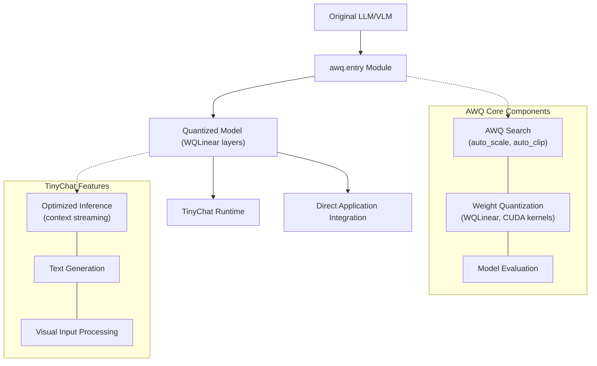
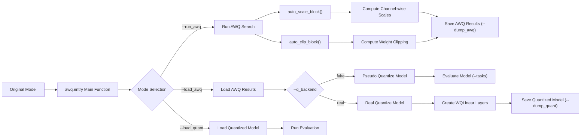
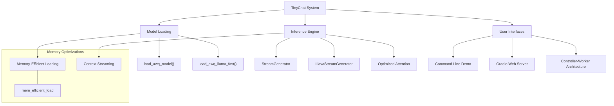
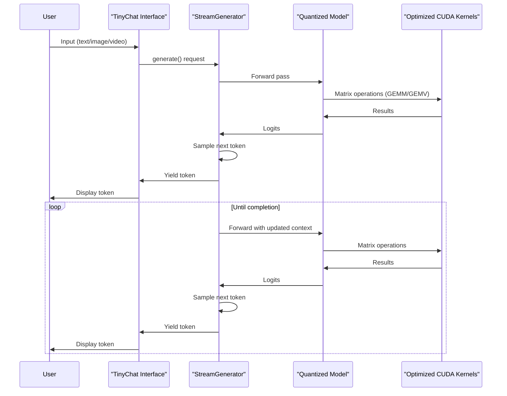
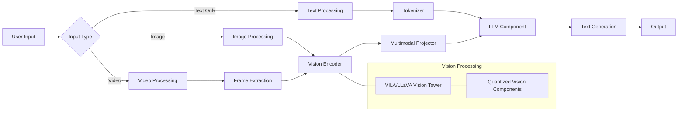

<!-- source: DeepWiki mcp.deepwiki.com · repo mit-han-lab/llm-awq · page 1 Overview · fetched 2026-10-30 -->

# Overview

Relevant source files

The following files were used as context for generating this wiki page:

- [README.md](README.md)
- [scripts/qwen_example.sh](scripts/qwen_example.sh)
- [tinychat/README.md](tinychat/README.md)
- [tinychat/utils/constants.py](tinychat/utils/constants.py)

This page provides an introduction to the AWQ (Activation-aware Weight Quantization) repository, explaining the key components and workflows of the system. AWQ enables efficient and accurate low-bit weight quantization (INT3/4) for Large Language Models (LLMs), supporting both instruction-tuned models and multi-modal language models (VLMs).

The AWQ repository consists of two main systems:
1. The AWQ quantization framework for compressing LLMs while maintaining quality
2. TinyChat, an efficient inference runtime for deploying the quantized models

For detailed information about the quantization algorithm, see [AWQ Quantization System](#2), and for more on the inference system, refer to [TinyChat System](#3).

## System Architecture

Here's a high-level overview of the AWQ system architecture:

Sources: [README.md:10-16]()

## Quantization Workflow

The AWQ quantization process involves three main operations, controlled through command-line arguments to the `awq.entry` module:

Sources: [scripts/qwen_example.sh:3-25](), [README.md:177-208]()

The workflow consists of three main phases:
1. **Search Mode**: Find optimal quantization parameters (scales and clips)
2. **Quantize Mode**: Apply quantization to the model using these parameters
3. **Evaluate Mode**: Assess the performance of the quantized model

## TinyChat Runtime

TinyChat provides an efficient inference environment for the quantized models:

Sources: [README.md:51-52](), [tinychat/utils/constants.py:4-9]()

TinyChat is designed for efficient inference with both text-only and multimodal models. It includes:
- Memory-efficient model loading (especially important for edge devices)
- Optimized attention mechanisms
- Streaming text generation
- Support for various user interfaces (CLI and web-based)

## Inference Flow

During inference, TinyChat processes inputs and generates outputs as follows:

Sources: [README.md:17-18]()

## Multimodal Support

AWQ and TinyChat support multimodal models that can process text, images, and videos:

Sources: [README.md:29-43](), [README.md:135-143]()

The multimodal architecture enables processing of:
- Text inputs through tokenizers
- Image inputs through vision encoders (like those in VILA and LLaVA)
- Video inputs by extracting frames and processing them through the vision encoder

## Configuration Parameters

Key configuration parameters for TinyChat (from `tinychat.utils.constants.py`):

| Parameter | Description | Default Value |
|-----------|-------------|---------------|
| `max_seq_len` | Maximum sequence length | 8192 |
| `max_batch_size` | Maximum batch size | 1 |
| `llama_multiple_of` | Sequence length multiple | 256 |
| `mem_efficient_load` | Layer-wise model loading | False |

Sources: [tinychat/utils/constants.py:4-9]()

The `mem_efficient_load` parameter is particularly useful for edge devices with limited memory.

## Model Support

AWQ supports a wide range of LLMs and VLMs:

| Model Family | Sizes | INT4 | INT3 |
|--------------|-------|------|------|
| DeepSeek-R1-Distill | 8B | ✅ |  |
| Qwen-2.5 | 7B/72B | ✅ |  |
| VILA-1.5 | 3B/8B/13B/40B | ✅ | ✅ |
| Llama3 | 8B/70B | ✅ | ✅ |
| Llama2 | 7B/13B/70B | ✅ | ✅ |
| LLaMA | 7B/13B/30B/65B | ✅ | ✅ |
| OPT | 125m-30B | ✅ | ✅ |
| CodeLlama | 7B/13B/34B | ✅ | ✅ |
| StarCoder | 15.5B | ✅ | ✅ |
| Vicuna | 7B/13B | ✅ |  |
| LLaVA | 13B | ✅ |  |

Sources: [README.md:144-161]()

## Performance Benefits

AWQ quantization provides significant benefits:

- Memory reduction: 3-4x smaller model size
- Inference speedup: 2-3x faster generation
- Maintained accuracy: Minimal quality degradation compared to FP16
- Edge compatibility: Enables running large models on resource-constrained devices

Sources: [README.md:16-17](), [README.md:20-26]()

## Installation and Usage

The AWQ repository can be installed by following these steps:

1. Clone the repository
2. Install the Python package
3. Compile the CUDA kernels
4. (Optional) Install VILA for multimodal support

For practical usage, the most common workflow is:

1. Run AWQ search to find optimal quantization parameters
2. Apply quantization to create a 4-bit model
3. Deploy the quantized model using TinyChat

Sources: [README.md:99-143](), [README.md:176-208]()

---

