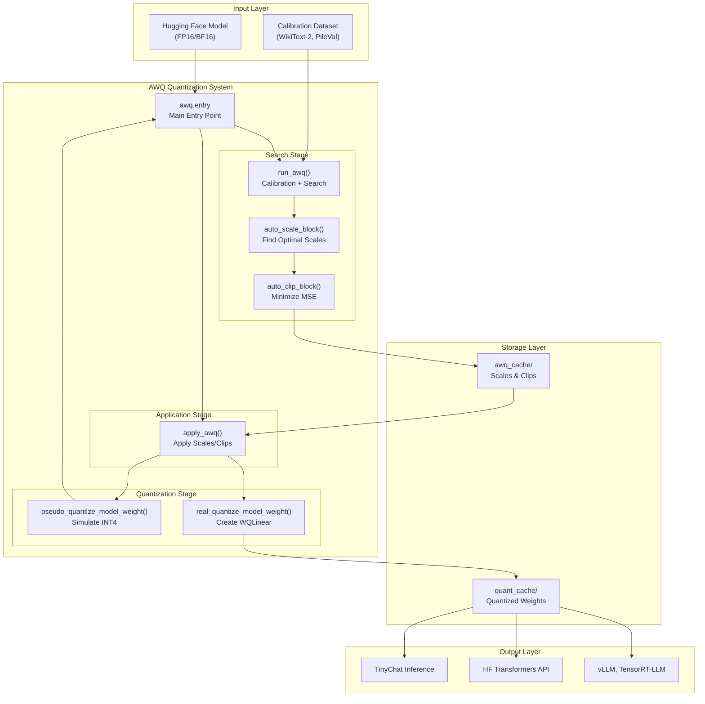
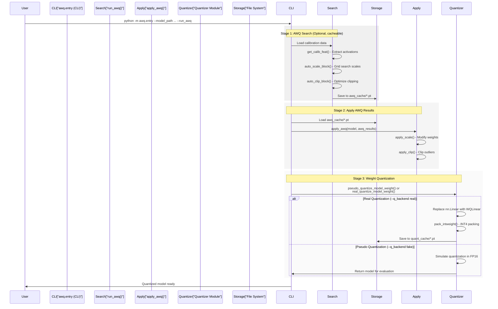
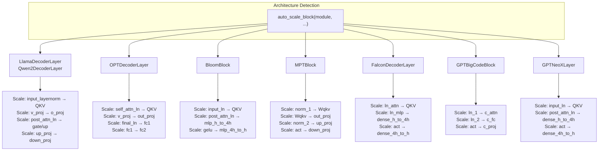
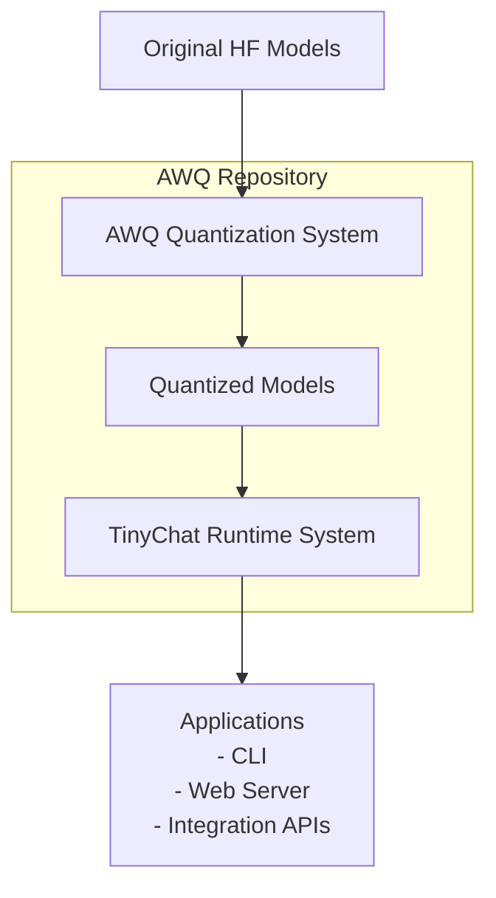

<!-- source: DeepWiki mcp.deepwiki.com · repo mit-han-lab/llm-awq · page 2 AWQ Quantization System · fetched 2026-10-30 -->

# AWQ Quantization System

<details>
<summary>Relevant source files</summary>

The following files were used as context for generating this wiki page:

- [README.md](README.md)
- [awq/entry.py](awq/entry.py)
- [awq/quantize/auto_scale.py](awq/quantize/auto_scale.py)
- [scripts/qwen_example.sh](scripts/qwen_example.sh)
- [tinychat/README.md](tinychat/README.md)
- [tinychat/utils/constants.py](tinychat/utils/constants.py)

</details>


## Purpose and Scope

The AWQ (Activation-aware Weight Quantization) Quantization System is the core component that enables efficient 4-bit (INT4) weight quantization of large language models while maintaining accuracy close to full-precision models. This page provides an overview of the AWQ system's motivation, approach, and key components.

For detailed algorithmic explanations, see [Quantization Algorithm](#2.1). For implementation details, see [Quantization Implementation](#2.2). For usage and calibration workflows, see [Calibration & Evaluation](#2.3). For low-level optimization details, see [CUDA Kernels & Low-Level Optimization](#2.4).

## What is AWQ?

AWQ (Activation-aware Weight Quantization) is a quantization method that reduces model weight precision from FP16/BF16 to INT4 (4-bit integers) while maintaining model accuracy. Unlike naive quantization approaches that treat all weights equally, AWQ protects salient weights based on activation statistics, achieving superior accuracy-efficiency trade-offs.

### Key Benefits

| Benefit | Description |
|---------|-------------|
| **Memory Reduction** | 4× reduction in model size (e.g., 7B model from 14GB to 3.5GB) |
| **Inference Speed** | 2-3× faster token generation on GPUs |
| **Accuracy Preservation** | Minimal accuracy degradation compared to FP16 |
| **Hardware Efficient** | Optimized CUDA kernels for W4A16 operations |
| **Broad Compatibility** | Supports LLaMA, Qwen, Falcon, MPT, VILA, and more |

Sources: [README.md:1-17]()

### The AWQ Approach

AWQ's core innovation is **activation-aware** quantization:

1. **Observes Activation Patterns**: Analyzes activation magnitudes on calibration data
2. **Protects Salient Weights**: Applies per-channel scaling to preserve important weights
3. **Minimizes Quantization Error**: Uses auto-clipping to reduce outlier impact
4. **Efficient Search**: Grid search finds optimal scaling factors per layer

This approach differs from traditional quantization by adapting to each model's unique activation patterns rather than applying uniform quantization.

Sources: [README.md:4-6](), [awq/quantize/auto_scale.py:87-156]()

## System Architecture

**High-Level Architecture Diagram**



The AWQ system consists of three main stages:

1. **Search Stage**: Finds optimal per-channel scales and per-group clipping values
2. **Application Stage**: Applies discovered scales/clips to model weights
3. **Quantization Stage**: Converts to INT4 representation (pseudo or real)

Sources: [awq/entry.py:1-25](), [awq/quantize/pre_quant.py:1-50](), [awq/quantize/quantizer.py:1-50]()

## Quantization Pipeline

**End-to-End Quantization Workflow**



**Typical Usage Commands**

```bash
# Step 1: Run AWQ search (compute scales/clips)
python -m awq.entry --model_path /path/to/model \
    --w_bit 4 --q_group_size 128 \
    --run_awq --dump_awq awq_cache/model-w4-g128.pt

# Step 2: Evaluate with pseudo quantization
python -m awq.entry --model_path /path/to/model \
    --tasks wikitext --w_bit 4 --q_group_size 128 \
    --load_awq awq_cache/model-w4-g128.pt \
    --q_backend fake

# Step 3: Generate real quantized weights
python -m awq.entry --model_path /path/to/model \
    --w_bit 4 --q_group_size 128 \
    --load_awq awq_cache/model-w4-g128.pt \
    --q_backend real --dump_quant quant_cache/model-w4-g128-awq.pt
```

Sources: [awq/entry.py:26-96](), [awq/entry.py:190-246](), [scripts/qwen_example.sh:1-26]()

## Key Components

### 1. Entry Point: `awq.entry`

The `awq.entry` module provides the command-line interface and orchestrates the entire quantization pipeline. It handles model loading, AWQ search execution, quantization, and evaluation.

**Key Functions in `awq/entry.py`:**

| Component | Description | Line Reference |
|-----------|-------------|----------------|
| `build_model_and_enc()` | Loads model and tokenizer, handles pre-quantized models | [awq/entry.py:122-270]() |
| `main()` | Entry point that coordinates workflow stages | [awq/entry.py:273-357]() |
| Command-line args | Configures quantization parameters (w_bit, q_group_size, etc.) | [awq/entry.py:26-96]() |

### 2. AWQ Search: `run_awq()` and Auto-Scaling

The AWQ search process finds optimal per-channel scaling factors and per-group clipping values. This is performed on calibration data (typically 128 samples of 512 tokens).

**Search Components:**

- **`run_awq()`**: Main search function that orchestrates calibration and optimization
- **`auto_scale_block()`**: Performs grid search (20 points) to find optimal scaling ratio per layer
- **`auto_clip_block()`**: Finds optimal clipping threshold to minimize MSE

The search results are cached in `awq_cache/` to avoid recomputation.

Sources: [awq/entry.py:200-216](), [awq/quantize/auto_scale.py:87-156]()

### 3. Quantization Methods

**Comparison of Quantization Backends:**

| Backend | Purpose | Weight Storage | Linear Layers | Use Case |
|---------|---------|----------------|---------------|----------|
| **Pseudo (`fake`)** | Evaluation | FP16/BF16 | `nn.Linear` | Accuracy testing before deployment |
| **Real (`real`)** | Deployment | INT4 (packed) | `WQLinear` | Production inference |

- **Pseudo Quantization**: Simulates INT4 quantization during forward pass but keeps weights in FP16. Used to validate accuracy without changing model structure.
- **Real Quantization**: Converts weights to packed INT4 format and replaces `nn.Linear` with `WQLinear` layers that use custom CUDA kernels.

Sources: [awq/entry.py:226-246]()

### 4. WQLinear Module

`WQLinear` is the quantized replacement for `nn.Linear` that stores INT4 weights and uses optimized CUDA kernels for W4A16 (4-bit weight, 16-bit activation) matrix operations.

**WQLinear Structure:**

- **`qweight`**: Packed INT4 weights
- **`qzeros`**: Quantization zero points per group
- **`scales`**: Dequantization scales per group
- **Forward pass**: Calls `gemm_forward_cuda` or `gemv_forward_cuda` depending on batch size

This module enables memory-efficient storage and fast inference with quantized weights.

### 5. CUDA Kernel Layer

Optimized CUDA kernels provide the computational foundation for efficient W4A16 operations:

- **`gemv_forward_cuda`**: Matrix-vector multiplication for single token generation (decoding)
- **`gemm_forward_cuda`**: Matrix-matrix multiplication for batch processing (prefill)
- **`layernorm_forward_cuda`**: Accelerated layer normalization
- **Fused operations**: Combine multiple operations to reduce memory bandwidth

These kernels achieve 2-3× speedup over FP16 inference by exploiting reduced memory bandwidth requirements and specialized INT4 arithmetic.

Sources: [awq/kernels/](), detailed in [CUDA Kernels & Low-Level Optimization](#2.4)

## Supported Model Architectures

AWQ supports a wide range of model architectures by adapting its scaling strategy to each architecture's specific layer structure. The `auto_scale_block()` function detects the model type and applies the appropriate scaling logic.

**Supported Architectures and Decoder Layers:**



**Model Zoo Coverage:**

| Model Family | Sizes | Configuration | Pre-computed Cache |
|--------------|-------|---------------|-------------------|
| LLaMA 2/3 | 7B, 13B, 70B | W4A16, group_size=128 | ✅ Available |
| Qwen 2.5 | 7B, 72B | W4A16, group_size=128 | ✅ Available |
| Falcon | 7B, 40B, 180B | W4A16, group_size=64 | ✅ Available |
| MPT | 7B, 30B | W4A16, group_size=128 | ✅ Available |
| OPT | 125M-30B | W4A16, group_size=128 | ✅ Available |
| VILA/LLaVA | 7B, 13B, 40B | W4A16, group_size=128 | ✅ Available |
| CodeLlama | 7B, 13B, 34B | W4A16, group_size=128 | ✅ Available |
| StarCoder | 15.5B | W4A16, group_size=128 | ✅ Available |

Sources: [awq/quantize/auto_scale.py:175-443](), [README.md:147-173]()

## Configuration Options

**Command-Line Arguments for `awq.entry`:**

| Parameter | Type | Description | Default | Example |
|-----------|------|-------------|---------|---------|
| `--model_path` | str | Path to Hugging Face model | Required | `/path/to/llama-2-7b` |
| `--dtype` | str | Model data type | `float16` | `float16`, `bfloat16` |
| `--w_bit` | int | Weight quantization bits | `4` | `3`, `4` |
| `--q_group_size` | int | Quantization group size (-1 for per-channel) | `128` | `64`, `128` |
| `--no_zero_point` | flag | Disable zero point quantization | False | - |
| `--q_backend` | str | Quantization backend | `fake` | `fake`, `real` |
| `--run_awq` | flag | Perform AWQ search | False | - |
| `--dump_awq` | str | Save AWQ search results | None | `awq_cache/model.pt` |
| `--load_awq` | str | Load AWQ search results | None | `awq_cache/model.pt` |
| `--dump_quant` | str | Save quantized model | None | `quant_cache/model.pt` |
| `--load_quant` | str | Load quantized model | None | `quant_cache/model.pt` |
| `--tasks` | str | Evaluation tasks | None | `wikitext`, `piqa,arc_easy` |

**Quantization Config Dictionary:**

The `q_config` dictionary controls quantization behavior:

```python
q_config = {
    "zero_point": True,        # Use symmetric (False) or asymmetric (True) quantization
    "q_group_size": 128,       # Group size for group-wise quantization
}
```

Sources: [awq/entry.py:26-96](), [awq/entry.py:112-117]()

## Calibration Data

AWQ uses calibration data to observe activation patterns during the search phase. The default configuration uses:

- **Dataset**: WikiText-2 or Pile validation set
- **Samples**: 128 sequences
- **Sequence Length**: 512 tokens
- **Purpose**: Capture representative activation statistics for scaling

The calibration process is quick (typically a few minutes) and only needs to be run once per model. Results are cached in `awq_cache/` for reuse.

Sources: [awq/entry.py:203-210]()

## Integration with the Rest of the System

The AWQ Quantization System integrates with other components of the repository to enable efficient inference with quantized models:



The AWQ Quantization System produces quantized models that can be loaded and used by the TinyChat system for efficient inference, or directly integrated into custom applications.

Sources: [awq/entry.py:153-187]()

## Summary

The AWQ Quantization System provides a comprehensive framework for efficient 4-bit quantization of large language models while maintaining high performance. Its key innovations include:

1. Activation-aware quantization that minimizes error based on activation patterns
2. Auto-scaling that finds optimal scaling factors for each layer
3. Highly optimized CUDA kernels for efficient inference
4. Support for a wide range of model architectures
5. Options for both simulated and real quantization

These features allow AWQ to achieve superior performance compared to other quantization methods, enabling efficient deployment of large language models on resource-constrained devices.

---

