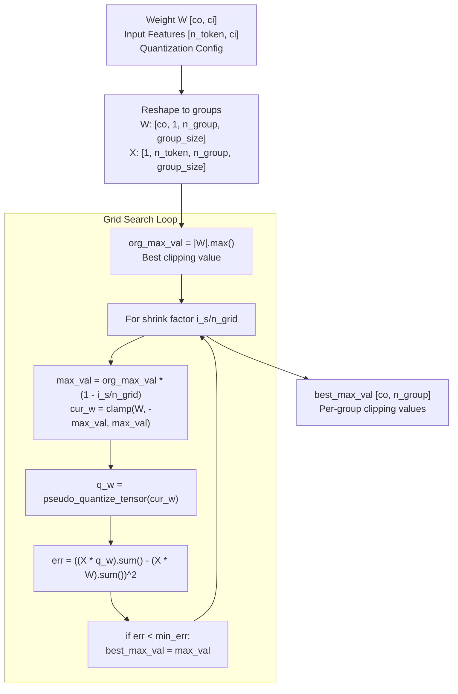
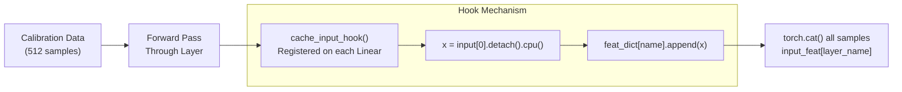
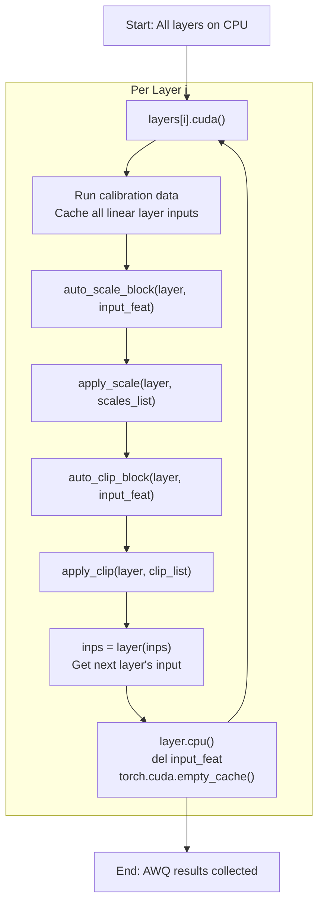

<!-- source: DeepWiki mcp.deepwiki.com · repo mit-han-lab/llm-awq · page 2.1 Quantization Algorithm · fetched 2026-10-30 -->

# Quantization Algorithm

<details>
<summary>Relevant source files</summary>

The following files were used as context for generating this wiki page:

- [awq/quantize/auto_clip.py](awq/quantize/auto_clip.py)
- [awq/quantize/pre_quant.py](awq/quantize/pre_quant.py)
- [awq/quantize/qmodule.py](awq/quantize/qmodule.py)
- [tinychat/models/__init__.py](tinychat/models/__init__.py)

</details>


## Purpose and Scope

This document explains the AWQ (Activation-aware Weight Quantization) algorithm, which is the core quantization technique used in this repository. AWQ quantizes model weights from FP16/BF16 to INT4 while preserving accuracy by leveraging activation statistics.

This page focuses on the **algorithmic principles** of AWQ, including auto-scaling and auto-clipping techniques. For implementation details of quantized modules and weight packing, see [Quantization Implementation](#2.2). For running AWQ search and calibration workflows, see [Calibration & Evaluation](#2.3).

---

## AWQ Algorithm Overview

AWQ performs **activation-aware weight quantization**, meaning it uses calibration data to analyze activation patterns and adaptively protects important weights from quantization error. Unlike naive quantization that treats all weights equally, AWQ observes that certain channels are more salient (have larger activation magnitudes) and should be preserved with higher precision.

The algorithm operates in two stages:

1. **Auto-Scaling**: Per-channel scaling factors protect salient weights based on activation magnitudes
2. **Auto-Clipping**: Per-group clipping values minimize quantization error via grid search

Both stages use calibration data (typically 512 samples from WikiText-2 or Pile) to analyze activation distributions and optimize quantization parameters.

**Key Principle**: Instead of quantizing weights directly, AWQ first transforms them using learned scales and clips, then applies uniform quantization. This transformation is mathematically equivalent to scaling activations inversely, but is computationally cheaper at inference time.

Sources: [awq/quantize/pre_quant.py:102-249]()

---

## Algorithm Components

### High-Level Algorithm Flow

```mermaid
graph TB
    Input["Model (FP16/BF16)<br/>+ Calibration Data"]
    GetBlocks["get_blocks()<br/>Extract transformer layers"]
    CacheInputs["Forward hooks<br/>Cache layer inputs"]
    
    subgraph "Per-Layer Processing"
        CacheFeats["cache_input_hook()<br/>Capture linear layer inputs"]
        AutoScale["auto_scale_block()<br/>Compute per-channel scales"]
        ApplyScale["apply_scale()<br/>Transform weights"]
        AutoClip["auto_clip_block()<br/>Compute per-group clips"]
        ApplyClip["apply_clip()<br/>Clamp weights"]
    end
    
    Results["AWQ Results<br/>{scale: [...], clip: [...]}"]
    
    Input --> GetBlocks
    GetBlocks --> CacheInputs
    CacheInputs --> CacheFeats
    CacheFeats --> AutoScale
    AutoScale --> ApplyScale
    ApplyScale --> AutoClip
    AutoClip --> ApplyClip
    ApplyClip --> Results
    
    style "Per-Layer Processing" fill:#f9f9f9
```

**Diagram: AWQ Algorithm Pipeline**

The algorithm processes the model layer-by-layer to manage GPU memory efficiently. For each transformer layer, it captures input features, computes scaling factors, applies them to weights, then computes and applies clipping values.

Sources: [awq/quantize/pre_quant.py:102-249]()

---

## Auto-Scaling

Auto-scaling protects salient weights by computing per-channel scaling factors based on activation magnitudes. The intuition is that channels with large activations are more important and should maintain higher effective precision after quantization.

### Mathematical Formulation

For a linear layer with weight matrix **W** ∈ ℝ^(out×in) and input **X** ∈ ℝ^(batch×in):

1. **Analyze activations**: Compute per-channel activation magnitudes from calibration data
2. **Compute scale factors** **s** ∈ ℝ^in: Scale factor for each input channel
3. **Transform weights**: **W'** = **W** · diag(**s**)
4. **Transform activations inversely**: **X'** = **X** · diag(**s**)^(-1)

The transformation preserves the output: **W' X'** = **W X**, but **W'** is more amenable to quantization because salient channels are scaled up (reducing relative quantization error).

### Grid Search for Optimal Scales

The `auto_scale_block()` function performs a grid search over possible scaling strategies:

- Evaluates different scale computation methods (mean, max, etc.)
- Tests scale values on a grid (e.g., 0.0 to 1.0 in steps)
- Selects scales that minimize quantization error on calibration data

The selected scales are applied to both the current layer's weights and the input features passed to the next layer, ensuring end-to-end consistency.

Sources: [awq/quantize/pre_quant.py:19-20](), [awq/quantize/pre_quant.py:204-219]()

---

## Auto-Clipping

After auto-scaling, AWQ applies **auto-clipping** to further reduce quantization error. While scaling operates at the channel level (entire columns of the weight matrix), clipping operates at the **group level** (sub-blocks of weights), providing finer-grained optimization.

### Clipping Algorithm Details



**Diagram: Auto-Clipping Grid Search Process**

Sources: [awq/quantize/auto_clip.py:10-63]()

### Clipping Parameters

| Parameter | Default Value | Description |
|-----------|---------------|-------------|
| `n_grid` | 20 | Number of grid points to search |
| `max_shrink` | 0.5 | Maximum shrinkage (50% of original range) |
| `n_sample_token` | 512 | Number of tokens sampled from calibration data |
| `group_size` | 128 | Weights per quantization group |

The algorithm tests clipping values from the original max down to `max_shrink * org_max_val`, selecting the value that minimizes MSE between:
- Original output: **(X · W).sum()**
- Quantized output: **(X · quantize(clamp(W))).sum()**

### Layer Selection

Not all layers are clipped. The algorithm **excludes** query and key projection layers (`q_`, `k_`, `query`, `key`, `Wqkv`) because their outputs are used in batch matrix multiplies with specific numerical requirements.

Sources: [awq/quantize/auto_clip.py:66-83]()

---

## Input Feature Caching

A critical component of AWQ is capturing the input features (activations) for each linear layer during calibration. These features are used to evaluate quantization quality in the grid searches.

### Hook-Based Feature Collection



**Diagram: Input Feature Caching Mechanism**

The caching process:

1. **Register hooks**: For each linear layer, register a forward hook using `functools.partial` to bind the layer name
2. **Forward pass**: Run calibration data through the layer
3. **Hook execution**: Each hook captures `x[0]` (first input tensor), detaches it, and moves to CPU
4. **Concatenation**: After forward pass, concatenate all captured features along batch dimension

This produces `input_feat[layer_name]` with shape `[n_samples, in_features]`, representing all calibration inputs to that layer.

Sources: [awq/quantize/pre_quant.py:180-199]()

---

## Layer-by-Layer Processing

AWQ processes the model one transformer layer at a time to manage GPU memory efficiently. This is critical for quantizing large models like LLaMA-70B.

### Processing Strategy



**Diagram: Layer-by-Layer Memory Management**

### Memory Optimization Techniques

1. **Selective GPU loading**: Only one layer on GPU at a time
2. **CPU offloading**: Move processed layers back to CPU immediately
3. **Explicit cache clearing**: `torch.cuda.empty_cache()` after each layer
4. **Feature deletion**: Delete `input_feat` dictionary after processing
5. **Embedding management**: `move_embed()` moves embeddings on/off GPU as needed

This strategy allows quantizing 70B models on a single 80GB A100 GPU.

Sources: [awq/quantize/pre_quant.py:174-248]()

---

## Model Architecture Support

AWQ supports various transformer architectures through a unified interface. The `get_blocks()` function extracts transformer layers from different model types.

### Supported Model Types

| Model Family | Layer Access Path | Example |
|--------------|-------------------|---------|
| LLaMA / Qwen2 | `model.model.layers` | LLaMA-2, LLaMA-3, Qwen-2 |
| InternVL3 | `model.language_model.model.layers` | InternVL3 (multimodal) |
| LLaVA | `model.model.layers` | LLaVA (multimodal) |
| OPT | `model.model.decoder.layers` | OPT models |
| BLOOM | `model.transformer.h` | BLOOM models |
| MPT | `model.transformer.blocks` | MPT models |
| Falcon | `model.transformer.h` | Falcon models |

The algorithm is architecture-agnostic once layers are extracted. Each layer is treated as a module containing multiple linear layers (`nn.Linear`).

Sources: [awq/quantize/pre_quant.py:29-54]()

---

## Complete Algorithm Implementation

### `run_awq()` Function Signature

```python
def run_awq(
    model,              # Transformer model to quantize
    enc,                # Tokenizer for calibration data
    w_bit,              # Weight bit-width (typically 4)
    q_config,           # Quantization config (group_size, etc.)
    n_samples=512,      # Number of calibration samples
    seqlen=512,         # Sequence length
    auto_scale=True,    # Enable auto-scaling
    mse_range=True,     # Enable auto-clipping (MSE-based)
    calib_data="pileval" # Calibration dataset name
) -> dict            # Returns {"scale": [...], "clip": [...]}
```

Sources: [awq/quantize/pre_quant.py:101-113]()

### Algorithm Steps

1. **Initialization**
   - Extract transformer layers using `get_blocks(model)`
   - Load calibration dataset using `get_calib_dataset()`
   - Concatenate samples into tensor of shape `[n_samples, seqlen]`

2. **Capture First Layer Input**
   - Use `Catcher` module to intercept layer 0's input and kwargs
   - Prevents full forward pass (early exit via exception)
   - Provides starting point for layer-by-layer processing

3. **Layer-by-Layer Loop** (for each layer `i`):
   - Load `layers[i]` to GPU
   - Register forward hooks to cache linear layer inputs
   - Forward pass: `inps = layer(inps, **layer_kwargs)[0]`
   - Collect `input_feat[layer_name]` for all linear layers
   - If `auto_scale=True`: Call `auto_scale_block()`, get `scales_list`, apply scales
   - If `mse_range=True`: Call `auto_clip_block()`, get `clip_list`, apply clips
   - Append scales/clips to results with layer name prefix
   - Move layer back to CPU, clear GPU cache

4. **Return Results**
   - Dictionary with keys `"scale"` and `"clip"`
   - Each contains list of `(layer_name, values)` tuples
   - Values are tensors with appropriate shapes for each layer

Sources: [awq/quantize/pre_quant.py:102-249]()

---

## Quantization Configuration

The `q_config` dictionary controls quantization behavior:

| Parameter | Typical Value | Description |
|-----------|---------------|-------------|
| `q_group_size` | 128 | Number of weights per quantization group |
| `w_bit` | 4 | Weight bit-width |
| `version` | "GEMM" or "GEMV" | Kernel type to target |

The group size determines granularity:
- **Group size = 128**: Balance between precision and overhead
- **Group size = in_features**: Per-channel quantization (coarser)
- **Group size = 64/32**: Finer granularity (more overhead)

Smaller group sizes provide more flexibility but require more storage for scales/zeros and more computation for dequantization.

Sources: [awq/quantize/auto_clip.py:18-20]()

---

## Pseudo-Quantization for Evaluation

During the grid search processes, AWQ uses **pseudo-quantization** to simulate quantization without actually converting to INT4. This allows evaluating quantization quality using full-precision arithmetic.

### Pseudo-Quantization Process

```python
def pseudo_quantize_tensor(w, n_bit, q_config):
    # 1. Compute scales and zeros based on group_size
    # 2. Quantize: q_w = round((w - zero) / scale)
    # 3. Clip to [0, 2^n_bit - 1]
    # 4. Dequantize: w_q = q_w * scale + zero
    # Returns: dequantized tensor in original precision
```

This simulates the quantization error without the memory/compute benefits, used only during AWQ search. Real quantization (INT4 storage) happens later in the pipeline.

Sources: [awq/quantize/auto_clip.py:3](), [awq/quantize/auto_clip.py:45]()

---

## Output Format

The `run_awq()` function returns a dictionary with the following structure:

```python
awq_results = {
    "scale": [
        ("model.layers.0.self_attn.q_proj", tensor([...])),
        ("model.layers.0.self_attn.v_proj", tensor([...])),
        # ... more layers ...
    ],
    "clip": [
        ("model.layers.0.self_attn.v_proj", tensor([...])),
        ("model.layers.0.mlp.up_proj", tensor([...])),
        # ... more layers ...
        # Note: q_proj and k_proj excluded from clipping
    ]
}
```

### Scale Tensor Shape
- Per-channel: `[out_features, in_features]` or similar
- Applied as diagonal scaling matrices

### Clip Tensor Shape
- Per-group: `[out_features, n_groups]`
- Each group corresponds to `group_size` consecutive weights
- Used to clamp weights before quantization

These results are cached to `awq_cache/` directory and reused to avoid redundant computation.

Sources: [awq/quantize/pre_quant.py:168-171](), [awq/quantize/pre_quant.py:217-238]()

---

## Algorithm Complexity

### Time Complexity

For a model with `L` layers, each containing `N` linear layers:

- **Feature caching**: O(L × calibration_samples) forward passes
- **Auto-scaling**: O(L × N × grid_size × samples) for grid search
- **Auto-clipping**: O(L × N × n_grid × oc_batch_size × samples)

The auto-clipping grid search is the most expensive operation, involving:
- 20 grid points (default `n_grid=20`)
- 10 shrinkage levels (default `max_shrink=0.5`)
- Pseudo-quantization + MSE computation for each point

Typical quantization time for LLaMA-7B: 1-2 hours on A100 GPU with 512 calibration samples.

### Memory Complexity

- **Peak GPU memory**: Single layer + calibration features
  - `input_feat`: `[512 × seqlen, in_features]` per linear layer
  - Typically 1-2GB for small linear layers, 10-20GB for large MLP layers
- **CPU memory**: Entire model in FP16
  - 7B model: ~14GB
  - 70B model: ~140GB

Sources: [awq/quantize/auto_clip.py:11-63](), [awq/quantize/pre_quant.py:174-248]()

---

## Code-to-Algorithm Mapping

### Key Functions and Their Roles

| Code Entity | Location | Algorithm Role |
|-------------|----------|----------------|
| `run_awq()` | [awq/quantize/pre_quant.py:102-249]() | Main algorithm orchestrator |
| `get_blocks()` | [awq/quantize/pre_quant.py:29-54]() | Extract transformer layers |
| `cache_input_hook()` | [awq/quantize/pre_quant.py:180-183]() | Capture layer inputs during forward pass |
| `auto_scale_block()` | [awq/quantize/auto_scale.py]() (imported) | Compute per-channel scales |
| `apply_scale()` | [awq/quantize/auto_scale.py]() (imported) | Apply scales to weights and features |
| `auto_clip_block()` | [awq/quantize/auto_clip.py:67-83]() | Compute per-group clips |
| `auto_clip_layer()` | [awq/quantize/auto_clip.py:11-63]() | Grid search for optimal clipping |
| `apply_clip()` | [awq/quantize/auto_clip.py:87-98]() | Clamp weights to clip values |
| `pseudo_quantize_tensor()` | [awq/quantize/quantizer.py]() (imported) | Simulate quantization for evaluation |

Sources: [awq/quantize/pre_quant.py:1-255](), [awq/quantize/auto_clip.py:1-99]()

---

