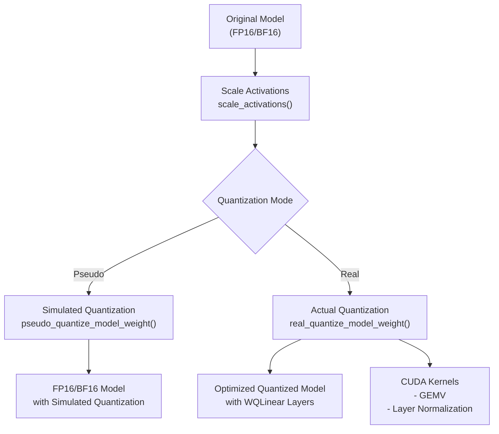
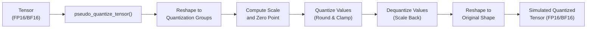
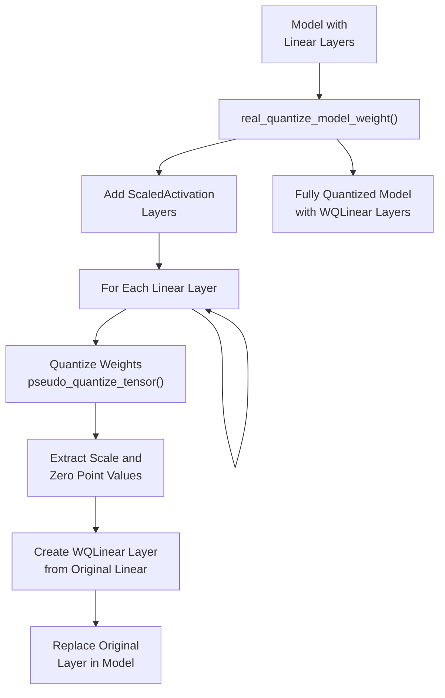
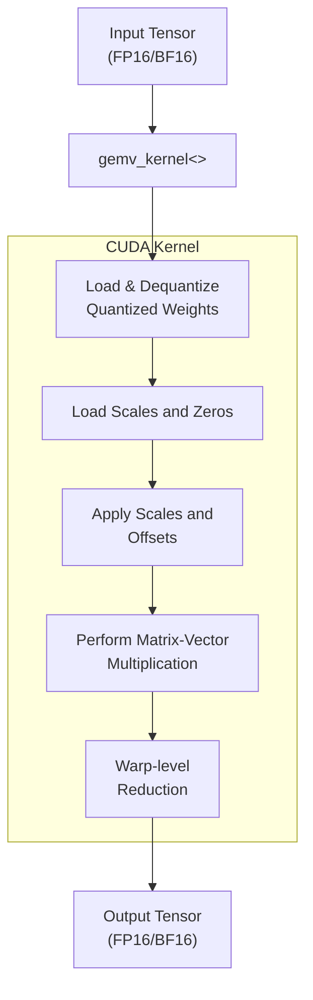
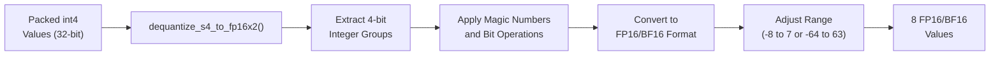
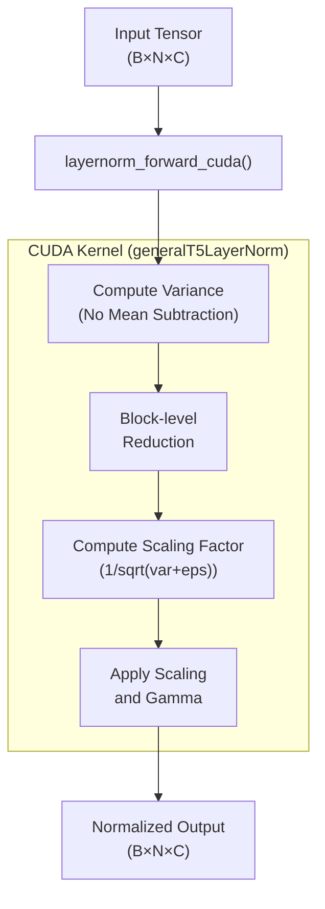
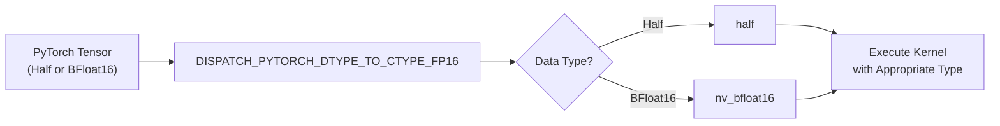
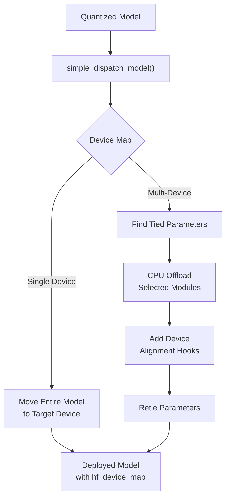
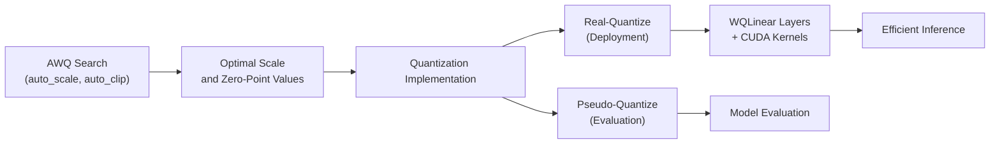

<!-- source: DeepWiki mcp.deepwiki.com · repo mit-han-lab/llm-awq · page 2.2 Quantization Implementation · fetched 2026-10-30 -->

# Quantization Implementation

<details>
<summary>Relevant source files</summary>

The following files were used as context for generating this wiki page:

- [awq/quantize/auto_clip.py](awq/quantize/auto_clip.py)
- [awq/quantize/qmodule.py](awq/quantize/qmodule.py)
- [awq/quantize/quantizer.py](awq/quantize/quantizer.py)
- [awq/utils/utils.py](awq/utils/utils.py)

</details>


This document details the practical implementation of AWQ's weight quantization system, focusing on how the AWQ algorithm is translated into efficient software components. It covers the core quantization functions, optimized CUDA kernels, and the infrastructure connecting these elements. For details on the mathematical foundations of the AWQ algorithm itself, see [Quantization Algorithm](#2.1).

## Overview of Quantization Implementation

AWQ implements two primary forms of quantization:

1. **Pseudo Quantization**: Simulates quantization effects while maintaining the original model structure (for evaluation purposes)
2. **Real Quantization**: Actually transforms model weights into quantized format with optimized compute kernels



*Diagram: AWQ Quantization Implementation Flow*

Sources: [awq/quantize/quantizer.py:61-105](), [awq/quantize/quantizer.py:106-123](), [awq/quantize/quantizer.py:126-165]()

## Core Quantization Functions

### Pseudo-Quantization Implementation

Pseudo-quantization provides a way to evaluate quantization effects without changing model structure. This is essential for determining optimal quantization parameters.



*Diagram: Pseudo-Quantization Process*

The core pseudo-quantization function computes quantization parameters and simulates their effect:

```python
# Core quantization parameters:
max_val = w.amax(dim=1, keepdim=True)          # Max value per row
min_val = w.amin(dim=1, keepdim=True)          # Min value per row
max_int = 2**n_bit - 1                         # Maximum integer value (e.g., 15 for 4-bit)
scales = (max_val - min_val).clamp(min=1e-5) / max_int  # Scale factor
zeros = (-torch.round(min_val / scales)).clamp_(min_int, max_int)  # Zero point
```

This process is applied to every linear layer in the model through the `pseudo_quantize_model_weight` function.

Sources: [awq/quantize/quantizer.py:61-103](), [awq/quantize/quantizer.py:106-123]()

### Real Quantization Implementation

Real quantization actually transforms the model, replacing standard linear layers with specialized `WQLinear` layers that operate on quantized weights.



*Diagram: Real Quantization Process*

The implementation includes special handling for different model architectures, with activation scaling applied appropriately:

```python
# Example for BloomBlock architecture:
if isinstance(module, BloomBlock):
    if isinstance(module.mlp.gelu_impl, ScaledActivation):
        return
    c = module.mlp.dense_h_to_4h.out_features
    act = ScaledActivation(
        module.mlp.gelu_impl, torch.ones(c, dtype=dtype, device=device)
    )
    set_op_by_name(module, "mlp.gelu_impl", act)
```

Sources: [awq/quantize/quantizer.py:126-165](), [awq/quantize/quantizer.py:14-57]()

## Optimized CUDA Kernels

AWQ implements highly optimized CUDA kernels to accelerate computation with quantized weights.

### GEMV (General Matrix-Vector Multiplication)

The GEMV kernel is critical for efficient inference with quantized weights, especially for single-batch inference scenarios.



*Diagram: GEMV Kernel Processing Flow*

Key optimizations in the GEMV kernel:
- Efficient 4-bit weight dequantization
- Memory coalescing for weight access
- Warp-level reductions for accumulation
- Support for both FP16 and BF16 data types

Sources: [awq/kernels/csrc/quantization_new/gemv/gemv_cuda.cu:74-229](), [awq/kernels/csrc/quantization_new/gemv/gemv_cuda.cu:245-338]()

### Dequantization Implementation

The dequantization process converts packed 4-bit integers into FP16/BF16 values efficiently:



*Diagram: Weight Dequantization Process*

The implementation uses advanced CUDA intrinsics and bit manipulation for optimal performance:

```cpp
// Extract elements using LOP3 operations (parallel bit extraction)
asm volatile("lop3.b32 %0, %1, %2, %3, %4;\n"
             : "=r"(h[0])
             : "r"(i4s), "n"(BOTTOM_MASK), "n"(I4s_TO_F16s_MAGIC_NUM), "n"(immLut));

// Convert to floating point with FMA operations
asm volatile("fma.rn.f16x2 %0, %1, %2, %3;\n" 
             : "=r"(h[1]) 
             : "r"(h[1]), "r"(ONE_SIXTEENTH), "r"(NEG_64));
```

Sources: [awq/kernels/csrc/quantization_new/dequantize.cuh:15-123]()

### Layer Normalization

AWQ provides optimized layer normalization for quantized models:



*Diagram: Layer Normalization Kernel Flow*

The layer normalization implementation follows the T5-style approach (without bias and mean subtraction):

```cpp
// Compute variance only (no mean subtraction)
float local_var_sum = 0.0f;
for (int i = tid; i < n; i += blockDim.x) {
    float diff = to_float(__ldg(&input[blockIdx.x * n + i]));
    local_var_sum += diff * diff;
}
variance = blockReduceSum(local_var_sum);

// Apply normalization with gamma (no beta)
for (int i = tid; i < n; i += blockDim.x) {
    output[blockIdx.x * n + i] =
        clamp_inf_for_half<T>((to_float(input[blockIdx.x * n + i]) * s_variance) * to_float(__ldg(&gamma[i])));
}
```

Sources: [awq/kernels/csrc/layernorm/layernorm.cu:39-64](), [awq/kernels/csrc/layernorm/layernorm.cu:67-131]()

## Quantization Infrastructure

### Data Type Handling

AWQ supports both FP16 (half) and BF16 (bfloat16) formats through a unified dispatching mechanism:



*Diagram: Data Type Dispatching*

The `DISPATCH_PYTORCH_DTYPE_TO_CTYPE_FP16` macro provides a unified interface for handling different precision formats:

```cpp
#define DISPATCH_PYTORCH_DTYPE_TO_CTYPE_FP16(pytorch_dtype, c_type, ...)                \
  if (pytorch_dtype == at::ScalarType::Half) {                                          \
    using c_type = half;                                                                \
    __VA_ARGS__                                                                         \
  } else if (pytorch_dtype == at::ScalarType::BFloat16) {                               \
    using c_type = nv_bfloat16;                                                         \
    __VA_ARGS__                                                                         \
  } else { /* error handling */ }
```

Sources: [awq/kernels/csrc/quantization_new/dispatch_utils.cuh:7-18](), [awq/kernels/csrc/layernorm/layernorm.cu:15-26]()

### Device Management

AWQ includes utilities for efficient model deployment across different devices:



*Diagram: Model Deployment Process*

The implementation supports sophisticated device mapping for efficient memory usage:

```python
# CPU offload for selected modules
cpu_offload_group = [(n, d) for n, d in device_map.items() if d == "cpu"]
prev_hook = None
for idx, (n, d) in enumerate(cpu_offload_group):
    m = get_module_by_name_suffix(model, n)
    _, prev_hook = accelerate.cpu_offload_with_hook(
        m, execution_device=main_device, prev_module_hook=prev_hook
    )
```

Sources: [awq/utils/utils.py:11-51]()

## Quantization Parameters

The quantization implementation in AWQ uses the following key parameters:

| Parameter | Description | Typical Values |
|-----------|-------------|---------------|
| `w_bit` | Bit-width for weight quantization | 4 (int4) |
| `q_group_size` | Size of quantization groups | 128 elements |
| `zero_point` | Whether to use zero-point quantization | True |
| `scales` | Scaling factors for each quantization group | FP16/BF16 tensor |
| `zeros` | Zero points for each quantization group | FP16/BF16 tensor |

These parameters are used throughout the quantization process to control the precision and efficiency of the resulting model.

Sources: [awq/quantize/quantizer.py:61-103](), [awq/quantize/quantizer.py:126-165]()

## Integration With AWQ Search

The quantization implementation connects with the AWQ search process (described in [Quantization Algorithm](#2.1)) to form a complete pipeline:



*Diagram: Integration with AWQ Search*

The search process determines optimal quantization parameters, which are then used by the implementation described in this document to create efficient quantized models ready for deployment.

Sources: [awq/quantize/quantizer.py:126-165]()

---

