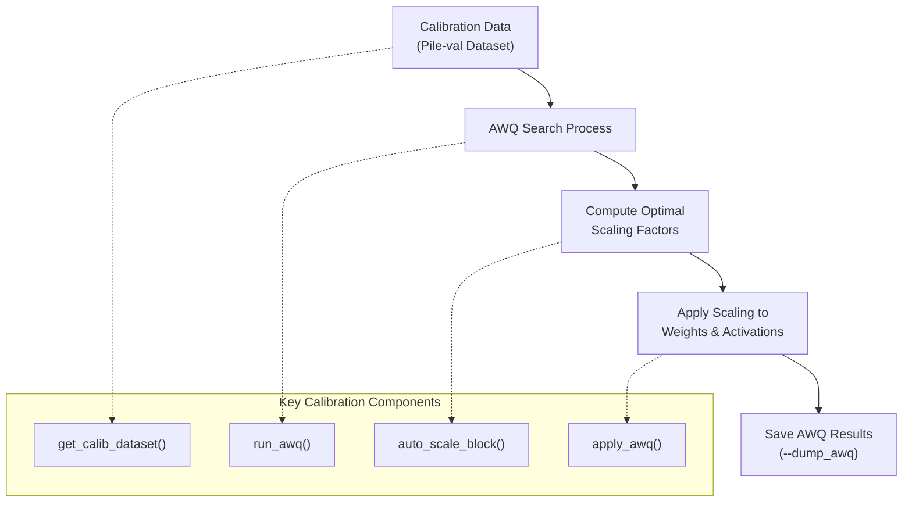
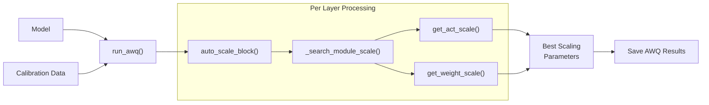
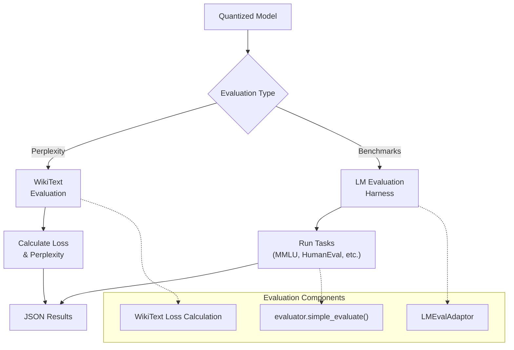
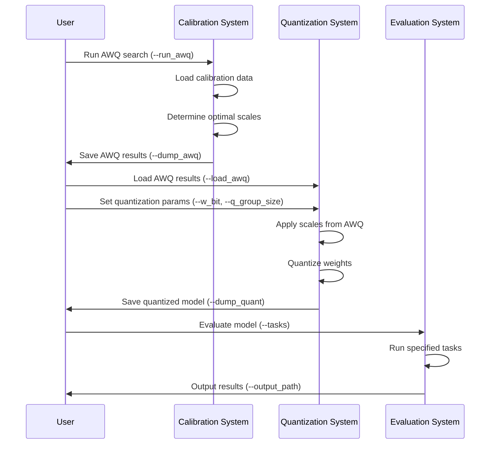
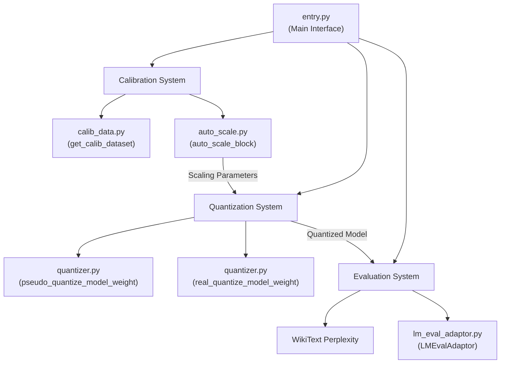

<!-- source: DeepWiki mcp.deepwiki.com · repo mit-han-lab/llm-awq · page 2.3 Calibration & Evaluation · fetched 2026-10-30 -->

# Calibration & Evaluation

<details>
<summary>Relevant source files</summary>

The following files were used as context for generating this wiki page:

- [awq/entry.py](awq/entry.py)
- [awq/quantize/auto_scale.py](awq/quantize/auto_scale.py)
- [awq/quantize/pre_quant.py](awq/quantize/pre_quant.py)
- [tinychat/models/__init__.py](tinychat/models/__init__.py)

</details>


This page documents the calibration and evaluation systems in the AWQ (Activation-aware Weight Quantization) framework. It covers how models are calibrated with representative data to find optimal quantization parameters and how quantized models are evaluated to ensure quality preservation. For information on the core quantization algorithm itself, see [Quantization Algorithm](#2.1), and for implementation details, see [Quantization Implementation](#2.2).

## 1. Calibration Overview

Calibration is a critical process in AWQ that identifies optimal scaling factors for weight quantization. The process uses a representative dataset to measure activation patterns, which guide the quantization process to minimize accuracy loss.



Sources: [awq/entry.py:199-216](), [awq/utils/calib_data.py:5-32](), [awq/quantize/auto_scale.py:17-444]()

### 1.1. Calibration Data Preparation

AWQ uses a subset of the Pile dataset (specifically "pile-val") as default calibration data. The data is processed to generate representative input sequences for different model components.

```python
# Main calibration data loading function
def get_calib_dataset(data="pileval", tokenizer=None, n_samples=512, block_size=512):
    # Load dataset, tokenize, and organize into appropriate blocks
    dataset = load_dataset("mit-han-lab/pile-val-backup", split="validation")
    # Process and return calibration samples
```

The calibration dataset is prepared with the following characteristics:
- Default of 512 samples from the Pile validation set
- Text sequences divided into blocks of 512 tokens
- Shuffled with a fixed seed (42) for reproducibility

Sources: [awq/utils/calib_data.py:5-32]()

### 1.2. AWQ Search Process

The AWQ search process identifies optimal scaling parameters for each layer based on activation patterns observed during inference on the calibration data.



The AWQ search process is triggered with the `--run_awq` command-line flag and outputs scaling factors that balance quantization error with model performance.

Sources: [awq/entry.py:200-216](), [awq/quantize/auto_scale.py:87-446]()

### 1.3. Auto-Scaling Algorithm

AWQ implements an architecture-aware auto-scaling algorithm that handles different model types (Llama, OPT, Bloom, etc.) with specialized scaling strategies for each component:

1. For each block in the model:
   - Identify key linear layers (attention projections, MLP layers)
   - Compute activation scales using calibration data
   - Search for optimal scaling ratios that minimize post-quantization error
   - Apply these scales to preserve important activations

The `auto_scale_block` function implements model-specific scaling strategies and supports various architectures including:
- LlamaDecoderLayer
- OPTDecoderLayer
- BloomBlock
- MPT models
- Falcon models
- And others

Sources: [awq/quantize/auto_scale.py:87-446](), [awq/quantize/auto_scale.py:449-481]()

## 2. Evaluation Methodology

AWQ provides comprehensive evaluation tools to verify the quality of quantized models, supporting both standard language model metrics and task-specific evaluations.



Sources: [awq/entry.py:273-356](), [awq/utils/lm_eval_adaptor.py:7-116]()

### 2.1. Perplexity Evaluation

Perplexity is a key metric for evaluating language models. AWQ includes WikiText perplexity evaluation:

```python
# WikiText perplexity evaluation process
testenc = load_dataset("wikitext", "wikitext-2-raw-v1", split="test")
testenc = enc("\n\n".join(testenc["text"]), return_tensors="pt")
model.seqlen = 2048
# Calculate perplexity by measuring negative log likelihood
```

The process:
1. Loads the WikiText-2 test dataset
2. Processes text through the model tokenizer
3. Computes loss for each sequence block
4. Aggregates the loss and calculates perplexity as `exp(total_loss / tokens)`

Sources: [awq/entry.py:301-333]()

### 2.2. LM Evaluation Harness Integration

For comprehensive evaluation, AWQ integrates with the [LM Evaluation Harness](https://github.com/EleutherAI/lm-evaluation-harness) to run standardized benchmarks:

```python
# Using LM Evaluation Harness
lm_eval_model = LMEvalAdaptor(args.model_path, model, enc, args.batch_size)
results = evaluator.simple_evaluate(
    model=lm_eval_model,
    tasks=task_names,
    batch_size=args.batch_size,
    no_cache=True,
    num_fewshot=args.num_fewshot,
)
```

The `LMEvalAdaptor` class adapts AWQ quantized models to work with the evaluation harness, handling:
- Token generation and logit computation
- Batch processing
- Appropriate handling of context lengths
- Support for various model architectures

Sources: [awq/entry.py:335-346](), [awq/utils/lm_eval_adaptor.py:7-116]()

## 3. Calibration and Evaluation Workflow

The complete workflow connects calibration, quantization, and evaluation into an integrated pipeline:



Sources: [awq/entry.py:94-357]()

### 3.1. Command-Line Interface

The AWQ entry script provides a comprehensive CLI for calibration and evaluation with key parameters:

| Parameter | Description | Default |
|-----------|-------------|---------|
| `--run_awq` | Run AWQ search process | False |
| `--dump_awq` | Save AWQ results to file | None |
| `--load_awq` | Load pre-computed AWQ results | None |
| `--w_bit` | Number of bits for weight quantization | None |
| `--q_group_size` | Group size for quantization | -1 |
| `--tasks` | Evaluation tasks to run | None |
| `--batch_size` | Batch size for evaluation | 1 |
| `--num_fewshot` | Number of few-shot examples | 0 |
| `--output_path` | Path to save evaluation results | None |

Sources: [awq/entry.py:26-96]()

### 3.2. Implementation Architecture

The calibration and evaluation systems connect to other AWQ components as follows:



Sources: [awq/entry.py:15-357](), [awq/quantize/auto_scale.py:17-481](), [awq/utils/lm_eval_adaptor.py:7-116]()

## 4. Using the Calibration and Evaluation Systems

### 4.1. Typical Calibration Workflow

```bash
# Step 1: Run AWQ search to find optimal scaling parameters
python -m awq.entry --model_path <model_path> --run_awq --dump_awq <output_path>/awq_results.pt

# Step 2: Quantize using the AWQ results
python -m awq.entry --model_path <model_path> --load_awq <output_path>/awq_results.pt --w_bit 4 --q_backend real --dump_quant <output_path>/quantized_model.pt
```

### 4.2. Typical Evaluation Workflow

```bash
# Evaluate a quantized model on specific tasks
python -m awq.entry --model_path <model_path> --load_quant <output_path>/quantized_model.pt --tasks "hellaswag,winogrande" --output_path <output_path>/eval_results.json

# Or evaluate perplexity on WikiText
python -m awq.entry --model_path <model_path> --load_quant <output_path>/quantized_model.pt --tasks "wikitext" --output_path <output_path>/ppl_results.json
```

Sources: [awq/entry.py:94-357]()

## 5. Advanced Features

### 5.1. Device Management

AWQ supports distributed evaluation across multiple GPUs with automatic device management:

```python
# Device management for large models
kwargs = {"max_memory": get_balanced_memory(model, max_memory if len(max_memory) > 0 else None)}
device_map = infer_auto_device_map(model, no_split_module_classes=[...], **kwargs)
model = dispatch_model(model, device_map=device_map)
```

The system can:
- Automatically determine optimal GPU usage based on model size
- Split models across multiple devices for large models
- Balance memory allocation

Sources: [awq/entry.py:251-268](), [awq/utils/parallel.py:6-28]()

### 5.2. Multimodal Model Support

For vision-language models (VLMs), AWQ includes specialized calibration and evaluation support:

```python
# Support for VLMs including VILA/NVILA models
if args.smooth_scale and args.vila_20:
    from awq.quantize import get_smooth_scale
    act_scale = get_smooth_scale(args.model_path, args.media_path)
    # Save activation scales for vision tower
```

This extends calibration and evaluation to handle:
- Vision tower components in multimodal models
- Generation of activation scales for visual inputs
- Specialized handling for VILA 1.5 and VILA 2.0 (NVILA) models

Sources: [awq/entry.py:280-292]()

## Summary

The AWQ Calibration and Evaluation systems provide a comprehensive framework for:
1. Determining optimal scaling parameters through data-driven calibration
2. Quantizing models with minimal quality loss
3. Evaluating quantized models with standard benchmarks

These systems are tightly integrated with the core AWQ quantization algorithms to provide an end-to-end workflow for efficient LLM quantization and deployment.

Sources: [awq/entry.py:15-357](), [awq/quantize/auto_scale.py:17-481](), [awq/utils/calib_data.py:5-32](), [awq/utils/lm_eval_adaptor.py:7-116]()

---

