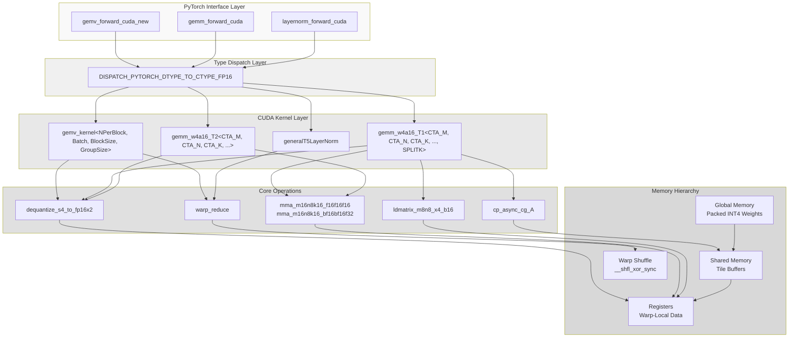
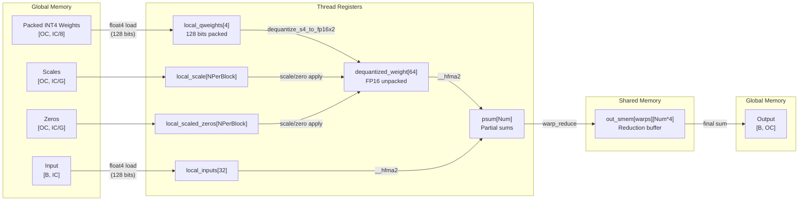
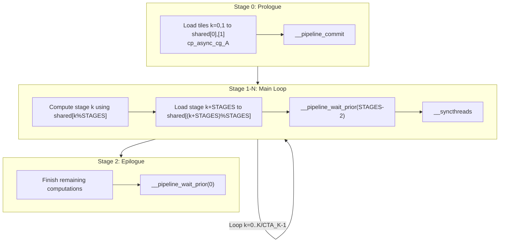
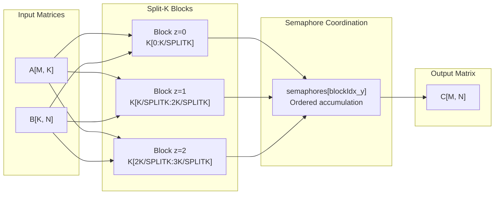
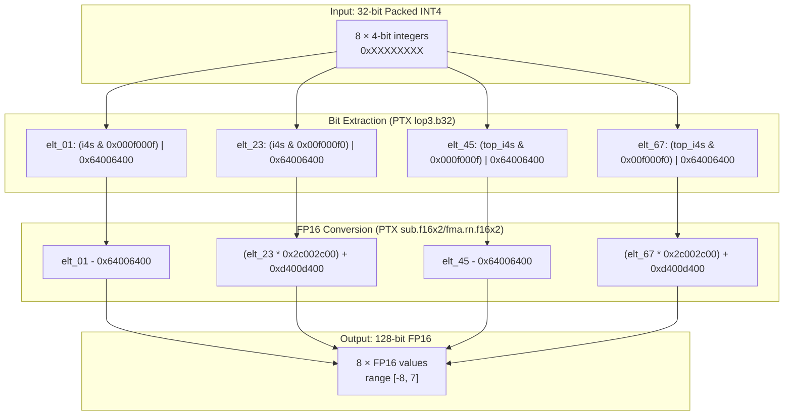
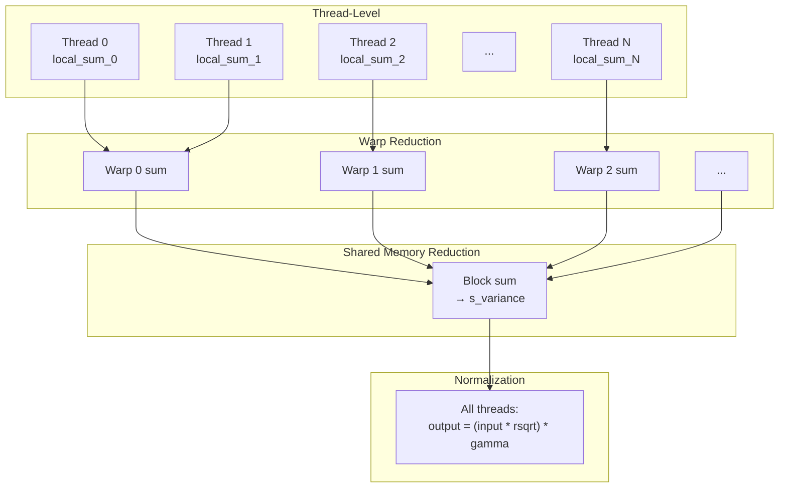

<!-- source: DeepWiki mcp.deepwiki.com · repo mit-han-lab/llm-awq · page 2.4 CUDA Kernels & Low-Level Optimization · fetched 2026-10-30 -->

# CUDA Kernels & Low-Level Optimization

<details>
<summary>Relevant source files</summary>

The following files were used as context for generating this wiki page:

- [awq/kernels/csrc/layernorm/layernorm.cu](awq/kernels/csrc/layernorm/layernorm.cu)
- [awq/kernels/csrc/quantization_new/dequantize.cuh](awq/kernels/csrc/quantization_new/dequantize.cuh)
- [awq/kernels/csrc/quantization_new/dispatch_utils.cuh](awq/kernels/csrc/quantization_new/dispatch_utils.cuh)
- [awq/kernels/csrc/quantization_new/gemm/gemm_cuda.cu](awq/kernels/csrc/quantization_new/gemm/gemm_cuda.cu)
- [awq/kernels/csrc/quantization_new/gemv/gemv_cuda.cu](awq/kernels/csrc/quantization_new/gemv/gemv_cuda.cu)

</details>


## Purpose and Scope

This page provides a deep technical analysis of the custom CUDA kernels that power AWQ's efficient W4A16 (4-bit weights, 16-bit activations) inference. These kernels are the foundation of the performance optimizations in TinyChat and directly implement quantized matrix operations, dequantization, and layer normalization.

For information about how these kernels are integrated into higher-level model modules, see [2.2 Quantization Implementation](#2.2). For details on the quantization algorithm that determines the scale and zero-point parameters used by these kernels, see [2.1 Quantization Algorithm](#2.1).

**Key Components Covered:**
- GEMV (General Matrix-Vector multiplication) kernels for decoding
- GEMM (General Matrix-Matrix multiplication) kernels for prefill with split-K parallelism
- INT4 dequantization using PTX assembly
- RMS layer normalization
- Memory hierarchy optimization techniques
- FP16/BF16 type dispatch system

---

## System Architecture

The CUDA kernel system is organized in five layers, from high-level PyTorch interfaces down to hardware-specific optimizations.



**Sources:** [awq/kernels/csrc/quantization_new/gemv/gemv_cuda.cu:1-340](), [awq/kernels/csrc/quantization_new/gemm/gemm_cuda.cu:1-752](), [awq/kernels/csrc/layernorm/layernorm.cu:1-132]()

---

## Type Dispatch System

All kernels support both FP16 (`half`) and BF16 (`nv_bfloat16`) activations through a compile-time dispatch macro.

### DISPATCH_PYTORCH_DTYPE_TO_CTYPE_FP16

This macro routes PyTorch tensor types to corresponding CUDA C types:

```cpp
#define DISPATCH_PYTORCH_DTYPE_TO_CTYPE_FP16(pytorch_dtype, c_type, ...)
  if (pytorch_dtype == at::ScalarType::Half) {
    using c_type = half;
    __VA_ARGS__
  } else if (pytorch_dtype == at::ScalarType::BFloat16) {
    using c_type = nv_bfloat16;
    __VA_ARGS__
  }
```

This pattern is used consistently across all kernel entry points to ensure type safety and enable template instantiation for both precision modes.

**Sources:** [awq/kernels/csrc/quantization_new/dispatch_utils.cuh:7-18](), [awq/kernels/csrc/layernorm/layernorm.cu:15-26]()

---

## GEMV Kernels: Vector-Matrix Multiplication

The GEMV kernel (`gemv_kernel`) is optimized for the **decoding phase** where batch size is small (1-7 tokens). It performs `Y = W * X` where `W` is a quantized weight matrix (INT4) and `X` is an activation vector (FP16/BF16).

### Kernel Signature and Configuration

```
gemv_kernel<NPerBlock, Batch, BlockSize, GroupSize, T>
```

| Template Parameter | Description | Typical Value |
|-------------------|-------------|---------------|
| `NPerBlock` | Output channels per block | 2 |
| `Batch` | Batch size (1-7) | 1-7 |
| `BlockSize` | Threads per block | 256 |
| `GroupSize` | Quantization group size | 128 |
| `T` | Data type (half/nv_bfloat16) | half |

**Sources:** [awq/kernels/csrc/quantization_new/gemv/gemv_cuda.cu:74-229]()

### Memory Access Pattern



**Sources:** [awq/kernels/csrc/quantization_new/gemv/gemv_cuda.cu:98-229]()

### Key Optimization: Interleaved Memory Layout

Weights are stored in an **interleaved format** with `kInterleave = 4`. This means output channels are grouped in sets of 4 to improve memory coalescing. Thread blocks process 2 output channels × 4 interleave = 8 output channels simultaneously.

**Sources:** [awq/kernels/csrc/quantization_new/gemv/gemv_cuda.cu:113-122]()

### Warp-Level Reduction

The `warp_reduce` function performs tree reduction within a warp using shuffle instructions:

```
1. Each thread holds partial sums for Num outputs
2. __shfl_xor_sync reduces across lanes: stride 16, 8, 1
3. Selected lanes (0, 2, 4, 6) write to shared memory
4. Final reduction across warps in shared memory
```

This avoids expensive atomic operations and maximizes warp-level parallelism.

**Sources:** [awq/kernels/csrc/quantization_new/gemv/gemv_cuda.cu:37-68]()

---

## GEMM Kernels: Matrix-Matrix Multiplication

The GEMM kernels (`gemm_w4a16_T1` and `gemm_w4a16_T2`) are optimized for the **prefill phase** where batch size is large. They compute `C = A * B` where `B` is quantized (INT4) and `A` is in FP16/BF16.

### Two Kernel Variants

| Kernel | Description | Use Case |
|--------|-------------|----------|
| `gemm_w4a16_T1` | Multi-stage pipeline with split-K | Large M, N, K |
| `gemm_w4a16_T2` | Simplified version without split-K | Smaller problems |

**Sources:** [awq/kernels/csrc/quantization_new/gemm/gemm_cuda.cu:312-752](), [awq/kernels/csrc/quantization_new/gemm/gemm_cuda.cu:922-1153]()

### CTA (Cooperative Thread Array) Tile Configuration

```
Template Parameters:
- CTA_M, CTA_N, CTA_K: Block-level tile sizes (e.g., 128×128×64)
- WARP_M, WARP_N, WARP_K: Warp-level tile sizes (e.g., 64×64×64)
- STAGES: Number of pipeline stages (1 or 2+)
- G: Quantization group size (128)
- SPLITK: K-dimension split factor for parallelism
```

**Sources:** [awq/kernels/csrc/quantization_new/gemm/gemm_cuda.cu:312-313]()

### Multi-Stage Software Pipelining



This overlaps global memory loads (stage k+2) with computation (stage k), hiding memory latency.

**Sources:** [awq/kernels/csrc/quantization_new/gemm/gemm_cuda.cu:372-494]()

### Split-K Parallelism

Split-K divides the K dimension across multiple thread blocks to increase parallelism:



Blocks wait on semaphores to accumulate partial results in order, avoiding race conditions.

**Sources:** [awq/kernels/csrc/quantization_new/gemm/gemm_cuda.cu:548-619](), [awq/kernels/csrc/quantization_new/gemm/gemm_cuda.cu:26-44]()

### Tensor Core MMA Operations

The kernels use native Tensor Core instructions for matrix multiplication:

```cpp
// FP16 accumulation
mma.sync.aligned.m16n8k16.row.col.f16.f16.f16.f16

// BF16 input, FP32 accumulation
mma.sync.aligned.m16n8k16.row.col.f32.bf16.bf16.f32
```

These operate on 16×8 tiles, processing 16 FP16/BF16 MACs per clock per thread.

**Sources:** [awq/kernels/csrc/quantization_new/gemm/gemm_cuda.cu:124-141]()

---

## Dequantization: INT4 to FP16/BF16 Conversion

The `dequantize_s4_to_fp16x2` function is the performance-critical operation that unpacks INT4 weights to FP16/BF16 format using PTX inline assembly.

### INT4 Unpacking Algorithm



**Key Constants:**
- `0x64006400`: Magic number that encodes 1024 in FP16 format (for subtraction)
- `0x2c002c00`: 1/16 in FP16 format (for scaling)
- `0xd400d400`: -64 in FP16 format (for bias)

The algorithm uses a clever trick: it constructs intermediate FP16 values with a bias, then subtracts/scales to get the final range of [-8, 7].

**Sources:** [awq/kernels/csrc/quantization_new/dequantize.cuh:15-80]()

### BF16 Variant

The BF16 version uses a simpler algorithm since BF16 has more exponent bits:

```
1. Extract 4 bits at offsets 0, 4, 8, 12
2. OR with magic number 0x43004300 (encodes 128 in BF16)
3. Subtract 128 to get range [-8, 7]
```

**Sources:** [awq/kernels/csrc/quantization_new/dequantize.cuh:82-123]()

---

## Memory Transfer Operations

### Asynchronous Copy

The `cp_async_cg_A` function uses CUDA's asynchronous copy to transfer data from global to shared memory:

```cpp
asm volatile("{"
             "  .reg .pred p;"
             "  setp.ne.b32 p, %0, 0;"
             "  @p cp.async.cg.shared.global.L2::128B [%1], [%2], %3;"
             "}" :: "r"((int)mask), "r"(smem_int_ptr), "l"(src), "n"(cp_size));
```

This overlaps memory transfer with computation and leverages L2 cache hints.

**Sources:** [awq/kernels/csrc/quantization_new/gemm/gemm_cuda.cu:111-122]()

### ldmatrix Instruction

The `ldmatrix_m8n8_x4_b16` function loads shared memory tiles directly into register arrays formatted for Tensor Core operations:

```cpp
asm volatile("ldmatrix.sync.aligned.m8n8.x4.shared.b16 "
             "{%0, %1, %2, %3}, [%4];" ...);
```

This is faster than manual loads and automatically handles the complex layout required by `mma.sync` instructions.

**Sources:** [awq/kernels/csrc/quantization_new/gemm/gemm_cuda.cu:91-109]()

---

## Memory Bank Conflict Avoidance

### XOR-Based Swizzling

To prevent shared memory bank conflicts, the kernels apply XOR-based column swizzling:

```cpp
int ld_col_swizzled = (ld_col ^ (ld_row) & 7) * PACK_SIZE;
```

This transforms the memory address to distribute accesses across 32 banks, ensuring conflict-free access patterns when threads in a warp access consecutive elements.

**Pattern:**
```
Row 0: col XOR 0 → col
Row 1: col XOR 1 → col XOR 1
Row 2: col XOR 2 → col XOR 2
...
Row 8: col XOR 0 → col (pattern repeats)
```

**Sources:** [awq/kernels/csrc/quantization_new/gemv/gemv_cuda.cu:161](), [awq/kernels/csrc/quantization_new/gemm/gemm_cuda.cu:255]()

---

## Layer Normalization

The `generalT5LayerNorm` kernel implements RMS (Root Mean Square) normalization without mean subtraction, as used in T5-style models.

### Algorithm

```
1. Each thread computes local variance: Σ(x²)
2. Block-level reduction using blockReduceSum
3. Compute rsqrt(variance/n + eps)
4. Normalize and scale: output = (input * rsqrt_var) * gamma
```

### Block Reduction Pattern



**Sources:** [awq/kernels/csrc/layernorm/layernorm.cu:38-64]()

### Block Reduction Implementation

The `blockReduceSum` function (from `reduction.cuh`) performs a hierarchical reduction:

1. **Warp-level:** Use `__shfl_down_sync` to reduce within each warp
2. **Block-level:** Use shared memory to accumulate warp results
3. **Final:** Thread 0 broadcasts result back to shared memory

**Sources:** [awq/kernels/csrc/layernorm/layernorm.cu:10]()

---

## PyTorch Integration

### Entry Points

Each kernel has a corresponding PyTorch entry point that handles tensor validation and device management:

| Function | Kernel Called | Purpose |
|----------|--------------|---------|
| `gemv_forward_cuda_new` | `gemv_kernel` | Small batch decode |
| `gemm_forward_cuda` (T1) | `gemm_w4a16_T1` | Large batch prefill with split-K |
| `gemm_forward_cuda` (T2) | `gemm_w4a16_T2` | Medium batch prefill |
| `layernorm_forward_cuda` | `generalT5LayerNorm` | RMS normalization |

**Sources:** [awq/kernels/csrc/quantization_new/gemv/gemv_cuda.cu:245-338](), [awq/kernels/csrc/layernorm/layernorm.cu:111-131]()

### Tensor Shape Conventions

```
GEMV:
  Input: [B, IC]  (B = batch size, IC = input channels)
  Weight: [OC, IC/8]  (packed INT4)
  Scales: [OC, IC/G]  (G = group size)
  Zeros: [OC, IC/G]
  Output: [B, OC]

GEMM:
  A: [M, K]  (activations)
  B: [K/4, N]  (packed INT4 weights)
  Scales: [K/G, N]
  Zeros: [K/G, N]
  C: [M, N]  (output)
```

**Sources:** [awq/kernels/csrc/quantization_new/gemv/gemv_cuda.cu:232-243](), [awq/kernels/csrc/quantization_new/gemm/gemm_cuda.cu:26-44]()

---

## Performance Optimization Summary

| Technique | Implementation | Benefit |
|-----------|---------------|---------|
| **Interleaved Layout** | 4-way interleaving of output channels | Improved memory coalescing |
| **Warp Shuffle** | `__shfl_xor_sync` in reduction | Avoids shared memory traffic |
| **Software Pipelining** | Multi-stage with `__pipeline_*` | Overlaps compute/memory |
| **Split-K** | K-dimension parallelization | Increases GPU utilization |
| **Semaphore Sync** | Ordered accumulation | Safe split-K reduction |
| **XOR Swizzling** | `col ^ row` address transform | Eliminates bank conflicts |
| **Async Copy** | `cp.async.cg` with L2 hints | Faster global→shared transfer |
| **ldmatrix** | Direct shared→register load | Optimized for Tensor Cores |
| **PTX Dequant** | Inline assembly bit manipulation | Minimal unpacking overhead |
| **Tensor Cores** | `mma.sync` instructions | 16×8 MAC per clock |

**Sources:** All kernel implementation files

---

