<!-- source: DeepWiki mcp.deepwiki.com · repo mit-han-lab/llm-awq · page 3 TinyChat Inference System · fetched 2026-10-30 -->

# TinyChat Inference System

<details>
<summary>Relevant source files</summary>

The following files were used as context for generating this wiki page:

- [README.md](README.md)
- [scripts/qwen_example.sh](scripts/qwen_example.sh)
- [tinychat/README.md](tinychat/README.md)
- [tinychat/demo.py](tinychat/demo.py)
- [tinychat/utils/constants.py](tinychat/utils/constants.py)

</details>


## Purpose and Scope

TinyChat is the efficient inference engine that executes AWQ-quantized models on GPU platforms, from cloud data centers to edge devices. This document provides an architectural overview of the TinyChat system, explaining how it loads quantized models, generates text through streaming, and achieves state-of-the-art performance through specialized optimizations.

For details on how models are loaded and configured, see [Model Loading & Configuration](#3.1). For the text generation and streaming mechanisms, see [Text Generation & Streaming](#3.2). For optimization techniques including Flash Attention and chunk prefilling, see [Performance Optimizations](#3.3). For information on how models are quantized before inference, see [AWQ Quantization System](#2).

**Sources:** [README.md:1-27](), [tinychat/README.md:1-57]()

---

## System Overview

TinyChat provides a complete inference pipeline for AWQ-quantized models with three primary interfaces: command-line demos, web servers, and benchmarking tools. The system is designed to maximize GPU utilization through custom CUDA kernels, fused operations, and memory-efficient KV cache management.

### Key Capabilities

| Capability | Description |
|------------|-------------|
| **Model Support** | LLaMA, Qwen, Falcon, MPT, VILA, LLaVA, NVILA (both language-only and vision-language models) |
| **Precision Modes** | W4A16 (4-bit weights, 16-bit activations), W16A16 (FP16/BF16) |
| **Hardware Targets** | Cloud GPUs (A100, RTX 4090), Edge devices (Jetson Orin) |
| **Quantization** | INT4 weight-only quantization via AWQ, W8A8 for vision towers (NVILA) |
| **Performance Features** | Flash Attention, chunk prefilling, fused MHA/GQA/MQA kernels, custom GEMV/GEMM |
| **Speedup** | 2.7x on RTX 4090, 2.9x on Jetson Orin compared to FP16 (LLaMA-3-8B) |

**Sources:** [tinychat/README.md:5-24](), [tinychat/README.md:68-93]()

---

## System Architecture

```mermaid
graph TB
    subgraph "Entry Points"
        CLI["demo.py<br/>Command-Line Interface"]
        VLMDemo["vila15_demo.py<br/>nvila_demo.py<br/>Multimodal Demos"]
        Bench["benchmark.py<br/>Performance Testing"]
        WebUI["serve/gradio_web_server.py<br/>Web Interface"]
    end
    
    subgraph "Model Loading Layer"
        LoadAWQ["load_awq_model()<br/>load_awq_llama_fast()<br/>tinychat/utils/load_quant.py"]
        MemEff["mem_efficient_load<br/>Layer-wise Loading"]
        Config["gen_params<br/>AttributeDict"]
    end
    
    subgraph "Model Initialization"
        ModelClass["LlamaForCausalLM<br/>Qwen2ForCausalLM<br/>FalconForCausalLM<br/>MPTForCausalLM"]
        MakeQuant["make_quant_attn()<br/>make_quant_norm()<br/>tinychat/modules"]
        Warmup["device_warmup()<br/>tune_all_wqlinears()"]
    end
    
    subgraph "Generation Core"
        StreamGen["StreamGenerator<br/>tinychat/stream_generators.py"]
        Prompter["get_prompter()<br/>BasePrompter<br/>Model-specific templates"]
        StopTokens["get_stop_token_ids()"]
    end
    
    subgraph "Inference Execution"
        Forward["model.forward()<br/>Token-by-token generation"]
        KVCache["Pre-allocated KV Cache<br/>max_seq_len x max_batch_size"]
        ChunkPrefill["Chunk Prefilling<br/>KV Cache Reuse"]
    end
    
    subgraph "Low-Level Optimization"
        WQLinear["WQLinear<br/>Quantized Linear Layers"]
        FlashAttn["Flash Attention<br/>Efficient Attention"]
        Kernels["CUDA Kernels<br/>GEMV/GEMM W4A16"]
        FusedOps["Fused MHA/GQA/MQA<br/>Fused LayerNorm"]
    end
    
    CLI --> LoadAWQ
    VLMDemo --> LoadAWQ
    Bench --> LoadAWQ
    WebUI --> LoadAWQ
    
    LoadAWQ --> MemEff
    LoadAWQ --> ModelClass
    Config --> StreamGen
    
    ModelClass --> MakeQuant
    MakeQuant --> Warmup
    
    Warmup --> Prompter
    Prompter --> StreamGen
    StopTokens --> StreamGen
    
    StreamGen --> Forward
    Forward --> KVCache
    Forward --> ChunkPrefill
    
    Forward --> WQLinear
    Forward --> FlashAttn
    WQLinear --> Kernels
    FlashAttn --> FusedOps
    
    style "Entry Points" fill:#f9f9f9
    style "Model Loading Layer" fill:#f9f9f9
    style "Generation Core" fill:#f9f9f9
    style "Low-Level Optimization" fill:#f9f9f9
```

**Architecture Diagram: TinyChat Inference Pipeline**

The TinyChat architecture consists of five layers:

1. **Entry Points**: User-facing interfaces (CLI demos, web server, benchmarks)
2. **Model Loading Layer**: Loads AWQ-quantized checkpoints from disk with optional memory-efficient mode
3. **Model Initialization**: Replaces standard modules with quantized equivalents, performs warmup
4. **Generation Core**: Manages prompt formatting, token generation loop, and streaming output
5. **Low-Level Optimization**: Custom CUDA kernels and fused operations for maximum performance

**Sources:** [tinychat/demo.py:1-284](), [tinychat/README.md:377-431]()

---

## Inference Pipeline Flow

The following diagram illustrates how a single inference request flows through TinyChat from user input to generated output:

```mermaid
graph LR
    subgraph "Input Processing"
        UserPrompt["User Input:<br/>Text or Text+Images"]
        Prompter["get_prompter()<br/>Format with template"]
        Tokenize["tokenizer.encode()"]
    end
    
    subgraph "Context Stage"
        CheckCache["Check if chunk_prefilling<br/>and start_pos > 0"]
        Prefill["Prefill KV Cache<br/>Process all input tokens"]
        ReuseCache["Reuse existing KV Cache<br/>Only process new tokens"]
    end
    
    subgraph "Generation Loop"
        GenToken["model.forward(token, pos)<br/>Generate next token"]
        Sample["Sampling:<br/>top_k, top_p, temperature"]
        CheckStop["Check stop_token_ids"]
        UpdateKV["Update KV Cache<br/>cache[:, pos] = new_kv"]
    end
    
    subgraph "Output Processing"
        Decode["tokenizer.decode(token)"]
        Stream["Yield token to stream"]
        Display["Display to user"]
    end
    
    UserPrompt --> Prompter
    Prompter --> Tokenize
    Tokenize --> CheckCache
    
    CheckCache -->|start_pos == 0| Prefill
    CheckCache -->|start_pos > 0| ReuseCache
    
    Prefill --> GenToken
    ReuseCache --> GenToken
    
    GenToken --> Sample
    Sample --> CheckStop
    CheckStop -->|not stop| UpdateKV
    UpdateKV --> Decode
    Decode --> Stream
    Stream --> Display
    Display --> GenToken
    
    CheckStop -->|is stop| End["End Generation"]
```



**Inference Request Flow Diagram**

This flow shows the key decision points and operations:

1. **Input Processing**: User prompt is formatted with model-specific template and tokenized
2. **Context Stage**: If chunk prefilling is enabled and this is not the first turn, the system reuses existing KV cache entries rather than recomputing
3. **Generation Loop**: Iteratively generates tokens until stop condition is met, with streaming output to user
4. **Output Processing**: Tokens are decoded and streamed back in real-time

**Sources:** [tinychat/demo.py:256-283](), [tinychat/stream_generators.py]()

---

## Core Components

### Model Loading System

TinyChat provides two loading functions for quantized models:

| Function | Location | Use Case |
|----------|----------|----------|
| `load_awq_model()` | [tinychat/utils/load_quant.py]() | General models (Falcon, MPT) |
| `load_awq_llama_fast()` | [tinychat/utils/load_quant.py]() | Optimized for LLaMA/Qwen architectures |

Both functions load pre-quantized INT4 weights from checkpoint files created by the AWQ quantization system. When `mem_efficient_load=True` is enabled in [tinychat/utils/constants.py:9](), the system loads model layers sequentially rather than all at once, reducing peak memory usage for edge devices.

**Sources:** [tinychat/demo.py:193-208](), [tinychat/utils/constants.py:9]()

### Generation Parameters

The `gen_params` object ([tinychat/demo.py:19-47]()) controls the generation behavior:

| Parameter | Default | Purpose |
|-----------|---------|---------|
| `n_predict` | 512 | Maximum new tokens to generate |
| `n_ctx` | 512 | Context window size |
| `temp` | 0.70 | Temperature for sampling randomness |
| `top_k` | 40 | Top-K sampling parameter |
| `top_p` | 0.95 | Nucleus sampling threshold |
| `repeat_penalty` | 1.10 | Penalty for token repetition |

These parameters are passed to `StreamGenerator` to control the decoding strategy during inference.

**Sources:** [tinychat/demo.py:19-47]()

### Model Classes

TinyChat defines custom model classes that replace standard transformers:

```
tinychat/models/
├── llama.py          # LlamaForCausalLM
├── qwen2.py          # Qwen2ForCausalLM  
├── falcon.py         # FalconForCausalLM
└── mpt.py            # MPTForCausalLM
```

These classes inherit from the base architecture but integrate:
- Pre-allocated KV cache ([tinychat/utils/constants.py:6-7]())
- Support for quantized `WQLinear` layers
- Optimized attention mechanisms (standard or Flash Attention)
- Position tracking for chunk prefilling

**Sources:** [tinychat/demo.py:157-162](), [tinychat/demo.py:186-221]()

### Prompt Template System

The `get_prompter()` function ([tinychat/utils/prompt_templates.py]()) returns a `BasePrompter` instance that formats user inputs according to model-specific chat templates:

- **LLaMA-2**: `[INST] <<SYS>>\n{system}\n<</SYS>>\n\n{prompt} [/INST]`
- **Vicuna**: `A chat between a curious user and an assistant. USER: {prompt} ASSISTANT:`
- **Qwen**: `<|im_start|>user\n{prompt}<|im_end|>\n<|im_start|>assistant\n`

The prompter also manages conversation history when `single_round=False`, enabling multi-turn dialogues with proper context.

**Sources:** [tinychat/demo.py:251](), [tinychat/utils/prompt_templates.py]()

---

## Optimization Stack

TinyChat achieves high performance through a layered optimization approach:

### Layer 1: Module Replacement

The `make_quant_attn()` and `make_quant_norm()` functions ([tinychat/modules]()) replace standard PyTorch modules:

| Original Module | Replacement | Optimization |
|-----------------|-------------|--------------|
| `nn.Linear` | `WQLinear` | INT4 weights with custom GEMV/GEMM kernels |
| `LlamaAttention` | `QuantLlamaAttention` | Flash Attention, pre-allocated KV cache |
| `LlamaRMSNorm` | `QuantLlamaRMSNorm` | Fused CUDA kernel for RMS normalization |
| `LlamaMLP` | Fused MLP | Single kernel for gate_proj, up_proj, down_proj |

**Sources:** [tinychat/demo.py:235-241]()

### Layer 2: Attention Optimization

When `--flash_attn` is enabled, TinyChat uses Flash Attention (Dao et al.) for the prefill stage, reducing memory bandwidth requirements from O(N²) to O(N) for sequence length N. This is especially beneficial for long context lengths.

**Sources:** [tinychat/demo.py:237-240]()

### Layer 3: KV Cache Management

- **Pre-allocation**: KV cache is allocated once at initialization based on `max_seq_len` and `max_batch_size` ([tinychat/utils/constants.py:6-7]())
- **Chunk Prefilling**: When `--chunk_prefilling` is enabled ([tinychat/demo.py:130-133]()), the system reuses cached key-value pairs from previous turns, avoiding redundant computation
- This reduces TTFT (Time To First Token) by up to 11.45x on RTX 4090 for multi-turn conversations

**Sources:** [tinychat/README.md:217-248](), [tinychat/demo.py:275-278]()

### Layer 4: CUDA Kernels

Custom CUDA implementations for quantized operations:

- **GEMV**: Vector-matrix multiplication for decoding stage
- **GEMM**: Matrix-matrix multiplication with split-K parallelism for prefill stage
- **Dequantization**: On-the-fly INT4 → FP16/BF16 conversion using PTX assembly
- **Fused Kernels**: Combined operations (MHA, layernorm) to reduce memory traffic

For detailed kernel implementation, see [CUDA Kernels & Low-Level Optimization](#2.4).

**Sources:** [tinychat/README.md:68-93]()

---

## Supported Configurations

### Precision Modes

| Mode | Weight Precision | Activation Precision | Use Case |
|------|------------------|---------------------|----------|
| **W4A16** | INT4 | FP16/BF16 | Default for most models, best speedup |
| **W16A16** | FP16/BF16 | FP16/BF16 | Baseline for comparison |

The precision mode is specified via `--precision` argument ([tinychat/demo.py:96]()).

**Sources:** [tinychat/demo.py:96](), [tinychat/demo.py:142]()

### Model Types

TinyChat supports the following model architectures via the `--model_type` argument:

```python
# From tinychat/demo.py:186-191
model_type_dict = {
    "llama": LlamaForCausalLM,
    "falcon": FalconForCausalLM,
    "mpt": MPTForCausalLM,
    "qwen": Qwen2ForCausalLM,
}
```

Vision-language models (VILA, LLaVA, NVILA) use separate demo scripts:
- `vila15_demo.py` for VILA-1.5
- `vila10_demo.py` for VILA-1.0 and LLaVA
- `nvila_demo.py` for NVILA (video understanding)

**Sources:** [tinychat/demo.py:136-141](), [tinychat/demo.py:186-191](), [tinychat/README.md:433-509]()

### Quantization Group Size

The `--q_group_size` parameter ([tinychat/demo.py:99]()) specifies the granularity of quantization:

- **128** (default): Standard for most models
- **64**: Required for Falcon-7B-instruct

This must match the group size used during AWQ quantization.

**Sources:** [tinychat/demo.py:99](), [tinychat/README.md:356]()

---

## Performance Characteristics

### Decoding Speed (Token Generation)

Representative speedups on different hardware platforms (LLaMA-3-8B, W4A16 vs FP16):

| Platform | FP16 (ms/token) | INT4 (ms/token) | Speedup |
|----------|-----------------|-----------------|---------|
| RTX 4090 | 17.07 | 6.39 | **2.69x** |
| Jetson Orin | 96.00 | 32.53 | **2.95x** |
| A100 | 12.37 | 6.29 | **1.96x** |

The speedup comes primarily from reduced memory bandwidth (INT4 weights are 4x smaller) and custom GEMV kernels optimized for quantized operations.

**Sources:** [tinychat/README.md:82-92](), [tinychat/README.md:127-137](), [tinychat/README.md:154-164]()

### Prefill Speed (Time To First Token)

With Flash Attention enabled, TinyChat achieves significant TTFT improvements:

| Sequence Length | FP16 (s) | TinyChat (s) | Speedup |
|-----------------|----------|--------------|---------|
| 256 | 0.031 | 0.021 | 1.52x |
| 1024 | 0.109 | 0.064 | 1.69x |
| 4096 | 0.446 | 0.275 | 1.62x |

*RTX 4090, LLaMA-3-8B*

**Sources:** [tinychat/README.md:172-179]()

### Chunk Prefilling Speedup (Multi-turn Conversations)

When reusing KV cache from previous turns:

| History Tokens | FP16 TTFT (ms) | TinyChat TTFT (ms) | Speedup |
|----------------|----------------|---------------------|---------|
| 16 | 21.49 | 14.30 | 1.54x |
| 256 | 47.15 | 14.38 | 3.33x |
| 1024 | 162.27 | 14.49 | **11.45x** |

*RTX 4090, LLaMA-3-8B, 32-token question length*

The speedup increases dramatically with history length because baseline systems recompute all history tokens while TinyChat reuses cached results.

**Sources:** [tinychat/README.md:227-235]()

---

## Usage Modes

### Command-Line Interface

The primary entry point is `demo.py`:

```bash
cd tinychat
python demo.py --model_type llama \
    --model_path /PATH/TO/LLAMA3/llama3-8b \
    --q_group_size 128 \
    --load_quant quant_cache/llama3-8b-w4-g128-awq.pt \
    --precision W4A16 \
    --flash_attn \
    --chunk_prefilling
```

Key arguments:
- `--model_type`: Architecture (llama, falcon, mpt, qwen)
- `--load_quant`: Path to quantized checkpoint from AWQ
- `--precision`: W4A16 (quantized) or W16A16 (baseline)
- `--flash_attn`: Enable Flash Attention for prefill
- `--chunk_prefilling`: Enable KV cache reuse for multi-turn
- `--mem_efficient_load`: Layer-wise loading for edge devices

For detailed usage instructions and examples, see [Command-Line Demos](#5.1).

**Sources:** [tinychat/demo.py:82-135](), [tinychat/README.md:377-416]()

### Benchmarking

The `benchmark.py` script measures TTFT and decoding throughput:

```bash
python benchmark.py --flash \
    --context_length 16 32 64 128 256 512 1024 2048 \
    --model_path /PATH/TO/MODEL \
    --precision W4A16
```

For chunk prefilling benchmarks:

```bash
python benchmark.py --chunk_prefilling \
    --question_length 32 \
    --context_length 16 32 64 128 256 512 1024 \
    --precision W4A16
```

**Sources:** [tinychat/README.md:418-431]()

### Web Interface

TinyChat includes a Gradio-based web server for multi-user, multi-modal interactions. See [Gradio Web Interface](#5.2) for deployment instructions.

**Sources:** [tinychat/README.md:96](), [README.md:96]()

---

## Memory Management

### KV Cache Pre-allocation

TinyChat pre-allocates key-value caches at model initialization to avoid dynamic memory allocation during inference. The cache size is controlled by global constants:

```python
# From tinychat/utils/constants.py
max_seq_len = 8192      # Maximum sequence length
max_batch_size = 1      # Maximum batch size
```

The actual memory footprint is:
```
KV_cache_size = 2 * num_layers * max_batch_size * max_seq_len * hidden_size * sizeof(dtype)
```

For LLaMA-3-8B with `max_seq_len=2048`:
- 32 layers, 4096 hidden size, FP16 → ~2GB for KV cache

**Sources:** [tinychat/utils/constants.py:6-7](), [tinychat/README.md:432]()

### Memory-Efficient Loading

When `--mem_efficient_load` is enabled ([tinychat/demo.py:115-118]()), the system loads model weights layer-by-layer instead of loading the entire checkpoint at once. This is critical for running large models (e.g., LLaMA-2-70B) on edge devices with limited memory:

1. Load checkpoint into CPU memory as memory-mapped file
2. Transfer one layer to GPU
3. Initialize layer
4. Repeat for next layer

The `split_ckpt.py` utility can split large checkpoint files into smaller pieces to facilitate this loading mode.

**Sources:** [tinychat/demo.py:115-118](), [tinychat/demo.py:148-154](), [tinychat/README.md:397-416]()

---

## Integration with AWQ Quantization

TinyChat consumes quantized checkpoints produced by the AWQ quantization system. The typical workflow is:

1. **AWQ Search**: Run `awq.entry` with `--run_awq` to find optimal scale/clip parameters → `awq_cache/`
2. **Generate Quantized Weights**: Run `awq.entry` with `--q_backend real` to create INT4 weights → `quant_cache/`
3. **TinyChat Inference**: Load checkpoint with `--load_quant` and run inference

Example:
```bash
# Step 1 & 2: Quantization (see AWQ Quantization System)
python -m awq.entry --model_path /PATH/TO/MODEL \
    --w_bit 4 --q_group_size 128 \
    --load_awq awq_cache/model-w4-g128.pt \
    --q_backend real --dump_quant quant_cache/model-w4-g128-awq.pt

# Step 3: Inference with TinyChat
cd tinychat
python demo.py --model_path /PATH/TO/MODEL \
    --load_quant quant_cache/model-w4-g128-awq.pt \
    --precision W4A16
```

Alternatively, pre-quantized models can be downloaded directly from the [AWQ Model Zoo](#6.2) on Hugging Face.

**Sources:** [README.md:186-221](), [scripts/qwen_example.sh:1-26](), [tinychat/README.md:343-375]()

---

## System Constants and Configuration

Global configuration is managed through [tinychat/utils/constants.py]():

| Constant | Default | Purpose |
|----------|---------|---------|
| `max_seq_len` | 8192 | Maximum sequence length for KV cache allocation |
| `max_batch_size` | 1 | Maximum batch size (currently only single-batch supported) |
| `llama_multiple_of` | 256 | Weight matrix dimension alignment for LLaMA |
| `mem_efficient_load` | False | Enable layer-wise loading for edge devices |

These constants are initialized before model loading and affect memory allocation and optimization strategies throughout the system.

**Sources:** [tinychat/utils/constants.py:4-9]()

---

## Summary

TinyChat is a high-performance inference engine optimized for AWQ-quantized models. It achieves 2-3x speedup over FP16 baselines through:

1. **Custom CUDA kernels** for INT4 weight operations
2. **Flash Attention** for efficient context processing
3. **Chunk prefilling** for fast multi-turn conversations (up to 11x TTFT reduction)
4. **Fused operations** to reduce memory bandwidth
5. **Pre-allocated KV cache** to eliminate dynamic allocation overhead

The system supports both cloud and edge deployment, with special optimizations for memory-constrained devices. It provides simple CLI interfaces, web serving capabilities, and comprehensive benchmarking tools for production deployment.

For specific implementation details:
- Model loading: see [Model Loading & Configuration](#3.1)
- Generation pipeline: see [Text Generation & Streaming](#3.2)
- Optimization techniques: see [Performance Optimizations](#3.3)
- CUDA kernels: see [CUDA Kernels & Low-Level Optimization](#2.4)

**Sources:** [tinychat/README.md:1-527](), [README.md:1-292]()

---

