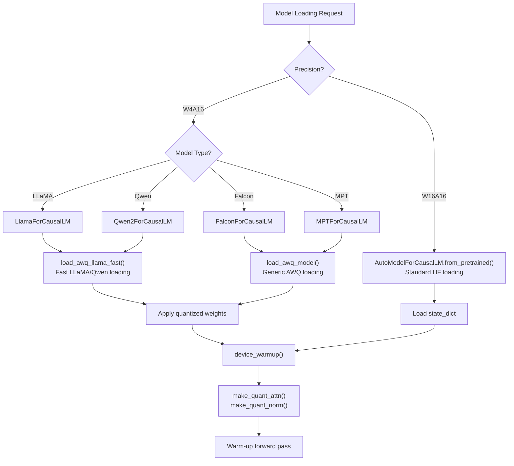
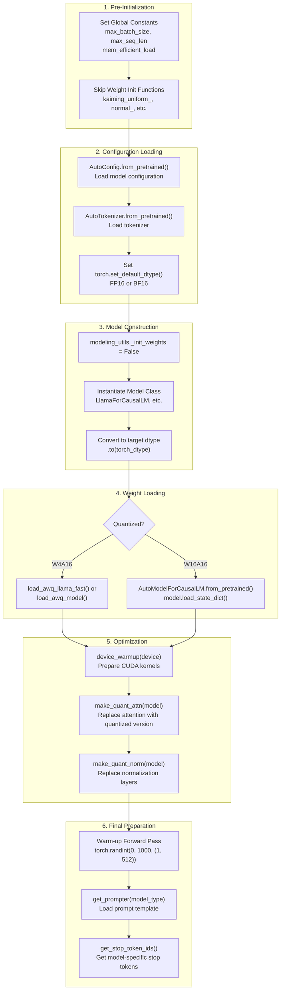
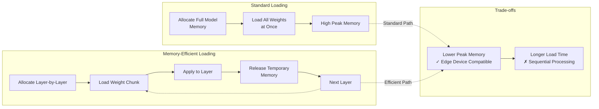

<!-- source: DeepWiki mcp.deepwiki.com · repo mit-han-lab/llm-awq · page 3.1 Model Loading & Configuration · fetched 2026-10-30 -->

# Model Loading & Configuration

<details>
<summary>Relevant source files</summary>

The following files were used as context for generating this wiki page:

- [pyproject.toml](pyproject.toml)
- [tinychat/demo.py](tinychat/demo.py)
- [tinychat/stream_generators/llava_stream_gen.py](tinychat/stream_generators/llava_stream_gen.py)
- [tinychat/utils/conversation_utils.py](tinychat/utils/conversation_utils.py)

</details>


## Purpose and Scope

This page explains how TinyChat loads and initializes models for inference, covering both quantized (AWQ) and standard checkpoints. It describes the `gen_params` configuration system, model loading workflows, memory-efficient loading for edge devices, and the complete initialization pipeline that prepares models for generation.

For information about how quantized weights are created during the AWQ quantization process, see [Quantization Implementation](#2.2). For details on the actual text generation process, see [Text Generation & Streaming](#3.2). For deployment-specific configurations, see [Deployment & Practical Usage](#6).

---

## Generation Parameters

### gen_params Structure

TinyChat uses an `AttributeDict` structure called `gen_params` to configure all aspects of text generation. This configuration is defined consistently across the codebase and controls sampling, context management, and token penalties.

**gen_params Categories:**

| Category | Parameters | Purpose |
|----------|-----------|---------|
| **Context Management** | `n_ctx`, `n_batch`, `n_keep`, `n_predict` | Control context size, batch processing, and generation length |
| **Sampling** | `top_k`, `top_p`, `temp`, `tfs_z`, `typical_p` | Control randomness and diversity of generation |
| **Penalties** | `repeat_penalty`, `repeat_last_n`, `frequency_penalty`, `presence_penalty` | Discourage repetition and encourage variety |
| **Advanced Sampling** | `mirostat`, `mirostat_tau`, `mirostat_eta` | Enable Mirostat dynamic sampling algorithm |
| **System** | `seed`, `n_threads`, `n_vocab`, `logit_bias` | System-level configuration and vocabulary size |

**Default Configuration:**

```python
gen_params = AttributeDict([
    ("n_predict", 512),      # New tokens to generate
    ("n_ctx", 512),          # Context window size
    ("n_batch", 512),        # Batch size for prompt processing
    ("top_k", 40),           # Top-K sampling
    ("top_p", 0.95),         # Nucleus sampling threshold
    ("temp", 0.70),          # Temperature (0.20 for multimodal)
    ("repeat_penalty", 1.10), # Repetition penalty
    ("repeat_last_n", 64),   # Window for repeat penalty
])
```

The default temperature varies by use case: `0.70` for language-only models [tinychat/demo.py:35]() and `0.20` for multimodal models [tinychat/utils/conversation_utils.py:21]().

Sources: [tinychat/demo.py:19-47](), [tinychat/utils/conversation_utils.py:5-33](), [tinychat/stream_generators/llava_stream_gen.py:26-46]()

---

## Model Loading Workflows

### Loading Decision Flow

TinyChat supports multiple loading paths depending on the model type and precision requirements:



**Loading Functions:**

| Function | Model Types | Description |
|----------|-------------|-------------|
| `load_awq_llama_fast` | LLaMA, Qwen | Optimized loading path for LLaMA-style architectures |
| `load_awq_model` | Falcon, MPT | Generic AWQ loading for other architectures |
| `AutoModelForCausalLM.from_pretrained` | All (W16A16) | Standard Hugging Face loading for non-quantized models |

Sources: [tinychat/demo.py:193-221](), [tinychat/utils/load_quant.py:10]()

---

## Configuration System

### Command-Line Arguments

The main demo script accepts comprehensive configuration through command-line arguments:

**Model Selection:**

```bash
--model_type     # Model architecture: llama, falcon, mpt, qwen
--model_path     # Path to model checkpoint or HF model ID
--dtype          # Computation dtype: float16 or bfloat16
```

**Quantization:**

```bash
--precision      # W4A16 (quantized) or W16A16 (full precision)
--load_quant     # Path to pre-quantized 4-bit weights
--q_group_size   # Quantization group size (default: 128)
```

**Memory & Performance:**

```bash
--max_seq_len         # Maximum sequence length for KV cache (default: 2048)
--max_batch_size      # Maximum batch size for KV cache (default: 1)
--mem_efficient_load  # Enable layer-wise loading for edge devices
--flash_attn          # Enable Flash Attention optimization
--chunk_prefilling    # Enable KV cache reuse for multi-turn conversations
```

**Conversation Mode:**

```bash
--single_round   # Disable conversation history (single Q&A only)
```

Sources: [tinychat/demo.py:83-133]()

### Global Constants

Before model initialization, several global constants are set to configure system-wide behavior:

```python
tinychat.utils.constants.max_batch_size = args.max_batch_size
tinychat.utils.constants.max_seq_len = args.max_seq_len
tinychat.utils.constants.mem_efficient_load = args.mem_efficient_load
```

These constants are accessed throughout the codebase to determine KV cache allocation, memory management strategies, and batch processing limits.

**Memory-Efficient Loading Mode:**

When `mem_efficient_load` is enabled, the system loads model layers sequentially rather than all at once. This reduces peak memory consumption at the cost of longer initialization time, making it suitable for edge devices with limited memory.

```
[Info] You have activated mem_efficient_load mode.
       Less on-chip memory will be consumed when loading the model.
       However, the loading process will take more time.
```

Sources: [tinychat/demo.py:146-154]()

---

## Complete Initialization Pipeline

### Initialization Sequence



### Detailed Steps

**Step 1: Pre-Initialization**

The system first configures global state and disables unnecessary weight initialization to save memory and time:

```python
# Set global constants
tinychat.utils.constants.max_batch_size = args.max_batch_size
tinychat.utils.constants.max_seq_len = args.max_seq_len
tinychat.utils.constants.mem_efficient_load = args.mem_efficient_load

# Skip weight initialization (weights will be loaded from checkpoint)
def skip(*args, **kwargs):
    pass

torch.nn.init.kaiming_uniform_ = skip
torch.nn.init.kaiming_normal_ = skip
torch.nn.init.uniform_ = skip
torch.nn.init.normal_ = skip
```

Sources: [tinychat/demo.py:146-170]()

**Step 2: Configuration and Tokenizer Loading**

Load model configuration and tokenizer from the checkpoint path:

```python
config = AutoConfig.from_pretrained(args.model_path, trust_remote_code=True)

# MPT models use separate tokenizer
if "mpt" in config.__class__.__name__.lower():
    tokenizer = AutoTokenizer.from_pretrained(
        config.tokenizer_name, trust_remote_code=True
    )
else:
    tokenizer = AutoTokenizer.from_pretrained(
        args.model_path, use_fast=False, trust_remote_code=True
    )

torch_dtype = torch.float16 if args.dtype == "float16" else torch.bfloat16
```

Sources: [tinychat/demo.py:172-182]()

**Step 3: Model Instantiation**

Create the model instance with disabled weight initialization:

```python
modeling_utils._init_weights = False
torch.set_default_dtype(torch_dtype)

model_type_dict = {
    "llama": LlamaForCausalLM,
    "falcon": FalconForCausalLM,
    "mpt": MPTForCausalLM,
    "qwen": Qwen2ForCausalLM,
}

model = model_type_dict[args.model_type.lower()](config).to(torch_dtype)
```

Sources: [tinychat/demo.py:183-205]()

**Step 4: Weight Loading**

Load weights using the appropriate method:

**For W4A16 (Quantized):**
```python
if args.model_type.lower() == "llama":
    model = load_awq_llama_fast(
        model, args.load_quant, 4, args.q_group_size, args.device
    )
else:
    model = load_awq_model(
        model, args.load_quant, 4, args.q_group_size, args.device
    )
```

**For W16A16 (Standard):**
```python
loaded_model = AutoModelForCausalLM.from_pretrained(
    args.model_path,
    config=config,
    torch_dtype=torch_dtype,
    trust_remote_code=True,
)
model.load_state_dict(loaded_model.state_dict())
```

Sources: [tinychat/demo.py:193-221]()

**Step 5: Device Warmup and Optimization**

Prepare CUDA kernels and apply optimizations:

```python
# Warm up device and kernels
device_warmup(args.device)

# Optional: Auto-tune split_k_iters for quantized layers
# tune_all_wqlinears(model)

# Replace attention and normalization with optimized versions
if args.precision == "W4A16":
    make_quant_attn(model, args.device, args.flash_attn)
    make_quant_norm(model)
```

Sources: [tinychat/demo.py:223-241]()

**Step 6: Final Warm-up Pass**

Execute a warm-up forward pass to initialize internal states and compile kernels:

```python
model(
    torch.randint(0, 1000, (1, 512), dtype=torch.int, device="cuda:0"),
    0,  # start_pos
    quant=args.precision == "W4A16",
)
```

This pass uses random input tokens to trigger kernel compilation and cache allocation without meaningful computation.

Sources: [tinychat/demo.py:242-246]()

---

## Model Type Support Matrix

### Supported Architectures

| Model Type | Precision | Fast Loading | Special Handling |
|------------|-----------|--------------|------------------|
| **LLaMA** | W4A16, W16A16 | ✓ (`load_awq_llama_fast`) | Supports Flash Attention, optimized attention |
| **Qwen** | W4A16, W16A16 | ✓ (`load_awq_llama_fast`) | Uses LLaMA-style fast loading |
| **Falcon** | W4A16, W16A16 | ✗ (uses `load_awq_model`) | Generic loading path |
| **MPT** | W4A16, W16A16 | ✗ (uses `load_awq_model`) | Separate tokenizer configuration |

**Architecture-Specific Notes:**

- **LLaMA and Qwen** share the same fast loading path due to architectural similarity
- **MPT** requires tokenizer to be loaded from `config.tokenizer_name` rather than model path
- **Flash Attention** optimization is only available for LLaMA and Qwen models
- All architectures support `mem_efficient_load` for edge deployment

Sources: [tinychat/demo.py:136-141](), [tinychat/demo.py:186-191](), [tinychat/demo.py:193-208]()

---

## Memory-Efficient Loading Architecture

### Layer-wise Loading Strategy



When `mem_efficient_load` is enabled via `--mem_efficient_load` flag:

1. The system sets the global flag: `tinychat.utils.constants.mem_efficient_load = True`
2. Model loading functions detect this flag and switch to layer-wise loading
3. Each transformer layer is loaded, processed, and then the temporary buffers are freed
4. This reduces peak memory usage from ~2x model size to ~1.2x model size
5. Loading time increases by approximately 30-50%

**Use Cases:**

- **Edge devices** (Jetson Orin, mobile GPUs) with limited memory
- **Large models** (70B parameters) on consumer GPUs
- **Multi-model serving** where memory must be shared

Sources: [tinychat/demo.py:115-118](), [tinychat/demo.py:146-154]()

---

## Prompt Template and Stop Token Configuration

### Model-Specific Configuration

After model loading, the system configures prompt formatting and stop tokens:

```python
# Determine if short prompt optimization should be used
if args.max_seq_len <= 1024:
    short_prompt = True
else:
    short_prompt = False

# Load model-specific prompt template
model_prompter = get_prompter(args.model_type, args.model_path, short_prompt)

# Get model-specific stop token IDs
stop_token_ids = get_stop_token_ids(args.model_type, args.model_path)
```

**Prompt Template System:**

The `get_prompter()` function returns a model-specific `BasePrompter` subclass that:
- Formats user input according to the model's training template
- Manages conversation history for multi-turn dialogues
- Handles special tokens and formatting requirements

**Stop Token Configuration:**

The `get_stop_token_ids()` function returns token IDs that signal generation termination:
- Base case: `[tokenizer.eos_token_id]`
- Model-specific additions (e.g., Qwen has additional stop sequences)
- Used during generation to detect when to stop producing tokens

For detailed information on prompt templates, see [Prompt Templates & Input Processing](#6.1).

Sources: [tinychat/demo.py:247-252]()

---

## Integration Points

### Generation Parameters in Action

Once the model is loaded and configured, `gen_params` is passed to the stream generator:

```python
output_stream = StreamGenerator(
    model,
    tokenizer,
    model_prompter.model_input,
    start_pos,
    gen_params,                    # Generation parameters
    device=args.device,
    stop_token_ids=stop_token_ids,
    chunk_prefilling=args.chunk_prefilling,
    quant_llm=args.precision == "W4A16",
)
```

The stream generator uses `gen_params` to control:
- **Sampling behavior** via `top_k`, `top_p`, `temp`
- **Token penalties** via `repeat_penalty`, `frequency_penalty`
- **Generation length** via `n_predict`
- **Mirostat sampling** if `mirostat > 0`

For details on how these parameters affect generation, see [Text Generation & Streaming](#3.2).

Sources: [tinychat/demo.py:263-273]()

### Multi-Turn Conversation Support

The initialization also configures multi-turn conversation behavior:

```python
start_pos = 0  # Tracks position in KV cache

# After each generation:
if args.chunk_prefilling:
    start_pos += total_tokens  # Reuse KV cache
else:
    start_pos = 0  # Recompute from scratch

if args.single_round is not True and args.max_seq_len > 512:
    model_prompter.update_template(outputs, args.chunk_prefilling)
```

**Conversation Modes:**

| Mode | Flag | Behavior |
|------|------|----------|
| **Multi-turn** | Default | Remembers conversation history, reuses KV cache |
| **Single-round** | `--single_round` | Forgets history after each response |
| **Chunk prefilling** | `--chunk_prefilling` | Aggressively reuses KV cache for history tokens |

For more on chunk prefilling optimization, see [Performance Optimizations](#3.3).

Sources: [tinychat/demo.py:254-283]()

---

