<!-- source: DeepWiki mcp.deepwiki.com · repo mit-han-lab/llm-awq · page 3.2 Text Generation & Streaming · fetched 2026-10-30 -->

# Text Generation & Streaming

<details>
<summary>Relevant source files</summary>

The following files were used as context for generating this wiki page:

- [pyproject.toml](pyproject.toml)
- [tinychat/stream_generators/llava_stream_gen.py](tinychat/stream_generators/llava_stream_gen.py)
- [tinychat/stream_generators/stream_gen.py](tinychat/stream_generators/stream_gen.py)
- [tinychat/utils/conversation_utils.py](tinychat/utils/conversation_utils.py)

</details>


This document describes the streaming generation system that powers real-time text generation from AWQ-quantized models. The system provides token-by-token output streaming, configurable sampling strategies, KV cache management for efficient generation, and detailed performance monitoring.

The streaming generators integrate with model loading (see page 3.1) and leverage performance optimizations (see page 3.3) to achieve efficient inference.

## System Architecture

The streaming generation system consists of two specialized generator functions and supporting infrastructure:

### Core Generator Functions

| Component | Location | Purpose |
|-----------|----------|---------|
| `StreamGenerator` | [tinychat/stream_generators/stream_gen.py:36-214]() | Text-only language models |
| `LlavaStreamGenerator` | [tinychat/stream_generators/llava_stream_gen.py:82-302]() | Multimodal (vision-language) models |
| `prepare_logits_processor` | [tinychat/stream_generators/stream_gen.py:19-32]() | Configure sampling strategies |
| `TimeStats` | [tinychat/utils/conversation_utils.py:36-65]() | Performance monitoring |
| `stream_output` | [tinychat/utils/conversation_utils.py:67-86]() | Display streaming results |

### Component Architecture

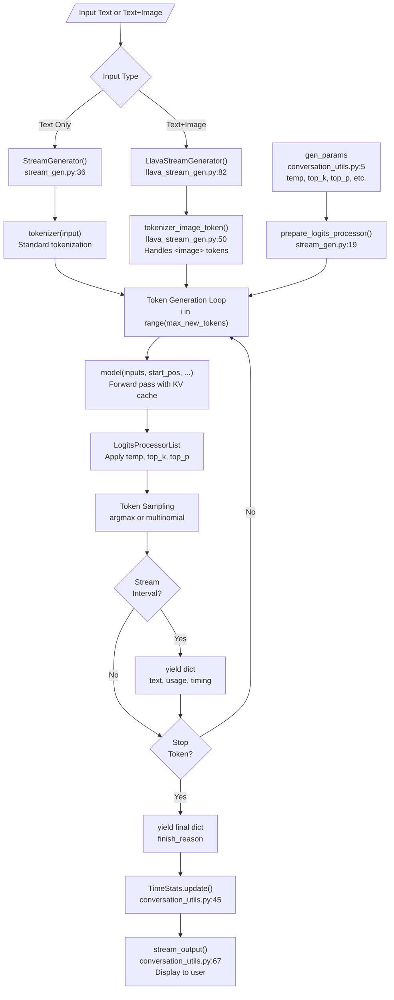

Sources: [tinychat/stream_generators/stream_gen.py:36-214](), [tinychat/stream_generators/llava_stream_gen.py:82-302](), [tinychat/utils/conversation_utils.py:5-86]()

## Generation Parameters

The `gen_params` AttributeDict in [tinychat/utils/conversation_utils.py:5-33]() defines the configuration for text generation:

### Parameter Reference

| Parameter | Type | Default | Function | Impact |
|-----------|------|---------|----------|--------|
| `n_predict` | int | 512 | Max tokens to generate | Generation length limit |
| `temp` | float | 0.20 | Temperature scaling | Higher = more creative/random |
| `top_k` | int | 50 | Top-K sampling | Number of candidates to consider |
| `top_p` | float | 0.95 | Nucleus sampling | Cumulative probability threshold |
| `repeat_penalty` | float | 1.10 | Repetition penalty | Values > 1.0 discourage repeats |
| `repeat_last_n` | int | 64 | Penalty context window | Tokens to check for repetition |
| `n_ctx` | int | 512 | Context size | Maximum sequence length |
| `n_vocab` | int | 50272 | Vocabulary size | Used for top_k validation |

### Parameter Usage Flow

The parameters flow through the generation pipeline as follows:

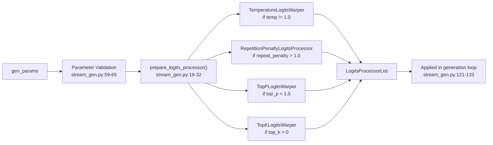

Sources: [tinychat/utils/conversation_utils.py:5-33](), [tinychat/stream_generators/stream_gen.py:19-32](), [tinychat/stream_generators/stream_gen.py:59-65]()

## Logits Processing & Token Sampling

The system transforms model logits into token IDs through a configurable processing pipeline using transformers library components.

### Logits Processor Setup

The `prepare_logits_processor` function at [tinychat/stream_generators/stream_gen.py:19-32]() conditionally constructs a processor list:

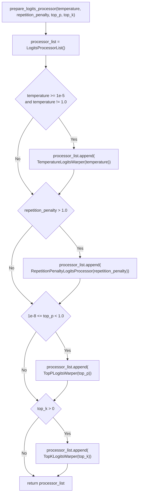

### Token Sampling Strategy

During generation at [tinychat/stream_generators/stream_gen.py:121-134](), the system applies processors and samples:

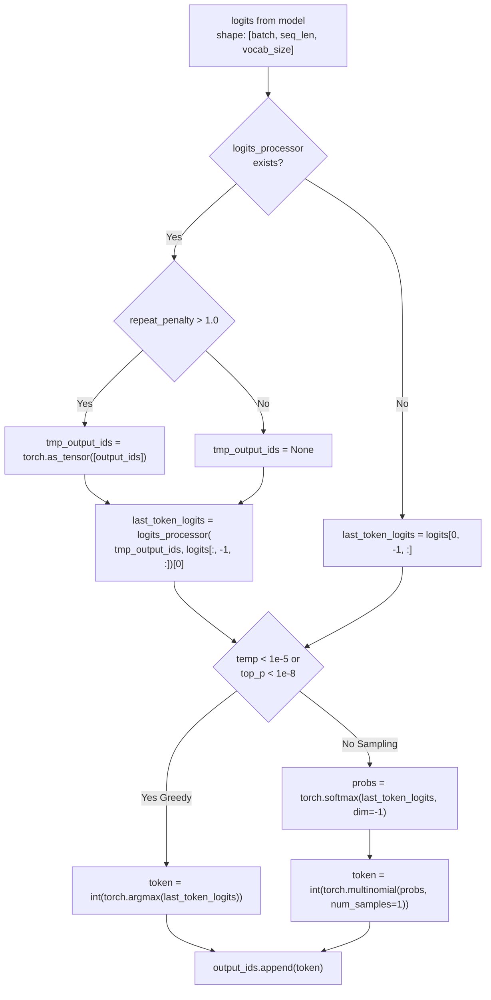

Sources: [tinychat/stream_generators/stream_gen.py:19-32](), [tinychat/stream_generators/stream_gen.py:121-134]()

## StreamGenerator: Main Generation Loop

The `StreamGenerator` function at [tinychat/stream_generators/stream_gen.py:36-214]() implements the core autoregressive generation loop.

### Function Signature

```python
@torch.inference_mode()
def StreamGenerator(
    model,                    # AWQ-quantized or standard model
    tokenizer,                # HuggingFace tokenizer
    input: str,               # Input prompt text
    start_pos: int,           # Starting position for KV cache
    gen_params: dict,         # Generation parameters
    device: str = "cuda:0",   # Target device
    stream_interval: int = 2, # Tokens between yields
    echo: bool = False,       # Include prompt in output
    stop_token_ids=[],        # Additional stop tokens
    chunk_prefilling=False,   # Enable chunk prefilling optimization
    quant_llm=False,          # Flag for quantized model path
)
```

### Generation Loop Implementation

```mermaid
graph TB
    Entry["StreamGenerator() entry<br/>stream_gen.py:36"] --> Tokenize["input_ids = tokenizer(input)['input_ids']<br/>stream_gen.py:50-57"]
    Tokenize --> PrepProc["logits_processor = prepare_logits_processor()<br/>stream_gen.py:63-65"]
    PrepProc --> InitVars["past_key_values = out = None<br/>stop_token_ids.append(tokenizer.eos_token_id)<br/>stream_gen.py:67-68"]
    
    InitVars --> LoopStart["for i in range(max_new_tokens):<br/>stream_gen.py:70"]
    
    LoopStart --> TimeStart["torch.cuda.synchronize()<br/>t_st = time.time()<br/>stream_gen.py:71-72"]
    
    TimeStart --> CheckFirst{"i == 0<br/>Prefill or Decode"}
    
    CheckFirst -->|"Prefill i==0"| InputsFull["inputs = torch.as_tensor([input_ids], device=device)<br/>stream_gen.py:75"]
    CheckFirst -->|"Decode i>0"| InputsSingle["inputs = torch.as_tensor([[token]], device=device)<br/>stream_gen.py:77"]
    
    InputsFull --> ModelCheck{"Model Type"}
    InputsSingle --> ModelCheck
    
    ModelCheck -->|"llama/qwen/internvl"| ModelOptimized["out = model(inputs, start_pos, chunk_prefilling)<br/>start_pos += inputs.shape[1]<br/>stream_gen.py:105-115"]
    ModelCheck -->|"Other models"| ModelStandard["out = model(inputs, use_cache=True, past_key_values)<br/>past_key_values = out.past_key_values<br/>stream_gen.py:86-98"]
    
    ModelOptimized --> TimeEnd["torch.cuda.synchronize()<br/>t_ed = time.time()<br/>stream_gen.py:117-118"]
    ModelStandard --> TimeEnd
    
    TimeEnd --> ProcessLogits["Apply logits_processor<br/>Sample token<br/>stream_gen.py:121-134"]
    
    ProcessLogits --> RecordTime{"i == 0"}
    RecordTime -->|Yes| RecContext["context_time = t_ed - t_st<br/>context_tokens = inputs.shape[1]<br/>stream_gen.py:141-142"]
    RecordTime -->|No| RecGen["generation_time_list.append(t_ed - t_st)<br/>stream_gen.py:145"]
    
    RecContext --> CheckStop
    RecGen --> CheckStop
    
    CheckStop{"token in<br/>stop_token_ids"} -->|Yes| SetStopped["stopped = True<br/>stream_gen.py:148"]
    CheckStop -->|No| SetNotStopped["stopped = False<br/>stream_gen.py:150"]
    
    SetStopped --> CheckStream
    SetNotStopped --> CheckStream
    
    CheckStream{"i % stream_interval == 0<br/>or i == max_new_tokens - 1<br/>or stopped"} -->|Yes| Decode["output = tokenizer.decode(tmp_output_ids)<br/>stream_gen.py:160-164"]
    CheckStream -->|No| CheckBreak
    
    Decode --> YieldIntermediate["yield dict: text, usage, finish_reason=None<br/>stream_gen.py:170-179"]
    YieldIntermediate --> CheckBreak
    
    CheckBreak{"stopped"} -->|Yes| FinalYield
    CheckBreak -->|No| LoopStart
    
    FinalYield["yield final dict: text, usage, finish_reason, timing<br/>stream_gen.py:193-207"] --> Cleanup["del past_key_values, out<br/>gc.collect()<br/>torch.cuda.empty_cache()<br/>stream_gen.py:209-211"]
```

Sources: [tinychat/stream_generators/stream_gen.py:36-214]()

### Prefill vs Decode Phase

The generator handles two phases differently:

| Phase | Iteration | Input Shape | KV Cache | Purpose |
|-------|-----------|-------------|----------|---------|
| **Prefill** | `i == 0` | `[batch, seq_len]` | None or empty | Process entire prompt, initialize KV cache |
| **Decode** | `i > 0` | `[batch, 1]` | Accumulated | Process single new token, append to KV cache |

At [tinychat/stream_generators/stream_gen.py:74-77](), the input tensor shape changes based on phase.

Sources: [tinychat/stream_generators/stream_gen.py:74-77](), [tinychat/stream_generators/stream_gen.py:86-116]()

## KV Cache Management

Both generators manage Key-Value (KV) cache to enable efficient autoregressive generation by avoiding recomputation of attention for previous tokens.

### KV Cache in Standard Models

For non-optimized models at [tinychat/stream_generators/stream_gen.py:86-98]():

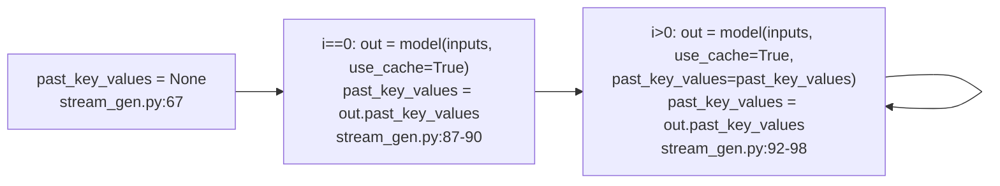

The model returns updated `past_key_values` which are passed back in the next iteration, accumulating the attention cache across all generated tokens.

### KV Cache in Optimized Models

For LLaMA/Qwen models with optimizations at [tinychat/stream_generators/stream_gen.py:105-115]():

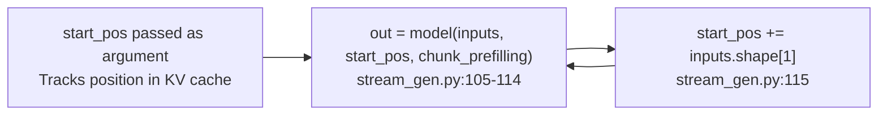

Instead of passing `past_key_values`, the `start_pos` parameter tracks the current position, and the model internally manages the KV cache using pre-allocated buffers.

### Chunk Prefilling

When `chunk_prefilling=True` at [tinychat/stream_generators/stream_gen.py:49-52](), the generator adjusts tokenization for multi-turn conversations:

- Removes the leading `<s>` token added by the tokenizer: `input_ids = tokenizer(input).input_ids[1:]`
- Allows reusing KV cache from previous turns
- Detailed in page 3.3 on performance optimizations

Sources: [tinychat/stream_generators/stream_gen.py:49-52](), [tinychat/stream_generators/stream_gen.py:67](), [tinychat/stream_generators/stream_gen.py:86-98](), [tinychat/stream_generators/stream_gen.py:105-115]()

## LlavaStreamGenerator for Multimodal Models

The `LlavaStreamGenerator` function at [tinychat/stream_generators/llava_stream_gen.py:82-302]() extends text generation to handle vision-language models.

### Key Differences from StreamGenerator

| Aspect | StreamGenerator | LlavaStreamGenerator |
|--------|-----------------|---------------------|
| **Tokenization** | `tokenizer(input)` | `tokenizer_image_token(input, tokenizer)` [llava_stream_gen.py:98-106]() |
| **Special Tokens** | Standard tokens | `<image>` token mapped to `IMAGE_TOKEN_INDEX` (-200) |
| **Model Input** | `inputs` only | `inputs + images + position_ids + attention_mask` |
| **Position Tracking** | Simple increment | Accounts for image token expansion (195 tokens per image) |
| **Image Tensor** | N/A | `image_tensor: Optional[torch.FloatTensor]` passed to model |

### Image Token Processing

The `tokenizer_image_token` function at [tinychat/stream_generators/llava_stream_gen.py:50-78]() handles `<image>` placeholders:

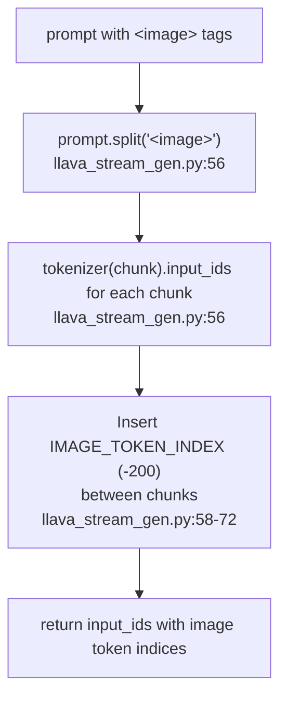

### Position ID Management

At [tinychat/stream_generators/llava_stream_gen.py:128-134]() and [llava_stream_gen.py:144-146](), position IDs are carefully maintained:

```python
# Initial prefill
position_ids = torch.arange(start_pos, start_pos + input_ids.numel(), device=device)

# Each decode step
position_ids = (position_ids[:, -1] + 1).reshape(1, 1)
```

### Image Token Expansion

Vision tokens expand during processing at [tinychat/stream_generators/llava_stream_gen.py:197-199]():

```python
start_pos += inputs.shape[1] + 195 * torch.sum(inputs[0] == IMAGE_TOKEN_INDEX).item()
```

Each `<image>` token expands to 195 vision encoder output tokens, affecting KV cache position tracking.

Sources: [tinychat/stream_generators/llava_stream_gen.py:50-78](), [tinychat/stream_generators/llava_stream_gen.py:82-302](), [tinychat/stream_generators/llava_stream_gen.py:128-146](), [tinychat/stream_generators/llava_stream_gen.py:197-199]()

## Streaming Output Mechanism

The generator yields output dictionaries at configurable intervals, enabling real-time display to users.

### Stream Interval Logic

At [tinychat/stream_generators/stream_gen.py:152-179](), output is yielded when:

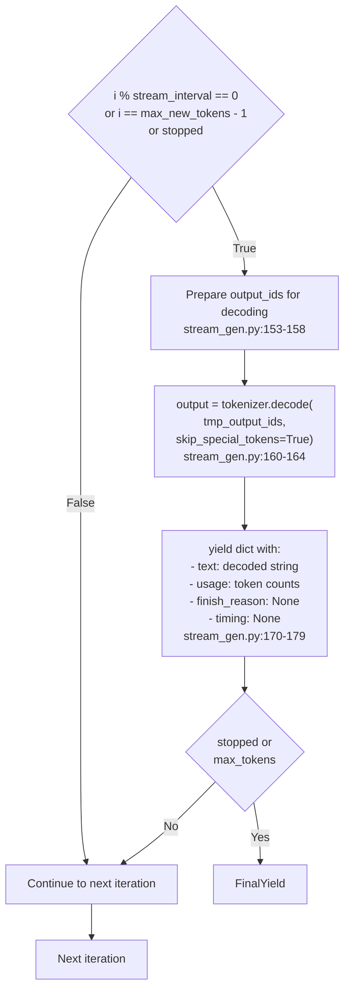

**Key Points:**
- `stream_interval` (default=2): Yield every N tokens
- Always yield on final token or stop condition
- Intermediate yields have `finish_reason=None`, `timing=None`

### Output Dictionary Format

The yielded dictionary structure:

```python
{
    "text": str,              # Decoded text (full or incremental)
    "usage": {
        "prompt_tokens": int, # Input token count
        "completion_tokens": int,  # Generated token count
        "total_tokens": int   # Sum of prompt + completion
    },
    "finish_reason": str | None,  # "stop", "length", or None
    "timing": dict | None    # Performance metrics (final yield only)
}
```

At [tinychat/stream_generators/stream_gen.py:170-179]() for intermediate yields and [stream_gen.py:193-207]() for the final yield.

### Final Yield with Timing

The last yield includes detailed timing information at [tinychat/stream_generators/stream_gen.py:193-207]():

```python
{
    "text": output,
    "usage": {...},
    "finish_reason": "stop" | "length",  # Determined by stop condition
    "timing": {
        "context_tokens": int,      # Tokens in prefill phase
        "context_time": float,      # Time for prefill (seconds)
        "total_tokens": int,        # Total tokens processed
        "generation_time_list": list[float]  # Time per decode token
    }
}
```

Sources: [tinychat/stream_generators/stream_gen.py:152-179](), [tinychat/stream_generators/stream_gen.py:185-207]()

## Performance Monitoring

The system provides comprehensive performance tracking through the `TimeStats` class and `stream_output` function.

### TimeStats Class

The `TimeStats` class at [tinychat/utils/conversation_utils.py:36-65]() accumulates and reports performance metrics:

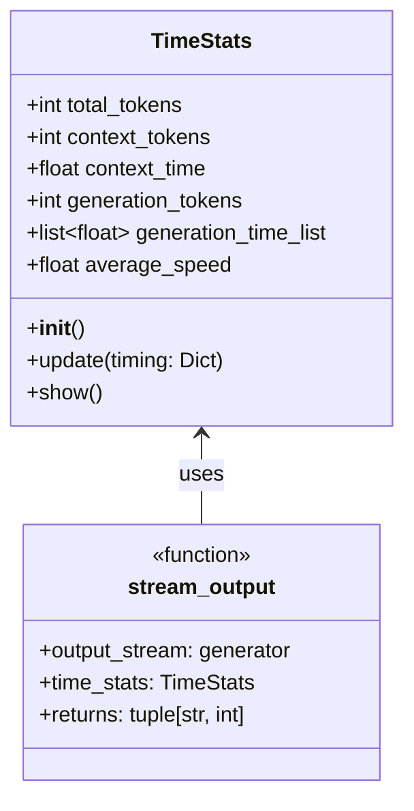

**Tracked Metrics:**

| Metric | Source | Calculation | Units |
|--------|--------|-------------|-------|
| `context_tokens` | `timing["context_tokens"]` | Prefill phase token count | tokens |
| `context_time` | `timing["context_time"]` | Prefill phase duration | seconds |
| `generation_tokens` | `len(generation_time_list)` | Decode phase token count | tokens |
| `generation_time_list` | `timing["generation_time_list"]` | Per-token decode times | seconds/token |
| `average_speed` | Computed in `update()` | Total time / total tokens | seconds/token |

### Timing Collection in Generator

Global variables at [tinychat/stream_generators/stream_gen.py:13-16]() accumulate timing data:

```python
context_tokens = 0
context_time = 0.0
total_tokens = 0
generation_time_list = []
```

Updated during generation at [tinychat/stream_generators/stream_gen.py:136-145]():

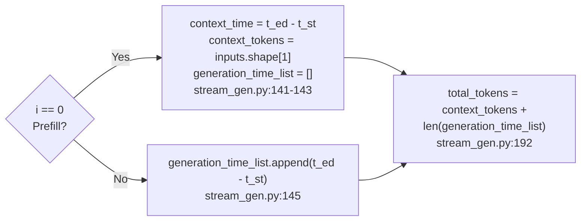

### stream_output Function

The `stream_output` function at [tinychat/utils/conversation_utils.py:67-86]() consumes the generator and displays results:

```python
def stream_output(output_stream, time_stats: TimeStats = None):
    # Incrementally display output
    # Update TimeStats with final timing
    # Print TTFT (Time To First Token)
    return output_text, total_tokens
```

**Example Output:**
```
--------------------------------------------------
TTFT: 0.523 s for 128 tokens.
**************************************************
Speed of Generation : 15.3 ms/token
**************************************************
```

At [tinychat/utils/conversation_utils.py:84]() for TTFT and [conversation_utils.py:60-64]() for generation speed.

Sources: [tinychat/utils/conversation_utils.py:36-86](), [tinychat/stream_generators/stream_gen.py:13-16](), [tinychat/stream_generators/stream_gen.py:136-145](), [tinychat/stream_generators/stream_gen.py:192]()

## Stop Conditions

Generation terminates when one of several stop conditions is met, controlled at [tinychat/stream_generators/stream_gen.py:147-150]() and [stream_gen.py:181-190]().

### Stop Token Detection

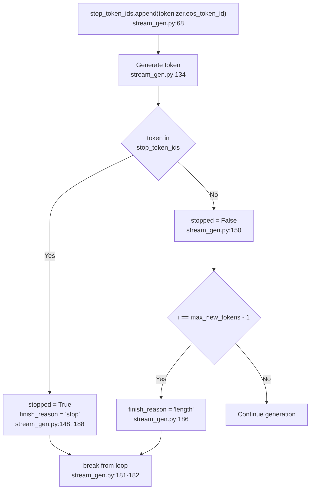

### Configurable Stop Tokens

The `stop_token_ids` parameter allows specifying additional stop tokens beyond EOS:

```python
# From function signature at stream_gen.py:45
stop_token_ids=[]  # Additional stop token IDs

# EOS always added at stream_gen.py:68
stop_token_ids.append(tokenizer.eos_token_id)
```

Common use cases:
- Model-specific stop sequences (e.g., `<|endoftext|>` for GPT models)
- Custom chat format delimiters
- Multi-turn conversation boundaries

### Finish Reasons

| Finish Reason | Condition | Set At |
|---------------|-----------|---------|
| `"stop"` | Token in `stop_token_ids` | [stream_gen.py:188]() |
| `"length"` | Reached `max_new_tokens` | [stream_gen.py:186]() |
| `None` | Still generating (intermediate yield) | [stream_gen.py:177]() |

Sources: [tinychat/stream_generators/stream_gen.py:45](), [tinychat/stream_generators/stream_gen.py:68](), [tinychat/stream_generators/stream_gen.py:147-150](), [tinychat/stream_generators/stream_gen.py:181-190]()

## Model Support and Integration

The generator functions support different model types by checking the model's class name and adapting their behavior:

```mermaid
flowchart LR
    A["StreamGenerator/LlavaStreamGenerator"] --> B{"Model Type"}
    B -->|"llama" or "qwen"| C["model(inputs, start_pos, chunk_prefilling)"]
    B -->|"other"| D["model(inputs)"]
    C --> E["Generated Token"]
    D --> E
    
    subgraph "Model-Specific Handling"
        B
        C["Special handling for optimized models"]
        D["Standard handling"]
    end
    
    subgraph "Support for AWQ Quantized Models"
        F["quant_llm parameter"]
        F --> B
    end
```

This flexibility allows the text generation system to work with:
- Standard PyTorch models
- AWQ-quantized models
- Different model architectures (Llama, MPT, Falcon, Qwen, etc.)
- Multimodal models (LLaVA)

Sources: [tinychat/stream_generators/stream_gen.py:79-114](), [tinychat/stream_generators/llava_stream_gen.py:151-200]()

## System Integration

The text generation system integrates with the rest of the AWQ TinyChat system as follows:

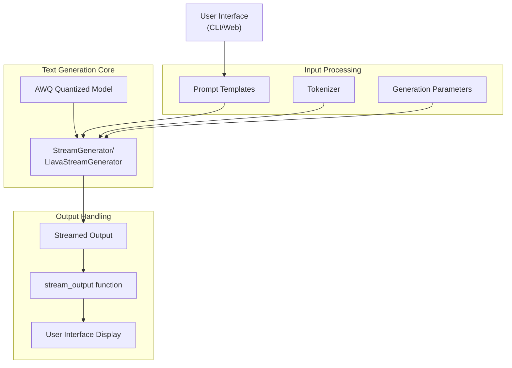

The system is designed to be:
1. Modular - easily integrated with different models and interfaces
2. Efficient - optimized for performance with quantized models
3. Informative - provides detailed metrics about the generation process
4. Responsive - streams output in real-time for better user experience

Sources: [tinychat/stream_generators/stream_gen.py](), [tinychat/utils/conversation_utils.py:67-85]()

---

