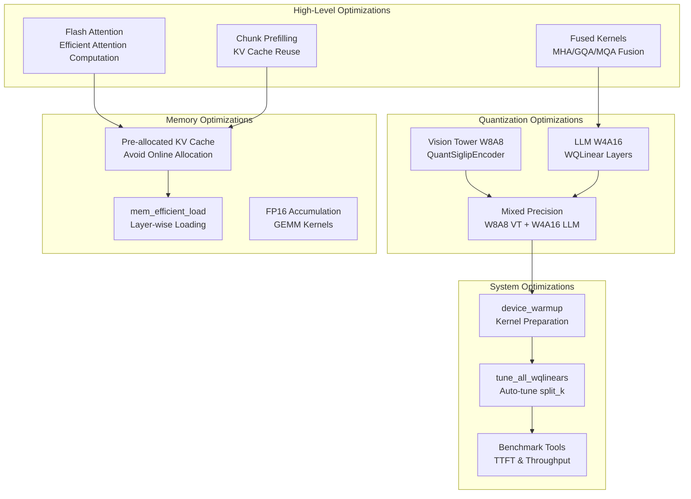
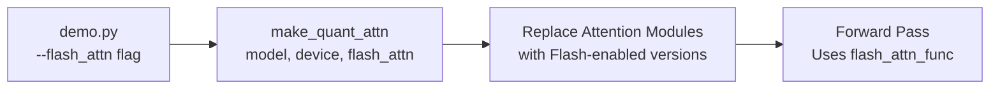
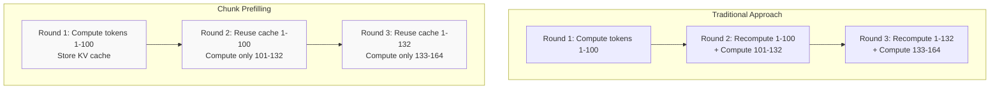
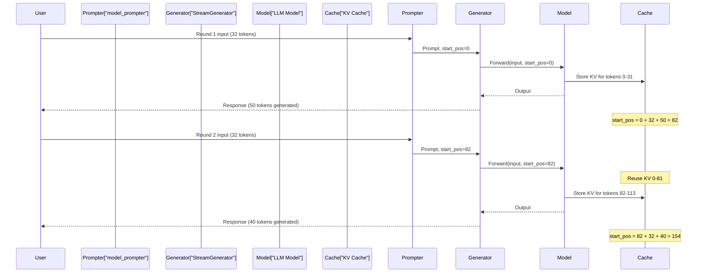
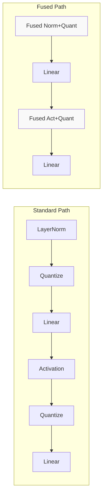
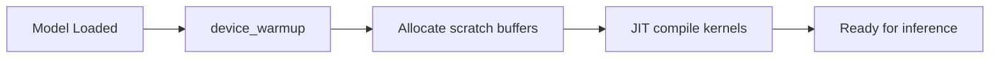
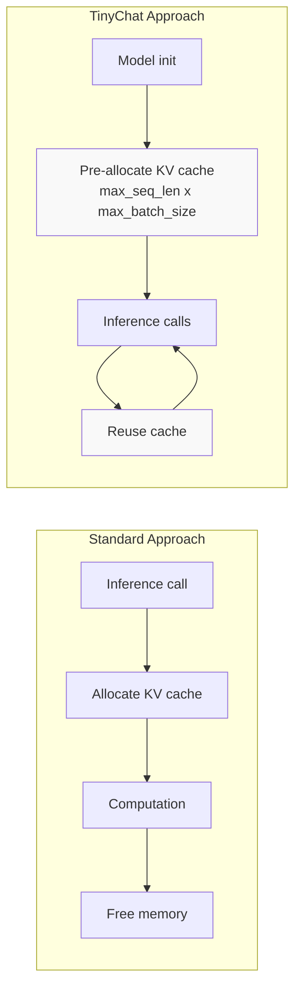
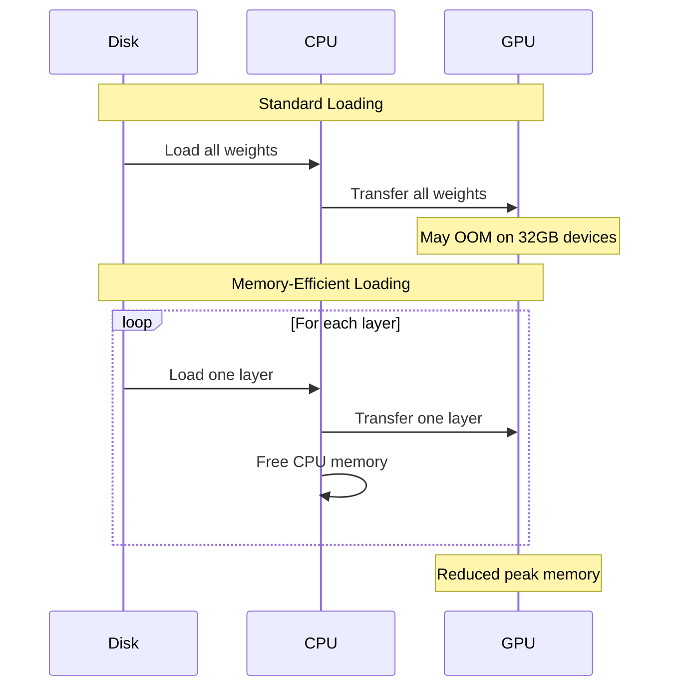
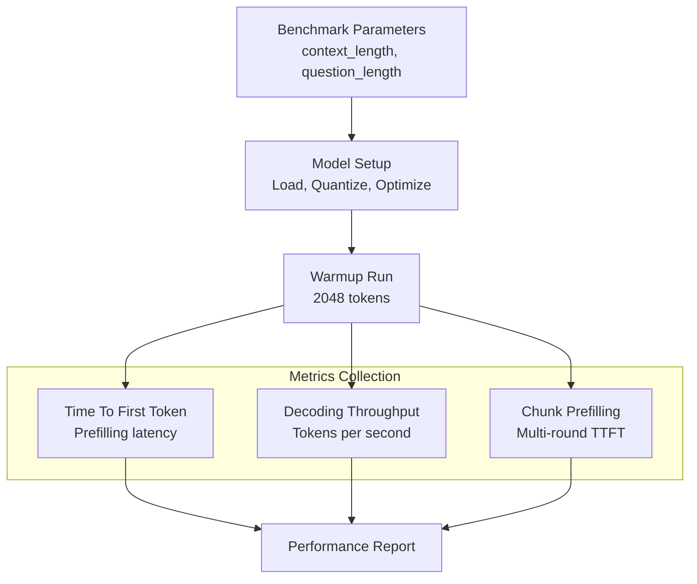

<!-- source: DeepWiki mcp.deepwiki.com · repo mit-han-lab/llm-awq · page 3.3 Performance Optimizations · fetched 2026-10-30 -->

# Performance Optimizations

<details>
<summary>Relevant source files</summary>

The following files were used as context for generating this wiki page:

- [README.md](README.md)
- [scripts/qwen_example.sh](scripts/qwen_example.sh)
- [tinychat/README.md](tinychat/README.md)
- [tinychat/benchmark.py](tinychat/benchmark.py)
- [tinychat/demo.py](tinychat/demo.py)
- [tinychat/modules/fused_siglipdecoder.py](tinychat/modules/fused_siglipdecoder.py)
- [tinychat/nvila_benchmark.py](tinychat/nvila_benchmark.py)
- [tinychat/stream_generators/NVILA_stream_gen.py](tinychat/stream_generators/NVILA_stream_gen.py)
- [tinychat/utils/constants.py](tinychat/utils/constants.py)

</details>


## Purpose and Scope

This page documents the performance optimization techniques employed in TinyChat to achieve efficient inference with quantized models. These optimizations target both prefilling (context processing) and decoding (token generation) stages, with special attention to multi-turn conversations and multimodal inputs.

For low-level CUDA kernel optimizations, see [CUDA Kernels & Low-Level Optimization](#2.4). For model loading strategies, see [Model Loading & Configuration](#3.1). For generation mechanics, see [Text Generation & Streaming](#3.2).

---

## Overview of Optimization Stack

TinyChat implements multiple orthogonal optimization techniques that work together to achieve state-of-the-art inference speed on both cloud GPUs and edge devices.



**Sources:** [tinychat/README.md:66-73](), [README.md:13-16]()

---

## Flash Attention Integration

### Overview

Flash Attention is integrated to accelerate the attention computation during the prefilling stage. It reduces memory access by fusing attention operations and using tiling techniques.

### Enabling Flash Attention

Flash Attention is enabled through the `--flash_attn` flag in demo scripts and the `make_quant_attn` function:



In [tinychat/demo.py:237-240](), Flash Attention is conditionally enabled:

```python
if args.flash_attn:
    make_quant_attn(model, args.device, args.flash_attn)
else:
    make_quant_attn(model, args.device)
```

### Implementation Details

For vision encoders, Flash Attention is implemented in `QuantSiglipFlashAttention2` [tinychat/modules/fused_siglipdecoder.py:125-178]():

- QKV projection is performed first
- Attention is computed using `flash_attn_func` with `causal=False` for bidirectional attention
- Output projection and quantization follow

The module replaces standard attention with:

```python
attn_output = flash_attn_func(q, k, v, softmax_scale=None, causal=False)
```

### Performance Impact

Flash Attention provides 1.5-1.7x speedup in prefilling on RTX 4090 and 1.2x speedup on Jetson Orin [tinychat/README.md:167-199](). Time-To-First-Token (TTFT) improvements:

| Sequence Length | 256 | 512 | 1024 | 2048 | 4096 |
|-----------------|-----|-----|------|------|------|
| **RTX 4090 Speedup** | 1.52x | 1.68x | 1.69x | 1.61x | 1.62x |
| **Jetson Orin Speedup** | 1.24x | 1.26x | 0.91x | 1.22x | 1.21x |

**Sources:** [tinychat/demo.py:125-128, 237-240](), [tinychat/modules/fused_siglipdecoder.py:125-178](), [tinychat/README.md:167-199]()

---

## Chunk Prefilling for Multi-Turn Conversations

### Concept

Chunk prefilling optimizes multi-turn conversations by reusing KV cache entries from previous rounds, eliminating redundant computation of historical tokens.



### Enabling Chunk Prefilling

Chunk prefilling is controlled by the `chunk_prefilling` flag [tinychat/demo.py:129-133]():

```python
parser.add_argument(
    "--chunk_prefilling",
    action="store_true",
    help="If used, in context stage, the history tokens will not be recalculated"
)
```

The `start_pos` parameter tracks the current KV cache position [tinychat/demo.py:254-283]():

- Initialize `start_pos = 0`
- After each generation, increment by `total_tokens`
- Pass `start_pos` to the model to resume from cached position

### Implementation Flow



### Performance Results

On RTX 4090 with LLaMA-3-8B, chunk prefilling achieves dramatic speedups as history length grows [tinychat/README.md:217-235]():

| History Length | 16 | 32 | 64 | 128 | 256 | 512 | 1024 |
|----------------|-----|-----|-----|-----|-----|-----|------|
| **TTFT (ms) - FP16** | 21.49 | 21.38 | 23.51 | 40.82 | 47.15 | 75.41 | 162.27 |
| **TTFT (ms) - TinyChat 2.0** | 14.30 | 14.05 | 14.05 | 14.43 | 14.38 | 14.35 | 14.49 |
| **Speedup** | 1.54x | 1.54x | 1.69x | 2.84x | 3.33x | 5.27x | **11.45x** |

**Sources:** [tinychat/demo.py:129-133, 254-283](), [tinychat/benchmark.py:56-60, 84-96](), [tinychat/README.md:217-248]()

---

## Fused Kernel Operations

### Kernel Fusion Strategy

TinyChat fuses multiple operations into single kernels to reduce memory bandwidth and kernel launch overhead:

1. **Fused MHA/GQA/MQA**: All multi-head attention operations in a single kernel
2. **Fused Positional Embeddings**: RoPE/ALiBi fused into attention
3. **Fused Normalization**: LayerNorm/RMSNorm with quantization
4. **Fused MLP**: Activation function with quantization



### make_quant_attn Function

The `make_quant_attn` function replaces standard attention modules with optimized quantized versions [tinychat/demo.py:235-241]():

- Traverses the model tree
- Replaces attention modules with fused implementations
- Enables Flash Attention if specified
- Configures for W4A16 precision

### make_quant_norm Function

The `make_quant_norm` function [tinychat/demo.py:241]() replaces normalization layers with fused implementations:

- RMSNorm layers are replaced with quantization-aware versions
- Normalization and quantization are computed in a single kernel
- Reduces memory traffic between normalization and subsequent operations

For vision encoders, this is implemented in `RMSNormGeneral` [tinychat/modules/fused_siglipdecoder.py:246-283]():

```python
awq_inference_engine.rms_norm_general(
    quantized_hidden_states_buffer,
    x,
    self.weight.data,
    self.bias.data,
    quantized_scale_buffer,
    self.variance_epsilon,
    self.use_per_token_quant,
)
```

### make_fused_mlp Function

The `make_fused_mlp` function creates fused MLP layers [tinychat/benchmark.py:134, 262]():

- Gate projection and activation are fused
- Activation quantization is integrated
- Reduces kernel launches from 3+ to 2

In `QuantSiglipMLP` [tinychat/modules/fused_siglipdecoder.py:83-123]():

```python
# Fused GELU activation and quantization
awq_inference_engine.gelu_and_quant(
    buffer.quantized_mlp_act_buffer,
    buffer.fc1_buffer,
    buffer.quantized_scale_buffer,
    buffer.tmp,
)
```

**Sources:** [tinychat/demo.py:235-241](), [tinychat/benchmark.py:17, 134, 261-262](), [tinychat/modules/fused_siglipdecoder.py:83-123, 246-283]()

---

## Device Warmup and Auto-Tuning

### Device Warmup

The `device_warmup` function prepares GPU kernels before inference [tinychat/demo.py:223]():



Device warmup ensures:
- Kernel compilation happens once at startup
- Memory pools are pre-allocated
- CUDA context is initialized
- First inference call is not artificially slow

### Auto-Tuning split_k Parameter

The `tune_all_wqlinears` function [tinychat/demo.py:226]() automatically tunes the `split_k_iters` parameter for each `WQLinear` layer:

- `split_k_iters` controls output dimension splitting in GEMM
- Different layers have different optimal values
- Tuning finds the best configuration for the target GPU

The tuning process:
1. For each `WQLinear` layer in the model
2. Try different `split_k_iters` values (typically 1, 2, 4, 8)
3. Measure execution time
4. Select the fastest configuration

**Note:** Auto-tuning is currently commented out in demo code [tinychat/demo.py:226]() but can be enabled for optimal performance on new hardware.

**Sources:** [tinychat/demo.py:223, 226](), [tinychat/utils/tune.py](), [tinychat/benchmark.py:13-16, 137, 259-260]()

---

## Vision Encoder Quantization

### W8A8 Quantization for Vision Towers

TinyChat implements W8A8 (8-bit weights, 8-bit activations) quantization for vision encoders to reduce memory and computation while maintaining accuracy.

```mermaid
graph TB
    subgraph "Standard Vision Encoder"
        S1["FP16 Input"] --> S2["FP16 Self-Attention"]
        S2 --> S3["FP16 MLP"]
        S3 --> S4["FP16 Output"]
    end
    
    subgraph "Quantized Vision Encoder"
        Q1["FP16 Input"] --> Q2["Quantize to INT8"]
        Q2 --> Q3["INT8 Self-Attention"]
        Q3 --> Q4["Dequant to FP16"]
        Q4 --> Q5["Quantize to INT8"]
        Q5 --> Q6["INT8 MLP"]
        Q6 --> Q7["Dequant to FP16"]
    end
    
    style Q3 fill:#f9f9f9
    style Q6 fill:#f9f9f9
```



### QuantSiglipEncoder Implementation

The `QuantSiglipEncoder` class [tinychat/modules/fused_siglipdecoder.py:24-81]() implements the quantized vision encoder:

**Key Components:**

1. **ActivationBuffer** [tinychat/modules/fused_siglipdecoder.py:29-32](): Pre-allocated buffers for:
   - Quantized hidden states (INT8)
   - Quantization scales (FP16)
   - Intermediate activations (QKV, FC outputs)

2. **QuantSiglipEncoderLayer** [tinychat/modules/fused_siglipdecoder.py:180-243](): Each layer performs:
   - RMS normalization with quantization
   - INT8 attention computation
   - RMS normalization with quantization
   - INT8 MLP computation
   - Residual connections in FP16

3. **Dynamic Input Scale** [tinychat/modules/fused_siglipdecoder.py:88-93](): Per-token or per-tensor quantization scales computed dynamically

### Buffer Management

The `ActivationBuffer` manages memory efficiently [tinychat/modules/fused_siglipdecoder.py:29-32, 45-49]():

```python
# Allocate once for batch_size * sequence_length
self.buffer.allocate_activation_buffer(bsz * seqlen)

# Reuse buffers across layers
# No per-layer allocation overhead
```

Buffers include:
- `quantized_hidden_states_buffer`: INT8 layer inputs
- `quantized_scale_buffer`: Per-token scales
- `qkv_proj_act_buffer`: QKV projection outputs
- `fc1_buffer`, `fc2_buffer`: MLP intermediate activations
- `quantized_mlp_act_buffer`: Quantized MLP activations

### Mixed Precision Strategy

NVILA uses a mixed-precision approach [tinychat/README.md:485]():

- **Vision Tower**: W8A8 quantization via `QuantSiglipEncoder`
- **Language Model**: W4A16 quantization via `WQLinear`
- **Benefits**: 
  - Preserves vision encoder accuracy (W8A8 < 1% degradation)
  - Maximizes LLM compression (W4A16)
  - Achieves 1.3-3.3x prefilling speedup

Enabling in code [tinychat/nvila_benchmark.py:108-113]():

```python
if args.quant_VT:
    from tinychat.modules import QuantSiglipEncoder
    model.vision_tower.vision_tower.vision_model.encoder = QuantSiglipEncoder(
        model.vision_tower.vision_tower.vision_model.encoder
    )
```

**Sources:** [tinychat/modules/fused_siglipdecoder.py:24-283](), [tinychat/nvila_benchmark.py:108-113](), [tinychat/README.md:485]()

---

## Memory Optimizations

### Pre-allocated KV Cache

TinyChat pre-allocates KV cache to avoid online memory allocation overhead [tinychat/README.md:72]():



Configuration via constants [tinychat/utils/constants.py:4-9]():

```python
max_seq_len = 8192      # Maximum sequence length
max_batch_size = 1      # Maximum batch size
```

Command-line override [tinychat/demo.py:106-113]():

```python
parser.add_argument("--max_seq_len", type=int, default=2048)
parser.add_argument("--max_batch_size", type=int, default=1)
```

### Memory-Efficient Loading

For edge devices with limited memory, `mem_efficient_load` mode [tinychat/utils/constants.py:9]() loads checkpoints layer-by-layer:



Enabled via [tinychat/demo.py:115-118]():

```python
parser.add_argument(
    "--mem_efficient_load",
    action="store_true",
    help="enable mem_efficient_load mod"
)
```

This mode is essential for running large models (e.g., LLaMA-2-70B) on edge devices like Jetson Orin with 64GB shared memory.

### FP16 Accumulation in GEMM

TinyChat uses FP16 accumulation in GEMM kernels when applicable [tinychat/README.md:72]():

- **Standard**: INT4 x FP16 → FP32 accumulation → FP16 output
- **Optimized**: INT4 x FP16 → FP16 accumulation → FP16 output

Benefits:
- Higher throughput on Tensor Cores
- Reduced memory bandwidth
- Minimal accuracy impact for most models

This is particularly effective on Ampere and newer architectures where FP16 Tensor Cores have higher throughput than FP32.

**Sources:** [tinychat/utils/constants.py:4-9](), [tinychat/demo.py:106-118, 146-154](), [tinychat/README.md:72]()

---

## Benchmarking Methodology

### Benchmark Script Overview

The `benchmark.py` script [tinychat/benchmark.py]() provides comprehensive performance measurement:



### Time-To-First-Token (TTFT) Measurement

TTFT measures the latency from input submission to first output token [tinychat/benchmark.py:175-195]():

**Measurement procedure:**
1. Generate input sequence of specified length
2. Synchronize CUDA: `torch.cuda.synchronize()`
3. Record start time: `t_st = time.time()`
4. Perform forward pass: `out = model(inputs, start_pos=0)`
5. Synchronize CUDA: `torch.cuda.synchronize()`
6. Record end time: `t_ed = time.time()`
7. Repeat 10 times and average

For vision-language models, images are included in the input [tinychat/benchmark.py:157-186]().

### Decoding Throughput Measurement

Decoding throughput measures token generation speed [tinychat/benchmark.py:304-324]():

**Measurement procedure:**
1. Run prefilling to populate KV cache
2. Generate 256 tokens one-by-one
3. Measure total time
4. Calculate: `tokens_per_second = 256 / total_time`

### Chunk Prefilling Benchmark

Chunk prefilling benchmark measures multi-turn conversation performance [tinychat/benchmark.py:326-376]():

**Setup:**
- `context_length`: Historical tokens from previous rounds
- `question_length`: New tokens in current round (typically 32)

**Procedure:**
1. Prefill historical tokens (if `context_length > question_length`)
2. Synchronize and start timer
3. Process new question tokens with `start_pos = context_length`
4. Synchronize and stop timer
5. Report TTFT for current round

This simulates realistic multi-turn usage where history is already cached.

### Command-Line Interface

Basic TTFT benchmark [tinychat/benchmark.py:422-425]():

```bash
python benchmark.py --flash \
    --context_length 256 512 1024 2048 \
    --model_path /PATH/TO/MODEL --precision W4A16
```

Chunk prefilling benchmark [tinychat/benchmark.py:427-431]():

```bash
python benchmark.py --chunk_prefilling \
    --model_path /PATH/TO/MODEL \
    --question_length 32 --context_length 16 32 64 128 256 512 1024 \
    --precision W4A16
```

### Output Format

Benchmark output includes [tinychat/demo.py:61-79]():

```
==================================================
Speed of Inference
--------------------------------------------------
TTFT : 0.021 s for 256 tokens
Speed of Generation : 6.39 ms/token
==================================================
```

For streaming generation, timing information is collected in `generation_time_list` [tinychat/stream_generators/NVILA_stream_gen.py:8-11, 99-108]() and reported at the end.

**Sources:** [tinychat/benchmark.py:1-380](), [tinychat/demo.py:61-79](), [tinychat/stream_generators/NVILA_stream_gen.py:8-11, 99-108]()

---

## Performance Results Summary

### Decoding Speed Comparison

Across different hardware platforms [tinychat/README.md:80-163]():

| Model | Hardware | FP16 (ms/token) | W4A16 (ms/token) | Speedup |
|-------|----------|-----------------|------------------|---------|
| LLaMA-3-8B | RTX 4090 | 17.07 | 6.39 | **2.69x** |
| LLaMA-3-8B | Jetson Orin | 96.00 | 32.53 | **2.95x** |
| LLaMA-3-8B | A100 | 12.37 | 6.29 | **1.96x** |
| NVILA-8B | RTX 4090 | 16.12 | 5.97 | **2.70x** |
| NVILA-8B | Jetson Orin | 86.24 | 30.48 | **2.83x** |

### Prefilling Speed Comparison

RTX 4090 with LLaMA-3-8B [tinychat/README.md:172-178]():

| Seq Length | FP16 (s) | TinyChat 2.0 (s) | Speedup |
|------------|----------|------------------|---------|
| 256 | 0.031 | 0.021 | 1.52x |
| 512 | 0.055 | 0.033 | 1.68x |
| 1024 | 0.109 | 0.064 | 1.69x |
| 2048 | 0.211 | 0.131 | 1.61x |
| 4096 | 0.446 | 0.275 | 1.62x |

### Multi-Turn Conversation Speedup

RTX 4090 with chunk prefilling [tinychat/README.md:227-235]():

| History Length | FP16 (ms) | TinyChat Legacy (ms) | TinyChat 2.0 (ms) | Speedup |
|----------------|-----------|----------------------|-------------------|---------|
| 16 | 21.49 | 15.20 | 14.30 | 1.54x |
| 128 | 40.82 | 29.66 | 14.43 | 2.84x |
| 512 | 75.41 | 72.50 | 14.35 | 5.27x |
| 1024 | 162.27 | 163.90 | 14.49 | **11.45x** |

### Cross-System Comparison

4-bit LLaMA-3-8B on RTX 4090 [tinychat/README.md:203-214]():

| System | 256 | 512 | 1024 | 2048 | 4096 |
|--------|-----|-----|------|------|------|
| TensorRT-LLM | 0.027 | 0.051 | 0.100 | 0.204 | 0.421 |
| MLC | 0.028 | 0.042 | 0.081 | 0.166 | 0.350 |
| llama.cpp | 0.026 | 0.045 | 0.086 | 0.175 | 0.375 |
| ExLlama v2 | 0.040 | 0.051 | 0.077 | 0.139 | 0.294 |
| TinyChat Legacy | 0.031 | 0.051 | 0.101 | 0.219 | 0.461 |
| **TinyChat 2.0** | **0.021** | **0.033** | **0.065** | **0.132** | **0.278** |

TinyChat 2.0 achieves state-of-the-art prefilling speed across all sequence lengths.

**Sources:** [tinychat/README.md:75-214]()

---

## Optimization Configuration Guide

### Recommended Configurations

**Cloud GPUs (A100, RTX 4090):**
```bash
python demo.py --model_path MODEL \
    --precision W4A16 \
    --flash_attn \
    --chunk_prefilling \
    --max_seq_len 8192
```

**Edge Devices (Jetson Orin):**
```bash
python demo.py --model_path MODEL \
    --precision W4A16 \
    --flash_attn \
    --chunk_prefilling \
    --max_seq_len 2048 \
    --mem_efficient_load
```

**Vision-Language Models:**
```bash
python vila15_demo.py \
    --model-path MODEL \
    --quant-path QUANT \
    --precision W4A16 \
    --flash \
    --chunk_prefilling
```

**NVILA with Mixed Precision:**
```bash
python nvila_demo.py \
    --model-path MODEL \
    --quant_path QUANT \
    --act_scale_path SCALE \
    --quant_llm \
    --quant_VT \
    --chunk
```

### Optimization Trade-offs

| Optimization | Memory Impact | Speed Impact | Accuracy Impact |
|--------------|---------------|--------------|-----------------|
| Flash Attention | Neutral | +50-70% prefill | None |
| Chunk Prefilling | +KV cache | +150-1000% multi-turn | None |
| Fused Kernels | Neutral | +10-20% | None |
| Pre-allocated KV | +fixed overhead | +5-10% | None |
| Vision W8A8 | -50% VT memory | +30-200% VT | <1% accuracy |
| LLM W4A16 | -75% LLM memory | +200-300% decode | <2% perplexity |
| mem_efficient_load | -peak load memory | -10% load speed | None |

**Sources:** [tinychat/demo.py:377-416](), [scripts/qwen_example.sh](), [tinychat/README.md:485-509]()

---

