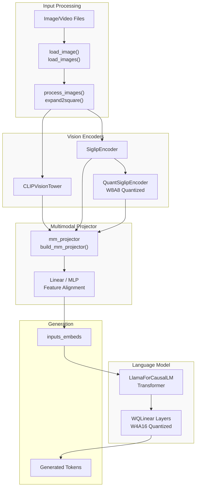
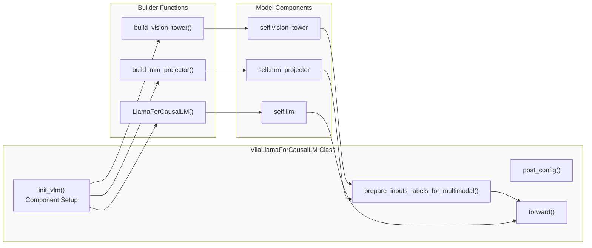
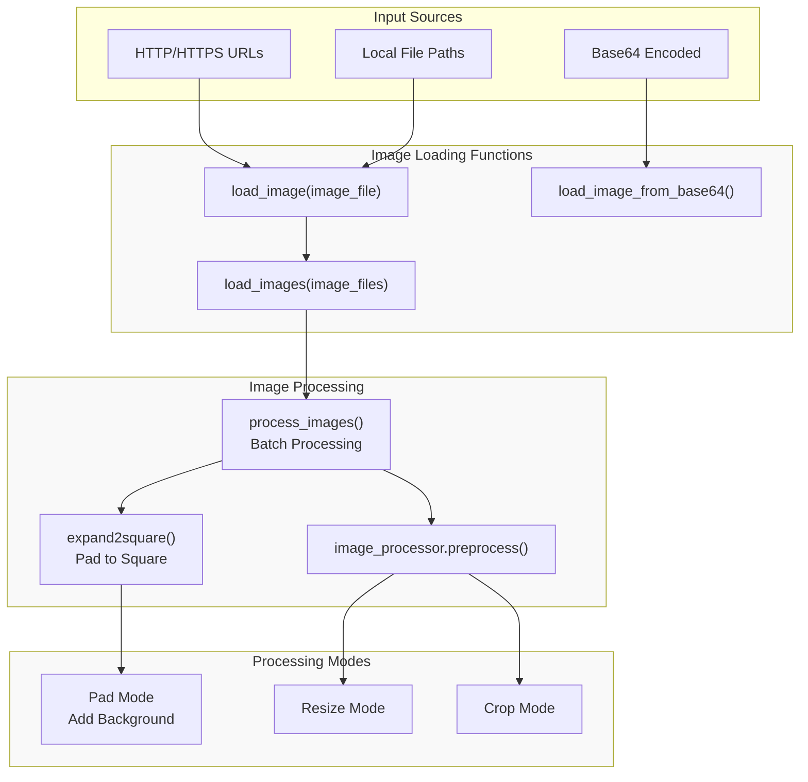
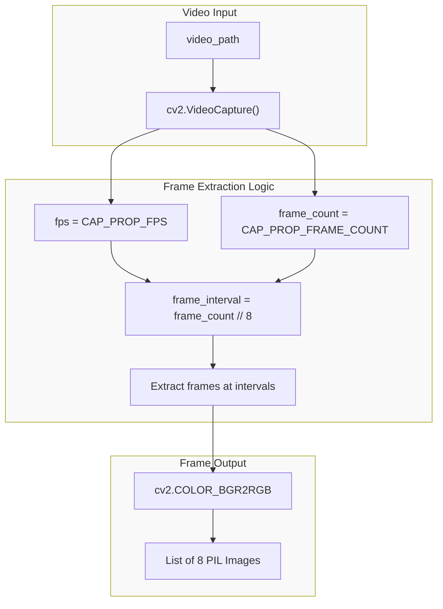
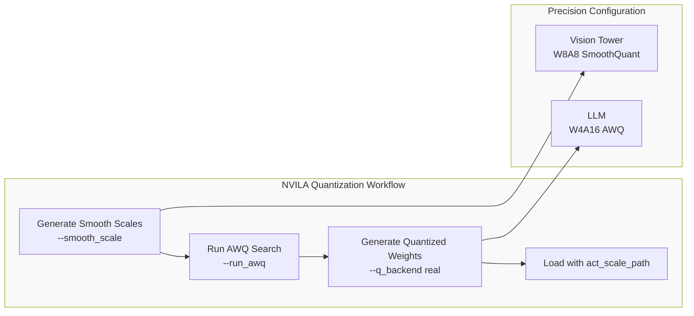
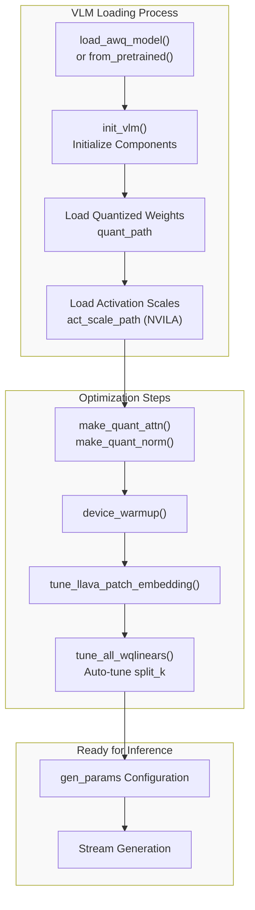
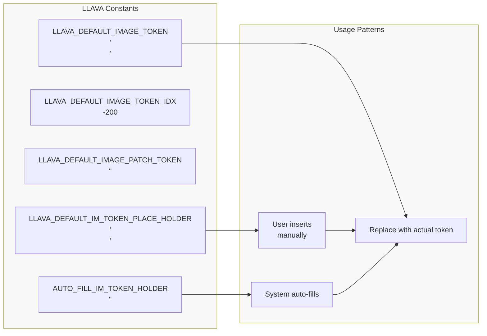
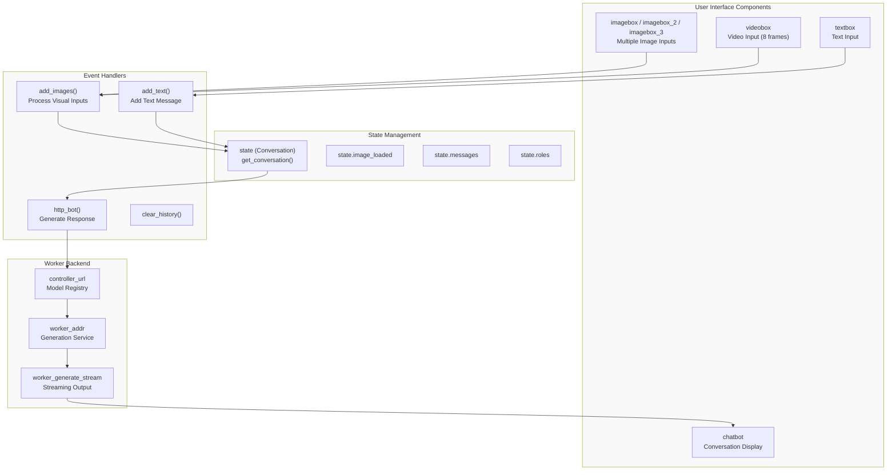

<!-- source: DeepWiki mcp.deepwiki.com · repo mit-han-lab/llm-awq · page 4 Multimodal Models · fetched 2026-10-30 -->

# Multimodal Models

<details>
<summary>Relevant source files</summary>

The following files were used as context for generating this wiki page:

- [README.md](README.md)
- [scripts/qwen_example.sh](scripts/qwen_example.sh)
- [tinychat/README.md](tinychat/README.md)
- [tinychat/models/vila_llama.py](tinychat/models/vila_llama.py)
- [tinychat/serve/gradio_web_server.py](tinychat/serve/gradio_web_server.py)
- [tinychat/utils/constants.py](tinychat/utils/constants.py)
- [tinychat/utils/llava_image_processing.py](tinychat/utils/llava_image_processing.py)
- [tinychat/utils/tune.py](tinychat/utils/tune.py)

</details>


## Purpose and Scope

This document describes the multimodal (vision-language) model support in the AWQ system. It covers the integration of visual understanding capabilities with language models, including image and video processing, vision encoder quantization, and inference optimization for Vision-Language Models (VLMs). The AWQ system supports several VLM families including VILA, LLaVA, and NVILA, enabling efficient deployment of these large-scale models through 4-bit weight quantization.

For information about language-only model quantization, see [AWQ Quantization System](#2). For inference system details, see [TinyChat Inference System](#3). For vision encoder quantization specifics, see [Vision Encoder Quantization](#4.3).

## Overview

The AWQ system extends its activation-aware weight quantization approach to vision-language models, enabling efficient inference for models that process both images/videos and text. The system supports multiple VLM architectures through a modular design that combines vision encoders (for processing visual inputs), multimodal projectors (for aligning visual and text representations), and quantized language models (for text generation).

Key supported model families include:
- **VILA 1.0/1.5**: Image understanding models with 3B-40B parameters
- **NVILA**: Video understanding models with 3B-8B parameters, featuring mixed-precision quantization
- **LLaVA**: Visual instruction-following models
- **InternVL3**: Multi-lingual vision-language models

Sources: [README.md:1-175](), [tinychat/README.md:1-95]()

## Multimodal Model Architecture

### Component Structure



**VLM Processing Pipeline**

The multimodal models follow a three-stage architecture:

1. **Vision Encoding**: Images or video frames are processed by vision encoders (`CLIPVisionTower` or `SiglipEncoder`) to extract visual features
2. **Feature Projection**: The `mm_projector` aligns visual features with the language model's embedding space
3. **Language Generation**: The quantized language model (`LlamaForCausalLM` with `WQLinear` layers) generates text conditioned on both visual and text inputs

Sources: [tinychat/models/vila_llama.py:1-110](), [tinychat/utils/llava_image_processing.py:85-114]()

### VILA Model Implementation



**VilaLlamaForCausalLM Architecture**

The `VilaLlamaForCausalLM` class integrates vision and language components through:
- `init_vlm()`: Initializes vision tower, multimodal projector, and LLM based on model configuration
- `prepare_inputs_labels_for_multimodal()`: Merges image embeddings with text tokens
- `forward()`: Supports both embedding-based and token-based inputs with optional chunk prefilling

Sources: [tinychat/models/vila_llama.py:20-110]()

## Image and Video Processing

### Image Loading and Preprocessing



**Image Preprocessing Pipeline**

The image processing utilities support multiple input formats and preprocessing modes:

| Function | Purpose | Key Parameters |
|----------|---------|----------------|
| `load_image()` | Load single image from URL or file | `image_file` |
| `load_images()` | Load multiple images | `image_files` list |
| `expand2square()` | Pad non-square images | `background_color` |
| `process_images()` | Batch preprocess with model config | `image_aspect_ratio` mode |

The `process_images()` function handles different aspect ratio modes specified in `model_cfg.image_aspect_ratio`:
- **"pad"**: Expands images to square using background padding
- **Default**: Uses standard image processor without padding

Sources: [tinychat/utils/llava_image_processing.py:24-114]()

### Video Frame Extraction



**Video Processing for NVILA**

The Gradio web server includes video frame extraction functionality at [tinychat/serve/gradio_web_server.py:232-274](). The `extract_frames()` function:
1. Opens video using OpenCV's `cv2.VideoCapture`
2. Calculates frame interval to extract 8 evenly-spaced frames
3. Converts frames from BGR to RGB format
4. Returns frames as PIL Image objects for downstream processing

This enables NVILA models to process video inputs by treating them as sequences of images.

Sources: [tinychat/serve/gradio_web_server.py:232-274]()

## Quantization Strategies for VLMs

### Mixed Precision Quantization

AWQ supports multiple quantization strategies for vision-language models:

| Model Component | Quantization Method | Bit Width | Description |
|----------------|---------------------|-----------|-------------|
| Language Model | AWQ W4A16 | INT4 weights, FP16 activations | Standard AWQ quantization |
| Vision Encoder (VILA) | FP16/BF16 | 16-bit | High precision for visual features |
| Vision Encoder (NVILA) | SmoothQuant W8A8 | INT8 weights & activations | Mixed precision optimization |
| Multimodal Projector | FP16/BF16 | 16-bit | Maintains feature alignment quality |

### NVILA Mixed Precision Approach

NVILA implements a unique mixed-precision strategy combining W8A8 quantization for the vision tower with W4A16 quantization for the LLM:



**NVILA Quantization Commands**

The NVILA quantization process requires three steps:

1. **Generate smooth scales for vision tower** (W8A8):
   ```bash
   python -m awq.entry --model_path PATH/TO/NVILA \
       --smooth_scale --media_path VIDEO_PATH \
       --act_scale_path awq_cache/NVILA-VT-smooth-scale.pt \
       --vila-20 --w_bit 4 --q_group_size 128 \
       --run_awq --dump_awq awq_cache/NVILA.pt
   ```

2. **Generate quantized LLM weights** (W4A16):
   ```bash
   python -m awq.entry --model_path PATH/TO/NVILA/llm \
       --w_bit 4 --q_group_size 128 \
       --load_awq awq_cache/NVILA.pt \
       --q_backend real --dump_quant quant_cache/NVILA-w4-g128-awq.pt --vila-20
   ```

3. **Run inference with mixed precision**:
   ```bash
   python nvila_demo.py --model-path PATH/TO/NVILA \
       --quant_path PATH/TO/NVILA-w4-g128-v2.pt \
       --act_scale_path PATH/TO/NVILA-smooth-scale.pt \
       --quant_llm --chunk --model_type nvila
   ```

Sources: [tinychat/README.md:485-509](), [README.md:162-163]()

## Performance Characteristics

### Accuracy Preservation

AWQ maintains high accuracy on multimodal benchmarks after quantization:

**NVILA-8B Results:**

| Benchmark | FP16 | AWQ-INT4 | Degradation |
|-----------|------|----------|-------------|
| AI2D | 91.0 | 90.9 | -0.1 |
| ChartQA | 84.8 | 83.3 | -1.5 |
| DocVQA | 91.7 | 89.2 | -2.5 |
| MMMU_val | 50.7 | 49.3 | -1.4 |
| SEED | 76.3 | 76.2 | -0.1 |
| TextVQA | 78.1 | 78.2 | +0.1 |
| VideoMME | 63.9 | 62.1 | -1.8 |

**VILA-1.5-8B Results:**

| Benchmark | FP16 | AWQ-INT4 | Degradation |
|-----------|------|----------|-------------|
| VQA-v2 | 80.9 | 80.3 | -0.6 |
| GQA | 61.9 | 61.7 | -0.2 |
| VizWiz | 58.7 | 59.3 | +0.6 |
| ScienceQA | 79.9 | 79.0 | -0.9 |
| TextVQA | 66.3 | 65.4 | -0.9 |
| MMBench | 72.3 | 71.0 | -1.3 |

Sources: [tinychat/README.md:270-308]()

### Speed Improvements

AWQ quantization provides significant speedup for VLM inference:

**Decoding Throughput (RTX 4090):**

| Model | FP16 (ms/token) | INT4 (ms/token) | Speedup |
|-------|-----------------|-----------------|---------|
| VILA-7B | 17.09 | 5.95 | 2.87x |
| VILA-13B | OOM | 10.01 | -- |
| NVILA-2B | 5.26 | 4.27 | 1.23x |
| NVILA-8B | 16.12 | 5.97 | 2.70x |

**Prefilling Speedup (RTX 4090, NVILA):**

Mixed-precision quantization achieves 1.3x-3.3x speedup in the prefilling stage while maintaining nearly 1.5x higher decoding throughput compared to FP16.

Sources: [tinychat/README.md:80-163]()

## Integration with Inference System

### Model Loading and Initialization



**VLM Initialization Pipeline**

The VLM loading process involves several optimization steps:

1. **Model Loading**: Load pretrained model using `load_awq_model()` or HuggingFace's `from_pretrained()`
2. **Component Initialization**: `init_vlm()` sets up vision tower, projector, and LLM
3. **Quantization Loading**: Load INT4 weights for LLM and INT8 scales for vision tower (NVILA)
4. **Kernel Optimization**: 
   - `tune_llava_patch_embedding()`: Pre-tunes vision encoder patch embedding kernel
   - `tune_all_wqlinears()`: Auto-tunes split-K parameters for WQLinear layers
5. **Device Warmup**: `device_warmup()` prepares CUDA kernels

Sources: [tinychat/utils/tune.py:7-82](), [tinychat/models/vila_llama.py:25-65]()

### Constants and Configuration

The system defines several constants for multimodal processing:



**Image Token Handling**

The system supports two modes for image token placement:
- **Manual**: Users insert `<image>` tokens in their prompts explicitly
- **Automatic**: System uses `<im_holder>` placeholders that are automatically replaced with `LLAVA_DEFAULT_IMAGE_TOKEN` during processing

This dual-mode approach allows flexible prompt formatting while maintaining compatibility with different VLM architectures.

Sources: [tinychat/utils/constants.py:4-27](), [tinychat/serve/gradio_web_server.py:52-60]()

## Web Interface for Multimodal Chatbots

### Gradio Server Architecture



**Gradio Web Server Flow**

The web interface [tinychat/serve/gradio_web_server.py:1-1300]() provides a complete chatbot UI with:

1. **Multi-modal Input**: Supports up to 3 simultaneous images or 1 video (extracted to 8 frames)
2. **State Management**: Maintains conversation history with image references
3. **Controller-Worker Pattern**: Separates model registry (controller) from inference workers
4. **Streaming Generation**: Real-time token-by-token output via `worker_generate_stream`

Key functions:
- `add_images()`: Processes image/video inputs, extracts frames, adds to conversation state
- `http_bot()`: Queries controller for worker address, sends generation request, streams response
- `prepare_inputs_labels_for_multimodal()`: Merges image embeddings with text tokens

Sources: [tinychat/serve/gradio_web_server.py:1-650]()

### Image Token Replacement Logic

The web server implements sophisticated image token handling:

```python
count_auto_im_token = prompt.count(AUTO_FILL_IM_TOKEN_HOLDER)
count_manual_im_token = prompt.count(LLAVA_DEFAULT_IM_TOKEN_PLACE_HOLDER)

if (count_auto_im_token == image_num) and (count_manual_im_token == 0):
    # Use default system prompt
    prompt = prompt.replace(AUTO_FILL_IM_TOKEN_HOLDER, LLAVA_DEFAULT_IMAGE_TOKEN)
elif (count_auto_im_token == image_num) and (count_manual_im_token == image_num):
    # User provided manual tokens
    prompt = prompt.replace(AUTO_FILL_IM_TOKEN_HOLDER, "")
    prompt = prompt.replace(LLAVA_DEFAULT_IM_TOKEN_PLACE_HOLDER, LLAVA_DEFAULT_IMAGE_TOKEN)
```

This logic at [tinychat/serve/gradio_web_server.py:488-504]() handles three cases:
1. **Auto mode**: Replace auto-fill tokens with actual image tokens
2. **Manual mode**: User provided `<image>` tokens, use those
3. **Hybrid mode**: Both auto and manual tokens present, use manual

Sources: [tinychat/serve/gradio_web_server.py:488-518]()

## Command-Line Demos

### VILA Demo Interface

The VILA demo scripts (`vila15_demo.py`, `vila10_demo.py`) provide interactive command-line interfaces for testing VLMs:

**Key Features:**
- Multi-image input support (comma-separated paths)
- Optional image visualization in terminal (via `--vis-image` flag)
- Flash attention and chunk prefilling support
- Memory-efficient loading for edge devices

**Usage Pattern:**
```bash
python vila15_demo.py \
    --model-path /PATH/TO/VILA/VILA-1.5-13B \
    --quant-path quant_cache/vila-1.5-13b-w4-g128-awq.pt \
    --precision W4A16 \
    --image-file /PATH/TO/IMAGE1,/PATH/TO/IMAGE2 \
    --vis-image --flash --chunk_prefilling
```

Sources: [tinychat/README.md:433-483]()

### NVILA Video Demo

NVILA demo supports video understanding with specialized flags:

```bash
python nvila_demo.py \
    --model-path PATH/TO/NVILA \
    --quant_path PATH/TO/NVILA-w4-g128-v2.pt \
    --media PATH/TO/VIDEO.mp4 \
    --act_scale_path PATH/TO/NVILA-smooth-scale.pt \
    --quant_llm --chunk --model_type nvila
```

The `--media` flag accepts video files which are automatically processed into 8 frames for inference. The `--act_scale_path` loads the W8A8 activation scales for the quantized vision tower.

Sources: [tinychat/README.md:502-509]()

---

