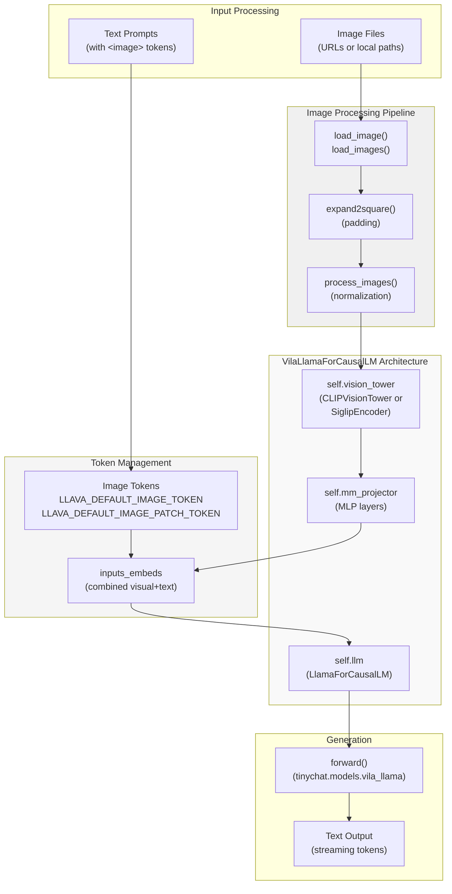
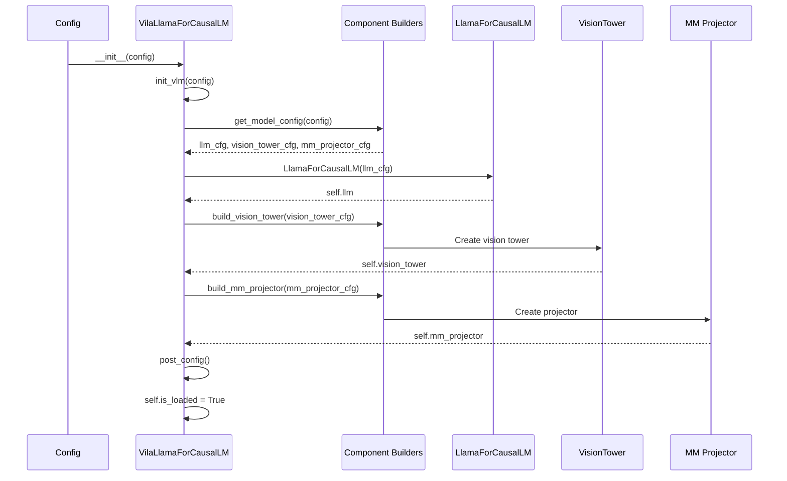
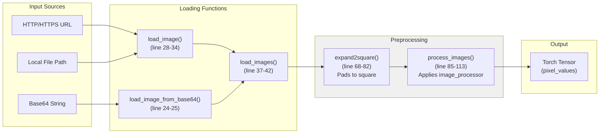
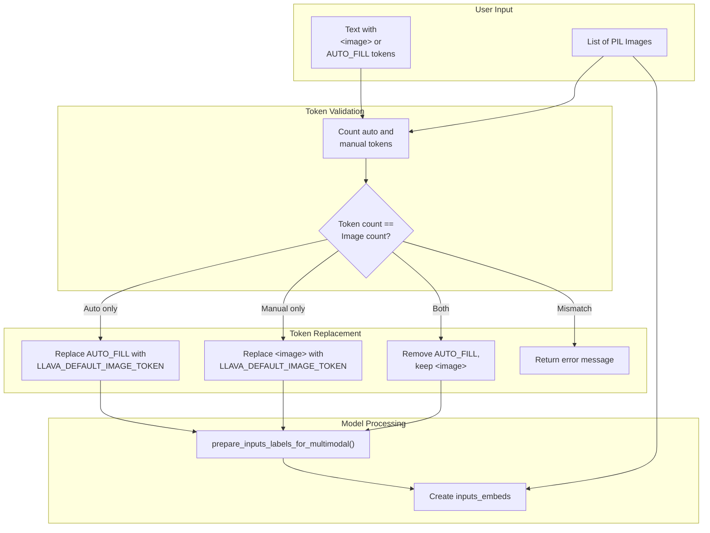
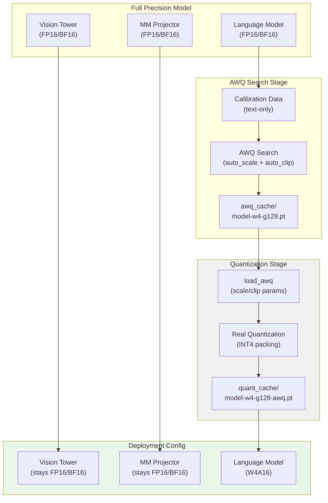

<!-- source: DeepWiki mcp.deepwiki.com · repo mit-han-lab/llm-awq · page 4.1 VILA & LLaVA Models · fetched 2026-10-30 -->

# VILA & LLaVA Models

<details>
<summary>Relevant source files</summary>

The following files were used as context for generating this wiki page:

- [README.md](README.md)
- [scripts/qwen_example.sh](scripts/qwen_example.sh)
- [tinychat/README.md](tinychat/README.md)
- [tinychat/models/vila_llama.py](tinychat/models/vila_llama.py)
- [tinychat/serve/gradio_web_server.py](tinychat/serve/gradio_web_server.py)
- [tinychat/utils/constants.py](tinychat/utils/constants.py)
- [tinychat/utils/llava_image_processing.py](tinychat/utils/llava_image_processing.py)
- [tinychat/utils/tune.py](tinychat/utils/tune.py)

</details>


## Purpose and Scope

This page documents the VILA (Visual Language Adapter) and LLaVA (Large Language and Vision Assistant) multimodal models supported in the AWQ system. These models combine vision encoders with large language models to enable visual understanding and reasoning capabilities. This page covers their architecture, image processing pipeline, and quantization strategies specific to vision-language integration.

For information about NVILA video models, see [NVILA Video Models](#4.2). For details on quantizing vision encoders specifically, see [Vision Encoder Quantization](#4.3). For general multimodal model concepts, see [Multimodal Models](#4).

---

## Architecture Overview

VILA and LLaVA models consist of three primary components that work together to process visual and textual inputs: a vision encoder that processes images, a multi-modal projector that bridges vision and language representations, and a language model that generates text outputs.

### Component Integration Diagram



**Sources:** [tinychat/models/vila_llama.py:1-110](), [tinychat/utils/llava_image_processing.py:1-114](), [tinychat/utils/constants.py:1-27]()

---

## Model Components

### VilaLlamaForCausalLM Class

The `VilaLlamaForCausalLM` class in [tinychat/models/vila_llama.py:20-110]() is the main container for VILA models. It inherits from `LlavaMetaModel` and `LlavaMetaForCausalLM` to provide multimodal capabilities.

| Component | Attribute | Type | Purpose |
|-----------|-----------|------|---------|
| Language Model | `self.llm` | `LlamaForCausalLM` | Generates text based on combined embeddings |
| Vision Encoder | `self.vision_tower` | `CLIPVisionTower` or `SiglipEncoder` | Encodes images to feature vectors |
| Projector | `self.mm_projector` | MLP layers | Maps vision features to language embedding space |

### Initialization Process

The `init_vlm()` method [tinychat/models/vila_llama.py:25-65]() initializes the three components:

1. **Extracts configurations** using `get_model_config(config)` to obtain `llm_cfg`, `vision_tower_cfg`, and `mm_projector_cfg`
2. **Builds language model** by instantiating `LlamaForCausalLM(llm_cfg)`
3. **Builds vision tower** using `build_vision_tower(vision_tower_cfg, config)`
4. **Builds projector** using `build_mm_projector(mm_projector_cfg, config)`
5. **Calls post_config()** to finalize initialization



**Sources:** [tinychat/models/vila_llama.py:25-65]()

### Forward Pass

The `forward()` method [tinychat/models/vila_llama.py:66-109]() handles both image and text inputs:

1. **Prepares multimodal inputs** by calling `prepare_inputs_labels_for_multimodal()` which embeds images and text together
2. **Routes to LLM** with either `inputs_embeds` (for image+text) or `tokens` (for text-only)
3. **Supports chunk prefilling** for efficient multi-turn conversations via the `chunk_prefilling` parameter

**Sources:** [tinychat/models/vila_llama.py:66-109]()

---

## Image Processing Pipeline

The image processing pipeline converts raw image files into tensors suitable for the vision encoder. The pipeline is implemented in [tinychat/utils/llava_image_processing.py:1-114]().

### Image Loading and Preprocessing Flow



### Key Image Processing Functions

| Function | Location | Purpose |
|----------|----------|---------|
| `load_image()` | [tinychat/utils/llava_image_processing.py:28-34]() | Loads single image from URL or file path, converts to RGB |
| `load_images()` | [tinychat/utils/llava_image_processing.py:37-42]() | Batch loads multiple images |
| `expand2square()` | [tinychat/utils/llava_image_processing.py:68-82]() | Pads non-square images with background color to make square |
| `process_images()` | [tinychat/utils/llava_image_processing.py:85-113]() | Applies model-specific preprocessing using `image_processor` |

### Image Aspect Ratio Handling

The `process_images()` function handles different aspect ratio modes based on `model_cfg.image_aspect_ratio`:

- **"pad" mode**: Calls `expand2square()` to pad images to square dimensions using mean color from `image_processor.image_mean`
- **Default mode**: Directly processes images without padding, allowing resize/crop based on `image_processor` settings

**Sources:** [tinychat/utils/llava_image_processing.py:85-113]()

---

## Image Token Management

VILA and LLaVA use special tokens to mark where images should be inserted into the text sequence. These tokens are defined in [tinychat/utils/constants.py:12-21]().

### Image Token Constants

| Constant | Value | Index | Purpose |
|----------|-------|-------|---------|
| `LLAVA_DEFAULT_IMAGE_TOKEN` | `"<image>"` | -200 | Primary image placeholder in prompts |
| `LLAVA_DEFAULT_IMAGE_PATCH_TOKEN` | `"<im_patch>"` | 32000 | Represents individual image patches |
| `LLAVA_DEFAULT_IM_START_TOKEN` | `"<im_start>"` | - | Marks beginning of image sequence |
| `LLAVA_DEFAULT_IM_END_TOKEN` | `"<im_end>"` | - | Marks end of image sequence |
| `LLAVA_DEFAULT_IM_TOKEN_PLACE_HOLDER` | `"<image>"` | - | User-inserted image placeholder |
| `AUTO_FILL_IM_TOKEN_HOLDER` | `"<im_holder>"` | - | Automatically filled image token |

### Token Replacement Process

In the Gradio web server [tinychat/serve/gradio_web_server.py:488-518](), the system performs token replacement:

1. **Counts tokens**: Checks `count_auto_im_token` and `count_manual_im_token` against `image_num`
2. **Validates**: Ensures token count matches the number of images provided
3. **Replaces**: Converts placeholder tokens to `LLAVA_DEFAULT_IMAGE_TOKEN` for model processing



**Sources:** [tinychat/serve/gradio_web_server.py:488-518](), [tinychat/utils/constants.py:12-21]()

---

## Model Variants

### VILA 1.0 and 1.5

VILA (Visual Language Adapter) models are available in multiple sizes with different capabilities:

| Model | Size | Vision Encoder | Context Length | Pre-computed AWQ |
|-------|------|----------------|----------------|------------------|
| VILA-1.0-7B | 7B | CLIP | Standard | ✅ [README.md:165]() |
| VILA-1.0-13B | 13B | CLIP | Standard | ✅ [README.md:165]() |
| VILA-1.5-3B | 3B | CLIP/Siglip | Extended | ✅ [README.md:163]() |
| VILA-1.5-8B | 8B | CLIP/Siglip | Extended | ✅ [README.md:163]() |
| VILA-1.5-13B | 13B | CLIP/Siglip | Extended | ✅ [README.md:163]() |
| VILA-1.5-40B | 40B | CLIP/Siglip | Extended | ✅ [README.md:163]() |

**VILA-1.5 enhancements** [README.md:59]():
- Video understanding support through frame extraction
- Multi-image input capability
- Improved visual reasoning across diverse tasks

### LLaVA Models

LLaVA (Large Language and Vision Assistant) models focus on instruction-following with visual inputs:

| Model | Size | Base LLM | Pre-computed AWQ |
|-------|------|----------|------------------|
| LLaVA-v0-13B | 13B | LLaMA | ✅ [README.md:172]() |
| LLaVA-v1.5-7B | 7B | Vicuna | Requires manual AWQ |

**Sources:** [README.md:156-174](), [tinychat/README.md:14-19]()

---

## Quantization Strategy for Vision-Language Models

VILA and LLaVA models use W4A16 (4-bit weights, 16-bit activations) quantization for the language model component, while the vision encoder typically remains at higher precision.

### Quantization Pipeline for VILA Models



### Component-Specific Quantization

| Component | Quantization | Rationale |
|-----------|--------------|-----------|
| Vision Tower | FP16/BF16 (no quantization) | Preserves visual feature quality; relatively small compared to LLM |
| MM Projector | FP16/BF16 (no quantization) | Small layer; minimal memory savings from quantization |
| Language Model | W4A16 AWQ | Large parameter count; significant memory reduction with AWQ |

### Performance Impact

From [tinychat/README.md:273-308](), VILA-1.5 models maintain accuracy after quantization:

**VILA-1.5-8B Accuracy (FP16 vs AWQ-INT4)**:
- VQA-v2: 80.9 → 80.3 (-0.6%)
- GQA: 61.9 → 61.7 (-0.2%)
- TextVQA: 66.3 → 65.4 (-0.9%)
- MMBench: 72.3 → 71.0 (-1.3%)

**Speed Improvements** [tinychat/README.md:82-92]():
- RTX 4090: 2.87x faster decoding for VILA-7B
- Jetson Orin: 3.10x faster decoding for VILA-7B

**Sources:** [README.md:180-183](), [tinychat/README.md:273-315]()

---

## Multi-Image and Video Support

### Multi-Image Input Processing

VILA models support multiple images in a single conversation. The Gradio interface [tinychat/serve/gradio_web_server.py:220-308]() demonstrates this capability:

1. **Image boxes**: Three separate image input boxes (`imagebox`, `imagebox_2`, `imagebox_3`)
2. **Image aggregation**: The `add_images()` function collects all non-None images into `image_list`
3. **Token insertion**: Each image gets an `AUTO_FILL_IM_TOKEN_HOLDER` or empty string based on `args.auto_pad_image_token`
4. **State management**: `state.append_message()` is called for each image to maintain conversation state

### Video Frame Extraction

For video inputs [tinychat/serve/gradio_web_server.py:232-274](), the system:

1. **Extracts frames** using OpenCV (`cv2.VideoCapture`)
2. **Samples uniformly**: Takes 8 frames at regular intervals (`frame_interval = frame_count // 8`)
3. **Converts to PIL**: Each frame is converted from BGR to RGB and wrapped as PIL Image
4. **Treats as images**: Video frames are appended to `image_list` and processed like regular images

```mermaid
graph LR
    subgraph VideoInput["Video Input"]
        VideoFile["Video File<br/>(MP4, etc.)"]
    end
    
    subgraph Extraction["Frame Extraction"]
        OpenCV["cv2.VideoCapture"]
        Sample["Sample 8 frames<br/>(uniform intervals)"]
        Convert["Convert BGR to RGB<br/>Create PIL Images"]
    end
    
    subgraph Processing["Image Processing"]
        ImageList["Append to image_list"]
        TokenInsert["Insert image tokens<br/>for each frame"]
        VisionEnc["Vision Encoder<br/>processes all frames"]
    end
    
    subgraph LLM["Language Model"]
        Aggregate["Aggregate frame<br/>features"]
        Generate["Generate video<br/>understanding response"]
    end
    
    VideoFile --> OpenCV
    OpenCV --> Sample
    Sample --> Convert
    Convert --> ImageList
    ImageList --> TokenInsert
    TokenInsert --> VisionEnc
    VisionEnc --> Aggregate
    Aggregate --> Generate
    
    style Extraction fill:#f0f0f0
    style Processing fill:#f5f5f5
```



**Multi-image examples** [README.md:29-50]():
- Single-image queries with visual reasoning
- Multi-image comparisons and analysis
- Video understanding through frame sequences

**Sources:** [tinychat/serve/gradio_web_server.py:220-308](), [README.md:29-50]()

---

## Model Loading and Optimization

### Loading Pre-quantized Models

For TinyChat deployment, VILA models can be loaded from pre-quantized checkpoints:

**Option 1: Manual quantization** [tinychat/README.md:358-375]():
```bash
# Step 1: Run AWQ search
python -m awq.entry --model_path /PATH/TO/VILA \
    --w_bit 4 --q_group_size 128 \
    --run_awq --dump_awq awq_cache/vila-w4-g128.pt

# Step 2: Generate real quantized weights
python -m awq.entry --model_path /PATH/TO/VILA \
    --load_awq awq_cache/vila-w4-g128.pt \
    --q_backend real --dump_quant quant_cache/vila-w4-g128-awq.pt
```

**Option 2: Download pre-quantized** [tinychat/README.md:457-472]():
```bash
git clone https://huggingface.co/Efficient-Large-Model/VILA1.5-13b-AWQ
python vila15_demo.py \
    --model-path VILA1.5-13b-AWQ \
    --quant-path VILA1.5-13b-AWQ/llm \
    --precision W4A16
```

### Runtime Optimizations

When running VILA models with TinyChat [tinychat/README.md:394-395](), two key optimizations are available:

1. **Flash Attention**: `--flash` flag enables efficient attention computation
2. **Chunk Prefilling**: `--chunk_prefilling` flag enables KV cache reuse in multi-turn conversations

The `tune_all_wqlinears()` function [tinychat/utils/tune.py:68-81]() auto-tunes the `split_k_iters` parameter for each quantized linear layer to optimize throughput.

### Vision Tower Warmup

The `tune_llava_patch_embedding()` function [tinychat/utils/tune.py:16-33]() pre-tunes the vision tower's patch embedding layer to avoid cuDNN auto-tuning latency during inference:

1. **Extracts patch_embedding** from vision tower
2. **Creates dummy input** with shape `(1, in_channels, 336, 336)`
3. **Runs 100 warmup iterations** to pre-tune kernel configurations

**Sources:** [tinychat/utils/tune.py:16-33](), [tinychat/utils/tune.py:68-81](), [tinychat/README.md:394-395]()

---

## Demo and Interface Usage

### Command-Line Demo

The VILA-1.5 demo script provides an interactive interface [tinychat/README.md:446-472]():

```bash
python vila15_demo.py \
    --model-path /PATH/TO/VILA/VILA-1.5-13B \
    --quant-path quant_cache/vila-1.5-13b-w4-g128-awq.pt \
    --precision W4A16 \
    --image-file /PATH/TO/IMAGE \
    --vis-image  # Optional: display images in terminal
```

**Key parameters**:
- `--model-path`: Path to full-precision model config
- `--quant-path`: Path to quantized weights
- `--precision`: Quantization mode (W4A16 or W16A16)
- `--image-file`: Comma-separated list of image paths for multi-image input
- `--vis-image`: Enables in-terminal image display using termvisage

### Gradio Web Server

For browser-based interaction [tinychat/serve/gradio_web_server.py:632-678](), the Gradio interface provides:

1. **Multi-modal inputs**: Three image boxes plus one video box
2. **Chat interface**: Streaming text generation with message history
3. **Model selection**: Dropdown to choose between different VILA variants
4. **Prompt style**: Radio buttons for "default" or "no-sys" prompt templates
5. **Image processing mode**: Options for "Crop", "Resize", "Pad", or "Default"

The web server uses a controller-worker architecture (see [Gradio Web Interface](#5.2) for details).

**Sources:** [tinychat/README.md:446-472](), [tinychat/serve/gradio_web_server.py:632-678]()

---

