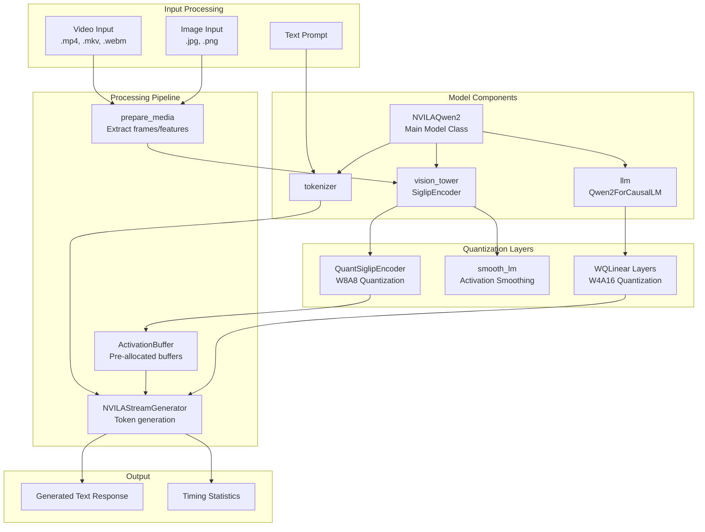
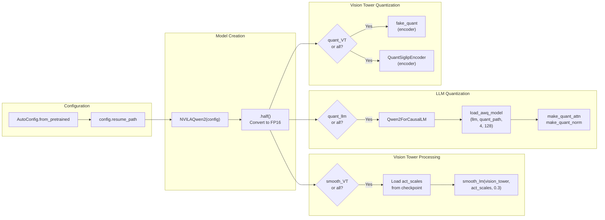
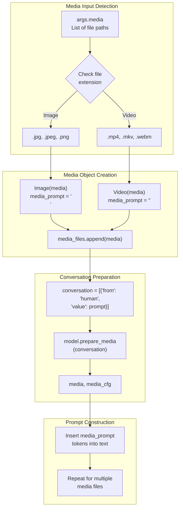
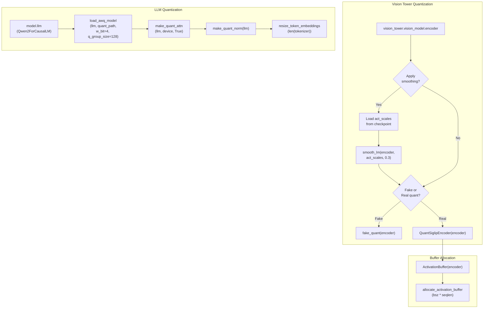
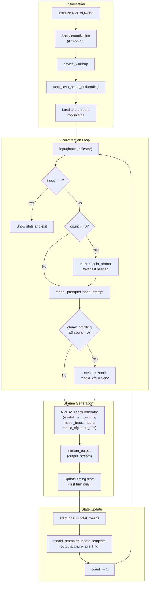
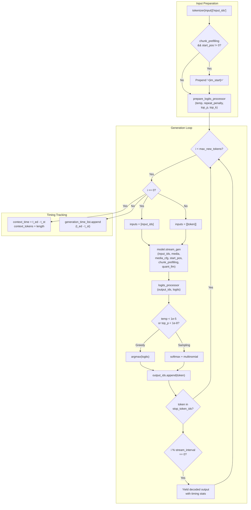
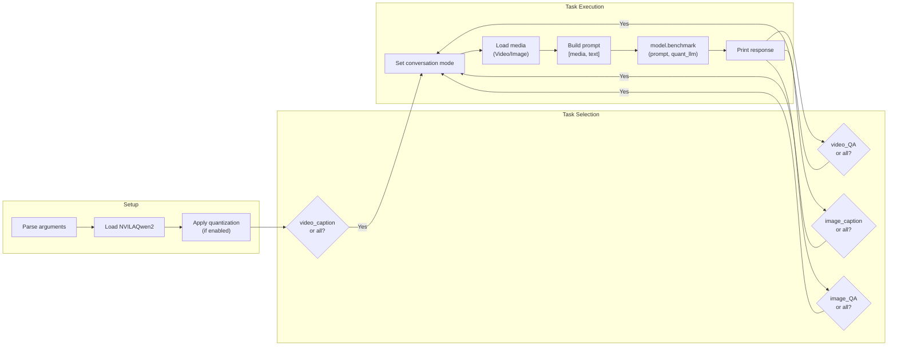
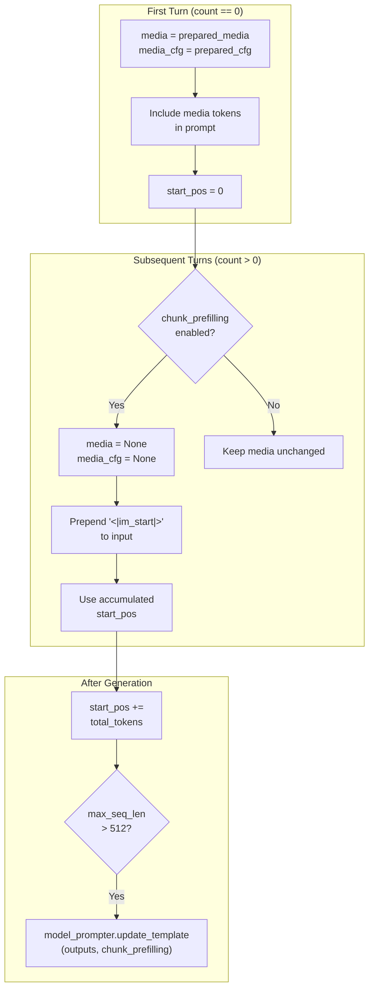

<!-- source: DeepWiki mcp.deepwiki.com · repo mit-han-lab/llm-awq · page 4.2 NVILA Video Models · fetched 2026-10-30 -->

# NVILA Video Models

<details>
<summary>Relevant source files</summary>

The following files were used as context for generating this wiki page:

- [tinychat/benchmark.py](tinychat/benchmark.py)
- [tinychat/modules/fused_siglipdecoder.py](tinychat/modules/fused_siglipdecoder.py)
- [tinychat/nvila_benchmark.py](tinychat/nvila_benchmark.py)
- [tinychat/nvila_demo.py](tinychat/nvila_demo.py)
- [tinychat/stream_generators/NVILA_stream_gen.py](tinychat/stream_generators/NVILA_stream_gen.py)
- [tinychat/utils/input_metadata.py](tinychat/utils/input_metadata.py)

</details>


## Purpose and Scope

This document describes NVILA (Neural Video-Language Assistant), a video understanding model that extends vision-language capabilities to temporal video processing. NVILA combines a vision encoder (Siglip) with a language model (Qwen2) to process video inputs and generate text responses. The implementation demonstrates mixed-precision quantization strategies, with W8A8 quantization for the vision tower and W4A16 quantization for the language model.

For static image processing with VILA/LLaVA models, see [VILA & LLaVA Models](#4.1). For details on vision encoder quantization techniques, see [Vision Encoder Quantization](#4.3). For inference optimization strategies, see [Performance Optimizations](#3.3).

---

## Architecture Overview

NVILA's architecture consists of three primary components: a quantized vision tower for processing visual inputs, a quantized language model for text generation, and media processing utilities for handling both images and videos.

**NVILA System Architecture**



**Sources:** [tinychat/nvila_demo.py:75-115](), [tinychat/models/nvila_qwen2.py]()

---

## Model Initialization and Configuration

The `NVILAQwen2` model is initialized with specific configurations for handling video inputs and applying mixed-precision quantization.

**Model Loading Process**



**Sources:** [tinychat/nvila_demo.py:79-115]()

### Command-Line Arguments

The NVILA demo supports multiple quantization and configuration options:

| Argument | Type | Purpose |
|----------|------|---------|
| `--model_path` | str | Path to the NVILA model checkpoint |
| `--quant_path` | str | Path to the quantized LLM weights (.pt file) |
| `--act_scale_path` | str | Path to activation scales for smoothing |
| `--media` | str[] | List of video/image file paths |
| `--quant_llm` | flag | Enable W4A16 quantization for language model |
| `--quant_VT` | flag | Enable W8A8 quantization for vision tower |
| `--smooth_VT` | flag | Apply activation smoothing to vision tower |
| `--fakequant_VT` | flag | Use fake quantization instead of real quantization |
| `--all` | flag | Enable all quantization options |
| `--chunk_prefilling` | flag | Enable KV cache reuse for multi-turn conversations |

**Sources:** [tinychat/nvila_demo.py:214-271]()

---

## Media Processing Pipeline

NVILA handles both images and videos through a unified media processing interface provided by the `llava` library.

**Media Type Detection and Processing**



**Sources:** [tinychat/nvila_demo.py:119-141]()

### Video Frame Extraction

Videos are processed by extracting frames at specific intervals. The `Video` class from the `llava.media` module handles this extraction automatically.

```python
# Video handling example from nvila_demo.py
media = Video(media_path)  # Creates Video object
media_prompt = "<vila/video>"  # Special token for video input
```

The `prepare_media` method processes the video frames and returns:
- `media`: Processed frame tensors
- `media_cfg`: Configuration dictionary containing frame count, temporal information, and encoding parameters

**Sources:** [tinychat/nvila_demo.py:122-141]()

---

## Mixed-Precision Quantization Strategy

NVILA employs a mixed-precision quantization approach to balance model size, inference speed, and accuracy. The vision tower uses W8A8 (8-bit weights and activations) while the language model uses W4A16 (4-bit weights and 16-bit activations).

**Quantization Configuration Table**

| Component | Weight Precision | Activation Precision | Method | Purpose |
|-----------|------------------|---------------------|--------|---------|
| Vision Tower (SiglipEncoder) | INT8 | INT8 | `QuantSiglipEncoder` | High accuracy for visual features |
| Language Model (Qwen2) | INT4 | FP16 | `WQLinear` + AWQ | Memory efficiency for large LLM |
| Projection Layers | FP16 | FP16 | No quantization | Preserve modality alignment |

**Quantization Application Flow**



**Sources:** [tinychat/nvila_demo.py:86-115]()

### Activation Smoothing

Before quantizing the vision tower, activation smoothing (`smooth_lm`) is applied to reduce quantization error. This technique scales channel-wise activations and weights to minimize the impact of outliers.

The smoothing factor of `0.3` (alpha parameter) controls the balance between activation and weight smoothing:

```
W' = W * s^alpha
X' = X / s^alpha
```

where `s` contains the per-channel activation scales.

**Sources:** [tinychat/nvila_demo.py:86-90](), [awq/quantize/__init__.py]()

### QuantSiglipEncoder Architecture

The `QuantSiglipEncoder` wraps the standard `SiglipEncoder` with INT8 quantization support:

**Key Components:**

1. **ActivationBuffer**: Pre-allocates GPU memory for intermediate activations
   - `qkv_proj_act_buffer`: Stores Q, K, V projections
   - `fc1_buffer`, `actfn_buffer`: MLP intermediate outputs
   - `quantized_act_buffer`: INT8 quantized activations
   - `quantized_scale_buffer`: Per-token quantization scales

2. **Quantized Layers**:
   - `QuantSiglipFlashAttention2`: Flash Attention with INT8 I/O
   - `QuantSiglipMLP`: MLP layers with INT8 computation
   - `RMSNormGeneral`: Layer normalization with quantization

**Sources:** [tinychat/modules/fused_siglipdecoder.py:24-81](), [tinychat/utils/input_metadata.py:14-103]()

---

## Interactive Demo Interface

The NVILA demo provides an interactive command-line interface for multi-turn conversations with video and image inputs.

**Demo Conversation Loop**



**Sources:** [tinychat/nvila_demo.py:166-211]()

### Prompt Template Handling

The demo uses model-specific prompt templates through the `get_prompter` function. For NVILA, prompts are formatted according to the Qwen conversation format:

```
<|im_start|>system
{system_message}<|im_end|>
<|im_start|>user
{media_tokens}{user_message}<|im_end|>
<|im_start|>assistant
```

Media tokens (`<image>` or `<vila/video>`) are automatically inserted before the user message in the first turn.

**Sources:** [tinychat/nvila_demo.py:149-183](), [tinychat/utils/prompt_templates.py]()

---

## Stream Generation Implementation

The `NVILAStreamGenerator` handles token-by-token generation with timing statistics and streaming output.

**Generation Pipeline**



**Sources:** [tinychat/stream_generators/NVILA_stream_gen.py:14-177]()

### Timing Statistics

The generator tracks detailed timing information:

- **Context Processing**: Time to process the initial prompt (including media encoding)
- **Context Tokens**: Number of tokens in the context (input + media tokens)
- **Generation Time List**: Per-token generation times for all output tokens
- **Total Tokens**: Sum of context and generated tokens

These statistics are yielded in the final output dictionary:

```python
yield {
    "text": output,
    "usage": {
        "prompt_tokens": input_echo_len,
        "completion_tokens": i,
        "total_tokens": input_echo_len + i,
    },
    "finish_reason": finish_reason,
    "timing": {
        "context_tokens": context_tokens,
        "context_time": context_time,
        "total_tokens": total_tokens,
        "generation_time_list": generation_time_list,
    },
}
```

**Sources:** [tinychat/stream_generators/NVILA_stream_gen.py:99-170]()

---

## Benchmarking Capabilities

The `nvila_benchmark.py` script provides structured evaluation of NVILA's performance across four tasks.

**Benchmark Tasks**

| Task | Media Type | Sample Prompt |
|------|------------|---------------|
| Video Caption | Video | "Elaborate on the visual and narrative elements of the video in detail." |
| Video QA | Video | "What is the person in the video doing? Select the option that best describes..." |
| Image Caption | Image | "Describe the image in detail." |
| Image QA | Image | "What does the text in the image say? Choose the option that best matches..." |

**Benchmark Execution Flow**



**Sources:** [tinychat/nvila_benchmark.py:19-163]()

### Benchmark Arguments

```bash
# Run all tasks with full quantization
python tinychat/nvila_benchmark.py \
    --model-path /path/to/nvila-model \
    --quant_path /path/to/quantized-weights.pt \
    --act_scale_path /path/to/activation-scales.pt \
    --all

# Run specific tasks
python tinychat/nvila_benchmark.py \
    --model-path /path/to/nvila-model \
    --video_caption \
    --video_QA \
    --video_path /path/to/video.mp4
```

The `--all` flag enables both LLM and vision tower quantization and runs all four tasks sequentially.

**Sources:** [tinychat/nvila_benchmark.py:43-69]()

---

## Model File Download

The demo includes a helper function to download NVILA model files from Hugging Face Hub:

```python
def download_model_file(
    repo_id: str = "Efficient-Large-Model/NVILA-AWQ",
    filename: str = None,
    local_dir: str = "./hf_cache",      
    force_download: bool = False,         
) -> str
```

This function:
1. Creates the local directory if it doesn't exist
2. Checks if the file already exists locally
3. Downloads from Hugging Face Hub if needed
4. Returns the local path to the file

The default repository is `Efficient-Large-Model/NVILA-AWQ`, which hosts pre-quantized NVILA models with both LLM weights and activation scales.

**Sources:** [tinychat/nvila_demo.py:40-61]()

---

## Integration with Chunk Prefilling

NVILA supports chunk prefilling for efficient multi-turn conversations. When enabled:

1. **First Turn**: Media and full prompt are processed, KV cache is populated
2. **Subsequent Turns**: Media is set to `None`, only new tokens are processed
3. **Position Tracking**: `start_pos` tracks the current position in the KV cache

This optimization significantly reduces latency in multi-turn video conversations by reusing previously computed key-value pairs.

**Chunk Prefilling State Management**



**Sources:** [tinychat/nvila_demo.py:184-209](), [tinychat/stream_generators/NVILA_stream_gen.py:30-31]()

---

