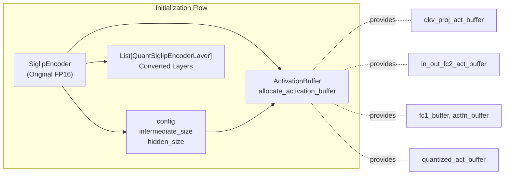
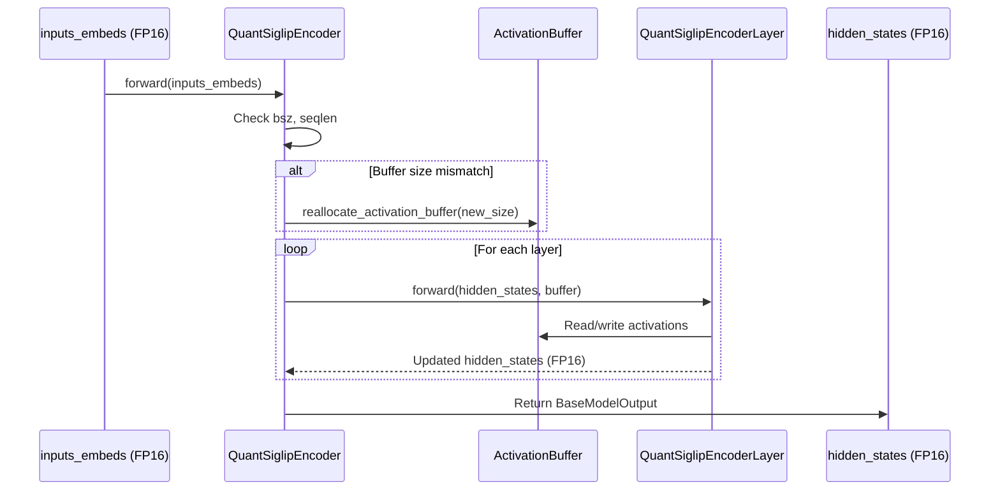
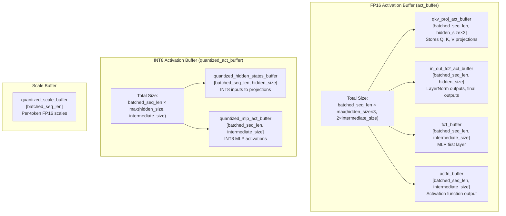
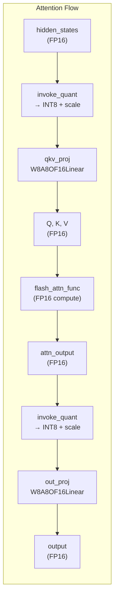
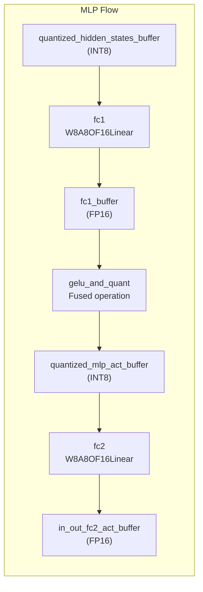
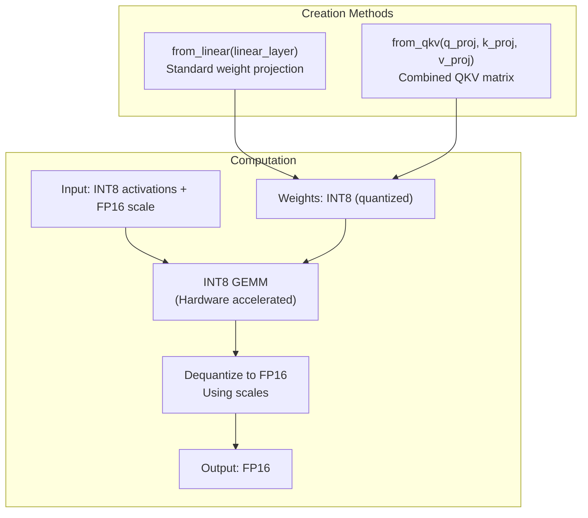
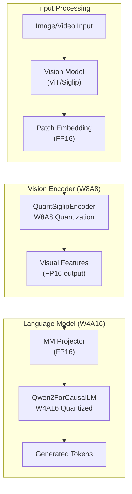
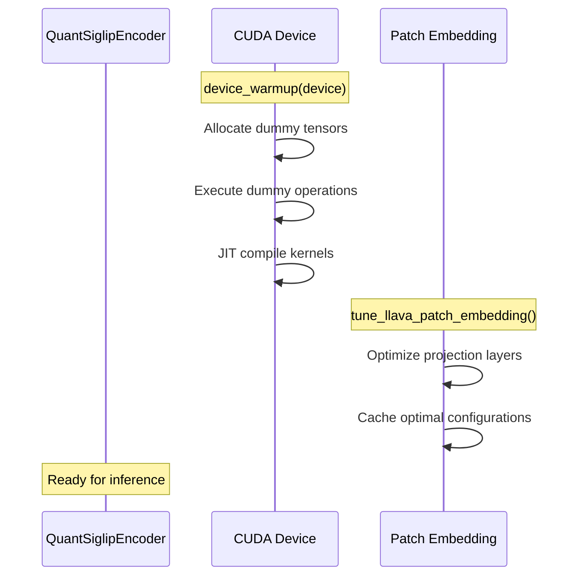
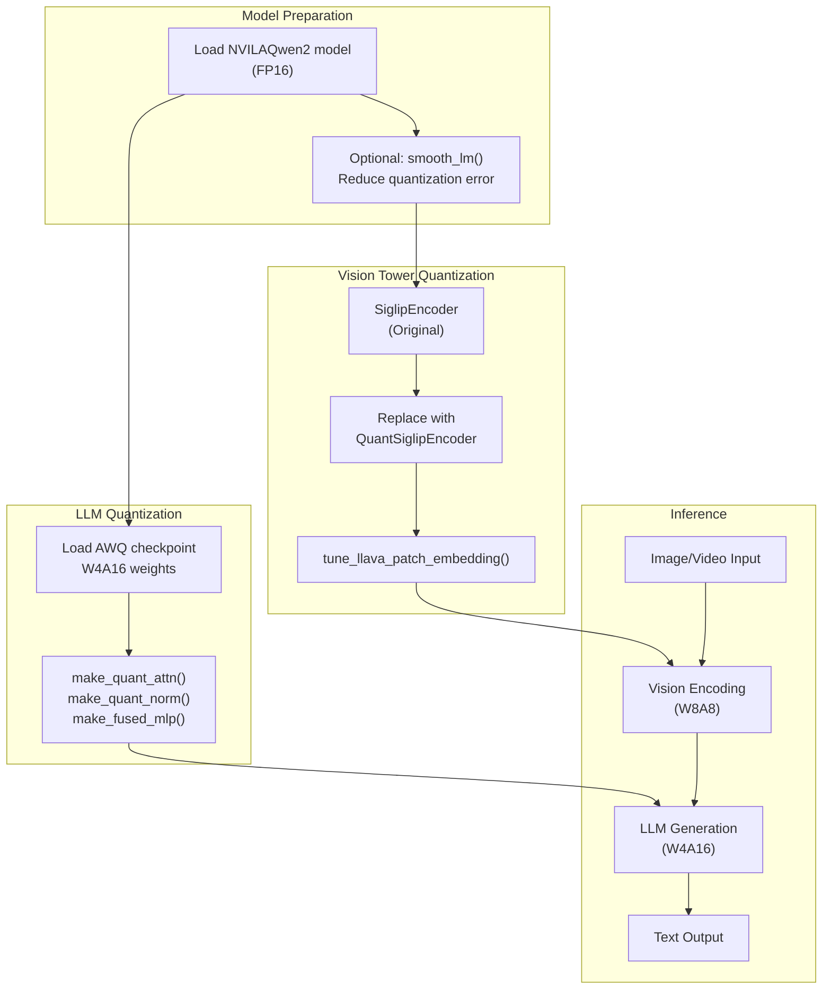

<!-- source: DeepWiki mcp.deepwiki.com · repo mit-han-lab/llm-awq · page 4.3 Vision Encoder Quantization · fetched 2026-10-30 -->

# Vision Encoder Quantization

<details>
<summary>Relevant source files</summary>

The following files were used as context for generating this wiki page:

- [tinychat/benchmark.py](tinychat/benchmark.py)
- [tinychat/modules/fused_siglipdecoder.py](tinychat/modules/fused_siglipdecoder.py)
- [tinychat/nvila_benchmark.py](tinychat/nvila_benchmark.py)
- [tinychat/nvila_demo.py](tinychat/nvila_demo.py)
- [tinychat/stream_generators/NVILA_stream_gen.py](tinychat/stream_generators/NVILA_stream_gen.py)
- [tinychat/utils/input_metadata.py](tinychat/utils/input_metadata.py)

</details>


## Purpose and Scope

This document describes the W8A8 (8-bit weight, 8-bit activation) quantization system for vision encoders in multimodal models. Vision encoders process image and video inputs before they are consumed by the language model. For information about the overall multimodal model architectures, see [VILA & LLaVA Models](#4.1) and [NVILA Video Models](#4.2). For LLM quantization using W4A16, see [Quantization Implementation](#2.2).

Vision encoder quantization differs from LLM quantization in several key ways:
- Uses W8A8 instead of W4A16 (higher precision for visual features)
- Quantizes both weights and activations dynamically
- Employs pre-allocated activation buffers for memory efficiency
- Integrates Flash Attention for efficient processing

---

## System Overview

The vision encoder quantization system transforms a standard `SiglipEncoder` (or similar vision encoder) into a quantized version that performs INT8 computation while maintaining FP16 input/output interfaces. The system is designed for real-time video and image processing where memory efficiency is critical.

```mermaid
graph TB
    subgraph "Input Processing"
        ImageEmbed["Image Embeddings<br/>(FP16)"]
    end
    
    subgraph "QuantSiglipEncoder"
        AllocBuffer["ActivationBuffer<br/>Pre-allocated INT8/FP16"]
        Layer1["QuantSiglipEncoderLayer 0"]
        Layer2["QuantSiglipEncoderLayer 1"]
        LayerN["QuantSiglipEncoderLayer N"]
    end
    
    subgraph "Layer Components"
        LN1["RMSNormGeneral<br/>FP16→INT8+Scale"]
        Attn["QuantSiglipFlashAttention2<br/>QKV Projection"]
        FlashAttn["flash_attn_func<br/>Efficient Attention"]
        OutProj["out_proj<br/>W8A8OF16LinearDynamicInputScale"]
        LN2["RMSNormGeneral<br/>FP16→INT8+Scale"]
        MLP["QuantSiglipMLP<br/>fc1→gelu→fc2"]
    end
    
    subgraph "Output"
        Features["Visual Features<br/>(FP16)"]
    end
    
    ImageEmbed --> AllocBuffer
    AllocBuffer --> Layer1
    Layer1 --> Layer2
    Layer2 --> LayerN
    LayerN --> Features
    
    Layer1 -.contains.- LN1
    LN1 --> Attn
    Attn --> FlashAttn
    FlashAttn --> OutProj
    OutProj --> LN2
    LN2 --> MLP
    
    style "QuantSiglipEncoder" fill:#f9f9f9
    style "Layer Components" fill:#f0f0f0
```

**Sources:** [tinychat/modules/fused_siglipdecoder.py:24-81](), [tinychat/modules/fused_siglipdecoder.py:180-243]()

---

## QuantSiglipEncoder Architecture

### Initialization and Buffer Allocation

The `QuantSiglipEncoder` wraps a standard `SiglipEncoder` and converts each layer into a quantized version. It maintains an `ActivationBuffer` instance that provides pre-allocated memory for intermediate activations.



**Key initialization parameters:**

| Parameter | Purpose | Default |
|-----------|---------|---------|
| `bsz` | Batch size for buffer allocation | 64 |
| `seqlen` | Sequence length per sample | 1024 |
| `batched_seq_len` | Total tokens = `bsz * seqlen` | 65536 |

**Sources:** [tinychat/modules/fused_siglipdecoder.py:24-33](), [tinychat/utils/input_metadata.py:14-46]()

### Forward Pass

The forward pass iterates through quantized encoder layers, passing the shared `ActivationBuffer` to each layer. The buffer is dynamically reallocated if the batch size or sequence length changes.



**Sources:** [tinychat/modules/fused_siglipdecoder.py:35-80]()

---

## ActivationBuffer System

The `ActivationBuffer` class pre-allocates memory for all intermediate activations in the vision encoder, avoiding repeated memory allocations during inference. This is critical for real-time video processing.

### Buffer Layout



**Buffer allocation strategy:**
- Overlapping views: Different buffers are views into the same underlying tensor
- Maximum size principle: Allocate based on the maximum needed across all operations
- Example: `qkv_proj_act_buffer` and `fc1_buffer` can share memory because they're not used simultaneously

**Sources:** [tinychat/utils/input_metadata.py:40-103]()

### Memory Efficiency

The overlapping buffer design significantly reduces memory footprint:

| Component | Size (tokens=65536, hidden=768, intermediate=3072) |
|-----------|---------------------------------------------------|
| Without sharing | ~1.5 GB (multiple separate buffers) |
| With sharing | ~800 MB (overlapping views) |
| Savings | ~47% |

**Sources:** [tinychat/utils/input_metadata.py:48-76]()

---

## Quantized Layer Components

### QuantSiglipFlashAttention2

Implements quantized multi-head attention with Flash Attention optimization. The flow is:

1. **FP16→INT8 Quantization**: Input hidden states quantized with per-token scales
2. **QKV Projection**: `W8A8OF16LinearDynamicInputScale` computes Q, K, V (outputs FP16)
3. **Flash Attention**: Efficient attention computation on FP16 tensors
4. **Output Quantization**: Attention output quantized back to INT8
5. **Output Projection**: Final projection returns FP16 output



**Key components:**

- `qkv_proj`: Combined QKV projection created by `W8A8OF16LinearDynamicInputScale.from_qkv()` [tinychat/modules/fused_siglipdecoder.py:137-139]()
- `out_proj`: Output projection layer [tinychat/modules/fused_siglipdecoder.py:140-142]()
- `flash_attn_func`: Flash Attention 2 implementation for non-causal attention [tinychat/modules/fused_siglipdecoder.py:168]()

**Sources:** [tinychat/modules/fused_siglipdecoder.py:125-178]()

### QuantSiglipMLP

Implements the feed-forward network with quantized operations. The MLP follows the pattern:

```
FP16 → INT8 → fc1(W8A8) → FP16 → GELU → INT8 → fc2(W8A8) → FP16
```



**Fused operation optimization:**

The `gelu_and_quant` kernel fuses two operations into one:
1. Apply GELU activation function
2. Quantize to INT8 with per-token scaling

This avoids an intermediate FP16 materialization, saving memory bandwidth.

**Sources:** [tinychat/modules/fused_siglipdecoder.py:83-123]()

### RMSNormGeneral

Implements layer normalization with integrated quantization. Unlike standard LayerNorm, this version outputs INT8 tensors directly.

**Operation:**
```
output = quantize(weight * (x / sqrt(mean(x²) + eps)) + bias)
```

**Features:**
- Supports both per-token and per-tensor quantization
- Uses custom CUDA kernel `awq_inference_engine.rms_norm_general` for efficiency
- Returns both quantized output (INT8) and per-token scales (FP16)

**Sources:** [tinychat/modules/fused_siglipdecoder.py:246-283]()

---

## W8A8OF16LinearDynamicInputScale

The fundamental building block for quantized linear layers in the vision encoder. This class performs INT8 matrix multiplication with FP16 output.

### Layer Types



**Dynamic input scaling:**
- Input activations are quantized per-token, not per-tensor
- Each token has its own FP16 scale factor
- This preserves outliers in the activation distribution

**Sources:** [tinychat/modules/fused_siglipdecoder.py:88-92](), [tinychat/modules/fused_siglipdecoder.py:137-142]()

---

## Integration with Language Models

### Mixed-Precision Architecture

Vision-language models like NVILA use mixed-precision quantization:
- **Vision Tower**: W8A8 (higher precision for visual features)
- **Language Model**: W4A16 (more aggressive quantization)



**Sources:** [tinychat/nvila_demo.py:106-114]()

### Conditional Quantization

The system supports flexible quantization strategies controlled by command-line flags:

| Flag | Effect | Use Case |
|------|--------|----------|
| `--quant_VT` | Quantize vision tower only | Test vision encoder performance |
| `--quant_llm` | Quantize LLM only | Test language model performance |
| `--smooth_VT` | Apply activation smoothing | Reduce quantization error |
| `--fakequant_VT` | Simulate quantization | Debugging without real quantization |
| `--all` | Enable all optimizations | Production deployment |

**Implementation example:**

```python
# From nvila_demo.py
if args.quant_VT or args.all:
    from tinychat.modules import QuantSiglipEncoder
    
    if args.fakequant_VT:
        fake_quant(model.vision_tower.vision_tower.vision_model.encoder)
    else:
        model.vision_tower.vision_tower.vision_model.encoder = QuantSiglipEncoder(
            model.vision_tower.vision_tower.vision_model.encoder
        )
```

**Sources:** [tinychat/nvila_demo.py:106-114](), [tinychat/nvila_benchmark.py:108-113]()

---

## Activation Smoothing

Before quantization, activation smoothing can be applied to reduce quantization error. This technique redistributes magnitude across channels to minimize outliers.

**Process:**
1. Load pre-computed activation scales from checkpoint
2. Apply `smooth_lm(vision_tower, act_scales, alpha=0.3)`
3. Scales are migrated from activations to weights
4. Result: More uniform activation distribution → better quantization

**Usage:**

```python
# From nvila_demo.py
if args.smooth_VT or args.all:
    from awq.quantize import smooth_lm
    act_scales = torch.load(args.act_scale_path)
    smooth_lm(model.vision_tower, act_scales, 0.3)
```

The `alpha=0.3` parameter controls the trade-off between activation and weight smoothing.

**Sources:** [tinychat/nvila_demo.py:86-90]()

---

## Performance Optimization

### Device Warmup and Tuning

Before inference, the vision encoder requires initialization:



**Sources:** [tinychat/nvila_demo.py:116-117](), [tinychat/benchmark.py:137]()

### Memory Allocation Strategy

The buffer allocation happens lazily and adaptively:

1. **Initial Allocation**: When encoder is created with default `bsz=64, seqlen=1024`
2. **Runtime Reallocation**: If input shape changes, buffer is reallocated [tinychat/modules/fused_siglipdecoder.py:46-49]()
3. **Shared Memory**: Multiple buffer views share underlying storage

**Benefits:**
- Handles variable-length video inputs efficiently
- Minimal memory fragmentation
- Predictable memory usage

**Sources:** [tinychat/modules/fused_siglipdecoder.py:46-49](), [tinychat/utils/input_metadata.py:40-103]()

---

## Usage Patterns

### Complete Quantization Workflow



**Sources:** [tinychat/nvila_demo.py:64-115]()

### Benchmarking Vision Encoder

The benchmark utility measures vision encoder performance in isolation:

```python
# Key metrics tracked:
# - Time to first token (TTFT): Encoding time + first LLM token
# - Throughput: Subsequent token generation speed
# - Memory usage: Peak GPU memory consumption
```

**Test scenarios:**

| Scenario | Configuration | Purpose |
|----------|--------------|---------|
| Image Caption | Single image, short prompt | Test image encoding |
| Image QA | Single image, question | Test reasoning |
| Video Caption | Multi-frame video | Test temporal processing |
| Video QA | Multi-frame video, question | Test video understanding |

**Sources:** [tinychat/nvila_benchmark.py:116-159]()

---

## Implementation Notes

### Key Design Decisions

1. **W8A8 vs W4A16**: Vision encoders use higher precision because:
   - Visual features have more uniform distributions
   - Lower quantization error is critical for downstream tasks
   - INT8 computation is well-optimized on GPUs

2. **Dynamic Input Scaling**: Per-token scales enable:
   - Better handling of outliers in attention scores
   - Preservation of fine-grained visual details
   - Minimal accuracy loss compared to FP16

3. **Buffer Reuse**: Overlapping buffer views:
   - Reduce memory footprint by ~50%
   - Enable larger batch sizes or longer sequences
   - Critical for video processing (many frames)

**Sources:** [tinychat/modules/fused_siglipdecoder.py](), [tinychat/utils/input_metadata.py]()

### CUDA Kernel Integration

The quantized vision encoder relies on custom CUDA kernels from `awq_inference_engine`:

- `invoke_quant`: FP16 → INT8 quantization with scale computation
- `gelu_and_quant`: Fused GELU activation and quantization
- `rms_norm_general`: Layer normalization with integrated quantization

These kernels are implemented in [awq/kernels/csrc]() and exposed through PyTorch extensions.

**Sources:** [tinychat/modules/fused_siglipdecoder.py:97-101](), [tinychat/modules/fused_siglipdecoder.py:111-116](), [tinychat/modules/fused_siglipdecoder.py:274-282]()

---

