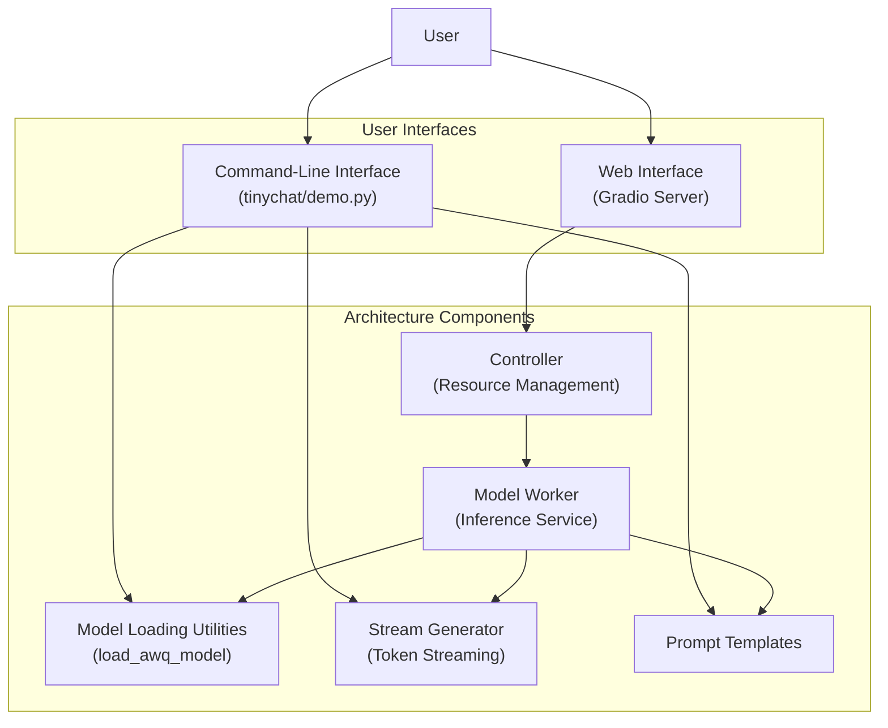
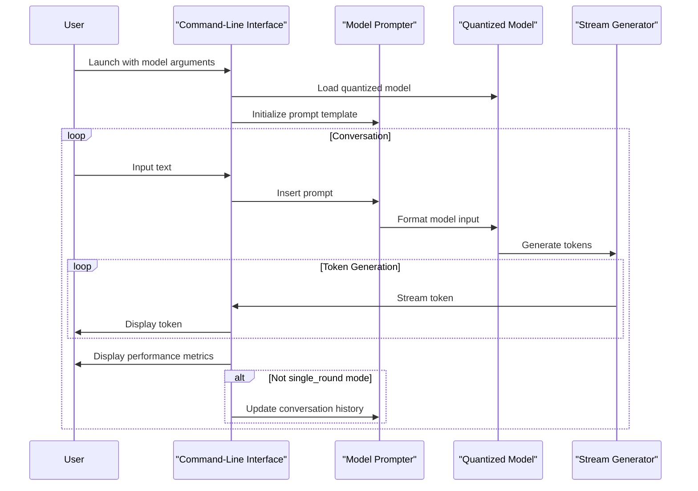
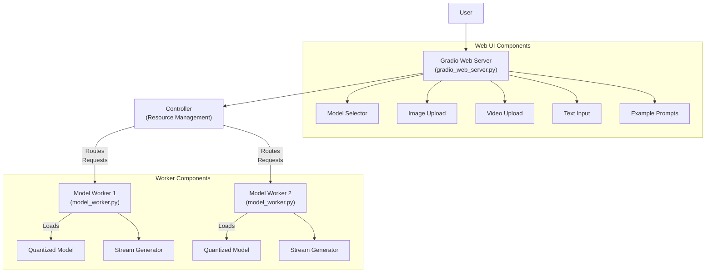
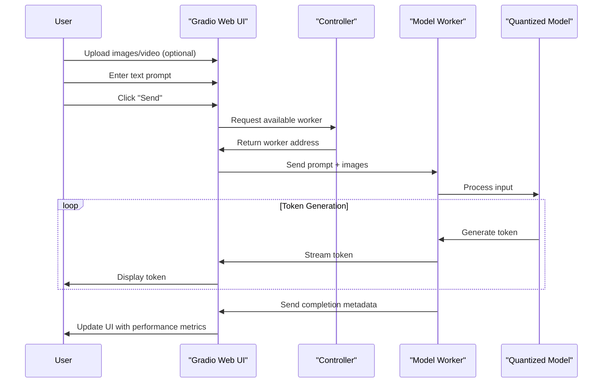
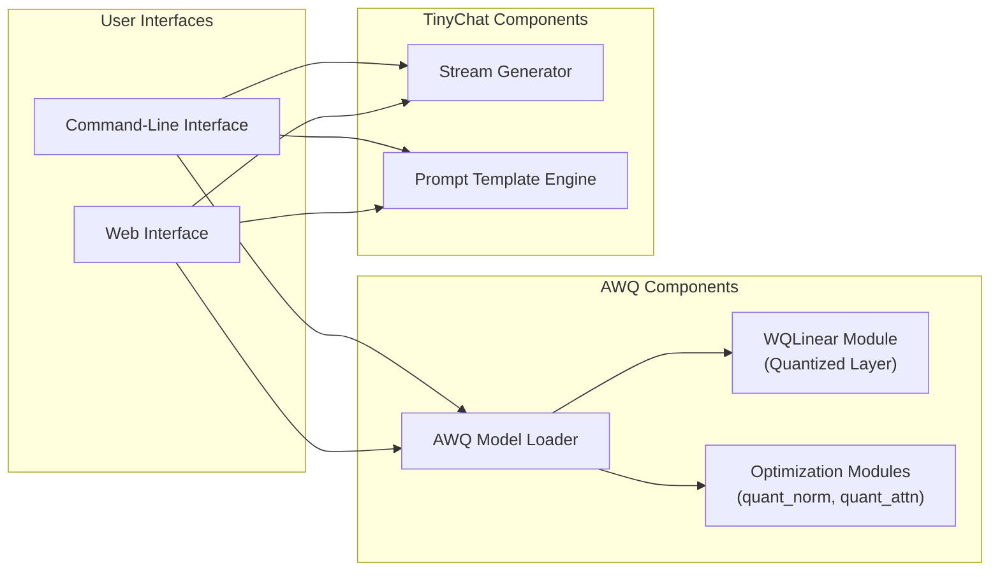

<!-- source: DeepWiki mcp.deepwiki.com · repo mit-han-lab/llm-awq · page 5 User Interfaces · fetched 2026-10-30 -->

# User Interfaces

<details>
<summary>Relevant source files</summary>

The following files were used as context for generating this wiki page:

- [README.md](README.md)
- [scripts/qwen_example.sh](scripts/qwen_example.sh)
- [tinychat/README.md](tinychat/README.md)
- [tinychat/demo.py](tinychat/demo.py)
- [tinychat/utils/constants.py](tinychat/utils/constants.py)

</details>


This page documents the user interfaces provided by the LLM-AWQ repository for interacting with quantized language models. It focuses on both command-line and web-based interfaces that enable users to leverage AWQ-quantized models for text generation and multimodal tasks.

For information about the quantization algorithm itself, refer to [AWQ Quantization System](#2), and for details about optimized inference and text generation, see [TinyChat System](#3).

## Overview

LLM-AWQ provides two primary interfaces for users to interact with quantized models:

1. **Command-Line Interface (CLI)**: A terminal-based interface for direct interaction with models
2. **Web Interface (Gradio)**: A browser-based graphical interface with support for text, image, and video inputs

Both interfaces leverage the same underlying TinyChat inference system but provide different interaction paradigms to suit various use cases, from development to demonstration.



Sources: [tinychat/demo.py](), [tinychat/serve/gradio_web_server.py](), [tinychat/serve/README.md]()

## Command-Line Interface

The command-line interface provides a straightforward way to interact with quantized models directly from the terminal. It's implemented in the `tinychat/demo.py` script and supports various model types and configurations.

### Features

- Interactive text-based chat with the model
- Support for various model architectures (LLaMa, Falcon, MPT, Qwen)
- Performance metrics reporting (tokens per second, time to first token)
- Memory-efficient loading options
- Chunk-based prefilling for long context processing

### Architecture and Implementation

The CLI follows a simple interaction loop where user input is processed, fed to the model, and the generated output is streamed back to the console.



Sources: [tinychat/demo.py:80-283]()

### Usage

The CLI is launched with various command-line arguments to configure the model and generation parameters:

```bash
python -m tinychat.demo \
    --model_type llama \
    --model_path /path/to/model \
    --load_quant /path/to/quantized/weights \
    --precision W4A16 \
    --max_seq_len 2048 \
    --mem_efficient_load \
    --flash_attn \
    --chunk_prefilling
```

Key parameters include:

| Parameter | Description | Default |
|-----------|-------------|---------|
| `--model_type` | Model architecture (llama, falcon, mpt, qwen) | "LLaMa" |
| `--precision` | Compute precision (W4A16, W16A16) | "W4A16" |
| `--load_quant` | Path to pre-quantized 4-bit weights | Required |
| `--max_seq_len` | Maximum sequence length for KV cache | 2048 |
| `--mem_efficient_load` | Enable memory-efficient loading mode | False |
| `--flash_attn` | Use flash attention optimization | False |
| `--chunk_prefilling` | Enable chunk prefilling for faster inference | False |
| `--single_round` | Don't memorize previous conversations | False |

Sources: [tinychat/demo.py:82-134]()

### Key Components

The CLI leverages several key components:

1. **Model Loading**: Uses `load_awq_model` and `load_awq_llama_fast` utilities to load AWQ-quantized models.
2. **Prompt Templating**: Uses model-specific prompters to format inputs properly.
3. **Stream Generator**: Handles token-by-token generation and streaming.
4. **Performance Optimization**: Includes device warmup and optional tuning of quantized layers.

Sources: [tinychat/demo.py:192-241](), [tinychat/utils/tune.py:10-14]()

## Web Interface (Gradio)

The web interface provides a graphical user interface for interacting with quantized models through a web browser. It's built using Gradio and supports multimodal inputs including text, images, and videos.

### Architecture

The web interface follows a controller-worker architecture that enables serving multiple models through a single interface:



Sources: [tinychat/serve/gradio_web_server.py](), [tinychat/serve/README.md:1-27]()

### Setup and Deployment

To deploy the web interface, three components need to be launched:

1. **Controller**: Manages workers and routes requests
   ```bash
   python -m tinychat.serve.controller --host 0.0.0.0 --port 10000
   ```

2. **Web Server**: Provides the Gradio interface
   ```bash
   python -m tinychat.serve.gradio_web_server --controller http://localhost:10000 --share
   ```

3. **Model Worker(s)**: Handles model inference
   ```bash
   python -m tinychat.serve.model_worker --controller http://localhost:10000 \
       --model-path /path/to/model --quant-path /path/to/quantized/weights
   ```

Multiple model workers can be connected to the same controller, allowing the web interface to serve multiple models.

Sources: [tinychat/serve/README.md:6-21]()

### Features and Components

The web interface includes several key components and features:

1. **Model Selection**: Dropdown menu to select from available models
2. **Text Input**: Text box for entering prompts
3. **Image Upload**: Support for uploading up to 3 images
4. **Video Input**: Support for video input (extracted as frames)
5. **Examples**: Pre-configured examples demonstrating capabilities
6. **Conversation History**: Visual display of the conversation
7. **Prompt Styling**: Options for different prompt templates



Sources: [tinychat/serve/gradio_web_server.py:363-596](), [tinychat/serve/gradio_web_server.py:632-853]()

### Multimodal Support

One of the key features of the web interface is its support for multimodal inputs:

1. **Image Processing**: Supports uploading and processing multiple images within a single prompt
2. **Video Processing**: Extracts frames from videos for processing
3. **Image-Text Integration**: Seamlessly combines image and text inputs with special tokens like `<image>`

Sources: [tinychat/serve/gradio_web_server.py:219-308](), [tinychat/utils/llava_image_processing.py:25-113]()

## Integration with AWQ System

Both interfaces integrate with the core AWQ quantization system, leveraging the optimized quantized models for efficient inference.



Sources: [tinychat/demo.py:193-241](), [tinychat/utils/tune.py:10-82]()

### Key Integration Points

1. **Model Loading**: Both interfaces use `load_awq_model` or `load_awq_llama_fast` to load quantized models
2. **Optimization**: Apply optimizations like `make_quant_norm` and `make_quant_attn`
3. **Device Warmup**: Use `device_warmup` to prepare CUDA kernels
4. **Generator Integration**: Use the `StreamGenerator` for token generation

## Feature Comparison

The following table summarizes the features available in each interface:

| Feature | Command-Line Interface | Web Interface |
|---------|:----------------------:|:-------------:|
| Text Generation | ✓ | ✓ |
| Image Input | ✗ | ✓ |
| Video Input | ✗ | ✓ |
| Multiple Model Support | ✗ | ✓ |
| Conversation History | Optional | ✓ |
| Performance Metrics | ✓ | ✓ |
| Example Prompts | ✗ | ✓ |
| Memory-Efficient Loading | ✓ | ✓ |
| Flash Attention | ✓ | ✓ |
| Chunk Prefilling | ✓ | ✓ |
| Remote Deployment | ✗ | ✓ |

## Conclusion

The LLM-AWQ repository provides two complementary user interfaces that cater to different use cases:

1. The **Command-Line Interface** offers a straightforward way to interact with quantized models directly, making it suitable for testing, development, and scripting.

2. The **Web Interface** provides a rich, user-friendly experience with support for multimodal inputs, making it ideal for demonstrations, collaborations, and applications requiring visual elements.

Both interfaces leverage the same underlying TinyChat inference system, ensuring consistent performance and capabilities regardless of the chosen interface.

---

