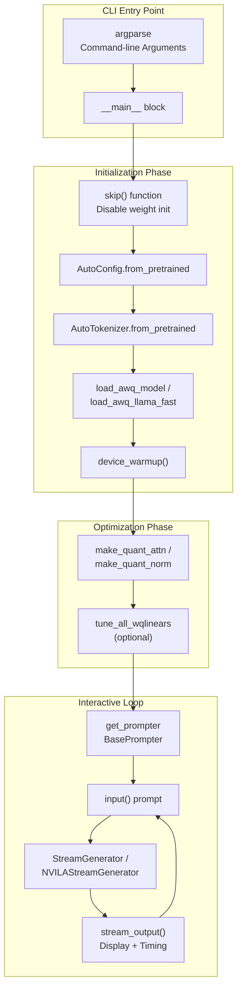
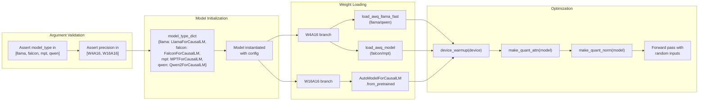
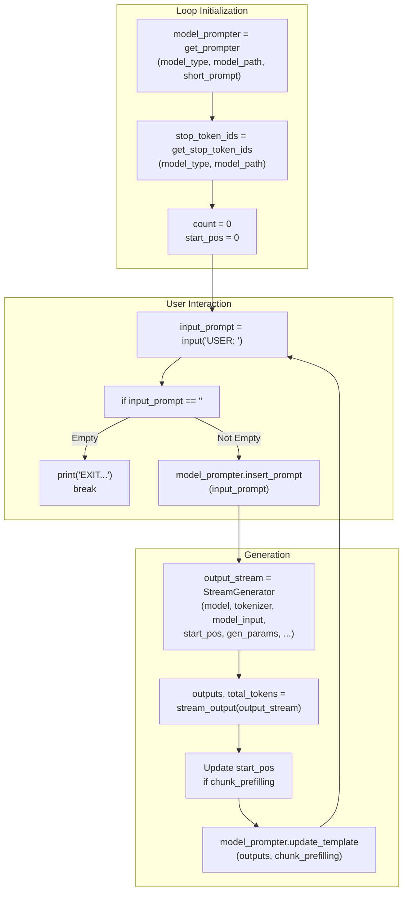
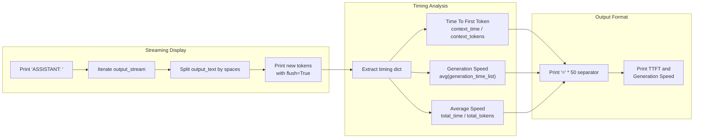
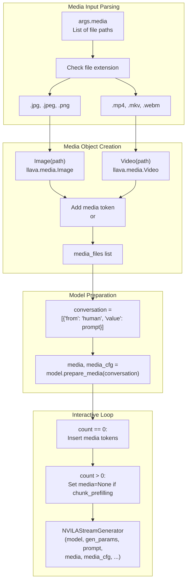
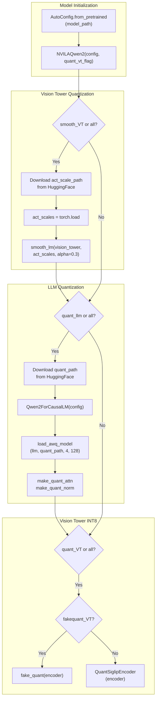
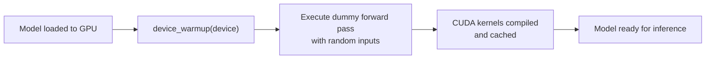

<!-- source: DeepWiki mcp.deepwiki.com · repo mit-han-lab/llm-awq · page 5.1 Command-Line Demos · fetched 2026-10-30 -->

# Command-Line Demos

<details>
<summary>Relevant source files</summary>

The following files were used as context for generating this wiki page:

- [tinychat/demo.py](tinychat/demo.py)
- [tinychat/nvila_demo.py](tinychat/nvila_demo.py)
- [tinychat/utils/input_metadata.py](tinychat/utils/input_metadata.py)

</details>


This document describes the command-line interface demos provided by TinyChat for interacting with AWQ-quantized models. Two primary demo scripts enable interactive conversations: `demo.py` for text-only language models and `nvila_demo.py` for multimodal models with vision and video understanding capabilities.

For web-based interfaces with multi-user support, see [Gradio Web Interface](#5.2). For customizing prompt formats, see [Prompt Templates & Input Processing](#6.1).

---

## Overview

The CLI demos provide an interactive terminal interface for testing and benchmarking quantized models. Both scripts follow a similar pattern: parse command-line arguments, load the model with specified optimizations, enter an interactive prompt loop, and display streaming responses with performance statistics.



**Sources:** [tinychat/demo.py:1-284](), [tinychat/nvila_demo.py:1-273]()

---

## Text-Only Demo (demo.py)

The `demo.py` script provides a command-line interface for language-only models including LLaMA, Qwen, Falcon, and MPT.

### Command-Line Arguments

| Argument | Type | Default | Description |
|----------|------|---------|-------------|
| `--model_type` | str | "LLaMa" | Model architecture type (llama, falcon, mpt, qwen) |
| `--dtype` | str | "float16" | Computation dtype (float16 or bfloat16) |
| `--model_path` | str | Required | Path to model checkpoint or HuggingFace ID |
| `--precision` | str | "W4A16" | Quantization precision (W4A16 or W16A16) |
| `--device` | str | "cuda:0" | Target device |
| `--q_group_size` | int | 128 | Group size for quantization |
| `--load_quant` | str | Required | Path to quantized weights (.pt file) |
| `--max_seq_len` | int | 2048 | Maximum KV cache sequence length |
| `--max_batch_size` | int | 1 | Maximum batch size for KV cache |
| `--mem_efficient_load` | flag | False | Enable memory-efficient layer-wise loading |
| `--single_round` | flag | False | Disable conversation memory (single-turn) |
| `--flash_attn` | flag | False | Enable Flash Attention for prefill speedup |
| `--chunk_prefilling` | flag | False | Enable KV cache reuse for multi-turn conversations |

**Sources:** [tinychat/demo.py:83-134]()

### Model Loading Workflow



**Sources:** [tinychat/demo.py:136-246]()

### Interactive Prompt Loop

The demo enters an infinite loop where users can type prompts and receive streaming responses. The loop maintains conversation state unless `--single_round` is specified.



The `start_pos` variable tracks the current KV cache position. When `chunk_prefilling` is enabled, it increments by `total_tokens` to reuse cached key-value pairs from previous turns, avoiding recomputation of history tokens.

**Sources:** [tinychat/demo.py:253-284]()

### Performance Metrics Display

The `stream_output` function [tinychat/demo.py:50-80]() displays streaming tokens in real-time and prints performance statistics:



Example output:
```
ASSISTANT: The capital of France is Paris.
==================================================
Speed of Inference
--------------------------------------------------
TTFT : 0.123 s for 45 tokens
Speed of Generation : 15.67 ms/token
==================================================
```

**Sources:** [tinychat/demo.py:50-80]()

---

## Multimodal Demo (nvila_demo.py)

The `nvila_demo.py` script extends the CLI demo to support NVILA models with image and video understanding capabilities.

### Command-Line Arguments

| Argument | Type | Default | Description |
|----------|------|---------|-------------|
| `--model_type` | str | "LLaMa" | Base model type |
| `--model-path` | str | Required | Path to NVILA model checkpoint |
| `--quant_path` | str | Required | Path to quantized LLM weights |
| `--act_scale_path` | str | Required | Path to activation scales for vision tower |
| `--media` | str (list) | None | Paths to image/video files for input |
| `--device` | str | "cuda:0" | Target device |
| `--max_seq_len` | int | 2048 | Maximum sequence length |
| `--single_round` | flag | False | Disable conversation memory |
| `--vis-image` | flag | False | Display input images in terminal |
| `--empty-prompt` | flag | False | Use empty prompt template |
| `--flash_attn` | flag | False | Enable Flash Attention |
| `--chunk_prefilling` | flag | False | Enable KV cache reuse |
| `--quant_llm` | flag | False | Quantize language model (W4A16) |
| `--quant_VT` | flag | False | Quantize vision tower (W8A8) |
| `--smooth_VT` | flag | False | Apply smooth quantization to vision tower |
| `--all` | flag | False | Enable all quantization options |
| `--fakequant_VT` | flag | False | Use fake quantization for vision tower |

**Sources:** [tinychat/nvila_demo.py:214-272]()

### Media Processing Pipeline



**Sources:** [tinychat/nvila_demo.py:120-187]()

### Model Configuration and Quantization

The NVILA demo supports mixed-precision quantization with independent control over the language model and vision tower:



The `--all` flag enables all three quantization modes simultaneously: W4A16 for the LLM, W8A8 for the vision tower, and smooth quantization preprocessing.

**Sources:** [tinychat/nvila_demo.py:64-118]()

### HuggingFace Model Download

The `download_model_file` function [tinychat/nvila_demo.py:40-61]() automatically downloads required files from the HuggingFace model zoo:

| Parameter | Purpose |
|-----------|---------|
| `repo_id` | HuggingFace repository (default: "Efficient-Large-Model/NVILA-AWQ") |
| `filename` | Specific file to download (e.g., quantized weights, activation scales) |
| `local_dir` | Local cache directory (default: "./hf_cache") |
| `force_download` | Force re-download even if file exists |

The function uses `hf_hub_download` with resume capability and symlink-free caching for edge device compatibility.

**Sources:** [tinychat/nvila_demo.py:40-61]()

---

## Common Features

### Generation Parameters (gen_params)

Both demos use the `gen_params` AttributeDict [tinychat/demo.py:19-47]() to configure text generation behavior:

| Parameter | Default | Description |
|-----------|---------|-------------|
| `seed` | -1 | Random seed (-1 for random) |
| `n_predict` | 512 | Maximum new tokens to generate |
| `n_ctx` | 512 | Context window size |
| `n_batch` | 512 | Batch size for prompt processing |
| `n_keep` | 0 | Tokens to keep from initial prompt |
| `top_k` | 40 | Top-k sampling (≤0 uses full vocabulary) |
| `top_p` | 0.95 | Nucleus sampling threshold |
| `temp` | 0.70 | Sampling temperature |
| `repeat_penalty` | 1.10 | Repetition penalty multiplier |
| `repeat_last_n` | 64 | Context for repetition penalty |
| `frequency_penalty` | 0.00 | Frequency-based penalty |
| `presence_penalty` | 0.00 | Presence-based penalty |
| `mirostat` | 0 | Mirostat sampling mode (0=disabled) |
| `mirostat_tau` | 5.00 | Mirostat target entropy |
| `mirostat_eta` | 0.10 | Mirostat learning rate |

These parameters are passed to `StreamGenerator` or `NVILAStreamGenerator` to control the sampling strategy during generation.

**Sources:** [tinychat/demo.py:18-47](), [tinychat/utils/conversation_utils.py]()

### Initialization Optimizations

Both scripts disable PyTorch weight initialization to speed up model loading:

```python
def skip(*args, **kwargs):
    pass

torch.nn.init.kaiming_uniform_ = skip
torch.nn.init.kaiming_normal_ = skip
torch.nn.init.uniform_ = skip
torch.nn.init.normal_ = skip
```

This optimization is safe because quantized weights are loaded directly from checkpoints, bypassing random initialization entirely. For quantized models, initialization time can be reduced by up to 80%.

**Sources:** [tinychat/demo.py:164-171](), [tinychat/nvila_demo.py:19-71]()

### Device Warmup

The `device_warmup` function is called before generation to prepare CUDA kernels and allocate resources:



This step eliminates first-inference latency by triggering kernel compilation and memory allocation before user interaction begins.

**Sources:** [tinychat/demo.py:223](), [tinychat/nvila_demo.py:116](), [tinychat/utils/tune.py]()

### Performance Monitoring

Both demos track and display inference performance metrics:

| Metric | Description | Formula |
|--------|-------------|---------|
| **TTFT** (Time To First Token) | Prefill latency for context processing | `context_time / context_tokens` |
| **Generation Speed** | Average token generation rate | `mean(generation_time_list)` |
| **Total Tokens** | Sum of context and generated tokens | `context_tokens + len(generation_time_list)` |

The timing information is embedded in the output stream by `StreamGenerator` and extracted by `stream_output`. This enables real-time performance monitoring without separate benchmarking infrastructure.

**Sources:** [tinychat/demo.py:61-79](), [tinychat/utils/conversation_utils.py]()

---

## Usage Examples

### Basic Text Generation

```bash
python tinychat/demo.py \
  --model_type llama \
  --model_path meta-llama/Llama-2-7b-hf \
  --load_quant /path/to/llama-2-7b-w4-g128.pt \
  --precision W4A16 \
  --max_seq_len 2048 \
  --flash_attn
```

### Multi-Turn Conversation with KV Cache Reuse

```bash
python tinychat/demo.py \
  --model_type llama \
  --model_path meta-llama/Llama-2-7b-chat-hf \
  --load_quant /path/to/llama-2-7b-chat-w4-g128.pt \
  --precision W4A16 \
  --max_seq_len 4096 \
  --chunk_prefilling \
  --flash_attn
```

The `--chunk_prefilling` flag enables incremental KV cache updates, dramatically reducing prefill latency for subsequent turns.

### Multimodal Image Understanding

```bash
python tinychat/nvila_demo.py \
  --model-path /path/to/nvila-model \
  --quant_path /path/to/nvila-qwen-w4-g128.pt \
  --media /path/to/image.jpg \
  --all \
  --flash_attn \
  --vis-image
```

### Video Understanding with Chunked Prefilling

```bash
python tinychat/nvila_demo.py \
  --model-path /path/to/nvila-model \
  --media /path/to/video.mp4 \
  --all \
  --chunk_prefilling \
  --max_seq_len 4096
```

For video inputs, NVILA extracts and processes multiple frames. The `--chunk_prefilling` flag reuses the visual embeddings across conversation turns, avoiding redundant vision tower inference.

**Sources:** [tinychat/demo.py:1-284](), [tinychat/nvila_demo.py:1-273]()

---

