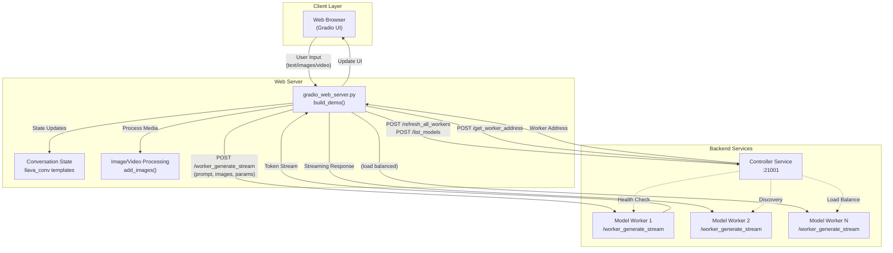
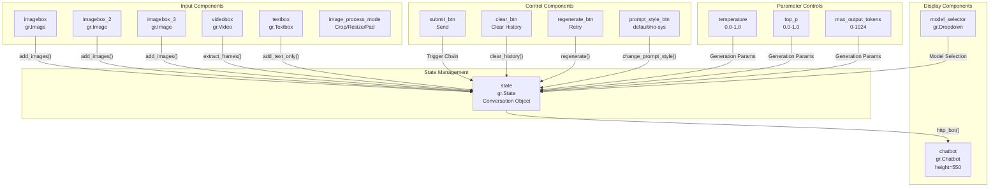
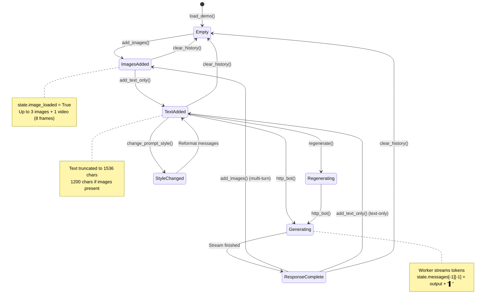
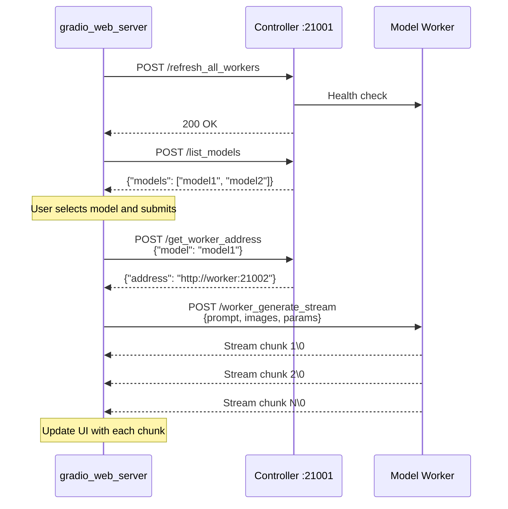

<!-- source: DeepWiki mcp.deepwiki.com · repo mit-han-lab/llm-awq · page 5.2 Gradio Web Interface · fetched 2026-10-30 -->

# Gradio Web Interface

<details>
<summary>Relevant source files</summary>

The following files were used as context for generating this wiki page:

- [tinychat/models/vila_llama.py](tinychat/models/vila_llama.py)
- [tinychat/serve/gradio_web_server.py](tinychat/serve/gradio_web_server.py)
- [tinychat/utils/llava_image_processing.py](tinychat/utils/llava_image_processing.py)
- [tinychat/utils/tune.py](tinychat/utils/tune.py)

</details>


This document describes the Gradio-based web server for AWQ-quantized multimodal models. The web interface provides a browser-based chatbot with support for text, image, and video inputs, enabling multi-user interactive sessions with vision-language models.

**Scope**: This page covers the Gradio web UI implementation, including UI components, request handling, and conversation state management. For command-line demos, see [CLI Demos](#5.1). For the underlying model serving architecture (controller/worker pattern), see the related serving components.

---

## Architecture Overview

The Gradio web server operates in a distributed architecture with three main components:



**Key Design Patterns**:
- **Controller-Worker Pattern**: The controller (`--controller-url`) manages worker discovery and load balancing
- **Stateless Workers**: Each worker independently handles generation requests
- **Streaming Protocol**: Workers stream tokens back via HTTP chunked responses with null-byte delimiters
- **Client-Side State**: The web server maintains conversation history in Gradio's state object

Sources: [tinychat/serve/gradio_web_server.py:1-1201]()

---

## UI Component Structure

The Gradio interface is built by `build_demo()` and consists of several interconnected components:



**UI Layout**: The interface uses a two-column layout with media inputs and chat display on the left (scale=8) and model configuration, examples, and parameters on the right (scale=4).

**Media Input Limits**: The interface supports up to 3 static images plus 1 video (automatically converted to 8 frames).

Sources: [tinychat/serve/gradio_web_server.py:632-1031]()

---

## Request Processing Flow

When a user submits input, the system processes it through a multi-stage pipeline:

```mermaid
graph TB
    UserSubmit["User Clicks Submit/Enter"]
    
    ClearText["clear_text_history()<br/>Reset conversation state"]
    
    AddImages["add_images()<br/>Process media inputs"]
    
    subgraph "add_images() Logic"
        CheckLoaded["Check state.image_loaded"]
        ExtractVideo["extract_frames(videobox)<br/>8 frames via cv2"]
        BuildList["Build image_list<br/>[imagebox, imagebox_2, imagebox_3, *frames]"]
        CountImages["Count non-null images"]
        AppendMessages["Append (AUTO_FILL_IM_TOKEN_HOLDER, image, mode)<br/>for each image"]
        SetLoaded["Set state.image_loaded = True"]
    end
    
    AddTextOnly["add_text_only()<br/>Append text to state"]
    
    subgraph "add_text_only() Logic"
        Moderate["violates_moderation(text)<br/>if args.moderate"]
        Truncate["text = text[:1536]<br/>Hard cutoff"]
        AppendText["state.append_message(roles[0], text)<br/>state.append_message(roles[1], None)"]
    end
    
    HttpBot["http_bot()<br/>Generate response"]
    
    subgraph "http_bot() Logic"
        QueryController["POST /get_worker_address<br/>to controller"]
        GetWorkerAddr["worker_addr from response"]
        ConstructPrompt["state.get_prompt()<br/>Build formatted prompt"]
        ExtractImages["state.get_images()<br/>Get PIL images"]
        HashImages["hashlib.md5(image.tobytes())"]
        TokenValidation["Validate IMAGE_TOKEN count<br/>vs image count"]
        ReplaceTokens["Replace AUTO_FILL/PLACEHOLDER<br/>with LLAVA_DEFAULT_IMAGE_TOKEN"]
        BuildPayload["pload = {model, prompt,<br/>temperature, top_p,<br/>max_new_tokens, stop, images}"]
        StreamRequest["POST /worker_generate_stream<br/>to worker_addr"]
        ParseStream["Parse chunk-by-chunk<br/>delimiter=b'\\0'"]
        UpdateState["state.messages[-1][-1] = output + '▌'"]
        YieldUpdate["yield (state, chatbot)"]
        LogConversation["Write to conv.json log"]
    end
    
    UserSubmit --> ClearText
    ClearText --> AddImages
    
    AddImages --> CheckLoaded
    CheckLoaded -->|"Not loaded"| ExtractVideo
    ExtractVideo --> BuildList
    BuildList --> CountImages
    CountImages --> AppendMessages
    AppendMessages --> SetLoaded
    SetLoaded --> AddTextOnly
    CheckLoaded -->|"Already loaded"| AddTextOnly
    
    AddTextOnly --> Moderate
    Moderate --> Truncate
    Truncate --> AppendText
    AppendText --> HttpBot
    
    HttpBot --> QueryController
    QueryController --> GetWorkerAddr
    GetWorkerAddr --> ConstructPrompt
    ConstructPrompt --> ExtractImages
    ExtractImages --> HashImages
    HashImages --> TokenValidation
    TokenValidation --> ReplaceTokens
    ReplaceTokens --> BuildPayload
    BuildPayload --> StreamRequest
    StreamRequest --> ParseStream
    ParseStream --> UpdateState
    UpdateState --> YieldUpdate
    YieldUpdate -->|"Continue streaming"| ParseStream
    YieldUpdate -->|"Complete"| LogConversation
```



**Token Replacement Logic**: The system handles three token types:
- `AUTO_FILL_IM_TOKEN_HOLDER`: Automatically inserted placeholder
- `LLAVA_DEFAULT_IM_TOKEN_PLACE_HOLDER`: User-inserted `<image>` token
- `LLAVA_DEFAULT_IMAGE_TOKEN`: Final token sent to the model

The validation at [tinychat/serve/gradio_web_server.py:488-518]() ensures the number of image tokens matches the number of actual images provided.

Sources: [tinychat/serve/gradio_web_server.py:1108-1150](), [tinychat/serve/gradio_web_server.py:311-326](), [tinychat/serve/gradio_web_server.py:219-309](), [tinychat/serve/gradio_web_server.py:363-596]()

---

## Conversation State Management

The conversation state is managed through the `llava_conv` module's conversation templates:

| State Component | Purpose | Key Methods |
|----------------|---------|-------------|
| `state.messages` | List of (role, content) tuples | `append_message()`, `get_prompt()` |
| `state.version` | Conversation template (default/no-sys) | `get_conversation()` |
| `state.image_loaded` | Tracks if images added to state | Set in `add_images()` |
| `state.skip_next` | Skip generation for invalid input | Set on moderation/empty input |
| `state.offset` | Starting point for messages | Used in conversation template |
| `state.sep`, `state.sep2` | Message separators | Template-dependent |

**Conversation Flow States**:



**State Persistence**: Conversations are logged to JSON files named by date (`{year}-{month}-{day}-conv.json`) including timestamps, model name, client IP, and full conversation state.

Sources: [tinychat/serve/gradio_web_server.py:27-32](), [tinychat/serve/gradio_web_server.py:101-114](), [tinychat/serve/gradio_web_server.py:147-177](), [tinychat/serve/gradio_web_server.py:584-595]()

---

## Multi-Modal Input Processing

### Image Processing

The system supports three image input boxes plus video input. Images are processed through the `add_images()` function:

**Image Processing Pipeline**:

1. **Input Collection**: Gather `imagebox`, `imagebox_2`, `imagebox_3`, and video frames
2. **Video Frame Extraction**: If `videobox` is not None, extract 8 uniformly-sampled frames using OpenCV
3. **Image List Construction**: Combine all images into a single list
4. **Token Management**: 
   - If `args.auto_pad_image_token` is True OR only 1 image: use `AUTO_FILL_IM_TOKEN_HOLDER`
   - Otherwise: Use empty string (user must insert `<image>` tokens manually)
5. **State Update**: Append `(token, image, image_process_mode)` tuple for each image

**Video Frame Extraction**:
```
Video → cv2.VideoCapture → Calculate frame_interval = frame_count // 8
→ Sample 8 frames → cv2.cvtColor(BGR2RGB) → PIL.Image → Add to image_list
```

Sources: [tinychat/serve/gradio_web_server.py:219-309]()

### Image Mode Processing

The `image_process_mode` parameter controls non-square image handling:
- **Crop**: Center crop to square
- **Resize**: Resize to target dimensions (may distort)
- **Pad**: Expand to square with padding (preserves aspect ratio)
- **Default**: Model-specific default behavior

This mode is passed through the state and used by the vision encoder during preprocessing. The actual preprocessing happens on the worker side using utilities from `tinychat.utils.llava_image_processing`.

Sources: [tinychat/serve/gradio_web_server.py:651-656](), [tinychat/utils/llava_image_processing.py:68-113]()

### Image Token Validation

Before sending to the worker, the system validates image token counts:

| Scenario | `AUTO_FILL` Count | Manual `<image>` Count | Action |
|----------|-------------------|------------------------|--------|
| Auto-fill only | == image_num | 0 | Replace AUTO_FILL with LLAVA_DEFAULT_IMAGE_TOKEN |
| User override | == image_num | == image_num | Remove AUTO_FILL, replace `<image>` with token |
| Manual only | 0 | == image_num | Replace `<image>` with token |
| Mismatch | Any other combination | - | Error: "IMAGE NUM MISMATCHES IMAGE TOKEN PLACEHOLDER" |

Sources: [tinychat/serve/gradio_web_server.py:488-518]()

---

## Worker Communication Protocol

### Controller Interactions

The web server communicates with the controller for model discovery and worker selection:

**Controller Endpoints**:
- `POST /refresh_all_workers`: Refresh worker health status
- `POST /list_models`: Get available model list
- `POST /get_worker_address`: Get worker address for specific model



Sources: [tinychat/serve/gradio_web_server.py:73-80](), [tinychat/serve/gradio_web_server.py:421-427]()

### Streaming Protocol

Workers return streaming responses with a custom protocol:

**Response Format**:
- **Delimiter**: Null byte (`\0`) between chunks
- **Encoding**: UTF-8 JSON objects
- **Chunk Structure**: `{"error_code": int, "text": str}`

**Parsing Logic**:
```python
for chunk in response.iter_lines(decode_unicode=False, delimiter=b"\0"):
    if chunk:
        data = json.loads(chunk.decode())
        if data["error_code"] == 0:
            output = data["text"][len(prompt):].strip()
            # Update state and yield
```

The streaming display shows a cursor (`▌`) during generation, removed when complete.

Sources: [tinychat/serve/gradio_web_server.py:529-579]()

---

## Example Gallery

The UI includes pre-configured examples organized by input type:

| Example Type | Count | Purpose |
|--------------|-------|---------|
| Video Example | 1 | Video understanding (8 frames) |
| Single Image Examples | 6 | Various vision tasks (pedestrian, car, CPR, building, animals, windmill) |
| Multi-Image Example 1 | 1 | Climate change comparison (2 images) |
| Multi-Image Example 2 | 1 | Temporal reasoning (3 palm images, meal tracking) |
| Multi-Image Example 3 | 1 | Action sequence (3 golf swing frames) |
| In-Context Learning Examples | 3 | ICL with logos, buildings, artworks |

**Example Click Behavior**: Clicking an example triggers `clear_after_click_example_*` functions that:
1. Clear unused image boxes
2. Reset state to appropriate prompt style (`default` or `no-sys` for ICL)
3. Populate the relevant image boxes and textbox

Sources: [tinychat/serve/gradio_web_server.py:706-992]()

---

## Configuration and Deployment

### Command-Line Arguments

```
python tinychat/serve/gradio_web_server.py [OPTIONS]
```

| Argument | Default | Description |
|----------|---------|-------------|
| `--host` | `0.0.0.0` | Server bind address |
| `--port` | None | Server port (required) |
| `--controller-url` | `http://localhost:21001` | Controller service URL |
| `--concurrency-count` | 10 | Max concurrent requests |
| `--model-list-mode` | `once` | Model list refresh: `once` or `reload` |
| `--share` | False | Create public Gradio share link |
| `--moderate` | False | Enable content moderation |
| `--embed` | False | Embed mode (hide title/footer) |
| `--auto-pad-image-token` | False | Auto-insert `<image>` tokens |

**Model List Modes**:
- `once`: Load model list on startup only (faster, static)
- `reload`: Refresh model list on each page load (slower, dynamic)

Sources: [tinychat/serve/gradio_web_server.py:1173-1191]()

### Launch Configuration

The demo is launched with:
```python
demo = build_demo(args.embed)
demo.queue(
    concurrency_count=args.concurrency_count,
    api_open=False
).launch(
    server_name=args.host,
    server_port=args.port,
    share=args.share
)
```

**Queue Settings**:
- `concurrency_count`: Max simultaneous generation requests
- `api_open=False`: Disable REST API endpoints (UI only)

Sources: [tinychat/serve/gradio_web_server.py:1197-1200]()

### Logging and Monitoring

The system logs three types of events:

1. **Conversation Logs** (`{date}-conv.json`):
   - Full conversation state
   - Image hashes for reference
   - Generation timing (start/finish timestamps)
   - Client IP addresses

2. **Server Logs** (`gradio_web_server.log`):
   - Page loads and model selection
   - User actions (submit, clear, regenerate)
   - HTTP bot requests and responses

3. **Image Archive** (`serve_images/{date}/{hash}.jpg`):
   - Permanent storage of uploaded images
   - Organized by upload date
   - Deduplicated by MD5 hash

Sources: [tinychat/serve/gradio_web_server.py:44](), [tinychat/serve/gradio_web_server.py:67-70](), [tinychat/serve/gradio_web_server.py:447-455](), [tinychat/serve/gradio_web_server.py:584-595]()

---

## Integration with Model Loading

While the Gradio web server doesn't load models directly, it coordinates with workers that use TinyChat's model loading system. Workers typically:

1. Load AWQ-quantized checkpoints via `load_awq_model()`
2. Apply optimizations with `make_quant_attn()`, `make_quant_norm()`, `make_fused_mlp()`
3. Warm up and tune kernels with `device_warmup()` and `tune_all_wqlinears()`
4. Serve requests via the streaming generation endpoint

For vision-language models, workers also load and configure vision towers (Siglip, CLIP) and handle image preprocessing.

Sources: [tinychat/utils/tune.py:1-82](), [tinychat/models/vila_llama.py:1-110]()

---

