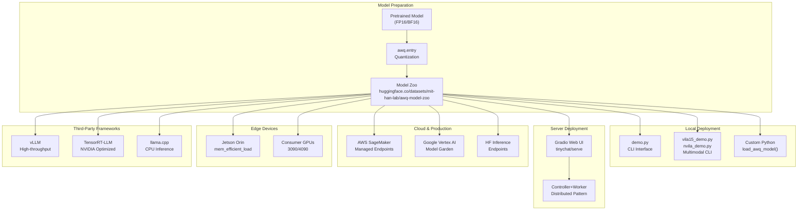
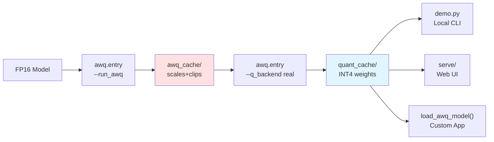
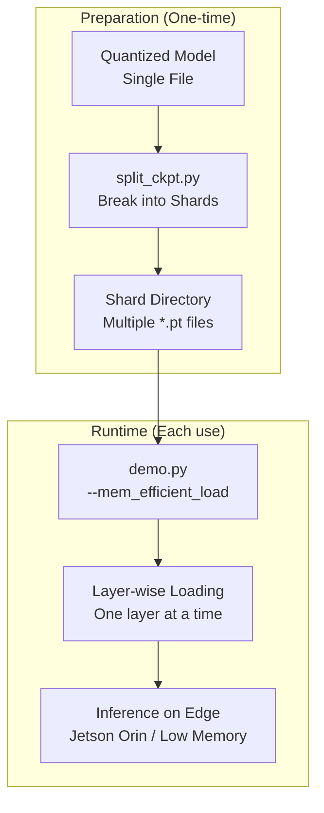
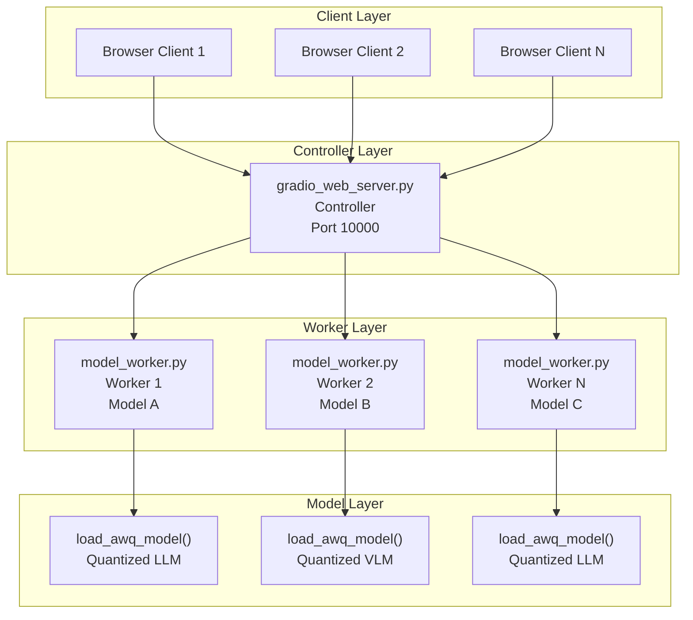
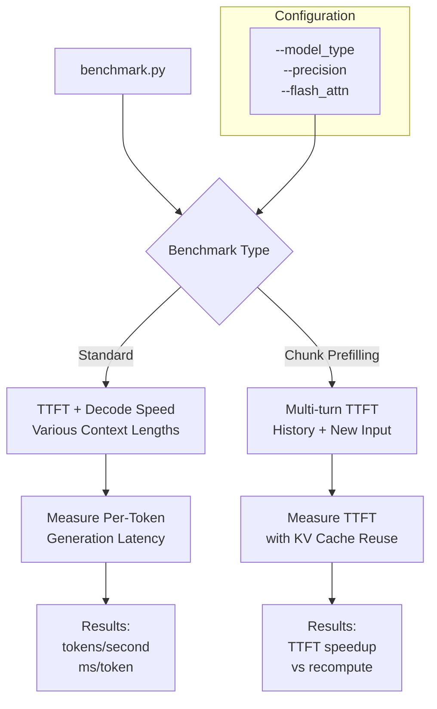
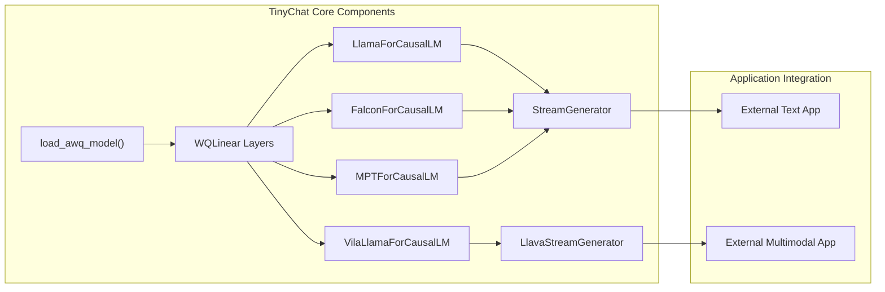

<!-- source: DeepWiki mcp.deepwiki.com · repo mit-han-lab/llm-awq · page 6 Deployment & Practical Usage · fetched 2026-10-30 -->

# Deployment & Practical Usage

<details>
<summary>Relevant source files</summary>

The following files were used as context for generating this wiki page:

- [README.md](README.md)
- [awq/entry.py](awq/entry.py)
- [awq/quantize/auto_scale.py](awq/quantize/auto_scale.py)
- [scripts/qwen_example.sh](scripts/qwen_example.sh)
- [tinychat/README.md](tinychat/README.md)
- [tinychat/utils/constants.py](tinychat/utils/constants.py)

</details>


This page provides practical guidance for deploying and using AWQ-quantized models in various scenarios, from local experimentation to production deployments. The AWQ ecosystem supports multiple deployment paths including local inference, server-based serving, cloud platforms, edge devices, and third-party framework integrations.

**Key Deployment Options:**
- **Local Deployment**: CLI demos, Jupyter notebooks, and custom Python applications
- **Server Deployment**: Gradio web UI, FastAPI REST endpoints, distributed serving
- **Cloud Platforms**: AWS SageMaker, Google Vertex AI, Hugging Face Inference Endpoints
- **Edge Devices**: NVIDIA Jetson Orin with memory-efficient loading
- **Third-Party Frameworks**: vLLM, TensorRT-LLM, llama.cpp, Text Generation WebUI

For model-specific prompt formatting and input processing, see [Prompt Templates & Input Processing](#6.1). For downloading and using pre-quantized models, see [Model Zoo & Pre-quantized Models](#6.2). For integration with external frameworks, see [Third-Party Integrations](#6.3).

Sources: [README.md:91-98](), [tinychat/README.md:1-52]()

## Deployment Architecture Overview

The AWQ deployment ecosystem spans multiple layers, from model development to production serving. The following diagram shows the complete deployment architecture:

**Deployment Paths and Integration Methods**



**Integration Methods:**
- **HF Transformers**: Use `AutoModelForCausalLM.from_pretrained()` with AWQ models from Hugging Face Hub
- **Direct Checkpoint**: Load `quant_cache/*.pt` files using `load_awq_model()` 
- **Model Zoo**: Download pre-computed AWQ results from `awq-model-zoo` repository

Sources: [README.md:91-98](), [README.md:147-174](), [tinychat/README.md:5-23]()

## Core Workflow: Quantization to Deployment

The standard workflow consists of three stages: AWQ search, weight quantization, and deployment.

**Standard AWQ Workflow**



Sources: [scripts/qwen_example.sh:1-26](), [awq/entry.py:26-96]()

## Local Deployment

### Command-Line Demos

TinyChat provides CLI demos for interactive model inference. The basic pattern uses `demo.py` for language models and specialized scripts for multimodal models.

**Language Models (LLaMA, Qwen, Falcon, MPT)**

```bash
cd tinychat
python demo.py --model_type llama \
    --model_path /PATH/TO/LLAMA2/llama-2-7b-chat \
    --q_group_size 128 --load_quant quant_cache/llama-2-7b-chat-w4-g128-awq.pt \
    --precision W4A16
```

**Command-Line Parameters:**

| Parameter | Purpose | Common Values |
|-----------|---------|---------------|
| `--model_type` | Model architecture | `llama`, `falcon`, `mpt`, `vila` |
| `--model_path` | Original model directory | HF model path or local directory |
| `--load_quant` | Quantized checkpoint | Path to `*.pt` file |
| `--precision` | Quantization mode | `W4A16` (4-bit weights, 16-bit acts) or `W16A16` (FP16) |
| `--q_group_size` | Group size used in quantization | `128` (default), `64` (Falcon) |
| `--flash` | Enable Flash Attention | Flag (no value) |
| `--chunk_prefilling` | Enable chunk-based prefilling | Flag (no value) |

**Multimodal Models (VILA, NVILA, LLaVA)**

```bash
cd tinychat
python vila15_demo.py \
    --model-path /PATH/TO/VILA/VILA-1.5-13B \
    --quant-path quant_cache/vila-1.5-13b-w4-g128-awq.pt \
    --precision W4A16 \
    --image-file /PATH/TO/IMAGE \
    --vis-image
```

For video understanding (NVILA):

```bash
python nvila_demo.py --model-path /PATH/TO/NVILA \
    --quant_path quant_cache/NVILA-w4-g128-awq.pt \
    --media /PATH/TO/VIDEO.mp4 \
    --act_scale_path awq_cache/NVILA-smooth-scale.pt \
    --quant_llm --chunk --model_type nvila
```

Sources: [tinychat/README.md:377-416](), [tinychat/README.md:445-509]()

### Performance Optimization Options

**Flash Attention and Chunk Prefilling**

Enable advanced optimizations for faster inference:

```bash
python demo.py --model_type llama \
    --model_path /PATH/TO/MODEL \
    --load_quant quant_cache/model-w4-g128-awq.pt \
    --precision W4A16 \
    --flash --chunk_prefilling
```

**Optimization Effects:**

| Optimization | TTFT Impact | Decode Impact | Use Case |
|--------------|-------------|---------------|----------|
| `--flash` | 1.5-1.7x faster | Minimal | Long contexts (>1024 tokens) |
| `--chunk_prefilling` | Up to 11x faster | N/A | Multi-turn conversations |
| Combined | Best for multi-turn | 2.7-3.0x faster | Interactive chatbots |

Sources: [tinychat/README.md:217-257]()

## Edge Device Deployment

### Memory-Efficient Loading for Jetson Orin

Edge devices with limited memory (e.g., NVIDIA Jetson Orin) require special handling. TinyChat provides layer-wise loading to avoid OOM errors.

**Edge Deployment Workflow**



**Step 1: Split Checkpoint**

```bash
python split_ckpt.py --input_path quant_cache/llama-2-7b-chat-w4-g128-awq.pt \
    --output_path quant_cache/llama-2-7b-chat-w4-g128-awq
```

This creates a directory with multiple shard files instead of a single large file.

**Step 2: Load with Memory-Efficient Mode**

```bash
cd tinychat
python demo.py --model_type llama \
    --model_path /PATH/TO/LLAMA2/llama-2-7b-chat \
    --q_group_size 128 --load_quant quant_cache/llama-2-7b-chat-w4-g128-awq \
    --precision W4A16 --mem_efficient_load
```

**Key Configuration:**

The `mem_efficient_load` flag is defined in [tinychat/utils/constants.py:4-9]() and controls layer-wise loading behavior. When enabled, each transformer layer is loaded individually, processed, and can be offloaded before loading the next layer.

**Performance on Edge Devices:**

| Model | Device | FP16 Latency | W4A16 Latency | Speedup |
|-------|--------|--------------|---------------|---------|
| LLaMA-3-8B | Jetson Orin | 96.00 ms | 32.53 ms | 2.95x |
| LLaMA-2-13B | Jetson Orin | 162.33 ms | 47.67 ms | 3.41x |
| VILA-13B | Jetson Orin | OOM | 57.14 ms | Enables inference |

Sources: [tinychat/README.md:397-416](), [tinychat/utils/constants.py:1-10]()

## Quantizing Custom Models

If you need to quantize a model not available in the model zoo, follow this workflow:

### Standard Quantization Process

**Step 1: Run AWQ Search**

```bash
python -m awq.entry --model_path /PATH/TO/MODEL \
    --w_bit 4 --q_group_size 128 \
    --run_awq --dump_awq awq_cache/model-name-w4-g128.pt
```

This performs grid search to find optimal per-channel scales. The process uses 128 calibration samples from WikiText-2 by default. See [AWQ Quantization System](#2) for algorithm details.

**Step 2: Generate Real Quantized Weights**

```bash
python -m awq.entry --model_path /PATH/TO/MODEL \
    --w_bit 4 --q_group_size 128 \
    --load_awq awq_cache/model-name-w4-g128.pt \
    --q_backend real --dump_quant quant_cache/model-name-w4-g128-awq.pt
```

**Step 3: (Optional) Evaluate Accuracy**

```bash
python -m awq.entry --model_path /PATH/TO/MODEL \
    --tasks wikitext \
    --w_bit 4 --q_group_size 128 \
    --load_quant quant_cache/model-name-w4-g128-awq.pt
```

Sources: [scripts/qwen_example.sh:1-26](), [awq/entry.py:62-68]()

### Multimodal Model Quantization

For vision-language models (VILA-1.5, NVILA), additional steps are required to handle vision encoders:

```bash
# Step 1: Generate smooth scales for vision tower (NVILA only)
python -m awq.entry --model_path /PATH/TO/NVILA \
    --smooth_scale --media_path /PATH/TO/SAMPLE/VIDEO.mp4 \
    --act_scale_path awq_cache/NVILA-smooth-scale.pt --vila-20 \
    --w_bit 4 --q_group_size 128 \
    --run_awq --dump_awq awq_cache/NVILA.pt

# Step 2: Quantize LLM component
python -m awq.entry --model_path /PATH/TO/NVILA/llm \
    --w_bit 4 --q_group_size 128 \
    --load_awq awq_cache/NVILA.pt \
    --q_backend real --dump_quant quant_cache/NVILA-w4-g128-awq.pt --vila-20
```

**Multimodal Quantization Parameters:**

| Parameter | Purpose | Models |
|-----------|---------|--------|
| `--vila-15` | Enable VILA 1.5 mode | VILA-1.5 series |
| `--vila-20` | Enable NVILA mode | NVILA series |
| `--smooth_scale` | Generate W8A8 smooth scales | NVILA (vision tower) |
| `--media_path` | Calibration media file | NVILA, VILA-1.5 |
| `--act_scale_path` | Save/load activation scales | NVILA |

Sources: [awq/entry.py:70-96](), [tinychat/README.md:485-509]()

### Supported Model Architectures

AWQ supports quantization for the following architectures (via [awq/entry.py:119-270]()):

**Language Models:**
- LLaMA (1/2/3), Qwen (1/1.5/2/2.5), Falcon, MPT
- OPT, BLOOM, GPT-BigCode, GPT-NeoX
- DeepSeek-R1-Distill series

**Vision-Language Models:**
- VILA (1.0/1.5), NVILA, LLaVA, InternVL3

The quantization process is model-agnostic for the most part, but certain architectures (e.g., Falcon) may require adjusted group sizes. See [awq/quantize/auto_scale.py:75-481]() for per-architecture handling.

Sources: [README.md:156-174](), [awq/entry.py:119-270]()

## Server Deployment

### Gradio Web Interface

TinyChat provides a Gradio-based web interface for serving multimodal chatbots. The architecture uses a controller-worker pattern for distributed serving.

**Gradio Server Architecture**



**Starting the Server:**

```bash
# 1. Start the controller
python -m tinychat.serve.controller --host 0.0.0.0 --port 10000

# 2. Start model worker(s)
python -m tinychat.serve.model_worker \
    --host 0.0.0.0 --controller http://localhost:10000 \
    --port 40000 --worker http://localhost:40000 \
    --model-path /PATH/TO/MODEL \
    --quant-path quant_cache/model-w4-g128-awq.pt

# 3. Start Gradio web server
python -m tinychat.serve.gradio_web_server \
    --controller http://localhost:10000 \
    --port 7860
```

The web interface will be accessible at `http://localhost:7860`. Multiple workers can be registered with the controller for load balancing across different models or replicas.

**Configuration Constants:**

Heartbeat and expiration settings are defined in [tinychat/utils/constants.py:24-26]():
- `CONTROLLER_HEART_BEAT_EXPIRATION`: 30 seconds
- `WORKER_HEART_BEAT_INTERVAL`: 15 seconds

Sources: [README.md:96](), [tinychat/utils/constants.py:23-26]()

### Custom Python Integration

For custom applications, use the `load_awq_model()` function to load quantized models programmatically:

```python
from tinychat.utils.load_quant import load_awq_model

# Load quantized model
model = load_awq_model(
    model_path="/PATH/TO/MODEL",
    quant_path="quant_cache/model-w4-g128-awq.pt",
    precision="W4A16"
)

# Use for inference
output = model.generate(input_ids, max_length=512)
```

This approach allows integration with custom serving frameworks, batch processing pipelines, or specialized applications.

Sources: [tinychat/README.md:377-416]()

## Benchmarking Performance

TinyChat includes comprehensive benchmarking tools for measuring Time-To-First-Token (TTFT), decoding throughput, and the effectiveness of optimizations.

**Benchmark Script Architecture**



### Standard Benchmarking

Measure basic inference performance across different context lengths:

```bash
cd tinychat
python benchmark.py --flash \
    --context_length 256 512 1024 2048 4096 \
    --model_path /PATH/TO/MODEL --precision W4A16
```

**Typical Results (RTX 4090):**

| Context Length | FP16 TTFT | W4A16 TTFT | Speedup |
|----------------|-----------|------------|---------|
| 256 tokens | 0.031s | 0.021s | 1.52x |
| 512 tokens | 0.055s | 0.033s | 1.68x |
| 1024 tokens | 0.109s | 0.064s | 1.69x |
| 2048 tokens | 0.211s | 0.131s | 1.61x |
| 4096 tokens | 0.446s | 0.275s | 1.62x |

Sources: [tinychat/README.md:168-188]()

### Multi-Turn Conversation Benchmarking

Test the effectiveness of chunk prefilling for multi-turn dialogues:

```bash
python benchmark.py --chunk_prefilling \
    --model_path /PATH/TO/MODEL \
    --question_length 32 \
    --context_length 16 32 64 128 256 512 1024 \
    --precision W4A16
```

This benchmarks scenarios where the model has already processed conversation history and only needs to process new user input.

**Chunk Prefilling Impact (RTX 4090, LLaMA-3-8B):**

| History Length | FP16 TTFT | Legacy TinyChat | TinyChat 2.0 | Speedup |
|----------------|-----------|-----------------|--------------|---------|
| 16 tokens | 21.49 ms | 15.20 ms | 14.30 ms | 1.54x |
| 128 tokens | 40.82 ms | 29.66 ms | 14.43 ms | 2.84x |
| 512 tokens | 75.41 ms | 72.50 ms | 14.35 ms | 5.27x |
| 1024 tokens | 162.27 ms | 163.90 ms | 14.49 ms | 11.45x |

The speedup increases dramatically with conversation length because TinyChat 2.0 reuses the KV cache for history tokens instead of recomputing them.

Sources: [tinychat/README.md:217-248]()

### Accuracy Evaluation

Verify quantization quality on standard benchmarks:

```bash
# WikiText-2 perplexity
python -m awq.entry --model_path /PATH/TO/MODEL \
    --tasks wikitext \
    --w_bit 4 --q_group_size 128 \
    --load_quant quant_cache/model-w4-g128-awq.pt

# Multi-task evaluation (lm-eval)
python -m awq.entry --model_path /PATH/TO/MODEL \
    --tasks piqa,arc_easy,arc_challenge,winogrande \
    --w_bit 4 --q_group_size 128 \
    --load_quant quant_cache/model-w4-g128-awq.pt
```

**Typical Accuracy Results:**

| Model | Metric | FP16 | AWQ-INT4 | Degradation |
|-------|--------|------|----------|-------------|
| DeepSeek-R1-Distill-Llama-8B | WikiText PPL | 13.13 | 13.84 | +0.71 |
| DeepSeek-R1-Distill-Llama-8B | AIME 2024 | 43.33% | 43.33% | 0% |
| NVILA-8B | VideoMME | 63.9% | 62.1% | -1.8% |
| VILA-1.5-13B | VQA-v2 | 82.8% | 82.7% | -0.1% |

Sources: [tinychat/README.md:309-320](), [awq/entry.py:299-354]()

## End-to-End Deployment Examples

### Example 1: Local LLaMA-3 Deployment

Complete workflow from model download to interactive inference:

```bash
# Setup
MODEL_PATH=/dataset/models/llama3-8b
MODEL_NAME=llama3-8b

# Option A: Use pre-quantized model from Model Zoo
git clone https://huggingface.co/datasets/mit-han-lab/awq-model-zoo awq_cache

# Option B: Quantize from scratch
# Step 1: Run AWQ search (if not using model zoo)
python -m awq.entry --model_path $MODEL_PATH \
    --w_bit 4 --q_group_size 128 \
    --run_awq --dump_awq awq_cache/$MODEL_NAME-w4-g128.pt

# Step 2: Generate quantized weights
python -m awq.entry --model_path $MODEL_PATH \
    --w_bit 4 --q_group_size 128 \
    --load_awq awq_cache/$MODEL_NAME-w4-g128.pt \
    --q_backend real --dump_quant quant_cache/$MODEL_NAME-w4-g128-awq.pt

# Step 3: Run interactive demo
cd tinychat
python demo.py --model_type llama \
    --model_path $MODEL_PATH \
    --q_group_size 128 --load_quant quant_cache/$MODEL_NAME-w4-g128-awq.pt \
    --precision W4A16 --flash --chunk_prefilling
```

**Expected Performance (RTX 4090):**
- Decoding: 6.39 ms/token (~156 tokens/sec)
- TTFT (1024 context): 0.064s
- Speedup vs FP16: 2.69x

Sources: [README.md:186-221](), [tinychat/README.md:82-92]()

### Example 2: Edge Deployment on Jetson Orin

Deploy a 13B model on NVIDIA Jetson Orin with limited memory:

```bash
MODEL_PATH=/path/to/llama-2-13b-chat
MODEL_NAME=llama-2-13b-chat

# Step 1: Quantize model (on development machine)
python -m awq.entry --model_path $MODEL_PATH \
    --w_bit 4 --q_group_size 128 \
    --load_awq awq_cache/$MODEL_NAME-w4-g128.pt \
    --q_backend real --dump_quant quant_cache/$MODEL_NAME-w4-g128-awq.pt

# Step 2: Split checkpoint for memory-efficient loading
python split_ckpt.py --input_path quant_cache/$MODEL_NAME-w4-g128-awq.pt \
    --output_path quant_cache/$MODEL_NAME-w4-g128-awq

# Step 3: Transfer to Jetson Orin and run
cd tinychat
python demo.py --model_type llama \
    --model_path $MODEL_PATH \
    --q_group_size 128 --load_quant quant_cache/$MODEL_NAME-w4-g128-awq \
    --precision W4A16 --mem_efficient_load
```

**Expected Performance (Jetson Orin):**
- Decoding: 47.67 ms/token (~21 tokens/sec)
- Memory usage: Fits in 64GB with mem_efficient_load
- Speedup vs FP16: 3.41x

Sources: [tinychat/README.md:126-137](), [README.md:115-119]()

### Example 3: NVILA Video Understanding

Deploy a video-capable multimodal model:

```bash
MODEL_PATH=/path/to/NVILA-8B
MODEL_NAME=NVILA-8B

# Step 1: Generate smooth scales for vision tower
python -m awq.entry --model_path $MODEL_PATH \
    --smooth_scale --media_path sample_video.mp4 \
    --act_scale_path awq_cache/$MODEL_NAME-smooth-scale.pt --vila-20 \
    --w_bit 4 --q_group_size 128 \
    --run_awq --dump_awq awq_cache/$MODEL_NAME.pt

# Step 2: Quantize LLM component
python -m awq.entry --model_path $MODEL_PATH/llm \
    --w_bit 4 --q_group_size 128 \
    --load_awq awq_cache/$MODEL_NAME.pt \
    --q_backend real --dump_quant quant_cache/$MODEL_NAME-w4-g128-awq.pt --vila-20

# Step 3: Run interactive video chat
cd tinychat
python nvila_demo.py --model-path $MODEL_PATH \
    --quant_path quant_cache/$MODEL_NAME-w4-g128-awq.pt \
    --media cooking_video.mp4 \
    --act_scale_path awq_cache/$MODEL_NAME-smooth-scale.pt \
    --quant_llm --chunk --model_type nvila
```

**Sample Interaction:**
```
User: What might be the next step according to the video?
NVILA: The next step in the video could be to place the shaped dough 
       onto a baking sheet and let it rise before baking.
```

**Expected Performance (RTX 4090):**
- Decoding: 5.97 ms/token (~168 tokens/sec)
- Vision encoding: 128 tokens/image in lite mode
- Accuracy: 62.1% on VideoMME (vs 63.9% FP16)

Sources: [tinychat/README.md:485-509](), [README.md:41-48](), [tinychat/README.md:275-284]()

### Example 4: Gradio Web Server for Multi-User Serving

Deploy a web interface accessible by multiple users:

```bash
# Terminal 1: Start controller
python -m tinychat.serve.controller --host 0.0.0.0 --port 10000

# Terminal 2: Start VILA-1.5-8B worker
python -m tinychat.serve.model_worker \
    --host 0.0.0.0 --controller http://localhost:10000 \
    --port 40000 --worker http://localhost:40000 \
    --model-path /path/to/VILA-1.5-8B \
    --quant-path quant_cache/vila-1.5-8b-w4-g128-awq.pt

# Terminal 3: Start web server
python -m tinychat.serve.gradio_web_server \
    --controller http://localhost:10000 \
    --port 7860
```

Access the interface at `http://localhost:7860`. Multiple model workers can be started with different `--port` values for load balancing.

Sources: [README.md:96]()

## Common Issues and Solutions

| Issue | Solution |
|-------|----------|
| Out of memory during quantization | Use a smaller batch size for AWQ search |
| Out of memory during inference | Enable `--mem_efficient_load` and split checkpoints |
| Slow inference with long context | Enable `--chunk_prefilling` and `--flash_attn` |
| Poor generation quality | Try a larger `--q_group_size` (e.g., 128 → 256) |
| Error loading quantized model | Ensure model type matches the original model |

Sources: [tinychat/scripts/llama2_demo.sh:23-31](), [tinychat/benchmark.py:47-59]()

## Integration with External Applications

AWQ quantized models can be integrated with external applications through TinyChat's API. This diagram shows the relationship between AWQ, TinyChat, and external applications:



The key integration point is the `load_awq_model()` function from `tinychat.utils.load_quant`, which loads quantized models for use in applications.

Sources: [tinychat/benchmark.py:10-11]()

---

