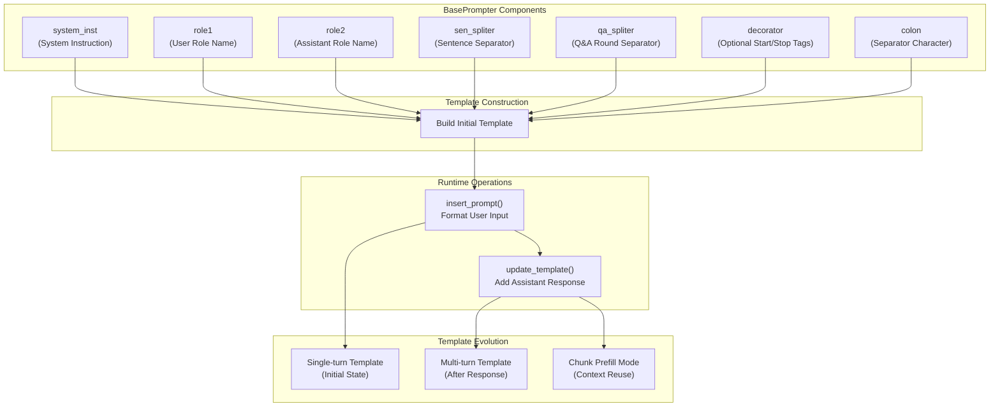
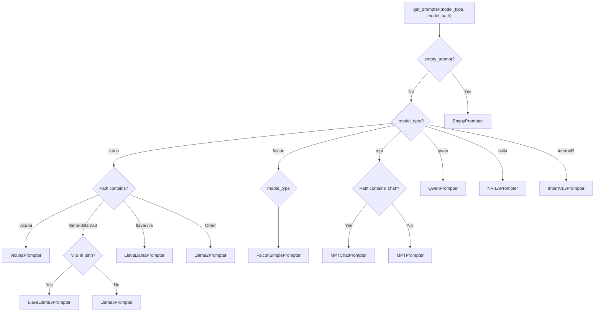
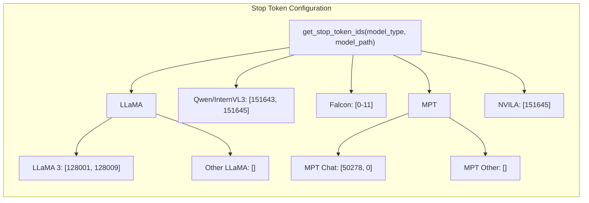
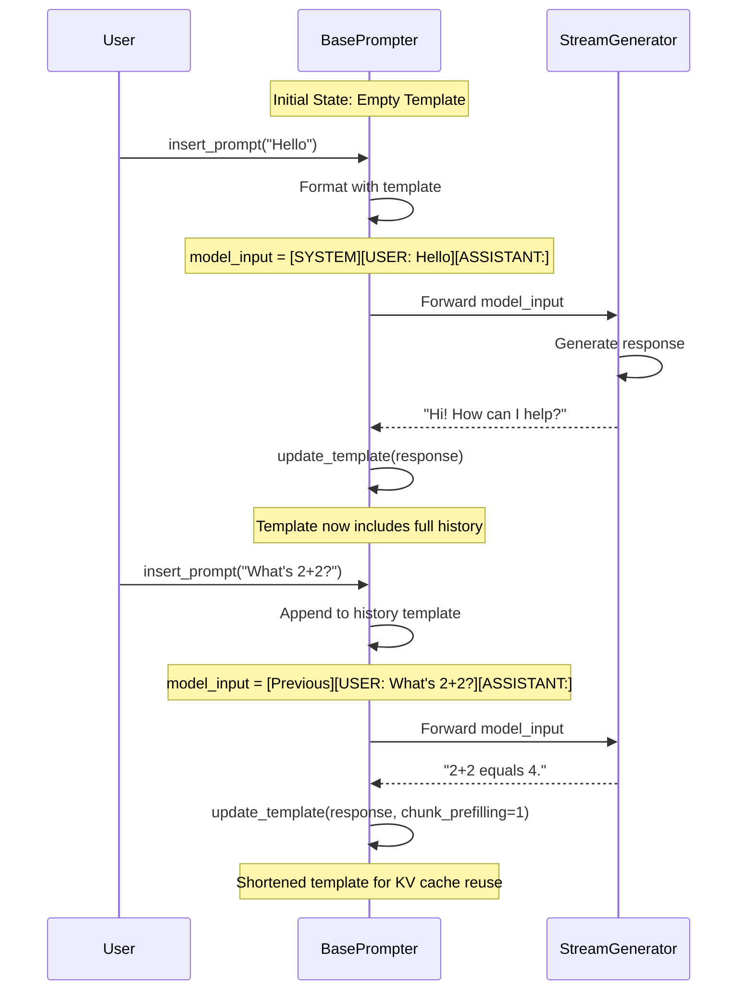
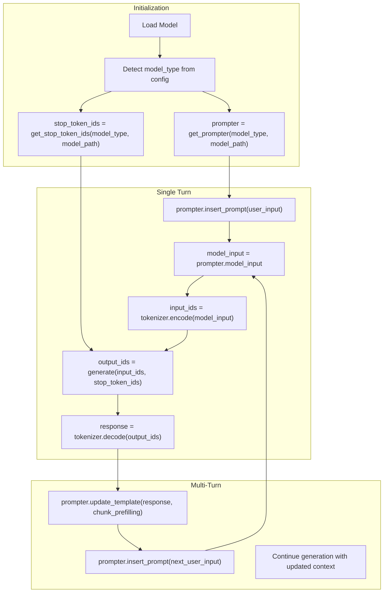

<!-- source: DeepWiki mcp.deepwiki.com · repo mit-han-lab/llm-awq · page 6.1 Prompt Templates & Input Processing · fetched 2026-10-30 -->

# Prompt Templates & Input Processing

<details>
<summary>Relevant source files</summary>

The following files were used as context for generating this wiki page:

- [tinychat/utils/prompt_templates.py](tinychat/utils/prompt_templates.py)

</details>


**Purpose**: This page explains the prompt template system in TinyChat, which formats user inputs according to model-specific conversation templates. It covers the `BasePrompter` class hierarchy, model-specific prompt formats, stop token configuration, multi-turn conversation handling, and integration with multimodal inputs.

For information about how these prompts are used during generation, see [Text Generation & Streaming](#3.2). For multimodal input processing specifics, see [VILA & LLaVA Models](#4.1) and [NVILA Video Models](#4.2).

---

## Overview

Different language models expect inputs in specific formats, with varying system instructions, role labels, separators, and special tokens. The prompt template system in TinyChat abstracts these differences, providing a uniform interface for formatting user inputs across model families (LLaMA, Qwen, Falcon, MPT, etc.) and modalities (text-only and vision-language models).

The system is implemented primarily in [tinychat/utils/prompt_templates.py:1-400](), which defines a `BasePrompter` class and model-specific subclasses.

**Sources**: [tinychat/utils/prompt_templates.py:1-400]()

---

## BasePrompter Architecture

The `BasePrompter` class [tinychat/utils/prompt_templates.py:28-116]() provides the foundation for all prompt templates. It constructs conversation templates by combining system instructions, role labels, and separators.



**Sources**: [tinychat/utils/prompt_templates.py:28-116]()

### Template Components

The `BasePrompter.__init__()` method [tinychat/utils/prompt_templates.py:29-80]() accepts the following parameters:

| Parameter | Type | Purpose | Example |
|-----------|------|---------|---------|
| `system_inst` | str or None | System-level instruction establishing assistant behavior | "You are a helpful assistant" |
| `role1` | str | Label for user role | "USER", "Human", "user" |
| `role2` | str | Label for assistant role | "ASSISTANT", "Assistant", "assistant" |
| `sen_spliter` | str | Separator between system/user/assistant sections | "\n", " ", "<\|eot_id\|>" |
| `qa_spliter` | str | Separator between Q&A rounds in multi-turn | "\n", "</s>", "" |
| `decorator` | List[str] or None | Optional start/stop tags wrapping each section | ["<\|im_start\|>", "<\|im_end\|>"] |
| `colon` | str | Separator between role and content | ":", "" |

The constructed template format depends on whether a system instruction is present:

**With system instruction** [tinychat/utils/prompt_templates.py:64-80]():
```
{starter}{system_inst}{stopper}{sen_spliter}{starter}{role1}{colon} {prompt}{stopper}{sen_spliter}{starter}{role2}{colon}
```

**Without system instruction** [tinychat/utils/prompt_templates.py:53-63]():
```
{starter}{role1}{colon} {prompt}{stopper}{sen_spliter}{starter}{role2}{colon}
```

**Sources**: [tinychat/utils/prompt_templates.py:28-80]()

### Core Methods

#### insert_prompt()

The `insert_prompt()` method [tinychat/utils/prompt_templates.py:83-84]() formats a user prompt into the template:

```python
def insert_prompt(self, input_prompt):
    self.model_input = self.template.format(prompt=input_prompt)
```

This replaces the `{prompt}` placeholder with the actual user input, storing the result in `self.model_input`.

#### update_template()

The `update_template()` method [tinychat/utils/prompt_templates.py:86-115]() handles multi-turn conversations by appending the assistant's previous response and preparing for the next user input:

- **Normal mode** [tinychat/utils/prompt_templates.py:99-114](): Appends the full conversation history
- **Chunk prefilling mode** [tinychat/utils/prompt_templates.py:87-97](): Uses a shortened template to reuse KV cache from previous turns

**Sources**: [tinychat/utils/prompt_templates.py:83-115]()

---

## Model-Specific Prompt Formats

The system provides specialized prompters for each model family. The following table summarizes the key differences:

| Model Family | Prompter Class | System Instruction | Role Labels | Separators | Special Features |
|--------------|----------------|-------------------|-------------|------------|-----------------|
| LLaMA 2 | `Llama2Prompter` | Human/AI chat description | "### Human", "### Assistant" | "\n", "</s>" | One-shot example |
| LLaMA 3 | `Llama3Prompter` | None | Special header tags | "<\|eot_id\|>" | Header-based format |
| Qwen | `QwenPrompter` | Alibaba Cloud assistant | "<\|im_start\|>user", "assistant" | "<\|im_end\|>" | IM tags |
| Falcon | `FalconSimplePrompter` | None (simple mode) | "User", "Assistant" | "\n\n" | Minimal formatting |
| MPT Chat | `MPTChatPrompter` | MosaicML assistant | "<\|im_start\|>user", "assistant" | "\n" | IM tags |
| Vicuna | `VicunaPrompter` | Curious user chat | "USER", "ASSISTANT" | " ", "</s>" | Space separator |
| LLaVA/VILA | `LlavaLlamaPrompter` | Human/AI chat with vision | "USER", "ASSISTANT" | " ", "</s>" | Image token support |
| NVILA | `NVILAPrompter` | Helpful assistant | "<\|im_start\|>user", "assistant" | "\n" | Video understanding |
| InternVL3 | `InternVL3Prompter` | Chinese system prompt | "<\|im_start\|>user", "assistant" | "\n" | Multilingual |

**Sources**: [tinychat/utils/prompt_templates.py:137-340]()

### Example: LLaMA 3 Format

The `Llama3Prompter` [tinychat/utils/prompt_templates.py:191-211]() uses a unique header-based format:

```
<|start_header_id|>user<|end_header_id|>

{user_prompt}<|eot_id|>

<|start_header_id|>assistant<|end_header_id|>

{assistant_response}
```

This prompter has no system instruction and uses empty strings for role labels, relying entirely on header tags for structure.

**Sources**: [tinychat/utils/prompt_templates.py:191-211]()

### Example: Qwen Format

The `QwenPrompter` [tinychat/utils/prompt_templates.py:214-224]() uses instant messaging-style tags:

```
<|im_start|>system
You are Qwen, created by Alibaba Cloud. You are a helpful assistant.<|im_end|>
<|im_start|>user
{user_prompt}<|im_end|>
<|im_start|>assistant
```

**Sources**: [tinychat/utils/prompt_templates.py:214-224]()

### Example: One-Shot Learning (LLaMA 2)

The `Llama2Prompter` [tinychat/utils/prompt_templates.py:157-188]() extends `OneShotBasePrompter` [tinychat/utils/prompt_templates.py:118-134]() to include a demonstration example in the prompt. This provides the model with a sample interaction showing the expected response style and length.

The one-shot example consists of:
- **User example**: "Got any creative ideas for a 10 year old's birthday?"
- **Assistant example**: A detailed response with numbered suggestions (length varies based on `short_prompt` parameter)

**Sources**: [tinychat/utils/prompt_templates.py:118-188]()

---

## Prompter Selection System

The `get_prompter()` function [tinychat/utils/prompt_templates.py:343-376]() automatically selects the appropriate prompter based on model type and path:



The function examines both `model_type` (primary classifier) and `model_path` (for variant detection like "vicuna", "llava", "chat") to determine the correct prompter.

**Sources**: [tinychat/utils/prompt_templates.py:343-376]()

---

## Stop Token Configuration

Stop tokens signal the end of generation. The `get_stop_token_ids()` function [tinychat/utils/prompt_templates.py:379-399]() returns model-specific stop token IDs:



### Stop Token Details

| Model | Stop Token IDs | Purpose |
|-------|----------------|---------|
| LLaMA 3 | [128001, 128009] | `<\|eot_id\|>` and `<\|start_header_id\|>` tokens |
| LLaMA 2/Vicuna | [] | Relies on EOS token in tokenizer |
| Qwen/InternVL3 | [151643, 151645] | `<\|im_end\|>` and related tokens |
| Falcon | [0-11] | Multiple low-ID tokens as stoppers |
| MPT Chat | [50278, 0] | `<\|im_end\|>` and EOS |
| NVILA | [151645] | `<\|im_end\|>` token |

These stop token IDs are used by the generation system to halt decoding when appropriate termination tokens are encountered.

**Sources**: [tinychat/utils/prompt_templates.py:379-399]()

---

## Multi-Turn Conversation Handling

The prompt template system supports multi-turn conversations by maintaining conversation history and updating the template after each response.



### Standard Multi-Turn Update

When `update_template()` is called with `chunk_prefilling=0` [tinychat/utils/prompt_templates.py:99-114](), the full conversation history is included:

```
{previous_model_input} {assistant_output}{stopper}{qa_spliter}{starter}{role1}{colon}{prompt}{stopper}{sen_spliter}{starter}{role2}{colon}
```

This ensures the model has complete context for the next turn.

### Chunk Prefilling Mode

When `chunk_prefilling=1` [tinychat/utils/prompt_templates.py:87-97](), a shortened template is used:

```
{role1}{colon}{prompt}{stopper}{sen_spliter}{starter}{role2}{colon}
```

This optimization works with TinyChat's chunk prefilling feature (see [Performance Optimizations](#3.3)), which caches key-value pairs from previous turns, eliminating the need to re-encode the full history.

**Sources**: [tinychat/utils/prompt_templates.py:86-115]()

---

## Multimodal Integration

For vision-language models, the prompt template system integrates image tokens into text prompts.

### Image Token Insertion

The `get_image_token()` function [tinychat/utils/prompt_templates.py:8-25]() returns the special token representing an image:

```python
def get_image_token(model, model_name):
    return LLAVA_DEFAULT_IMAGE_TOKEN + "\n "
```

Currently, it returns `LLAVA_DEFAULT_IMAGE_TOKEN` (typically `"<image>"`) for all multimodal models. The commented code shows logic for computing the exact number of image patch tokens for VILA models based on vision encoder configuration.

### Vision-Language Prompters

Three specialized prompters handle multimodal inputs:

1. **LlavaLlamaPrompter** [tinychat/utils/prompt_templates.py:227-234](): For LLaVA/VILA 1.0 models using LLaMA 2 format
2. **LlavaLlama3Prompter** [tinychat/utils/prompt_templates.py:237-261](): For VILA 1.5 models using LLaMA 3 format with vision-specific system prompt
3. **NVILAPrompter** [tinychat/utils/prompt_templates.py:318-328](): For NVILA video models

The image token is inserted into the user prompt before formatting:

```
USER: <image>
{text_prompt} ASSISTANT:
```

**Sources**: [tinychat/utils/prompt_templates.py:8-25, 227-261, 318-328]()

---

## Practical Usage Example

Here's how the prompt template system is typically used:



**Sources**: [tinychat/utils/prompt_templates.py:1-400]()

---

## Integration with TinyChat Components

The prompt template system integrates with several TinyChat components:

| Component | Integration Point | Description |
|-----------|------------------|-------------|
| CLI Demos | Command-line arguments specify `model_type` | Demos call `get_prompter()` to initialize appropriate prompter |
| StreamGenerator | Receives formatted `model_input` | Tokenizes and generates from prompter output |
| Gradio Interface | Conversation state management | Web UI maintains prompter instance per session |
| Chunk Prefilling | `update_template(chunk_prefilling=1)` | Shortened template enables KV cache reuse |
| Stop Token Detection | `stop_token_ids` in generation config | Generator halts when stop tokens detected |

For details on how these components use prompt templates, see:
- [Command-Line Demos](#5.1) for CLI integration
- [Text Generation & Streaming](#3.2) for generation integration
- [Gradio Web Interface](#5.2) for web UI integration
- [Performance Optimizations](#3.3) for chunk prefilling

**Sources**: [tinychat/utils/prompt_templates.py:1-400]()

---

