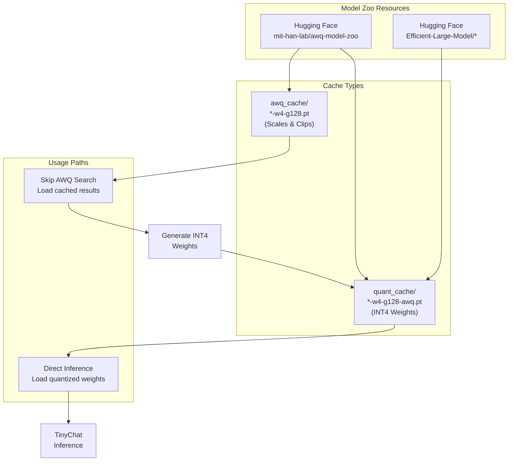
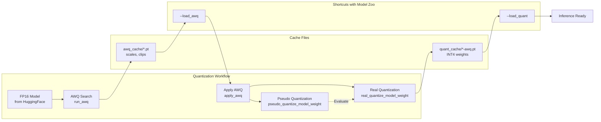
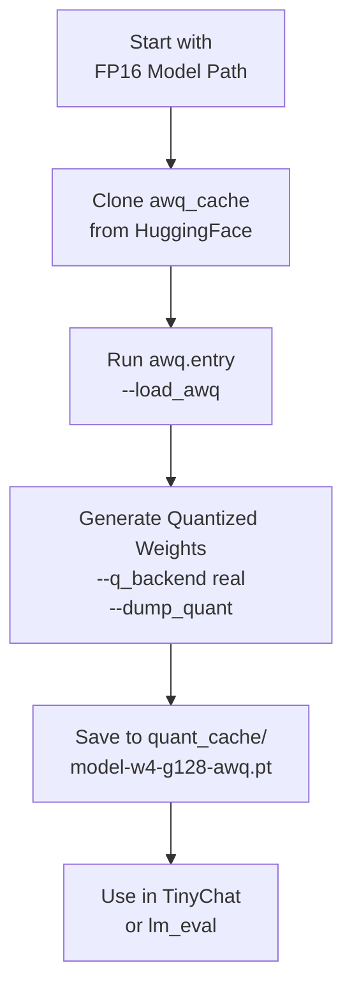
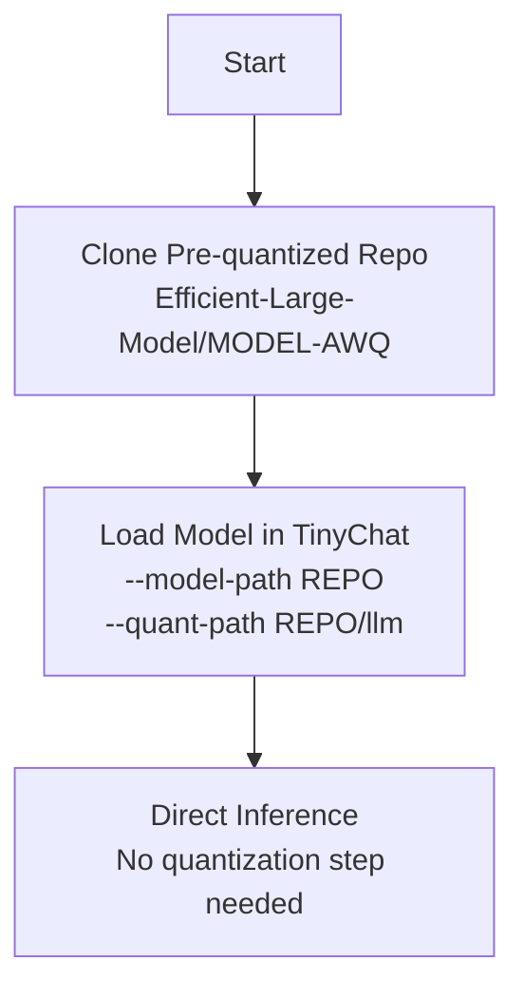

<!-- source: DeepWiki mcp.deepwiki.com · repo mit-han-lab/llm-awq · page 6.2 Model Zoo & Pre-quantized Models · fetched 2026-10-30 -->

# Model Zoo & Pre-quantized Models

<details>
<summary>Relevant source files</summary>

The following files were used as context for generating this wiki page:

- [README.md](README.md)
- [awq/entry.py](awq/entry.py)
- [awq/quantize/auto_scale.py](awq/quantize/auto_scale.py)
- [scripts/qwen_example.sh](scripts/qwen_example.sh)
- [tinychat/README.md](tinychat/README.md)
- [tinychat/utils/constants.py](tinychat/utils/constants.py)

</details>


## Purpose and Scope

This document describes the AWQ Model Zoo, a collection of pre-computed quantization search results and pre-quantized model weights hosted on Hugging Face. The model zoo eliminates the need to perform computationally expensive AWQ search procedures, enabling users to directly load quantized models for inference. This page covers the cache structure, download procedures, model availability, and integration with the quantization and inference pipelines.

For information about performing AWQ quantization from scratch, see [Calibration & Evaluation](#2.3). For information about loading models in TinyChat, see [Model Loading & Configuration](#3.1).

## Model Zoo Overview

The AWQ Model Zoo provides two types of pre-computed resources:

1. **AWQ Search Results** (`awq_cache`): Per-channel scaling factors and per-group clipping values computed during the AWQ search process
2. **Quantized Model Weights** (`quant_cache`): Real INT4 quantized weights ready for inference

These resources are hosted on Hugging Face at `mit-han-lab/awq-model-zoo` and as standalone model repositories under the `Efficient-Large-Model` organization.



**Diagram: AWQ Model Zoo Ecosystem**

Sources: [README.md:147-154](), [tinychat/README.md:343-348](), [awq/entry.py:62-68]()

## Cache Structure and File Types

### AWQ Cache Files

AWQ cache files store the results of the AWQ search algorithm, which performs grid search to find optimal per-channel scaling factors and per-group clipping values. These files enable users to skip the computationally expensive search phase.

**File Format:** PyTorch checkpoint (`.pt` file)

**Contents:**
- Per-channel scaling factors for each quantizable layer
- Per-group clipping ranges
- Layer-wise quantization parameters

**Naming Convention:** `{model_name}-w{bits}-g{group_size}.pt`
- Example: `llama3-8b-w4-g128.pt` (4-bit weights, group size 128)

**Storage Location:** `awq_cache/` directory

**Usage in Code:**
```bash
# Load AWQ cache during quantization
python -m awq.entry --model_path /PATH/TO/MODEL \
    --load_awq awq_cache/model-w4-g128.pt \
    --q_backend real --dump_quant quant_cache/model-w4-g128-awq.pt
```

Sources: [awq/entry.py:220-223](), [scripts/qwen_example.sh:16-19]()

### Quantized Weight Cache Files

Quantized weight cache files contain the actual INT4 quantized weights after real quantization has been applied. These files allow direct loading into inference engines without any quantization step.

**File Format:** PyTorch state dict (`.pt` file)

**Contents:**
- INT4 packed weights for all quantizable layers
- Quantization scales and zero points
- Non-quantized components (embeddings, layer norms, etc.)

**Naming Convention:** `{model_name}-w{bits}-g{group_size}-awq.pt` or `{model_name}-w{bits}-g{group_size}-awq-v2.pt`
- Example: `llama3-8b-w4-g128-awq-v2.pt`
- The `-v2` suffix indicates compatibility with newer checkpoint formats

**Storage Location:** `quant_cache/` directory

**Usage in Code:**
```bash
# Direct loading of quantized weights
python -m awq.entry --model_path /PATH/TO/MODEL \
    --load_quant quant_cache/model-w4-g128-awq.pt \
    --tasks wikitext
```

Sources: [awq/entry.py:153-186](), [scripts/qwen_example.sh:22-25]()



**Diagram: Cache Types in Quantization Pipeline**

Sources: [awq/entry.py:200-246](), [scripts/qwen_example.sh:1-26]()

## Downloading Model Zoo Resources

### Method 1: Clone Entire Model Zoo

Download all pre-computed AWQ search results from the central repository:

```bash
# Install git-lfs if not already installed
# git lfs install

# Clone the entire model zoo
git clone https://huggingface.co/datasets/mit-han-lab/awq-model-zoo awq_cache
```

This creates an `awq_cache/` directory containing AWQ search results for all supported models.

**Directory Structure:**
```
awq_cache/
├── llama3-8b-w4-g128.pt
├── llama3-70b-w4-g128.pt
├── llama-2-7b-w4-g128.pt
├── llama-2-13b-w4-g128.pt
├── qwen2.5-7b-w4-g128.pt
├── vila-1.5-3b-w4-g128.pt
└── ...
```

Sources: [README.md:147-154](), [tinychat/README.md:343-348]()

### Method 2: Download Pre-quantized Models

For some models (especially VILA family), fully quantized checkpoints are available from the `Efficient-Large-Model` organization on Hugging Face:

```bash
# Example: Download VILA-1.5-13B with quantized weights
git clone https://huggingface.co/Efficient-Large-Model/VILA1.5-13b-AWQ

# Directory structure:
# VILA1.5-13b-AWQ/
# ├── llm/              # Quantized LLM weights
# ├── config.json
# └── ...
```

These repositories contain both the model configuration and quantized weights, ready for immediate inference.

Sources: [tinychat/README.md:457-472]()

### Method 3: Manual Download from HuggingFace Hub

Individual cache files can be downloaded directly from the HuggingFace web interface or using the `huggingface-hub` Python library:

```python
from huggingface_hub import hf_hub_download

# Download specific AWQ cache file
awq_file = hf_hub_download(
    repo_id="mit-han-lab/awq-model-zoo",
    filename="llama3-8b-w4-g128.pt",
    local_dir="awq_cache"
)
```

Sources: [README.md:147-154]()

## Model Zoo Contents

The following table lists models with pre-computed AWQ search results available in the model zoo:

| Model Family | Sizes | INT4 (g128) | INT3 (g128) | Notes |
|--------------|-------|-------------|-------------|-------|
| [DeepSeek-R1-Distill](../scripts/DeepSeek_R1_Distill_example.sh) | 1.5B, 7B, 8B | ✅ | — | Reasoning models |
| [Qwen-2.5](../scripts/qwen_example.sh) | 7B, 72B | ✅ | — | BF16 precision support |
| [NVILA](../scripts/nvila_example.sh) | 3B, 8B | ✅ | — | Video-language models, W8A8 vision tower |
| [VILA-1.5](../scripts/vila15_example.sh) | 3B, 8B, 13B, 40B | ✅ | ✅ | Multi-modal models |
| [Llama-3](../scripts/llama_example.sh) | 8B, 70B | ✅ | ✅ | Latest Llama generation |
| [VILA](../scripts/vila_example.sh) | 7B, 13B | ✅ | — | Vision-language models |
| [Llama-2](../scripts/llama2_example.sh) | 7B, 13B, 70B | ✅ | ✅ | Chat and base models |
| [LLaMA](../scripts/llama_example.sh) | 7B, 13B, 30B, 65B | ✅ | ✅ | Original LLaMA |
| [OPT](../scripts/opt_example.sh) | 125M, 1.3B, 2.7B, 6.7B, 13B, 30B | ✅ | ✅ | Open Pre-trained Transformers |
| [CodeLlama](../scripts/codellama_example.sh) | 7B, 13B, 34B | ✅ | ✅ | Code generation |
| [StarCoder](../scripts/starcoder_example.sh) | 15.5B | ✅ | ✅ | Code generation |
| [Vicuna-v1.1](../scripts/vicuna_example.sh) | 7B, 13B | ✅ | — | Chat models |
| [LLaVA-v0](../scripts/llava_example.sh) | 13B | ✅ | — | Vision-language |

**Notes:**
- ✅ indicates pre-computed AWQ search results available
- INT4/INT3 refers to weight quantization bit-width
- g128 denotes group size of 128
- Some models also support g64 (e.g., Falcon-7B uses g64 instead of g128)

Sources: [README.md:156-173](), [tinychat/README.md:6-23]()

### Pre-quantized Weight Availability

Fully quantized weights (ready for inference) are available for select models:

| Model Repository | Organization | Notes |
|------------------|--------------|-------|
| `VILA1.5-3b-AWQ` | Efficient-Large-Model | Includes vision encoder |
| `VILA1.5-8b-AWQ` | Efficient-Large-Model | Includes vision encoder |
| `VILA1.5-13b-AWQ` | Efficient-Large-Model | Includes vision encoder |
| `VILA1.5-40b-AWQ` | Efficient-Large-Model | Includes vision encoder |
| `NVILA-AWQ` | Efficient-Large-Model | Mixed-precision quantization |

For other models, users must generate quantized weights using the AWQ cache files as described in the next section.

Sources: [README.md:173-174](), [tinychat/README.md:457-472]()

## Using Pre-computed Resources

### Workflow 1: Using AWQ Cache to Generate Quantized Weights

When only AWQ cache files are available, follow this workflow:



**Diagram: Workflow Using AWQ Cache**

**Example Commands:**

```bash
# Step 1: Download AWQ cache
git clone https://huggingface.co/datasets/mit-han-lab/awq-model-zoo awq_cache

# Step 2: Generate quantized weights
mkdir quant_cache
python -m awq.entry --model_path /PATH/TO/llama3-8b \
    --w_bit 4 --q_group_size 128 \
    --load_awq awq_cache/llama3-8b-w4-g128.pt \
    --q_backend real --dump_quant quant_cache/llama3-8b-w4-g128-awq.pt

# Step 3: Use quantized weights for inference
cd tinychat
python demo.py --model_type llama \
    --model_path /PATH/TO/llama3-8b \
    --q_group_size 128 \
    --load_quant quant_cache/llama3-8b-w4-g128-awq.pt \
    --precision W4A16
```

Sources: [awq/entry.py:220-246](), [scripts/qwen_example.sh:15-25](), [tinychat/README.md:377-393]()

### Workflow 2: Direct Loading of Pre-quantized Models

For models with pre-quantized weights available (e.g., VILA family):



**Diagram: Direct Loading Workflow**

**Example Commands:**

```bash
# Step 1: Download pre-quantized model
cd tinychat
git clone https://huggingface.co/Efficient-Large-Model/VILA1.5-13b-AWQ

# Step 2: Run inference directly
python vila15_demo.py \
    --model-path VILA1.5-13b-AWQ \
    --quant-path VILA1.5-13b-AWQ/llm \
    --precision W4A16 \
    --image-file /PATH/TO/IMAGE
```

No quantization step is required; the model is immediately ready for inference.

Sources: [tinychat/README.md:457-472]()

### Workflow 3: Evaluation Without Quantization

For quick evaluation using pseudo-quantization (simulation):

```bash
# Evaluate AWQ quantization quality without generating real weights
python -m awq.entry --model_path /PATH/TO/MODEL \
    --tasks wikitext \
    --w_bit 4 --q_group_size 128 \
    --load_awq awq_cache/model-w4-g128.pt \
    --q_backend fake
```

This uses `pseudo_quantize_model_weight` to simulate quantization for evaluation without creating INT4 weights.

Sources: [awq/entry.py:227-234](), [scripts/qwen_example.sh:8-13]()

## File Naming Conventions and Version Compatibility

### Naming Format

AWQ cache and quantized checkpoint files follow a consistent naming pattern:

**AWQ Cache:** `{model_name}-w{bits}-g{group_size}.pt`
- `model_name`: Model identifier (e.g., `llama3-8b`, `qwen2.5-7b`)
- `w{bits}`: Weight bit-width (e.g., `w4` for 4-bit, `w3` for 3-bit)
- `g{group_size}`: Quantization group size (e.g., `g128`, `g64`)

**Quantized Weights:** `{model_name}-w{bits}-g{group_size}-awq.pt` or `{model_name}-w{bits}-g{group_size}-awq-v2.pt`
- `-awq` suffix indicates AWQ quantized weights
- `-v2` suffix indicates newer checkpoint format (automatically added by the codebase)

**Example File Names:**
```
awq_cache/llama3-8b-w4-g128.pt           # AWQ cache
quant_cache/llama3-8b-w4-g128-awq-v2.pt  # Quantized weights (v2)
quant_cache/vila-1.5-13b-w4-g128-awq.pt  # Quantized weights (legacy)
```

Sources: [awq/entry.py:238-240]()

### Version 2 Format

The codebase automatically converts checkpoint filenames to include the `-v2` suffix when saving:

```python
# From awq/entry.py:238-240
if not args.dump_quant.endswith("v2.pt"):
    print("[Info] Auto-change the dump_quant file name to *v2.pt")
    args.dump_quant = args.dump_quant.replace(".pt", "-v2.pt")
```

This ensures compatibility with newer checkpoint loading mechanisms. Both v1 and v2 formats are loadable, but v2 is preferred for new quantizations.

Sources: [awq/entry.py:238-240]()

## Integration Points

### Integration with awq.entry

The main quantization entry point integrates with the model zoo through three command-line arguments:

| Argument | Purpose | Cache Type |
|----------|---------|------------|
| `--load_awq PATH` | Load pre-computed AWQ search results | AWQ cache |
| `--dump_awq PATH` | Save AWQ search results | AWQ cache |
| `--load_quant PATH` | Load quantized weights directly | Quantized cache |
| `--dump_quant PATH` | Save quantized weights | Quantized cache |

**Mutual Exclusivity:**
- If `--load_awq` is provided, `--run_awq` is automatically disabled (line 190)
- If `--load_quant` is provided, the quantization process is skipped entirely

Sources: [awq/entry.py:62-68](), [awq/entry.py:153-189]()

### Integration with TinyChat

TinyChat can load quantized models through multiple paths:

**Language Models:**
```bash
python demo.py --model_type llama \
    --model_path /PATH/TO/MODEL \
    --q_group_size 128 \
    --load_quant quant_cache/model-w4-g128-awq.pt \
    --precision W4A16
```

**Vision-Language Models (VILA):**
```bash
python vila15_demo.py \
    --model-path /PATH/TO/VILA \
    --quant-path quant_cache/vila-w4-g128-awq.pt \
    --precision W4A16
```

**Pre-quantized Model Repositories:**
```bash
python vila15_demo.py \
    --model-path VILA1.5-13b-AWQ \
    --quant-path VILA1.5-13b-AWQ/llm \
    --precision W4A16
```

Sources: [tinychat/README.md:377-393](), [tinychat/README.md:445-472]()

### Memory-Efficient Loading for Edge Devices

For edge devices with limited memory (e.g., Jetson Orin), quantized checkpoints can be split into smaller chunks:

```bash
# Split checkpoint into layer-wise files
python split_ckpt.py \
    --input_path quant_cache/model-w4-g128-awq.pt \
    --output_path quant_cache/model-w4-g128-awq

# Load with memory-efficient mode
python demo.py --model_type llama \
    --model_path /PATH/TO/MODEL \
    --q_group_size 128 \
    --load_quant quant_cache/model-w4-g128-awq \
    --precision W4A16 \
    --mem_efficient_load
```

This enables layer-by-layer loading to avoid out-of-memory errors on devices with shared CPU/GPU memory.

Sources: [tinychat/README.md:397-416](), [tinychat/utils/constants.py:9]()

## Special Cases

### Falcon Models

Falcon-7B uses a non-standard group size of 64 instead of 128:

```bash
# Falcon-7B quantization
python -m awq.entry --model_path /PATH/TO/falcon-7b-instruct \
    --w_bit 4 --q_group_size 64 \
    --load_awq awq_cache/falcon-7b-w4-g64.pt \
    --q_backend real --dump_quant quant_cache/falcon-7b-w4-g64-awq.pt

# Falcon-7B inference
python demo.py --model_type falcon \
    --model_path /PATH/TO/falcon-7b-instruct \
    --q_group_size 64 \
    --load_quant quant_cache/falcon-7b-w4-g64-awq.pt \
    --precision W4A16
```

Always verify the correct group size for each model family.

Sources: [tinychat/README.md:356-393]()

### NVILA Mixed-Precision Models

NVILA models use mixed-precision quantization (W8A8 for vision tower, W4A16 for LLM). The model zoo provides both AWQ cache for the LLM and activation scales for the vision tower:

```bash
# Generate activation scales for vision tower
python -m awq.entry --model_path PATH/TO/NVILA \
    --smooth_scale \
    --media_path VIDEO_URL \
    --act_scale_path awq_cache/NVILA-VT-smooth-scale.pt \
    --vila-20 \
    --w_bit 4 --q_group_size 128 \
    --run_awq --dump_awq awq_cache/NVILA.pt

# Generate quantized LLM weights
python -m awq.entry --model_path PATH/TO/NVILA/llm \
    --w_bit 4 --q_group_size 128 \
    --load_awq awq_cache/NVILA.pt \
    --q_backend real --dump_quant quant_cache/NVILA-w4-g128-awq.pt \
    --vila-20

# Inference with both caches
python nvila_demo.py --model-path PATH/TO/NVILA \
    --quant_path quant_cache/NVILA-w4-g128-awq.pt \
    --act_scale_path awq_cache/NVILA-VT-smooth-scale.pt \
    --quant_llm --model_type nvila
```

Pre-quantized NVILA weights are available at `Efficient-Large-Model/NVILA-AWQ`.

Sources: [awq/entry.py:79-96](), [tinychat/README.md:485-509]()

## Summary of Benefits

Using the AWQ Model Zoo provides several advantages:

1. **Time Savings**: Skip the AWQ search process, which can take hours on large models
2. **Computational Savings**: Avoid expensive grid search over activation distributions
3. **Consistency**: Pre-computed results are validated and tested
4. **Immediate Deployment**: Pre-quantized models enable instant inference without quantization steps
5. **Storage Efficiency**: AWQ cache files (10-100 MB) are much smaller than full model checkpoints

**Recommended Workflow:**
- For **development/experimentation**: Use AWQ cache → generate quantized weights → iterate on inference
- For **production deployment**: Use pre-quantized models from `Efficient-Large-Model` for zero-setup inference
- For **new models**: Perform AWQ search → save results → contribute back to model zoo

Sources: [README.md:147-174](), [tinychat/README.md:343-348]()

---

