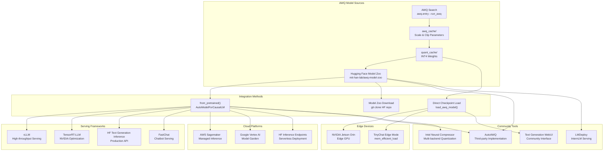
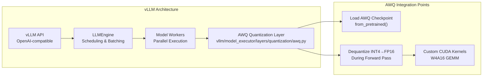
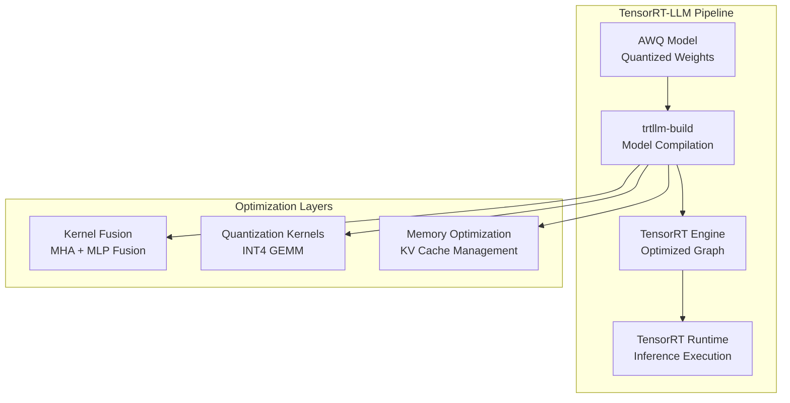
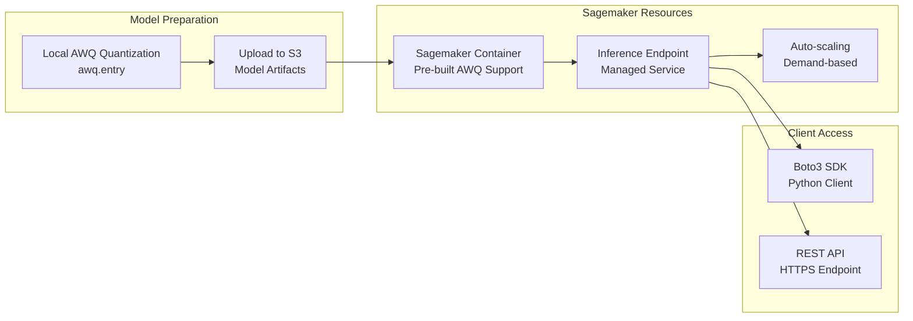
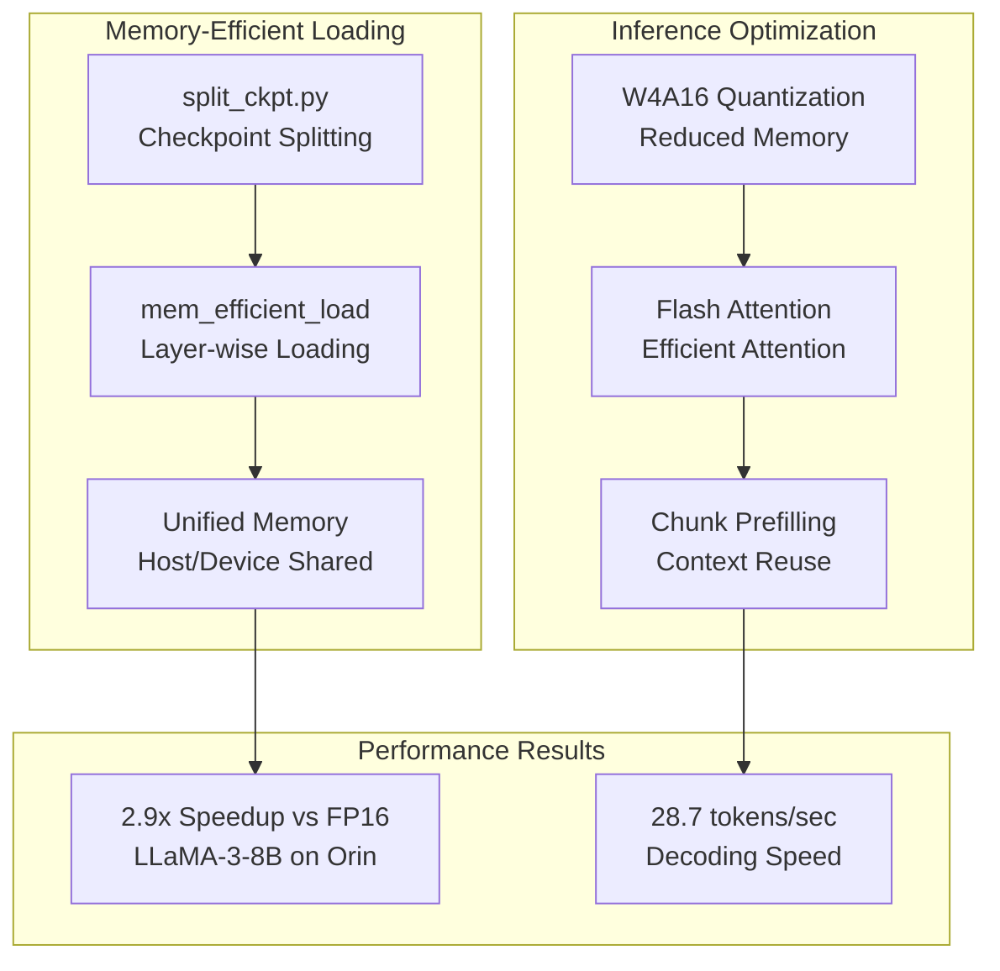
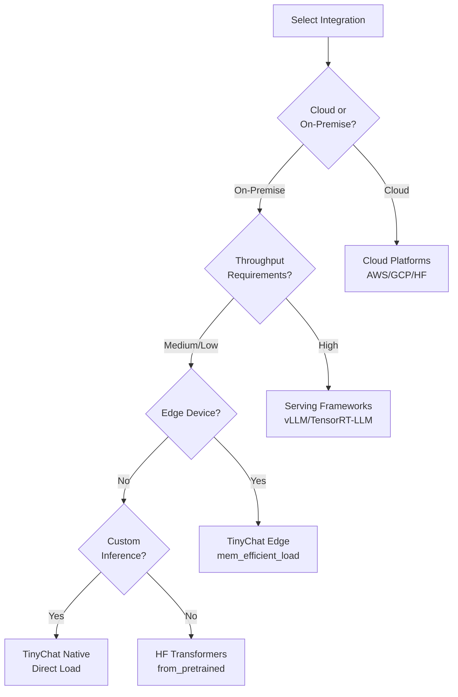

<!-- source: DeepWiki mcp.deepwiki.com · repo mit-han-lab/llm-awq · page 6.3 Third-Party Integrations · fetched 2026-10-30 -->

# Third-Party Integrations

<details>
<summary>Relevant source files</summary>

The following files were used as context for generating this wiki page:

- [README.md](README.md)
- [scripts/qwen_example.sh](scripts/qwen_example.sh)
- [tinychat/README.md](tinychat/README.md)
- [tinychat/demo.py](tinychat/demo.py)
- [tinychat/utils/constants.py](tinychat/utils/constants.py)

</details>


## Purpose and Scope

This document describes how AWQ-quantized models integrate with external frameworks, serving systems, cloud platforms, and edge devices. It covers the integration pathways, API compatibility, and deployment strategies for using AWQ models beyond the native TinyChat inference engine.

For information about the AWQ model zoo and pre-quantized model distribution, see [Model Zoo & Pre-quantized Models](#6.2). For native TinyChat deployment, see [TinyChat Inference System](#3).

---

## Integration Overview

AWQ models can be consumed by external systems through three primary pathways: **native Hugging Face Transformers support**, **direct checkpoint loading**, and **pre-quantized model downloads from the model zoo**. Each pathway enables different use cases and optimization strategies.

### Integration Pathways



**Sources:** [README.md:68-72](), [README.md:65-67]()

---

## Hugging Face Transformers Integration

### Native from_pretrained Support

AWQ is **natively integrated** into Hugging Face Transformers, enabling seamless loading of quantized models through the standard `from_pretrained` API. This integration was announced in November 2023 and provides zero-code-change compatibility for users familiar with the Transformers library.

#### Loading Quantized Models from Hub

```python
from transformers import AutoModelForCausalLM, AutoTokenizer

# Load AWQ-quantized model directly from Hub
model = AutoModelForCausalLM.from_pretrained(
    "TheBloke/Llama-2-7B-Chat-AWQ",
    device_map="auto"
)
tokenizer = AutoTokenizer.from_pretrained("TheBloke/Llama-2-7B-Chat-AWQ")

# Standard inference - quantization is transparent
inputs = tokenizer("Hello, how are you?", return_tensors="pt")
outputs = model.generate(**inputs)
```

#### Loading Local Quantized Checkpoints

Users can also load locally quantized models:

```python
# After running AWQ quantization locally
model = AutoModelForCausalLM.from_pretrained(
    "/path/to/local/model",
    device_map="auto",
    load_in_4bit=True,  # Enable 4-bit loading
)
```

The `from_pretrained` integration automatically detects AWQ configuration and applies appropriate dequantization kernels during inference.

**Sources:** [README.md:68-69]()

---

## Serving Frameworks

### vLLM Integration

**vLLM** is a high-throughput serving system optimized for large-scale LLM deployment. AWQ integration enables efficient serving with reduced memory footprint and higher throughput compared to FP16 models.



#### vLLM Usage Example

```python
from vllm import LLM, SamplingParams

# Initialize vLLM with AWQ model
llm = LLM(
    model="TheBloke/Llama-2-7B-Chat-AWQ",
    quantization="awq",
    dtype="float16"
)

# Generate with high throughput
prompts = ["Tell me a joke", "Explain quantum computing"]
sampling_params = SamplingParams(temperature=0.8, top_p=0.95)
outputs = llm.generate(prompts, sampling_params)
```

vLLM's **PagedAttention** mechanism combined with AWQ quantization enables serving larger batches with reduced memory usage, significantly improving throughput in production environments.

**Sources:** [README.md:70]()

---

### TensorRT-LLM Integration

**TensorRT-LLM** is NVIDIA's optimized inference library for LLMs, leveraging TensorRT's compilation and optimization capabilities. AWQ integration was announced in October 2023, enabling deployment on NVIDIA GPUs with maximum performance.

#### Integration Architecture



TensorRT-LLM compiles AWQ models into highly optimized execution graphs, applying **layer fusion**, **kernel selection**, and **memory planning** during the build phase. The compiled engine achieves lower latency than PyTorch-based inference.

#### Key Features

| Feature | Description |
|---------|-------------|
| **Build-time Optimization** | Compiles model graph with AWQ-specific kernels |
| **Multi-GPU Support** | Tensor parallelism for large models |
| **Flash Attention** | Integrated efficient attention kernels |
| **C++ Runtime** | Low-overhead inference without Python |

**Sources:** [README.md:69]()

---

### Other Serving Frameworks

AWQ is integrated into multiple community-maintained serving systems:

| Framework | Purpose | Integration Status |
|-----------|---------|-------------------|
| **FastChat** | Chatbot serving with web UI | Native support, documented at [docs/awq.md](https://github.com/lm-sys/FastChat/blob/main/docs/awq.md) |
| **HuggingFace TGI** | Production API server | Native AWQ support via [PR #1054](https://github.com/huggingface/text-generation-inference/pull/1054) |
| **LMDeploy** | InternLM serving toolkit | Integrated for efficient deployment |
| **Intel Neural Compressor** | Multi-backend quantization | AWQ as quantization option |

**Sources:** [README.md:70]()

---

## Cloud Platform Deployment

### AWS Sagemaker Integration

**Amazon Sagemaker** integrated AWQ in November 2023, enabling managed inference with quantized models. The integration provides pre-built containers with AWQ support, simplifying deployment for enterprise users.

#### Deployment Workflow



#### Sagemaker Deployment Code

```python
import boto3
from sagemaker.huggingface import HuggingFaceModel

# Define model with AWQ configuration
huggingface_model = HuggingFaceModel(
    model_data="s3://my-bucket/awq-model.tar.gz",
    role=role,
    transformers_version="4.35",
    pytorch_version="2.1",
    py_version="py310",
)

# Deploy to endpoint
predictor = huggingface_model.deploy(
    initial_instance_count=1,
    instance_type="ml.g5.xlarge"
)
```

**Sources:** [README.md:66]()

---

### Google Vertex AI Integration

**Google Vertex AI** added AWQ to their **Model Garden** in January 2024, providing managed deployment with auto-scaling and monitoring capabilities.

#### Key Features

- **Pre-configured Models**: Ready-to-deploy AWQ quantized models
- **Managed Infrastructure**: Automatic provisioning and scaling
- **Model Monitoring**: Performance and accuracy tracking
- **Integration with GCP**: Seamless connection to BigQuery, Cloud Storage

The Vertex AI integration focuses on **LLaMA-2 quantized models**, as documented in the [model garden console](https://console.cloud.google.com/vertex-ai/publishers/meta/model-garden/llama-2-quantized).

**Sources:** [README.md:65]()

---

### Hugging Face Inference Endpoints

Hugging Face provides **serverless inference endpoints** for AWQ models, enabling on-demand deployment without infrastructure management.

```python
from huggingface_hub import InferenceClient

client = InferenceClient(
    model="TheBloke/Llama-2-7B-Chat-AWQ",
    token="hf_..."
)

response = client.text_generation(
    "What is the capital of France?",
    max_new_tokens=50
)
```

**Sources:** [README.md:68-69]()

---

## Edge Device Deployment

### NVIDIA Jetson Orin Support

AWQ provides specialized support for **NVIDIA Jetson Orin**, an edge GPU platform with unified memory architecture. The integration addresses unique challenges of edge deployment: limited memory, shared host/device memory, and power constraints.

#### Edge-Specific Optimizations



#### Memory-Efficient Loading Workflow

For large models on Jetson Orin (e.g., LLaMA-2-70B on 64GB Orin), the checkpoint must be split into smaller pieces to avoid OOM during loading:

```bash
# Step 1: Split checkpoint into smaller files
python split_ckpt.py \
    --input_path quant_cache/llama-2-70b-w4-g128-awq.pt \
    --output_path quant_cache/llama-2-70b-w4-g128-awq/

# Step 2: Run TinyChat with mem_efficient_load flag
cd tinychat
python demo.py --model_type llama \
    --model_path /PATH/TO/LLAMA2/llama-2-70b-chat \
    --q_group_size 128 \
    --load_quant quant_cache/llama-2-70b-w4-g128-awq/ \
    --precision W4A16 \
    --mem_efficient_load
```

The `mem_efficient_load` flag activates **layer-wise loading**, where each model layer is loaded individually, processed, and then the next layer is loaded. This approach trades loading time for reduced peak memory usage.

**Sources:** [tinychat/README.md:397-416](), [tinychat/utils/constants.py:9]()

---

#### Installation for Jetson Orin

Special installation steps are required for Jetson devices due to pre-built package availability:

```bash
# 1. Modify pyproject.toml to comment out torch dependency
# See README.md:117

# 2. Install PyTorch from NVIDIA pre-built binaries
# JetPack 5 ships with Python 3.8
conda create -n awq python=3.8 -y
conda activate awq

# Download from https://forums.developer.nvidia.com/t/pytorch-for-jetson/72048
pip install torch-2.1.0-cp38-cp38-linux_aarch64.whl

# 3. Build Flash Attention from source for compute capability 87
git clone https://github.com/Dao-AILab/flash-attention.git
cd flash-attention
sed -i '168 a\    cc_flag.append("-gencode")\n\    cc_flag.append("arch=compute_87,code=sm_87")' setup.py
python setup.py install
```

**Sources:** [README.md:115-120](), [tinychat/README.md:323-330]()

---

#### Performance Benchmarks on Jetson Orin

| Model | FP16 Speed | W4A16 Speed | Speedup | Memory Savings |
|-------|------------|-------------|---------|----------------|
| LLaMA-3-8B | 96.0 ms/token | 32.5 ms/token | 2.95x | ~4GB → ~2GB |
| LLaMA-2-7B | 84.0 ms/token | 25.9 ms/token | 3.24x | ~3.5GB → ~1.8GB |
| LLaMA-2-13B | 162.3 ms/token | 47.7 ms/token | 3.41x | OOM → ~3GB |

The table shows that AWQ not only improves speed but also enables running models that would otherwise OOM in FP16 mode.

**Sources:** [tinychat/README.md:126-137]()

---

## Community Tools and Extensions

### AutoAWQ

**AutoAWQ** is a third-party implementation that extends AWQ with additional features and improved ease of use. It provides a more modular architecture for integrating new model types and accelerated inference.

Key differences from the original AWQ:

| Feature | AWQ (this repo) | AutoAWQ |
|---------|-----------------|---------|
| **Focus** | Research implementation, TinyChat | Production ease-of-use |
| **Model Support** | Core models (LLaMA, Falcon, etc.) | Broader model family support |
| **Inference** | TinyChat with custom kernels | HF Transformers integration |
| **API Design** | Academic research tool | Developer-friendly library |

AutoAWQ is recommended for users who need quick integration with new models or prefer a Transformers-centric workflow.

**Sources:** [README.md:72]()

---

### Text Generation WebUI

The **Text Generation WebUI** (also known as oobabooga's webui) is a popular community tool for running LLMs with a Gradio interface. AWQ models can be loaded directly through checkpoint loading:

```python
# In Text Generation WebUI settings
Model: /path/to/awq-model
Loader: AutoAWQ
wbits: 4
groupsize: 128
```

**Sources:** Based on integration diagram [Diagram 6]()

---

### Other Community Integrations

| Tool | Purpose | Integration Method |
|------|---------|-------------------|
| **llama.cpp** | CPU inference | Experimental AWQ support for CPU deployment |
| **Intel Neural Compressor** | Multi-backend quantization | AWQ as one quantization strategy |
| **LMDeploy** | InternLM deployment | Native AWQ loading support |

**Sources:** [README.md:70]()

---

## Integration Method Selection

### Decision Matrix

The choice of integration method depends on deployment requirements:



### Recommendation Summary

| Use Case | Recommended Integration | Key Benefits |
|----------|------------------------|--------------|
| **Production serving, high throughput** | vLLM or TensorRT-LLM | Batching, paging, kernel optimization |
| **Managed cloud deployment** | AWS Sagemaker or GCP Vertex AI | Auto-scaling, monitoring, low ops overhead |
| **Research/prototyping** | HF Transformers `from_pretrained` | Zero-code-change, easy experimentation |
| **Edge deployment (Jetson)** | TinyChat with `mem_efficient_load` | Memory optimization, unified memory support |
| **Custom inference pipeline** | TinyChat with direct checkpoint load | Full control, custom kernels, streaming |
| **Quick model testing** | AutoAWQ | Fast setup, broad model support |

**Sources:** [README.md:91-97](), [Diagram 6]()

---

## Configuration and Compatibility

### Model Format Compatibility

AWQ checkpoints use a standardized format that is compatible across different integration methods:

| Component | Storage Format | Compatible Systems |
|-----------|----------------|-------------------|
| **Quantized Weights** | INT4 packed format (`.pt` file) | TinyChat, AutoAWQ, Text Gen WebUI |
| **Scale & Clip Parameters** | `awq_cache/*.pt` | Native AWQ, AutoAWQ |
| **HF Config** | `config.json` with AWQ metadata | HF Transformers, vLLM, TensorRT-LLM |

### Loading Different Checkpoint Formats

```python
# Method 1: Direct checkpoint load (TinyChat)
from tinychat.utils.load_quant import load_awq_model
model = load_awq_model(model, "quant_cache/model.pt", 4, 128, "cuda:0")

# Method 2: HF Transformers from_pretrained
from transformers import AutoModelForCausalLM
model = AutoModelForCausalLM.from_pretrained("user/model-awq")

# Method 3: vLLM with explicit quantization
from vllm import LLM
llm = LLM(model="user/model-awq", quantization="awq")
```

**Sources:** [tinychat/demo.py:196-208](), [README.md:68-69]()

---

## Cross-Framework Performance Comparison

### Prefilling Speed Comparison (RTX 4090)

Time-To-First-Token (TTFT) for 4-bit Llama-3-8B across different systems:

| System | 256 tokens | 512 tokens | 1024 tokens | 2048 tokens | 4096 tokens |
|--------|------------|------------|-------------|-------------|-------------|
| **TensorRT-LLM** | 0.027s | 0.051s | 0.100s | 0.204s | 0.421s |
| **MLC** | 0.028s | 0.042s | 0.081s | 0.166s | 0.350s |
| **llama.cpp** | 0.026s | 0.045s | 0.086s | 0.175s | 0.375s |
| **ExLlama v2** | 0.040s | 0.051s | 0.077s | 0.139s | 0.294s |
| **TinyChat (Legacy)** | 0.031s | 0.051s | 0.101s | 0.219s | 0.461s |
| **TinyChat 2.0** | 0.021s | 0.033s | 0.065s | 0.132s | 0.278s |

TinyChat 2.0 achieves **state-of-the-art prefilling speed** across all sequence lengths, outperforming both specialized frameworks (TensorRT-LLM, llama.cpp) and community projects (ExLlama v2, MLC).

**Sources:** [tinychat/README.md:203-214]()

---

## Summary of Integration Paths

AWQ's broad integration ecosystem provides flexibility for different deployment scenarios:

1. **Native Integration**: HF Transformers `from_pretrained` for research and prototyping
2. **High-Performance Serving**: vLLM and TensorRT-LLM for production throughput
3. **Cloud Managed**: AWS Sagemaker and GCP Vertex AI for enterprise deployment  
4. **Edge Optimized**: TinyChat with memory-efficient loading for Jetson devices
5. **Community Extended**: AutoAWQ and Text Gen WebUI for rapid experimentation

Each integration method leverages AWQ's quantization benefits (4× memory reduction, 2-3× speedup) while providing different trade-offs in ease of use, performance, and operational complexity.

**Sources:** [README.md:54-76](), [Diagram 6]()