# Page: Overview

# Overview

<details>
<summary>Relevant source files</summary>

The following files were used as context for generating this wiki page:

- [README.md](README.md)
- [scripts/qwen_example.sh](scripts/qwen_example.sh)
- [tinychat/README.md](tinychat/README.md)
- [tinychat/utils/constants.py](tinychat/utils/constants.py)

</details>


This page provides an introduction to the AWQ (Activation-aware Weight Quantization) repository, explaining the key components and workflows of the system. AWQ enables efficient and accurate low-bit weight quantization (INT3/4) for Large Language Models (LLMs), supporting both instruction-tuned models and multi-modal language models (VLMs).

The AWQ repository consists of two main systems:
1. The AWQ quantization framework for compressing LLMs while maintaining quality
2. TinyChat, an efficient inference runtime for deploying the quantized models

For detailed information about the quantization algorithm, see [AWQ Quantization System](#2), and for more on the inference system, refer to [TinyChat System](#3).

## System Architecture

Here's a high-level overview of the AWQ system architecture:

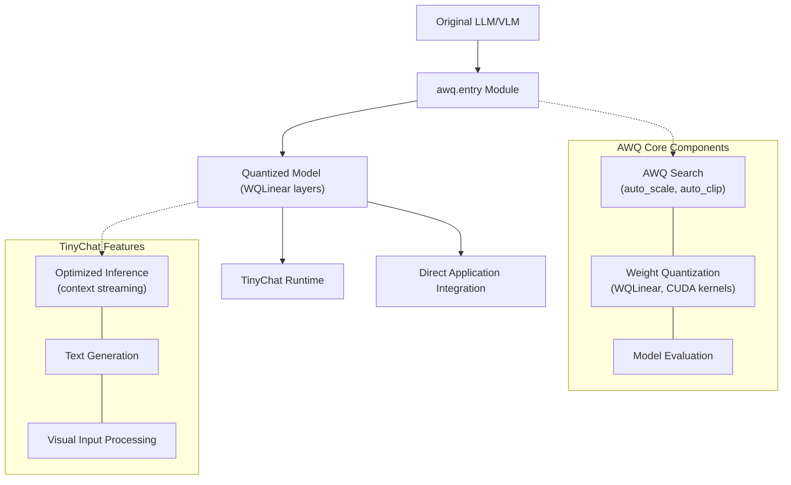

Sources: [README.md:10-16]()

## Quantization Workflow

The AWQ quantization process involves three main operations, controlled through command-line arguments to the `awq.entry` module:

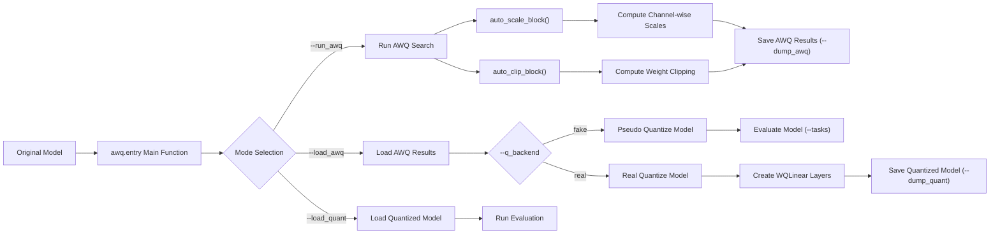

Sources: [scripts/qwen_example.sh:3-25](), [README.md:177-208]()

The workflow consists of three main phases:
1. **Search Mode**: Find optimal quantization parameters (scales and clips)
2. **Quantize Mode**: Apply quantization to the model using these parameters
3. **Evaluate Mode**: Assess the performance of the quantized model

## TinyChat Runtime

TinyChat provides an efficient inference environment for the quantized models:

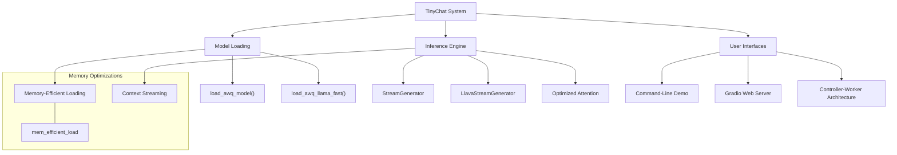

Sources: [README.md:51-52](), [tinychat/utils/constants.py:4-9]()

TinyChat is designed for efficient inference with both text-only and multimodal models. It includes:
- Memory-efficient model loading (especially important for edge devices)
- Optimized attention mechanisms
- Streaming text generation
- Support for various user interfaces (CLI and web-based)

## Inference Flow

During inference, TinyChat processes inputs and generates outputs as follows:

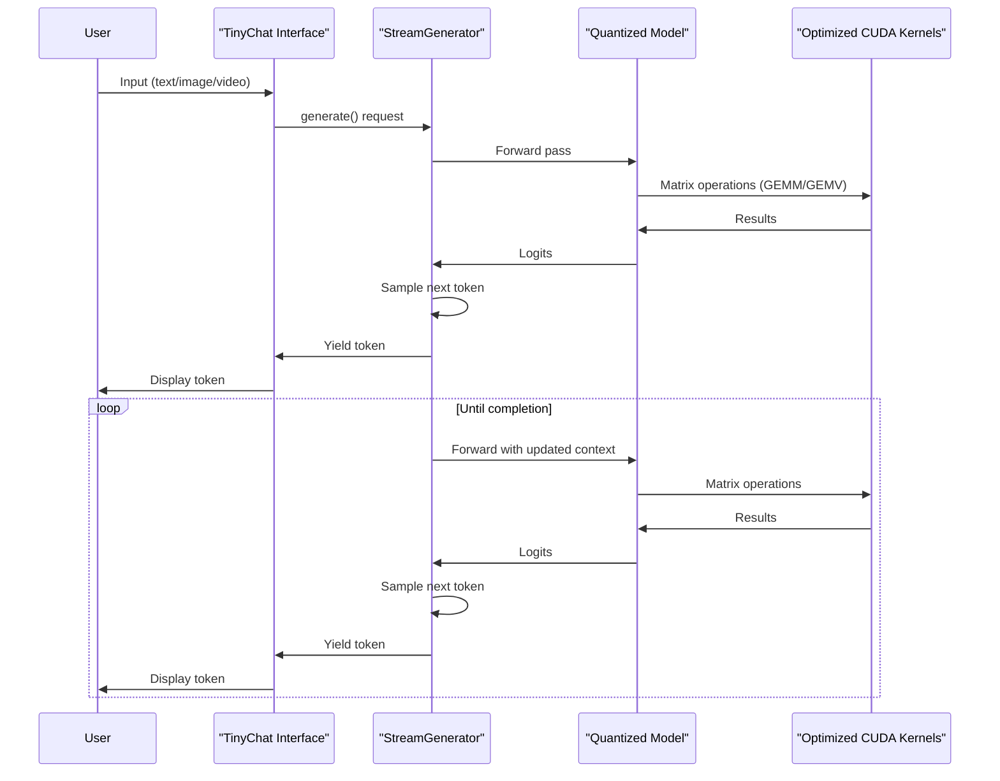

Sources: [README.md:17-18]()

## Multimodal Support

AWQ and TinyChat support multimodal models that can process text, images, and videos:

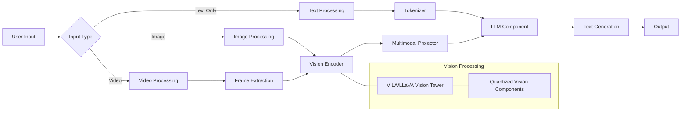

Sources: [README.md:29-43](), [README.md:135-143]()

The multimodal architecture enables processing of:
- Text inputs through tokenizers
- Image inputs through vision encoders (like those in VILA and LLaVA)
- Video inputs by extracting frames and processing them through the vision encoder

## Configuration Parameters

Key configuration parameters for TinyChat (from `tinychat.utils.constants.py`):

| Parameter | Description | Default Value |
|-----------|-------------|---------------|
| `max_seq_len` | Maximum sequence length | 8192 |
| `max_batch_size` | Maximum batch size | 1 |
| `llama_multiple_of` | Sequence length multiple | 256 |
| `mem_efficient_load` | Layer-wise model loading | False |

Sources: [tinychat/utils/constants.py:4-9]()

The `mem_efficient_load` parameter is particularly useful for edge devices with limited memory.

## Model Support

AWQ supports a wide range of LLMs and VLMs:

| Model Family | Sizes | INT4 | INT3 |
|--------------|-------|------|------|
| DeepSeek-R1-Distill | 8B | ✅ |  |
| Qwen-2.5 | 7B/72B | ✅ |  |
| VILA-1.5 | 3B/8B/13B/40B | ✅ | ✅ |
| Llama3 | 8B/70B | ✅ | ✅ |
| Llama2 | 7B/13B/70B | ✅ | ✅ |
| LLaMA | 7B/13B/30B/65B | ✅ | ✅ |
| OPT | 125m-30B | ✅ | ✅ |
| CodeLlama | 7B/13B/34B | ✅ | ✅ |
| StarCoder | 15.5B | ✅ | ✅ |
| Vicuna | 7B/13B | ✅ |  |
| LLaVA | 13B | ✅ |  |

Sources: [README.md:144-161]()

## Performance Benefits

AWQ quantization provides significant benefits:

- Memory reduction: 3-4x smaller model size
- Inference speedup: 2-3x faster generation
- Maintained accuracy: Minimal quality degradation compared to FP16
- Edge compatibility: Enables running large models on resource-constrained devices

Sources: [README.md:16-17](), [README.md:20-26]()

## Installation and Usage

The AWQ repository can be installed by following these steps:

1. Clone the repository
2. Install the Python package
3. Compile the CUDA kernels
4. (Optional) Install VILA for multimodal support

For practical usage, the most common workflow is:

1. Run AWQ search to find optimal quantization parameters
2. Apply quantization to create a 4-bit model
3. Deploy the quantized model using TinyChat

Sources: [README.md:99-143](), [README.md:176-208]()

---

# Page: AWQ Quantization System

# AWQ Quantization System

<details>
<summary>Relevant source files</summary>

The following files were used as context for generating this wiki page:

- [README.md](README.md)
- [awq/entry.py](awq/entry.py)
- [awq/quantize/auto_scale.py](awq/quantize/auto_scale.py)
- [scripts/qwen_example.sh](scripts/qwen_example.sh)
- [tinychat/README.md](tinychat/README.md)
- [tinychat/utils/constants.py](tinychat/utils/constants.py)

</details>


## Purpose and Scope

The AWQ (Activation-aware Weight Quantization) Quantization System is the core component that enables efficient 4-bit (INT4) weight quantization of large language models while maintaining accuracy close to full-precision models. This page provides an overview of the AWQ system's motivation, approach, and key components.

For detailed algorithmic explanations, see [Quantization Algorithm](#2.1). For implementation details, see [Quantization Implementation](#2.2). For usage and calibration workflows, see [Calibration & Evaluation](#2.3). For low-level optimization details, see [CUDA Kernels & Low-Level Optimization](#2.4).

## What is AWQ?

AWQ (Activation-aware Weight Quantization) is a quantization method that reduces model weight precision from FP16/BF16 to INT4 (4-bit integers) while maintaining model accuracy. Unlike naive quantization approaches that treat all weights equally, AWQ protects salient weights based on activation statistics, achieving superior accuracy-efficiency trade-offs.

### Key Benefits

| Benefit | Description |
|---------|-------------|
| **Memory Reduction** | 4× reduction in model size (e.g., 7B model from 14GB to 3.5GB) |
| **Inference Speed** | 2-3× faster token generation on GPUs |
| **Accuracy Preservation** | Minimal accuracy degradation compared to FP16 |
| **Hardware Efficient** | Optimized CUDA kernels for W4A16 operations |
| **Broad Compatibility** | Supports LLaMA, Qwen, Falcon, MPT, VILA, and more |

Sources: [README.md:1-17]()

### The AWQ Approach

AWQ's core innovation is **activation-aware** quantization:

1. **Observes Activation Patterns**: Analyzes activation magnitudes on calibration data
2. **Protects Salient Weights**: Applies per-channel scaling to preserve important weights
3. **Minimizes Quantization Error**: Uses auto-clipping to reduce outlier impact
4. **Efficient Search**: Grid search finds optimal scaling factors per layer

This approach differs from traditional quantization by adapting to each model's unique activation patterns rather than applying uniform quantization.

Sources: [README.md:4-6](), [awq/quantize/auto_scale.py:87-156]()

## System Architecture

**High-Level Architecture Diagram**

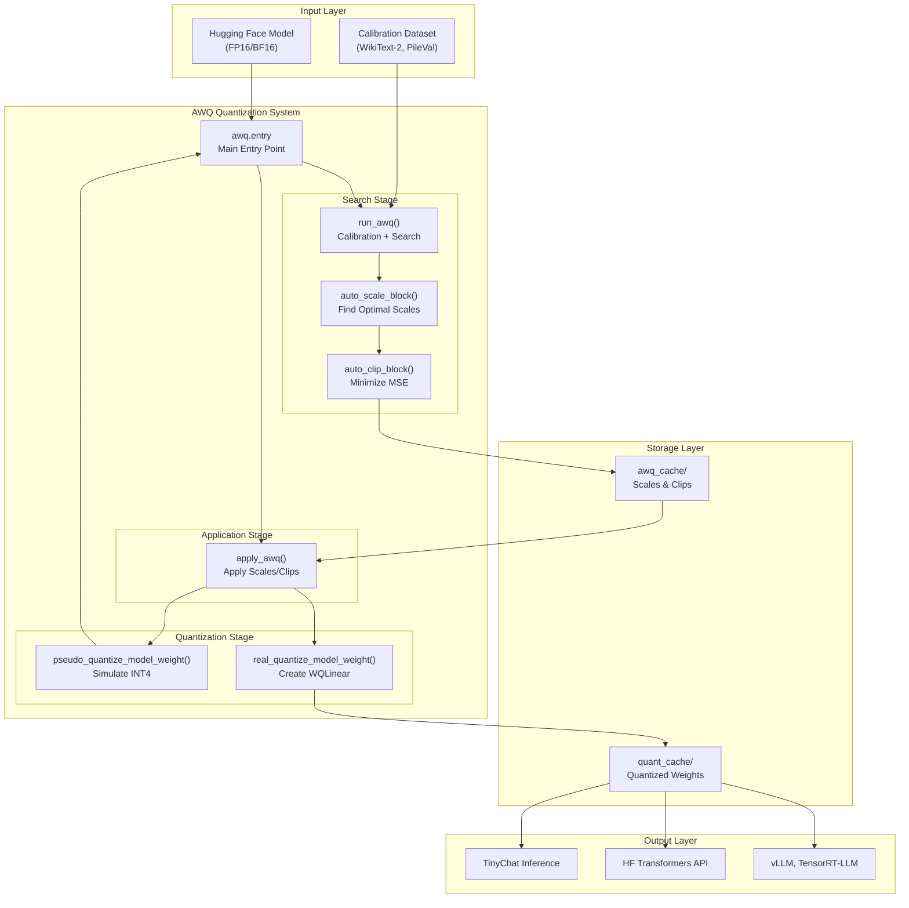

The AWQ system consists of three main stages:

1. **Search Stage**: Finds optimal per-channel scales and per-group clipping values
2. **Application Stage**: Applies discovered scales/clips to model weights
3. **Quantization Stage**: Converts to INT4 representation (pseudo or real)

Sources: [awq/entry.py:1-25](), [awq/quantize/pre_quant.py:1-50](), [awq/quantize/quantizer.py:1-50]()

## Quantization Pipeline

**End-to-End Quantization Workflow**

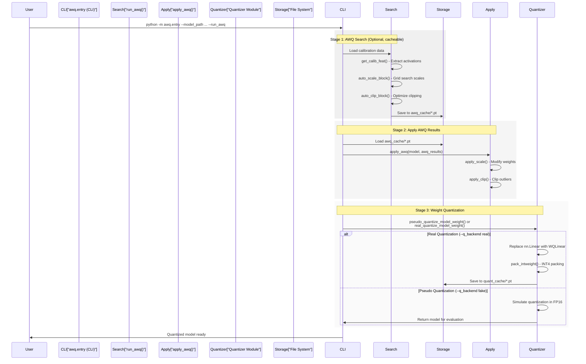

**Typical Usage Commands**

```bash
# Step 1: Run AWQ search (compute scales/clips)
python -m awq.entry --model_path /path/to/model \
    --w_bit 4 --q_group_size 128 \
    --run_awq --dump_awq awq_cache/model-w4-g128.pt

# Step 2: Evaluate with pseudo quantization
python -m awq.entry --model_path /path/to/model \
    --tasks wikitext --w_bit 4 --q_group_size 128 \
    --load_awq awq_cache/model-w4-g128.pt \
    --q_backend fake

# Step 3: Generate real quantized weights
python -m awq.entry --model_path /path/to/model \
    --w_bit 4 --q_group_size 128 \
    --load_awq awq_cache/model-w4-g128.pt \
    --q_backend real --dump_quant quant_cache/model-w4-g128-awq.pt
```

Sources: [awq/entry.py:26-96](), [awq/entry.py:190-246](), [scripts/qwen_example.sh:1-26]()

## Key Components

### 1. Entry Point: `awq.entry`

The `awq.entry` module provides the command-line interface and orchestrates the entire quantization pipeline. It handles model loading, AWQ search execution, quantization, and evaluation.

**Key Functions in `awq/entry.py`:**

| Component | Description | Line Reference |
|-----------|-------------|----------------|
| `build_model_and_enc()` | Loads model and tokenizer, handles pre-quantized models | [awq/entry.py:122-270]() |
| `main()` | Entry point that coordinates workflow stages | [awq/entry.py:273-357]() |
| Command-line args | Configures quantization parameters (w_bit, q_group_size, etc.) | [awq/entry.py:26-96]() |

### 2. AWQ Search: `run_awq()` and Auto-Scaling

The AWQ search process finds optimal per-channel scaling factors and per-group clipping values. This is performed on calibration data (typically 128 samples of 512 tokens).

**Search Components:**

- **`run_awq()`**: Main search function that orchestrates calibration and optimization
- **`auto_scale_block()`**: Performs grid search (20 points) to find optimal scaling ratio per layer
- **`auto_clip_block()`**: Finds optimal clipping threshold to minimize MSE

The search results are cached in `awq_cache/` to avoid recomputation.

Sources: [awq/entry.py:200-216](), [awq/quantize/auto_scale.py:87-156]()

### 3. Quantization Methods

**Comparison of Quantization Backends:**

| Backend | Purpose | Weight Storage | Linear Layers | Use Case |
|---------|---------|----------------|---------------|----------|
| **Pseudo (`fake`)** | Evaluation | FP16/BF16 | `nn.Linear` | Accuracy testing before deployment |
| **Real (`real`)** | Deployment | INT4 (packed) | `WQLinear` | Production inference |

- **Pseudo Quantization**: Simulates INT4 quantization during forward pass but keeps weights in FP16. Used to validate accuracy without changing model structure.
- **Real Quantization**: Converts weights to packed INT4 format and replaces `nn.Linear` with `WQLinear` layers that use custom CUDA kernels.

Sources: [awq/entry.py:226-246]()

### 4. WQLinear Module

`WQLinear` is the quantized replacement for `nn.Linear` that stores INT4 weights and uses optimized CUDA kernels for W4A16 (4-bit weight, 16-bit activation) matrix operations.

**WQLinear Structure:**

- **`qweight`**: Packed INT4 weights
- **`qzeros`**: Quantization zero points per group
- **`scales`**: Dequantization scales per group
- **Forward pass**: Calls `gemm_forward_cuda` or `gemv_forward_cuda` depending on batch size

This module enables memory-efficient storage and fast inference with quantized weights.

### 5. CUDA Kernel Layer

Optimized CUDA kernels provide the computational foundation for efficient W4A16 operations:

- **`gemv_forward_cuda`**: Matrix-vector multiplication for single token generation (decoding)
- **`gemm_forward_cuda`**: Matrix-matrix multiplication for batch processing (prefill)
- **`layernorm_forward_cuda`**: Accelerated layer normalization
- **Fused operations**: Combine multiple operations to reduce memory bandwidth

These kernels achieve 2-3× speedup over FP16 inference by exploiting reduced memory bandwidth requirements and specialized INT4 arithmetic.

Sources: [awq/kernels/](), detailed in [CUDA Kernels & Low-Level Optimization](#2.4)

## Supported Model Architectures

AWQ supports a wide range of model architectures by adapting its scaling strategy to each architecture's specific layer structure. The `auto_scale_block()` function detects the model type and applies the appropriate scaling logic.

**Supported Architectures and Decoder Layers:**

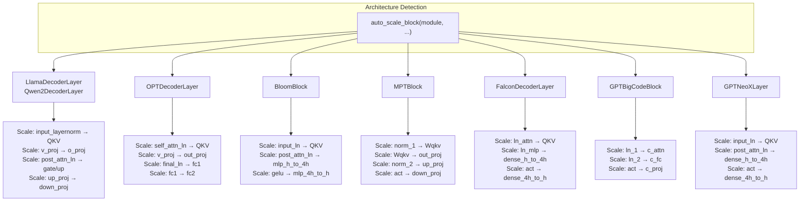

**Model Zoo Coverage:**

| Model Family | Sizes | Configuration | Pre-computed Cache |
|--------------|-------|---------------|-------------------|
| LLaMA 2/3 | 7B, 13B, 70B | W4A16, group_size=128 | ✅ Available |
| Qwen 2.5 | 7B, 72B | W4A16, group_size=128 | ✅ Available |
| Falcon | 7B, 40B, 180B | W4A16, group_size=64 | ✅ Available |
| MPT | 7B, 30B | W4A16, group_size=128 | ✅ Available |
| OPT | 125M-30B | W4A16, group_size=128 | ✅ Available |
| VILA/LLaVA | 7B, 13B, 40B | W4A16, group_size=128 | ✅ Available |
| CodeLlama | 7B, 13B, 34B | W4A16, group_size=128 | ✅ Available |
| StarCoder | 15.5B | W4A16, group_size=128 | ✅ Available |

Sources: [awq/quantize/auto_scale.py:175-443](), [README.md:147-173]()

## Configuration Options

**Command-Line Arguments for `awq.entry`:**

| Parameter | Type | Description | Default | Example |
|-----------|------|-------------|---------|---------|
| `--model_path` | str | Path to Hugging Face model | Required | `/path/to/llama-2-7b` |
| `--dtype` | str | Model data type | `float16` | `float16`, `bfloat16` |
| `--w_bit` | int | Weight quantization bits | `4` | `3`, `4` |
| `--q_group_size` | int | Quantization group size (-1 for per-channel) | `128` | `64`, `128` |
| `--no_zero_point` | flag | Disable zero point quantization | False | - |
| `--q_backend` | str | Quantization backend | `fake` | `fake`, `real` |
| `--run_awq` | flag | Perform AWQ search | False | - |
| `--dump_awq` | str | Save AWQ search results | None | `awq_cache/model.pt` |
| `--load_awq` | str | Load AWQ search results | None | `awq_cache/model.pt` |
| `--dump_quant` | str | Save quantized model | None | `quant_cache/model.pt` |
| `--load_quant` | str | Load quantized model | None | `quant_cache/model.pt` |
| `--tasks` | str | Evaluation tasks | None | `wikitext`, `piqa,arc_easy` |

**Quantization Config Dictionary:**

The `q_config` dictionary controls quantization behavior:

```python
q_config = {
    "zero_point": True,        # Use symmetric (False) or asymmetric (True) quantization
    "q_group_size": 128,       # Group size for group-wise quantization
}
```

Sources: [awq/entry.py:26-96](), [awq/entry.py:112-117]()

## Calibration Data

AWQ uses calibration data to observe activation patterns during the search phase. The default configuration uses:

- **Dataset**: WikiText-2 or Pile validation set
- **Samples**: 128 sequences
- **Sequence Length**: 512 tokens
- **Purpose**: Capture representative activation statistics for scaling

The calibration process is quick (typically a few minutes) and only needs to be run once per model. Results are cached in `awq_cache/` for reuse.

Sources: [awq/entry.py:203-210]()

## Integration with the Rest of the System

The AWQ Quantization System integrates with other components of the repository to enable efficient inference with quantized models:

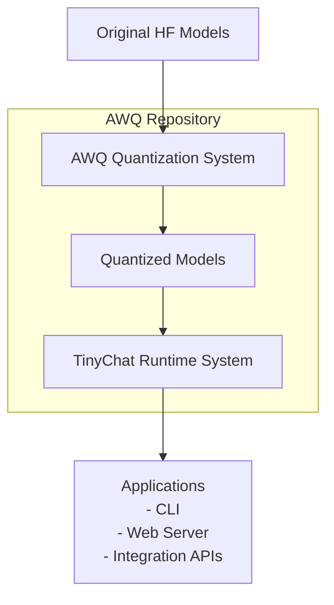

The AWQ Quantization System produces quantized models that can be loaded and used by the TinyChat system for efficient inference, or directly integrated into custom applications.

Sources: [awq/entry.py:153-187]()

## Summary

The AWQ Quantization System provides a comprehensive framework for efficient 4-bit quantization of large language models while maintaining high performance. Its key innovations include:

1. Activation-aware quantization that minimizes error based on activation patterns
2. Auto-scaling that finds optimal scaling factors for each layer
3. Highly optimized CUDA kernels for efficient inference
4. Support for a wide range of model architectures
5. Options for both simulated and real quantization

These features allow AWQ to achieve superior performance compared to other quantization methods, enabling efficient deployment of large language models on resource-constrained devices.

---

# Page: Quantization Algorithm

# Quantization Algorithm

<details>
<summary>Relevant source files</summary>

The following files were used as context for generating this wiki page:

- [awq/quantize/auto_clip.py](awq/quantize/auto_clip.py)
- [awq/quantize/pre_quant.py](awq/quantize/pre_quant.py)
- [awq/quantize/qmodule.py](awq/quantize/qmodule.py)
- [tinychat/models/__init__.py](tinychat/models/__init__.py)

</details>


## Purpose and Scope

This document explains the AWQ (Activation-aware Weight Quantization) algorithm, which is the core quantization technique used in this repository. AWQ quantizes model weights from FP16/BF16 to INT4 while preserving accuracy by leveraging activation statistics.

This page focuses on the **algorithmic principles** of AWQ, including auto-scaling and auto-clipping techniques. For implementation details of quantized modules and weight packing, see [Quantization Implementation](#2.2). For running AWQ search and calibration workflows, see [Calibration & Evaluation](#2.3).

---

## AWQ Algorithm Overview

AWQ performs **activation-aware weight quantization**, meaning it uses calibration data to analyze activation patterns and adaptively protects important weights from quantization error. Unlike naive quantization that treats all weights equally, AWQ observes that certain channels are more salient (have larger activation magnitudes) and should be preserved with higher precision.

The algorithm operates in two stages:

1. **Auto-Scaling**: Per-channel scaling factors protect salient weights based on activation magnitudes
2. **Auto-Clipping**: Per-group clipping values minimize quantization error via grid search

Both stages use calibration data (typically 512 samples from WikiText-2 or Pile) to analyze activation distributions and optimize quantization parameters.

**Key Principle**: Instead of quantizing weights directly, AWQ first transforms them using learned scales and clips, then applies uniform quantization. This transformation is mathematically equivalent to scaling activations inversely, but is computationally cheaper at inference time.

Sources: [awq/quantize/pre_quant.py:102-249]()

---

## Algorithm Components

### High-Level Algorithm Flow

```mermaid
graph TB
    Input["Model (FP16/BF16)<br/>+ Calibration Data"]
    GetBlocks["get_blocks()<br/>Extract transformer layers"]
    CacheInputs["Forward hooks<br/>Cache layer inputs"]
    
    subgraph "Per-Layer Processing"
        CacheFeats["cache_input_hook()<br/>Capture linear layer inputs"]
        AutoScale["auto_scale_block()<br/>Compute per-channel scales"]
        ApplyScale["apply_scale()<br/>Transform weights"]
        AutoClip["auto_clip_block()<br/>Compute per-group clips"]
        ApplyClip["apply_clip()<br/>Clamp weights"]
    end
    
    Results["AWQ Results<br/>{scale: [...], clip: [...]}"]
    
    Input --> GetBlocks
    GetBlocks --> CacheInputs
    CacheInputs --> CacheFeats
    CacheFeats --> AutoScale
    AutoScale --> ApplyScale
    ApplyScale --> AutoClip
    AutoClip --> ApplyClip
    ApplyClip --> Results
    
    style "Per-Layer Processing" fill:#f9f9f9
```

**Diagram: AWQ Algorithm Pipeline**

The algorithm processes the model layer-by-layer to manage GPU memory efficiently. For each transformer layer, it captures input features, computes scaling factors, applies them to weights, then computes and applies clipping values.

Sources: [awq/quantize/pre_quant.py:102-249]()

---

## Auto-Scaling

Auto-scaling protects salient weights by computing per-channel scaling factors based on activation magnitudes. The intuition is that channels with large activations are more important and should maintain higher effective precision after quantization.

### Mathematical Formulation

For a linear layer with weight matrix **W** ∈ ℝ^(out×in) and input **X** ∈ ℝ^(batch×in):

1. **Analyze activations**: Compute per-channel activation magnitudes from calibration data
2. **Compute scale factors** **s** ∈ ℝ^in: Scale factor for each input channel
3. **Transform weights**: **W'** = **W** · diag(**s**)
4. **Transform activations inversely**: **X'** = **X** · diag(**s**)^(-1)

The transformation preserves the output: **W' X'** = **W X**, but **W'** is more amenable to quantization because salient channels are scaled up (reducing relative quantization error).

### Grid Search for Optimal Scales

The `auto_scale_block()` function performs a grid search over possible scaling strategies:

- Evaluates different scale computation methods (mean, max, etc.)
- Tests scale values on a grid (e.g., 0.0 to 1.0 in steps)
- Selects scales that minimize quantization error on calibration data

The selected scales are applied to both the current layer's weights and the input features passed to the next layer, ensuring end-to-end consistency.

Sources: [awq/quantize/pre_quant.py:19-20](), [awq/quantize/pre_quant.py:204-219]()

---

## Auto-Clipping

After auto-scaling, AWQ applies **auto-clipping** to further reduce quantization error. While scaling operates at the channel level (entire columns of the weight matrix), clipping operates at the **group level** (sub-blocks of weights), providing finer-grained optimization.

### Clipping Algorithm Details

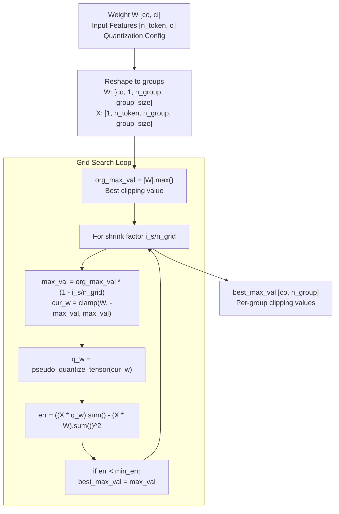

**Diagram: Auto-Clipping Grid Search Process**

Sources: [awq/quantize/auto_clip.py:10-63]()

### Clipping Parameters

| Parameter | Default Value | Description |
|-----------|---------------|-------------|
| `n_grid` | 20 | Number of grid points to search |
| `max_shrink` | 0.5 | Maximum shrinkage (50% of original range) |
| `n_sample_token` | 512 | Number of tokens sampled from calibration data |
| `group_size` | 128 | Weights per quantization group |

The algorithm tests clipping values from the original max down to `max_shrink * org_max_val`, selecting the value that minimizes MSE between:
- Original output: **(X · W).sum()**
- Quantized output: **(X · quantize(clamp(W))).sum()**

### Layer Selection

Not all layers are clipped. The algorithm **excludes** query and key projection layers (`q_`, `k_`, `query`, `key`, `Wqkv`) because their outputs are used in batch matrix multiplies with specific numerical requirements.

Sources: [awq/quantize/auto_clip.py:66-83]()

---

## Input Feature Caching

A critical component of AWQ is capturing the input features (activations) for each linear layer during calibration. These features are used to evaluate quantization quality in the grid searches.

### Hook-Based Feature Collection

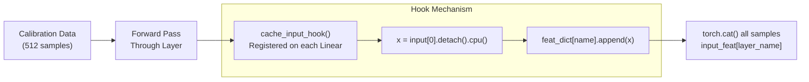

**Diagram: Input Feature Caching Mechanism**

The caching process:

1. **Register hooks**: For each linear layer, register a forward hook using `functools.partial` to bind the layer name
2. **Forward pass**: Run calibration data through the layer
3. **Hook execution**: Each hook captures `x[0]` (first input tensor), detaches it, and moves to CPU
4. **Concatenation**: After forward pass, concatenate all captured features along batch dimension

This produces `input_feat[layer_name]` with shape `[n_samples, in_features]`, representing all calibration inputs to that layer.

Sources: [awq/quantize/pre_quant.py:180-199]()

---

## Layer-by-Layer Processing

AWQ processes the model one transformer layer at a time to manage GPU memory efficiently. This is critical for quantizing large models like LLaMA-70B.

### Processing Strategy

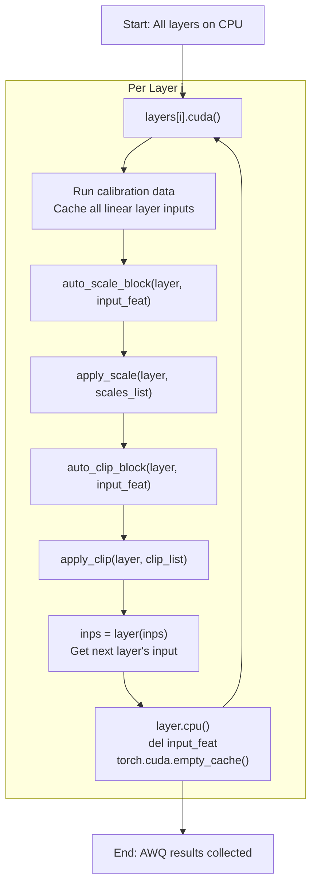

**Diagram: Layer-by-Layer Memory Management**

### Memory Optimization Techniques

1. **Selective GPU loading**: Only one layer on GPU at a time
2. **CPU offloading**: Move processed layers back to CPU immediately
3. **Explicit cache clearing**: `torch.cuda.empty_cache()` after each layer
4. **Feature deletion**: Delete `input_feat` dictionary after processing
5. **Embedding management**: `move_embed()` moves embeddings on/off GPU as needed

This strategy allows quantizing 70B models on a single 80GB A100 GPU.

Sources: [awq/quantize/pre_quant.py:174-248]()

---

## Model Architecture Support

AWQ supports various transformer architectures through a unified interface. The `get_blocks()` function extracts transformer layers from different model types.

### Supported Model Types

| Model Family | Layer Access Path | Example |
|--------------|-------------------|---------|
| LLaMA / Qwen2 | `model.model.layers` | LLaMA-2, LLaMA-3, Qwen-2 |
| InternVL3 | `model.language_model.model.layers` | InternVL3 (multimodal) |
| LLaVA | `model.model.layers` | LLaVA (multimodal) |
| OPT | `model.model.decoder.layers` | OPT models |
| BLOOM | `model.transformer.h` | BLOOM models |
| MPT | `model.transformer.blocks` | MPT models |
| Falcon | `model.transformer.h` | Falcon models |

The algorithm is architecture-agnostic once layers are extracted. Each layer is treated as a module containing multiple linear layers (`nn.Linear`).

Sources: [awq/quantize/pre_quant.py:29-54]()

---

## Complete Algorithm Implementation

### `run_awq()` Function Signature

```python
def run_awq(
    model,              # Transformer model to quantize
    enc,                # Tokenizer for calibration data
    w_bit,              # Weight bit-width (typically 4)
    q_config,           # Quantization config (group_size, etc.)
    n_samples=512,      # Number of calibration samples
    seqlen=512,         # Sequence length
    auto_scale=True,    # Enable auto-scaling
    mse_range=True,     # Enable auto-clipping (MSE-based)
    calib_data="pileval" # Calibration dataset name
) -> dict            # Returns {"scale": [...], "clip": [...]}
```

Sources: [awq/quantize/pre_quant.py:101-113]()

### Algorithm Steps

1. **Initialization**
   - Extract transformer layers using `get_blocks(model)`
   - Load calibration dataset using `get_calib_dataset()`
   - Concatenate samples into tensor of shape `[n_samples, seqlen]`

2. **Capture First Layer Input**
   - Use `Catcher` module to intercept layer 0's input and kwargs
   - Prevents full forward pass (early exit via exception)
   - Provides starting point for layer-by-layer processing

3. **Layer-by-Layer Loop** (for each layer `i`):
   - Load `layers[i]` to GPU
   - Register forward hooks to cache linear layer inputs
   - Forward pass: `inps = layer(inps, **layer_kwargs)[0]`
   - Collect `input_feat[layer_name]` for all linear layers
   - If `auto_scale=True`: Call `auto_scale_block()`, get `scales_list`, apply scales
   - If `mse_range=True`: Call `auto_clip_block()`, get `clip_list`, apply clips
   - Append scales/clips to results with layer name prefix
   - Move layer back to CPU, clear GPU cache

4. **Return Results**
   - Dictionary with keys `"scale"` and `"clip"`
   - Each contains list of `(layer_name, values)` tuples
   - Values are tensors with appropriate shapes for each layer

Sources: [awq/quantize/pre_quant.py:102-249]()

---

## Quantization Configuration

The `q_config` dictionary controls quantization behavior:

| Parameter | Typical Value | Description |
|-----------|---------------|-------------|
| `q_group_size` | 128 | Number of weights per quantization group |
| `w_bit` | 4 | Weight bit-width |
| `version` | "GEMM" or "GEMV" | Kernel type to target |

The group size determines granularity:
- **Group size = 128**: Balance between precision and overhead
- **Group size = in_features**: Per-channel quantization (coarser)
- **Group size = 64/32**: Finer granularity (more overhead)

Smaller group sizes provide more flexibility but require more storage for scales/zeros and more computation for dequantization.

Sources: [awq/quantize/auto_clip.py:18-20]()

---

## Pseudo-Quantization for Evaluation

During the grid search processes, AWQ uses **pseudo-quantization** to simulate quantization without actually converting to INT4. This allows evaluating quantization quality using full-precision arithmetic.

### Pseudo-Quantization Process

```python
def pseudo_quantize_tensor(w, n_bit, q_config):
    # 1. Compute scales and zeros based on group_size
    # 2. Quantize: q_w = round((w - zero) / scale)
    # 3. Clip to [0, 2^n_bit - 1]
    # 4. Dequantize: w_q = q_w * scale + zero
    # Returns: dequantized tensor in original precision
```

This simulates the quantization error without the memory/compute benefits, used only during AWQ search. Real quantization (INT4 storage) happens later in the pipeline.

Sources: [awq/quantize/auto_clip.py:3](), [awq/quantize/auto_clip.py:45]()

---

## Output Format

The `run_awq()` function returns a dictionary with the following structure:

```python
awq_results = {
    "scale": [
        ("model.layers.0.self_attn.q_proj", tensor([...])),
        ("model.layers.0.self_attn.v_proj", tensor([...])),
        # ... more layers ...
    ],
    "clip": [
        ("model.layers.0.self_attn.v_proj", tensor([...])),
        ("model.layers.0.mlp.up_proj", tensor([...])),
        # ... more layers ...
        # Note: q_proj and k_proj excluded from clipping
    ]
}
```

### Scale Tensor Shape
- Per-channel: `[out_features, in_features]` or similar
- Applied as diagonal scaling matrices

### Clip Tensor Shape
- Per-group: `[out_features, n_groups]`
- Each group corresponds to `group_size` consecutive weights
- Used to clamp weights before quantization

These results are cached to `awq_cache/` directory and reused to avoid redundant computation.

Sources: [awq/quantize/pre_quant.py:168-171](), [awq/quantize/pre_quant.py:217-238]()

---

## Algorithm Complexity

### Time Complexity

For a model with `L` layers, each containing `N` linear layers:

- **Feature caching**: O(L × calibration_samples) forward passes
- **Auto-scaling**: O(L × N × grid_size × samples) for grid search
- **Auto-clipping**: O(L × N × n_grid × oc_batch_size × samples)

The auto-clipping grid search is the most expensive operation, involving:
- 20 grid points (default `n_grid=20`)
- 10 shrinkage levels (default `max_shrink=0.5`)
- Pseudo-quantization + MSE computation for each point

Typical quantization time for LLaMA-7B: 1-2 hours on A100 GPU with 512 calibration samples.

### Memory Complexity

- **Peak GPU memory**: Single layer + calibration features
  - `input_feat`: `[512 × seqlen, in_features]` per linear layer
  - Typically 1-2GB for small linear layers, 10-20GB for large MLP layers
- **CPU memory**: Entire model in FP16
  - 7B model: ~14GB
  - 70B model: ~140GB

Sources: [awq/quantize/auto_clip.py:11-63](), [awq/quantize/pre_quant.py:174-248]()

---

## Code-to-Algorithm Mapping

### Key Functions and Their Roles

| Code Entity | Location | Algorithm Role |
|-------------|----------|----------------|
| `run_awq()` | [awq/quantize/pre_quant.py:102-249]() | Main algorithm orchestrator |
| `get_blocks()` | [awq/quantize/pre_quant.py:29-54]() | Extract transformer layers |
| `cache_input_hook()` | [awq/quantize/pre_quant.py:180-183]() | Capture layer inputs during forward pass |
| `auto_scale_block()` | [awq/quantize/auto_scale.py]() (imported) | Compute per-channel scales |
| `apply_scale()` | [awq/quantize/auto_scale.py]() (imported) | Apply scales to weights and features |
| `auto_clip_block()` | [awq/quantize/auto_clip.py:67-83]() | Compute per-group clips |
| `auto_clip_layer()` | [awq/quantize/auto_clip.py:11-63]() | Grid search for optimal clipping |
| `apply_clip()` | [awq/quantize/auto_clip.py:87-98]() | Clamp weights to clip values |
| `pseudo_quantize_tensor()` | [awq/quantize/quantizer.py]() (imported) | Simulate quantization for evaluation |

Sources: [awq/quantize/pre_quant.py:1-255](), [awq/quantize/auto_clip.py:1-99]()

---

# Page: Quantization Implementation

# Quantization Implementation

<details>
<summary>Relevant source files</summary>

The following files were used as context for generating this wiki page:

- [awq/quantize/auto_clip.py](awq/quantize/auto_clip.py)
- [awq/quantize/qmodule.py](awq/quantize/qmodule.py)
- [awq/quantize/quantizer.py](awq/quantize/quantizer.py)
- [awq/utils/utils.py](awq/utils/utils.py)

</details>


This document details the practical implementation of AWQ's weight quantization system, focusing on how the AWQ algorithm is translated into efficient software components. It covers the core quantization functions, optimized CUDA kernels, and the infrastructure connecting these elements. For details on the mathematical foundations of the AWQ algorithm itself, see [Quantization Algorithm](#2.1).

## Overview of Quantization Implementation

AWQ implements two primary forms of quantization:

1. **Pseudo Quantization**: Simulates quantization effects while maintaining the original model structure (for evaluation purposes)
2. **Real Quantization**: Actually transforms model weights into quantized format with optimized compute kernels

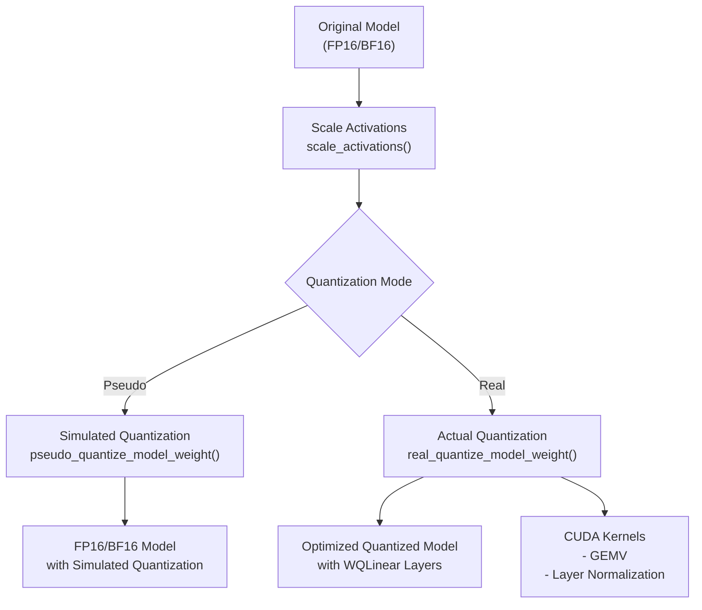

*Diagram: AWQ Quantization Implementation Flow*

Sources: [awq/quantize/quantizer.py:61-105](), [awq/quantize/quantizer.py:106-123](), [awq/quantize/quantizer.py:126-165]()

## Core Quantization Functions

### Pseudo-Quantization Implementation

Pseudo-quantization provides a way to evaluate quantization effects without changing model structure. This is essential for determining optimal quantization parameters.

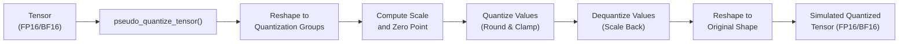

*Diagram: Pseudo-Quantization Process*

The core pseudo-quantization function computes quantization parameters and simulates their effect:

```python
# Core quantization parameters:
max_val = w.amax(dim=1, keepdim=True)          # Max value per row
min_val = w.amin(dim=1, keepdim=True)          # Min value per row
max_int = 2**n_bit - 1                         # Maximum integer value (e.g., 15 for 4-bit)
scales = (max_val - min_val).clamp(min=1e-5) / max_int  # Scale factor
zeros = (-torch.round(min_val / scales)).clamp_(min_int, max_int)  # Zero point
```

This process is applied to every linear layer in the model through the `pseudo_quantize_model_weight` function.

Sources: [awq/quantize/quantizer.py:61-103](), [awq/quantize/quantizer.py:106-123]()

### Real Quantization Implementation

Real quantization actually transforms the model, replacing standard linear layers with specialized `WQLinear` layers that operate on quantized weights.

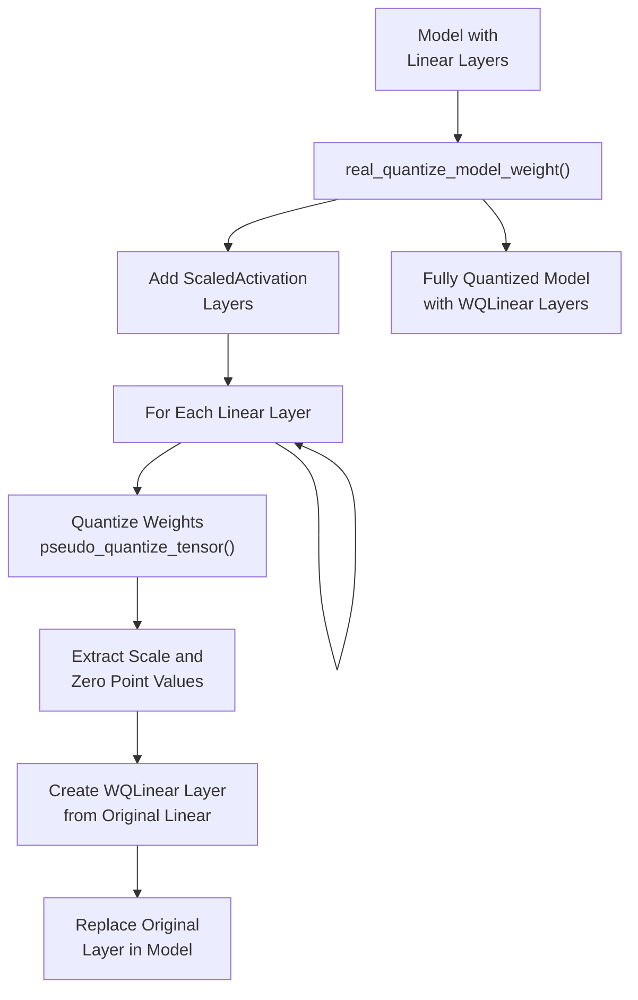

*Diagram: Real Quantization Process*

The implementation includes special handling for different model architectures, with activation scaling applied appropriately:

```python
# Example for BloomBlock architecture:
if isinstance(module, BloomBlock):
    if isinstance(module.mlp.gelu_impl, ScaledActivation):
        return
    c = module.mlp.dense_h_to_4h.out_features
    act = ScaledActivation(
        module.mlp.gelu_impl, torch.ones(c, dtype=dtype, device=device)
    )
    set_op_by_name(module, "mlp.gelu_impl", act)
```

Sources: [awq/quantize/quantizer.py:126-165](), [awq/quantize/quantizer.py:14-57]()

## Optimized CUDA Kernels

AWQ implements highly optimized CUDA kernels to accelerate computation with quantized weights.

### GEMV (General Matrix-Vector Multiplication)

The GEMV kernel is critical for efficient inference with quantized weights, especially for single-batch inference scenarios.

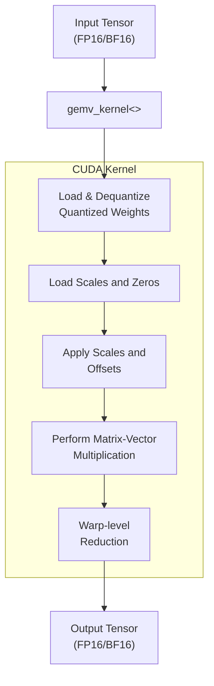

*Diagram: GEMV Kernel Processing Flow*

Key optimizations in the GEMV kernel:
- Efficient 4-bit weight dequantization
- Memory coalescing for weight access
- Warp-level reductions for accumulation
- Support for both FP16 and BF16 data types

Sources: [awq/kernels/csrc/quantization_new/gemv/gemv_cuda.cu:74-229](), [awq/kernels/csrc/quantization_new/gemv/gemv_cuda.cu:245-338]()

### Dequantization Implementation

The dequantization process converts packed 4-bit integers into FP16/BF16 values efficiently:

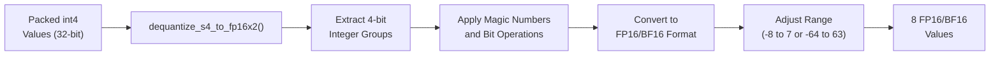

*Diagram: Weight Dequantization Process*

The implementation uses advanced CUDA intrinsics and bit manipulation for optimal performance:

```cpp
// Extract elements using LOP3 operations (parallel bit extraction)
asm volatile("lop3.b32 %0, %1, %2, %3, %4;\n"
             : "=r"(h[0])
             : "r"(i4s), "n"(BOTTOM_MASK), "n"(I4s_TO_F16s_MAGIC_NUM), "n"(immLut));

// Convert to floating point with FMA operations
asm volatile("fma.rn.f16x2 %0, %1, %2, %3;\n" 
             : "=r"(h[1]) 
             : "r"(h[1]), "r"(ONE_SIXTEENTH), "r"(NEG_64));
```

Sources: [awq/kernels/csrc/quantization_new/dequantize.cuh:15-123]()

### Layer Normalization

AWQ provides optimized layer normalization for quantized models:

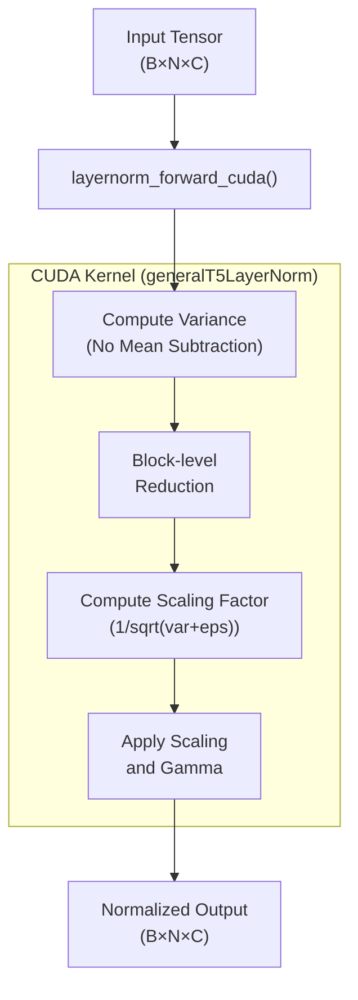

*Diagram: Layer Normalization Kernel Flow*

The layer normalization implementation follows the T5-style approach (without bias and mean subtraction):

```cpp
// Compute variance only (no mean subtraction)
float local_var_sum = 0.0f;
for (int i = tid; i < n; i += blockDim.x) {
    float diff = to_float(__ldg(&input[blockIdx.x * n + i]));
    local_var_sum += diff * diff;
}
variance = blockReduceSum(local_var_sum);

// Apply normalization with gamma (no beta)
for (int i = tid; i < n; i += blockDim.x) {
    output[blockIdx.x * n + i] =
        clamp_inf_for_half<T>((to_float(input[blockIdx.x * n + i]) * s_variance) * to_float(__ldg(&gamma[i])));
}
```

Sources: [awq/kernels/csrc/layernorm/layernorm.cu:39-64](), [awq/kernels/csrc/layernorm/layernorm.cu:67-131]()

## Quantization Infrastructure

### Data Type Handling

AWQ supports both FP16 (half) and BF16 (bfloat16) formats through a unified dispatching mechanism:

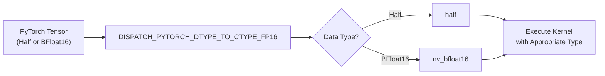

*Diagram: Data Type Dispatching*

The `DISPATCH_PYTORCH_DTYPE_TO_CTYPE_FP16` macro provides a unified interface for handling different precision formats:

```cpp
#define DISPATCH_PYTORCH_DTYPE_TO_CTYPE_FP16(pytorch_dtype, c_type, ...)                \
  if (pytorch_dtype == at::ScalarType::Half) {                                          \
    using c_type = half;                                                                \
    __VA_ARGS__                                                                         \
  } else if (pytorch_dtype == at::ScalarType::BFloat16) {                               \
    using c_type = nv_bfloat16;                                                         \
    __VA_ARGS__                                                                         \
  } else { /* error handling */ }
```

Sources: [awq/kernels/csrc/quantization_new/dispatch_utils.cuh:7-18](), [awq/kernels/csrc/layernorm/layernorm.cu:15-26]()

### Device Management

AWQ includes utilities for efficient model deployment across different devices:

```mermaid
flowchart TD
    A["Quantized Model"] --> B["simple_dispatch_model()"]
    B --> C{"Device Map"}
    C -->|"Single Device"| D["Move Entire Model\nto Target Device"]
    C -->|"Multi-Device"| E["Find Tied Parameters"]
    E --> F["CPU Offload\nSelected Modules"]
    F --> G["Add Device\nAlignment Hooks"]
    G --> H["Retie Parameters"]
    D --> I["Deployed Model\nwith hf_device_map"]
    H --> I
```

*Diagram: Model Deployment Process*

The implementation supports sophisticated device mapping for efficient memory usage:

```python
# CPU offload for selected modules
cpu_offload_group = [(n, d) for n, d in device_map.items() if d == "cpu"]
prev_hook = None
for idx, (n, d) in enumerate(cpu_offload_group):
    m = get_module_by_name_suffix(model, n)
    _, prev_hook = accelerate.cpu_offload_with_hook(
        m, execution_device=main_device, prev_module_hook=prev_hook
    )
```

Sources: [awq/utils/utils.py:11-51]()

## Quantization Parameters

The quantization implementation in AWQ uses the following key parameters:

| Parameter | Description | Typical Values |
|-----------|-------------|---------------|
| `w_bit` | Bit-width for weight quantization | 4 (int4) |
| `q_group_size` | Size of quantization groups | 128 elements |
| `zero_point` | Whether to use zero-point quantization | True |
| `scales` | Scaling factors for each quantization group | FP16/BF16 tensor |
| `zeros` | Zero points for each quantization group | FP16/BF16 tensor |

These parameters are used throughout the quantization process to control the precision and efficiency of the resulting model.

Sources: [awq/quantize/quantizer.py:61-103](), [awq/quantize/quantizer.py:126-165]()

## Integration With AWQ Search

The quantization implementation connects with the AWQ search process (described in [Quantization Algorithm](#2.1)) to form a complete pipeline:

```mermaid
flowchart LR
    A["AWQ Search\n(auto_scale, auto_clip)"] --> B["Optimal Scale\nand Zero-Point Values"]
    B --> C["Quantization Implementation"]
    C --> D["Pseudo-Quantize\n(Evaluation)"]
    C --> E["Real-Quantize\n(Deployment)"]
    E --> F["WQLinear Layers\n+ CUDA Kernels"]
    D --> G["Model Evaluation"]
    F --> H["Efficient Inference"]
```

*Diagram: Integration with AWQ Search*

The search process determines optimal quantization parameters, which are then used by the implementation described in this document to create efficient quantized models ready for deployment.

Sources: [awq/quantize/quantizer.py:126-165]()

---

# Page: Calibration & Evaluation

# Calibration & Evaluation

<details>
<summary>Relevant source files</summary>

The following files were used as context for generating this wiki page:

- [awq/entry.py](awq/entry.py)
- [awq/quantize/auto_scale.py](awq/quantize/auto_scale.py)
- [awq/quantize/pre_quant.py](awq/quantize/pre_quant.py)
- [tinychat/models/__init__.py](tinychat/models/__init__.py)

</details>


This page documents the calibration and evaluation systems in the AWQ (Activation-aware Weight Quantization) framework. It covers how models are calibrated with representative data to find optimal quantization parameters and how quantized models are evaluated to ensure quality preservation. For information on the core quantization algorithm itself, see [Quantization Algorithm](#2.1), and for implementation details, see [Quantization Implementation](#2.2).

## 1. Calibration Overview

Calibration is a critical process in AWQ that identifies optimal scaling factors for weight quantization. The process uses a representative dataset to measure activation patterns, which guide the quantization process to minimize accuracy loss.

```mermaid
flowchart TD
    A["Calibration Data\n(Pile-val Dataset)"] --> B["AWQ Search Process"]
    B --> C["Compute Optimal\nScaling Factors"]
    C --> D["Apply Scaling to\nWeights & Activations"]
    D --> E["Save AWQ Results\n(--dump_awq)"]
    
    subgraph "Key Calibration Components"
        F["get_calib_dataset()"]
        G["run_awq()"]
        H["auto_scale_block()"]
        I["apply_awq()"]
    end
    
    B -.-> G
    C -.-> H
    D -.-> I
    A -.-> F
```

Sources: [awq/entry.py:199-216](), [awq/utils/calib_data.py:5-32](), [awq/quantize/auto_scale.py:17-444]()

### 1.1. Calibration Data Preparation

AWQ uses a subset of the Pile dataset (specifically "pile-val") as default calibration data. The data is processed to generate representative input sequences for different model components.

```python
# Main calibration data loading function
def get_calib_dataset(data="pileval", tokenizer=None, n_samples=512, block_size=512):
    # Load dataset, tokenize, and organize into appropriate blocks
    dataset = load_dataset("mit-han-lab/pile-val-backup", split="validation")
    # Process and return calibration samples
```

The calibration dataset is prepared with the following characteristics:
- Default of 512 samples from the Pile validation set
- Text sequences divided into blocks of 512 tokens
- Shuffled with a fixed seed (42) for reproducibility

Sources: [awq/utils/calib_data.py:5-32]()

### 1.2. AWQ Search Process

The AWQ search process identifies optimal scaling parameters for each layer based on activation patterns observed during inference on the calibration data.

```mermaid
flowchart LR
    A["Model"] --> B["run_awq()"]
    C["Calibration Data"] --> B
    B --> D["auto_scale_block()"]
    D --> E["_search_module_scale()"]
    E --> F["get_act_scale()"]
    E --> G["get_weight_scale()"]
    F --> H["Best Scaling\nParameters"]
    G --> H
    H --> I["Save AWQ Results"]
    
    subgraph "Per Layer Processing"
        D
        E
        F
        G
    end
```

The AWQ search process is triggered with the `--run_awq` command-line flag and outputs scaling factors that balance quantization error with model performance.

Sources: [awq/entry.py:200-216](), [awq/quantize/auto_scale.py:87-446]()

### 1.3. Auto-Scaling Algorithm

AWQ implements an architecture-aware auto-scaling algorithm that handles different model types (Llama, OPT, Bloom, etc.) with specialized scaling strategies for each component:

1. For each block in the model:
   - Identify key linear layers (attention projections, MLP layers)
   - Compute activation scales using calibration data
   - Search for optimal scaling ratios that minimize post-quantization error
   - Apply these scales to preserve important activations

The `auto_scale_block` function implements model-specific scaling strategies and supports various architectures including:
- LlamaDecoderLayer
- OPTDecoderLayer
- BloomBlock
- MPT models
- Falcon models
- And others

Sources: [awq/quantize/auto_scale.py:87-446](), [awq/quantize/auto_scale.py:449-481]()

## 2. Evaluation Methodology

AWQ provides comprehensive evaluation tools to verify the quality of quantized models, supporting both standard language model metrics and task-specific evaluations.

```mermaid
flowchart TD
    A["Quantized Model"] --> B{"Evaluation Type"}
    B -->|"Perplexity"| C["WikiText\nEvaluation"]
    B -->|"Benchmarks"| D["LM Evaluation\nHarness"]
    
    C --> E["Calculate Loss\n& Perplexity"]
    D --> F["Run Tasks\n(MMLU, HumanEval, etc.)"]
    
    E --> G["JSON Results"]
    F --> G
    
    subgraph "Evaluation Components"
        H["LMEvalAdaptor"]
        I["evaluator.simple_evaluate()"]
        J["WikiText Loss Calculation"]
    end
    
    D -.-> H
    F -.-> I
    C -.-> J
```

Sources: [awq/entry.py:273-356](), [awq/utils/lm_eval_adaptor.py:7-116]()

### 2.1. Perplexity Evaluation

Perplexity is a key metric for evaluating language models. AWQ includes WikiText perplexity evaluation:

```python
# WikiText perplexity evaluation process
testenc = load_dataset("wikitext", "wikitext-2-raw-v1", split="test")
testenc = enc("\n\n".join(testenc["text"]), return_tensors="pt")
model.seqlen = 2048
# Calculate perplexity by measuring negative log likelihood
```

The process:
1. Loads the WikiText-2 test dataset
2. Processes text through the model tokenizer
3. Computes loss for each sequence block
4. Aggregates the loss and calculates perplexity as `exp(total_loss / tokens)`

Sources: [awq/entry.py:301-333]()

### 2.2. LM Evaluation Harness Integration

For comprehensive evaluation, AWQ integrates with the [LM Evaluation Harness](https://github.com/EleutherAI/lm-evaluation-harness) to run standardized benchmarks:

```python
# Using LM Evaluation Harness
lm_eval_model = LMEvalAdaptor(args.model_path, model, enc, args.batch_size)
results = evaluator.simple_evaluate(
    model=lm_eval_model,
    tasks=task_names,
    batch_size=args.batch_size,
    no_cache=True,
    num_fewshot=args.num_fewshot,
)
```

The `LMEvalAdaptor` class adapts AWQ quantized models to work with the evaluation harness, handling:
- Token generation and logit computation
- Batch processing
- Appropriate handling of context lengths
- Support for various model architectures

Sources: [awq/entry.py:335-346](), [awq/utils/lm_eval_adaptor.py:7-116]()

## 3. Calibration and Evaluation Workflow

The complete workflow connects calibration, quantization, and evaluation into an integrated pipeline:

```mermaid
sequenceDiagram
    participant User
    participant Calibration as Calibration System
    participant Quantizer as Quantization System
    participant Evaluator as Evaluation System
    
    User->>Calibration: Run AWQ search (--run_awq)
    Calibration->>Calibration: Load calibration data
    Calibration->>Calibration: Determine optimal scales
    Calibration->>User: Save AWQ results (--dump_awq)
    
    User->>Quantizer: Load AWQ results (--load_awq)
    User->>Quantizer: Set quantization params (--w_bit, --q_group_size)
    Quantizer->>Quantizer: Apply scales from AWQ
    Quantizer->>Quantizer: Quantize weights
    Quantizer->>User: Save quantized model (--dump_quant)
    
    User->>Evaluator: Evaluate model (--tasks)
    Evaluator->>Evaluator: Run specified tasks
    Evaluator->>User: Output results (--output_path)
```

Sources: [awq/entry.py:94-357]()

### 3.1. Command-Line Interface

The AWQ entry script provides a comprehensive CLI for calibration and evaluation with key parameters:

| Parameter | Description | Default |
|-----------|-------------|---------|
| `--run_awq` | Run AWQ search process | False |
| `--dump_awq` | Save AWQ results to file | None |
| `--load_awq` | Load pre-computed AWQ results | None |
| `--w_bit` | Number of bits for weight quantization | None |
| `--q_group_size` | Group size for quantization | -1 |
| `--tasks` | Evaluation tasks to run | None |
| `--batch_size` | Batch size for evaluation | 1 |
| `--num_fewshot` | Number of few-shot examples | 0 |
| `--output_path` | Path to save evaluation results | None |

Sources: [awq/entry.py:26-96]()

### 3.2. Implementation Architecture

The calibration and evaluation systems connect to other AWQ components as follows:

```mermaid
graph TD
    A["entry.py\n(Main Interface)"] --> B["Calibration System"]
    A --> C["Quantization System"]
    A --> D["Evaluation System"]
    
    B --> B1["calib_data.py\n(get_calib_dataset)"]
    B --> B2["auto_scale.py\n(auto_scale_block)"]
    
    C --> C1["quantizer.py\n(pseudo_quantize_model_weight)"]
    C --> C2["quantizer.py\n(real_quantize_model_weight)"]
    
    D --> D1["WikiText Perplexity"]
    D --> D2["lm_eval_adaptor.py\n(LMEvalAdaptor)"]
    
    B2 -->|"Scaling Parameters"| C
    C -->|"Quantized Model"| D
```

Sources: [awq/entry.py:15-357](), [awq/quantize/auto_scale.py:17-481](), [awq/utils/lm_eval_adaptor.py:7-116]()

## 4. Using the Calibration and Evaluation Systems

### 4.1. Typical Calibration Workflow

```bash
# Step 1: Run AWQ search to find optimal scaling parameters
python -m awq.entry --model_path <model_path> --run_awq --dump_awq <output_path>/awq_results.pt

# Step 2: Quantize using the AWQ results
python -m awq.entry --model_path <model_path> --load_awq <output_path>/awq_results.pt --w_bit 4 --q_backend real --dump_quant <output_path>/quantized_model.pt
```

### 4.2. Typical Evaluation Workflow

```bash
# Evaluate a quantized model on specific tasks
python -m awq.entry --model_path <model_path> --load_quant <output_path>/quantized_model.pt --tasks "hellaswag,winogrande" --output_path <output_path>/eval_results.json

# Or evaluate perplexity on WikiText
python -m awq.entry --model_path <model_path> --load_quant <output_path>/quantized_model.pt --tasks "wikitext" --output_path <output_path>/ppl_results.json
```

Sources: [awq/entry.py:94-357]()

## 5. Advanced Features

### 5.1. Device Management

AWQ supports distributed evaluation across multiple GPUs with automatic device management:

```python
# Device management for large models
kwargs = {"max_memory": get_balanced_memory(model, max_memory if len(max_memory) > 0 else None)}
device_map = infer_auto_device_map(model, no_split_module_classes=[...], **kwargs)
model = dispatch_model(model, device_map=device_map)
```

The system can:
- Automatically determine optimal GPU usage based on model size
- Split models across multiple devices for large models
- Balance memory allocation

Sources: [awq/entry.py:251-268](), [awq/utils/parallel.py:6-28]()

### 5.2. Multimodal Model Support

For vision-language models (VLMs), AWQ includes specialized calibration and evaluation support:

```python
# Support for VLMs including VILA/NVILA models
if args.smooth_scale and args.vila_20:
    from awq.quantize import get_smooth_scale
    act_scale = get_smooth_scale(args.model_path, args.media_path)
    # Save activation scales for vision tower
```

This extends calibration and evaluation to handle:
- Vision tower components in multimodal models
- Generation of activation scales for visual inputs
- Specialized handling for VILA 1.5 and VILA 2.0 (NVILA) models

Sources: [awq/entry.py:280-292]()

## Summary

The AWQ Calibration and Evaluation systems provide a comprehensive framework for:
1. Determining optimal scaling parameters through data-driven calibration
2. Quantizing models with minimal quality loss
3. Evaluating quantized models with standard benchmarks

These systems are tightly integrated with the core AWQ quantization algorithms to provide an end-to-end workflow for efficient LLM quantization and deployment.

Sources: [awq/entry.py:15-357](), [awq/quantize/auto_scale.py:17-481](), [awq/utils/calib_data.py:5-32](), [awq/utils/lm_eval_adaptor.py:7-116]()

---

# Page: CUDA Kernels & Low-Level Optimization

# CUDA Kernels & Low-Level Optimization

<details>
<summary>Relevant source files</summary>

The following files were used as context for generating this wiki page:

- [awq/kernels/csrc/layernorm/layernorm.cu](awq/kernels/csrc/layernorm/layernorm.cu)
- [awq/kernels/csrc/quantization_new/dequantize.cuh](awq/kernels/csrc/quantization_new/dequantize.cuh)
- [awq/kernels/csrc/quantization_new/dispatch_utils.cuh](awq/kernels/csrc/quantization_new/dispatch_utils.cuh)
- [awq/kernels/csrc/quantization_new/gemm/gemm_cuda.cu](awq/kernels/csrc/quantization_new/gemm/gemm_cuda.cu)
- [awq/kernels/csrc/quantization_new/gemv/gemv_cuda.cu](awq/kernels/csrc/quantization_new/gemv/gemv_cuda.cu)

</details>


## Purpose and Scope

This page provides a deep technical analysis of the custom CUDA kernels that power AWQ's efficient W4A16 (4-bit weights, 16-bit activations) inference. These kernels are the foundation of the performance optimizations in TinyChat and directly implement quantized matrix operations, dequantization, and layer normalization.

For information about how these kernels are integrated into higher-level model modules, see [2.2 Quantization Implementation](#2.2). For details on the quantization algorithm that determines the scale and zero-point parameters used by these kernels, see [2.1 Quantization Algorithm](#2.1).

**Key Components Covered:**
- GEMV (General Matrix-Vector multiplication) kernels for decoding
- GEMM (General Matrix-Matrix multiplication) kernels for prefill with split-K parallelism
- INT4 dequantization using PTX assembly
- RMS layer normalization
- Memory hierarchy optimization techniques
- FP16/BF16 type dispatch system

---

## System Architecture

The CUDA kernel system is organized in five layers, from high-level PyTorch interfaces down to hardware-specific optimizations.

```mermaid
graph TB
    subgraph PyTorch["PyTorch Interface Layer"]
        GV[gemv_forward_cuda_new]
        GM1[gemm_forward_cuda]
        LN[layernorm_forward_cuda]
    end
    
    subgraph Dispatch["Type Dispatch Layer"]
        DISP[DISPATCH_PYTORCH_DTYPE_TO_CTYPE_FP16]
    end
    
    subgraph Kernels["CUDA Kernel Layer"]
        GVK["gemv_kernel&lt;NPerBlock, Batch, BlockSize, GroupSize&gt;"]
        GMK1["gemm_w4a16_T1&lt;CTA_M, CTA_N, CTA_K, ..., SPLITK&gt;"]
        GMK2["gemm_w4a16_T2&lt;CTA_M, CTA_N, CTA_K, ...&gt;"]
        LNK[generalT5LayerNorm]
    end
    
    subgraph CoreOps["Core Operations"]
        DQ[dequantize_s4_to_fp16x2]
        WR[warp_reduce]
        MMA[mma_m16n8k16_f16f16f16<br/>mma_m16n8k16_bf16bf16f32]
        LDMX[ldmatrix_m8n8_x4_b16]
        ASYNC[cp_async_cg_A]
    end
    
    subgraph Memory["Memory Hierarchy"]
        GLOB[Global Memory<br/>Packed INT4 Weights]
        SMEM[Shared Memory<br/>Tile Buffers]
        REG[Registers<br/>Warp-Local Data]
        WARP[Warp Shuffle<br/>__shfl_xor_sync]
    end
    
    GV --> DISP
    GM1 --> DISP
    LN --> DISP
    
    DISP --> GVK
    DISP --> GMK1
    DISP --> GMK2
    DISP --> LNK
    
    GVK --> DQ
    GVK --> WR
    GMK1 --> DQ
    GMK1 --> MMA
    GMK1 --> LDMX
    GMK1 --> ASYNC
    GMK2 --> DQ
    GMK2 --> MMA
    LNK --> WR
    
    DQ --> REG
    WR --> WARP
    MMA --> REG
    LDMX --> REG
    ASYNC --> SMEM
    
    GLOB --> SMEM
    SMEM --> REG
    
    style PyTorch fill:#f9f9f9
    style Dispatch fill:#f0f0f0
    style Kernels fill:#e8e8e8
    style CoreOps fill:#e0e0e0
    style Memory fill:#d8d8d8
```

**Sources:** [awq/kernels/csrc/quantization_new/gemv/gemv_cuda.cu:1-340](), [awq/kernels/csrc/quantization_new/gemm/gemm_cuda.cu:1-752](), [awq/kernels/csrc/layernorm/layernorm.cu:1-132]()

---

## Type Dispatch System

All kernels support both FP16 (`half`) and BF16 (`nv_bfloat16`) activations through a compile-time dispatch macro.

### DISPATCH_PYTORCH_DTYPE_TO_CTYPE_FP16

This macro routes PyTorch tensor types to corresponding CUDA C types:

```cpp
#define DISPATCH_PYTORCH_DTYPE_TO_CTYPE_FP16(pytorch_dtype, c_type, ...)
  if (pytorch_dtype == at::ScalarType::Half) {
    using c_type = half;
    __VA_ARGS__
  } else if (pytorch_dtype == at::ScalarType::BFloat16) {
    using c_type = nv_bfloat16;
    __VA_ARGS__
  }
```

This pattern is used consistently across all kernel entry points to ensure type safety and enable template instantiation for both precision modes.

**Sources:** [awq/kernels/csrc/quantization_new/dispatch_utils.cuh:7-18](), [awq/kernels/csrc/layernorm/layernorm.cu:15-26]()

---

## GEMV Kernels: Vector-Matrix Multiplication

The GEMV kernel (`gemv_kernel`) is optimized for the **decoding phase** where batch size is small (1-7 tokens). It performs `Y = W * X` where `W` is a quantized weight matrix (INT4) and `X` is an activation vector (FP16/BF16).

### Kernel Signature and Configuration

```
gemv_kernel<NPerBlock, Batch, BlockSize, GroupSize, T>
```

| Template Parameter | Description | Typical Value |
|-------------------|-------------|---------------|
| `NPerBlock` | Output channels per block | 2 |
| `Batch` | Batch size (1-7) | 1-7 |
| `BlockSize` | Threads per block | 256 |
| `GroupSize` | Quantization group size | 128 |
| `T` | Data type (half/nv_bfloat16) | half |

**Sources:** [awq/kernels/csrc/quantization_new/gemv/gemv_cuda.cu:74-229]()

### Memory Access Pattern

```mermaid
graph LR
    subgraph Global["Global Memory"]
        W["Packed INT4 Weights<br/>[OC, IC/8]"]
        S["Scales<br/>[OC, IC/G]"]
        Z["Zeros<br/>[OC, IC/G]"]
        X["Input<br/>[B, IC]"]
    end
    
    subgraph Thread["Thread Registers"]
        LW["local_qweights[4]<br/>128 bits packed"]
        LS["local_scale[NPerBlock]"]
        LZ["local_scaled_zeros[NPerBlock]"]
        LX["local_inputs[32]"]
        DW["dequantized_weight[64]<br/>FP16 unpacked"]
        PS["psum[Num]<br/>Partial sums"]
    end
    
    subgraph Shared["Shared Memory"]
        OUT["out_smem[warps][Num*4]<br/>Reduction buffer"]
    end
    
    subgraph Output["Global Memory"]
        Y["Output<br/>[B, OC]"]
    end
    
    W -->|"float4 load<br/>(128 bits)"| LW
    S --> LS
    Z --> LZ
    X -->|"float4 load<br/>(128 bits)"| LX
    
    LW -->|"dequantize_s4_to_fp16x2"| DW
    LS -->|"scale/zero apply"| DW
    LZ -->|"scale/zero apply"| DW
    
    DW -->|"__hfma2"| PS
    LX -->|"__hfma2"| PS
    
    PS -->|"warp_reduce"| OUT
    OUT -->|"final sum"| Y
```

**Sources:** [awq/kernels/csrc/quantization_new/gemv/gemv_cuda.cu:98-229]()

### Key Optimization: Interleaved Memory Layout

Weights are stored in an **interleaved format** with `kInterleave = 4`. This means output channels are grouped in sets of 4 to improve memory coalescing. Thread blocks process 2 output channels × 4 interleave = 8 output channels simultaneously.

**Sources:** [awq/kernels/csrc/quantization_new/gemv/gemv_cuda.cu:113-122]()

### Warp-Level Reduction

The `warp_reduce` function performs tree reduction within a warp using shuffle instructions:

```
1. Each thread holds partial sums for Num outputs
2. __shfl_xor_sync reduces across lanes: stride 16, 8, 1
3. Selected lanes (0, 2, 4, 6) write to shared memory
4. Final reduction across warps in shared memory
```

This avoids expensive atomic operations and maximizes warp-level parallelism.

**Sources:** [awq/kernels/csrc/quantization_new/gemv/gemv_cuda.cu:37-68]()

---

## GEMM Kernels: Matrix-Matrix Multiplication

The GEMM kernels (`gemm_w4a16_T1` and `gemm_w4a16_T2`) are optimized for the **prefill phase** where batch size is large. They compute `C = A * B` where `B` is quantized (INT4) and `A` is in FP16/BF16.

### Two Kernel Variants

| Kernel | Description | Use Case |
|--------|-------------|----------|
| `gemm_w4a16_T1` | Multi-stage pipeline with split-K | Large M, N, K |
| `gemm_w4a16_T2` | Simplified version without split-K | Smaller problems |

**Sources:** [awq/kernels/csrc/quantization_new/gemm/gemm_cuda.cu:312-752](), [awq/kernels/csrc/quantization_new/gemm/gemm_cuda.cu:922-1153]()

### CTA (Cooperative Thread Array) Tile Configuration

```
Template Parameters:
- CTA_M, CTA_N, CTA_K: Block-level tile sizes (e.g., 128×128×64)
- WARP_M, WARP_N, WARP_K: Warp-level tile sizes (e.g., 64×64×64)
- STAGES: Number of pipeline stages (1 or 2+)
- G: Quantization group size (128)
- SPLITK: K-dimension split factor for parallelism
```

**Sources:** [awq/kernels/csrc/quantization_new/gemm/gemm_cuda.cu:312-313]()

### Multi-Stage Software Pipelining

```mermaid
graph TB
    subgraph Stage0["Stage 0: Prologue"]
        L0["Load tiles k=0,1 to shared[0],[1]<br/>cp_async_cg_A"]
        W0["__pipeline_commit"]
    end
    
    subgraph Stage1["Stage 1-N: Main Loop"]
        C1["Compute stage k using shared[k%STAGES]"]
        L1["Load stage k+STAGES to shared[(k+STAGES)%STAGES]"]
        W1["__pipeline_wait_prior(STAGES-2)"]
        S1["__syncthreads"]
    end
    
    subgraph Stage2["Stage 2: Epilogue"]
        C2["Finish remaining computations"]
        W2["__pipeline_wait_prior(0)"]
    end
    
    Stage0 --> Stage1
    Stage1 -->|"Loop k=0..K/CTA_K-1"| Stage1
    Stage1 --> Stage2
    
    L0 --> W0
    C1 --> L1
    L1 --> W1
    W1 --> S1
    C2 --> W2
```

This overlaps global memory loads (stage k+2) with computation (stage k), hiding memory latency.

**Sources:** [awq/kernels/csrc/quantization_new/gemm/gemm_cuda.cu:372-494]()

### Split-K Parallelism

Split-K divides the K dimension across multiple thread blocks to increase parallelism:

```mermaid
graph LR
    subgraph Input["Input Matrices"]
        A["A[M, K]"]
        B["B[K, N]"]
    end
    
    subgraph SplitK["Split-K Blocks"]
        B0["Block z=0<br/>K[0:K/SPLITK]"]
        B1["Block z=1<br/>K[K/SPLITK:2K/SPLITK]"]
        B2["Block z=2<br/>K[2K/SPLITK:3K/SPLITK]"]
    end
    
    subgraph Semaphore["Semaphore Coordination"]
        SEM["semaphores[blockIdx_y]<br/>Ordered accumulation"]
    end
    
    subgraph Output["Output Matrix"]
        C["C[M, N]"]
    end
    
    A --> B0
    A --> B1
    A --> B2
    B --> B0
    B --> B1
    B --> B2
    
    B0 --> SEM
    B1 --> SEM
    B2 --> SEM
    
    SEM --> C
```

Blocks wait on semaphores to accumulate partial results in order, avoiding race conditions.

**Sources:** [awq/kernels/csrc/quantization_new/gemm/gemm_cuda.cu:548-619](), [awq/kernels/csrc/quantization_new/gemm/gemm_cuda.cu:26-44]()

### Tensor Core MMA Operations

The kernels use native Tensor Core instructions for matrix multiplication:

```cpp
// FP16 accumulation
mma.sync.aligned.m16n8k16.row.col.f16.f16.f16.f16

// BF16 input, FP32 accumulation
mma.sync.aligned.m16n8k16.row.col.f32.bf16.bf16.f32
```

These operate on 16×8 tiles, processing 16 FP16/BF16 MACs per clock per thread.

**Sources:** [awq/kernels/csrc/quantization_new/gemm/gemm_cuda.cu:124-141]()

---

## Dequantization: INT4 to FP16/BF16 Conversion

The `dequantize_s4_to_fp16x2` function is the performance-critical operation that unpacks INT4 weights to FP16/BF16 format using PTX inline assembly.

### INT4 Unpacking Algorithm

```mermaid
graph TB
    subgraph Input["Input: 32-bit Packed INT4"]
        I4["8 × 4-bit integers<br/>0xXXXXXXXX"]
    end
    
    subgraph Extract["Bit Extraction (PTX lop3.b32)"]
        E0["elt_01: (i4s & 0x000f000f) | 0x64006400"]
        E1["elt_23: (i4s & 0x00f000f0) | 0x64006400"]
        E2["elt_45: (top_i4s & 0x000f000f) | 0x64006400"]
        E3["elt_67: (top_i4s & 0x00f000f0) | 0x64006400"]
    end
    
    subgraph Convert["FP16 Conversion (PTX sub.f16x2/fma.rn.f16x2)"]
        C0["elt_01 - 0x64006400"]
        C1["(elt_23 * 0x2c002c00) + 0xd400d400"]
        C2["elt_45 - 0x64006400"]
        C3["(elt_67 * 0x2c002c00) + 0xd400d400"]
    end
    
    subgraph Output["Output: 128-bit FP16"]
        O["8 × FP16 values<br/>range [-8, 7]"]
    end
    
    I4 --> E0
    I4 --> E1
    I4 --> E2
    I4 --> E3
    
    E0 --> C0
    E1 --> C1
    E2 --> C2
    E3 --> C3
    
    C0 --> O
    C1 --> O
    C2 --> O
    C3 --> O
```

**Key Constants:**
- `0x64006400`: Magic number that encodes 1024 in FP16 format (for subtraction)
- `0x2c002c00`: 1/16 in FP16 format (for scaling)
- `0xd400d400`: -64 in FP16 format (for bias)

The algorithm uses a clever trick: it constructs intermediate FP16 values with a bias, then subtracts/scales to get the final range of [-8, 7].

**Sources:** [awq/kernels/csrc/quantization_new/dequantize.cuh:15-80]()

### BF16 Variant

The BF16 version uses a simpler algorithm since BF16 has more exponent bits:

```
1. Extract 4 bits at offsets 0, 4, 8, 12
2. OR with magic number 0x43004300 (encodes 128 in BF16)
3. Subtract 128 to get range [-8, 7]
```

**Sources:** [awq/kernels/csrc/quantization_new/dequantize.cuh:82-123]()

---

## Memory Transfer Operations

### Asynchronous Copy

The `cp_async_cg_A` function uses CUDA's asynchronous copy to transfer data from global to shared memory:

```cpp
asm volatile("{"
             "  .reg .pred p;"
             "  setp.ne.b32 p, %0, 0;"
             "  @p cp.async.cg.shared.global.L2::128B [%1], [%2], %3;"
             "}" :: "r"((int)mask), "r"(smem_int_ptr), "l"(src), "n"(cp_size));
```

This overlaps memory transfer with computation and leverages L2 cache hints.

**Sources:** [awq/kernels/csrc/quantization_new/gemm/gemm_cuda.cu:111-122]()

### ldmatrix Instruction

The `ldmatrix_m8n8_x4_b16` function loads shared memory tiles directly into register arrays formatted for Tensor Core operations:

```cpp
asm volatile("ldmatrix.sync.aligned.m8n8.x4.shared.b16 "
             "{%0, %1, %2, %3}, [%4];" ...);
```

This is faster than manual loads and automatically handles the complex layout required by `mma.sync` instructions.

**Sources:** [awq/kernels/csrc/quantization_new/gemm/gemm_cuda.cu:91-109]()

---

## Memory Bank Conflict Avoidance

### XOR-Based Swizzling

To prevent shared memory bank conflicts, the kernels apply XOR-based column swizzling:

```cpp
int ld_col_swizzled = (ld_col ^ (ld_row) & 7) * PACK_SIZE;
```

This transforms the memory address to distribute accesses across 32 banks, ensuring conflict-free access patterns when threads in a warp access consecutive elements.

**Pattern:**
```
Row 0: col XOR 0 → col
Row 1: col XOR 1 → col XOR 1
Row 2: col XOR 2 → col XOR 2
...
Row 8: col XOR 0 → col (pattern repeats)
```

**Sources:** [awq/kernels/csrc/quantization_new/gemv/gemv_cuda.cu:161](), [awq/kernels/csrc/quantization_new/gemm/gemm_cuda.cu:255]()

---

## Layer Normalization

The `generalT5LayerNorm` kernel implements RMS (Root Mean Square) normalization without mean subtraction, as used in T5-style models.

### Algorithm

```
1. Each thread computes local variance: Σ(x²)
2. Block-level reduction using blockReduceSum
3. Compute rsqrt(variance/n + eps)
4. Normalize and scale: output = (input * rsqrt_var) * gamma
```

### Block Reduction Pattern

```mermaid
graph TB
    subgraph Threads["Thread-Level"]
        T0["Thread 0<br/>local_sum_0"]
        T1["Thread 1<br/>local_sum_1"]
        T2["Thread 2<br/>local_sum_2"]
        TDOT["..."]
        TN["Thread N<br/>local_sum_N"]
    end
    
    subgraph WarpRed["Warp Reduction"]
        W0["Warp 0 sum"]
        W1["Warp 1 sum"]
        W2["Warp 2 sum"]
        WDOT["..."]
    end
    
    subgraph SharedMem["Shared Memory Reduction"]
        SMEM["Block sum<br/>→ s_variance"]
    end
    
    subgraph Normalize["Normalization"]
        NORM["All threads:<br/>output = (input * rsqrt) * gamma"]
    end
    
    T0 --> W0
    T1 --> W0
    T2 --> W1
    TN --> W2
    
    W0 --> SMEM
    W1 --> SMEM
    W2 --> SMEM
    WDOT --> SMEM
    
    SMEM --> NORM
```

**Sources:** [awq/kernels/csrc/layernorm/layernorm.cu:38-64]()

### Block Reduction Implementation

The `blockReduceSum` function (from `reduction.cuh`) performs a hierarchical reduction:

1. **Warp-level:** Use `__shfl_down_sync` to reduce within each warp
2. **Block-level:** Use shared memory to accumulate warp results
3. **Final:** Thread 0 broadcasts result back to shared memory

**Sources:** [awq/kernels/csrc/layernorm/layernorm.cu:10]()

---

## PyTorch Integration

### Entry Points

Each kernel has a corresponding PyTorch entry point that handles tensor validation and device management:

| Function | Kernel Called | Purpose |
|----------|--------------|---------|
| `gemv_forward_cuda_new` | `gemv_kernel` | Small batch decode |
| `gemm_forward_cuda` (T1) | `gemm_w4a16_T1` | Large batch prefill with split-K |
| `gemm_forward_cuda` (T2) | `gemm_w4a16_T2` | Medium batch prefill |
| `layernorm_forward_cuda` | `generalT5LayerNorm` | RMS normalization |

**Sources:** [awq/kernels/csrc/quantization_new/gemv/gemv_cuda.cu:245-338](), [awq/kernels/csrc/layernorm/layernorm.cu:111-131]()

### Tensor Shape Conventions

```
GEMV:
  Input: [B, IC]  (B = batch size, IC = input channels)
  Weight: [OC, IC/8]  (packed INT4)
  Scales: [OC, IC/G]  (G = group size)
  Zeros: [OC, IC/G]
  Output: [B, OC]

GEMM:
  A: [M, K]  (activations)
  B: [K/4, N]  (packed INT4 weights)
  Scales: [K/G, N]
  Zeros: [K/G, N]
  C: [M, N]  (output)
```

**Sources:** [awq/kernels/csrc/quantization_new/gemv/gemv_cuda.cu:232-243](), [awq/kernels/csrc/quantization_new/gemm/gemm_cuda.cu:26-44]()

---

## Performance Optimization Summary

| Technique | Implementation | Benefit |
|-----------|---------------|---------|
| **Interleaved Layout** | 4-way interleaving of output channels | Improved memory coalescing |
| **Warp Shuffle** | `__shfl_xor_sync` in reduction | Avoids shared memory traffic |
| **Software Pipelining** | Multi-stage with `__pipeline_*` | Overlaps compute/memory |
| **Split-K** | K-dimension parallelization | Increases GPU utilization |
| **Semaphore Sync** | Ordered accumulation | Safe split-K reduction |
| **XOR Swizzling** | `col ^ row` address transform | Eliminates bank conflicts |
| **Async Copy** | `cp.async.cg` with L2 hints | Faster global→shared transfer |
| **ldmatrix** | Direct shared→register load | Optimized for Tensor Cores |
| **PTX Dequant** | Inline assembly bit manipulation | Minimal unpacking overhead |
| **Tensor Cores** | `mma.sync` instructions | 16×8 MAC per clock |

**Sources:** All kernel implementation files

---

# Page: TinyChat Inference System

# TinyChat Inference System

<details>
<summary>Relevant source files</summary>

The following files were used as context for generating this wiki page:

- [README.md](README.md)
- [scripts/qwen_example.sh](scripts/qwen_example.sh)
- [tinychat/README.md](tinychat/README.md)
- [tinychat/demo.py](tinychat/demo.py)
- [tinychat/utils/constants.py](tinychat/utils/constants.py)

</details>


## Purpose and Scope

TinyChat is the efficient inference engine that executes AWQ-quantized models on GPU platforms, from cloud data centers to edge devices. This document provides an architectural overview of the TinyChat system, explaining how it loads quantized models, generates text through streaming, and achieves state-of-the-art performance through specialized optimizations.

For details on how models are loaded and configured, see [Model Loading & Configuration](#3.1). For the text generation and streaming mechanisms, see [Text Generation & Streaming](#3.2). For optimization techniques including Flash Attention and chunk prefilling, see [Performance Optimizations](#3.3). For information on how models are quantized before inference, see [AWQ Quantization System](#2).

**Sources:** [README.md:1-27](), [tinychat/README.md:1-57]()

---

## System Overview

TinyChat provides a complete inference pipeline for AWQ-quantized models with three primary interfaces: command-line demos, web servers, and benchmarking tools. The system is designed to maximize GPU utilization through custom CUDA kernels, fused operations, and memory-efficient KV cache management.

### Key Capabilities

| Capability | Description |
|------------|-------------|
| **Model Support** | LLaMA, Qwen, Falcon, MPT, VILA, LLaVA, NVILA (both language-only and vision-language models) |
| **Precision Modes** | W4A16 (4-bit weights, 16-bit activations), W16A16 (FP16/BF16) |
| **Hardware Targets** | Cloud GPUs (A100, RTX 4090), Edge devices (Jetson Orin) |
| **Quantization** | INT4 weight-only quantization via AWQ, W8A8 for vision towers (NVILA) |
| **Performance Features** | Flash Attention, chunk prefilling, fused MHA/GQA/MQA kernels, custom GEMV/GEMM |
| **Speedup** | 2.7x on RTX 4090, 2.9x on Jetson Orin compared to FP16 (LLaMA-3-8B) |

**Sources:** [tinychat/README.md:5-24](), [tinychat/README.md:68-93]()

---

## System Architecture

```mermaid
graph TB
    subgraph "Entry Points"
        CLI["demo.py<br/>Command-Line Interface"]
        VLMDemo["vila15_demo.py<br/>nvila_demo.py<br/>Multimodal Demos"]
        Bench["benchmark.py<br/>Performance Testing"]
        WebUI["serve/gradio_web_server.py<br/>Web Interface"]
    end
    
    subgraph "Model Loading Layer"
        LoadAWQ["load_awq_model()<br/>load_awq_llama_fast()<br/>tinychat/utils/load_quant.py"]
        MemEff["mem_efficient_load<br/>Layer-wise Loading"]
        Config["gen_params<br/>AttributeDict"]
    end
    
    subgraph "Model Initialization"
        ModelClass["LlamaForCausalLM<br/>Qwen2ForCausalLM<br/>FalconForCausalLM<br/>MPTForCausalLM"]
        MakeQuant["make_quant_attn()<br/>make_quant_norm()<br/>tinychat/modules"]
        Warmup["device_warmup()<br/>tune_all_wqlinears()"]
    end
    
    subgraph "Generation Core"
        StreamGen["StreamGenerator<br/>tinychat/stream_generators.py"]
        Prompter["get_prompter()<br/>BasePrompter<br/>Model-specific templates"]
        StopTokens["get_stop_token_ids()"]
    end
    
    subgraph "Inference Execution"
        Forward["model.forward()<br/>Token-by-token generation"]
        KVCache["Pre-allocated KV Cache<br/>max_seq_len x max_batch_size"]
        ChunkPrefill["Chunk Prefilling<br/>KV Cache Reuse"]
    end
    
    subgraph "Low-Level Optimization"
        WQLinear["WQLinear<br/>Quantized Linear Layers"]
        FlashAttn["Flash Attention<br/>Efficient Attention"]
        Kernels["CUDA Kernels<br/>GEMV/GEMM W4A16"]
        FusedOps["Fused MHA/GQA/MQA<br/>Fused LayerNorm"]
    end
    
    CLI --> LoadAWQ
    VLMDemo --> LoadAWQ
    Bench --> LoadAWQ
    WebUI --> LoadAWQ
    
    LoadAWQ --> MemEff
    LoadAWQ --> ModelClass
    Config --> StreamGen
    
    ModelClass --> MakeQuant
    MakeQuant --> Warmup
    
    Warmup --> Prompter
    Prompter --> StreamGen
    StopTokens --> StreamGen
    
    StreamGen --> Forward
    Forward --> KVCache
    Forward --> ChunkPrefill
    
    Forward --> WQLinear
    Forward --> FlashAttn
    WQLinear --> Kernels
    FlashAttn --> FusedOps
    
    style "Entry Points" fill:#f9f9f9
    style "Model Loading Layer" fill:#f9f9f9
    style "Generation Core" fill:#f9f9f9
    style "Low-Level Optimization" fill:#f9f9f9
```

**Architecture Diagram: TinyChat Inference Pipeline**

The TinyChat architecture consists of five layers:

1. **Entry Points**: User-facing interfaces (CLI demos, web server, benchmarks)
2. **Model Loading Layer**: Loads AWQ-quantized checkpoints from disk with optional memory-efficient mode
3. **Model Initialization**: Replaces standard modules with quantized equivalents, performs warmup
4. **Generation Core**: Manages prompt formatting, token generation loop, and streaming output
5. **Low-Level Optimization**: Custom CUDA kernels and fused operations for maximum performance

**Sources:** [tinychat/demo.py:1-284](), [tinychat/README.md:377-431]()

---

## Inference Pipeline Flow

The following diagram illustrates how a single inference request flows through TinyChat from user input to generated output:

```mermaid
graph LR
    subgraph "Input Processing"
        UserPrompt["User Input:<br/>Text or Text+Images"]
        Prompter["get_prompter()<br/>Format with template"]
        Tokenize["tokenizer.encode()"]
    end
    
    subgraph "Context Stage"
        CheckCache["Check if chunk_prefilling<br/>and start_pos > 0"]
        Prefill["Prefill KV Cache<br/>Process all input tokens"]
        ReuseCache["Reuse existing KV Cache<br/>Only process new tokens"]
    end
    
    subgraph "Generation Loop"
        GenToken["model.forward(token, pos)<br/>Generate next token"]
        Sample["Sampling:<br/>top_k, top_p, temperature"]
        CheckStop["Check stop_token_ids"]
        UpdateKV["Update KV Cache<br/>cache[:, pos] = new_kv"]
    end
    
    subgraph "Output Processing"
        Decode["tokenizer.decode(token)"]
        Stream["Yield token to stream"]
        Display["Display to user"]
    end
    
    UserPrompt --> Prompter
    Prompter --> Tokenize
    Tokenize --> CheckCache
    
    CheckCache -->|start_pos == 0| Prefill
    CheckCache -->|start_pos > 0| ReuseCache
    
    Prefill --> GenToken
    ReuseCache --> GenToken
    
    GenToken --> Sample
    Sample --> CheckStop
    CheckStop -->|not stop| UpdateKV
    UpdateKV --> Decode
    Decode --> Stream
    Stream --> Display
    Display --> GenToken
    
    CheckStop -->|is stop| End["End Generation"]
```

**Inference Request Flow Diagram**

This flow shows the key decision points and operations:

1. **Input Processing**: User prompt is formatted with model-specific template and tokenized
2. **Context Stage**: If chunk prefilling is enabled and this is not the first turn, the system reuses existing KV cache entries rather than recomputing
3. **Generation Loop**: Iteratively generates tokens until stop condition is met, with streaming output to user
4. **Output Processing**: Tokens are decoded and streamed back in real-time

**Sources:** [tinychat/demo.py:256-283](), [tinychat/stream_generators.py]()

---

## Core Components

### Model Loading System

TinyChat provides two loading functions for quantized models:

| Function | Location | Use Case |
|----------|----------|----------|
| `load_awq_model()` | [tinychat/utils/load_quant.py]() | General models (Falcon, MPT) |
| `load_awq_llama_fast()` | [tinychat/utils/load_quant.py]() | Optimized for LLaMA/Qwen architectures |

Both functions load pre-quantized INT4 weights from checkpoint files created by the AWQ quantization system. When `mem_efficient_load=True` is enabled in [tinychat/utils/constants.py:9](), the system loads model layers sequentially rather than all at once, reducing peak memory usage for edge devices.

**Sources:** [tinychat/demo.py:193-208](), [tinychat/utils/constants.py:9]()

### Generation Parameters

The `gen_params` object ([tinychat/demo.py:19-47]()) controls the generation behavior:

| Parameter | Default | Purpose |
|-----------|---------|---------|
| `n_predict` | 512 | Maximum new tokens to generate |
| `n_ctx` | 512 | Context window size |
| `temp` | 0.70 | Temperature for sampling randomness |
| `top_k` | 40 | Top-K sampling parameter |
| `top_p` | 0.95 | Nucleus sampling threshold |
| `repeat_penalty` | 1.10 | Penalty for token repetition |

These parameters are passed to `StreamGenerator` to control the decoding strategy during inference.

**Sources:** [tinychat/demo.py:19-47]()

### Model Classes

TinyChat defines custom model classes that replace standard transformers:

```
tinychat/models/
├── llama.py          # LlamaForCausalLM
├── qwen2.py          # Qwen2ForCausalLM  
├── falcon.py         # FalconForCausalLM
└── mpt.py            # MPTForCausalLM
```

These classes inherit from the base architecture but integrate:
- Pre-allocated KV cache ([tinychat/utils/constants.py:6-7]())
- Support for quantized `WQLinear` layers
- Optimized attention mechanisms (standard or Flash Attention)
- Position tracking for chunk prefilling

**Sources:** [tinychat/demo.py:157-162](), [tinychat/demo.py:186-221]()

### Prompt Template System

The `get_prompter()` function ([tinychat/utils/prompt_templates.py]()) returns a `BasePrompter` instance that formats user inputs according to model-specific chat templates:

- **LLaMA-2**: `[INST] <<SYS>>\n{system}\n<</SYS>>\n\n{prompt} [/INST]`
- **Vicuna**: `A chat between a curious user and an assistant. USER: {prompt} ASSISTANT:`
- **Qwen**: `<|im_start|>user\n{prompt}<|im_end|>\n<|im_start|>assistant\n`

The prompter also manages conversation history when `single_round=False`, enabling multi-turn dialogues with proper context.

**Sources:** [tinychat/demo.py:251](), [tinychat/utils/prompt_templates.py]()

---

## Optimization Stack

TinyChat achieves high performance through a layered optimization approach:

### Layer 1: Module Replacement

The `make_quant_attn()` and `make_quant_norm()` functions ([tinychat/modules]()) replace standard PyTorch modules:

| Original Module | Replacement | Optimization |
|-----------------|-------------|--------------|
| `nn.Linear` | `WQLinear` | INT4 weights with custom GEMV/GEMM kernels |
| `LlamaAttention` | `QuantLlamaAttention` | Flash Attention, pre-allocated KV cache |
| `LlamaRMSNorm` | `QuantLlamaRMSNorm` | Fused CUDA kernel for RMS normalization |
| `LlamaMLP` | Fused MLP | Single kernel for gate_proj, up_proj, down_proj |

**Sources:** [tinychat/demo.py:235-241]()

### Layer 2: Attention Optimization

When `--flash_attn` is enabled, TinyChat uses Flash Attention (Dao et al.) for the prefill stage, reducing memory bandwidth requirements from O(N²) to O(N) for sequence length N. This is especially beneficial for long context lengths.

**Sources:** [tinychat/demo.py:237-240]()

### Layer 3: KV Cache Management

- **Pre-allocation**: KV cache is allocated once at initialization based on `max_seq_len` and `max_batch_size` ([tinychat/utils/constants.py:6-7]())
- **Chunk Prefilling**: When `--chunk_prefilling` is enabled ([tinychat/demo.py:130-133]()), the system reuses cached key-value pairs from previous turns, avoiding redundant computation
- This reduces TTFT (Time To First Token) by up to 11.45x on RTX 4090 for multi-turn conversations

**Sources:** [tinychat/README.md:217-248](), [tinychat/demo.py:275-278]()

### Layer 4: CUDA Kernels

Custom CUDA implementations for quantized operations:

- **GEMV**: Vector-matrix multiplication for decoding stage
- **GEMM**: Matrix-matrix multiplication with split-K parallelism for prefill stage
- **Dequantization**: On-the-fly INT4 → FP16/BF16 conversion using PTX assembly
- **Fused Kernels**: Combined operations (MHA, layernorm) to reduce memory traffic

For detailed kernel implementation, see [CUDA Kernels & Low-Level Optimization](#2.4).

**Sources:** [tinychat/README.md:68-93]()

---

## Supported Configurations

### Precision Modes

| Mode | Weight Precision | Activation Precision | Use Case |
|------|------------------|---------------------|----------|
| **W4A16** | INT4 | FP16/BF16 | Default for most models, best speedup |
| **W16A16** | FP16/BF16 | FP16/BF16 | Baseline for comparison |

The precision mode is specified via `--precision` argument ([tinychat/demo.py:96]()).

**Sources:** [tinychat/demo.py:96](), [tinychat/demo.py:142]()

### Model Types

TinyChat supports the following model architectures via the `--model_type` argument:

```python
# From tinychat/demo.py:186-191
model_type_dict = {
    "llama": LlamaForCausalLM,
    "falcon": FalconForCausalLM,
    "mpt": MPTForCausalLM,
    "qwen": Qwen2ForCausalLM,
}
```

Vision-language models (VILA, LLaVA, NVILA) use separate demo scripts:
- `vila15_demo.py` for VILA-1.5
- `vila10_demo.py` for VILA-1.0 and LLaVA
- `nvila_demo.py` for NVILA (video understanding)

**Sources:** [tinychat/demo.py:136-141](), [tinychat/demo.py:186-191](), [tinychat/README.md:433-509]()

### Quantization Group Size

The `--q_group_size` parameter ([tinychat/demo.py:99]()) specifies the granularity of quantization:

- **128** (default): Standard for most models
- **64**: Required for Falcon-7B-instruct

This must match the group size used during AWQ quantization.

**Sources:** [tinychat/demo.py:99](), [tinychat/README.md:356]()

---

## Performance Characteristics

### Decoding Speed (Token Generation)

Representative speedups on different hardware platforms (LLaMA-3-8B, W4A16 vs FP16):

| Platform | FP16 (ms/token) | INT4 (ms/token) | Speedup |
|----------|-----------------|-----------------|---------|
| RTX 4090 | 17.07 | 6.39 | **2.69x** |
| Jetson Orin | 96.00 | 32.53 | **2.95x** |
| A100 | 12.37 | 6.29 | **1.96x** |

The speedup comes primarily from reduced memory bandwidth (INT4 weights are 4x smaller) and custom GEMV kernels optimized for quantized operations.

**Sources:** [tinychat/README.md:82-92](), [tinychat/README.md:127-137](), [tinychat/README.md:154-164]()

### Prefill Speed (Time To First Token)

With Flash Attention enabled, TinyChat achieves significant TTFT improvements:

| Sequence Length | FP16 (s) | TinyChat (s) | Speedup |
|-----------------|----------|--------------|---------|
| 256 | 0.031 | 0.021 | 1.52x |
| 1024 | 0.109 | 0.064 | 1.69x |
| 4096 | 0.446 | 0.275 | 1.62x |

*RTX 4090, LLaMA-3-8B*

**Sources:** [tinychat/README.md:172-179]()

### Chunk Prefilling Speedup (Multi-turn Conversations)

When reusing KV cache from previous turns:

| History Tokens | FP16 TTFT (ms) | TinyChat TTFT (ms) | Speedup |
|----------------|----------------|---------------------|---------|
| 16 | 21.49 | 14.30 | 1.54x |
| 256 | 47.15 | 14.38 | 3.33x |
| 1024 | 162.27 | 14.49 | **11.45x** |

*RTX 4090, LLaMA-3-8B, 32-token question length*

The speedup increases dramatically with history length because baseline systems recompute all history tokens while TinyChat reuses cached results.

**Sources:** [tinychat/README.md:227-235]()

---

## Usage Modes

### Command-Line Interface

The primary entry point is `demo.py`:

```bash
cd tinychat
python demo.py --model_type llama \
    --model_path /PATH/TO/LLAMA3/llama3-8b \
    --q_group_size 128 \
    --load_quant quant_cache/llama3-8b-w4-g128-awq.pt \
    --precision W4A16 \
    --flash_attn \
    --chunk_prefilling
```

Key arguments:
- `--model_type`: Architecture (llama, falcon, mpt, qwen)
- `--load_quant`: Path to quantized checkpoint from AWQ
- `--precision`: W4A16 (quantized) or W16A16 (baseline)
- `--flash_attn`: Enable Flash Attention for prefill
- `--chunk_prefilling`: Enable KV cache reuse for multi-turn
- `--mem_efficient_load`: Layer-wise loading for edge devices

For detailed usage instructions and examples, see [Command-Line Demos](#5.1).

**Sources:** [tinychat/demo.py:82-135](), [tinychat/README.md:377-416]()

### Benchmarking

The `benchmark.py` script measures TTFT and decoding throughput:

```bash
python benchmark.py --flash \
    --context_length 16 32 64 128 256 512 1024 2048 \
    --model_path /PATH/TO/MODEL \
    --precision W4A16
```

For chunk prefilling benchmarks:

```bash
python benchmark.py --chunk_prefilling \
    --question_length 32 \
    --context_length 16 32 64 128 256 512 1024 \
    --precision W4A16
```

**Sources:** [tinychat/README.md:418-431]()

### Web Interface

TinyChat includes a Gradio-based web server for multi-user, multi-modal interactions. See [Gradio Web Interface](#5.2) for deployment instructions.

**Sources:** [tinychat/README.md:96](), [README.md:96]()

---

## Memory Management

### KV Cache Pre-allocation

TinyChat pre-allocates key-value caches at model initialization to avoid dynamic memory allocation during inference. The cache size is controlled by global constants:

```python
# From tinychat/utils/constants.py
max_seq_len = 8192      # Maximum sequence length
max_batch_size = 1      # Maximum batch size
```

The actual memory footprint is:
```
KV_cache_size = 2 * num_layers * max_batch_size * max_seq_len * hidden_size * sizeof(dtype)
```

For LLaMA-3-8B with `max_seq_len=2048`:
- 32 layers, 4096 hidden size, FP16 → ~2GB for KV cache

**Sources:** [tinychat/utils/constants.py:6-7](), [tinychat/README.md:432]()

### Memory-Efficient Loading

When `--mem_efficient_load` is enabled ([tinychat/demo.py:115-118]()), the system loads model weights layer-by-layer instead of loading the entire checkpoint at once. This is critical for running large models (e.g., LLaMA-2-70B) on edge devices with limited memory:

1. Load checkpoint into CPU memory as memory-mapped file
2. Transfer one layer to GPU
3. Initialize layer
4. Repeat for next layer

The `split_ckpt.py` utility can split large checkpoint files into smaller pieces to facilitate this loading mode.

**Sources:** [tinychat/demo.py:115-118](), [tinychat/demo.py:148-154](), [tinychat/README.md:397-416]()

---

## Integration with AWQ Quantization

TinyChat consumes quantized checkpoints produced by the AWQ quantization system. The typical workflow is:

1. **AWQ Search**: Run `awq.entry` with `--run_awq` to find optimal scale/clip parameters → `awq_cache/`
2. **Generate Quantized Weights**: Run `awq.entry` with `--q_backend real` to create INT4 weights → `quant_cache/`
3. **TinyChat Inference**: Load checkpoint with `--load_quant` and run inference

Example:
```bash
# Step 1 & 2: Quantization (see AWQ Quantization System)
python -m awq.entry --model_path /PATH/TO/MODEL \
    --w_bit 4 --q_group_size 128 \
    --load_awq awq_cache/model-w4-g128.pt \
    --q_backend real --dump_quant quant_cache/model-w4-g128-awq.pt

# Step 3: Inference with TinyChat
cd tinychat
python demo.py --model_path /PATH/TO/MODEL \
    --load_quant quant_cache/model-w4-g128-awq.pt \
    --precision W4A16
```

Alternatively, pre-quantized models can be downloaded directly from the [AWQ Model Zoo](#6.2) on Hugging Face.

**Sources:** [README.md:186-221](), [scripts/qwen_example.sh:1-26](), [tinychat/README.md:343-375]()

---

## System Constants and Configuration

Global configuration is managed through [tinychat/utils/constants.py]():

| Constant | Default | Purpose |
|----------|---------|---------|
| `max_seq_len` | 8192 | Maximum sequence length for KV cache allocation |
| `max_batch_size` | 1 | Maximum batch size (currently only single-batch supported) |
| `llama_multiple_of` | 256 | Weight matrix dimension alignment for LLaMA |
| `mem_efficient_load` | False | Enable layer-wise loading for edge devices |

These constants are initialized before model loading and affect memory allocation and optimization strategies throughout the system.

**Sources:** [tinychat/utils/constants.py:4-9]()

---

## Summary

TinyChat is a high-performance inference engine optimized for AWQ-quantized models. It achieves 2-3x speedup over FP16 baselines through:

1. **Custom CUDA kernels** for INT4 weight operations
2. **Flash Attention** for efficient context processing
3. **Chunk prefilling** for fast multi-turn conversations (up to 11x TTFT reduction)
4. **Fused operations** to reduce memory bandwidth
5. **Pre-allocated KV cache** to eliminate dynamic allocation overhead

The system supports both cloud and edge deployment, with special optimizations for memory-constrained devices. It provides simple CLI interfaces, web serving capabilities, and comprehensive benchmarking tools for production deployment.

For specific implementation details:
- Model loading: see [Model Loading & Configuration](#3.1)
- Generation pipeline: see [Text Generation & Streaming](#3.2)
- Optimization techniques: see [Performance Optimizations](#3.3)
- CUDA kernels: see [CUDA Kernels & Low-Level Optimization](#2.4)

**Sources:** [tinychat/README.md:1-527](), [README.md:1-292]()

---

# Page: Model Loading & Configuration

# Model Loading & Configuration

<details>
<summary>Relevant source files</summary>

The following files were used as context for generating this wiki page:

- [pyproject.toml](pyproject.toml)
- [tinychat/demo.py](tinychat/demo.py)
- [tinychat/stream_generators/llava_stream_gen.py](tinychat/stream_generators/llava_stream_gen.py)
- [tinychat/utils/conversation_utils.py](tinychat/utils/conversation_utils.py)

</details>


## Purpose and Scope

This page explains how TinyChat loads and initializes models for inference, covering both quantized (AWQ) and standard checkpoints. It describes the `gen_params` configuration system, model loading workflows, memory-efficient loading for edge devices, and the complete initialization pipeline that prepares models for generation.

For information about how quantized weights are created during the AWQ quantization process, see [Quantization Implementation](#2.2). For details on the actual text generation process, see [Text Generation & Streaming](#3.2). For deployment-specific configurations, see [Deployment & Practical Usage](#6).

---

## Generation Parameters

### gen_params Structure

TinyChat uses an `AttributeDict` structure called `gen_params` to configure all aspects of text generation. This configuration is defined consistently across the codebase and controls sampling, context management, and token penalties.

**gen_params Categories:**

| Category | Parameters | Purpose |
|----------|-----------|---------|
| **Context Management** | `n_ctx`, `n_batch`, `n_keep`, `n_predict` | Control context size, batch processing, and generation length |
| **Sampling** | `top_k`, `top_p`, `temp`, `tfs_z`, `typical_p` | Control randomness and diversity of generation |
| **Penalties** | `repeat_penalty`, `repeat_last_n`, `frequency_penalty`, `presence_penalty` | Discourage repetition and encourage variety |
| **Advanced Sampling** | `mirostat`, `mirostat_tau`, `mirostat_eta` | Enable Mirostat dynamic sampling algorithm |
| **System** | `seed`, `n_threads`, `n_vocab`, `logit_bias` | System-level configuration and vocabulary size |

**Default Configuration:**

```python
gen_params = AttributeDict([
    ("n_predict", 512),      # New tokens to generate
    ("n_ctx", 512),          # Context window size
    ("n_batch", 512),        # Batch size for prompt processing
    ("top_k", 40),           # Top-K sampling
    ("top_p", 0.95),         # Nucleus sampling threshold
    ("temp", 0.70),          # Temperature (0.20 for multimodal)
    ("repeat_penalty", 1.10), # Repetition penalty
    ("repeat_last_n", 64),   # Window for repeat penalty
])
```

The default temperature varies by use case: `0.70` for language-only models [tinychat/demo.py:35]() and `0.20` for multimodal models [tinychat/utils/conversation_utils.py:21]().

Sources: [tinychat/demo.py:19-47](), [tinychat/utils/conversation_utils.py:5-33](), [tinychat/stream_generators/llava_stream_gen.py:26-46]()

---

## Model Loading Workflows

### Loading Decision Flow

TinyChat supports multiple loading paths depending on the model type and precision requirements:

```mermaid
graph TD
    Start["Model Loading Request"]
    CheckPrecision{"Precision?"}
    CheckModelType{"Model Type?"}
    
    LoadAWQ_Llama["load_awq_llama_fast()<br/>Fast LLaMA/Qwen loading"]
    LoadAWQ_Generic["load_awq_model()<br/>Generic AWQ loading"]
    LoadStandard["AutoModelForCausalLM.from_pretrained()<br/>Standard HF loading"]
    
    LlamaModel["LlamaForCausalLM"]
    QwenModel["Qwen2ForCausalLM"]
    FalconModel["FalconForCausalLM"]
    MPTModel["MPTForCausalLM"]
    
    ApplyQuant["Apply quantized weights"]
    LoadState["Load state_dict"]
    
    Warmup["device_warmup()"]
    MakeQuant["make_quant_attn()<br/>make_quant_norm()"]
    WarmupForward["Warm-up forward pass"]
    
    Start --> CheckPrecision
    CheckPrecision -->|"W4A16"| CheckModelType
    CheckPrecision -->|"W16A16"| LoadStandard
    
    CheckModelType -->|"LLaMA"| LlamaModel
    CheckModelType -->|"Qwen"| QwenModel
    CheckModelType -->|"Falcon"| FalconModel
    CheckModelType -->|"MPT"| MPTModel
    
    LlamaModel --> LoadAWQ_Llama
    QwenModel --> LoadAWQ_Llama
    FalconModel --> LoadAWQ_Generic
    MPTModel --> LoadAWQ_Generic
    
    LoadAWQ_Llama --> ApplyQuant
    LoadAWQ_Generic --> ApplyQuant
    LoadStandard --> LoadState
    
    ApplyQuant --> Warmup
    LoadState --> Warmup
    
    Warmup --> MakeQuant
    MakeQuant --> WarmupForward
```

**Loading Functions:**

| Function | Model Types | Description |
|----------|-------------|-------------|
| `load_awq_llama_fast` | LLaMA, Qwen | Optimized loading path for LLaMA-style architectures |
| `load_awq_model` | Falcon, MPT | Generic AWQ loading for other architectures |
| `AutoModelForCausalLM.from_pretrained` | All (W16A16) | Standard Hugging Face loading for non-quantized models |

Sources: [tinychat/demo.py:193-221](), [tinychat/utils/load_quant.py:10]()

---

## Configuration System

### Command-Line Arguments

The main demo script accepts comprehensive configuration through command-line arguments:

**Model Selection:**

```bash
--model_type     # Model architecture: llama, falcon, mpt, qwen
--model_path     # Path to model checkpoint or HF model ID
--dtype          # Computation dtype: float16 or bfloat16
```

**Quantization:**

```bash
--precision      # W4A16 (quantized) or W16A16 (full precision)
--load_quant     # Path to pre-quantized 4-bit weights
--q_group_size   # Quantization group size (default: 128)
```

**Memory & Performance:**

```bash
--max_seq_len         # Maximum sequence length for KV cache (default: 2048)
--max_batch_size      # Maximum batch size for KV cache (default: 1)
--mem_efficient_load  # Enable layer-wise loading for edge devices
--flash_attn          # Enable Flash Attention optimization
--chunk_prefilling    # Enable KV cache reuse for multi-turn conversations
```

**Conversation Mode:**

```bash
--single_round   # Disable conversation history (single Q&A only)
```

Sources: [tinychat/demo.py:83-133]()

### Global Constants

Before model initialization, several global constants are set to configure system-wide behavior:

```python
tinychat.utils.constants.max_batch_size = args.max_batch_size
tinychat.utils.constants.max_seq_len = args.max_seq_len
tinychat.utils.constants.mem_efficient_load = args.mem_efficient_load
```

These constants are accessed throughout the codebase to determine KV cache allocation, memory management strategies, and batch processing limits.

**Memory-Efficient Loading Mode:**

When `mem_efficient_load` is enabled, the system loads model layers sequentially rather than all at once. This reduces peak memory consumption at the cost of longer initialization time, making it suitable for edge devices with limited memory.

```
[Info] You have activated mem_efficient_load mode.
       Less on-chip memory will be consumed when loading the model.
       However, the loading process will take more time.
```

Sources: [tinychat/demo.py:146-154]()

---

## Complete Initialization Pipeline

### Initialization Sequence

```mermaid
graph TB
    subgraph "1. Pre-Initialization"
        SetGlobals["Set Global Constants<br/>max_batch_size, max_seq_len<br/>mem_efficient_load"]
        SkipInit["Skip Weight Init Functions<br/>kaiming_uniform_, normal_, etc."]
    end
    
    subgraph "2. Configuration Loading"
        LoadConfig["AutoConfig.from_pretrained()<br/>Load model configuration"]
        LoadTokenizer["AutoTokenizer.from_pretrained()<br/>Load tokenizer"]
        SetDtype["Set torch.set_default_dtype()<br/>FP16 or BF16"]
    end
    
    subgraph "3. Model Construction"
        DisableInit["modeling_utils._init_weights = False"]
        CreateModel["Instantiate Model Class<br/>LlamaForCausalLM, etc."]
        ConvertDtype["Convert to target dtype<br/>.to(torch_dtype)"]
    end
    
    subgraph "4. Weight Loading"
        CheckQuant{"Quantized?"}
        LoadQuantWeights["load_awq_llama_fast() or<br/>load_awq_model()"]
        LoadStandardWeights["AutoModelForCausalLM.from_pretrained()<br/>model.load_state_dict()"]
    end
    
    subgraph "5. Optimization"
        DeviceWarmup["device_warmup(device)<br/>Prepare CUDA kernels"]
        MakeQuantAttn["make_quant_attn(model)<br/>Replace attention with quantized version"]
        MakeQuantNorm["make_quant_norm(model)<br/>Replace normalization layers"]
    end
    
    subgraph "6. Final Preparation"
        WarmupPass["Warm-up Forward Pass<br/>torch.randint(0, 1000, (1, 512))"]
        LoadPrompter["get_prompter(model_type)<br/>Load prompt template"]
        GetStopTokens["get_stop_token_ids()<br/>Get model-specific stop tokens"]
    end
    
    SetGlobals --> SkipInit
    SkipInit --> LoadConfig
    LoadConfig --> LoadTokenizer
    LoadTokenizer --> SetDtype
    SetDtype --> DisableInit
    DisableInit --> CreateModel
    CreateModel --> ConvertDtype
    ConvertDtype --> CheckQuant
    CheckQuant -->|"W4A16"| LoadQuantWeights
    CheckQuant -->|"W16A16"| LoadStandardWeights
    LoadQuantWeights --> DeviceWarmup
    LoadStandardWeights --> DeviceWarmup
    DeviceWarmup --> MakeQuantAttn
    MakeQuantAttn --> MakeQuantNorm
    MakeQuantNorm --> WarmupPass
    WarmupPass --> LoadPrompter
    LoadPrompter --> GetStopTokens
```

### Detailed Steps

**Step 1: Pre-Initialization**

The system first configures global state and disables unnecessary weight initialization to save memory and time:

```python
# Set global constants
tinychat.utils.constants.max_batch_size = args.max_batch_size
tinychat.utils.constants.max_seq_len = args.max_seq_len
tinychat.utils.constants.mem_efficient_load = args.mem_efficient_load

# Skip weight initialization (weights will be loaded from checkpoint)
def skip(*args, **kwargs):
    pass

torch.nn.init.kaiming_uniform_ = skip
torch.nn.init.kaiming_normal_ = skip
torch.nn.init.uniform_ = skip
torch.nn.init.normal_ = skip
```

Sources: [tinychat/demo.py:146-170]()

**Step 2: Configuration and Tokenizer Loading**

Load model configuration and tokenizer from the checkpoint path:

```python
config = AutoConfig.from_pretrained(args.model_path, trust_remote_code=True)

# MPT models use separate tokenizer
if "mpt" in config.__class__.__name__.lower():
    tokenizer = AutoTokenizer.from_pretrained(
        config.tokenizer_name, trust_remote_code=True
    )
else:
    tokenizer = AutoTokenizer.from_pretrained(
        args.model_path, use_fast=False, trust_remote_code=True
    )

torch_dtype = torch.float16 if args.dtype == "float16" else torch.bfloat16
```

Sources: [tinychat/demo.py:172-182]()

**Step 3: Model Instantiation**

Create the model instance with disabled weight initialization:

```python
modeling_utils._init_weights = False
torch.set_default_dtype(torch_dtype)

model_type_dict = {
    "llama": LlamaForCausalLM,
    "falcon": FalconForCausalLM,
    "mpt": MPTForCausalLM,
    "qwen": Qwen2ForCausalLM,
}

model = model_type_dict[args.model_type.lower()](config).to(torch_dtype)
```

Sources: [tinychat/demo.py:183-205]()

**Step 4: Weight Loading**

Load weights using the appropriate method:

**For W4A16 (Quantized):**
```python
if args.model_type.lower() == "llama":
    model = load_awq_llama_fast(
        model, args.load_quant, 4, args.q_group_size, args.device
    )
else:
    model = load_awq_model(
        model, args.load_quant, 4, args.q_group_size, args.device
    )
```

**For W16A16 (Standard):**
```python
loaded_model = AutoModelForCausalLM.from_pretrained(
    args.model_path,
    config=config,
    torch_dtype=torch_dtype,
    trust_remote_code=True,
)
model.load_state_dict(loaded_model.state_dict())
```

Sources: [tinychat/demo.py:193-221]()

**Step 5: Device Warmup and Optimization**

Prepare CUDA kernels and apply optimizations:

```python
# Warm up device and kernels
device_warmup(args.device)

# Optional: Auto-tune split_k_iters for quantized layers
# tune_all_wqlinears(model)

# Replace attention and normalization with optimized versions
if args.precision == "W4A16":
    make_quant_attn(model, args.device, args.flash_attn)
    make_quant_norm(model)
```

Sources: [tinychat/demo.py:223-241]()

**Step 6: Final Warm-up Pass**

Execute a warm-up forward pass to initialize internal states and compile kernels:

```python
model(
    torch.randint(0, 1000, (1, 512), dtype=torch.int, device="cuda:0"),
    0,  # start_pos
    quant=args.precision == "W4A16",
)
```

This pass uses random input tokens to trigger kernel compilation and cache allocation without meaningful computation.

Sources: [tinychat/demo.py:242-246]()

---

## Model Type Support Matrix

### Supported Architectures

| Model Type | Precision | Fast Loading | Special Handling |
|------------|-----------|--------------|------------------|
| **LLaMA** | W4A16, W16A16 | ✓ (`load_awq_llama_fast`) | Supports Flash Attention, optimized attention |
| **Qwen** | W4A16, W16A16 | ✓ (`load_awq_llama_fast`) | Uses LLaMA-style fast loading |
| **Falcon** | W4A16, W16A16 | ✗ (uses `load_awq_model`) | Generic loading path |
| **MPT** | W4A16, W16A16 | ✗ (uses `load_awq_model`) | Separate tokenizer configuration |

**Architecture-Specific Notes:**

- **LLaMA and Qwen** share the same fast loading path due to architectural similarity
- **MPT** requires tokenizer to be loaded from `config.tokenizer_name` rather than model path
- **Flash Attention** optimization is only available for LLaMA and Qwen models
- All architectures support `mem_efficient_load` for edge deployment

Sources: [tinychat/demo.py:136-141](), [tinychat/demo.py:186-191](), [tinychat/demo.py:193-208]()

---

## Memory-Efficient Loading Architecture

### Layer-wise Loading Strategy

```mermaid
graph LR
    subgraph "Standard Loading"
        S1["Allocate Full Model<br/>Memory"]
        S2["Load All Weights<br/>at Once"]
        S3["High Peak Memory"]
    end
    
    subgraph "Memory-Efficient Loading"
        M1["Allocate Layer-by-Layer"]
        M2["Load Weight Chunk"]
        M3["Apply to Layer"]
        M4["Release Temporary<br/>Memory"]
        M5["Next Layer"]
        
        M2 --> M3
        M3 --> M4
        M4 --> M5
        M5 -.-> M2
    end
    
    subgraph "Trade-offs"
        T1["Lower Peak Memory<br/>✓ Edge Device Compatible"]
        T2["Longer Load Time<br/>✗ Sequential Processing"]
    end
    
    S1 --> S2
    S2 --> S3
    
    M1 --> M2
    
    S3 -.->|"Standard Path"| T1
    M5 -.->|"Efficient Path"| T1
    
    T1 --> T2
```

When `mem_efficient_load` is enabled via `--mem_efficient_load` flag:

1. The system sets the global flag: `tinychat.utils.constants.mem_efficient_load = True`
2. Model loading functions detect this flag and switch to layer-wise loading
3. Each transformer layer is loaded, processed, and then the temporary buffers are freed
4. This reduces peak memory usage from ~2x model size to ~1.2x model size
5. Loading time increases by approximately 30-50%

**Use Cases:**

- **Edge devices** (Jetson Orin, mobile GPUs) with limited memory
- **Large models** (70B parameters) on consumer GPUs
- **Multi-model serving** where memory must be shared

Sources: [tinychat/demo.py:115-118](), [tinychat/demo.py:146-154]()

---

## Prompt Template and Stop Token Configuration

### Model-Specific Configuration

After model loading, the system configures prompt formatting and stop tokens:

```python
# Determine if short prompt optimization should be used
if args.max_seq_len <= 1024:
    short_prompt = True
else:
    short_prompt = False

# Load model-specific prompt template
model_prompter = get_prompter(args.model_type, args.model_path, short_prompt)

# Get model-specific stop token IDs
stop_token_ids = get_stop_token_ids(args.model_type, args.model_path)
```

**Prompt Template System:**

The `get_prompter()` function returns a model-specific `BasePrompter` subclass that:
- Formats user input according to the model's training template
- Manages conversation history for multi-turn dialogues
- Handles special tokens and formatting requirements

**Stop Token Configuration:**

The `get_stop_token_ids()` function returns token IDs that signal generation termination:
- Base case: `[tokenizer.eos_token_id]`
- Model-specific additions (e.g., Qwen has additional stop sequences)
- Used during generation to detect when to stop producing tokens

For detailed information on prompt templates, see [Prompt Templates & Input Processing](#6.1).

Sources: [tinychat/demo.py:247-252]()

---

## Integration Points

### Generation Parameters in Action

Once the model is loaded and configured, `gen_params` is passed to the stream generator:

```python
output_stream = StreamGenerator(
    model,
    tokenizer,
    model_prompter.model_input,
    start_pos,
    gen_params,                    # Generation parameters
    device=args.device,
    stop_token_ids=stop_token_ids,
    chunk_prefilling=args.chunk_prefilling,
    quant_llm=args.precision == "W4A16",
)
```

The stream generator uses `gen_params` to control:
- **Sampling behavior** via `top_k`, `top_p`, `temp`
- **Token penalties** via `repeat_penalty`, `frequency_penalty`
- **Generation length** via `n_predict`
- **Mirostat sampling** if `mirostat > 0`

For details on how these parameters affect generation, see [Text Generation & Streaming](#3.2).

Sources: [tinychat/demo.py:263-273]()

### Multi-Turn Conversation Support

The initialization also configures multi-turn conversation behavior:

```python
start_pos = 0  # Tracks position in KV cache

# After each generation:
if args.chunk_prefilling:
    start_pos += total_tokens  # Reuse KV cache
else:
    start_pos = 0  # Recompute from scratch

if args.single_round is not True and args.max_seq_len > 512:
    model_prompter.update_template(outputs, args.chunk_prefilling)
```

**Conversation Modes:**

| Mode | Flag | Behavior |
|------|------|----------|
| **Multi-turn** | Default | Remembers conversation history, reuses KV cache |
| **Single-round** | `--single_round` | Forgets history after each response |
| **Chunk prefilling** | `--chunk_prefilling` | Aggressively reuses KV cache for history tokens |

For more on chunk prefilling optimization, see [Performance Optimizations](#3.3).

Sources: [tinychat/demo.py:254-283]()

---

# Page: Text Generation & Streaming

# Text Generation & Streaming

<details>
<summary>Relevant source files</summary>

The following files were used as context for generating this wiki page:

- [pyproject.toml](pyproject.toml)
- [tinychat/stream_generators/llava_stream_gen.py](tinychat/stream_generators/llava_stream_gen.py)
- [tinychat/stream_generators/stream_gen.py](tinychat/stream_generators/stream_gen.py)
- [tinychat/utils/conversation_utils.py](tinychat/utils/conversation_utils.py)

</details>


This document describes the streaming generation system that powers real-time text generation from AWQ-quantized models. The system provides token-by-token output streaming, configurable sampling strategies, KV cache management for efficient generation, and detailed performance monitoring.

The streaming generators integrate with model loading (see page 3.1) and leverage performance optimizations (see page 3.3) to achieve efficient inference.

## System Architecture

The streaming generation system consists of two specialized generator functions and supporting infrastructure:

### Core Generator Functions

| Component | Location | Purpose |
|-----------|----------|---------|
| `StreamGenerator` | [tinychat/stream_generators/stream_gen.py:36-214]() | Text-only language models |
| `LlavaStreamGenerator` | [tinychat/stream_generators/llava_stream_gen.py:82-302]() | Multimodal (vision-language) models |
| `prepare_logits_processor` | [tinychat/stream_generators/stream_gen.py:19-32]() | Configure sampling strategies |
| `TimeStats` | [tinychat/utils/conversation_utils.py:36-65]() | Performance monitoring |
| `stream_output` | [tinychat/utils/conversation_utils.py:67-86]() | Display streaming results |

### Component Architecture

```mermaid
graph TB
    Input[/"Input Text or Text+Image"/] --> Router{Input Type}
    
    Router -->|Text Only| SG["StreamGenerator()<br/>stream_gen.py:36"]
    Router -->|Text+Image| LSG["LlavaStreamGenerator()<br/>llava_stream_gen.py:82"]
    
    SG --> Tokenizer["tokenizer(input)<br/>Standard tokenization"]
    LSG --> ImgTokenizer["tokenizer_image_token()<br/>llava_stream_gen.py:50<br/>Handles &lt;image&gt; tokens"]
    
    GenParams["gen_params<br/>conversation_utils.py:5<br/>temp, top_k, top_p, etc."] --> PrepLogits["prepare_logits_processor()<br/>stream_gen.py:19"]
    
    Tokenizer --> GenLoop["Token Generation Loop<br/>i in range(max_new_tokens)"]
    ImgTokenizer --> GenLoop
    PrepLogits --> GenLoop
    
    GenLoop --> ModelFwd["model(inputs, start_pos, ...)<br/>Forward pass with KV cache"]
    ModelFwd --> LogitsProc["LogitsProcessorList<br/>Apply temp, top_k, top_p"]
    LogitsProc --> Sampling["Token Sampling<br/>argmax or multinomial"]
    Sampling --> StreamCheck{Stream<br/>Interval?}
    
    StreamCheck -->|Yes| Yield["yield dict<br/>text, usage, timing"]
    StreamCheck -->|No| StopCheck{Stop<br/>Token?}
    
    Yield --> StopCheck
    StopCheck -->|No| GenLoop
    StopCheck -->|Yes| Final["yield final dict<br/>finish_reason"]
    
    Final --> TimeStats["TimeStats.update()<br/>conversation_utils.py:45"]
    TimeStats --> Display["stream_output()<br/>conversation_utils.py:67<br/>Display to user"]
```

Sources: [tinychat/stream_generators/stream_gen.py:36-214](), [tinychat/stream_generators/llava_stream_gen.py:82-302](), [tinychat/utils/conversation_utils.py:5-86]()

## Generation Parameters

The `gen_params` AttributeDict in [tinychat/utils/conversation_utils.py:5-33]() defines the configuration for text generation:

### Parameter Reference

| Parameter | Type | Default | Function | Impact |
|-----------|------|---------|----------|--------|
| `n_predict` | int | 512 | Max tokens to generate | Generation length limit |
| `temp` | float | 0.20 | Temperature scaling | Higher = more creative/random |
| `top_k` | int | 50 | Top-K sampling | Number of candidates to consider |
| `top_p` | float | 0.95 | Nucleus sampling | Cumulative probability threshold |
| `repeat_penalty` | float | 1.10 | Repetition penalty | Values > 1.0 discourage repeats |
| `repeat_last_n` | int | 64 | Penalty context window | Tokens to check for repetition |
| `n_ctx` | int | 512 | Context size | Maximum sequence length |
| `n_vocab` | int | 50272 | Vocabulary size | Used for top_k validation |

### Parameter Usage Flow

The parameters flow through the generation pipeline as follows:

```mermaid
graph LR
    GP["gen_params"] --> Validate["Parameter Validation<br/>stream_gen.py:59-65"]
    Validate --> PrepProc["prepare_logits_processor()<br/>stream_gen.py:19-32"]
    
    PrepProc --> TempWarp["TemperatureLogitsWarper<br/>if temp != 1.0"]
    PrepProc --> RepPen["RepetitionPenaltyLogitsProcessor<br/>if repeat_penalty > 1.0"]
    PrepProc --> TopPWarp["TopPLogitsWarper<br/>if top_p < 1.0"]
    PrepProc --> TopKWarp["TopKLogitsWarper<br/>if top_k > 0"]
    
    TempWarp --> ProcList["LogitsProcessorList"]
    RepPen --> ProcList
    TopPWarp --> ProcList
    TopKWarp --> ProcList
    
    ProcList --> Apply["Applied in generation loop<br/>stream_gen.py:121-133"]
```

Sources: [tinychat/utils/conversation_utils.py:5-33](), [tinychat/stream_generators/stream_gen.py:19-32](), [tinychat/stream_generators/stream_gen.py:59-65]()

## Logits Processing & Token Sampling

The system transforms model logits into token IDs through a configurable processing pipeline using transformers library components.

### Logits Processor Setup

The `prepare_logits_processor` function at [tinychat/stream_generators/stream_gen.py:19-32]() conditionally constructs a processor list:

```mermaid
graph TB
    Start["prepare_logits_processor(temperature, repetition_penalty, top_p, top_k)"] --> Init["processor_list = LogitsProcessorList()"]
    
    Init --> CheckTemp{"temperature >= 1e-5<br/>and temperature != 1.0"}
    CheckTemp -->|Yes| AddTemp["processor_list.append(<br/>TemperatureLogitsWarper(temperature))"]
    CheckTemp -->|No| CheckRep
    AddTemp --> CheckRep
    
    CheckRep{"repetition_penalty > 1.0"} -->|Yes| AddRep["processor_list.append(<br/>RepetitionPenaltyLogitsProcessor(repetition_penalty))"]
    CheckRep -->|No| CheckTopP
    AddRep --> CheckTopP
    
    CheckTopP{"1e-8 <= top_p < 1.0"} -->|Yes| AddTopP["processor_list.append(<br/>TopPLogitsWarper(top_p))"]
    CheckTopP -->|No| CheckTopK
    AddTopP --> CheckTopK
    
    CheckTopK{"top_k > 0"} -->|Yes| AddTopK["processor_list.append(<br/>TopKLogitsWarper(top_k))"]
    CheckTopK -->|No| Return["return processor_list"]
    AddTopK --> Return
```

### Token Sampling Strategy

During generation at [tinychat/stream_generators/stream_gen.py:121-134](), the system applies processors and samples:

```mermaid
graph TB
    Logits["logits from model<br/>shape: [batch, seq_len, vocab_size]"] --> CheckProc{"logits_processor<br/>exists?"}
    
    CheckProc -->|Yes| CheckRepPen{"repeat_penalty > 1.0"}
    CheckProc -->|No| ExtractLast["last_token_logits = logits[0, -1, :]"]
    
    CheckRepPen -->|Yes| MakeTensor["tmp_output_ids = torch.as_tensor([output_ids])"]
    CheckRepPen -->|No| NoTensor["tmp_output_ids = None"]
    
    MakeTensor --> ApplyProc["last_token_logits = logits_processor(<br/>tmp_output_ids, logits[:, -1, :])[0]"]
    NoTensor --> ApplyProc
    ApplyProc --> CheckGreedy
    
    ExtractLast --> CheckGreedy{"temp < 1e-5 or<br/>top_p < 1e-8"}
    
    CheckGreedy -->|Yes Greedy| Argmax["token = int(torch.argmax(last_token_logits))"]
    CheckGreedy -->|No Sampling| Softmax["probs = torch.softmax(last_token_logits, dim=-1)"]
    
    Softmax --> Multinomial["token = int(torch.multinomial(probs, num_samples=1))"]
    
    Argmax --> Append["output_ids.append(token)"]
    Multinomial --> Append
```

Sources: [tinychat/stream_generators/stream_gen.py:19-32](), [tinychat/stream_generators/stream_gen.py:121-134]()

## StreamGenerator: Main Generation Loop

The `StreamGenerator` function at [tinychat/stream_generators/stream_gen.py:36-214]() implements the core autoregressive generation loop.

### Function Signature

```python
@torch.inference_mode()
def StreamGenerator(
    model,                    # AWQ-quantized or standard model
    tokenizer,                # HuggingFace tokenizer
    input: str,               # Input prompt text
    start_pos: int,           # Starting position for KV cache
    gen_params: dict,         # Generation parameters
    device: str = "cuda:0",   # Target device
    stream_interval: int = 2, # Tokens between yields
    echo: bool = False,       # Include prompt in output
    stop_token_ids=[],        # Additional stop tokens
    chunk_prefilling=False,   # Enable chunk prefilling optimization
    quant_llm=False,          # Flag for quantized model path
)
```

### Generation Loop Implementation

```mermaid
graph TB
    Entry["StreamGenerator() entry<br/>stream_gen.py:36"] --> Tokenize["input_ids = tokenizer(input)['input_ids']<br/>stream_gen.py:50-57"]
    Tokenize --> PrepProc["logits_processor = prepare_logits_processor()<br/>stream_gen.py:63-65"]
    PrepProc --> InitVars["past_key_values = out = None<br/>stop_token_ids.append(tokenizer.eos_token_id)<br/>stream_gen.py:67-68"]
    
    InitVars --> LoopStart["for i in range(max_new_tokens):<br/>stream_gen.py:70"]
    
    LoopStart --> TimeStart["torch.cuda.synchronize()<br/>t_st = time.time()<br/>stream_gen.py:71-72"]
    
    TimeStart --> CheckFirst{"i == 0<br/>Prefill or Decode"}
    
    CheckFirst -->|"Prefill i==0"| InputsFull["inputs = torch.as_tensor([input_ids], device=device)<br/>stream_gen.py:75"]
    CheckFirst -->|"Decode i>0"| InputsSingle["inputs = torch.as_tensor([[token]], device=device)<br/>stream_gen.py:77"]
    
    InputsFull --> ModelCheck{"Model Type"}
    InputsSingle --> ModelCheck
    
    ModelCheck -->|"llama/qwen/internvl"| ModelOptimized["out = model(inputs, start_pos, chunk_prefilling)<br/>start_pos += inputs.shape[1]<br/>stream_gen.py:105-115"]
    ModelCheck -->|"Other models"| ModelStandard["out = model(inputs, use_cache=True, past_key_values)<br/>past_key_values = out.past_key_values<br/>stream_gen.py:86-98"]
    
    ModelOptimized --> TimeEnd["torch.cuda.synchronize()<br/>t_ed = time.time()<br/>stream_gen.py:117-118"]
    ModelStandard --> TimeEnd
    
    TimeEnd --> ProcessLogits["Apply logits_processor<br/>Sample token<br/>stream_gen.py:121-134"]
    
    ProcessLogits --> RecordTime{"i == 0"}
    RecordTime -->|Yes| RecContext["context_time = t_ed - t_st<br/>context_tokens = inputs.shape[1]<br/>stream_gen.py:141-142"]
    RecordTime -->|No| RecGen["generation_time_list.append(t_ed - t_st)<br/>stream_gen.py:145"]
    
    RecContext --> CheckStop
    RecGen --> CheckStop
    
    CheckStop{"token in<br/>stop_token_ids"} -->|Yes| SetStopped["stopped = True<br/>stream_gen.py:148"]
    CheckStop -->|No| SetNotStopped["stopped = False<br/>stream_gen.py:150"]
    
    SetStopped --> CheckStream
    SetNotStopped --> CheckStream
    
    CheckStream{"i % stream_interval == 0<br/>or i == max_new_tokens - 1<br/>or stopped"} -->|Yes| Decode["output = tokenizer.decode(tmp_output_ids)<br/>stream_gen.py:160-164"]
    CheckStream -->|No| CheckBreak
    
    Decode --> YieldIntermediate["yield dict: text, usage, finish_reason=None<br/>stream_gen.py:170-179"]
    YieldIntermediate --> CheckBreak
    
    CheckBreak{"stopped"} -->|Yes| FinalYield
    CheckBreak -->|No| LoopStart
    
    FinalYield["yield final dict: text, usage, finish_reason, timing<br/>stream_gen.py:193-207"] --> Cleanup["del past_key_values, out<br/>gc.collect()<br/>torch.cuda.empty_cache()<br/>stream_gen.py:209-211"]
```

Sources: [tinychat/stream_generators/stream_gen.py:36-214]()

### Prefill vs Decode Phase

The generator handles two phases differently:

| Phase | Iteration | Input Shape | KV Cache | Purpose |
|-------|-----------|-------------|----------|---------|
| **Prefill** | `i == 0` | `[batch, seq_len]` | None or empty | Process entire prompt, initialize KV cache |
| **Decode** | `i > 0` | `[batch, 1]` | Accumulated | Process single new token, append to KV cache |

At [tinychat/stream_generators/stream_gen.py:74-77](), the input tensor shape changes based on phase.

Sources: [tinychat/stream_generators/stream_gen.py:74-77](), [tinychat/stream_generators/stream_gen.py:86-116]()

## KV Cache Management

Both generators manage Key-Value (KV) cache to enable efficient autoregressive generation by avoiding recomputation of attention for previous tokens.

### KV Cache in Standard Models

For non-optimized models at [tinychat/stream_generators/stream_gen.py:86-98]():

```mermaid
graph LR
    Init["past_key_values = None<br/>stream_gen.py:67"] --> FirstFwd["i==0: out = model(inputs, use_cache=True)<br/>past_key_values = out.past_key_values<br/>stream_gen.py:87-90"]
    
    FirstFwd --> NextFwd["i>0: out = model(inputs, use_cache=True,<br/>past_key_values=past_key_values)<br/>past_key_values = out.past_key_values<br/>stream_gen.py:92-98"]
    
    NextFwd --> NextFwd
```

The model returns updated `past_key_values` which are passed back in the next iteration, accumulating the attention cache across all generated tokens.

### KV Cache in Optimized Models

For LLaMA/Qwen models with optimizations at [tinychat/stream_generators/stream_gen.py:105-115]():

```mermaid
graph LR
    InitPos["start_pos passed as argument<br/>Tracks position in KV cache"] --> Forward["out = model(inputs, start_pos, chunk_prefilling)<br/>stream_gen.py:105-114"]
    
    Forward --> UpdatePos["start_pos += inputs.shape[1]<br/>stream_gen.py:115"]
    
    UpdatePos --> Forward
```

Instead of passing `past_key_values`, the `start_pos` parameter tracks the current position, and the model internally manages the KV cache using pre-allocated buffers.

### Chunk Prefilling

When `chunk_prefilling=True` at [tinychat/stream_generators/stream_gen.py:49-52](), the generator adjusts tokenization for multi-turn conversations:

- Removes the leading `<s>` token added by the tokenizer: `input_ids = tokenizer(input).input_ids[1:]`
- Allows reusing KV cache from previous turns
- Detailed in page 3.3 on performance optimizations

Sources: [tinychat/stream_generators/stream_gen.py:49-52](), [tinychat/stream_generators/stream_gen.py:67](), [tinychat/stream_generators/stream_gen.py:86-98](), [tinychat/stream_generators/stream_gen.py:105-115]()

## LlavaStreamGenerator for Multimodal Models

The `LlavaStreamGenerator` function at [tinychat/stream_generators/llava_stream_gen.py:82-302]() extends text generation to handle vision-language models.

### Key Differences from StreamGenerator

| Aspect | StreamGenerator | LlavaStreamGenerator |
|--------|-----------------|---------------------|
| **Tokenization** | `tokenizer(input)` | `tokenizer_image_token(input, tokenizer)` [llava_stream_gen.py:98-106]() |
| **Special Tokens** | Standard tokens | `<image>` token mapped to `IMAGE_TOKEN_INDEX` (-200) |
| **Model Input** | `inputs` only | `inputs + images + position_ids + attention_mask` |
| **Position Tracking** | Simple increment | Accounts for image token expansion (195 tokens per image) |
| **Image Tensor** | N/A | `image_tensor: Optional[torch.FloatTensor]` passed to model |

### Image Token Processing

The `tokenizer_image_token` function at [tinychat/stream_generators/llava_stream_gen.py:50-78]() handles `<image>` placeholders:

```mermaid
graph TB
    Input["prompt with &lt;image&gt; tags"] --> Split["prompt.split('&lt;image&gt;')<br/>llava_stream_gen.py:56"]
    
    Split --> Tokenize["tokenizer(chunk).input_ids for each chunk<br/>llava_stream_gen.py:56"]
    
    Tokenize --> Insert["Insert IMAGE_TOKEN_INDEX (-200)<br/>between chunks<br/>llava_stream_gen.py:58-72"]
    
    Insert --> Return["return input_ids with image token indices"]
```

### Position ID Management

At [tinychat/stream_generators/llava_stream_gen.py:128-134]() and [llava_stream_gen.py:144-146](), position IDs are carefully maintained:

```python
# Initial prefill
position_ids = torch.arange(start_pos, start_pos + input_ids.numel(), device=device)

# Each decode step
position_ids = (position_ids[:, -1] + 1).reshape(1, 1)
```

### Image Token Expansion

Vision tokens expand during processing at [tinychat/stream_generators/llava_stream_gen.py:197-199]():

```python
start_pos += inputs.shape[1] + 195 * torch.sum(inputs[0] == IMAGE_TOKEN_INDEX).item()
```

Each `<image>` token expands to 195 vision encoder output tokens, affecting KV cache position tracking.

Sources: [tinychat/stream_generators/llava_stream_gen.py:50-78](), [tinychat/stream_generators/llava_stream_gen.py:82-302](), [tinychat/stream_generators/llava_stream_gen.py:128-146](), [tinychat/stream_generators/llava_stream_gen.py:197-199]()

## Streaming Output Mechanism

The generator yields output dictionaries at configurable intervals, enabling real-time display to users.

### Stream Interval Logic

At [tinychat/stream_generators/stream_gen.py:152-179](), output is yielded when:

```mermaid
graph TB
    CheckYield{"i % stream_interval == 0<br/>or i == max_new_tokens - 1<br/>or stopped"} -->|True| PrepOutput["Prepare output_ids for decoding<br/>stream_gen.py:153-158"]
    CheckYield -->|False| Continue["Continue to next iteration"]
    
    PrepOutput --> Decode["output = tokenizer.decode(<br/>tmp_output_ids,<br/>skip_special_tokens=True)<br/>stream_gen.py:160-164"]
    
    Decode --> YieldDict["yield dict with:<br/>- text: decoded string<br/>- usage: token counts<br/>- finish_reason: None<br/>- timing: None<br/>stream_gen.py:170-179"]
    
    YieldDict --> CheckStopAgain{"stopped or<br/>max_tokens"}
    CheckStopAgain -->|Yes| FinalYield
    CheckStopAgain -->|No| Continue
    
    Continue --> NextToken["Next iteration"]
```

**Key Points:**
- `stream_interval` (default=2): Yield every N tokens
- Always yield on final token or stop condition
- Intermediate yields have `finish_reason=None`, `timing=None`

### Output Dictionary Format

The yielded dictionary structure:

```python
{
    "text": str,              # Decoded text (full or incremental)
    "usage": {
        "prompt_tokens": int, # Input token count
        "completion_tokens": int,  # Generated token count
        "total_tokens": int   # Sum of prompt + completion
    },
    "finish_reason": str | None,  # "stop", "length", or None
    "timing": dict | None    # Performance metrics (final yield only)
}
```

At [tinychat/stream_generators/stream_gen.py:170-179]() for intermediate yields and [stream_gen.py:193-207]() for the final yield.

### Final Yield with Timing

The last yield includes detailed timing information at [tinychat/stream_generators/stream_gen.py:193-207]():

```python
{
    "text": output,
    "usage": {...},
    "finish_reason": "stop" | "length",  # Determined by stop condition
    "timing": {
        "context_tokens": int,      # Tokens in prefill phase
        "context_time": float,      # Time for prefill (seconds)
        "total_tokens": int,        # Total tokens processed
        "generation_time_list": list[float]  # Time per decode token
    }
}
```

Sources: [tinychat/stream_generators/stream_gen.py:152-179](), [tinychat/stream_generators/stream_gen.py:185-207]()

## Performance Monitoring

The system provides comprehensive performance tracking through the `TimeStats` class and `stream_output` function.

### TimeStats Class

The `TimeStats` class at [tinychat/utils/conversation_utils.py:36-65]() accumulates and reports performance metrics:

```mermaid
classDiagram
    class TimeStats {
        +int total_tokens
        +int context_tokens
        +float context_time
        +int generation_tokens
        +list~float~ generation_time_list
        +float average_speed
        +__init__()
        +update(timing: Dict)
        +show()
    }
    
    class stream_output {
        <<function>>
        +output_stream: generator
        +time_stats: TimeStats
        +returns: tuple[str, int]
    }
    
    TimeStats <-- stream_output : uses
```

**Tracked Metrics:**

| Metric | Source | Calculation | Units |
|--------|--------|-------------|-------|
| `context_tokens` | `timing["context_tokens"]` | Prefill phase token count | tokens |
| `context_time` | `timing["context_time"]` | Prefill phase duration | seconds |
| `generation_tokens` | `len(generation_time_list)` | Decode phase token count | tokens |
| `generation_time_list` | `timing["generation_time_list"]` | Per-token decode times | seconds/token |
| `average_speed` | Computed in `update()` | Total time / total tokens | seconds/token |

### Timing Collection in Generator

Global variables at [tinychat/stream_generators/stream_gen.py:13-16]() accumulate timing data:

```python
context_tokens = 0
context_time = 0.0
total_tokens = 0
generation_time_list = []
```

Updated during generation at [tinychat/stream_generators/stream_gen.py:136-145]():

```mermaid
graph LR
    CheckIter{"i == 0<br/>Prefill?"}
    
    CheckIter -->|Yes| RecordContext["context_time = t_ed - t_st<br/>context_tokens = inputs.shape[1]<br/>generation_time_list = []<br/>stream_gen.py:141-143"]
    
    CheckIter -->|No| RecordGen["generation_time_list.append(t_ed - t_st)<br/>stream_gen.py:145"]
    
    RecordContext --> FinalCalc["total_tokens = context_tokens +<br/>len(generation_time_list)<br/>stream_gen.py:192"]
    RecordGen --> FinalCalc
```

### stream_output Function

The `stream_output` function at [tinychat/utils/conversation_utils.py:67-86]() consumes the generator and displays results:

```python
def stream_output(output_stream, time_stats: TimeStats = None):
    # Incrementally display output
    # Update TimeStats with final timing
    # Print TTFT (Time To First Token)
    return output_text, total_tokens
```

**Example Output:**
```
--------------------------------------------------
TTFT: 0.523 s for 128 tokens.
**************************************************
Speed of Generation : 15.3 ms/token
**************************************************
```

At [tinychat/utils/conversation_utils.py:84]() for TTFT and [conversation_utils.py:60-64]() for generation speed.

Sources: [tinychat/utils/conversation_utils.py:36-86](), [tinychat/stream_generators/stream_gen.py:13-16](), [tinychat/stream_generators/stream_gen.py:136-145](), [tinychat/stream_generators/stream_gen.py:192]()

## Stop Conditions

Generation terminates when one of several stop conditions is met, controlled at [tinychat/stream_generators/stream_gen.py:147-150]() and [stream_gen.py:181-190]().

### Stop Token Detection

```mermaid
graph TB
    AppendEOS["stop_token_ids.append(tokenizer.eos_token_id)<br/>stream_gen.py:68"] --> GenToken["Generate token<br/>stream_gen.py:134"]
    
    GenToken --> CheckStop{"token in<br/>stop_token_ids"}
    
    CheckStop -->|Yes| SetStop["stopped = True<br/>finish_reason = 'stop'<br/>stream_gen.py:148, 188"]
    CheckStop -->|No| SetContinue["stopped = False<br/>stream_gen.py:150"]
    
    SetStop --> Break["break from loop<br/>stream_gen.py:181-182"]
    SetContinue --> CheckLength
    
    CheckLength{"i == max_new_tokens - 1"}
    CheckLength -->|Yes| SetLength["finish_reason = 'length'<br/>stream_gen.py:186"]
    CheckLength -->|No| Continue["Continue generation"]
    
    SetLength --> Break
```

### Configurable Stop Tokens

The `stop_token_ids` parameter allows specifying additional stop tokens beyond EOS:

```python
# From function signature at stream_gen.py:45
stop_token_ids=[]  # Additional stop token IDs

# EOS always added at stream_gen.py:68
stop_token_ids.append(tokenizer.eos_token_id)
```

Common use cases:
- Model-specific stop sequences (e.g., `<|endoftext|>` for GPT models)
- Custom chat format delimiters
- Multi-turn conversation boundaries

### Finish Reasons

| Finish Reason | Condition | Set At |
|---------------|-----------|---------|
| `"stop"` | Token in `stop_token_ids` | [stream_gen.py:188]() |
| `"length"` | Reached `max_new_tokens` | [stream_gen.py:186]() |
| `None` | Still generating (intermediate yield) | [stream_gen.py:177]() |

Sources: [tinychat/stream_generators/stream_gen.py:45](), [tinychat/stream_generators/stream_gen.py:68](), [tinychat/stream_generators/stream_gen.py:147-150](), [tinychat/stream_generators/stream_gen.py:181-190]()

## Model Support and Integration

The generator functions support different model types by checking the model's class name and adapting their behavior:

```mermaid
flowchart LR
    A["StreamGenerator/LlavaStreamGenerator"] --> B{"Model Type"}
    B -->|"llama" or "qwen"| C["model(inputs, start_pos, chunk_prefilling)"]
    B -->|"other"| D["model(inputs)"]
    C --> E["Generated Token"]
    D --> E
    
    subgraph "Model-Specific Handling"
        B
        C["Special handling for optimized models"]
        D["Standard handling"]
    end
    
    subgraph "Support for AWQ Quantized Models"
        F["quant_llm parameter"]
        F --> B
    end
```

This flexibility allows the text generation system to work with:
- Standard PyTorch models
- AWQ-quantized models
- Different model architectures (Llama, MPT, Falcon, Qwen, etc.)
- Multimodal models (LLaVA)

Sources: [tinychat/stream_generators/stream_gen.py:79-114](), [tinychat/stream_generators/llava_stream_gen.py:151-200]()

## System Integration

The text generation system integrates with the rest of the AWQ TinyChat system as follows:

```mermaid
flowchart TD
    A["User Interface\n(CLI/Web)"] --> B["Prompt Templates"]
    B --> C["StreamGenerator/\nLlavaStreamGenerator"]
    D["AWQ Quantized Model"] --> C
    E["Tokenizer"] --> C
    F["Generation Parameters"] --> C
    C --> G["Streamed Output"]
    G --> H["stream_output function"]
    H --> I["User Interface Display"]
    
    subgraph "Input Processing"
        B
        E
        F
    end
    
    subgraph "Text Generation Core"
        C
        D
    end
    
    subgraph "Output Handling"
        G
        H
        I
    end
```

The system is designed to be:
1. Modular - easily integrated with different models and interfaces
2. Efficient - optimized for performance with quantized models
3. Informative - provides detailed metrics about the generation process
4. Responsive - streams output in real-time for better user experience

Sources: [tinychat/stream_generators/stream_gen.py](), [tinychat/utils/conversation_utils.py:67-85]()

---

# Page: Performance Optimizations

# Performance Optimizations

<details>
<summary>Relevant source files</summary>

The following files were used as context for generating this wiki page:

- [README.md](README.md)
- [scripts/qwen_example.sh](scripts/qwen_example.sh)
- [tinychat/README.md](tinychat/README.md)
- [tinychat/benchmark.py](tinychat/benchmark.py)
- [tinychat/demo.py](tinychat/demo.py)
- [tinychat/modules/fused_siglipdecoder.py](tinychat/modules/fused_siglipdecoder.py)
- [tinychat/nvila_benchmark.py](tinychat/nvila_benchmark.py)
- [tinychat/stream_generators/NVILA_stream_gen.py](tinychat/stream_generators/NVILA_stream_gen.py)
- [tinychat/utils/constants.py](tinychat/utils/constants.py)

</details>


## Purpose and Scope

This page documents the performance optimization techniques employed in TinyChat to achieve efficient inference with quantized models. These optimizations target both prefilling (context processing) and decoding (token generation) stages, with special attention to multi-turn conversations and multimodal inputs.

For low-level CUDA kernel optimizations, see [CUDA Kernels & Low-Level Optimization](#2.4). For model loading strategies, see [Model Loading & Configuration](#3.1). For generation mechanics, see [Text Generation & Streaming](#3.2).

---

## Overview of Optimization Stack

TinyChat implements multiple orthogonal optimization techniques that work together to achieve state-of-the-art inference speed on both cloud GPUs and edge devices.

```mermaid
graph TB
    subgraph "High-Level Optimizations"
        FlashAttn["Flash Attention<br/>Efficient Attention Computation"]
        ChunkPrefill["Chunk Prefilling<br/>KV Cache Reuse"]
        FusedKernels["Fused Kernels<br/>MHA/GQA/MQA Fusion"]
    end
    
    subgraph "Quantization Optimizations"
        VisionQuant["Vision Tower W8A8<br/>QuantSiglipEncoder"]
        LLMQuant["LLM W4A16<br/>WQLinear Layers"]
        MixedPrec["Mixed Precision<br/>W8A8 VT + W4A16 LLM"]
    end
    
    subgraph "Memory Optimizations"
        PreAlloc["Pre-allocated KV Cache<br/>Avoid Online Allocation"]
        MemEff["mem_efficient_load<br/>Layer-wise Loading"]
        FP16Accum["FP16 Accumulation<br/>GEMM Kernels"]
    end
    
    subgraph "System Optimizations"
        Warmup["device_warmup<br/>Kernel Preparation"]
        Tuning["tune_all_wqlinears<br/>Auto-tune split_k"]
        Benchmark["Benchmark Tools<br/>TTFT & Throughput"]
    end
    
    FlashAttn --> PreAlloc
    ChunkPrefill --> PreAlloc
    FusedKernels --> LLMQuant
    VisionQuant --> MixedPrec
    LLMQuant --> MixedPrec
    MixedPrec --> Warmup
    PreAlloc --> MemEff
    Warmup --> Tuning
    Tuning --> Benchmark
```

**Sources:** [tinychat/README.md:66-73](), [README.md:13-16]()

---

## Flash Attention Integration

### Overview

Flash Attention is integrated to accelerate the attention computation during the prefilling stage. It reduces memory access by fusing attention operations and using tiling techniques.

### Enabling Flash Attention

Flash Attention is enabled through the `--flash_attn` flag in demo scripts and the `make_quant_attn` function:

```mermaid
graph LR
    CLI["demo.py<br/>--flash_attn flag"]
    MakeQuant["make_quant_attn<br/>model, device, flash_attn"]
    Replace["Replace Attention Modules<br/>with Flash-enabled versions"]
    Inference["Forward Pass<br/>Uses flash_attn_func"]
    
    CLI --> MakeQuant
    MakeQuant --> Replace
    Replace --> Inference
```

In [tinychat/demo.py:237-240](), Flash Attention is conditionally enabled:

```python
if args.flash_attn:
    make_quant_attn(model, args.device, args.flash_attn)
else:
    make_quant_attn(model, args.device)
```

### Implementation Details

For vision encoders, Flash Attention is implemented in `QuantSiglipFlashAttention2` [tinychat/modules/fused_siglipdecoder.py:125-178]():

- QKV projection is performed first
- Attention is computed using `flash_attn_func` with `causal=False` for bidirectional attention
- Output projection and quantization follow

The module replaces standard attention with:

```python
attn_output = flash_attn_func(q, k, v, softmax_scale=None, causal=False)
```

### Performance Impact

Flash Attention provides 1.5-1.7x speedup in prefilling on RTX 4090 and 1.2x speedup on Jetson Orin [tinychat/README.md:167-199](). Time-To-First-Token (TTFT) improvements:

| Sequence Length | 256 | 512 | 1024 | 2048 | 4096 |
|-----------------|-----|-----|------|------|------|
| **RTX 4090 Speedup** | 1.52x | 1.68x | 1.69x | 1.61x | 1.62x |
| **Jetson Orin Speedup** | 1.24x | 1.26x | 0.91x | 1.22x | 1.21x |

**Sources:** [tinychat/demo.py:125-128, 237-240](), [tinychat/modules/fused_siglipdecoder.py:125-178](), [tinychat/README.md:167-199]()

---

## Chunk Prefilling for Multi-Turn Conversations

### Concept

Chunk prefilling optimizes multi-turn conversations by reusing KV cache entries from previous rounds, eliminating redundant computation of historical tokens.

```mermaid
graph TB
    subgraph "Traditional Approach"
        T1["Round 1: Compute tokens 1-100"]
        T2["Round 2: Recompute 1-100<br/>+ Compute 101-132"]
        T3["Round 3: Recompute 1-132<br/>+ Compute 133-164"]
    end
    
    subgraph "Chunk Prefilling"
        C1["Round 1: Compute tokens 1-100<br/>Store KV cache"]
        C2["Round 2: Reuse cache 1-100<br/>Compute only 101-132"]
        C3["Round 3: Reuse cache 1-132<br/>Compute only 133-164"]
    end
    
    T1 --> T2
    T2 --> T3
    C1 --> C2
    C2 --> C3
    
    style C1 fill:#f9f9f9
    style C2 fill:#f9f9f9
    style C3 fill:#f9f9f9
```

### Enabling Chunk Prefilling

Chunk prefilling is controlled by the `chunk_prefilling` flag [tinychat/demo.py:129-133]():

```python
parser.add_argument(
    "--chunk_prefilling",
    action="store_true",
    help="If used, in context stage, the history tokens will not be recalculated"
)
```

The `start_pos` parameter tracks the current KV cache position [tinychat/demo.py:254-283]():

- Initialize `start_pos = 0`
- After each generation, increment by `total_tokens`
- Pass `start_pos` to the model to resume from cached position

### Implementation Flow

```mermaid
sequenceDiagram
    participant User
    participant Prompter["model_prompter"]
    participant Generator["StreamGenerator"]
    participant Model["LLM Model"]
    participant Cache["KV Cache"]
    
    User->>Prompter: Round 1 input (32 tokens)
    Prompter->>Generator: Prompt, start_pos=0
    Generator->>Model: Forward(input, start_pos=0)
    Model->>Cache: Store KV for tokens 0-31
    Model-->>Generator: Output
    Generator-->>User: Response (50 tokens generated)
    Note over Cache: start_pos = 0 + 32 + 50 = 82
    
    User->>Prompter: Round 2 input (32 tokens)
    Prompter->>Generator: Prompt, start_pos=82
    Generator->>Model: Forward(input, start_pos=82)
    Note over Cache: Reuse KV 0-81
    Model->>Cache: Store KV for tokens 82-113
    Model-->>Generator: Output
    Generator-->>User: Response (40 tokens generated)
    Note over Cache: start_pos = 82 + 32 + 40 = 154
```

### Performance Results

On RTX 4090 with LLaMA-3-8B, chunk prefilling achieves dramatic speedups as history length grows [tinychat/README.md:217-235]():

| History Length | 16 | 32 | 64 | 128 | 256 | 512 | 1024 |
|----------------|-----|-----|-----|-----|-----|-----|------|
| **TTFT (ms) - FP16** | 21.49 | 21.38 | 23.51 | 40.82 | 47.15 | 75.41 | 162.27 |
| **TTFT (ms) - TinyChat 2.0** | 14.30 | 14.05 | 14.05 | 14.43 | 14.38 | 14.35 | 14.49 |
| **Speedup** | 1.54x | 1.54x | 1.69x | 2.84x | 3.33x | 5.27x | **11.45x** |

**Sources:** [tinychat/demo.py:129-133, 254-283](), [tinychat/benchmark.py:56-60, 84-96](), [tinychat/README.md:217-248]()

---

## Fused Kernel Operations

### Kernel Fusion Strategy

TinyChat fuses multiple operations into single kernels to reduce memory bandwidth and kernel launch overhead:

1. **Fused MHA/GQA/MQA**: All multi-head attention operations in a single kernel
2. **Fused Positional Embeddings**: RoPE/ALiBi fused into attention
3. **Fused Normalization**: LayerNorm/RMSNorm with quantization
4. **Fused MLP**: Activation function with quantization

```mermaid
graph LR
    subgraph "Standard Path"
        S1["LayerNorm"] --> S2["Quantize"]
        S2 --> S3["Linear"]
        S3 --> S4["Activation"]
        S4 --> S5["Quantize"]
        S5 --> S6["Linear"]
    end
    
    subgraph "Fused Path"
        F1["Fused Norm+Quant"] --> F2["Linear"]
        F2 --> F3["Fused Act+Quant"]
        F3 --> F4["Linear"]
    end
    
    style F1 fill:#f9f9f9
    style F3 fill:#f9f9f9
```

### make_quant_attn Function

The `make_quant_attn` function replaces standard attention modules with optimized quantized versions [tinychat/demo.py:235-241]():

- Traverses the model tree
- Replaces attention modules with fused implementations
- Enables Flash Attention if specified
- Configures for W4A16 precision

### make_quant_norm Function

The `make_quant_norm` function [tinychat/demo.py:241]() replaces normalization layers with fused implementations:

- RMSNorm layers are replaced with quantization-aware versions
- Normalization and quantization are computed in a single kernel
- Reduces memory traffic between normalization and subsequent operations

For vision encoders, this is implemented in `RMSNormGeneral` [tinychat/modules/fused_siglipdecoder.py:246-283]():

```python
awq_inference_engine.rms_norm_general(
    quantized_hidden_states_buffer,
    x,
    self.weight.data,
    self.bias.data,
    quantized_scale_buffer,
    self.variance_epsilon,
    self.use_per_token_quant,
)
```

### make_fused_mlp Function

The `make_fused_mlp` function creates fused MLP layers [tinychat/benchmark.py:134, 262]():

- Gate projection and activation are fused
- Activation quantization is integrated
- Reduces kernel launches from 3+ to 2

In `QuantSiglipMLP` [tinychat/modules/fused_siglipdecoder.py:83-123]():

```python
# Fused GELU activation and quantization
awq_inference_engine.gelu_and_quant(
    buffer.quantized_mlp_act_buffer,
    buffer.fc1_buffer,
    buffer.quantized_scale_buffer,
    buffer.tmp,
)
```

**Sources:** [tinychat/demo.py:235-241](), [tinychat/benchmark.py:17, 134, 261-262](), [tinychat/modules/fused_siglipdecoder.py:83-123, 246-283]()

---

## Device Warmup and Auto-Tuning

### Device Warmup

The `device_warmup` function prepares GPU kernels before inference [tinychat/demo.py:223]():

```mermaid
graph LR
    Init["Model Loaded"] --> Warmup["device_warmup"]
    Warmup --> Allocate["Allocate scratch buffers"]
    Allocate --> Compile["JIT compile kernels"]
    Compile --> Ready["Ready for inference"]
```

Device warmup ensures:
- Kernel compilation happens once at startup
- Memory pools are pre-allocated
- CUDA context is initialized
- First inference call is not artificially slow

### Auto-Tuning split_k Parameter

The `tune_all_wqlinears` function [tinychat/demo.py:226]() automatically tunes the `split_k_iters` parameter for each `WQLinear` layer:

- `split_k_iters` controls output dimension splitting in GEMM
- Different layers have different optimal values
- Tuning finds the best configuration for the target GPU

The tuning process:
1. For each `WQLinear` layer in the model
2. Try different `split_k_iters` values (typically 1, 2, 4, 8)
3. Measure execution time
4. Select the fastest configuration

**Note:** Auto-tuning is currently commented out in demo code [tinychat/demo.py:226]() but can be enabled for optimal performance on new hardware.

**Sources:** [tinychat/demo.py:223, 226](), [tinychat/utils/tune.py](), [tinychat/benchmark.py:13-16, 137, 259-260]()

---

## Vision Encoder Quantization

### W8A8 Quantization for Vision Towers

TinyChat implements W8A8 (8-bit weights, 8-bit activations) quantization for vision encoders to reduce memory and computation while maintaining accuracy.

```mermaid
graph TB
    subgraph "Standard Vision Encoder"
        S1["FP16 Input"] --> S2["FP16 Self-Attention"]
        S2 --> S3["FP16 MLP"]
        S3 --> S4["FP16 Output"]
    end
    
    subgraph "Quantized Vision Encoder"
        Q1["FP16 Input"] --> Q2["Quantize to INT8"]
        Q2 --> Q3["INT8 Self-Attention"]
        Q3 --> Q4["Dequant to FP16"]
        Q4 --> Q5["Quantize to INT8"]
        Q5 --> Q6["INT8 MLP"]
        Q6 --> Q7["Dequant to FP16"]
    end
    
    style Q3 fill:#f9f9f9
    style Q6 fill:#f9f9f9
```

### QuantSiglipEncoder Implementation

The `QuantSiglipEncoder` class [tinychat/modules/fused_siglipdecoder.py:24-81]() implements the quantized vision encoder:

**Key Components:**

1. **ActivationBuffer** [tinychat/modules/fused_siglipdecoder.py:29-32](): Pre-allocated buffers for:
   - Quantized hidden states (INT8)
   - Quantization scales (FP16)
   - Intermediate activations (QKV, FC outputs)

2. **QuantSiglipEncoderLayer** [tinychat/modules/fused_siglipdecoder.py:180-243](): Each layer performs:
   - RMS normalization with quantization
   - INT8 attention computation
   - RMS normalization with quantization
   - INT8 MLP computation
   - Residual connections in FP16

3. **Dynamic Input Scale** [tinychat/modules/fused_siglipdecoder.py:88-93](): Per-token or per-tensor quantization scales computed dynamically

### Buffer Management

The `ActivationBuffer` manages memory efficiently [tinychat/modules/fused_siglipdecoder.py:29-32, 45-49]():

```python
# Allocate once for batch_size * sequence_length
self.buffer.allocate_activation_buffer(bsz * seqlen)

# Reuse buffers across layers
# No per-layer allocation overhead
```

Buffers include:
- `quantized_hidden_states_buffer`: INT8 layer inputs
- `quantized_scale_buffer`: Per-token scales
- `qkv_proj_act_buffer`: QKV projection outputs
- `fc1_buffer`, `fc2_buffer`: MLP intermediate activations
- `quantized_mlp_act_buffer`: Quantized MLP activations

### Mixed Precision Strategy

NVILA uses a mixed-precision approach [tinychat/README.md:485]():

- **Vision Tower**: W8A8 quantization via `QuantSiglipEncoder`
- **Language Model**: W4A16 quantization via `WQLinear`
- **Benefits**: 
  - Preserves vision encoder accuracy (W8A8 < 1% degradation)
  - Maximizes LLM compression (W4A16)
  - Achieves 1.3-3.3x prefilling speedup

Enabling in code [tinychat/nvila_benchmark.py:108-113]():

```python
if args.quant_VT:
    from tinychat.modules import QuantSiglipEncoder
    model.vision_tower.vision_tower.vision_model.encoder = QuantSiglipEncoder(
        model.vision_tower.vision_tower.vision_model.encoder
    )
```

**Sources:** [tinychat/modules/fused_siglipdecoder.py:24-283](), [tinychat/nvila_benchmark.py:108-113](), [tinychat/README.md:485]()

---

## Memory Optimizations

### Pre-allocated KV Cache

TinyChat pre-allocates KV cache to avoid online memory allocation overhead [tinychat/README.md:72]():

```mermaid
graph LR
    subgraph "Standard Approach"
        S1["Inference call"] --> S2["Allocate KV cache"]
        S2 --> S3["Computation"]
        S3 --> S4["Free memory"]
    end
    
    subgraph "TinyChat Approach"
        T1["Model init"] --> T2["Pre-allocate KV cache<br/>max_seq_len x max_batch_size"]
        T2 --> T3["Inference calls"]
        T3 --> T4["Reuse cache"]
        T4 --> T3
    end
    
    style T2 fill:#f9f9f9
    style T4 fill:#f9f9f9
```

Configuration via constants [tinychat/utils/constants.py:4-9]():

```python
max_seq_len = 8192      # Maximum sequence length
max_batch_size = 1      # Maximum batch size
```

Command-line override [tinychat/demo.py:106-113]():

```python
parser.add_argument("--max_seq_len", type=int, default=2048)
parser.add_argument("--max_batch_size", type=int, default=1)
```

### Memory-Efficient Loading

For edge devices with limited memory, `mem_efficient_load` mode [tinychat/utils/constants.py:9]() loads checkpoints layer-by-layer:

```mermaid
sequenceDiagram
    participant Disk
    participant CPU
    participant GPU
    
    Note over Disk,GPU: Standard Loading
    Disk->>CPU: Load all weights
    CPU->>GPU: Transfer all weights
    Note over GPU: May OOM on 32GB devices
    
    Note over Disk,GPU: Memory-Efficient Loading
    loop For each layer
        Disk->>CPU: Load one layer
        CPU->>GPU: Transfer one layer
        CPU->>CPU: Free CPU memory
    end
    Note over GPU: Reduced peak memory
```

Enabled via [tinychat/demo.py:115-118]():

```python
parser.add_argument(
    "--mem_efficient_load",
    action="store_true",
    help="enable mem_efficient_load mod"
)
```

This mode is essential for running large models (e.g., LLaMA-2-70B) on edge devices like Jetson Orin with 64GB shared memory.

### FP16 Accumulation in GEMM

TinyChat uses FP16 accumulation in GEMM kernels when applicable [tinychat/README.md:72]():

- **Standard**: INT4 x FP16 → FP32 accumulation → FP16 output
- **Optimized**: INT4 x FP16 → FP16 accumulation → FP16 output

Benefits:
- Higher throughput on Tensor Cores
- Reduced memory bandwidth
- Minimal accuracy impact for most models

This is particularly effective on Ampere and newer architectures where FP16 Tensor Cores have higher throughput than FP32.

**Sources:** [tinychat/utils/constants.py:4-9](), [tinychat/demo.py:106-118, 146-154](), [tinychat/README.md:72]()

---

## Benchmarking Methodology

### Benchmark Script Overview

The `benchmark.py` script [tinychat/benchmark.py]() provides comprehensive performance measurement:

```mermaid
graph TB
    Input["Benchmark Parameters<br/>context_length, question_length"]
    Setup["Model Setup<br/>Load, Quantize, Optimize"]
    Warmup["Warmup Run<br/>2048 tokens"]
    
    subgraph "Metrics Collection"
        TTFT["Time To First Token<br/>Prefilling latency"]
        Decode["Decoding Throughput<br/>Tokens per second"]
        ChunkBench["Chunk Prefilling<br/>Multi-round TTFT"]
    end
    
    Results["Performance Report"]
    
    Input --> Setup
    Setup --> Warmup
    Warmup --> TTFT
    Warmup --> Decode
    Warmup --> ChunkBench
    TTFT --> Results
    Decode --> Results
    ChunkBench --> Results
```

### Time-To-First-Token (TTFT) Measurement

TTFT measures the latency from input submission to first output token [tinychat/benchmark.py:175-195]():

**Measurement procedure:**
1. Generate input sequence of specified length
2. Synchronize CUDA: `torch.cuda.synchronize()`
3. Record start time: `t_st = time.time()`
4. Perform forward pass: `out = model(inputs, start_pos=0)`
5. Synchronize CUDA: `torch.cuda.synchronize()`
6. Record end time: `t_ed = time.time()`
7. Repeat 10 times and average

For vision-language models, images are included in the input [tinychat/benchmark.py:157-186]().

### Decoding Throughput Measurement

Decoding throughput measures token generation speed [tinychat/benchmark.py:304-324]():

**Measurement procedure:**
1. Run prefilling to populate KV cache
2. Generate 256 tokens one-by-one
3. Measure total time
4. Calculate: `tokens_per_second = 256 / total_time`

### Chunk Prefilling Benchmark

Chunk prefilling benchmark measures multi-turn conversation performance [tinychat/benchmark.py:326-376]():

**Setup:**
- `context_length`: Historical tokens from previous rounds
- `question_length`: New tokens in current round (typically 32)

**Procedure:**
1. Prefill historical tokens (if `context_length > question_length`)
2. Synchronize and start timer
3. Process new question tokens with `start_pos = context_length`
4. Synchronize and stop timer
5. Report TTFT for current round

This simulates realistic multi-turn usage where history is already cached.

### Command-Line Interface

Basic TTFT benchmark [tinychat/benchmark.py:422-425]():

```bash
python benchmark.py --flash \
    --context_length 256 512 1024 2048 \
    --model_path /PATH/TO/MODEL --precision W4A16
```

Chunk prefilling benchmark [tinychat/benchmark.py:427-431]():

```bash
python benchmark.py --chunk_prefilling \
    --model_path /PATH/TO/MODEL \
    --question_length 32 --context_length 16 32 64 128 256 512 1024 \
    --precision W4A16
```

### Output Format

Benchmark output includes [tinychat/demo.py:61-79]():

```
==================================================
Speed of Inference
--------------------------------------------------
TTFT : 0.021 s for 256 tokens
Speed of Generation : 6.39 ms/token
==================================================
```

For streaming generation, timing information is collected in `generation_time_list` [tinychat/stream_generators/NVILA_stream_gen.py:8-11, 99-108]() and reported at the end.

**Sources:** [tinychat/benchmark.py:1-380](), [tinychat/demo.py:61-79](), [tinychat/stream_generators/NVILA_stream_gen.py:8-11, 99-108]()

---

## Performance Results Summary

### Decoding Speed Comparison

Across different hardware platforms [tinychat/README.md:80-163]():

| Model | Hardware | FP16 (ms/token) | W4A16 (ms/token) | Speedup |
|-------|----------|-----------------|------------------|---------|
| LLaMA-3-8B | RTX 4090 | 17.07 | 6.39 | **2.69x** |
| LLaMA-3-8B | Jetson Orin | 96.00 | 32.53 | **2.95x** |
| LLaMA-3-8B | A100 | 12.37 | 6.29 | **1.96x** |
| NVILA-8B | RTX 4090 | 16.12 | 5.97 | **2.70x** |
| NVILA-8B | Jetson Orin | 86.24 | 30.48 | **2.83x** |

### Prefilling Speed Comparison

RTX 4090 with LLaMA-3-8B [tinychat/README.md:172-178]():

| Seq Length | FP16 (s) | TinyChat 2.0 (s) | Speedup |
|------------|----------|------------------|---------|
| 256 | 0.031 | 0.021 | 1.52x |
| 512 | 0.055 | 0.033 | 1.68x |
| 1024 | 0.109 | 0.064 | 1.69x |
| 2048 | 0.211 | 0.131 | 1.61x |
| 4096 | 0.446 | 0.275 | 1.62x |

### Multi-Turn Conversation Speedup

RTX 4090 with chunk prefilling [tinychat/README.md:227-235]():

| History Length | FP16 (ms) | TinyChat Legacy (ms) | TinyChat 2.0 (ms) | Speedup |
|----------------|-----------|----------------------|-------------------|---------|
| 16 | 21.49 | 15.20 | 14.30 | 1.54x |
| 128 | 40.82 | 29.66 | 14.43 | 2.84x |
| 512 | 75.41 | 72.50 | 14.35 | 5.27x |
| 1024 | 162.27 | 163.90 | 14.49 | **11.45x** |

### Cross-System Comparison

4-bit LLaMA-3-8B on RTX 4090 [tinychat/README.md:203-214]():

| System | 256 | 512 | 1024 | 2048 | 4096 |
|--------|-----|-----|------|------|------|
| TensorRT-LLM | 0.027 | 0.051 | 0.100 | 0.204 | 0.421 |
| MLC | 0.028 | 0.042 | 0.081 | 0.166 | 0.350 |
| llama.cpp | 0.026 | 0.045 | 0.086 | 0.175 | 0.375 |
| ExLlama v2 | 0.040 | 0.051 | 0.077 | 0.139 | 0.294 |
| TinyChat Legacy | 0.031 | 0.051 | 0.101 | 0.219 | 0.461 |
| **TinyChat 2.0** | **0.021** | **0.033** | **0.065** | **0.132** | **0.278** |

TinyChat 2.0 achieves state-of-the-art prefilling speed across all sequence lengths.

**Sources:** [tinychat/README.md:75-214]()

---

## Optimization Configuration Guide

### Recommended Configurations

**Cloud GPUs (A100, RTX 4090):**
```bash
python demo.py --model_path MODEL \
    --precision W4A16 \
    --flash_attn \
    --chunk_prefilling \
    --max_seq_len 8192
```

**Edge Devices (Jetson Orin):**
```bash
python demo.py --model_path MODEL \
    --precision W4A16 \
    --flash_attn \
    --chunk_prefilling \
    --max_seq_len 2048 \
    --mem_efficient_load
```

**Vision-Language Models:**
```bash
python vila15_demo.py \
    --model-path MODEL \
    --quant-path QUANT \
    --precision W4A16 \
    --flash \
    --chunk_prefilling
```

**NVILA with Mixed Precision:**
```bash
python nvila_demo.py \
    --model-path MODEL \
    --quant_path QUANT \
    --act_scale_path SCALE \
    --quant_llm \
    --quant_VT \
    --chunk
```

### Optimization Trade-offs

| Optimization | Memory Impact | Speed Impact | Accuracy Impact |
|--------------|---------------|--------------|-----------------|
| Flash Attention | Neutral | +50-70% prefill | None |
| Chunk Prefilling | +KV cache | +150-1000% multi-turn | None |
| Fused Kernels | Neutral | +10-20% | None |
| Pre-allocated KV | +fixed overhead | +5-10% | None |
| Vision W8A8 | -50% VT memory | +30-200% VT | <1% accuracy |
| LLM W4A16 | -75% LLM memory | +200-300% decode | <2% perplexity |
| mem_efficient_load | -peak load memory | -10% load speed | None |

**Sources:** [tinychat/demo.py:377-416](), [scripts/qwen_example.sh](), [tinychat/README.md:485-509]()

---

# Page: Multimodal Models

# Multimodal Models

<details>
<summary>Relevant source files</summary>

The following files were used as context for generating this wiki page:

- [README.md](README.md)
- [scripts/qwen_example.sh](scripts/qwen_example.sh)
- [tinychat/README.md](tinychat/README.md)
- [tinychat/models/vila_llama.py](tinychat/models/vila_llama.py)
- [tinychat/serve/gradio_web_server.py](tinychat/serve/gradio_web_server.py)
- [tinychat/utils/constants.py](tinychat/utils/constants.py)
- [tinychat/utils/llava_image_processing.py](tinychat/utils/llava_image_processing.py)
- [tinychat/utils/tune.py](tinychat/utils/tune.py)

</details>


## Purpose and Scope

This document describes the multimodal (vision-language) model support in the AWQ system. It covers the integration of visual understanding capabilities with language models, including image and video processing, vision encoder quantization, and inference optimization for Vision-Language Models (VLMs). The AWQ system supports several VLM families including VILA, LLaVA, and NVILA, enabling efficient deployment of these large-scale models through 4-bit weight quantization.

For information about language-only model quantization, see [AWQ Quantization System](#2). For inference system details, see [TinyChat Inference System](#3). For vision encoder quantization specifics, see [Vision Encoder Quantization](#4.3).

## Overview

The AWQ system extends its activation-aware weight quantization approach to vision-language models, enabling efficient inference for models that process both images/videos and text. The system supports multiple VLM architectures through a modular design that combines vision encoders (for processing visual inputs), multimodal projectors (for aligning visual and text representations), and quantized language models (for text generation).

Key supported model families include:
- **VILA 1.0/1.5**: Image understanding models with 3B-40B parameters
- **NVILA**: Video understanding models with 3B-8B parameters, featuring mixed-precision quantization
- **LLaVA**: Visual instruction-following models
- **InternVL3**: Multi-lingual vision-language models

Sources: [README.md:1-175](), [tinychat/README.md:1-95]()

## Multimodal Model Architecture

### Component Structure

```mermaid
graph TB
    subgraph Input["Input Processing"]
        ImgPath["Image/Video Files"]
        ImgLoader["load_image()<br/>load_images()"]
        ImgProc["process_images()<br/>expand2square()"]
    end
    
    subgraph VisionTower["Vision Encoders"]
        CLIP["CLIPVisionTower"]
        Siglip["SiglipEncoder"]
        QuantSiglip["QuantSiglipEncoder<br/>W8A8 Quantized"]
    end
    
    subgraph Projector["Multimodal Projector"]
        MMProj["mm_projector<br/>build_mm_projector()"]
        ProjTypes["Linear / MLP<br/>Feature Alignment"]
    end
    
    subgraph LLM["Language Model"]
        LlamaModel["LlamaForCausalLM<br/>Transformer"]
        WQLinear["WQLinear Layers<br/>W4A16 Quantized"]
    end
    
    subgraph Output["Generation"]
        Embeddings["inputs_embeds"]
        Tokens["Generated Tokens"]
    end
    
    ImgPath --> ImgLoader
    ImgLoader --> ImgProc
    ImgProc --> CLIP
    ImgProc --> Siglip
    Siglip --> QuantSiglip
    
    CLIP --> MMProj
    Siglip --> MMProj
    QuantSiglip --> MMProj
    
    MMProj --> ProjTypes
    ProjTypes --> Embeddings
    
    Embeddings --> LlamaModel
    LlamaModel --> WQLinear
    WQLinear --> Tokens
    
    style Input fill:#f9f9f9
    style VisionTower fill:#f9f9f9
    style Projector fill:#f9f9f9
    style LLM fill:#f9f9f9
```

**VLM Processing Pipeline**

The multimodal models follow a three-stage architecture:

1. **Vision Encoding**: Images or video frames are processed by vision encoders (`CLIPVisionTower` or `SiglipEncoder`) to extract visual features
2. **Feature Projection**: The `mm_projector` aligns visual features with the language model's embedding space
3. **Language Generation**: The quantized language model (`LlamaForCausalLM` with `WQLinear` layers) generates text conditioned on both visual and text inputs

Sources: [tinychat/models/vila_llama.py:1-110](), [tinychat/utils/llava_image_processing.py:85-114]()

### VILA Model Implementation

```mermaid
graph LR
    subgraph VilaLlamaForCausalLM["VilaLlamaForCausalLM Class"]
        InitVLM["init_vlm()<br/>Component Setup"]
        PostConfig["post_config()"]
        PrepareInputs["prepare_inputs_labels_for_multimodal()"]
        Forward["forward()"]
    end
    
    subgraph Components["Model Components"]
        VisionTowerAttr["self.vision_tower"]
        MMProjAttr["self.mm_projector"]
        LLMAttr["self.llm"]
    end
    
    subgraph Builders["Builder Functions"]
        BuildVT["build_vision_tower()"]
        BuildProj["build_mm_projector()"]
        BuildLLM["LlamaForCausalLM()"]
    end
    
    InitVLM --> BuildVT
    InitVLM --> BuildProj
    InitVLM --> BuildLLM
    
    BuildVT --> VisionTowerAttr
    BuildProj --> MMProjAttr
    BuildLLM --> LLMAttr
    
    VisionTowerAttr --> PrepareInputs
    MMProjAttr --> PrepareInputs
    PrepareInputs --> Forward
    
    LLMAttr --> Forward
    
    style VilaLlamaForCausalLM fill:#f9f9f9
    style Components fill:#f9f9f9
    style Builders fill:#f9f9f9
```

**VilaLlamaForCausalLM Architecture**

The `VilaLlamaForCausalLM` class integrates vision and language components through:
- `init_vlm()`: Initializes vision tower, multimodal projector, and LLM based on model configuration
- `prepare_inputs_labels_for_multimodal()`: Merges image embeddings with text tokens
- `forward()`: Supports both embedding-based and token-based inputs with optional chunk prefilling

Sources: [tinychat/models/vila_llama.py:20-110]()

## Image and Video Processing

### Image Loading and Preprocessing

```mermaid
graph TB
    subgraph Loading["Image Loading Functions"]
        LoadImage["load_image(image_file)"]
        LoadImages["load_images(image_files)"]
        LoadBase64["load_image_from_base64()"]
    end
    
    subgraph Sources["Input Sources"]
        HTTPSource["HTTP/HTTPS URLs"]
        LocalFile["Local File Paths"]
        Base64Data["Base64 Encoded"]
    end
    
    subgraph Processing["Image Processing"]
        Expand2Sq["expand2square()<br/>Pad to Square"]
        ProcessImages["process_images()<br/>Batch Processing"]
        ImageProcessor["image_processor.preprocess()"]
    end
    
    subgraph Modes["Processing Modes"]
        PadMode["Pad Mode<br/>Add Background"]
        ResizeMode["Resize Mode"]
        CropMode["Crop Mode"]
    end
    
    HTTPSource --> LoadImage
    LocalFile --> LoadImage
    Base64Data --> LoadBase64
    
    LoadImage --> LoadImages
    LoadImages --> ProcessImages
    
    ProcessImages --> Expand2Sq
    ProcessImages --> ImageProcessor
    
    Expand2Sq --> PadMode
    ImageProcessor --> ResizeMode
    ImageProcessor --> CropMode
    
    style Loading fill:#f9f9f9
    style Processing fill:#f9f9f9
    style Modes fill:#f9f9f9
```

**Image Preprocessing Pipeline**

The image processing utilities support multiple input formats and preprocessing modes:

| Function | Purpose | Key Parameters |
|----------|---------|----------------|
| `load_image()` | Load single image from URL or file | `image_file` |
| `load_images()` | Load multiple images | `image_files` list |
| `expand2square()` | Pad non-square images | `background_color` |
| `process_images()` | Batch preprocess with model config | `image_aspect_ratio` mode |

The `process_images()` function handles different aspect ratio modes specified in `model_cfg.image_aspect_ratio`:
- **"pad"**: Expands images to square using background padding
- **Default**: Uses standard image processor without padding

Sources: [tinychat/utils/llava_image_processing.py:24-114]()

### Video Frame Extraction

```mermaid
graph TB
    subgraph VideoInput["Video Input"]
        VideoPath["video_path"]
        OpenCV["cv2.VideoCapture()"]
    end
    
    subgraph Extraction["Frame Extraction Logic"]
        GetFPS["fps = CAP_PROP_FPS"]
        GetFrameCount["frame_count = CAP_PROP_FRAME_COUNT"]
        CalcInterval["frame_interval = frame_count // 8"]
        ExtractFrames["Extract frames at intervals"]
    end
    
    subgraph Output["Frame Output"]
        FrameList["List of 8 PIL Images"]
        RGBConvert["cv2.COLOR_BGR2RGB"]
    end
    
    VideoPath --> OpenCV
    OpenCV --> GetFPS
    OpenCV --> GetFrameCount
    GetFPS --> CalcInterval
    GetFrameCount --> CalcInterval
    CalcInterval --> ExtractFrames
    ExtractFrames --> RGBConvert
    RGBConvert --> FrameList
    
    style VideoInput fill:#f9f9f9
    style Extraction fill:#f9f9f9
    style Output fill:#f9f9f9
```

**Video Processing for NVILA**

The Gradio web server includes video frame extraction functionality at [tinychat/serve/gradio_web_server.py:232-274](). The `extract_frames()` function:
1. Opens video using OpenCV's `cv2.VideoCapture`
2. Calculates frame interval to extract 8 evenly-spaced frames
3. Converts frames from BGR to RGB format
4. Returns frames as PIL Image objects for downstream processing

This enables NVILA models to process video inputs by treating them as sequences of images.

Sources: [tinychat/serve/gradio_web_server.py:232-274]()

## Quantization Strategies for VLMs

### Mixed Precision Quantization

AWQ supports multiple quantization strategies for vision-language models:

| Model Component | Quantization Method | Bit Width | Description |
|----------------|---------------------|-----------|-------------|
| Language Model | AWQ W4A16 | INT4 weights, FP16 activations | Standard AWQ quantization |
| Vision Encoder (VILA) | FP16/BF16 | 16-bit | High precision for visual features |
| Vision Encoder (NVILA) | SmoothQuant W8A8 | INT8 weights & activations | Mixed precision optimization |
| Multimodal Projector | FP16/BF16 | 16-bit | Maintains feature alignment quality |

### NVILA Mixed Precision Approach

NVILA implements a unique mixed-precision strategy combining W8A8 quantization for the vision tower with W4A16 quantization for the LLM:

```mermaid
graph LR
    subgraph NVILAQuant["NVILA Quantization Workflow"]
        Step1["Generate Smooth Scales<br/>--smooth_scale"]
        Step2["Run AWQ Search<br/>--run_awq"]
        Step3["Generate Quantized Weights<br/>--q_backend real"]
        Step4["Load with act_scale_path"]
    end
    
    subgraph Precision["Precision Configuration"]
        VT["Vision Tower<br/>W8A8 SmoothQuant"]
        LLM["LLM<br/>W4A16 AWQ"]
    end
    
    Step1 --> Step2
    Step2 --> Step3
    Step3 --> Step4
    
    Step1 --> VT
    Step3 --> LLM
    
    style NVILAQuant fill:#f9f9f9
    style Precision fill:#f9f9f9
```

**NVILA Quantization Commands**

The NVILA quantization process requires three steps:

1. **Generate smooth scales for vision tower** (W8A8):
   ```bash
   python -m awq.entry --model_path PATH/TO/NVILA \
       --smooth_scale --media_path VIDEO_PATH \
       --act_scale_path awq_cache/NVILA-VT-smooth-scale.pt \
       --vila-20 --w_bit 4 --q_group_size 128 \
       --run_awq --dump_awq awq_cache/NVILA.pt
   ```

2. **Generate quantized LLM weights** (W4A16):
   ```bash
   python -m awq.entry --model_path PATH/TO/NVILA/llm \
       --w_bit 4 --q_group_size 128 \
       --load_awq awq_cache/NVILA.pt \
       --q_backend real --dump_quant quant_cache/NVILA-w4-g128-awq.pt --vila-20
   ```

3. **Run inference with mixed precision**:
   ```bash
   python nvila_demo.py --model-path PATH/TO/NVILA \
       --quant_path PATH/TO/NVILA-w4-g128-v2.pt \
       --act_scale_path PATH/TO/NVILA-smooth-scale.pt \
       --quant_llm --chunk --model_type nvila
   ```

Sources: [tinychat/README.md:485-509](), [README.md:162-163]()

## Performance Characteristics

### Accuracy Preservation

AWQ maintains high accuracy on multimodal benchmarks after quantization:

**NVILA-8B Results:**

| Benchmark | FP16 | AWQ-INT4 | Degradation |
|-----------|------|----------|-------------|
| AI2D | 91.0 | 90.9 | -0.1 |
| ChartQA | 84.8 | 83.3 | -1.5 |
| DocVQA | 91.7 | 89.2 | -2.5 |
| MMMU_val | 50.7 | 49.3 | -1.4 |
| SEED | 76.3 | 76.2 | -0.1 |
| TextVQA | 78.1 | 78.2 | +0.1 |
| VideoMME | 63.9 | 62.1 | -1.8 |

**VILA-1.5-8B Results:**

| Benchmark | FP16 | AWQ-INT4 | Degradation |
|-----------|------|----------|-------------|
| VQA-v2 | 80.9 | 80.3 | -0.6 |
| GQA | 61.9 | 61.7 | -0.2 |
| VizWiz | 58.7 | 59.3 | +0.6 |
| ScienceQA | 79.9 | 79.0 | -0.9 |
| TextVQA | 66.3 | 65.4 | -0.9 |
| MMBench | 72.3 | 71.0 | -1.3 |

Sources: [tinychat/README.md:270-308]()

### Speed Improvements

AWQ quantization provides significant speedup for VLM inference:

**Decoding Throughput (RTX 4090):**

| Model | FP16 (ms/token) | INT4 (ms/token) | Speedup |
|-------|-----------------|-----------------|---------|
| VILA-7B | 17.09 | 5.95 | 2.87x |
| VILA-13B | OOM | 10.01 | -- |
| NVILA-2B | 5.26 | 4.27 | 1.23x |
| NVILA-8B | 16.12 | 5.97 | 2.70x |

**Prefilling Speedup (RTX 4090, NVILA):**

Mixed-precision quantization achieves 1.3x-3.3x speedup in the prefilling stage while maintaining nearly 1.5x higher decoding throughput compared to FP16.

Sources: [tinychat/README.md:80-163]()

## Integration with Inference System

### Model Loading and Initialization

```mermaid
graph TB
    subgraph LoadProcess["VLM Loading Process"]
        LoadAWQ["load_awq_model()<br/>or from_pretrained()"]
        InitVLM["init_vlm()<br/>Initialize Components"]
        LoadQuant["Load Quantized Weights<br/>quant_path"]
        LoadActScales["Load Activation Scales<br/>act_scale_path (NVILA)"]
    end
    
    subgraph Optimization["Optimization Steps"]
        MakeQuant["make_quant_attn()<br/>make_quant_norm()"]
        WarmupDev["device_warmup()"]
        TuneWQ["tune_all_wqlinears()<br/>Auto-tune split_k"]
        TunePatch["tune_llava_patch_embedding()"]
    end
    
    subgraph Ready["Ready for Inference"]
        GenParams["gen_params Configuration"]
        StreamGen["Stream Generation"]
    end
    
    LoadAWQ --> InitVLM
    InitVLM --> LoadQuant
    LoadQuant --> LoadActScales
    
    LoadActScales --> MakeQuant
    MakeQuant --> WarmupDev
    WarmupDev --> TunePatch
    TunePatch --> TuneWQ
    
    TuneWQ --> GenParams
    GenParams --> StreamGen
    
    style LoadProcess fill:#f9f9f9
    style Optimization fill:#f9f9f9
    style Ready fill:#f9f9f9
```

**VLM Initialization Pipeline**

The VLM loading process involves several optimization steps:

1. **Model Loading**: Load pretrained model using `load_awq_model()` or HuggingFace's `from_pretrained()`
2. **Component Initialization**: `init_vlm()` sets up vision tower, projector, and LLM
3. **Quantization Loading**: Load INT4 weights for LLM and INT8 scales for vision tower (NVILA)
4. **Kernel Optimization**: 
   - `tune_llava_patch_embedding()`: Pre-tunes vision encoder patch embedding kernel
   - `tune_all_wqlinears()`: Auto-tunes split-K parameters for WQLinear layers
5. **Device Warmup**: `device_warmup()` prepares CUDA kernels

Sources: [tinychat/utils/tune.py:7-82](), [tinychat/models/vila_llama.py:25-65]()

### Constants and Configuration

The system defines several constants for multimodal processing:

```mermaid
graph LR
    subgraph Constants["LLAVA Constants"]
        ImageToken["LLAVA_DEFAULT_IMAGE_TOKEN<br/>'<image>'"]
        ImageTokenIdx["LLAVA_DEFAULT_IMAGE_TOKEN_IDX<br/>-200"]
        PatchToken["LLAVA_DEFAULT_IMAGE_PATCH_TOKEN<br/>'<im_patch>'"]
        PlaceHolder["LLAVA_DEFAULT_IM_TOKEN_PLACE_HOLDER<br/>'<image>'"]
        AutoFill["AUTO_FILL_IM_TOKEN_HOLDER<br/>'<im_holder>'"]
    end
    
    subgraph Usage["Usage Patterns"]
        Manual["User inserts <image> manually"]
        Auto["System auto-fills <im_holder>"]
        Replacement["Replace with actual token"]
    end
    
    ImageToken --> Replacement
    PlaceHolder --> Manual
    AutoFill --> Auto
    
    Manual --> Replacement
    Auto --> Replacement
    
    style Constants fill:#f9f9f9
    style Usage fill:#f9f9f9
```

**Image Token Handling**

The system supports two modes for image token placement:
- **Manual**: Users insert `<image>` tokens in their prompts explicitly
- **Automatic**: System uses `<im_holder>` placeholders that are automatically replaced with `LLAVA_DEFAULT_IMAGE_TOKEN` during processing

This dual-mode approach allows flexible prompt formatting while maintaining compatibility with different VLM architectures.

Sources: [tinychat/utils/constants.py:4-27](), [tinychat/serve/gradio_web_server.py:52-60]()

## Web Interface for Multimodal Chatbots

### Gradio Server Architecture

```mermaid
graph TB
    subgraph UI["User Interface Components"]
        ImageBox["imagebox / imagebox_2 / imagebox_3<br/>Multiple Image Inputs"]
        VideoBox["videobox<br/>Video Input (8 frames)"]
        TextBox["textbox<br/>Text Input"]
        ChatBot["chatbot<br/>Conversation Display"]
    end
    
    subgraph State["State Management"]
        ConvState["state (Conversation)<br/>get_conversation()"]
        ImageLoaded["state.image_loaded"]
        Messages["state.messages"]
        Roles["state.roles"]
    end
    
    subgraph Handlers["Event Handlers"]
        AddImages["add_images()<br/>Process Visual Inputs"]
        AddText["add_text()<br/>Add Text Message"]
        HttpBot["http_bot()<br/>Generate Response"]
        ClearHistory["clear_history()"]
    end
    
    subgraph Backend["Worker Backend"]
        Controller["controller_url<br/>Model Registry"]
        Worker["worker_addr<br/>Generation Service"]
        Stream["worker_generate_stream<br/>Streaming Output"]
    end
    
    ImageBox --> AddImages
    VideoBox --> AddImages
    TextBox --> AddText
    
    AddImages --> ConvState
    AddText --> ConvState
    ConvState --> HttpBot
    
    HttpBot --> Controller
    Controller --> Worker
    Worker --> Stream
    Stream --> ChatBot
    
    style UI fill:#f9f9f9
    style State fill:#f9f9f9
    style Handlers fill:#f9f9f9
    style Backend fill:#f9f9f9
```

**Gradio Web Server Flow**

The web interface [tinychat/serve/gradio_web_server.py:1-1300]() provides a complete chatbot UI with:

1. **Multi-modal Input**: Supports up to 3 simultaneous images or 1 video (extracted to 8 frames)
2. **State Management**: Maintains conversation history with image references
3. **Controller-Worker Pattern**: Separates model registry (controller) from inference workers
4. **Streaming Generation**: Real-time token-by-token output via `worker_generate_stream`

Key functions:
- `add_images()`: Processes image/video inputs, extracts frames, adds to conversation state
- `http_bot()`: Queries controller for worker address, sends generation request, streams response
- `prepare_inputs_labels_for_multimodal()`: Merges image embeddings with text tokens

Sources: [tinychat/serve/gradio_web_server.py:1-650]()

### Image Token Replacement Logic

The web server implements sophisticated image token handling:

```python
count_auto_im_token = prompt.count(AUTO_FILL_IM_TOKEN_HOLDER)
count_manual_im_token = prompt.count(LLAVA_DEFAULT_IM_TOKEN_PLACE_HOLDER)

if (count_auto_im_token == image_num) and (count_manual_im_token == 0):
    # Use default system prompt
    prompt = prompt.replace(AUTO_FILL_IM_TOKEN_HOLDER, LLAVA_DEFAULT_IMAGE_TOKEN)
elif (count_auto_im_token == image_num) and (count_manual_im_token == image_num):
    # User provided manual tokens
    prompt = prompt.replace(AUTO_FILL_IM_TOKEN_HOLDER, "")
    prompt = prompt.replace(LLAVA_DEFAULT_IM_TOKEN_PLACE_HOLDER, LLAVA_DEFAULT_IMAGE_TOKEN)
```

This logic at [tinychat/serve/gradio_web_server.py:488-504]() handles three cases:
1. **Auto mode**: Replace auto-fill tokens with actual image tokens
2. **Manual mode**: User provided `<image>` tokens, use those
3. **Hybrid mode**: Both auto and manual tokens present, use manual

Sources: [tinychat/serve/gradio_web_server.py:488-518]()

## Command-Line Demos

### VILA Demo Interface

The VILA demo scripts (`vila15_demo.py`, `vila10_demo.py`) provide interactive command-line interfaces for testing VLMs:

**Key Features:**
- Multi-image input support (comma-separated paths)
- Optional image visualization in terminal (via `--vis-image` flag)
- Flash attention and chunk prefilling support
- Memory-efficient loading for edge devices

**Usage Pattern:**
```bash
python vila15_demo.py \
    --model-path /PATH/TO/VILA/VILA-1.5-13B \
    --quant-path quant_cache/vila-1.5-13b-w4-g128-awq.pt \
    --precision W4A16 \
    --image-file /PATH/TO/IMAGE1,/PATH/TO/IMAGE2 \
    --vis-image --flash --chunk_prefilling
```

Sources: [tinychat/README.md:433-483]()

### NVILA Video Demo

NVILA demo supports video understanding with specialized flags:

```bash
python nvila_demo.py \
    --model-path PATH/TO/NVILA \
    --quant_path PATH/TO/NVILA-w4-g128-v2.pt \
    --media PATH/TO/VIDEO.mp4 \
    --act_scale_path PATH/TO/NVILA-smooth-scale.pt \
    --quant_llm --chunk --model_type nvila
```

The `--media` flag accepts video files which are automatically processed into 8 frames for inference. The `--act_scale_path` loads the W8A8 activation scales for the quantized vision tower.

Sources: [tinychat/README.md:502-509]()

---

# Page: VILA & LLaVA Models

# VILA & LLaVA Models

<details>
<summary>Relevant source files</summary>

The following files were used as context for generating this wiki page:

- [README.md](README.md)
- [scripts/qwen_example.sh](scripts/qwen_example.sh)
- [tinychat/README.md](tinychat/README.md)
- [tinychat/models/vila_llama.py](tinychat/models/vila_llama.py)
- [tinychat/serve/gradio_web_server.py](tinychat/serve/gradio_web_server.py)
- [tinychat/utils/constants.py](tinychat/utils/constants.py)
- [tinychat/utils/llava_image_processing.py](tinychat/utils/llava_image_processing.py)
- [tinychat/utils/tune.py](tinychat/utils/tune.py)

</details>


## Purpose and Scope

This page documents the VILA (Visual Language Adapter) and LLaVA (Large Language and Vision Assistant) multimodal models supported in the AWQ system. These models combine vision encoders with large language models to enable visual understanding and reasoning capabilities. This page covers their architecture, image processing pipeline, and quantization strategies specific to vision-language integration.

For information about NVILA video models, see [NVILA Video Models](#4.2). For details on quantizing vision encoders specifically, see [Vision Encoder Quantization](#4.3). For general multimodal model concepts, see [Multimodal Models](#4).

---

## Architecture Overview

VILA and LLaVA models consist of three primary components that work together to process visual and textual inputs: a vision encoder that processes images, a multi-modal projector that bridges vision and language representations, and a language model that generates text outputs.

### Component Integration Diagram

```mermaid
graph TB
    subgraph Input["Input Processing"]
        ImgFiles["Image Files<br/>(URLs or local paths)"]
        TextInput["Text Prompts<br/>(with &lt;image&gt; tokens)"]
    end
    
    subgraph ImageProc["Image Processing Pipeline"]
        LoadImg["load_image()<br/>load_images()"]
        Expand["expand2square()<br/>(padding)"]
        Process["process_images()<br/>(normalization)"]
    end
    
    subgraph ModelArch["VilaLlamaForCausalLM Architecture"]
        VisionTower["self.vision_tower<br/>(CLIPVisionTower or<br/>SiglipEncoder)"]
        Projector["self.mm_projector<br/>(MLP layers)"]
        LLM["self.llm<br/>(LlamaForCausalLM)"]
    end
    
    subgraph TokenMgmt["Token Management"]
        ImgTokens["Image Tokens<br/>LLAVA_DEFAULT_IMAGE_TOKEN<br/>LLAVA_DEFAULT_IMAGE_PATCH_TOKEN"]
        Embeddings["inputs_embeds<br/>(combined visual+text)"]
    end
    
    subgraph Generation["Generation"]
        Forward["forward()<br/>(tinychat.models.vila_llama)"]
        Output["Text Output<br/>(streaming tokens)"]
    end
    
    ImgFiles --> LoadImg
    LoadImg --> Expand
    Expand --> Process
    Process --> VisionTower
    
    TextInput --> ImgTokens
    VisionTower --> Projector
    Projector --> Embeddings
    ImgTokens --> Embeddings
    
    Embeddings --> LLM
    LLM --> Forward
    Forward --> Output
    
    style ModelArch fill:#f9f9f9
    style ImageProc fill:#f0f0f0
    style TokenMgmt fill:#f5f5f5
```

**Sources:** [tinychat/models/vila_llama.py:1-110](), [tinychat/utils/llava_image_processing.py:1-114](), [tinychat/utils/constants.py:1-27]()

---

## Model Components

### VilaLlamaForCausalLM Class

The `VilaLlamaForCausalLM` class in [tinychat/models/vila_llama.py:20-110]() is the main container for VILA models. It inherits from `LlavaMetaModel` and `LlavaMetaForCausalLM` to provide multimodal capabilities.

| Component | Attribute | Type | Purpose |
|-----------|-----------|------|---------|
| Language Model | `self.llm` | `LlamaForCausalLM` | Generates text based on combined embeddings |
| Vision Encoder | `self.vision_tower` | `CLIPVisionTower` or `SiglipEncoder` | Encodes images to feature vectors |
| Projector | `self.mm_projector` | MLP layers | Maps vision features to language embedding space |

### Initialization Process

The `init_vlm()` method [tinychat/models/vila_llama.py:25-65]() initializes the three components:

1. **Extracts configurations** using `get_model_config(config)` to obtain `llm_cfg`, `vision_tower_cfg`, and `mm_projector_cfg`
2. **Builds language model** by instantiating `LlamaForCausalLM(llm_cfg)`
3. **Builds vision tower** using `build_vision_tower(vision_tower_cfg, config)`
4. **Builds projector** using `build_mm_projector(mm_projector_cfg, config)`
5. **Calls post_config()** to finalize initialization

```mermaid
sequenceDiagram
    participant Config
    participant VilaLlama as VilaLlamaForCausalLM
    participant Builder as Component Builders
    participant LLM as LlamaForCausalLM
    participant VT as VisionTower
    participant Proj as MM Projector
    
    Config->>VilaLlama: __init__(config)
    VilaLlama->>VilaLlama: init_vlm(config)
    VilaLlama->>Builder: get_model_config(config)
    Builder-->>VilaLlama: llm_cfg, vision_tower_cfg, mm_projector_cfg
    
    VilaLlama->>LLM: LlamaForCausalLM(llm_cfg)
    LLM-->>VilaLlama: self.llm
    
    VilaLlama->>Builder: build_vision_tower(vision_tower_cfg)
    Builder->>VT: Create vision tower
    VT-->>VilaLlama: self.vision_tower
    
    VilaLlama->>Builder: build_mm_projector(mm_projector_cfg)
    Builder->>Proj: Create projector
    Proj-->>VilaLlama: self.mm_projector
    
    VilaLlama->>VilaLlama: post_config()
    VilaLlama->>VilaLlama: self.is_loaded = True
```

**Sources:** [tinychat/models/vila_llama.py:25-65]()

### Forward Pass

The `forward()` method [tinychat/models/vila_llama.py:66-109]() handles both image and text inputs:

1. **Prepares multimodal inputs** by calling `prepare_inputs_labels_for_multimodal()` which embeds images and text together
2. **Routes to LLM** with either `inputs_embeds` (for image+text) or `tokens` (for text-only)
3. **Supports chunk prefilling** for efficient multi-turn conversations via the `chunk_prefilling` parameter

**Sources:** [tinychat/models/vila_llama.py:66-109]()

---

## Image Processing Pipeline

The image processing pipeline converts raw image files into tensors suitable for the vision encoder. The pipeline is implemented in [tinychat/utils/llava_image_processing.py:1-114]().

### Image Loading and Preprocessing Flow

```mermaid
graph LR
    subgraph Input["Input Sources"]
        URL["HTTP/HTTPS URL"]
        LocalFile["Local File Path"]
        Base64["Base64 String"]
    end
    
    subgraph Loading["Loading Functions"]
        LoadImg["load_image()<br/>(line 28-34)"]
        LoadB64["load_image_from_base64()<br/>(line 24-25)"]
        LoadImgs["load_images()<br/>(line 37-42)"]
    end
    
    subgraph Preprocess["Preprocessing"]
        Expand["expand2square()<br/>(line 68-82)<br/>Pads to square"]
        Process["process_images()<br/>(line 85-113)<br/>Applies image_processor"]
    end
    
    subgraph Output["Output"]
        Tensor["Torch Tensor<br/>(pixel_values)"]
    end
    
    URL --> LoadImg
    LocalFile --> LoadImg
    Base64 --> LoadB64
    
    LoadImg --> LoadImgs
    LoadB64 --> LoadImgs
    LoadImgs --> Expand
    
    Expand --> Process
    Process --> Tensor
    
    style Preprocess fill:#f0f0f0
```

### Key Image Processing Functions

| Function | Location | Purpose |
|----------|----------|---------|
| `load_image()` | [tinychat/utils/llava_image_processing.py:28-34]() | Loads single image from URL or file path, converts to RGB |
| `load_images()` | [tinychat/utils/llava_image_processing.py:37-42]() | Batch loads multiple images |
| `expand2square()` | [tinychat/utils/llava_image_processing.py:68-82]() | Pads non-square images with background color to make square |
| `process_images()` | [tinychat/utils/llava_image_processing.py:85-113]() | Applies model-specific preprocessing using `image_processor` |

### Image Aspect Ratio Handling

The `process_images()` function handles different aspect ratio modes based on `model_cfg.image_aspect_ratio`:

- **"pad" mode**: Calls `expand2square()` to pad images to square dimensions using mean color from `image_processor.image_mean`
- **Default mode**: Directly processes images without padding, allowing resize/crop based on `image_processor` settings

**Sources:** [tinychat/utils/llava_image_processing.py:85-113]()

---

## Image Token Management

VILA and LLaVA use special tokens to mark where images should be inserted into the text sequence. These tokens are defined in [tinychat/utils/constants.py:12-21]().

### Image Token Constants

| Constant | Value | Index | Purpose |
|----------|-------|-------|---------|
| `LLAVA_DEFAULT_IMAGE_TOKEN` | `"<image>"` | -200 | Primary image placeholder in prompts |
| `LLAVA_DEFAULT_IMAGE_PATCH_TOKEN` | `"<im_patch>"` | 32000 | Represents individual image patches |
| `LLAVA_DEFAULT_IM_START_TOKEN` | `"<im_start>"` | - | Marks beginning of image sequence |
| `LLAVA_DEFAULT_IM_END_TOKEN` | `"<im_end>"` | - | Marks end of image sequence |
| `LLAVA_DEFAULT_IM_TOKEN_PLACE_HOLDER` | `"<image>"` | - | User-inserted image placeholder |
| `AUTO_FILL_IM_TOKEN_HOLDER` | `"<im_holder>"` | - | Automatically filled image token |

### Token Replacement Process

In the Gradio web server [tinychat/serve/gradio_web_server.py:488-518](), the system performs token replacement:

1. **Counts tokens**: Checks `count_auto_im_token` and `count_manual_im_token` against `image_num`
2. **Validates**: Ensures token count matches the number of images provided
3. **Replaces**: Converts placeholder tokens to `LLAVA_DEFAULT_IMAGE_TOKEN` for model processing

```mermaid
graph TD
    subgraph UserInput["User Input"]
        Text["Text with<br/>&lt;image&gt; or<br/>AUTO_FILL tokens"]
        Images["List of PIL Images"]
    end
    
    subgraph Validation["Token Validation"]
        Count["Count auto and<br/>manual tokens"]
        Check{"Token count ==<br/>Image count?"}
    end
    
    subgraph Replacement["Token Replacement"]
        AutoOnly["Replace AUTO_FILL with<br/>LLAVA_DEFAULT_IMAGE_TOKEN"]
        ManualOnly["Replace &lt;image&gt; with<br/>LLAVA_DEFAULT_IMAGE_TOKEN"]
        Both["Remove AUTO_FILL,<br/>keep &lt;image&gt;"]
        Error["Return error message"]
    end
    
    subgraph Processing["Model Processing"]
        PrepInputs["prepare_inputs_labels_for_multimodal()"]
        Embed["Create inputs_embeds"]
    end
    
    Text --> Count
    Images --> Count
    Count --> Check
    
    Check -->|Auto only| AutoOnly
    Check -->|Manual only| ManualOnly
    Check -->|Both| Both
    Check -->|Mismatch| Error
    
    AutoOnly --> PrepInputs
    ManualOnly --> PrepInputs
    Both --> PrepInputs
    
    PrepInputs --> Embed
    Images --> Embed
```

**Sources:** [tinychat/serve/gradio_web_server.py:488-518](), [tinychat/utils/constants.py:12-21]()

---

## Model Variants

### VILA 1.0 and 1.5

VILA (Visual Language Adapter) models are available in multiple sizes with different capabilities:

| Model | Size | Vision Encoder | Context Length | Pre-computed AWQ |
|-------|------|----------------|----------------|------------------|
| VILA-1.0-7B | 7B | CLIP | Standard | ✅ [README.md:165]() |
| VILA-1.0-13B | 13B | CLIP | Standard | ✅ [README.md:165]() |
| VILA-1.5-3B | 3B | CLIP/Siglip | Extended | ✅ [README.md:163]() |
| VILA-1.5-8B | 8B | CLIP/Siglip | Extended | ✅ [README.md:163]() |
| VILA-1.5-13B | 13B | CLIP/Siglip | Extended | ✅ [README.md:163]() |
| VILA-1.5-40B | 40B | CLIP/Siglip | Extended | ✅ [README.md:163]() |

**VILA-1.5 enhancements** [README.md:59]():
- Video understanding support through frame extraction
- Multi-image input capability
- Improved visual reasoning across diverse tasks

### LLaVA Models

LLaVA (Large Language and Vision Assistant) models focus on instruction-following with visual inputs:

| Model | Size | Base LLM | Pre-computed AWQ |
|-------|------|----------|------------------|
| LLaVA-v0-13B | 13B | LLaMA | ✅ [README.md:172]() |
| LLaVA-v1.5-7B | 7B | Vicuna | Requires manual AWQ |

**Sources:** [README.md:156-174](), [tinychat/README.md:14-19]()

---

## Quantization Strategy for Vision-Language Models

VILA and LLaVA models use W4A16 (4-bit weights, 16-bit activations) quantization for the language model component, while the vision encoder typically remains at higher precision.

### Quantization Pipeline for VILA Models

```mermaid
graph TB
    subgraph FullPrecision["Full Precision Model"]
        FP_VT["Vision Tower<br/>(FP16/BF16)"]
        FP_Proj["MM Projector<br/>(FP16/BF16)"]
        FP_LLM["Language Model<br/>(FP16/BF16)"]
    end
    
    subgraph AWQSearch["AWQ Search Stage"]
        CalibData["Calibration Data<br/>(text-only)"]
        Search["AWQ Search<br/>(auto_scale + auto_clip)"]
        Cache["awq_cache/<br/>model-w4-g128.pt"]
    end
    
    subgraph Quantization["Quantization Stage"]
        LoadAWQ["load_awq<br/>(scale/clip params)"]
        RealQuant["Real Quantization<br/>(INT4 packing)"]
        QuantCache["quant_cache/<br/>model-w4-g128-awq.pt"]
    end
    
    subgraph Deployment["Deployment Config"]
        VT_Stay["Vision Tower<br/>(stays FP16/BF16)"]
        Proj_Stay["MM Projector<br/>(stays FP16/BF16)"]
        LLM_Quant["Language Model<br/>(W4A16)"]
    end
    
    FP_LLM --> CalibData
    CalibData --> Search
    Search --> Cache
    Cache --> LoadAWQ
    LoadAWQ --> RealQuant
    RealQuant --> QuantCache
    
    FP_VT --> VT_Stay
    FP_Proj --> Proj_Stay
    QuantCache --> LLM_Quant
    
    style Quantization fill:#f0f0f0
    style Deployment fill:#e8f5e9
```

### Component-Specific Quantization

| Component | Quantization | Rationale |
|-----------|--------------|-----------|
| Vision Tower | FP16/BF16 (no quantization) | Preserves visual feature quality; relatively small compared to LLM |
| MM Projector | FP16/BF16 (no quantization) | Small layer; minimal memory savings from quantization |
| Language Model | W4A16 AWQ | Large parameter count; significant memory reduction with AWQ |

### Performance Impact

From [tinychat/README.md:273-308](), VILA-1.5 models maintain accuracy after quantization:

**VILA-1.5-8B Accuracy (FP16 vs AWQ-INT4)**:
- VQA-v2: 80.9 → 80.3 (-0.6%)
- GQA: 61.9 → 61.7 (-0.2%)
- TextVQA: 66.3 → 65.4 (-0.9%)
- MMBench: 72.3 → 71.0 (-1.3%)

**Speed Improvements** [tinychat/README.md:82-92]():
- RTX 4090: 2.87x faster decoding for VILA-7B
- Jetson Orin: 3.10x faster decoding for VILA-7B

**Sources:** [README.md:180-183](), [tinychat/README.md:273-315]()

---

## Multi-Image and Video Support

### Multi-Image Input Processing

VILA models support multiple images in a single conversation. The Gradio interface [tinychat/serve/gradio_web_server.py:220-308]() demonstrates this capability:

1. **Image boxes**: Three separate image input boxes (`imagebox`, `imagebox_2`, `imagebox_3`)
2. **Image aggregation**: The `add_images()` function collects all non-None images into `image_list`
3. **Token insertion**: Each image gets an `AUTO_FILL_IM_TOKEN_HOLDER` or empty string based on `args.auto_pad_image_token`
4. **State management**: `state.append_message()` is called for each image to maintain conversation state

### Video Frame Extraction

For video inputs [tinychat/serve/gradio_web_server.py:232-274](), the system:

1. **Extracts frames** using OpenCV (`cv2.VideoCapture`)
2. **Samples uniformly**: Takes 8 frames at regular intervals (`frame_interval = frame_count // 8`)
3. **Converts to PIL**: Each frame is converted from BGR to RGB and wrapped as PIL Image
4. **Treats as images**: Video frames are appended to `image_list` and processed like regular images

```mermaid
graph LR
    subgraph VideoInput["Video Input"]
        VideoFile["Video File<br/>(MP4, etc.)"]
    end
    
    subgraph Extraction["Frame Extraction"]
        OpenCV["cv2.VideoCapture"]
        Sample["Sample 8 frames<br/>(uniform intervals)"]
        Convert["Convert BGR to RGB<br/>Create PIL Images"]
    end
    
    subgraph Processing["Image Processing"]
        ImageList["Append to image_list"]
        TokenInsert["Insert image tokens<br/>for each frame"]
        VisionEnc["Vision Encoder<br/>processes all frames"]
    end
    
    subgraph LLM["Language Model"]
        Aggregate["Aggregate frame<br/>features"]
        Generate["Generate video<br/>understanding response"]
    end
    
    VideoFile --> OpenCV
    OpenCV --> Sample
    Sample --> Convert
    Convert --> ImageList
    ImageList --> TokenInsert
    TokenInsert --> VisionEnc
    VisionEnc --> Aggregate
    Aggregate --> Generate
    
    style Extraction fill:#f0f0f0
    style Processing fill:#f5f5f5
```

**Multi-image examples** [README.md:29-50]():
- Single-image queries with visual reasoning
- Multi-image comparisons and analysis
- Video understanding through frame sequences

**Sources:** [tinychat/serve/gradio_web_server.py:220-308](), [README.md:29-50]()

---

## Model Loading and Optimization

### Loading Pre-quantized Models

For TinyChat deployment, VILA models can be loaded from pre-quantized checkpoints:

**Option 1: Manual quantization** [tinychat/README.md:358-375]():
```bash
# Step 1: Run AWQ search
python -m awq.entry --model_path /PATH/TO/VILA \
    --w_bit 4 --q_group_size 128 \
    --run_awq --dump_awq awq_cache/vila-w4-g128.pt

# Step 2: Generate real quantized weights
python -m awq.entry --model_path /PATH/TO/VILA \
    --load_awq awq_cache/vila-w4-g128.pt \
    --q_backend real --dump_quant quant_cache/vila-w4-g128-awq.pt
```

**Option 2: Download pre-quantized** [tinychat/README.md:457-472]():
```bash
git clone https://huggingface.co/Efficient-Large-Model/VILA1.5-13b-AWQ
python vila15_demo.py \
    --model-path VILA1.5-13b-AWQ \
    --quant-path VILA1.5-13b-AWQ/llm \
    --precision W4A16
```

### Runtime Optimizations

When running VILA models with TinyChat [tinychat/README.md:394-395](), two key optimizations are available:

1. **Flash Attention**: `--flash` flag enables efficient attention computation
2. **Chunk Prefilling**: `--chunk_prefilling` flag enables KV cache reuse in multi-turn conversations

The `tune_all_wqlinears()` function [tinychat/utils/tune.py:68-81]() auto-tunes the `split_k_iters` parameter for each quantized linear layer to optimize throughput.

### Vision Tower Warmup

The `tune_llava_patch_embedding()` function [tinychat/utils/tune.py:16-33]() pre-tunes the vision tower's patch embedding layer to avoid cuDNN auto-tuning latency during inference:

1. **Extracts patch_embedding** from vision tower
2. **Creates dummy input** with shape `(1, in_channels, 336, 336)`
3. **Runs 100 warmup iterations** to pre-tune kernel configurations

**Sources:** [tinychat/utils/tune.py:16-33](), [tinychat/utils/tune.py:68-81](), [tinychat/README.md:394-395]()

---

## Demo and Interface Usage

### Command-Line Demo

The VILA-1.5 demo script provides an interactive interface [tinychat/README.md:446-472]():

```bash
python vila15_demo.py \
    --model-path /PATH/TO/VILA/VILA-1.5-13B \
    --quant-path quant_cache/vila-1.5-13b-w4-g128-awq.pt \
    --precision W4A16 \
    --image-file /PATH/TO/IMAGE \
    --vis-image  # Optional: display images in terminal
```

**Key parameters**:
- `--model-path`: Path to full-precision model config
- `--quant-path`: Path to quantized weights
- `--precision`: Quantization mode (W4A16 or W16A16)
- `--image-file`: Comma-separated list of image paths for multi-image input
- `--vis-image`: Enables in-terminal image display using termvisage

### Gradio Web Server

For browser-based interaction [tinychat/serve/gradio_web_server.py:632-678](), the Gradio interface provides:

1. **Multi-modal inputs**: Three image boxes plus one video box
2. **Chat interface**: Streaming text generation with message history
3. **Model selection**: Dropdown to choose between different VILA variants
4. **Prompt style**: Radio buttons for "default" or "no-sys" prompt templates
5. **Image processing mode**: Options for "Crop", "Resize", "Pad", or "Default"

The web server uses a controller-worker architecture (see [Gradio Web Interface](#5.2) for details).

**Sources:** [tinychat/README.md:446-472](), [tinychat/serve/gradio_web_server.py:632-678]()

---

# Page: NVILA Video Models

# NVILA Video Models

<details>
<summary>Relevant source files</summary>

The following files were used as context for generating this wiki page:

- [tinychat/benchmark.py](tinychat/benchmark.py)
- [tinychat/modules/fused_siglipdecoder.py](tinychat/modules/fused_siglipdecoder.py)
- [tinychat/nvila_benchmark.py](tinychat/nvila_benchmark.py)
- [tinychat/nvila_demo.py](tinychat/nvila_demo.py)
- [tinychat/stream_generators/NVILA_stream_gen.py](tinychat/stream_generators/NVILA_stream_gen.py)
- [tinychat/utils/input_metadata.py](tinychat/utils/input_metadata.py)

</details>


## Purpose and Scope

This document describes NVILA (Neural Video-Language Assistant), a video understanding model that extends vision-language capabilities to temporal video processing. NVILA combines a vision encoder (Siglip) with a language model (Qwen2) to process video inputs and generate text responses. The implementation demonstrates mixed-precision quantization strategies, with W8A8 quantization for the vision tower and W4A16 quantization for the language model.

For static image processing with VILA/LLaVA models, see [VILA & LLaVA Models](#4.1). For details on vision encoder quantization techniques, see [Vision Encoder Quantization](#4.3). For inference optimization strategies, see [Performance Optimizations](#3.3).

---

## Architecture Overview

NVILA's architecture consists of three primary components: a quantized vision tower for processing visual inputs, a quantized language model for text generation, and media processing utilities for handling both images and videos.

**NVILA System Architecture**

```mermaid
graph TB
    subgraph "Input Processing"
        VideoInput["Video Input<br/>.mp4, .mkv, .webm"]
        ImageInput["Image Input<br/>.jpg, .png"]
        TextInput["Text Prompt"]
    end
    
    subgraph "Model Components"
        NVILAQwen2["NVILAQwen2<br/>Main Model Class"]
        VisionTower["vision_tower<br/>SiglipEncoder"]
        LLM["llm<br/>Qwen2ForCausalLM"]
        Tokenizer["tokenizer"]
    end
    
    subgraph "Quantization Layers"
        QuantVT["QuantSiglipEncoder<br/>W8A8 Quantization"]
        SmoothVT["smooth_lm<br/>Activation Smoothing"]
        QuantLLM["WQLinear Layers<br/>W4A16 Quantization"]
    end
    
    subgraph "Processing Pipeline"
        MediaPrep["prepare_media<br/>Extract frames/features"]
        ActivBuffer["ActivationBuffer<br/>Pre-allocated buffers"]
        StreamGen["NVILAStreamGenerator<br/>Token generation"]
    end
    
    subgraph "Output"
        Response["Generated Text Response"]
        Stats["Timing Statistics"]
    end
    
    VideoInput --> MediaPrep
    ImageInput --> MediaPrep
    TextInput --> Tokenizer
    
    MediaPrep --> VisionTower
    VisionTower --> QuantVT
    VisionTower --> SmoothVT
    QuantVT --> ActivBuffer
    
    NVILAQwen2 --> VisionTower
    NVILAQwen2 --> LLM
    NVILAQwen2 --> Tokenizer
    
    LLM --> QuantLLM
    
    Tokenizer --> StreamGen
    ActivBuffer --> StreamGen
    QuantLLM --> StreamGen
    
    StreamGen --> Response
    StreamGen --> Stats
```

**Sources:** [tinychat/nvila_demo.py:75-115](), [tinychat/models/nvila_qwen2.py]()

---

## Model Initialization and Configuration

The `NVILAQwen2` model is initialized with specific configurations for handling video inputs and applying mixed-precision quantization.

**Model Loading Process**

```mermaid
graph LR
    subgraph "Configuration"
        ConfigLoad["AutoConfig.from_pretrained"]
        SetResume["config.resume_path"]
    end
    
    subgraph "Model Creation"
        InitModel["NVILAQwen2(config)"]
        HalfPrec[".half()<br/>Convert to FP16"]
    end
    
    subgraph "Vision Tower Processing"
        CheckSmoothVT{"smooth_VT<br/>or all?"}
        LoadActScales["Load act_scales<br/>from checkpoint"]
        ApplySmooth["smooth_lm(vision_tower,<br/>act_scales, 0.3)"]
    end
    
    subgraph "LLM Quantization"
        CheckQuantLLM{"quant_llm<br/>or all?"}
        CreateLLM["Qwen2ForCausalLM"]
        LoadAWQ["load_awq_model<br/>(llm, quant_path,<br/>4, 128)"]
        MakeQuant["make_quant_attn<br/>make_quant_norm"]
    end
    
    subgraph "Vision Tower Quantization"
        CheckQuantVT{"quant_VT<br/>or all?"}
        FakeQuant["fake_quant<br/>(encoder)"]
        RealQuant["QuantSiglipEncoder<br/>(encoder)"]
    end
    
    ConfigLoad --> SetResume
    SetResume --> InitModel
    InitModel --> HalfPrec
    
    HalfPrec --> CheckSmoothVT
    CheckSmoothVT -->|Yes| LoadActScales
    LoadActScales --> ApplySmooth
    
    HalfPrec --> CheckQuantLLM
    CheckQuantLLM -->|Yes| CreateLLM
    CreateLLM --> LoadAWQ
    LoadAWQ --> MakeQuant
    
    HalfPrec --> CheckQuantVT
    CheckQuantVT -->|Yes| FakeQuant
    CheckQuantVT -->|Yes| RealQuant
```

**Sources:** [tinychat/nvila_demo.py:79-115]()

### Command-Line Arguments

The NVILA demo supports multiple quantization and configuration options:

| Argument | Type | Purpose |
|----------|------|---------|
| `--model_path` | str | Path to the NVILA model checkpoint |
| `--quant_path` | str | Path to the quantized LLM weights (.pt file) |
| `--act_scale_path` | str | Path to activation scales for smoothing |
| `--media` | str[] | List of video/image file paths |
| `--quant_llm` | flag | Enable W4A16 quantization for language model |
| `--quant_VT` | flag | Enable W8A8 quantization for vision tower |
| `--smooth_VT` | flag | Apply activation smoothing to vision tower |
| `--fakequant_VT` | flag | Use fake quantization instead of real quantization |
| `--all` | flag | Enable all quantization options |
| `--chunk_prefilling` | flag | Enable KV cache reuse for multi-turn conversations |

**Sources:** [tinychat/nvila_demo.py:214-271]()

---

## Media Processing Pipeline

NVILA handles both images and videos through a unified media processing interface provided by the `llava` library.

**Media Type Detection and Processing**

```mermaid
graph TB
    subgraph "Media Input Detection"
        MediaFiles["args.media<br/>List of file paths"]
        CheckExt{"Check file<br/>extension"}
        ImageExts[".jpg, .jpeg, .png"]
        VideoExts[".mp4, .mkv, .webm"]
    end
    
    subgraph "Media Object Creation"
        CreateImage["Image(media)<br/>media_prompt = '<image>'"]
        CreateVideo["Video(media)<br/>media_prompt = '<vila/video>'"]
        AppendMedia["media_files.append(media)"]
    end
    
    subgraph "Conversation Preparation"
        BuildConv["conversation = [{'from': 'human',<br/>'value': prompt}]"]
        PrepMedia["model.prepare_media<br/>(conversation)"]
        MediaOutput["media, media_cfg"]
    end
    
    subgraph "Prompt Construction"
        InsertToken["Insert media_prompt<br/>tokens into text"]
        MultiMedia["Repeat for multiple<br/>media files"]
    end
    
    MediaFiles --> CheckExt
    CheckExt -->|Image| ImageExts
    CheckExt -->|Video| VideoExts
    ImageExts --> CreateImage
    VideoExts --> CreateVideo
    CreateImage --> AppendMedia
    CreateVideo --> AppendMedia
    
    AppendMedia --> BuildConv
    BuildConv --> PrepMedia
    PrepMedia --> MediaOutput
    
    MediaOutput --> InsertToken
    InsertToken --> MultiMedia
```

**Sources:** [tinychat/nvila_demo.py:119-141]()

### Video Frame Extraction

Videos are processed by extracting frames at specific intervals. The `Video` class from the `llava.media` module handles this extraction automatically.

```python
# Video handling example from nvila_demo.py
media = Video(media_path)  # Creates Video object
media_prompt = "<vila/video>"  # Special token for video input
```

The `prepare_media` method processes the video frames and returns:
- `media`: Processed frame tensors
- `media_cfg`: Configuration dictionary containing frame count, temporal information, and encoding parameters

**Sources:** [tinychat/nvila_demo.py:122-141]()

---

## Mixed-Precision Quantization Strategy

NVILA employs a mixed-precision quantization approach to balance model size, inference speed, and accuracy. The vision tower uses W8A8 (8-bit weights and activations) while the language model uses W4A16 (4-bit weights and 16-bit activations).

**Quantization Configuration Table**

| Component | Weight Precision | Activation Precision | Method | Purpose |
|-----------|------------------|---------------------|--------|---------|
| Vision Tower (SiglipEncoder) | INT8 | INT8 | `QuantSiglipEncoder` | High accuracy for visual features |
| Language Model (Qwen2) | INT4 | FP16 | `WQLinear` + AWQ | Memory efficiency for large LLM |
| Projection Layers | FP16 | FP16 | No quantization | Preserve modality alignment |

**Quantization Application Flow**

```mermaid
graph TB
    subgraph "Vision Tower Quantization"
        VT["vision_tower.vision_model.encoder"]
        SmoothStep{"Apply<br/>smoothing?"}
        LoadScales["Load act_scales<br/>from checkpoint"]
        Smooth["smooth_lm(encoder,<br/>act_scales, 0.3)"]
        QuantChoice{"Fake or<br/>Real quant?"}
        FakeQ["fake_quant(encoder)"]
        RealQ["QuantSiglipEncoder(encoder)"]
    end
    
    subgraph "LLM Quantization"
        LLMModel["model.llm<br/>(Qwen2ForCausalLM)"]
        LoadAWQWeights["load_awq_model<br/>(llm, quant_path,<br/>w_bit=4, q_group_size=128)"]
        MakeAttn["make_quant_attn<br/>(llm, device, True)"]
        MakeNorm["make_quant_norm(llm)"]
        ResizeEmbed["resize_token_embeddings<br/>(len(tokenizer))"]
    end
    
    subgraph "Buffer Allocation"
        AllocBuf["ActivationBuffer(encoder)"]
        AllocSize["allocate_activation_buffer<br/>(bsz * seqlen)"]
    end
    
    VT --> SmoothStep
    SmoothStep -->|Yes| LoadScales
    LoadScales --> Smooth
    Smooth --> QuantChoice
    SmoothStep -->|No| QuantChoice
    
    QuantChoice -->|Fake| FakeQ
    QuantChoice -->|Real| RealQ
    RealQ --> AllocBuf
    AllocBuf --> AllocSize
    
    LLMModel --> LoadAWQWeights
    LoadAWQWeights --> MakeAttn
    MakeAttn --> MakeNorm
    MakeNorm --> ResizeEmbed
```

**Sources:** [tinychat/nvila_demo.py:86-115]()

### Activation Smoothing

Before quantizing the vision tower, activation smoothing (`smooth_lm`) is applied to reduce quantization error. This technique scales channel-wise activations and weights to minimize the impact of outliers.

The smoothing factor of `0.3` (alpha parameter) controls the balance between activation and weight smoothing:

```
W' = W * s^alpha
X' = X / s^alpha
```

where `s` contains the per-channel activation scales.

**Sources:** [tinychat/nvila_demo.py:86-90](), [awq/quantize/__init__.py]()

### QuantSiglipEncoder Architecture

The `QuantSiglipEncoder` wraps the standard `SiglipEncoder` with INT8 quantization support:

**Key Components:**

1. **ActivationBuffer**: Pre-allocates GPU memory for intermediate activations
   - `qkv_proj_act_buffer`: Stores Q, K, V projections
   - `fc1_buffer`, `actfn_buffer`: MLP intermediate outputs
   - `quantized_act_buffer`: INT8 quantized activations
   - `quantized_scale_buffer`: Per-token quantization scales

2. **Quantized Layers**:
   - `QuantSiglipFlashAttention2`: Flash Attention with INT8 I/O
   - `QuantSiglipMLP`: MLP layers with INT8 computation
   - `RMSNormGeneral`: Layer normalization with quantization

**Sources:** [tinychat/modules/fused_siglipdecoder.py:24-81](), [tinychat/utils/input_metadata.py:14-103]()

---

## Interactive Demo Interface

The NVILA demo provides an interactive command-line interface for multi-turn conversations with video and image inputs.

**Demo Conversation Loop**

```mermaid
graph TB
    subgraph "Initialization"
        InitModel["Initialize NVILAQwen2"]
        InitQuant["Apply quantization<br/>(if enabled)"]
        InitWarmup["device_warmup"]
        InitTune["tune_llava_patch_embedding"]
        LoadMedia["Load and prepare<br/>media files"]
    end
    
    subgraph "Conversation Loop"
        GetInput["input(input_indicator)"]
        CheckEmpty{"input == ''?"}
        ExitLoop["Show stats and exit"]
        
        FirstTurn{"count == 0?"}
        InsertMedia["Insert media_prompt<br/>tokens if needed"]
        InsertPrompt["model_prompter.insert_prompt"]
        
        ClearMedia{"chunk_prefilling<br/>&& count > 0?"}
        NullifyMedia["media = None<br/>media_cfg = None"]
    end
    
    subgraph "Stream Generation"
        CreateStream["NVILAStreamGenerator<br/>(model, gen_params,<br/>model_input, media,<br/>media_cfg, start_pos)"]
        StreamOutput["stream_output<br/>(output_stream)"]
        CollectStats["Update timing stats<br/>(first turn only)"]
    end
    
    subgraph "State Update"
        UpdatePos["start_pos += total_tokens"]
        UpdatePrompt["model_prompter.update_template<br/>(outputs, chunk_prefilling)"]
        IncrCount["count += 1"]
    end
    
    InitModel --> InitQuant
    InitQuant --> InitWarmup
    InitWarmup --> InitTune
    InitTune --> LoadMedia
    LoadMedia --> GetInput
    
    GetInput --> CheckEmpty
    CheckEmpty -->|Yes| ExitLoop
    CheckEmpty -->|No| FirstTurn
    
    FirstTurn -->|Yes| InsertMedia
    FirstTurn -->|No| InsertPrompt
    InsertMedia --> InsertPrompt
    
    InsertPrompt --> ClearMedia
    ClearMedia -->|Yes| NullifyMedia
    ClearMedia -->|No| CreateStream
    NullifyMedia --> CreateStream
    
    CreateStream --> StreamOutput
    StreamOutput --> CollectStats
    CollectStats --> UpdatePos
    UpdatePos --> UpdatePrompt
    UpdatePrompt --> IncrCount
    IncrCount --> GetInput
```

**Sources:** [tinychat/nvila_demo.py:166-211]()

### Prompt Template Handling

The demo uses model-specific prompt templates through the `get_prompter` function. For NVILA, prompts are formatted according to the Qwen conversation format:

```
<|im_start|>system
{system_message}<|im_end|>
<|im_start|>user
{media_tokens}{user_message}<|im_end|>
<|im_start|>assistant
```

Media tokens (`<image>` or `<vila/video>`) are automatically inserted before the user message in the first turn.

**Sources:** [tinychat/nvila_demo.py:149-183](), [tinychat/utils/prompt_templates.py]()

---

## Stream Generation Implementation

The `NVILAStreamGenerator` handles token-by-token generation with timing statistics and streaming output.

**Generation Pipeline**

```mermaid
graph TB
    subgraph "Input Preparation"
        TokenizeInput["tokenizer(input)['input_ids']"]
        CheckPrefill{"chunk_prefilling<br/>&& start_pos != 0?"}
        AddPrefix["Prepend '<|im_start|>'"]
        PrepLogits["prepare_logits_processor<br/>(temp, repeat_penalty,<br/>top_p, top_k)"]
    end
    
    subgraph "Generation Loop"
        LoopStart{"i < max_new_tokens?"}
        FirstToken{"i == 0?"}
        InputFull["inputs = [input_ids]"]
        InputSingle["inputs = [[token]]"]
        
        StreamGen["model.stream_gen<br/>(input_ids, media,<br/>media_cfg, start_pos,<br/>chunk_prefilling,<br/>quant_llm)"]
        
        ProcessLogits["logits_processor<br/>(output_ids, logits)"]
        SampleMode{"temp < 1e-5<br/>or top_p < 1e-8?"}
        Greedy["argmax(logits)"]
        Sampling["softmax + multinomial"]
        
        AppendToken["output_ids.append(token)"]
        CheckStop{"token in<br/>stop_token_ids?"}
        
        StreamInterval{"i % stream_interval<br/>== 0?"}
        YieldOutput["Yield decoded output<br/>with timing stats"]
    end
    
    subgraph "Timing Tracking"
        RecordContext["context_time = t_ed - t_st<br/>context_tokens = length"]
        RecordGen["generation_time_list.append<br/>(t_ed - t_st)"]
    end
    
    TokenizeInput --> CheckPrefill
    CheckPrefill -->|Yes| AddPrefix
    CheckPrefill -->|No| PrepLogits
    AddPrefix --> PrepLogits
    
    PrepLogits --> LoopStart
    LoopStart -->|Yes| FirstToken
    FirstToken -->|Yes| InputFull
    FirstToken -->|No| InputSingle
    InputFull --> StreamGen
    InputSingle --> StreamGen
    
    StreamGen --> ProcessLogits
    ProcessLogits --> SampleMode
    SampleMode -->|Greedy| Greedy
    SampleMode -->|Sampling| Sampling
    Greedy --> AppendToken
    Sampling --> AppendToken
    
    AppendToken --> CheckStop
    CheckStop --> StreamInterval
    StreamInterval -->|Yes| YieldOutput
    
    FirstToken -->|Yes| RecordContext
    FirstToken -->|No| RecordGen
    
    YieldOutput --> LoopStart
    CheckStop -->|Yes| LoopStart
```

**Sources:** [tinychat/stream_generators/NVILA_stream_gen.py:14-177]()

### Timing Statistics

The generator tracks detailed timing information:

- **Context Processing**: Time to process the initial prompt (including media encoding)
- **Context Tokens**: Number of tokens in the context (input + media tokens)
- **Generation Time List**: Per-token generation times for all output tokens
- **Total Tokens**: Sum of context and generated tokens

These statistics are yielded in the final output dictionary:

```python
yield {
    "text": output,
    "usage": {
        "prompt_tokens": input_echo_len,
        "completion_tokens": i,
        "total_tokens": input_echo_len + i,
    },
    "finish_reason": finish_reason,
    "timing": {
        "context_tokens": context_tokens,
        "context_time": context_time,
        "total_tokens": total_tokens,
        "generation_time_list": generation_time_list,
    },
}
```

**Sources:** [tinychat/stream_generators/NVILA_stream_gen.py:99-170]()

---

## Benchmarking Capabilities

The `nvila_benchmark.py` script provides structured evaluation of NVILA's performance across four tasks.

**Benchmark Tasks**

| Task | Media Type | Sample Prompt |
|------|------------|---------------|
| Video Caption | Video | "Elaborate on the visual and narrative elements of the video in detail." |
| Video QA | Video | "What is the person in the video doing? Select the option that best describes..." |
| Image Caption | Image | "Describe the image in detail." |
| Image QA | Image | "What does the text in the image say? Choose the option that best matches..." |

**Benchmark Execution Flow**

```mermaid
graph LR
    subgraph "Setup"
        ParseArgs["Parse arguments"]
        LoadModel["Load NVILAQwen2"]
        ApplyQuant["Apply quantization<br/>(if enabled)"]
    end
    
    subgraph "Task Selection"
        CheckVC{"video_caption<br/>or all?"}
        CheckVQA{"video_QA<br/>or all?"}
        CheckIC{"image_caption<br/>or all?"}
        CheckIQA{"image_QA<br/>or all?"}
    end
    
    subgraph "Task Execution"
        SetConv["Set conversation mode"]
        LoadMedia["Load media<br/>(Video/Image)"]
        BuildPrompt["Build prompt<br/>[media, text]"]
        RunBench["model.benchmark<br/>(prompt, quant_llm)"]
        PrintResult["Print response"]
    end
    
    ParseArgs --> LoadModel
    LoadModel --> ApplyQuant
    ApplyQuant --> CheckVC
    
    CheckVC -->|Yes| SetConv
    CheckVQA -->|Yes| SetConv
    CheckIC -->|Yes| SetConv
    CheckIQA -->|Yes| SetConv
    
    SetConv --> LoadMedia
    LoadMedia --> BuildPrompt
    BuildPrompt --> RunBench
    RunBench --> PrintResult
    
    PrintResult --> CheckVQA
    PrintResult --> CheckIC
    PrintResult --> CheckIQA
```

**Sources:** [tinychat/nvila_benchmark.py:19-163]()

### Benchmark Arguments

```bash
# Run all tasks with full quantization
python tinychat/nvila_benchmark.py \
    --model-path /path/to/nvila-model \
    --quant_path /path/to/quantized-weights.pt \
    --act_scale_path /path/to/activation-scales.pt \
    --all

# Run specific tasks
python tinychat/nvila_benchmark.py \
    --model-path /path/to/nvila-model \
    --video_caption \
    --video_QA \
    --video_path /path/to/video.mp4
```

The `--all` flag enables both LLM and vision tower quantization and runs all four tasks sequentially.

**Sources:** [tinychat/nvila_benchmark.py:43-69]()

---

## Model File Download

The demo includes a helper function to download NVILA model files from Hugging Face Hub:

```python
def download_model_file(
    repo_id: str = "Efficient-Large-Model/NVILA-AWQ",
    filename: str = None,
    local_dir: str = "./hf_cache",      
    force_download: bool = False,         
) -> str
```

This function:
1. Creates the local directory if it doesn't exist
2. Checks if the file already exists locally
3. Downloads from Hugging Face Hub if needed
4. Returns the local path to the file

The default repository is `Efficient-Large-Model/NVILA-AWQ`, which hosts pre-quantized NVILA models with both LLM weights and activation scales.

**Sources:** [tinychat/nvila_demo.py:40-61]()

---

## Integration with Chunk Prefilling

NVILA supports chunk prefilling for efficient multi-turn conversations. When enabled:

1. **First Turn**: Media and full prompt are processed, KV cache is populated
2. **Subsequent Turns**: Media is set to `None`, only new tokens are processed
3. **Position Tracking**: `start_pos` tracks the current position in the KV cache

This optimization significantly reduces latency in multi-turn video conversations by reusing previously computed key-value pairs.

**Chunk Prefilling State Management**

```mermaid
graph TB
    subgraph "First Turn (count == 0)"
        HasMedia["media = prepared_media<br/>media_cfg = prepared_cfg"]
        FullPrompt["Include media tokens<br/>in prompt"]
        StartPos0["start_pos = 0"]
    end
    
    subgraph "Subsequent Turns (count > 0)"
        CheckChunk{"chunk_prefilling<br/>enabled?"}
        ClearMedia["media = None<br/>media_cfg = None"]
        KeepMedia["Keep media unchanged"]
        AddPrefix["Prepend '<|im_start|>'<br/>to input"]
        UseStartPos["Use accumulated<br/>start_pos"]
    end
    
    subgraph "After Generation"
        UpdatePos["start_pos +=<br/>total_tokens"]
        CheckMemory{"max_seq_len<br/>> 512?"}
        UpdateTemplate["model_prompter.update_template<br/>(outputs, chunk_prefilling)"]
    end
    
    HasMedia --> FullPrompt
    FullPrompt --> StartPos0
    
    StartPos0 --> CheckChunk
    CheckChunk -->|Yes| ClearMedia
    CheckChunk -->|No| KeepMedia
    ClearMedia --> AddPrefix
    AddPrefix --> UseStartPos
    
    UseStartPos --> UpdatePos
    UpdatePos --> CheckMemory
    CheckMemory -->|Yes| UpdateTemplate
```

**Sources:** [tinychat/nvila_demo.py:184-209](), [tinychat/stream_generators/NVILA_stream_gen.py:30-31]()

---

# Page: Vision Encoder Quantization

# Vision Encoder Quantization

<details>
<summary>Relevant source files</summary>

The following files were used as context for generating this wiki page:

- [tinychat/benchmark.py](tinychat/benchmark.py)
- [tinychat/modules/fused_siglipdecoder.py](tinychat/modules/fused_siglipdecoder.py)
- [tinychat/nvila_benchmark.py](tinychat/nvila_benchmark.py)
- [tinychat/nvila_demo.py](tinychat/nvila_demo.py)
- [tinychat/stream_generators/NVILA_stream_gen.py](tinychat/stream_generators/NVILA_stream_gen.py)
- [tinychat/utils/input_metadata.py](tinychat/utils/input_metadata.py)

</details>


## Purpose and Scope

This document describes the W8A8 (8-bit weight, 8-bit activation) quantization system for vision encoders in multimodal models. Vision encoders process image and video inputs before they are consumed by the language model. For information about the overall multimodal model architectures, see [VILA & LLaVA Models](#4.1) and [NVILA Video Models](#4.2). For LLM quantization using W4A16, see [Quantization Implementation](#2.2).

Vision encoder quantization differs from LLM quantization in several key ways:
- Uses W8A8 instead of W4A16 (higher precision for visual features)
- Quantizes both weights and activations dynamically
- Employs pre-allocated activation buffers for memory efficiency
- Integrates Flash Attention for efficient processing

---

## System Overview

The vision encoder quantization system transforms a standard `SiglipEncoder` (or similar vision encoder) into a quantized version that performs INT8 computation while maintaining FP16 input/output interfaces. The system is designed for real-time video and image processing where memory efficiency is critical.

```mermaid
graph TB
    subgraph "Input Processing"
        ImageEmbed["Image Embeddings<br/>(FP16)"]
    end
    
    subgraph "QuantSiglipEncoder"
        AllocBuffer["ActivationBuffer<br/>Pre-allocated INT8/FP16"]
        Layer1["QuantSiglipEncoderLayer 0"]
        Layer2["QuantSiglipEncoderLayer 1"]
        LayerN["QuantSiglipEncoderLayer N"]
    end
    
    subgraph "Layer Components"
        LN1["RMSNormGeneral<br/>FP16→INT8+Scale"]
        Attn["QuantSiglipFlashAttention2<br/>QKV Projection"]
        FlashAttn["flash_attn_func<br/>Efficient Attention"]
        OutProj["out_proj<br/>W8A8OF16LinearDynamicInputScale"]
        LN2["RMSNormGeneral<br/>FP16→INT8+Scale"]
        MLP["QuantSiglipMLP<br/>fc1→gelu→fc2"]
    end
    
    subgraph "Output"
        Features["Visual Features<br/>(FP16)"]
    end
    
    ImageEmbed --> AllocBuffer
    AllocBuffer --> Layer1
    Layer1 --> Layer2
    Layer2 --> LayerN
    LayerN --> Features
    
    Layer1 -.contains.- LN1
    LN1 --> Attn
    Attn --> FlashAttn
    FlashAttn --> OutProj
    OutProj --> LN2
    LN2 --> MLP
    
    style "QuantSiglipEncoder" fill:#f9f9f9
    style "Layer Components" fill:#f0f0f0
```

**Sources:** [tinychat/modules/fused_siglipdecoder.py:24-81](), [tinychat/modules/fused_siglipdecoder.py:180-243]()

---

## QuantSiglipEncoder Architecture

### Initialization and Buffer Allocation

The `QuantSiglipEncoder` wraps a standard `SiglipEncoder` and converts each layer into a quantized version. It maintains an `ActivationBuffer` instance that provides pre-allocated memory for intermediate activations.

```mermaid
graph LR
    subgraph "Initialization Flow"
        Original["SiglipEncoder<br/>(Original FP16)"]
        Config["config<br/>intermediate_size<br/>hidden_size"]
        Buffer["ActivationBuffer<br/>allocate_activation_buffer"]
        QuantLayers["List[QuantSiglipEncoderLayer]<br/>Converted Layers"]
    end
    
    Original --> Config
    Original --> Buffer
    Original --> QuantLayers
    Config --> Buffer
    
    Buffer -.provides.- QKVBuffer["qkv_proj_act_buffer"]
    Buffer -.provides.- FCBuffer["in_out_fc2_act_buffer"]
    Buffer -.provides.- MLPBuffer["fc1_buffer, actfn_buffer"]
    Buffer -.provides.- QuantBuffer["quantized_act_buffer"]
```

**Key initialization parameters:**

| Parameter | Purpose | Default |
|-----------|---------|---------|
| `bsz` | Batch size for buffer allocation | 64 |
| `seqlen` | Sequence length per sample | 1024 |
| `batched_seq_len` | Total tokens = `bsz * seqlen` | 65536 |

**Sources:** [tinychat/modules/fused_siglipdecoder.py:24-33](), [tinychat/utils/input_metadata.py:14-46]()

### Forward Pass

The forward pass iterates through quantized encoder layers, passing the shared `ActivationBuffer` to each layer. The buffer is dynamically reallocated if the batch size or sequence length changes.

```mermaid
sequenceDiagram
    participant Input as inputs_embeds (FP16)
    participant Encoder as QuantSiglipEncoder
    participant Buffer as ActivationBuffer
    participant Layer as QuantSiglipEncoderLayer
    participant Output as hidden_states (FP16)
    
    Input->>Encoder: forward(inputs_embeds)
    Encoder->>Encoder: Check bsz, seqlen
    alt Buffer size mismatch
        Encoder->>Buffer: reallocate_activation_buffer(new_size)
    end
    
    loop For each layer
        Encoder->>Layer: forward(hidden_states, buffer)
        Layer->>Buffer: Read/write activations
        Layer-->>Encoder: Updated hidden_states (FP16)
    end
    
    Encoder->>Output: Return BaseModelOutput
```

**Sources:** [tinychat/modules/fused_siglipdecoder.py:35-80]()

---

## ActivationBuffer System

The `ActivationBuffer` class pre-allocates memory for all intermediate activations in the vision encoder, avoiding repeated memory allocations during inference. This is critical for real-time video processing.

### Buffer Layout

```mermaid
graph TB
    subgraph "FP16 Activation Buffer (act_buffer)"
        Total1["Total Size:<br/>batched_seq_len × max(hidden_size×3, 2×intermediate_size)"]
        QKV["qkv_proj_act_buffer<br/>[batched_seq_len, hidden_size×3]<br/>Stores Q, K, V projections"]
        InOut["in_out_fc2_act_buffer<br/>[batched_seq_len, hidden_size]<br/>LayerNorm outputs, final outputs"]
        FC1["fc1_buffer<br/>[batched_seq_len, intermediate_size]<br/>MLP first layer"]
        ActFn["actfn_buffer<br/>[batched_seq_len, intermediate_size]<br/>Activation function output"]
    end
    
    subgraph "INT8 Activation Buffer (quantized_act_buffer)"
        Total2["Total Size:<br/>batched_seq_len × max(hidden_size, intermediate_size)"]
        QuantHS["quantized_hidden_states_buffer<br/>[batched_seq_len, hidden_size]<br/>INT8 inputs to projections"]
        QuantMLP["quantized_mlp_act_buffer<br/>[batched_seq_len, intermediate_size]<br/>INT8 MLP activations"]
    end
    
    subgraph "Scale Buffer"
        Scale["quantized_scale_buffer<br/>[batched_seq_len]<br/>Per-token FP16 scales"]
    end
    
    Total1 --> QKV
    Total1 --> InOut
    Total1 --> FC1
    Total1 --> ActFn
    
    Total2 --> QuantHS
    Total2 --> QuantMLP
```

**Buffer allocation strategy:**
- Overlapping views: Different buffers are views into the same underlying tensor
- Maximum size principle: Allocate based on the maximum needed across all operations
- Example: `qkv_proj_act_buffer` and `fc1_buffer` can share memory because they're not used simultaneously

**Sources:** [tinychat/utils/input_metadata.py:40-103]()

### Memory Efficiency

The overlapping buffer design significantly reduces memory footprint:

| Component | Size (tokens=65536, hidden=768, intermediate=3072) |
|-----------|---------------------------------------------------|
| Without sharing | ~1.5 GB (multiple separate buffers) |
| With sharing | ~800 MB (overlapping views) |
| Savings | ~47% |

**Sources:** [tinychat/utils/input_metadata.py:48-76]()

---

## Quantized Layer Components

### QuantSiglipFlashAttention2

Implements quantized multi-head attention with Flash Attention optimization. The flow is:

1. **FP16→INT8 Quantization**: Input hidden states quantized with per-token scales
2. **QKV Projection**: `W8A8OF16LinearDynamicInputScale` computes Q, K, V (outputs FP16)
3. **Flash Attention**: Efficient attention computation on FP16 tensors
4. **Output Quantization**: Attention output quantized back to INT8
5. **Output Projection**: Final projection returns FP16 output

```mermaid
graph LR
    subgraph "Attention Flow"
        HS_In["hidden_states<br/>(FP16)"]
        Quant1["invoke_quant<br/>→ INT8 + scale"]
        QKV["qkv_proj<br/>W8A8OF16Linear"]
        QKV_Out["Q, K, V<br/>(FP16)"]
        Flash["flash_attn_func<br/>(FP16 compute)"]
        Attn_Out["attn_output<br/>(FP16)"]
        Quant2["invoke_quant<br/>→ INT8 + scale"]
        OutProj["out_proj<br/>W8A8OF16Linear"]
        Final["output<br/>(FP16)"]
    end
    
    HS_In --> Quant1
    Quant1 --> QKV
    QKV --> QKV_Out
    QKV_Out --> Flash
    Flash --> Attn_Out
    Attn_Out --> Quant2
    Quant2 --> OutProj
    OutProj --> Final
```

**Key components:**

- `qkv_proj`: Combined QKV projection created by `W8A8OF16LinearDynamicInputScale.from_qkv()` [tinychat/modules/fused_siglipdecoder.py:137-139]()
- `out_proj`: Output projection layer [tinychat/modules/fused_siglipdecoder.py:140-142]()
- `flash_attn_func`: Flash Attention 2 implementation for non-causal attention [tinychat/modules/fused_siglipdecoder.py:168]()

**Sources:** [tinychat/modules/fused_siglipdecoder.py:125-178]()

### QuantSiglipMLP

Implements the feed-forward network with quantized operations. The MLP follows the pattern:

```
FP16 → INT8 → fc1(W8A8) → FP16 → GELU → INT8 → fc2(W8A8) → FP16
```

```mermaid
graph LR
    subgraph "MLP Flow"
        Input["quantized_hidden_states_buffer<br/>(INT8)"]
        FC1["fc1<br/>W8A8OF16Linear"]
        FC1_Out["fc1_buffer<br/>(FP16)"]
        GeluQuant["gelu_and_quant<br/>Fused operation"]
        ActBuffer["quantized_mlp_act_buffer<br/>(INT8)"]
        FC2["fc2<br/>W8A8OF16Linear"]
        Output["in_out_fc2_act_buffer<br/>(FP16)"]
    end
    
    Input --> FC1
    FC1 --> FC1_Out
    FC1_Out --> GeluQuant
    GeluQuant --> ActBuffer
    ActBuffer --> FC2
    FC2 --> Output
```

**Fused operation optimization:**

The `gelu_and_quant` kernel fuses two operations into one:
1. Apply GELU activation function
2. Quantize to INT8 with per-token scaling

This avoids an intermediate FP16 materialization, saving memory bandwidth.

**Sources:** [tinychat/modules/fused_siglipdecoder.py:83-123]()

### RMSNormGeneral

Implements layer normalization with integrated quantization. Unlike standard LayerNorm, this version outputs INT8 tensors directly.

**Operation:**
```
output = quantize(weight * (x / sqrt(mean(x²) + eps)) + bias)
```

**Features:**
- Supports both per-token and per-tensor quantization
- Uses custom CUDA kernel `awq_inference_engine.rms_norm_general` for efficiency
- Returns both quantized output (INT8) and per-token scales (FP16)

**Sources:** [tinychat/modules/fused_siglipdecoder.py:246-283]()

---

## W8A8OF16LinearDynamicInputScale

The fundamental building block for quantized linear layers in the vision encoder. This class performs INT8 matrix multiplication with FP16 output.

### Layer Types

```mermaid
graph TB
    subgraph "Creation Methods"
        FromLinear["from_linear(linear_layer)<br/>Standard weight projection"]
        FromQKV["from_qkv(q_proj, k_proj, v_proj)<br/>Combined QKV matrix"]
    end
    
    subgraph "Computation"
        Input["Input: INT8 activations + FP16 scale"]
        Weights["Weights: INT8 (quantized)"]
        Compute["INT8 GEMM<br/>(Hardware accelerated)"]
        Dequant["Dequantize to FP16<br/>Using scales"]
        Output["Output: FP16"]
    end
    
    FromLinear --> Weights
    FromQKV --> Weights
    Input --> Compute
    Weights --> Compute
    Compute --> Dequant
    Dequant --> Output
```

**Dynamic input scaling:**
- Input activations are quantized per-token, not per-tensor
- Each token has its own FP16 scale factor
- This preserves outliers in the activation distribution

**Sources:** [tinychat/modules/fused_siglipdecoder.py:88-92](), [tinychat/modules/fused_siglipdecoder.py:137-142]()

---

## Integration with Language Models

### Mixed-Precision Architecture

Vision-language models like NVILA use mixed-precision quantization:
- **Vision Tower**: W8A8 (higher precision for visual features)
- **Language Model**: W4A16 (more aggressive quantization)

```mermaid
graph TB
    subgraph "Input Processing"
        Image["Image/Video Input"]
        VisionModel["Vision Model<br/>(ViT/Siglip)"]
        PatchEmbed["Patch Embedding<br/>(FP16)"]
    end
    
    subgraph "Vision Encoder (W8A8)"
        QuantEncoder["QuantSiglipEncoder<br/>W8A8 Quantization"]
        VisualFeatures["Visual Features<br/>(FP16 output)"]
    end
    
    subgraph "Language Model (W4A16)"
        Projector["MM Projector<br/>(FP16)"]
        LLM["Qwen2ForCausalLM<br/>W4A16 Quantized"]
        Tokens["Generated Tokens"]
    end
    
    Image --> VisionModel
    VisionModel --> PatchEmbed
    PatchEmbed --> QuantEncoder
    QuantEncoder --> VisualFeatures
    VisualFeatures --> Projector
    Projector --> LLM
    LLM --> Tokens
```

**Sources:** [tinychat/nvila_demo.py:106-114]()

### Conditional Quantization

The system supports flexible quantization strategies controlled by command-line flags:

| Flag | Effect | Use Case |
|------|--------|----------|
| `--quant_VT` | Quantize vision tower only | Test vision encoder performance |
| `--quant_llm` | Quantize LLM only | Test language model performance |
| `--smooth_VT` | Apply activation smoothing | Reduce quantization error |
| `--fakequant_VT` | Simulate quantization | Debugging without real quantization |
| `--all` | Enable all optimizations | Production deployment |

**Implementation example:**

```python
# From nvila_demo.py
if args.quant_VT or args.all:
    from tinychat.modules import QuantSiglipEncoder
    
    if args.fakequant_VT:
        fake_quant(model.vision_tower.vision_tower.vision_model.encoder)
    else:
        model.vision_tower.vision_tower.vision_model.encoder = QuantSiglipEncoder(
            model.vision_tower.vision_tower.vision_model.encoder
        )
```

**Sources:** [tinychat/nvila_demo.py:106-114](), [tinychat/nvila_benchmark.py:108-113]()

---

## Activation Smoothing

Before quantization, activation smoothing can be applied to reduce quantization error. This technique redistributes magnitude across channels to minimize outliers.

**Process:**
1. Load pre-computed activation scales from checkpoint
2. Apply `smooth_lm(vision_tower, act_scales, alpha=0.3)`
3. Scales are migrated from activations to weights
4. Result: More uniform activation distribution → better quantization

**Usage:**

```python
# From nvila_demo.py
if args.smooth_VT or args.all:
    from awq.quantize import smooth_lm
    act_scales = torch.load(args.act_scale_path)
    smooth_lm(model.vision_tower, act_scales, 0.3)
```

The `alpha=0.3` parameter controls the trade-off between activation and weight smoothing.

**Sources:** [tinychat/nvila_demo.py:86-90]()

---

## Performance Optimization

### Device Warmup and Tuning

Before inference, the vision encoder requires initialization:

```mermaid
sequenceDiagram
    participant Model as QuantSiglipEncoder
    participant Device as CUDA Device
    participant Embedding as Patch Embedding
    
    Note over Device: device_warmup(device)
    Device->>Device: Allocate dummy tensors
    Device->>Device: Execute dummy operations
    Device->>Device: JIT compile kernels
    
    Note over Embedding: tune_llava_patch_embedding()
    Embedding->>Embedding: Optimize projection layers
    Embedding->>Embedding: Cache optimal configurations
    
    Note over Model: Ready for inference
```

**Sources:** [tinychat/nvila_demo.py:116-117](), [tinychat/benchmark.py:137]()

### Memory Allocation Strategy

The buffer allocation happens lazily and adaptively:

1. **Initial Allocation**: When encoder is created with default `bsz=64, seqlen=1024`
2. **Runtime Reallocation**: If input shape changes, buffer is reallocated [tinychat/modules/fused_siglipdecoder.py:46-49]()
3. **Shared Memory**: Multiple buffer views share underlying storage

**Benefits:**
- Handles variable-length video inputs efficiently
- Minimal memory fragmentation
- Predictable memory usage

**Sources:** [tinychat/modules/fused_siglipdecoder.py:46-49](), [tinychat/utils/input_metadata.py:40-103]()

---

## Usage Patterns

### Complete Quantization Workflow

```mermaid
graph TB
    subgraph "Model Preparation"
        Load["Load NVILAQwen2 model<br/>(FP16)"]
        Smooth["Optional: smooth_lm()<br/>Reduce quantization error"]
    end
    
    subgraph "Vision Tower Quantization"
        Original["SiglipEncoder<br/>(Original)"]
        Replace["Replace with<br/>QuantSiglipEncoder"]
        Warmup["tune_llava_patch_embedding()"]
    end
    
    subgraph "LLM Quantization"
        LoadWeights["Load AWQ checkpoint<br/>W4A16 weights"]
        MakeQuant["make_quant_attn()<br/>make_quant_norm()<br/>make_fused_mlp()"]
    end
    
    subgraph "Inference"
        Input["Image/Video Input"]
        VisionEncode["Vision Encoding<br/>(W8A8)"]
        LLMGenerate["LLM Generation<br/>(W4A16)"]
        Output["Text Output"]
    end
    
    Load --> Smooth
    Smooth --> Original
    Original --> Replace
    Replace --> Warmup
    
    Load --> LoadWeights
    LoadWeights --> MakeQuant
    
    Warmup --> VisionEncode
    MakeQuant --> LLMGenerate
    
    Input --> VisionEncode
    VisionEncode --> LLMGenerate
    LLMGenerate --> Output
```

**Sources:** [tinychat/nvila_demo.py:64-115]()

### Benchmarking Vision Encoder

The benchmark utility measures vision encoder performance in isolation:

```python
# Key metrics tracked:
# - Time to first token (TTFT): Encoding time + first LLM token
# - Throughput: Subsequent token generation speed
# - Memory usage: Peak GPU memory consumption
```

**Test scenarios:**

| Scenario | Configuration | Purpose |
|----------|--------------|---------|
| Image Caption | Single image, short prompt | Test image encoding |
| Image QA | Single image, question | Test reasoning |
| Video Caption | Multi-frame video | Test temporal processing |
| Video QA | Multi-frame video, question | Test video understanding |

**Sources:** [tinychat/nvila_benchmark.py:116-159]()

---

## Implementation Notes

### Key Design Decisions

1. **W8A8 vs W4A16**: Vision encoders use higher precision because:
   - Visual features have more uniform distributions
   - Lower quantization error is critical for downstream tasks
   - INT8 computation is well-optimized on GPUs

2. **Dynamic Input Scaling**: Per-token scales enable:
   - Better handling of outliers in attention scores
   - Preservation of fine-grained visual details
   - Minimal accuracy loss compared to FP16

3. **Buffer Reuse**: Overlapping buffer views:
   - Reduce memory footprint by ~50%
   - Enable larger batch sizes or longer sequences
   - Critical for video processing (many frames)

**Sources:** [tinychat/modules/fused_siglipdecoder.py](), [tinychat/utils/input_metadata.py]()

### CUDA Kernel Integration

The quantized vision encoder relies on custom CUDA kernels from `awq_inference_engine`:

- `invoke_quant`: FP16 → INT8 quantization with scale computation
- `gelu_and_quant`: Fused GELU activation and quantization
- `rms_norm_general`: Layer normalization with integrated quantization

These kernels are implemented in [awq/kernels/csrc]() and exposed through PyTorch extensions.

**Sources:** [tinychat/modules/fused_siglipdecoder.py:97-101](), [tinychat/modules/fused_siglipdecoder.py:111-116](), [tinychat/modules/fused_siglipdecoder.py:274-282]()

---

# Page: User Interfaces

# User Interfaces

<details>
<summary>Relevant source files</summary>

The following files were used as context for generating this wiki page:

- [README.md](README.md)
- [scripts/qwen_example.sh](scripts/qwen_example.sh)
- [tinychat/README.md](tinychat/README.md)
- [tinychat/demo.py](tinychat/demo.py)
- [tinychat/utils/constants.py](tinychat/utils/constants.py)

</details>


This page documents the user interfaces provided by the LLM-AWQ repository for interacting with quantized language models. It focuses on both command-line and web-based interfaces that enable users to leverage AWQ-quantized models for text generation and multimodal tasks.

For information about the quantization algorithm itself, refer to [AWQ Quantization System](#2), and for details about optimized inference and text generation, see [TinyChat System](#3).

## Overview

LLM-AWQ provides two primary interfaces for users to interact with quantized models:

1. **Command-Line Interface (CLI)**: A terminal-based interface for direct interaction with models
2. **Web Interface (Gradio)**: A browser-based graphical interface with support for text, image, and video inputs

Both interfaces leverage the same underlying TinyChat inference system but provide different interaction paradigms to suit various use cases, from development to demonstration.

```mermaid
flowchart TD
    User["User"]

    subgraph "User Interfaces"
        CLI["Command-Line Interface\n(tinychat/demo.py)"]
        WebUI["Web Interface\n(Gradio Server)"]
    end

    subgraph "Architecture Components"
        Worker["Model Worker\n(Inference Service)"]
        Controller["Controller\n(Resource Management)"]
        LoadUtils["Model Loading Utilities\n(load_awq_model)"]
        StreamGen["Stream Generator\n(Token Streaming)"]
        Templates["Prompt Templates"]
    end

    User --> CLI
    User --> WebUI
    CLI --> LoadUtils
    CLI --> StreamGen
    CLI --> Templates
    WebUI --> Controller
    Controller --> Worker
    Worker --> LoadUtils
    Worker --> StreamGen
    Worker --> Templates
```

Sources: [tinychat/demo.py](), [tinychat/serve/gradio_web_server.py](), [tinychat/serve/README.md]()

## Command-Line Interface

The command-line interface provides a straightforward way to interact with quantized models directly from the terminal. It's implemented in the `tinychat/demo.py` script and supports various model types and configurations.

### Features

- Interactive text-based chat with the model
- Support for various model architectures (LLaMa, Falcon, MPT, Qwen)
- Performance metrics reporting (tokens per second, time to first token)
- Memory-efficient loading options
- Chunk-based prefilling for long context processing

### Architecture and Implementation

The CLI follows a simple interaction loop where user input is processed, fed to the model, and the generated output is streamed back to the console.

```mermaid
sequenceDiagram
    participant User
    participant CLI as "Command-Line Interface"
    participant Prompter as "Model Prompter"
    participant Model as "Quantized Model"
    participant Generator as "Stream Generator"

    User->>CLI: Launch with model arguments
    CLI->>Model: Load quantized model
    CLI->>Prompter: Initialize prompt template
    
    loop Conversation
        User->>CLI: Input text
        CLI->>Prompter: Insert prompt
        Prompter->>Model: Format model input
        Model->>Generator: Generate tokens
        loop Token Generation
            Generator->>CLI: Stream token
            CLI->>User: Display token
        end
        CLI->>User: Display performance metrics
        alt Not single_round mode
            CLI->>Prompter: Update conversation history
        end
    end
```

Sources: [tinychat/demo.py:80-283]()

### Usage

The CLI is launched with various command-line arguments to configure the model and generation parameters:

```bash
python -m tinychat.demo \
    --model_type llama \
    --model_path /path/to/model \
    --load_quant /path/to/quantized/weights \
    --precision W4A16 \
    --max_seq_len 2048 \
    --mem_efficient_load \
    --flash_attn \
    --chunk_prefilling
```

Key parameters include:

| Parameter | Description | Default |
|-----------|-------------|---------|
| `--model_type` | Model architecture (llama, falcon, mpt, qwen) | "LLaMa" |
| `--precision` | Compute precision (W4A16, W16A16) | "W4A16" |
| `--load_quant` | Path to pre-quantized 4-bit weights | Required |
| `--max_seq_len` | Maximum sequence length for KV cache | 2048 |
| `--mem_efficient_load` | Enable memory-efficient loading mode | False |
| `--flash_attn` | Use flash attention optimization | False |
| `--chunk_prefilling` | Enable chunk prefilling for faster inference | False |
| `--single_round` | Don't memorize previous conversations | False |

Sources: [tinychat/demo.py:82-134]()

### Key Components

The CLI leverages several key components:

1. **Model Loading**: Uses `load_awq_model` and `load_awq_llama_fast` utilities to load AWQ-quantized models.
2. **Prompt Templating**: Uses model-specific prompters to format inputs properly.
3. **Stream Generator**: Handles token-by-token generation and streaming.
4. **Performance Optimization**: Includes device warmup and optional tuning of quantized layers.

Sources: [tinychat/demo.py:192-241](), [tinychat/utils/tune.py:10-14]()

## Web Interface (Gradio)

The web interface provides a graphical user interface for interacting with quantized models through a web browser. It's built using Gradio and supports multimodal inputs including text, images, and videos.

### Architecture

The web interface follows a controller-worker architecture that enables serving multiple models through a single interface:

```mermaid
flowchart TB
    User["User"]-->WebUI["Gradio Web Server\n(gradio_web_server.py)"]
    
    WebUI-->Controller["Controller\n(Resource Management)"]
    Controller-->|"Routes\nRequests"|Worker1["Model Worker 1\n(model_worker.py)"]
    Controller-->|"Routes\nRequests"|Worker2["Model Worker 2\n(model_worker.py)"]
    
    subgraph "Worker Components"
        Worker1-->|"Loads"|QModel1["Quantized Model"]
        Worker2-->|"Loads"|QModel2["Quantized Model"]
        
        Worker1-->StreamGen1["Stream Generator"]
        Worker2-->StreamGen2["Stream Generator"]
    end
    
    subgraph "Web UI Components"
        WebUI-->ModelSelector["Model Selector"]
        WebUI-->ImageUpload["Image Upload"]
        WebUI-->VideoUpload["Video Upload"]
        WebUI-->TextInput["Text Input"]
        WebUI-->Examples["Example Prompts"]
    end
```

Sources: [tinychat/serve/gradio_web_server.py](), [tinychat/serve/README.md:1-27]()

### Setup and Deployment

To deploy the web interface, three components need to be launched:

1. **Controller**: Manages workers and routes requests
   ```bash
   python -m tinychat.serve.controller --host 0.0.0.0 --port 10000
   ```

2. **Web Server**: Provides the Gradio interface
   ```bash
   python -m tinychat.serve.gradio_web_server --controller http://localhost:10000 --share
   ```

3. **Model Worker(s)**: Handles model inference
   ```bash
   python -m tinychat.serve.model_worker --controller http://localhost:10000 \
       --model-path /path/to/model --quant-path /path/to/quantized/weights
   ```

Multiple model workers can be connected to the same controller, allowing the web interface to serve multiple models.

Sources: [tinychat/serve/README.md:6-21]()

### Features and Components

The web interface includes several key components and features:

1. **Model Selection**: Dropdown menu to select from available models
2. **Text Input**: Text box for entering prompts
3. **Image Upload**: Support for uploading up to 3 images
4. **Video Input**: Support for video input (extracted as frames)
5. **Examples**: Pre-configured examples demonstrating capabilities
6. **Conversation History**: Visual display of the conversation
7. **Prompt Styling**: Options for different prompt templates

```mermaid
sequenceDiagram
    participant User
    participant WebUI as "Gradio Web UI"
    participant Controller as "Controller"
    participant Worker as "Model Worker"
    participant Model as "Quantized Model"
    
    User->>WebUI: Upload images/video (optional)
    User->>WebUI: Enter text prompt
    User->>WebUI: Click "Send"
    WebUI->>Controller: Request available worker
    Controller->>WebUI: Return worker address
    WebUI->>Worker: Send prompt + images
    
    Worker->>Model: Process input
    
    loop Token Generation
        Model->>Worker: Generate token
        Worker->>WebUI: Stream token
        WebUI->>User: Display token
    end
    
    Worker->>WebUI: Send completion metadata
    WebUI->>User: Update UI with performance metrics
```

Sources: [tinychat/serve/gradio_web_server.py:363-596](), [tinychat/serve/gradio_web_server.py:632-853]()

### Multimodal Support

One of the key features of the web interface is its support for multimodal inputs:

1. **Image Processing**: Supports uploading and processing multiple images within a single prompt
2. **Video Processing**: Extracts frames from videos for processing
3. **Image-Text Integration**: Seamlessly combines image and text inputs with special tokens like `<image>`

Sources: [tinychat/serve/gradio_web_server.py:219-308](), [tinychat/utils/llava_image_processing.py:25-113]()

## Integration with AWQ System

Both interfaces integrate with the core AWQ quantization system, leveraging the optimized quantized models for efficient inference.

```mermaid
flowchart LR
    subgraph "User Interfaces"
        CLI["Command-Line Interface"]
        WebUI["Web Interface"]
    end
    
    subgraph "AWQ Components"
        WQLinear["WQLinear Module\n(Quantized Layer)"]
        AWQLoader["AWQ Model Loader"]
        Optimization["Optimization Modules\n(quant_norm, quant_attn)"]
    end
    
    subgraph "TinyChat Components"
        StreamGen["Stream Generator"]
        TemplateEngine["Prompt Template Engine"]
    end
    
    CLI-->AWQLoader
    WebUI-->AWQLoader
    AWQLoader-->WQLinear
    AWQLoader-->Optimization
    CLI-->StreamGen
    WebUI-->StreamGen
    CLI-->TemplateEngine
    WebUI-->TemplateEngine
```

Sources: [tinychat/demo.py:193-241](), [tinychat/utils/tune.py:10-82]()

### Key Integration Points

1. **Model Loading**: Both interfaces use `load_awq_model` or `load_awq_llama_fast` to load quantized models
2. **Optimization**: Apply optimizations like `make_quant_norm` and `make_quant_attn`
3. **Device Warmup**: Use `device_warmup` to prepare CUDA kernels
4. **Generator Integration**: Use the `StreamGenerator` for token generation

## Feature Comparison

The following table summarizes the features available in each interface:

| Feature | Command-Line Interface | Web Interface |
|---------|:----------------------:|:-------------:|
| Text Generation | ✓ | ✓ |
| Image Input | ✗ | ✓ |
| Video Input | ✗ | ✓ |
| Multiple Model Support | ✗ | ✓ |
| Conversation History | Optional | ✓ |
| Performance Metrics | ✓ | ✓ |
| Example Prompts | ✗ | ✓ |
| Memory-Efficient Loading | ✓ | ✓ |
| Flash Attention | ✓ | ✓ |
| Chunk Prefilling | ✓ | ✓ |
| Remote Deployment | ✗ | ✓ |

## Conclusion

The LLM-AWQ repository provides two complementary user interfaces that cater to different use cases:

1. The **Command-Line Interface** offers a straightforward way to interact with quantized models directly, making it suitable for testing, development, and scripting.

2. The **Web Interface** provides a rich, user-friendly experience with support for multimodal inputs, making it ideal for demonstrations, collaborations, and applications requiring visual elements.

Both interfaces leverage the same underlying TinyChat inference system, ensuring consistent performance and capabilities regardless of the chosen interface.

---

# Page: Command-Line Demos

# Command-Line Demos

<details>
<summary>Relevant source files</summary>

The following files were used as context for generating this wiki page:

- [tinychat/demo.py](tinychat/demo.py)
- [tinychat/nvila_demo.py](tinychat/nvila_demo.py)
- [tinychat/utils/input_metadata.py](tinychat/utils/input_metadata.py)

</details>


This document describes the command-line interface demos provided by TinyChat for interacting with AWQ-quantized models. Two primary demo scripts enable interactive conversations: `demo.py` for text-only language models and `nvila_demo.py` for multimodal models with vision and video understanding capabilities.

For web-based interfaces with multi-user support, see [Gradio Web Interface](#5.2). For customizing prompt formats, see [Prompt Templates & Input Processing](#6.1).

---

## Overview

The CLI demos provide an interactive terminal interface for testing and benchmarking quantized models. Both scripts follow a similar pattern: parse command-line arguments, load the model with specified optimizations, enter an interactive prompt loop, and display streaming responses with performance statistics.

```mermaid
graph TB
    subgraph "CLI Entry Point"
        Args["argparse<br/>Command-line Arguments"]
        Main["__main__ block"]
    end
    
    subgraph "Initialization Phase"
        SkipInit["skip() function<br/>Disable weight init"]
        Config["AutoConfig.from_pretrained"]
        Tokenizer["AutoTokenizer.from_pretrained"]
        LoadModel["load_awq_model /<br/>load_awq_llama_fast"]
        Warmup["device_warmup()"]
    end
    
    subgraph "Optimization Phase"
        MakeQuant["make_quant_attn /<br/>make_quant_norm"]
        Tune["tune_all_wqlinears<br/>(optional)"]
    end
    
    subgraph "Interactive Loop"
        Prompter["get_prompter<br/>BasePrompter"]
        UserInput["input() prompt"]
        StreamGen["StreamGenerator /<br/>NVILAStreamGenerator"]
        StreamOut["stream_output()<br/>Display + Timing"]
    end
    
    Args --> Main
    Main --> SkipInit
    SkipInit --> Config
    Config --> Tokenizer
    Tokenizer --> LoadModel
    LoadModel --> Warmup
    Warmup --> MakeQuant
    MakeQuant --> Tune
    
    Tune --> Prompter
    Prompter --> UserInput
    UserInput --> StreamGen
    StreamGen --> StreamOut
    StreamOut --> UserInput
```

**Sources:** [tinychat/demo.py:1-284](), [tinychat/nvila_demo.py:1-273]()

---

## Text-Only Demo (demo.py)

The `demo.py` script provides a command-line interface for language-only models including LLaMA, Qwen, Falcon, and MPT.

### Command-Line Arguments

| Argument | Type | Default | Description |
|----------|------|---------|-------------|
| `--model_type` | str | "LLaMa" | Model architecture type (llama, falcon, mpt, qwen) |
| `--dtype` | str | "float16" | Computation dtype (float16 or bfloat16) |
| `--model_path` | str | Required | Path to model checkpoint or HuggingFace ID |
| `--precision` | str | "W4A16" | Quantization precision (W4A16 or W16A16) |
| `--device` | str | "cuda:0" | Target device |
| `--q_group_size` | int | 128 | Group size for quantization |
| `--load_quant` | str | Required | Path to quantized weights (.pt file) |
| `--max_seq_len` | int | 2048 | Maximum KV cache sequence length |
| `--max_batch_size` | int | 1 | Maximum batch size for KV cache |
| `--mem_efficient_load` | flag | False | Enable memory-efficient layer-wise loading |
| `--single_round` | flag | False | Disable conversation memory (single-turn) |
| `--flash_attn` | flag | False | Enable Flash Attention for prefill speedup |
| `--chunk_prefilling` | flag | False | Enable KV cache reuse for multi-turn conversations |

**Sources:** [tinychat/demo.py:83-134]()

### Model Loading Workflow

```mermaid
graph LR
    subgraph "Argument Validation"
        CheckType["Assert model_type in<br/>[llama, falcon, mpt, qwen]"]
        CheckPrec["Assert precision in<br/>[W4A16, W16A16]"]
    end
    
    subgraph "Model Initialization"
        TypeDict["model_type_dict<br/>{llama: LlamaForCausalLM,<br/>falcon: FalconForCausalLM,<br/>mpt: MPTForCausalLM,<br/>qwen: Qwen2ForCausalLM}"]
        CreateModel["Model instantiated<br/>with config"]
    end
    
    subgraph "Weight Loading"
        W4A16Path["W4A16 branch"]
        W16A16Path["W16A16 branch"]
        LoadAWQ["load_awq_llama_fast<br/>(llama/qwen)"]
        LoadAWQGen["load_awq_model<br/>(falcon/mpt)"]
        LoadFP["AutoModelForCausalLM<br/>.from_pretrained"]
    end
    
    subgraph "Optimization"
        DevWarm["device_warmup(device)"]
        MakeAttn["make_quant_attn(model)"]
        MakeNorm["make_quant_norm(model)"]
        DummyRun["Forward pass with<br/>random inputs"]
    end
    
    CheckType --> CheckPrec
    CheckPrec --> TypeDict
    TypeDict --> CreateModel
    CreateModel --> W4A16Path
    CreateModel --> W16A16Path
    
    W4A16Path --> LoadAWQ
    W4A16Path --> LoadAWQGen
    W16A16Path --> LoadFP
    
    LoadAWQ --> DevWarm
    LoadAWQGen --> DevWarm
    LoadFP --> DevWarm
    
    DevWarm --> MakeAttn
    MakeAttn --> MakeNorm
    MakeNorm --> DummyRun
```

**Sources:** [tinychat/demo.py:136-246]()

### Interactive Prompt Loop

The demo enters an infinite loop where users can type prompts and receive streaming responses. The loop maintains conversation state unless `--single_round` is specified.

```mermaid
graph TB
    subgraph "Loop Initialization"
        GetPrompter["model_prompter = get_prompter<br/>(model_type, model_path, short_prompt)"]
        GetStops["stop_token_ids = get_stop_token_ids<br/>(model_type, model_path)"]
        InitVars["count = 0<br/>start_pos = 0"]
    end
    
    subgraph "User Interaction"
        PromptUser["input_prompt = input('USER: ')"]
        CheckEmpty["if input_prompt == ''"]
        Exit["print('EXIT...')<br/>break"]
        InsertPrompt["model_prompter.insert_prompt<br/>(input_prompt)"]
    end
    
    subgraph "Generation"
        CreateStream["output_stream = StreamGenerator<br/>(model, tokenizer, model_input,<br/>start_pos, gen_params, ...)"]
        StreamOut["outputs, total_tokens =<br/>stream_output(output_stream)"]
        UpdatePos["Update start_pos<br/>if chunk_prefilling"]
        UpdateTemplate["model_prompter.update_template<br/>(outputs, chunk_prefilling)"]
    end
    
    GetPrompter --> GetStops
    GetStops --> InitVars
    InitVars --> PromptUser
    
    PromptUser --> CheckEmpty
    CheckEmpty -->|Empty| Exit
    CheckEmpty -->|Not Empty| InsertPrompt
    
    InsertPrompt --> CreateStream
    CreateStream --> StreamOut
    StreamOut --> UpdatePos
    UpdatePos --> UpdateTemplate
    UpdateTemplate --> PromptUser
```

The `start_pos` variable tracks the current KV cache position. When `chunk_prefilling` is enabled, it increments by `total_tokens` to reuse cached key-value pairs from previous turns, avoiding recomputation of history tokens.

**Sources:** [tinychat/demo.py:253-284]()

### Performance Metrics Display

The `stream_output` function [tinychat/demo.py:50-80]() displays streaming tokens in real-time and prints performance statistics:

```mermaid
graph LR
    subgraph "Streaming Display"
        InitPrint["Print 'ASSISTANT: '"]
        TokenLoop["Iterate output_stream"]
        SplitText["Split output_text by spaces"]
        FlushTokens["Print new tokens<br/>with flush=True"]
    end
    
    subgraph "Timing Analysis"
        ExtractTiming["Extract timing dict"]
        TTFT["Time To First Token<br/>context_time / context_tokens"]
        GenSpeed["Generation Speed<br/>avg(generation_time_list)"]
        AvgSpeed["Average Speed<br/>total_time / total_tokens"]
    end
    
    subgraph "Output Format"
        PrintSep["Print '=' * 50 separator"]
        PrintMetrics["Print TTFT and<br/>Generation Speed"]
    end
    
    InitPrint --> TokenLoop
    TokenLoop --> SplitText
    SplitText --> FlushTokens
    
    FlushTokens --> ExtractTiming
    ExtractTiming --> TTFT
    ExtractTiming --> GenSpeed
    ExtractTiming --> AvgSpeed
    
    TTFT --> PrintSep
    GenSpeed --> PrintSep
    AvgSpeed --> PrintSep
    PrintSep --> PrintMetrics
```

Example output:
```
ASSISTANT: The capital of France is Paris.
==================================================
Speed of Inference
--------------------------------------------------
TTFT : 0.123 s for 45 tokens
Speed of Generation : 15.67 ms/token
==================================================
```

**Sources:** [tinychat/demo.py:50-80]()

---

## Multimodal Demo (nvila_demo.py)

The `nvila_demo.py` script extends the CLI demo to support NVILA models with image and video understanding capabilities.

### Command-Line Arguments

| Argument | Type | Default | Description |
|----------|------|---------|-------------|
| `--model_type` | str | "LLaMa" | Base model type |
| `--model-path` | str | Required | Path to NVILA model checkpoint |
| `--quant_path` | str | Required | Path to quantized LLM weights |
| `--act_scale_path` | str | Required | Path to activation scales for vision tower |
| `--media` | str (list) | None | Paths to image/video files for input |
| `--device` | str | "cuda:0" | Target device |
| `--max_seq_len` | int | 2048 | Maximum sequence length |
| `--single_round` | flag | False | Disable conversation memory |
| `--vis-image` | flag | False | Display input images in terminal |
| `--empty-prompt` | flag | False | Use empty prompt template |
| `--flash_attn` | flag | False | Enable Flash Attention |
| `--chunk_prefilling` | flag | False | Enable KV cache reuse |
| `--quant_llm` | flag | False | Quantize language model (W4A16) |
| `--quant_VT` | flag | False | Quantize vision tower (W8A8) |
| `--smooth_VT` | flag | False | Apply smooth quantization to vision tower |
| `--all` | flag | False | Enable all quantization options |
| `--fakequant_VT` | flag | False | Use fake quantization for vision tower |

**Sources:** [tinychat/nvila_demo.py:214-272]()

### Media Processing Pipeline

```mermaid
graph TB
    subgraph "Media Input Parsing"
        MediaArgs["args.media<br/>List of file paths"]
        CheckExt["Check file extension"]
        ImageExt[".jpg, .jpeg, .png"]
        VideoExt[".mp4, .mkv, .webm"]
    end
    
    subgraph "Media Object Creation"
        CreateImage["Image(path)<br/>llava.media.Image"]
        CreateVideo["Video(path)<br/>llava.media.Video"]
        AddPrompt["Add media token<br/><image> or <vila/video>"]
        MediaList["media_files list"]
    end
    
    subgraph "Model Preparation"
        ConvFormat["conversation =<br/>[{'from': 'human', 'value': prompt}]"]
        PrepMedia["media, media_cfg =<br/>model.prepare_media(conversation)"]
    end
    
    subgraph "Interactive Loop"
        FirstTurn["count == 0:<br/>Insert media tokens"]
        LaterTurns["count > 0:<br/>Set media=None if chunk_prefilling"]
        StreamGenNVILA["NVILAStreamGenerator<br/>(model, gen_params, prompt,<br/>media, media_cfg, ...)"]
    end
    
    MediaArgs --> CheckExt
    CheckExt --> ImageExt
    CheckExt --> VideoExt
    
    ImageExt --> CreateImage
    VideoExt --> CreateVideo
    
    CreateImage --> AddPrompt
    CreateVideo --> AddPrompt
    AddPrompt --> MediaList
    
    MediaList --> ConvFormat
    ConvFormat --> PrepMedia
    
    PrepMedia --> FirstTurn
    FirstTurn --> LaterTurns
    LaterTurns --> StreamGenNVILA
```

**Sources:** [tinychat/nvila_demo.py:120-187]()

### Model Configuration and Quantization

The NVILA demo supports mixed-precision quantization with independent control over the language model and vision tower:

```mermaid
graph TB
    subgraph "Model Initialization"
        Config["AutoConfig.from_pretrained<br/>(model_path)"]
        CreateNVILA["NVILAQwen2(config, quant_vt_flag)"]
    end
    
    subgraph "Vision Tower Quantization"
        CheckSmoothVT{"smooth_VT or all?"}
        DownloadScale["Download act_scale_path<br/>from HuggingFace"]
        LoadScales["act_scales = torch.load"]
        ApplySmooth["smooth_lm(vision_tower,<br/>act_scales, alpha=0.3)"]
    end
    
    subgraph "LLM Quantization"
        CheckQuantLLM{"quant_llm or all?"}
        DownloadQuant["Download quant_path<br/>from HuggingFace"]
        CreateLLM["Qwen2ForCausalLM(config)"]
        LoadAWQ["load_awq_model<br/>(llm, quant_path, 4, 128)"]
        MakeOptimLLM["make_quant_attn<br/>make_quant_norm"]
    end
    
    subgraph "Vision Tower INT8"
        CheckQuantVT{"quant_VT or all?"}
        CheckFake{"fakequant_VT?"}
        FakeQuant["fake_quant(encoder)"]
        RealQuant["QuantSiglipEncoder<br/>(encoder)"]
    end
    
    Config --> CreateNVILA
    CreateNVILA --> CheckSmoothVT
    
    CheckSmoothVT -->|Yes| DownloadScale
    DownloadScale --> LoadScales
    LoadScales --> ApplySmooth
    
    ApplySmooth --> CheckQuantLLM
    CheckSmoothVT -->|No| CheckQuantLLM
    
    CheckQuantLLM -->|Yes| DownloadQuant
    DownloadQuant --> CreateLLM
    CreateLLM --> LoadAWQ
    LoadAWQ --> MakeOptimLLM
    
    MakeOptimLLM --> CheckQuantVT
    CheckQuantLLM -->|No| CheckQuantVT
    
    CheckQuantVT -->|Yes| CheckFake
    CheckFake -->|Yes| FakeQuant
    CheckFake -->|No| RealQuant
```

The `--all` flag enables all three quantization modes simultaneously: W4A16 for the LLM, W8A8 for the vision tower, and smooth quantization preprocessing.

**Sources:** [tinychat/nvila_demo.py:64-118]()

### HuggingFace Model Download

The `download_model_file` function [tinychat/nvila_demo.py:40-61]() automatically downloads required files from the HuggingFace model zoo:

| Parameter | Purpose |
|-----------|---------|
| `repo_id` | HuggingFace repository (default: "Efficient-Large-Model/NVILA-AWQ") |
| `filename` | Specific file to download (e.g., quantized weights, activation scales) |
| `local_dir` | Local cache directory (default: "./hf_cache") |
| `force_download` | Force re-download even if file exists |

The function uses `hf_hub_download` with resume capability and symlink-free caching for edge device compatibility.

**Sources:** [tinychat/nvila_demo.py:40-61]()

---

## Common Features

### Generation Parameters (gen_params)

Both demos use the `gen_params` AttributeDict [tinychat/demo.py:19-47]() to configure text generation behavior:

| Parameter | Default | Description |
|-----------|---------|-------------|
| `seed` | -1 | Random seed (-1 for random) |
| `n_predict` | 512 | Maximum new tokens to generate |
| `n_ctx` | 512 | Context window size |
| `n_batch` | 512 | Batch size for prompt processing |
| `n_keep` | 0 | Tokens to keep from initial prompt |
| `top_k` | 40 | Top-k sampling (≤0 uses full vocabulary) |
| `top_p` | 0.95 | Nucleus sampling threshold |
| `temp` | 0.70 | Sampling temperature |
| `repeat_penalty` | 1.10 | Repetition penalty multiplier |
| `repeat_last_n` | 64 | Context for repetition penalty |
| `frequency_penalty` | 0.00 | Frequency-based penalty |
| `presence_penalty` | 0.00 | Presence-based penalty |
| `mirostat` | 0 | Mirostat sampling mode (0=disabled) |
| `mirostat_tau` | 5.00 | Mirostat target entropy |
| `mirostat_eta` | 0.10 | Mirostat learning rate |

These parameters are passed to `StreamGenerator` or `NVILAStreamGenerator` to control the sampling strategy during generation.

**Sources:** [tinychat/demo.py:18-47](), [tinychat/utils/conversation_utils.py]()

### Initialization Optimizations

Both scripts disable PyTorch weight initialization to speed up model loading:

```python
def skip(*args, **kwargs):
    pass

torch.nn.init.kaiming_uniform_ = skip
torch.nn.init.kaiming_normal_ = skip
torch.nn.init.uniform_ = skip
torch.nn.init.normal_ = skip
```

This optimization is safe because quantized weights are loaded directly from checkpoints, bypassing random initialization entirely. For quantized models, initialization time can be reduced by up to 80%.

**Sources:** [tinychat/demo.py:164-171](), [tinychat/nvila_demo.py:19-71]()

### Device Warmup

The `device_warmup` function is called before generation to prepare CUDA kernels and allocate resources:

```mermaid
graph LR
    LoadModel["Model loaded to GPU"]
    Warmup["device_warmup(device)"]
    DummyForward["Execute dummy forward pass<br/>with random inputs"]
    KernelCompile["CUDA kernels compiled<br/>and cached"]
    Ready["Model ready for inference"]
    
    LoadModel --> Warmup
    Warmup --> DummyForward
    DummyForward --> KernelCompile
    KernelCompile --> Ready
```

This step eliminates first-inference latency by triggering kernel compilation and memory allocation before user interaction begins.

**Sources:** [tinychat/demo.py:223](), [tinychat/nvila_demo.py:116](), [tinychat/utils/tune.py]()

### Performance Monitoring

Both demos track and display inference performance metrics:

| Metric | Description | Formula |
|--------|-------------|---------|
| **TTFT** (Time To First Token) | Prefill latency for context processing | `context_time / context_tokens` |
| **Generation Speed** | Average token generation rate | `mean(generation_time_list)` |
| **Total Tokens** | Sum of context and generated tokens | `context_tokens + len(generation_time_list)` |

The timing information is embedded in the output stream by `StreamGenerator` and extracted by `stream_output`. This enables real-time performance monitoring without separate benchmarking infrastructure.

**Sources:** [tinychat/demo.py:61-79](), [tinychat/utils/conversation_utils.py]()

---

## Usage Examples

### Basic Text Generation

```bash
python tinychat/demo.py \
  --model_type llama \
  --model_path meta-llama/Llama-2-7b-hf \
  --load_quant /path/to/llama-2-7b-w4-g128.pt \
  --precision W4A16 \
  --max_seq_len 2048 \
  --flash_attn
```

### Multi-Turn Conversation with KV Cache Reuse

```bash
python tinychat/demo.py \
  --model_type llama \
  --model_path meta-llama/Llama-2-7b-chat-hf \
  --load_quant /path/to/llama-2-7b-chat-w4-g128.pt \
  --precision W4A16 \
  --max_seq_len 4096 \
  --chunk_prefilling \
  --flash_attn
```

The `--chunk_prefilling` flag enables incremental KV cache updates, dramatically reducing prefill latency for subsequent turns.

### Multimodal Image Understanding

```bash
python tinychat/nvila_demo.py \
  --model-path /path/to/nvila-model \
  --quant_path /path/to/nvila-qwen-w4-g128.pt \
  --media /path/to/image.jpg \
  --all \
  --flash_attn \
  --vis-image
```

### Video Understanding with Chunked Prefilling

```bash
python tinychat/nvila_demo.py \
  --model-path /path/to/nvila-model \
  --media /path/to/video.mp4 \
  --all \
  --chunk_prefilling \
  --max_seq_len 4096
```

For video inputs, NVILA extracts and processes multiple frames. The `--chunk_prefilling` flag reuses the visual embeddings across conversation turns, avoiding redundant vision tower inference.

**Sources:** [tinychat/demo.py:1-284](), [tinychat/nvila_demo.py:1-273]()

---

# Page: Gradio Web Interface

# Gradio Web Interface

<details>
<summary>Relevant source files</summary>

The following files were used as context for generating this wiki page:

- [tinychat/models/vila_llama.py](tinychat/models/vila_llama.py)
- [tinychat/serve/gradio_web_server.py](tinychat/serve/gradio_web_server.py)
- [tinychat/utils/llava_image_processing.py](tinychat/utils/llava_image_processing.py)
- [tinychat/utils/tune.py](tinychat/utils/tune.py)

</details>


This document describes the Gradio-based web server for AWQ-quantized multimodal models. The web interface provides a browser-based chatbot with support for text, image, and video inputs, enabling multi-user interactive sessions with vision-language models.

**Scope**: This page covers the Gradio web UI implementation, including UI components, request handling, and conversation state management. For command-line demos, see [CLI Demos](#5.1). For the underlying model serving architecture (controller/worker pattern), see the related serving components.

---

## Architecture Overview

The Gradio web server operates in a distributed architecture with three main components:

```mermaid
graph TB
    subgraph "Client Layer"
        Browser["Web Browser<br/>(Gradio UI)"]
    end
    
    subgraph "Web Server"
        GradioServer["gradio_web_server.py<br/>build_demo()"]
        StateManager["Conversation State<br/>llava_conv templates"]
        ImageProcessor["Image/Video Processing<br/>add_images()"]
    end
    
    subgraph "Backend Services"
        Controller["Controller Service<br/>:21001"]
        Worker1["Model Worker 1<br/>/worker_generate_stream"]
        Worker2["Model Worker 2<br/>/worker_generate_stream"]
        WorkerN["Model Worker N<br/>/worker_generate_stream"]
    end
    
    Browser -->|"User Input<br/>(text/images/video)"| GradioServer
    GradioServer -->|"State Updates"| StateManager
    GradioServer -->|"Process Media"| ImageProcessor
    
    GradioServer -->|"POST /refresh_all_workers<br/>POST /list_models"| Controller
    GradioServer -->|"POST /get_worker_address"| Controller
    Controller -->|"Worker Address"| GradioServer
    
    GradioServer -->|"POST /worker_generate_stream<br/>(prompt, images, params)"| Worker1
    GradioServer -->|"Streaming Response"| Worker2
    GradioServer -->|"(load balanced)"| WorkerN
    
    Worker1 -->|"Token Stream"| GradioServer
    GradioServer -->|"Update UI"| Browser
    
    Controller -.->|"Health Check"| Worker1
    Controller -.->|"Discovery"| Worker2
    Controller -.->|"Load Balance"| WorkerN
```

**Key Design Patterns**:
- **Controller-Worker Pattern**: The controller (`--controller-url`) manages worker discovery and load balancing
- **Stateless Workers**: Each worker independently handles generation requests
- **Streaming Protocol**: Workers stream tokens back via HTTP chunked responses with null-byte delimiters
- **Client-Side State**: The web server maintains conversation history in Gradio's state object

Sources: [tinychat/serve/gradio_web_server.py:1-1201]()

---

## UI Component Structure

The Gradio interface is built by `build_demo()` and consists of several interconnected components:

```mermaid
graph TB
    subgraph "Input Components"
        ImageBox1["imagebox<br/>gr.Image"]
        ImageBox2["imagebox_2<br/>gr.Image"]
        ImageBox3["imagebox_3<br/>gr.Image"]
        VideoBox["videobox<br/>gr.Video"]
        TextBox["textbox<br/>gr.Textbox"]
        ImageMode["image_process_mode<br/>Crop/Resize/Pad"]
    end
    
    subgraph "Control Components"
        SubmitBtn["submit_btn<br/>Send"]
        ClearBtn["clear_btn<br/>Clear History"]
        RegenerateBtn["regenerate_btn<br/>Retry"]
        PromptStyle["prompt_style_btn<br/>default/no-sys"]
    end
    
    subgraph "Display Components"
        Chatbot["chatbot<br/>gr.Chatbot<br/>height=550"]
        ModelSelector["model_selector<br/>gr.Dropdown"]
    end
    
    subgraph "Parameter Controls"
        Temperature["temperature<br/>0.0-1.0"]
        TopP["top_p<br/>0.0-1.0"]
        MaxTokens["max_output_tokens<br/>0-1024"]
    end
    
    subgraph "State Management"
        State["state<br/>gr.State<br/>Conversation Object"]
    end
    
    ImageBox1 -->|"add_images()"| State
    ImageBox2 -->|"add_images()"| State
    ImageBox3 -->|"add_images()"| State
    VideoBox -->|"extract_frames()"| State
    TextBox -->|"add_text_only()"| State
    
    SubmitBtn -->|"Trigger Chain"| State
    ClearBtn -->|"clear_history()"| State
    RegenerateBtn -->|"regenerate()"| State
    PromptStyle -->|"change_prompt_style()"| State
    
    State -->|"http_bot()"| Chatbot
    ModelSelector -->|"Model Selection"| State
    
    Temperature -->|"Generation Params"| State
    TopP -->|"Generation Params"| State
    MaxTokens -->|"Generation Params"| State
```

**UI Layout**: The interface uses a two-column layout with media inputs and chat display on the left (scale=8) and model configuration, examples, and parameters on the right (scale=4).

**Media Input Limits**: The interface supports up to 3 static images plus 1 video (automatically converted to 8 frames).

Sources: [tinychat/serve/gradio_web_server.py:632-1031]()

---

## Request Processing Flow

When a user submits input, the system processes it through a multi-stage pipeline:

```mermaid
graph TB
    UserSubmit["User Clicks Submit/Enter"]
    
    ClearText["clear_text_history()<br/>Reset conversation state"]
    
    AddImages["add_images()<br/>Process media inputs"]
    
    subgraph "add_images() Logic"
        CheckLoaded["Check state.image_loaded"]
        ExtractVideo["extract_frames(videobox)<br/>8 frames via cv2"]
        BuildList["Build image_list<br/>[imagebox, imagebox_2, imagebox_3, *frames]"]
        CountImages["Count non-null images"]
        AppendMessages["Append (AUTO_FILL_IM_TOKEN_HOLDER, image, mode)<br/>for each image"]
        SetLoaded["Set state.image_loaded = True"]
    end
    
    AddTextOnly["add_text_only()<br/>Append text to state"]
    
    subgraph "add_text_only() Logic"
        Moderate["violates_moderation(text)<br/>if args.moderate"]
        Truncate["text = text[:1536]<br/>Hard cutoff"]
        AppendText["state.append_message(roles[0], text)<br/>state.append_message(roles[1], None)"]
    end
    
    HttpBot["http_bot()<br/>Generate response"]
    
    subgraph "http_bot() Logic"
        QueryController["POST /get_worker_address<br/>to controller"]
        GetWorkerAddr["worker_addr from response"]
        ConstructPrompt["state.get_prompt()<br/>Build formatted prompt"]
        ExtractImages["state.get_images()<br/>Get PIL images"]
        HashImages["hashlib.md5(image.tobytes())"]
        TokenValidation["Validate IMAGE_TOKEN count<br/>vs image count"]
        ReplaceTokens["Replace AUTO_FILL/PLACEHOLDER<br/>with LLAVA_DEFAULT_IMAGE_TOKEN"]
        BuildPayload["pload = {model, prompt,<br/>temperature, top_p,<br/>max_new_tokens, stop, images}"]
        StreamRequest["POST /worker_generate_stream<br/>to worker_addr"]
        ParseStream["Parse chunk-by-chunk<br/>delimiter=b'\\0'"]
        UpdateState["state.messages[-1][-1] = output + '▌'"]
        YieldUpdate["yield (state, chatbot)"]
        LogConversation["Write to conv.json log"]
    end
    
    UserSubmit --> ClearText
    ClearText --> AddImages
    
    AddImages --> CheckLoaded
    CheckLoaded -->|"Not loaded"| ExtractVideo
    ExtractVideo --> BuildList
    BuildList --> CountImages
    CountImages --> AppendMessages
    AppendMessages --> SetLoaded
    SetLoaded --> AddTextOnly
    CheckLoaded -->|"Already loaded"| AddTextOnly
    
    AddTextOnly --> Moderate
    Moderate --> Truncate
    Truncate --> AppendText
    AppendText --> HttpBot
    
    HttpBot --> QueryController
    QueryController --> GetWorkerAddr
    GetWorkerAddr --> ConstructPrompt
    ConstructPrompt --> ExtractImages
    ExtractImages --> HashImages
    HashImages --> TokenValidation
    TokenValidation --> ReplaceTokens
    ReplaceTokens --> BuildPayload
    BuildPayload --> StreamRequest
    StreamRequest --> ParseStream
    ParseStream --> UpdateState
    UpdateState --> YieldUpdate
    YieldUpdate -->|"Continue streaming"| ParseStream
    YieldUpdate -->|"Complete"| LogConversation
```

**Token Replacement Logic**: The system handles three token types:
- `AUTO_FILL_IM_TOKEN_HOLDER`: Automatically inserted placeholder
- `LLAVA_DEFAULT_IM_TOKEN_PLACE_HOLDER`: User-inserted `<image>` token
- `LLAVA_DEFAULT_IMAGE_TOKEN`: Final token sent to the model

The validation at [tinychat/serve/gradio_web_server.py:488-518]() ensures the number of image tokens matches the number of actual images provided.

Sources: [tinychat/serve/gradio_web_server.py:1108-1150](), [tinychat/serve/gradio_web_server.py:311-326](), [tinychat/serve/gradio_web_server.py:219-309](), [tinychat/serve/gradio_web_server.py:363-596]()

---

## Conversation State Management

The conversation state is managed through the `llava_conv` module's conversation templates:

| State Component | Purpose | Key Methods |
|----------------|---------|-------------|
| `state.messages` | List of (role, content) tuples | `append_message()`, `get_prompt()` |
| `state.version` | Conversation template (default/no-sys) | `get_conversation()` |
| `state.image_loaded` | Tracks if images added to state | Set in `add_images()` |
| `state.skip_next` | Skip generation for invalid input | Set on moderation/empty input |
| `state.offset` | Starting point for messages | Used in conversation template |
| `state.sep`, `state.sep2` | Message separators | Template-dependent |

**Conversation Flow States**:

```mermaid
stateDiagram-v2
    [*] --> Empty: load_demo()
    
    Empty --> ImagesAdded: add_images()
    ImagesAdded --> TextAdded: add_text_only()
    TextAdded --> Generating: http_bot()
    Generating --> ResponseComplete: Stream finished
    
    ResponseComplete --> ImagesAdded: add_images() (multi-turn)
    ResponseComplete --> TextAdded: add_text_only() (text-only)
    
    ResponseComplete --> Empty: clear_history()
    TextAdded --> Empty: clear_history()
    ImagesAdded --> Empty: clear_history()
    
    TextAdded --> Regenerating: regenerate()
    Regenerating --> Generating: http_bot()
    
    TextAdded --> StyleChanged: change_prompt_style()
    StyleChanged --> TextAdded: Reformat messages
    
    note right of ImagesAdded
        state.image_loaded = True
        Up to 3 images + 1 video (8 frames)
    end note
    
    note right of TextAdded
        Text truncated to 1536 chars
        1200 chars if images present
    end note
    
    note right of Generating
        Worker streams tokens
        state.messages[-1][-1] = output + "▌"
    end note
```

**State Persistence**: Conversations are logged to JSON files named by date (`{year}-{month}-{day}-conv.json`) including timestamps, model name, client IP, and full conversation state.

Sources: [tinychat/serve/gradio_web_server.py:27-32](), [tinychat/serve/gradio_web_server.py:101-114](), [tinychat/serve/gradio_web_server.py:147-177](), [tinychat/serve/gradio_web_server.py:584-595]()

---

## Multi-Modal Input Processing

### Image Processing

The system supports three image input boxes plus video input. Images are processed through the `add_images()` function:

**Image Processing Pipeline**:

1. **Input Collection**: Gather `imagebox`, `imagebox_2`, `imagebox_3`, and video frames
2. **Video Frame Extraction**: If `videobox` is not None, extract 8 uniformly-sampled frames using OpenCV
3. **Image List Construction**: Combine all images into a single list
4. **Token Management**: 
   - If `args.auto_pad_image_token` is True OR only 1 image: use `AUTO_FILL_IM_TOKEN_HOLDER`
   - Otherwise: Use empty string (user must insert `<image>` tokens manually)
5. **State Update**: Append `(token, image, image_process_mode)` tuple for each image

**Video Frame Extraction**:
```
Video → cv2.VideoCapture → Calculate frame_interval = frame_count // 8
→ Sample 8 frames → cv2.cvtColor(BGR2RGB) → PIL.Image → Add to image_list
```

Sources: [tinychat/serve/gradio_web_server.py:219-309]()

### Image Mode Processing

The `image_process_mode` parameter controls non-square image handling:
- **Crop**: Center crop to square
- **Resize**: Resize to target dimensions (may distort)
- **Pad**: Expand to square with padding (preserves aspect ratio)
- **Default**: Model-specific default behavior

This mode is passed through the state and used by the vision encoder during preprocessing. The actual preprocessing happens on the worker side using utilities from `tinychat.utils.llava_image_processing`.

Sources: [tinychat/serve/gradio_web_server.py:651-656](), [tinychat/utils/llava_image_processing.py:68-113]()

### Image Token Validation

Before sending to the worker, the system validates image token counts:

| Scenario | `AUTO_FILL` Count | Manual `<image>` Count | Action |
|----------|-------------------|------------------------|--------|
| Auto-fill only | == image_num | 0 | Replace AUTO_FILL with LLAVA_DEFAULT_IMAGE_TOKEN |
| User override | == image_num | == image_num | Remove AUTO_FILL, replace `<image>` with token |
| Manual only | 0 | == image_num | Replace `<image>` with token |
| Mismatch | Any other combination | - | Error: "IMAGE NUM MISMATCHES IMAGE TOKEN PLACEHOLDER" |

Sources: [tinychat/serve/gradio_web_server.py:488-518]()

---

## Worker Communication Protocol

### Controller Interactions

The web server communicates with the controller for model discovery and worker selection:

**Controller Endpoints**:
- `POST /refresh_all_workers`: Refresh worker health status
- `POST /list_models`: Get available model list
- `POST /get_worker_address`: Get worker address for specific model

```mermaid
sequenceDiagram
    participant WebServer as gradio_web_server
    participant Controller as Controller :21001
    participant Worker as Model Worker
    
    WebServer->>Controller: POST /refresh_all_workers
    Controller->>Worker: Health check
    Controller-->>WebServer: 200 OK
    
    WebServer->>Controller: POST /list_models
    Controller-->>WebServer: {"models": ["model1", "model2"]}
    
    Note over WebServer: User selects model and submits
    
    WebServer->>Controller: POST /get_worker_address<br/>{"model": "model1"}
    Controller-->>WebServer: {"address": "http://worker:21002"}
    
    WebServer->>Worker: POST /worker_generate_stream<br/>{prompt, images, params}
    Worker-->>WebServer: Stream chunk 1\0
    Worker-->>WebServer: Stream chunk 2\0
    Worker-->>WebServer: Stream chunk N\0
    
    Note over WebServer: Update UI with each chunk
```

Sources: [tinychat/serve/gradio_web_server.py:73-80](), [tinychat/serve/gradio_web_server.py:421-427]()

### Streaming Protocol

Workers return streaming responses with a custom protocol:

**Response Format**:
- **Delimiter**: Null byte (`\0`) between chunks
- **Encoding**: UTF-8 JSON objects
- **Chunk Structure**: `{"error_code": int, "text": str}`

**Parsing Logic**:
```python
for chunk in response.iter_lines(decode_unicode=False, delimiter=b"\0"):
    if chunk:
        data = json.loads(chunk.decode())
        if data["error_code"] == 0:
            output = data["text"][len(prompt):].strip()
            # Update state and yield
```

The streaming display shows a cursor (`▌`) during generation, removed when complete.

Sources: [tinychat/serve/gradio_web_server.py:529-579]()

---

## Example Gallery

The UI includes pre-configured examples organized by input type:

| Example Type | Count | Purpose |
|--------------|-------|---------|
| Video Example | 1 | Video understanding (8 frames) |
| Single Image Examples | 6 | Various vision tasks (pedestrian, car, CPR, building, animals, windmill) |
| Multi-Image Example 1 | 1 | Climate change comparison (2 images) |
| Multi-Image Example 2 | 1 | Temporal reasoning (3 palm images, meal tracking) |
| Multi-Image Example 3 | 1 | Action sequence (3 golf swing frames) |
| In-Context Learning Examples | 3 | ICL with logos, buildings, artworks |

**Example Click Behavior**: Clicking an example triggers `clear_after_click_example_*` functions that:
1. Clear unused image boxes
2. Reset state to appropriate prompt style (`default` or `no-sys` for ICL)
3. Populate the relevant image boxes and textbox

Sources: [tinychat/serve/gradio_web_server.py:706-992]()

---

## Configuration and Deployment

### Command-Line Arguments

```
python tinychat/serve/gradio_web_server.py [OPTIONS]
```

| Argument | Default | Description |
|----------|---------|-------------|
| `--host` | `0.0.0.0` | Server bind address |
| `--port` | None | Server port (required) |
| `--controller-url` | `http://localhost:21001` | Controller service URL |
| `--concurrency-count` | 10 | Max concurrent requests |
| `--model-list-mode` | `once` | Model list refresh: `once` or `reload` |
| `--share` | False | Create public Gradio share link |
| `--moderate` | False | Enable content moderation |
| `--embed` | False | Embed mode (hide title/footer) |
| `--auto-pad-image-token` | False | Auto-insert `<image>` tokens |

**Model List Modes**:
- `once`: Load model list on startup only (faster, static)
- `reload`: Refresh model list on each page load (slower, dynamic)

Sources: [tinychat/serve/gradio_web_server.py:1173-1191]()

### Launch Configuration

The demo is launched with:
```python
demo = build_demo(args.embed)
demo.queue(
    concurrency_count=args.concurrency_count,
    api_open=False
).launch(
    server_name=args.host,
    server_port=args.port,
    share=args.share
)
```

**Queue Settings**:
- `concurrency_count`: Max simultaneous generation requests
- `api_open=False`: Disable REST API endpoints (UI only)

Sources: [tinychat/serve/gradio_web_server.py:1197-1200]()

### Logging and Monitoring

The system logs three types of events:

1. **Conversation Logs** (`{date}-conv.json`):
   - Full conversation state
   - Image hashes for reference
   - Generation timing (start/finish timestamps)
   - Client IP addresses

2. **Server Logs** (`gradio_web_server.log`):
   - Page loads and model selection
   - User actions (submit, clear, regenerate)
   - HTTP bot requests and responses

3. **Image Archive** (`serve_images/{date}/{hash}.jpg`):
   - Permanent storage of uploaded images
   - Organized by upload date
   - Deduplicated by MD5 hash

Sources: [tinychat/serve/gradio_web_server.py:44](), [tinychat/serve/gradio_web_server.py:67-70](), [tinychat/serve/gradio_web_server.py:447-455](), [tinychat/serve/gradio_web_server.py:584-595]()

---

## Integration with Model Loading

While the Gradio web server doesn't load models directly, it coordinates with workers that use TinyChat's model loading system. Workers typically:

1. Load AWQ-quantized checkpoints via `load_awq_model()`
2. Apply optimizations with `make_quant_attn()`, `make_quant_norm()`, `make_fused_mlp()`
3. Warm up and tune kernels with `device_warmup()` and `tune_all_wqlinears()`
4. Serve requests via the streaming generation endpoint

For vision-language models, workers also load and configure vision towers (Siglip, CLIP) and handle image preprocessing.

Sources: [tinychat/utils/tune.py:1-82](), [tinychat/models/vila_llama.py:1-110]()

---

# Page: Deployment & Practical Usage

# Deployment & Practical Usage

<details>
<summary>Relevant source files</summary>

The following files were used as context for generating this wiki page:

- [README.md](README.md)
- [awq/entry.py](awq/entry.py)
- [awq/quantize/auto_scale.py](awq/quantize/auto_scale.py)
- [scripts/qwen_example.sh](scripts/qwen_example.sh)
- [tinychat/README.md](tinychat/README.md)
- [tinychat/utils/constants.py](tinychat/utils/constants.py)

</details>


This page provides practical guidance for deploying and using AWQ-quantized models in various scenarios, from local experimentation to production deployments. The AWQ ecosystem supports multiple deployment paths including local inference, server-based serving, cloud platforms, edge devices, and third-party framework integrations.

**Key Deployment Options:**
- **Local Deployment**: CLI demos, Jupyter notebooks, and custom Python applications
- **Server Deployment**: Gradio web UI, FastAPI REST endpoints, distributed serving
- **Cloud Platforms**: AWS SageMaker, Google Vertex AI, Hugging Face Inference Endpoints
- **Edge Devices**: NVIDIA Jetson Orin with memory-efficient loading
- **Third-Party Frameworks**: vLLM, TensorRT-LLM, llama.cpp, Text Generation WebUI

For model-specific prompt formatting and input processing, see [Prompt Templates & Input Processing](#6.1). For downloading and using pre-quantized models, see [Model Zoo & Pre-quantized Models](#6.2). For integration with external frameworks, see [Third-Party Integrations](#6.3).

Sources: [README.md:91-98](), [tinychat/README.md:1-52]()

## Deployment Architecture Overview

The AWQ deployment ecosystem spans multiple layers, from model development to production serving. The following diagram shows the complete deployment architecture:

**Deployment Paths and Integration Methods**

```mermaid
flowchart TB
    subgraph "Model Preparation"
        D1["Pretrained Model<br/>(FP16/BF16)"]
        D2["awq.entry<br/>Quantization"]
        D3["Model Zoo<br/>huggingface.co/datasets/mit-han-lab/awq-model-zoo"]
    end
    
    subgraph "Local Deployment"
        L1["demo.py<br/>CLI Interface"]
        L2["vila15_demo.py<br/>nvila_demo.py<br/>Multimodal CLI"]
        L3["Custom Python<br/>load_awq_model()"]
    end
    
    subgraph "Server Deployment"
        S1["Gradio Web UI<br/>tinychat/serve"]
        S2["Controller+Worker<br/>Distributed Pattern"]
    end
    
    subgraph "Cloud & Production"
        C1["AWS SageMaker<br/>Managed Endpoints"]
        C2["Google Vertex AI<br/>Model Garden"]
        C3["HF Inference<br/>Endpoints"]
    end
    
    subgraph "Edge Devices"
        E1["Jetson Orin<br/>mem_efficient_load"]
        E2["Consumer GPUs<br/>3090/4090"]
    end
    
    subgraph "Third-Party Frameworks"
        T1["vLLM<br/>High-throughput"]
        T2["TensorRT-LLM<br/>NVIDIA Optimized"]
        T3["llama.cpp<br/>CPU Inference"]
    end
    
    D1 --> D2
    D2 --> D3
    D3 --> L1
    D3 --> L2
    D3 --> L3
    D3 --> S1
    D3 --> C1
    D3 --> C2
    D3 --> C3
    D3 --> E1
    D3 --> E2
    D3 --> T1
    D3 --> T2
    D3 --> T3
    
    S1 --> S2
```

**Integration Methods:**
- **HF Transformers**: Use `AutoModelForCausalLM.from_pretrained()` with AWQ models from Hugging Face Hub
- **Direct Checkpoint**: Load `quant_cache/*.pt` files using `load_awq_model()` 
- **Model Zoo**: Download pre-computed AWQ results from `awq-model-zoo` repository

Sources: [README.md:91-98](), [README.md:147-174](), [tinychat/README.md:5-23]()

## Core Workflow: Quantization to Deployment

The standard workflow consists of three stages: AWQ search, weight quantization, and deployment.

**Standard AWQ Workflow**

```mermaid
flowchart LR
    A["FP16 Model"] --> B["awq.entry<br/>--run_awq"]
    B --> C["awq_cache/<br/>scales+clips"]
    C --> D["awq.entry<br/>--q_backend real"]
    D --> E["quant_cache/<br/>INT4 weights"]
    E --> F1["demo.py<br/>Local CLI"]
    E --> F2["serve/<br/>Web UI"]
    E --> F3["load_awq_model()<br/>Custom App"]
    
    style C fill:#ffe1e1
    style E fill:#e1f5ff
```

Sources: [scripts/qwen_example.sh:1-26](), [awq/entry.py:26-96]()

## Local Deployment

### Command-Line Demos

TinyChat provides CLI demos for interactive model inference. The basic pattern uses `demo.py` for language models and specialized scripts for multimodal models.

**Language Models (LLaMA, Qwen, Falcon, MPT)**

```bash
cd tinychat
python demo.py --model_type llama \
    --model_path /PATH/TO/LLAMA2/llama-2-7b-chat \
    --q_group_size 128 --load_quant quant_cache/llama-2-7b-chat-w4-g128-awq.pt \
    --precision W4A16
```

**Command-Line Parameters:**

| Parameter | Purpose | Common Values |
|-----------|---------|---------------|
| `--model_type` | Model architecture | `llama`, `falcon`, `mpt`, `vila` |
| `--model_path` | Original model directory | HF model path or local directory |
| `--load_quant` | Quantized checkpoint | Path to `*.pt` file |
| `--precision` | Quantization mode | `W4A16` (4-bit weights, 16-bit acts) or `W16A16` (FP16) |
| `--q_group_size` | Group size used in quantization | `128` (default), `64` (Falcon) |
| `--flash` | Enable Flash Attention | Flag (no value) |
| `--chunk_prefilling` | Enable chunk-based prefilling | Flag (no value) |

**Multimodal Models (VILA, NVILA, LLaVA)**

```bash
cd tinychat
python vila15_demo.py \
    --model-path /PATH/TO/VILA/VILA-1.5-13B \
    --quant-path quant_cache/vila-1.5-13b-w4-g128-awq.pt \
    --precision W4A16 \
    --image-file /PATH/TO/IMAGE \
    --vis-image
```

For video understanding (NVILA):

```bash
python nvila_demo.py --model-path /PATH/TO/NVILA \
    --quant_path quant_cache/NVILA-w4-g128-awq.pt \
    --media /PATH/TO/VIDEO.mp4 \
    --act_scale_path awq_cache/NVILA-smooth-scale.pt \
    --quant_llm --chunk --model_type nvila
```

Sources: [tinychat/README.md:377-416](), [tinychat/README.md:445-509]()

### Performance Optimization Options

**Flash Attention and Chunk Prefilling**

Enable advanced optimizations for faster inference:

```bash
python demo.py --model_type llama \
    --model_path /PATH/TO/MODEL \
    --load_quant quant_cache/model-w4-g128-awq.pt \
    --precision W4A16 \
    --flash --chunk_prefilling
```

**Optimization Effects:**

| Optimization | TTFT Impact | Decode Impact | Use Case |
|--------------|-------------|---------------|----------|
| `--flash` | 1.5-1.7x faster | Minimal | Long contexts (>1024 tokens) |
| `--chunk_prefilling` | Up to 11x faster | N/A | Multi-turn conversations |
| Combined | Best for multi-turn | 2.7-3.0x faster | Interactive chatbots |

Sources: [tinychat/README.md:217-257]()

## Edge Device Deployment

### Memory-Efficient Loading for Jetson Orin

Edge devices with limited memory (e.g., NVIDIA Jetson Orin) require special handling. TinyChat provides layer-wise loading to avoid OOM errors.

**Edge Deployment Workflow**

```mermaid
flowchart TB
    A["Quantized Model<br/>Single File"] --> B["split_ckpt.py<br/>Break into Shards"]
    B --> C["Shard Directory<br/>Multiple *.pt files"]
    C --> D["demo.py<br/>--mem_efficient_load"]
    D --> E["Layer-wise Loading<br/>One layer at a time"]
    E --> F["Inference on Edge<br/>Jetson Orin / Low Memory"]
    
    subgraph "Preparation (One-time)"
        A
        B
        C
    end
    
    subgraph "Runtime (Each use)"
        D
        E
        F
    end
```

**Step 1: Split Checkpoint**

```bash
python split_ckpt.py --input_path quant_cache/llama-2-7b-chat-w4-g128-awq.pt \
    --output_path quant_cache/llama-2-7b-chat-w4-g128-awq
```

This creates a directory with multiple shard files instead of a single large file.

**Step 2: Load with Memory-Efficient Mode**

```bash
cd tinychat
python demo.py --model_type llama \
    --model_path /PATH/TO/LLAMA2/llama-2-7b-chat \
    --q_group_size 128 --load_quant quant_cache/llama-2-7b-chat-w4-g128-awq \
    --precision W4A16 --mem_efficient_load
```

**Key Configuration:**

The `mem_efficient_load` flag is defined in [tinychat/utils/constants.py:4-9]() and controls layer-wise loading behavior. When enabled, each transformer layer is loaded individually, processed, and can be offloaded before loading the next layer.

**Performance on Edge Devices:**

| Model | Device | FP16 Latency | W4A16 Latency | Speedup |
|-------|--------|--------------|---------------|---------|
| LLaMA-3-8B | Jetson Orin | 96.00 ms | 32.53 ms | 2.95x |
| LLaMA-2-13B | Jetson Orin | 162.33 ms | 47.67 ms | 3.41x |
| VILA-13B | Jetson Orin | OOM | 57.14 ms | Enables inference |

Sources: [tinychat/README.md:397-416](), [tinychat/utils/constants.py:1-10]()

## Quantizing Custom Models

If you need to quantize a model not available in the model zoo, follow this workflow:

### Standard Quantization Process

**Step 1: Run AWQ Search**

```bash
python -m awq.entry --model_path /PATH/TO/MODEL \
    --w_bit 4 --q_group_size 128 \
    --run_awq --dump_awq awq_cache/model-name-w4-g128.pt
```

This performs grid search to find optimal per-channel scales. The process uses 128 calibration samples from WikiText-2 by default. See [AWQ Quantization System](#2) for algorithm details.

**Step 2: Generate Real Quantized Weights**

```bash
python -m awq.entry --model_path /PATH/TO/MODEL \
    --w_bit 4 --q_group_size 128 \
    --load_awq awq_cache/model-name-w4-g128.pt \
    --q_backend real --dump_quant quant_cache/model-name-w4-g128-awq.pt
```

**Step 3: (Optional) Evaluate Accuracy**

```bash
python -m awq.entry --model_path /PATH/TO/MODEL \
    --tasks wikitext \
    --w_bit 4 --q_group_size 128 \
    --load_quant quant_cache/model-name-w4-g128-awq.pt
```

Sources: [scripts/qwen_example.sh:1-26](), [awq/entry.py:62-68]()

### Multimodal Model Quantization

For vision-language models (VILA-1.5, NVILA), additional steps are required to handle vision encoders:

```bash
# Step 1: Generate smooth scales for vision tower (NVILA only)
python -m awq.entry --model_path /PATH/TO/NVILA \
    --smooth_scale --media_path /PATH/TO/SAMPLE/VIDEO.mp4 \
    --act_scale_path awq_cache/NVILA-smooth-scale.pt --vila-20 \
    --w_bit 4 --q_group_size 128 \
    --run_awq --dump_awq awq_cache/NVILA.pt

# Step 2: Quantize LLM component
python -m awq.entry --model_path /PATH/TO/NVILA/llm \
    --w_bit 4 --q_group_size 128 \
    --load_awq awq_cache/NVILA.pt \
    --q_backend real --dump_quant quant_cache/NVILA-w4-g128-awq.pt --vila-20
```

**Multimodal Quantization Parameters:**

| Parameter | Purpose | Models |
|-----------|---------|--------|
| `--vila-15` | Enable VILA 1.5 mode | VILA-1.5 series |
| `--vila-20` | Enable NVILA mode | NVILA series |
| `--smooth_scale` | Generate W8A8 smooth scales | NVILA (vision tower) |
| `--media_path` | Calibration media file | NVILA, VILA-1.5 |
| `--act_scale_path` | Save/load activation scales | NVILA |

Sources: [awq/entry.py:70-96](), [tinychat/README.md:485-509]()

### Supported Model Architectures

AWQ supports quantization for the following architectures (via [awq/entry.py:119-270]()):

**Language Models:**
- LLaMA (1/2/3), Qwen (1/1.5/2/2.5), Falcon, MPT
- OPT, BLOOM, GPT-BigCode, GPT-NeoX
- DeepSeek-R1-Distill series

**Vision-Language Models:**
- VILA (1.0/1.5), NVILA, LLaVA, InternVL3

The quantization process is model-agnostic for the most part, but certain architectures (e.g., Falcon) may require adjusted group sizes. See [awq/quantize/auto_scale.py:75-481]() for per-architecture handling.

Sources: [README.md:156-174](), [awq/entry.py:119-270]()

## Server Deployment

### Gradio Web Interface

TinyChat provides a Gradio-based web interface for serving multimodal chatbots. The architecture uses a controller-worker pattern for distributed serving.

**Gradio Server Architecture**

```mermaid
flowchart TB
    U1["Browser Client 1"] --> C["gradio_web_server.py<br/>Controller<br/>Port 10000"]
    U2["Browser Client 2"] --> C
    U3["Browser Client N"] --> C
    
    C --> W1["model_worker.py<br/>Worker 1<br/>Model A"]
    C --> W2["model_worker.py<br/>Worker 2<br/>Model B"]
    C --> W3["model_worker.py<br/>Worker N<br/>Model C"]
    
    W1 --> M1["load_awq_model()<br/>Quantized LLM"]
    W2 --> M2["load_awq_model()<br/>Quantized VLM"]
    W3 --> M3["load_awq_model()<br/>Quantized LLM"]
    
    subgraph "Client Layer"
        U1
        U2
        U3
    end
    
    subgraph "Controller Layer"
        C
    end
    
    subgraph "Worker Layer"
        W1
        W2
        W3
    end
    
    subgraph "Model Layer"
        M1
        M2
        M3
    end
```

**Starting the Server:**

```bash
# 1. Start the controller
python -m tinychat.serve.controller --host 0.0.0.0 --port 10000

# 2. Start model worker(s)
python -m tinychat.serve.model_worker \
    --host 0.0.0.0 --controller http://localhost:10000 \
    --port 40000 --worker http://localhost:40000 \
    --model-path /PATH/TO/MODEL \
    --quant-path quant_cache/model-w4-g128-awq.pt

# 3. Start Gradio web server
python -m tinychat.serve.gradio_web_server \
    --controller http://localhost:10000 \
    --port 7860
```

The web interface will be accessible at `http://localhost:7860`. Multiple workers can be registered with the controller for load balancing across different models or replicas.

**Configuration Constants:**

Heartbeat and expiration settings are defined in [tinychat/utils/constants.py:24-26]():
- `CONTROLLER_HEART_BEAT_EXPIRATION`: 30 seconds
- `WORKER_HEART_BEAT_INTERVAL`: 15 seconds

Sources: [README.md:96](), [tinychat/utils/constants.py:23-26]()

### Custom Python Integration

For custom applications, use the `load_awq_model()` function to load quantized models programmatically:

```python
from tinychat.utils.load_quant import load_awq_model

# Load quantized model
model = load_awq_model(
    model_path="/PATH/TO/MODEL",
    quant_path="quant_cache/model-w4-g128-awq.pt",
    precision="W4A16"
)

# Use for inference
output = model.generate(input_ids, max_length=512)
```

This approach allows integration with custom serving frameworks, batch processing pipelines, or specialized applications.

Sources: [tinychat/README.md:377-416]()

## Benchmarking Performance

TinyChat includes comprehensive benchmarking tools for measuring Time-To-First-Token (TTFT), decoding throughput, and the effectiveness of optimizations.

**Benchmark Script Architecture**

```mermaid
flowchart TB
    A["benchmark.py"] --> B{"Benchmark Type"}
    B -->|"Standard"| C["TTFT + Decode Speed<br/>Various Context Lengths"]
    B -->|"Chunk Prefilling"| D["Multi-turn TTFT<br/>History + New Input"]
    
    C --> E["Measure Per-Token<br/>Generation Latency"]
    D --> F["Measure TTFT<br/>with KV Cache Reuse"]
    
    E --> G["Results:<br/>tokens/second<br/>ms/token"]
    F --> H["Results:<br/>TTFT speedup<br/>vs recompute"]
    
    subgraph "Configuration"
        I["--model_type<br/>--precision<br/>--flash_attn"]
    end
    
    I --> B
```

### Standard Benchmarking

Measure basic inference performance across different context lengths:

```bash
cd tinychat
python benchmark.py --flash \
    --context_length 256 512 1024 2048 4096 \
    --model_path /PATH/TO/MODEL --precision W4A16
```

**Typical Results (RTX 4090):**

| Context Length | FP16 TTFT | W4A16 TTFT | Speedup |
|----------------|-----------|------------|---------|
| 256 tokens | 0.031s | 0.021s | 1.52x |
| 512 tokens | 0.055s | 0.033s | 1.68x |
| 1024 tokens | 0.109s | 0.064s | 1.69x |
| 2048 tokens | 0.211s | 0.131s | 1.61x |
| 4096 tokens | 0.446s | 0.275s | 1.62x |

Sources: [tinychat/README.md:168-188]()

### Multi-Turn Conversation Benchmarking

Test the effectiveness of chunk prefilling for multi-turn dialogues:

```bash
python benchmark.py --chunk_prefilling \
    --model_path /PATH/TO/MODEL \
    --question_length 32 \
    --context_length 16 32 64 128 256 512 1024 \
    --precision W4A16
```

This benchmarks scenarios where the model has already processed conversation history and only needs to process new user input.

**Chunk Prefilling Impact (RTX 4090, LLaMA-3-8B):**

| History Length | FP16 TTFT | Legacy TinyChat | TinyChat 2.0 | Speedup |
|----------------|-----------|-----------------|--------------|---------|
| 16 tokens | 21.49 ms | 15.20 ms | 14.30 ms | 1.54x |
| 128 tokens | 40.82 ms | 29.66 ms | 14.43 ms | 2.84x |
| 512 tokens | 75.41 ms | 72.50 ms | 14.35 ms | 5.27x |
| 1024 tokens | 162.27 ms | 163.90 ms | 14.49 ms | 11.45x |

The speedup increases dramatically with conversation length because TinyChat 2.0 reuses the KV cache for history tokens instead of recomputing them.

Sources: [tinychat/README.md:217-248]()

### Accuracy Evaluation

Verify quantization quality on standard benchmarks:

```bash
# WikiText-2 perplexity
python -m awq.entry --model_path /PATH/TO/MODEL \
    --tasks wikitext \
    --w_bit 4 --q_group_size 128 \
    --load_quant quant_cache/model-w4-g128-awq.pt

# Multi-task evaluation (lm-eval)
python -m awq.entry --model_path /PATH/TO/MODEL \
    --tasks piqa,arc_easy,arc_challenge,winogrande \
    --w_bit 4 --q_group_size 128 \
    --load_quant quant_cache/model-w4-g128-awq.pt
```

**Typical Accuracy Results:**

| Model | Metric | FP16 | AWQ-INT4 | Degradation |
|-------|--------|------|----------|-------------|
| DeepSeek-R1-Distill-Llama-8B | WikiText PPL | 13.13 | 13.84 | +0.71 |
| DeepSeek-R1-Distill-Llama-8B | AIME 2024 | 43.33% | 43.33% | 0% |
| NVILA-8B | VideoMME | 63.9% | 62.1% | -1.8% |
| VILA-1.5-13B | VQA-v2 | 82.8% | 82.7% | -0.1% |

Sources: [tinychat/README.md:309-320](), [awq/entry.py:299-354]()

## End-to-End Deployment Examples

### Example 1: Local LLaMA-3 Deployment

Complete workflow from model download to interactive inference:

```bash
# Setup
MODEL_PATH=/dataset/models/llama3-8b
MODEL_NAME=llama3-8b

# Option A: Use pre-quantized model from Model Zoo
git clone https://huggingface.co/datasets/mit-han-lab/awq-model-zoo awq_cache

# Option B: Quantize from scratch
# Step 1: Run AWQ search (if not using model zoo)
python -m awq.entry --model_path $MODEL_PATH \
    --w_bit 4 --q_group_size 128 \
    --run_awq --dump_awq awq_cache/$MODEL_NAME-w4-g128.pt

# Step 2: Generate quantized weights
python -m awq.entry --model_path $MODEL_PATH \
    --w_bit 4 --q_group_size 128 \
    --load_awq awq_cache/$MODEL_NAME-w4-g128.pt \
    --q_backend real --dump_quant quant_cache/$MODEL_NAME-w4-g128-awq.pt

# Step 3: Run interactive demo
cd tinychat
python demo.py --model_type llama \
    --model_path $MODEL_PATH \
    --q_group_size 128 --load_quant quant_cache/$MODEL_NAME-w4-g128-awq.pt \
    --precision W4A16 --flash --chunk_prefilling
```

**Expected Performance (RTX 4090):**
- Decoding: 6.39 ms/token (~156 tokens/sec)
- TTFT (1024 context): 0.064s
- Speedup vs FP16: 2.69x

Sources: [README.md:186-221](), [tinychat/README.md:82-92]()

### Example 2: Edge Deployment on Jetson Orin

Deploy a 13B model on NVIDIA Jetson Orin with limited memory:

```bash
MODEL_PATH=/path/to/llama-2-13b-chat
MODEL_NAME=llama-2-13b-chat

# Step 1: Quantize model (on development machine)
python -m awq.entry --model_path $MODEL_PATH \
    --w_bit 4 --q_group_size 128 \
    --load_awq awq_cache/$MODEL_NAME-w4-g128.pt \
    --q_backend real --dump_quant quant_cache/$MODEL_NAME-w4-g128-awq.pt

# Step 2: Split checkpoint for memory-efficient loading
python split_ckpt.py --input_path quant_cache/$MODEL_NAME-w4-g128-awq.pt \
    --output_path quant_cache/$MODEL_NAME-w4-g128-awq

# Step 3: Transfer to Jetson Orin and run
cd tinychat
python demo.py --model_type llama \
    --model_path $MODEL_PATH \
    --q_group_size 128 --load_quant quant_cache/$MODEL_NAME-w4-g128-awq \
    --precision W4A16 --mem_efficient_load
```

**Expected Performance (Jetson Orin):**
- Decoding: 47.67 ms/token (~21 tokens/sec)
- Memory usage: Fits in 64GB with mem_efficient_load
- Speedup vs FP16: 3.41x

Sources: [tinychat/README.md:126-137](), [README.md:115-119]()

### Example 3: NVILA Video Understanding

Deploy a video-capable multimodal model:

```bash
MODEL_PATH=/path/to/NVILA-8B
MODEL_NAME=NVILA-8B

# Step 1: Generate smooth scales for vision tower
python -m awq.entry --model_path $MODEL_PATH \
    --smooth_scale --media_path sample_video.mp4 \
    --act_scale_path awq_cache/$MODEL_NAME-smooth-scale.pt --vila-20 \
    --w_bit 4 --q_group_size 128 \
    --run_awq --dump_awq awq_cache/$MODEL_NAME.pt

# Step 2: Quantize LLM component
python -m awq.entry --model_path $MODEL_PATH/llm \
    --w_bit 4 --q_group_size 128 \
    --load_awq awq_cache/$MODEL_NAME.pt \
    --q_backend real --dump_quant quant_cache/$MODEL_NAME-w4-g128-awq.pt --vila-20

# Step 3: Run interactive video chat
cd tinychat
python nvila_demo.py --model-path $MODEL_PATH \
    --quant_path quant_cache/$MODEL_NAME-w4-g128-awq.pt \
    --media cooking_video.mp4 \
    --act_scale_path awq_cache/$MODEL_NAME-smooth-scale.pt \
    --quant_llm --chunk --model_type nvila
```

**Sample Interaction:**
```
User: What might be the next step according to the video?
NVILA: The next step in the video could be to place the shaped dough 
       onto a baking sheet and let it rise before baking.
```

**Expected Performance (RTX 4090):**
- Decoding: 5.97 ms/token (~168 tokens/sec)
- Vision encoding: 128 tokens/image in lite mode
- Accuracy: 62.1% on VideoMME (vs 63.9% FP16)

Sources: [tinychat/README.md:485-509](), [README.md:41-48](), [tinychat/README.md:275-284]()

### Example 4: Gradio Web Server for Multi-User Serving

Deploy a web interface accessible by multiple users:

```bash
# Terminal 1: Start controller
python -m tinychat.serve.controller --host 0.0.0.0 --port 10000

# Terminal 2: Start VILA-1.5-8B worker
python -m tinychat.serve.model_worker \
    --host 0.0.0.0 --controller http://localhost:10000 \
    --port 40000 --worker http://localhost:40000 \
    --model-path /path/to/VILA-1.5-8B \
    --quant-path quant_cache/vila-1.5-8b-w4-g128-awq.pt

# Terminal 3: Start web server
python -m tinychat.serve.gradio_web_server \
    --controller http://localhost:10000 \
    --port 7860
```

Access the interface at `http://localhost:7860`. Multiple model workers can be started with different `--port` values for load balancing.

Sources: [README.md:96]()

## Common Issues and Solutions

| Issue | Solution |
|-------|----------|
| Out of memory during quantization | Use a smaller batch size for AWQ search |
| Out of memory during inference | Enable `--mem_efficient_load` and split checkpoints |
| Slow inference with long context | Enable `--chunk_prefilling` and `--flash_attn` |
| Poor generation quality | Try a larger `--q_group_size` (e.g., 128 → 256) |
| Error loading quantized model | Ensure model type matches the original model |

Sources: [tinychat/scripts/llama2_demo.sh:23-31](), [tinychat/benchmark.py:47-59]()

## Integration with External Applications

AWQ quantized models can be integrated with external applications through TinyChat's API. This diagram shows the relationship between AWQ, TinyChat, and external applications:

```mermaid
flowchart LR
    A["load_awq_model()"] --> B["WQLinear Layers"]
    B --> C["LlamaForCausalLM"]
    B --> D["FalconForCausalLM"]
    B --> E["MPTForCausalLM"]
    B --> F["VilaLlamaForCausalLM"]
    
    C --> G["StreamGenerator"]
    D --> G
    E --> G
    F --> H["LlavaStreamGenerator"]
    
    G --> I["External Text App"]
    H --> J["External Multimodal App"]
    
    subgraph "TinyChat Core Components"
        A
        B
        C
        D
        E
        F
        G
        H
    end
    
    subgraph "Application Integration"
        I
        J
    end
```

The key integration point is the `load_awq_model()` function from `tinychat.utils.load_quant`, which loads quantized models for use in applications.

Sources: [tinychat/benchmark.py:10-11]()

---

# Page: Prompt Templates & Input Processing

# Prompt Templates & Input Processing

<details>
<summary>Relevant source files</summary>

The following files were used as context for generating this wiki page:

- [tinychat/utils/prompt_templates.py](tinychat/utils/prompt_templates.py)

</details>


**Purpose**: This page explains the prompt template system in TinyChat, which formats user inputs according to model-specific conversation templates. It covers the `BasePrompter` class hierarchy, model-specific prompt formats, stop token configuration, multi-turn conversation handling, and integration with multimodal inputs.

For information about how these prompts are used during generation, see [Text Generation & Streaming](#3.2). For multimodal input processing specifics, see [VILA & LLaVA Models](#4.1) and [NVILA Video Models](#4.2).

---

## Overview

Different language models expect inputs in specific formats, with varying system instructions, role labels, separators, and special tokens. The prompt template system in TinyChat abstracts these differences, providing a uniform interface for formatting user inputs across model families (LLaMA, Qwen, Falcon, MPT, etc.) and modalities (text-only and vision-language models).

The system is implemented primarily in [tinychat/utils/prompt_templates.py:1-400](), which defines a `BasePrompter` class and model-specific subclasses.

**Sources**: [tinychat/utils/prompt_templates.py:1-400]()

---

## BasePrompter Architecture

The `BasePrompter` class [tinychat/utils/prompt_templates.py:28-116]() provides the foundation for all prompt templates. It constructs conversation templates by combining system instructions, role labels, and separators.

```mermaid
graph TB
    subgraph "BasePrompter Components"
        SystemInst["system_inst<br/>(System Instruction)"]
        Role1["role1<br/>(User Role Name)"]
        Role2["role2<br/>(Assistant Role Name)"]
        SenSplit["sen_spliter<br/>(Sentence Separator)"]
        QASplit["qa_spliter<br/>(Q&A Round Separator)"]
        Decorator["decorator<br/>(Optional Start/Stop Tags)"]
        Colon["colon<br/>(Separator Character)"]
    end
    
    subgraph "Template Construction"
        BuildTemplate["Build Initial Template"]
        SystemInst --> BuildTemplate
        Role1 --> BuildTemplate
        Role2 --> BuildTemplate
        SenSplit --> BuildTemplate
        QASplit --> BuildTemplate
        Decorator --> BuildTemplate
        Colon --> BuildTemplate
    end
    
    subgraph "Runtime Operations"
        InsertPrompt["insert_prompt()<br/>Format User Input"]
        UpdateTemplate["update_template()<br/>Add Assistant Response"]
        BuildTemplate --> InsertPrompt
        InsertPrompt --> UpdateTemplate
    end
    
    subgraph "Template Evolution"
        SingleTurn["Single-turn Template<br/>(Initial State)"]
        MultiTurn["Multi-turn Template<br/>(After Response)"]
        ChunkPrefill["Chunk Prefill Mode<br/>(Context Reuse)"]
        
        InsertPrompt --> SingleTurn
        UpdateTemplate --> MultiTurn
        UpdateTemplate --> ChunkPrefill
    end
```

**Sources**: [tinychat/utils/prompt_templates.py:28-116]()

### Template Components

The `BasePrompter.__init__()` method [tinychat/utils/prompt_templates.py:29-80]() accepts the following parameters:

| Parameter | Type | Purpose | Example |
|-----------|------|---------|---------|
| `system_inst` | str or None | System-level instruction establishing assistant behavior | "You are a helpful assistant" |
| `role1` | str | Label for user role | "USER", "Human", "user" |
| `role2` | str | Label for assistant role | "ASSISTANT", "Assistant", "assistant" |
| `sen_spliter` | str | Separator between system/user/assistant sections | "\n", " ", "<\|eot_id\|>" |
| `qa_spliter` | str | Separator between Q&A rounds in multi-turn | "\n", "</s>", "" |
| `decorator` | List[str] or None | Optional start/stop tags wrapping each section | ["<\|im_start\|>", "<\|im_end\|>"] |
| `colon` | str | Separator between role and content | ":", "" |

The constructed template format depends on whether a system instruction is present:

**With system instruction** [tinychat/utils/prompt_templates.py:64-80]():
```
{starter}{system_inst}{stopper}{sen_spliter}{starter}{role1}{colon} {prompt}{stopper}{sen_spliter}{starter}{role2}{colon}
```

**Without system instruction** [tinychat/utils/prompt_templates.py:53-63]():
```
{starter}{role1}{colon} {prompt}{stopper}{sen_spliter}{starter}{role2}{colon}
```

**Sources**: [tinychat/utils/prompt_templates.py:28-80]()

### Core Methods

#### insert_prompt()

The `insert_prompt()` method [tinychat/utils/prompt_templates.py:83-84]() formats a user prompt into the template:

```python
def insert_prompt(self, input_prompt):
    self.model_input = self.template.format(prompt=input_prompt)
```

This replaces the `{prompt}` placeholder with the actual user input, storing the result in `self.model_input`.

#### update_template()

The `update_template()` method [tinychat/utils/prompt_templates.py:86-115]() handles multi-turn conversations by appending the assistant's previous response and preparing for the next user input:

- **Normal mode** [tinychat/utils/prompt_templates.py:99-114](): Appends the full conversation history
- **Chunk prefilling mode** [tinychat/utils/prompt_templates.py:87-97](): Uses a shortened template to reuse KV cache from previous turns

**Sources**: [tinychat/utils/prompt_templates.py:83-115]()

---

## Model-Specific Prompt Formats

The system provides specialized prompters for each model family. The following table summarizes the key differences:

| Model Family | Prompter Class | System Instruction | Role Labels | Separators | Special Features |
|--------------|----------------|-------------------|-------------|------------|-----------------|
| LLaMA 2 | `Llama2Prompter` | Human/AI chat description | "### Human", "### Assistant" | "\n", "</s>" | One-shot example |
| LLaMA 3 | `Llama3Prompter` | None | Special header tags | "<\|eot_id\|>" | Header-based format |
| Qwen | `QwenPrompter` | Alibaba Cloud assistant | "<\|im_start\|>user", "assistant" | "<\|im_end\|>" | IM tags |
| Falcon | `FalconSimplePrompter` | None (simple mode) | "User", "Assistant" | "\n\n" | Minimal formatting |
| MPT Chat | `MPTChatPrompter` | MosaicML assistant | "<\|im_start\|>user", "assistant" | "\n" | IM tags |
| Vicuna | `VicunaPrompter` | Curious user chat | "USER", "ASSISTANT" | " ", "</s>" | Space separator |
| LLaVA/VILA | `LlavaLlamaPrompter` | Human/AI chat with vision | "USER", "ASSISTANT" | " ", "</s>" | Image token support |
| NVILA | `NVILAPrompter` | Helpful assistant | "<\|im_start\|>user", "assistant" | "\n" | Video understanding |
| InternVL3 | `InternVL3Prompter` | Chinese system prompt | "<\|im_start\|>user", "assistant" | "\n" | Multilingual |

**Sources**: [tinychat/utils/prompt_templates.py:137-340]()

### Example: LLaMA 3 Format

The `Llama3Prompter` [tinychat/utils/prompt_templates.py:191-211]() uses a unique header-based format:

```
<|start_header_id|>user<|end_header_id|>

{user_prompt}<|eot_id|>

<|start_header_id|>assistant<|end_header_id|>

{assistant_response}
```

This prompter has no system instruction and uses empty strings for role labels, relying entirely on header tags for structure.

**Sources**: [tinychat/utils/prompt_templates.py:191-211]()

### Example: Qwen Format

The `QwenPrompter` [tinychat/utils/prompt_templates.py:214-224]() uses instant messaging-style tags:

```
<|im_start|>system
You are Qwen, created by Alibaba Cloud. You are a helpful assistant.<|im_end|>
<|im_start|>user
{user_prompt}<|im_end|>
<|im_start|>assistant
```

**Sources**: [tinychat/utils/prompt_templates.py:214-224]()

### Example: One-Shot Learning (LLaMA 2)

The `Llama2Prompter` [tinychat/utils/prompt_templates.py:157-188]() extends `OneShotBasePrompter` [tinychat/utils/prompt_templates.py:118-134]() to include a demonstration example in the prompt. This provides the model with a sample interaction showing the expected response style and length.

The one-shot example consists of:
- **User example**: "Got any creative ideas for a 10 year old's birthday?"
- **Assistant example**: A detailed response with numbered suggestions (length varies based on `short_prompt` parameter)

**Sources**: [tinychat/utils/prompt_templates.py:118-188]()

---

## Prompter Selection System

The `get_prompter()` function [tinychat/utils/prompt_templates.py:343-376]() automatically selects the appropriate prompter based on model type and path:

```mermaid
graph TD
    GetPrompter["get_prompter(model_type, model_path)"]
    
    EmptyCheck{"empty_prompt?"}
    ModelType{"model_type?"}
    
    LlamaCheck{"Path contains?"}
    FalconCheck{"model_type"}
    MPTCheck{"Path contains 'chat'?"}
    
    GetPrompter --> EmptyCheck
    EmptyCheck -->|Yes| EmptyPrompter["EmptyPrompter"]
    EmptyCheck -->|No| ModelType
    
    ModelType -->|"llama"| LlamaCheck
    ModelType -->|"falcon"| FalconCheck
    ModelType -->|"qwen"| QwenPrompter["QwenPrompter"]
    ModelType -->|"mpt"| MPTCheck
    ModelType -->|"nvila"| NVILAPrompter["NVILAPrompter"]
    ModelType -->|"internvl3"| InternVL3Prompter["InternVL3Prompter"]
    
    LlamaCheck -->|"vicuna"| VicunaPrompter["VicunaPrompter"]
    LlamaCheck -->|"llama-3/llama3"| Llama3Check{"'vila' in path?"}
    LlamaCheck -->|"llava/vila"| LlavaLlamaPrompter["LlavaLlamaPrompter"]
    LlamaCheck -->|Other| Llama2Prompter["Llama2Prompter"]
    
    Llama3Check -->|Yes| LlavaLlama3Prompter["LlavaLlama3Prompter"]
    Llama3Check -->|No| Llama3Prompter["Llama3Prompter"]
    
    FalconCheck --> FalconSimplePrompter["FalconSimplePrompter"]
    
    MPTCheck -->|Yes| MPTChatPrompter["MPTChatPrompter"]
    MPTCheck -->|No| MPTPrompter["MPTPrompter"]
```

The function examines both `model_type` (primary classifier) and `model_path` (for variant detection like "vicuna", "llava", "chat") to determine the correct prompter.

**Sources**: [tinychat/utils/prompt_templates.py:343-376]()

---

## Stop Token Configuration

Stop tokens signal the end of generation. The `get_stop_token_ids()` function [tinychat/utils/prompt_templates.py:379-399]() returns model-specific stop token IDs:

```mermaid
graph LR
    subgraph "Stop Token Configuration"
        GetStopTokens["get_stop_token_ids(model_type, model_path)"]
        
        Llama["LLaMA"]
        Llama3["LLaMA 3: [128001, 128009]"]
        LlamaOther["Other LLaMA: []"]
        
        Qwen["Qwen/InternVL3: [151643, 151645]"]
        Falcon["Falcon: [0-11]"]
        MPT["MPT"]
        MPTChat["MPT Chat: [50278, 0]"]
        MPTOther["MPT Other: []"]
        NVILA["NVILA: [151645]"]
        
        GetStopTokens --> Llama
        GetStopTokens --> Qwen
        GetStopTokens --> Falcon
        GetStopTokens --> MPT
        GetStopTokens --> NVILA
        
        Llama --> Llama3
        Llama --> LlamaOther
        MPT --> MPTChat
        MPT --> MPTOther
    end
```

### Stop Token Details

| Model | Stop Token IDs | Purpose |
|-------|----------------|---------|
| LLaMA 3 | [128001, 128009] | `<\|eot_id\|>` and `<\|start_header_id\|>` tokens |
| LLaMA 2/Vicuna | [] | Relies on EOS token in tokenizer |
| Qwen/InternVL3 | [151643, 151645] | `<\|im_end\|>` and related tokens |
| Falcon | [0-11] | Multiple low-ID tokens as stoppers |
| MPT Chat | [50278, 0] | `<\|im_end\|>` and EOS |
| NVILA | [151645] | `<\|im_end\|>` token |

These stop token IDs are used by the generation system to halt decoding when appropriate termination tokens are encountered.

**Sources**: [tinychat/utils/prompt_templates.py:379-399]()

---

## Multi-Turn Conversation Handling

The prompt template system supports multi-turn conversations by maintaining conversation history and updating the template after each response.

```mermaid
sequenceDiagram
    participant User
    participant Prompter as BasePrompter
    participant Generator as StreamGenerator
    
    Note over Prompter: Initial State: Empty Template
    
    User->>Prompter: insert_prompt("Hello")
    Prompter->>Prompter: Format with template
    Note over Prompter: model_input = [SYSTEM][USER: Hello][ASSISTANT:]
    
    Prompter->>Generator: Forward model_input
    Generator->>Generator: Generate response
    Generator-->>Prompter: "Hi! How can I help?"
    
    Prompter->>Prompter: update_template(response)
    Note over Prompter: Template now includes full history
    
    User->>Prompter: insert_prompt("What's 2+2?")
    Prompter->>Prompter: Append to history template
    Note over Prompter: model_input = [Previous][USER: What's 2+2?][ASSISTANT:]
    
    Prompter->>Generator: Forward model_input
    Generator-->>Prompter: "2+2 equals 4."
    
    Prompter->>Prompter: update_template(response, chunk_prefilling=1)
    Note over Prompter: Shortened template for KV cache reuse
```

### Standard Multi-Turn Update

When `update_template()` is called with `chunk_prefilling=0` [tinychat/utils/prompt_templates.py:99-114](), the full conversation history is included:

```
{previous_model_input} {assistant_output}{stopper}{qa_spliter}{starter}{role1}{colon}{prompt}{stopper}{sen_spliter}{starter}{role2}{colon}
```

This ensures the model has complete context for the next turn.

### Chunk Prefilling Mode

When `chunk_prefilling=1` [tinychat/utils/prompt_templates.py:87-97](), a shortened template is used:

```
{role1}{colon}{prompt}{stopper}{sen_spliter}{starter}{role2}{colon}
```

This optimization works with TinyChat's chunk prefilling feature (see [Performance Optimizations](#3.3)), which caches key-value pairs from previous turns, eliminating the need to re-encode the full history.

**Sources**: [tinychat/utils/prompt_templates.py:86-115]()

---

## Multimodal Integration

For vision-language models, the prompt template system integrates image tokens into text prompts.

### Image Token Insertion

The `get_image_token()` function [tinychat/utils/prompt_templates.py:8-25]() returns the special token representing an image:

```python
def get_image_token(model, model_name):
    return LLAVA_DEFAULT_IMAGE_TOKEN + "\n "
```

Currently, it returns `LLAVA_DEFAULT_IMAGE_TOKEN` (typically `"<image>"`) for all multimodal models. The commented code shows logic for computing the exact number of image patch tokens for VILA models based on vision encoder configuration.

### Vision-Language Prompters

Three specialized prompters handle multimodal inputs:

1. **LlavaLlamaPrompter** [tinychat/utils/prompt_templates.py:227-234](): For LLaVA/VILA 1.0 models using LLaMA 2 format
2. **LlavaLlama3Prompter** [tinychat/utils/prompt_templates.py:237-261](): For VILA 1.5 models using LLaMA 3 format with vision-specific system prompt
3. **NVILAPrompter** [tinychat/utils/prompt_templates.py:318-328](): For NVILA video models

The image token is inserted into the user prompt before formatting:

```
USER: <image>
{text_prompt} ASSISTANT:
```

**Sources**: [tinychat/utils/prompt_templates.py:8-25, 227-261, 318-328]()

---

## Practical Usage Example

Here's how the prompt template system is typically used:

```mermaid
graph TB
    subgraph "Initialization"
        LoadModel["Load Model"]
        DetectType["Detect model_type from config"]
        GetPrompter["prompter = get_prompter(model_type, model_path)"]
        GetStopTokens["stop_token_ids = get_stop_token_ids(model_type, model_path)"]
    end
    
    subgraph "Single Turn"
        InsertPrompt["prompter.insert_prompt(user_input)"]
        GetModelInput["model_input = prompter.model_input"]
        Tokenize["input_ids = tokenizer.encode(model_input)"]
        Generate["output_ids = generate(input_ids, stop_token_ids)"]
        Decode["response = tokenizer.decode(output_ids)"]
    end
    
    subgraph "Multi-Turn"
        UpdateTemplate["prompter.update_template(response, chunk_prefilling)"]
        NextPrompt["prompter.insert_prompt(next_user_input)"]
        ContinueGeneration["Continue generation with updated context"]
    end
    
    LoadModel --> DetectType
    DetectType --> GetPrompter
    DetectType --> GetStopTokens
    
    GetPrompter --> InsertPrompt
    InsertPrompt --> GetModelInput
    GetModelInput --> Tokenize
    GetStopTokens --> Generate
    Tokenize --> Generate
    Generate --> Decode
    
    Decode --> UpdateTemplate
    UpdateTemplate --> NextPrompt
    NextPrompt --> GetModelInput
```

**Sources**: [tinychat/utils/prompt_templates.py:1-400]()

---

## Integration with TinyChat Components

The prompt template system integrates with several TinyChat components:

| Component | Integration Point | Description |
|-----------|------------------|-------------|
| CLI Demos | Command-line arguments specify `model_type` | Demos call `get_prompter()` to initialize appropriate prompter |
| StreamGenerator | Receives formatted `model_input` | Tokenizes and generates from prompter output |
| Gradio Interface | Conversation state management | Web UI maintains prompter instance per session |
| Chunk Prefilling | `update_template(chunk_prefilling=1)` | Shortened template enables KV cache reuse |
| Stop Token Detection | `stop_token_ids` in generation config | Generator halts when stop tokens detected |

For details on how these components use prompt templates, see:
- [Command-Line Demos](#5.1) for CLI integration
- [Text Generation & Streaming](#3.2) for generation integration
- [Gradio Web Interface](#5.2) for web UI integration
- [Performance Optimizations](#3.3) for chunk prefilling

**Sources**: [tinychat/utils/prompt_templates.py:1-400]()

---

# Page: Model Zoo & Pre-quantized Models

# Model Zoo & Pre-quantized Models

<details>
<summary>Relevant source files</summary>

The following files were used as context for generating this wiki page:

- [README.md](README.md)
- [awq/entry.py](awq/entry.py)
- [awq/quantize/auto_scale.py](awq/quantize/auto_scale.py)
- [scripts/qwen_example.sh](scripts/qwen_example.sh)
- [tinychat/README.md](tinychat/README.md)
- [tinychat/utils/constants.py](tinychat/utils/constants.py)

</details>


## Purpose and Scope

This document describes the AWQ Model Zoo, a collection of pre-computed quantization search results and pre-quantized model weights hosted on Hugging Face. The model zoo eliminates the need to perform computationally expensive AWQ search procedures, enabling users to directly load quantized models for inference. This page covers the cache structure, download procedures, model availability, and integration with the quantization and inference pipelines.

For information about performing AWQ quantization from scratch, see [Calibration & Evaluation](#2.3). For information about loading models in TinyChat, see [Model Loading & Configuration](#3.1).

## Model Zoo Overview

The AWQ Model Zoo provides two types of pre-computed resources:

1. **AWQ Search Results** (`awq_cache`): Per-channel scaling factors and per-group clipping values computed during the AWQ search process
2. **Quantized Model Weights** (`quant_cache`): Real INT4 quantized weights ready for inference

These resources are hosted on Hugging Face at `mit-han-lab/awq-model-zoo` and as standalone model repositories under the `Efficient-Large-Model` organization.

```mermaid
graph TB
    subgraph "Model Zoo Resources"
        HF["Hugging Face<br/>mit-han-lab/awq-model-zoo"]
        ELM["Hugging Face<br/>Efficient-Large-Model/*"]
    end
    
    subgraph "Cache Types"
        AWQCache["awq_cache/<br/>*-w4-g128.pt<br/>(Scales & Clips)"]
        QuantCache["quant_cache/<br/>*-w4-g128-awq.pt<br/>(INT4 Weights)"]
    end
    
    subgraph "Usage Paths"
        Skip["Skip AWQ Search<br/>Load cached results"]
        Direct["Direct Inference<br/>Load quantized weights"]
    end
    
    HF --> AWQCache
    HF --> QuantCache
    ELM --> QuantCache
    
    AWQCache --> Skip
    QuantCache --> Direct
    
    Skip --> Quant["Generate INT4<br/>Weights"]
    Quant --> QuantCache
    Direct --> Inference["TinyChat<br/>Inference"]
```

**Diagram: AWQ Model Zoo Ecosystem**

Sources: [README.md:147-154](), [tinychat/README.md:343-348](), [awq/entry.py:62-68]()

## Cache Structure and File Types

### AWQ Cache Files

AWQ cache files store the results of the AWQ search algorithm, which performs grid search to find optimal per-channel scaling factors and per-group clipping values. These files enable users to skip the computationally expensive search phase.

**File Format:** PyTorch checkpoint (`.pt` file)

**Contents:**
- Per-channel scaling factors for each quantizable layer
- Per-group clipping ranges
- Layer-wise quantization parameters

**Naming Convention:** `{model_name}-w{bits}-g{group_size}.pt`
- Example: `llama3-8b-w4-g128.pt` (4-bit weights, group size 128)

**Storage Location:** `awq_cache/` directory

**Usage in Code:**
```bash
# Load AWQ cache during quantization
python -m awq.entry --model_path /PATH/TO/MODEL \
    --load_awq awq_cache/model-w4-g128.pt \
    --q_backend real --dump_quant quant_cache/model-w4-g128-awq.pt
```

Sources: [awq/entry.py:220-223](), [scripts/qwen_example.sh:16-19]()

### Quantized Weight Cache Files

Quantized weight cache files contain the actual INT4 quantized weights after real quantization has been applied. These files allow direct loading into inference engines without any quantization step.

**File Format:** PyTorch state dict (`.pt` file)

**Contents:**
- INT4 packed weights for all quantizable layers
- Quantization scales and zero points
- Non-quantized components (embeddings, layer norms, etc.)

**Naming Convention:** `{model_name}-w{bits}-g{group_size}-awq.pt` or `{model_name}-w{bits}-g{group_size}-awq-v2.pt`
- Example: `llama3-8b-w4-g128-awq-v2.pt`
- The `-v2` suffix indicates compatibility with newer checkpoint formats

**Storage Location:** `quant_cache/` directory

**Usage in Code:**
```bash
# Direct loading of quantized weights
python -m awq.entry --model_path /PATH/TO/MODEL \
    --load_quant quant_cache/model-w4-g128-awq.pt \
    --tasks wikitext
```

Sources: [awq/entry.py:153-186](), [scripts/qwen_example.sh:22-25]()

```mermaid
graph LR
    subgraph "Quantization Workflow"
        FP16["FP16 Model<br/>from HuggingFace"]
        Search["AWQ Search<br/>run_awq"]
        Apply["Apply AWQ<br/>apply_awq"]
        PseudoQ["Pseudo Quantization<br/>pseudo_quantize_model_weight"]
        RealQ["Real Quantization<br/>real_quantize_model_weight"]
    end
    
    subgraph "Cache Files"
        AWQFile["awq_cache/*.pt<br/>scales, clips"]
        QuantFile["quant_cache/*-awq.pt<br/>INT4 weights"]
    end
    
    subgraph "Shortcuts with Model Zoo"
        LoadAWQ["--load_awq"]
        LoadQuant["--load_quant"]
    end
    
    FP16 --> Search
    Search --> AWQFile
    AWQFile --> LoadAWQ
    LoadAWQ --> Apply
    Apply --> PseudoQ
    Apply --> RealQ
    RealQ --> QuantFile
    QuantFile --> LoadQuant
    LoadQuant --> Inference["Inference Ready"]
    
    PseudoQ -.Evaluate.-> RealQ
```

**Diagram: Cache Types in Quantization Pipeline**

Sources: [awq/entry.py:200-246](), [scripts/qwen_example.sh:1-26]()

## Downloading Model Zoo Resources

### Method 1: Clone Entire Model Zoo

Download all pre-computed AWQ search results from the central repository:

```bash
# Install git-lfs if not already installed
# git lfs install

# Clone the entire model zoo
git clone https://huggingface.co/datasets/mit-han-lab/awq-model-zoo awq_cache
```

This creates an `awq_cache/` directory containing AWQ search results for all supported models.

**Directory Structure:**
```
awq_cache/
├── llama3-8b-w4-g128.pt
├── llama3-70b-w4-g128.pt
├── llama-2-7b-w4-g128.pt
├── llama-2-13b-w4-g128.pt
├── qwen2.5-7b-w4-g128.pt
├── vila-1.5-3b-w4-g128.pt
└── ...
```

Sources: [README.md:147-154](), [tinychat/README.md:343-348]()

### Method 2: Download Pre-quantized Models

For some models (especially VILA family), fully quantized checkpoints are available from the `Efficient-Large-Model` organization on Hugging Face:

```bash
# Example: Download VILA-1.5-13B with quantized weights
git clone https://huggingface.co/Efficient-Large-Model/VILA1.5-13b-AWQ

# Directory structure:
# VILA1.5-13b-AWQ/
# ├── llm/              # Quantized LLM weights
# ├── config.json
# └── ...
```

These repositories contain both the model configuration and quantized weights, ready for immediate inference.

Sources: [tinychat/README.md:457-472]()

### Method 3: Manual Download from HuggingFace Hub

Individual cache files can be downloaded directly from the HuggingFace web interface or using the `huggingface-hub` Python library:

```python
from huggingface_hub import hf_hub_download

# Download specific AWQ cache file
awq_file = hf_hub_download(
    repo_id="mit-han-lab/awq-model-zoo",
    filename="llama3-8b-w4-g128.pt",
    local_dir="awq_cache"
)
```

Sources: [README.md:147-154]()

## Model Zoo Contents

The following table lists models with pre-computed AWQ search results available in the model zoo:

| Model Family | Sizes | INT4 (g128) | INT3 (g128) | Notes |
|--------------|-------|-------------|-------------|-------|
| [DeepSeek-R1-Distill](../scripts/DeepSeek_R1_Distill_example.sh) | 1.5B, 7B, 8B | ✅ | — | Reasoning models |
| [Qwen-2.5](../scripts/qwen_example.sh) | 7B, 72B | ✅ | — | BF16 precision support |
| [NVILA](../scripts/nvila_example.sh) | 3B, 8B | ✅ | — | Video-language models, W8A8 vision tower |
| [VILA-1.5](../scripts/vila15_example.sh) | 3B, 8B, 13B, 40B | ✅ | ✅ | Multi-modal models |
| [Llama-3](../scripts/llama_example.sh) | 8B, 70B | ✅ | ✅ | Latest Llama generation |
| [VILA](../scripts/vila_example.sh) | 7B, 13B | ✅ | — | Vision-language models |
| [Llama-2](../scripts/llama2_example.sh) | 7B, 13B, 70B | ✅ | ✅ | Chat and base models |
| [LLaMA](../scripts/llama_example.sh) | 7B, 13B, 30B, 65B | ✅ | ✅ | Original LLaMA |
| [OPT](../scripts/opt_example.sh) | 125M, 1.3B, 2.7B, 6.7B, 13B, 30B | ✅ | ✅ | Open Pre-trained Transformers |
| [CodeLlama](../scripts/codellama_example.sh) | 7B, 13B, 34B | ✅ | ✅ | Code generation |
| [StarCoder](../scripts/starcoder_example.sh) | 15.5B | ✅ | ✅ | Code generation |
| [Vicuna-v1.1](../scripts/vicuna_example.sh) | 7B, 13B | ✅ | — | Chat models |
| [LLaVA-v0](../scripts/llava_example.sh) | 13B | ✅ | — | Vision-language |

**Notes:**
- ✅ indicates pre-computed AWQ search results available
- INT4/INT3 refers to weight quantization bit-width
- g128 denotes group size of 128
- Some models also support g64 (e.g., Falcon-7B uses g64 instead of g128)

Sources: [README.md:156-173](), [tinychat/README.md:6-23]()

### Pre-quantized Weight Availability

Fully quantized weights (ready for inference) are available for select models:

| Model Repository | Organization | Notes |
|------------------|--------------|-------|
| `VILA1.5-3b-AWQ` | Efficient-Large-Model | Includes vision encoder |
| `VILA1.5-8b-AWQ` | Efficient-Large-Model | Includes vision encoder |
| `VILA1.5-13b-AWQ` | Efficient-Large-Model | Includes vision encoder |
| `VILA1.5-40b-AWQ` | Efficient-Large-Model | Includes vision encoder |
| `NVILA-AWQ` | Efficient-Large-Model | Mixed-precision quantization |

For other models, users must generate quantized weights using the AWQ cache files as described in the next section.

Sources: [README.md:173-174](), [tinychat/README.md:457-472]()

## Using Pre-computed Resources

### Workflow 1: Using AWQ Cache to Generate Quantized Weights

When only AWQ cache files are available, follow this workflow:

```mermaid
graph TB
    Start["Start with<br/>FP16 Model Path"]
    Clone["Clone awq_cache<br/>from HuggingFace"]
    LoadAWQ["Run awq.entry<br/>--load_awq"]
    GenQuant["Generate Quantized Weights<br/>--q_backend real<br/>--dump_quant"]
    SaveQuant["Save to quant_cache/<br/>model-w4-g128-awq.pt"]
    Inference["Use in TinyChat<br/>or lm_eval"]
    
    Start --> Clone
    Clone --> LoadAWQ
    LoadAWQ --> GenQuant
    GenQuant --> SaveQuant
    SaveQuant --> Inference
```

**Diagram: Workflow Using AWQ Cache**

**Example Commands:**

```bash
# Step 1: Download AWQ cache
git clone https://huggingface.co/datasets/mit-han-lab/awq-model-zoo awq_cache

# Step 2: Generate quantized weights
mkdir quant_cache
python -m awq.entry --model_path /PATH/TO/llama3-8b \
    --w_bit 4 --q_group_size 128 \
    --load_awq awq_cache/llama3-8b-w4-g128.pt \
    --q_backend real --dump_quant quant_cache/llama3-8b-w4-g128-awq.pt

# Step 3: Use quantized weights for inference
cd tinychat
python demo.py --model_type llama \
    --model_path /PATH/TO/llama3-8b \
    --q_group_size 128 \
    --load_quant quant_cache/llama3-8b-w4-g128-awq.pt \
    --precision W4A16
```

Sources: [awq/entry.py:220-246](), [scripts/qwen_example.sh:15-25](), [tinychat/README.md:377-393]()

### Workflow 2: Direct Loading of Pre-quantized Models

For models with pre-quantized weights available (e.g., VILA family):

```mermaid
graph TB
    Start["Start"]
    Clone["Clone Pre-quantized Repo<br/>Efficient-Large-Model/MODEL-AWQ"]
    LoadModel["Load Model in TinyChat<br/>--model-path REPO<br/>--quant-path REPO/llm"]
    Inference["Direct Inference<br/>No quantization step needed"]
    
    Start --> Clone
    Clone --> LoadModel
    LoadModel --> Inference
```

**Diagram: Direct Loading Workflow**

**Example Commands:**

```bash
# Step 1: Download pre-quantized model
cd tinychat
git clone https://huggingface.co/Efficient-Large-Model/VILA1.5-13b-AWQ

# Step 2: Run inference directly
python vila15_demo.py \
    --model-path VILA1.5-13b-AWQ \
    --quant-path VILA1.5-13b-AWQ/llm \
    --precision W4A16 \
    --image-file /PATH/TO/IMAGE
```

No quantization step is required; the model is immediately ready for inference.

Sources: [tinychat/README.md:457-472]()

### Workflow 3: Evaluation Without Quantization

For quick evaluation using pseudo-quantization (simulation):

```bash
# Evaluate AWQ quantization quality without generating real weights
python -m awq.entry --model_path /PATH/TO/MODEL \
    --tasks wikitext \
    --w_bit 4 --q_group_size 128 \
    --load_awq awq_cache/model-w4-g128.pt \
    --q_backend fake
```

This uses `pseudo_quantize_model_weight` to simulate quantization for evaluation without creating INT4 weights.

Sources: [awq/entry.py:227-234](), [scripts/qwen_example.sh:8-13]()

## File Naming Conventions and Version Compatibility

### Naming Format

AWQ cache and quantized checkpoint files follow a consistent naming pattern:

**AWQ Cache:** `{model_name}-w{bits}-g{group_size}.pt`
- `model_name`: Model identifier (e.g., `llama3-8b`, `qwen2.5-7b`)
- `w{bits}`: Weight bit-width (e.g., `w4` for 4-bit, `w3` for 3-bit)
- `g{group_size}`: Quantization group size (e.g., `g128`, `g64`)

**Quantized Weights:** `{model_name}-w{bits}-g{group_size}-awq.pt` or `{model_name}-w{bits}-g{group_size}-awq-v2.pt`
- `-awq` suffix indicates AWQ quantized weights
- `-v2` suffix indicates newer checkpoint format (automatically added by the codebase)

**Example File Names:**
```
awq_cache/llama3-8b-w4-g128.pt           # AWQ cache
quant_cache/llama3-8b-w4-g128-awq-v2.pt  # Quantized weights (v2)
quant_cache/vila-1.5-13b-w4-g128-awq.pt  # Quantized weights (legacy)
```

Sources: [awq/entry.py:238-240]()

### Version 2 Format

The codebase automatically converts checkpoint filenames to include the `-v2` suffix when saving:

```python
# From awq/entry.py:238-240
if not args.dump_quant.endswith("v2.pt"):
    print("[Info] Auto-change the dump_quant file name to *v2.pt")
    args.dump_quant = args.dump_quant.replace(".pt", "-v2.pt")
```

This ensures compatibility with newer checkpoint loading mechanisms. Both v1 and v2 formats are loadable, but v2 is preferred for new quantizations.

Sources: [awq/entry.py:238-240]()

## Integration Points

### Integration with awq.entry

The main quantization entry point integrates with the model zoo through three command-line arguments:

| Argument | Purpose | Cache Type |
|----------|---------|------------|
| `--load_awq PATH` | Load pre-computed AWQ search results | AWQ cache |
| `--dump_awq PATH` | Save AWQ search results | AWQ cache |
| `--load_quant PATH` | Load quantized weights directly | Quantized cache |
| `--dump_quant PATH` | Save quantized weights | Quantized cache |

**Mutual Exclusivity:**
- If `--load_awq` is provided, `--run_awq` is automatically disabled (line 190)
- If `--load_quant` is provided, the quantization process is skipped entirely

Sources: [awq/entry.py:62-68](), [awq/entry.py:153-189]()

### Integration with TinyChat

TinyChat can load quantized models through multiple paths:

**Language Models:**
```bash
python demo.py --model_type llama \
    --model_path /PATH/TO/MODEL \
    --q_group_size 128 \
    --load_quant quant_cache/model-w4-g128-awq.pt \
    --precision W4A16
```

**Vision-Language Models (VILA):**
```bash
python vila15_demo.py \
    --model-path /PATH/TO/VILA \
    --quant-path quant_cache/vila-w4-g128-awq.pt \
    --precision W4A16
```

**Pre-quantized Model Repositories:**
```bash
python vila15_demo.py \
    --model-path VILA1.5-13b-AWQ \
    --quant-path VILA1.5-13b-AWQ/llm \
    --precision W4A16
```

Sources: [tinychat/README.md:377-393](), [tinychat/README.md:445-472]()

### Memory-Efficient Loading for Edge Devices

For edge devices with limited memory (e.g., Jetson Orin), quantized checkpoints can be split into smaller chunks:

```bash
# Split checkpoint into layer-wise files
python split_ckpt.py \
    --input_path quant_cache/model-w4-g128-awq.pt \
    --output_path quant_cache/model-w4-g128-awq

# Load with memory-efficient mode
python demo.py --model_type llama \
    --model_path /PATH/TO/MODEL \
    --q_group_size 128 \
    --load_quant quant_cache/model-w4-g128-awq \
    --precision W4A16 \
    --mem_efficient_load
```

This enables layer-by-layer loading to avoid out-of-memory errors on devices with shared CPU/GPU memory.

Sources: [tinychat/README.md:397-416](), [tinychat/utils/constants.py:9]()

## Special Cases

### Falcon Models

Falcon-7B uses a non-standard group size of 64 instead of 128:

```bash
# Falcon-7B quantization
python -m awq.entry --model_path /PATH/TO/falcon-7b-instruct \
    --w_bit 4 --q_group_size 64 \
    --load_awq awq_cache/falcon-7b-w4-g64.pt \
    --q_backend real --dump_quant quant_cache/falcon-7b-w4-g64-awq.pt

# Falcon-7B inference
python demo.py --model_type falcon \
    --model_path /PATH/TO/falcon-7b-instruct \
    --q_group_size 64 \
    --load_quant quant_cache/falcon-7b-w4-g64-awq.pt \
    --precision W4A16
```

Always verify the correct group size for each model family.

Sources: [tinychat/README.md:356-393]()

### NVILA Mixed-Precision Models

NVILA models use mixed-precision quantization (W8A8 for vision tower, W4A16 for LLM). The model zoo provides both AWQ cache for the LLM and activation scales for the vision tower:

```bash
# Generate activation scales for vision tower
python -m awq.entry --model_path PATH/TO/NVILA \
    --smooth_scale \
    --media_path VIDEO_URL \
    --act_scale_path awq_cache/NVILA-VT-smooth-scale.pt \
    --vila-20 \
    --w_bit 4 --q_group_size 128 \
    --run_awq --dump_awq awq_cache/NVILA.pt

# Generate quantized LLM weights
python -m awq.entry --model_path PATH/TO/NVILA/llm \
    --w_bit 4 --q_group_size 128 \
    --load_awq awq_cache/NVILA.pt \
    --q_backend real --dump_quant quant_cache/NVILA-w4-g128-awq.pt \
    --vila-20

# Inference with both caches
python nvila_demo.py --model-path PATH/TO/NVILA \
    --quant_path quant_cache/NVILA-w4-g128-awq.pt \
    --act_scale_path awq_cache/NVILA-VT-smooth-scale.pt \
    --quant_llm --model_type nvila
```

Pre-quantized NVILA weights are available at `Efficient-Large-Model/NVILA-AWQ`.

Sources: [awq/entry.py:79-96](), [tinychat/README.md:485-509]()

## Summary of Benefits

Using the AWQ Model Zoo provides several advantages:

1. **Time Savings**: Skip the AWQ search process, which can take hours on large models
2. **Computational Savings**: Avoid expensive grid search over activation distributions
3. **Consistency**: Pre-computed results are validated and tested
4. **Immediate Deployment**: Pre-quantized models enable instant inference without quantization steps
5. **Storage Efficiency**: AWQ cache files (10-100 MB) are much smaller than full model checkpoints

**Recommended Workflow:**
- For **development/experimentation**: Use AWQ cache → generate quantized weights → iterate on inference
- For **production deployment**: Use pre-quantized models from `Efficient-Large-Model` for zero-setup inference
- For **new models**: Perform AWQ search → save results → contribute back to model zoo

Sources: [README.md:147-174](), [tinychat/README.md:343-348]()

---

# Page: Third-Party Integrations

# Third-Party Integrations

<details>
<summary>Relevant source files</summary>

The following files were used as context for generating this wiki page:

- [README.md](README.md)
- [scripts/qwen_example.sh](scripts/qwen_example.sh)
- [tinychat/README.md](tinychat/README.md)
- [tinychat/demo.py](tinychat/demo.py)
- [tinychat/utils/constants.py](tinychat/utils/constants.py)

</details>


## Purpose and Scope

This document describes how AWQ-quantized models integrate with external frameworks, serving systems, cloud platforms, and edge devices. It covers the integration pathways, API compatibility, and deployment strategies for using AWQ models beyond the native TinyChat inference engine.

For information about the AWQ model zoo and pre-quantized model distribution, see [Model Zoo & Pre-quantized Models](#6.2). For native TinyChat deployment, see [TinyChat Inference System](#3).

---

## Integration Overview

AWQ models can be consumed by external systems through three primary pathways: **native Hugging Face Transformers support**, **direct checkpoint loading**, and **pre-quantized model downloads from the model zoo**. Each pathway enables different use cases and optimization strategies.

### Integration Pathways

```mermaid
graph TB
    subgraph "AWQ Model Sources"
        AWQ_Search["AWQ Search<br/>awq.entry --run_awq"]
        AWQ_Cache["awq_cache/<br/>Scale & Clip Parameters"]
        Quant_Cache["quant_cache/<br/>INT4 Weights"]
        Model_Zoo["Hugging Face Model Zoo<br/>mit-han-lab/awq-model-zoo"]
    end
    
    subgraph "Integration Methods"
        HF_From["from_pretrained()<br/>AutoModelForCausalLM"]
        Direct_Load["Direct Checkpoint Load<br/>load_awq_model()"]
        Zoo_Download["Model Zoo Download<br/>git clone HF repo"]
    end
    
    subgraph "Serving Frameworks"
        vLLM["vLLM<br/>High-throughput Serving"]
        TRT_LLM["TensorRT-LLM<br/>NVIDIA Optimization"]
        TGI["HF Text Generation Inference<br/>Production API"]
        FastChat["FastChat<br/>Chatbot Serving"]
    end
    
    subgraph "Cloud Platforms"
        AWS["AWS Sagemaker<br/>Managed Inference"]
        GCP["Google Vertex AI<br/>Model Garden"]
        HF_Endpoints["HF Inference Endpoints<br/>Serverless Deployment"]
    end
    
    subgraph "Edge Devices"
        Jetson["NVIDIA Jetson Orin<br/>Edge GPU"]
        TinyChat_Edge["TinyChat Edge Mode<br/>mem_efficient_load"]
    end
    
    subgraph "Community Tools"
        AutoAWQ["AutoAWQ<br/>Third-party Implementation"]
        TextGen["Text Generation WebUI<br/>Community Interface"]
        LMDeploy["LMDeploy<br/>InternLM Serving"]
        Neural["Intel Neural Compressor<br/>Multi-backend Quantization"]
    end
    
    AWQ_Search --> AWQ_Cache
    AWQ_Cache --> Quant_Cache
    Quant_Cache --> Model_Zoo
    
    Model_Zoo --> HF_From
    Model_Zoo --> Zoo_Download
    Quant_Cache --> Direct_Load
    
    HF_From --> vLLM
    HF_From --> TRT_LLM
    HF_From --> TGI
    HF_From --> FastChat
    
    HF_From --> AWS
    HF_From --> GCP
    HF_From --> HF_Endpoints
    
    Direct_Load --> Jetson
    Direct_Load --> TinyChat_Edge
    
    Model_Zoo --> AutoAWQ
    HF_From --> AutoAWQ
    Direct_Load --> TextGen
    Model_Zoo --> LMDeploy
    HF_From --> Neural
```

**Sources:** [README.md:68-72](), [README.md:65-67]()

---

## Hugging Face Transformers Integration

### Native from_pretrained Support

AWQ is **natively integrated** into Hugging Face Transformers, enabling seamless loading of quantized models through the standard `from_pretrained` API. This integration was announced in November 2023 and provides zero-code-change compatibility for users familiar with the Transformers library.

#### Loading Quantized Models from Hub

```python
from transformers import AutoModelForCausalLM, AutoTokenizer

# Load AWQ-quantized model directly from Hub
model = AutoModelForCausalLM.from_pretrained(
    "TheBloke/Llama-2-7B-Chat-AWQ",
    device_map="auto"
)
tokenizer = AutoTokenizer.from_pretrained("TheBloke/Llama-2-7B-Chat-AWQ")

# Standard inference - quantization is transparent
inputs = tokenizer("Hello, how are you?", return_tensors="pt")
outputs = model.generate(**inputs)
```

#### Loading Local Quantized Checkpoints

Users can also load locally quantized models:

```python
# After running AWQ quantization locally
model = AutoModelForCausalLM.from_pretrained(
    "/path/to/local/model",
    device_map="auto",
    load_in_4bit=True,  # Enable 4-bit loading
)
```

The `from_pretrained` integration automatically detects AWQ configuration and applies appropriate dequantization kernels during inference.

**Sources:** [README.md:68-69]()

---

## Serving Frameworks

### vLLM Integration

**vLLM** is a high-throughput serving system optimized for large-scale LLM deployment. AWQ integration enables efficient serving with reduced memory footprint and higher throughput compared to FP16 models.

```mermaid
graph LR
    subgraph "vLLM Architecture"
        API["vLLM API<br/>OpenAI-compatible"]
        Engine["LLMEngine<br/>Scheduling & Batching"]
        Workers["Model Workers<br/>Parallel Execution"]
        AWQ_Layer["AWQ Quantization Layer<br/>vllm/model_executor/layers/quantization/awq.py"]
    end
    
    subgraph "AWQ Integration Points"
        Load["Load AWQ Checkpoint<br/>from_pretrained()"]
        Dequant["Dequantize INT4→FP16<br/>During Forward Pass"]
        Kernel["Custom CUDA Kernels<br/>W4A16 GEMM"]
    end
    
    API --> Engine
    Engine --> Workers
    Workers --> AWQ_Layer
    
    AWQ_Layer --> Load
    AWQ_Layer --> Dequant
    Dequant --> Kernel
```

#### vLLM Usage Example

```python
from vllm import LLM, SamplingParams

# Initialize vLLM with AWQ model
llm = LLM(
    model="TheBloke/Llama-2-7B-Chat-AWQ",
    quantization="awq",
    dtype="float16"
)

# Generate with high throughput
prompts = ["Tell me a joke", "Explain quantum computing"]
sampling_params = SamplingParams(temperature=0.8, top_p=0.95)
outputs = llm.generate(prompts, sampling_params)
```

vLLM's **PagedAttention** mechanism combined with AWQ quantization enables serving larger batches with reduced memory usage, significantly improving throughput in production environments.

**Sources:** [README.md:70]()

---

### TensorRT-LLM Integration

**TensorRT-LLM** is NVIDIA's optimized inference library for LLMs, leveraging TensorRT's compilation and optimization capabilities. AWQ integration was announced in October 2023, enabling deployment on NVIDIA GPUs with maximum performance.

#### Integration Architecture

```mermaid
graph TB
    subgraph "TensorRT-LLM Pipeline"
        Model["AWQ Model<br/>Quantized Weights"]
        Builder["trtllm-build<br/>Model Compilation"]
        Engine["TensorRT Engine<br/>Optimized Graph"]
        Runtime["TensorRT Runtime<br/>Inference Execution"]
    end
    
    subgraph "Optimization Layers"
        Fusion["Kernel Fusion<br/>MHA + MLP Fusion"]
        Quant_Opt["Quantization Kernels<br/>INT4 GEMM"]
        Memory["Memory Optimization<br/>KV Cache Management"]
    end
    
    Model --> Builder
    Builder --> Engine
    Engine --> Runtime
    
    Builder --> Fusion
    Builder --> Quant_Opt
    Builder --> Memory
```

TensorRT-LLM compiles AWQ models into highly optimized execution graphs, applying **layer fusion**, **kernel selection**, and **memory planning** during the build phase. The compiled engine achieves lower latency than PyTorch-based inference.

#### Key Features

| Feature | Description |
|---------|-------------|
| **Build-time Optimization** | Compiles model graph with AWQ-specific kernels |
| **Multi-GPU Support** | Tensor parallelism for large models |
| **Flash Attention** | Integrated efficient attention kernels |
| **C++ Runtime** | Low-overhead inference without Python |

**Sources:** [README.md:69]()

---

### Other Serving Frameworks

AWQ is integrated into multiple community-maintained serving systems:

| Framework | Purpose | Integration Status |
|-----------|---------|-------------------|
| **FastChat** | Chatbot serving with web UI | Native support, documented at [docs/awq.md](https://github.com/lm-sys/FastChat/blob/main/docs/awq.md) |
| **HuggingFace TGI** | Production API server | Native AWQ support via [PR #1054](https://github.com/huggingface/text-generation-inference/pull/1054) |
| **LMDeploy** | InternLM serving toolkit | Integrated for efficient deployment |
| **Intel Neural Compressor** | Multi-backend quantization | AWQ as quantization option |

**Sources:** [README.md:70]()

---

## Cloud Platform Deployment

### AWS Sagemaker Integration

**Amazon Sagemaker** integrated AWQ in November 2023, enabling managed inference with quantized models. The integration provides pre-built containers with AWQ support, simplifying deployment for enterprise users.

#### Deployment Workflow

```mermaid
graph LR
    subgraph "Model Preparation"
        Local["Local AWQ Quantization<br/>awq.entry"]
        Upload["Upload to S3<br/>Model Artifacts"]
    end
    
    subgraph "Sagemaker Resources"
        Container["Sagemaker Container<br/>Pre-built AWQ Support"]
        Endpoint["Inference Endpoint<br/>Managed Service"]
        Autoscale["Auto-scaling<br/>Demand-based"]
    end
    
    subgraph "Client Access"
        SDK["Boto3 SDK<br/>Python Client"]
        REST["REST API<br/>HTTPS Endpoint"]
    end
    
    Local --> Upload
    Upload --> Container
    Container --> Endpoint
    Endpoint --> Autoscale
    
    Endpoint --> SDK
    Endpoint --> REST
```

#### Sagemaker Deployment Code

```python
import boto3
from sagemaker.huggingface import HuggingFaceModel

# Define model with AWQ configuration
huggingface_model = HuggingFaceModel(
    model_data="s3://my-bucket/awq-model.tar.gz",
    role=role,
    transformers_version="4.35",
    pytorch_version="2.1",
    py_version="py310",
)

# Deploy to endpoint
predictor = huggingface_model.deploy(
    initial_instance_count=1,
    instance_type="ml.g5.xlarge"
)
```

**Sources:** [README.md:66]()

---

### Google Vertex AI Integration

**Google Vertex AI** added AWQ to their **Model Garden** in January 2024, providing managed deployment with auto-scaling and monitoring capabilities.

#### Key Features

- **Pre-configured Models**: Ready-to-deploy AWQ quantized models
- **Managed Infrastructure**: Automatic provisioning and scaling
- **Model Monitoring**: Performance and accuracy tracking
- **Integration with GCP**: Seamless connection to BigQuery, Cloud Storage

The Vertex AI integration focuses on **LLaMA-2 quantized models**, as documented in the [model garden console](https://console.cloud.google.com/vertex-ai/publishers/meta/model-garden/llama-2-quantized).

**Sources:** [README.md:65]()

---

### Hugging Face Inference Endpoints

Hugging Face provides **serverless inference endpoints** for AWQ models, enabling on-demand deployment without infrastructure management.

```python
from huggingface_hub import InferenceClient

client = InferenceClient(
    model="TheBloke/Llama-2-7B-Chat-AWQ",
    token="hf_..."
)

response = client.text_generation(
    "What is the capital of France?",
    max_new_tokens=50
)
```

**Sources:** [README.md:68-69]()

---

## Edge Device Deployment

### NVIDIA Jetson Orin Support

AWQ provides specialized support for **NVIDIA Jetson Orin**, an edge GPU platform with unified memory architecture. The integration addresses unique challenges of edge deployment: limited memory, shared host/device memory, and power constraints.

#### Edge-Specific Optimizations

```mermaid
graph TB
    subgraph "Memory-Efficient Loading"
        Split["split_ckpt.py<br/>Checkpoint Splitting"]
        LayerWise["mem_efficient_load<br/>Layer-wise Loading"]
        MemMgmt["Unified Memory<br/>Host/Device Shared"]
    end
    
    subgraph "Inference Optimization"
        W4A16["W4A16 Quantization<br/>Reduced Memory"]
        Flash["Flash Attention<br/>Efficient Attention"]
        Chunk["Chunk Prefilling<br/>Context Reuse"]
    end
    
    subgraph "Performance Results"
        Speedup["2.9x Speedup vs FP16<br/>LLaMA-3-8B on Orin"]
        Throughput["28.7 tokens/sec<br/>Decoding Speed"]
    end
    
    Split --> LayerWise
    LayerWise --> MemMgmt
    
    W4A16 --> Flash
    Flash --> Chunk
    
    MemMgmt --> Speedup
    Chunk --> Throughput
```

#### Memory-Efficient Loading Workflow

For large models on Jetson Orin (e.g., LLaMA-2-70B on 64GB Orin), the checkpoint must be split into smaller pieces to avoid OOM during loading:

```bash
# Step 1: Split checkpoint into smaller files
python split_ckpt.py \
    --input_path quant_cache/llama-2-70b-w4-g128-awq.pt \
    --output_path quant_cache/llama-2-70b-w4-g128-awq/

# Step 2: Run TinyChat with mem_efficient_load flag
cd tinychat
python demo.py --model_type llama \
    --model_path /PATH/TO/LLAMA2/llama-2-70b-chat \
    --q_group_size 128 \
    --load_quant quant_cache/llama-2-70b-w4-g128-awq/ \
    --precision W4A16 \
    --mem_efficient_load
```

The `mem_efficient_load` flag activates **layer-wise loading**, where each model layer is loaded individually, processed, and then the next layer is loaded. This approach trades loading time for reduced peak memory usage.

**Sources:** [tinychat/README.md:397-416](), [tinychat/utils/constants.py:9]()

---

#### Installation for Jetson Orin

Special installation steps are required for Jetson devices due to pre-built package availability:

```bash
# 1. Modify pyproject.toml to comment out torch dependency
# See README.md:117

# 2. Install PyTorch from NVIDIA pre-built binaries
# JetPack 5 ships with Python 3.8
conda create -n awq python=3.8 -y
conda activate awq

# Download from https://forums.developer.nvidia.com/t/pytorch-for-jetson/72048
pip install torch-2.1.0-cp38-cp38-linux_aarch64.whl

# 3. Build Flash Attention from source for compute capability 87
git clone https://github.com/Dao-AILab/flash-attention.git
cd flash-attention
sed -i '168 a\    cc_flag.append("-gencode")\n\    cc_flag.append("arch=compute_87,code=sm_87")' setup.py
python setup.py install
```

**Sources:** [README.md:115-120](), [tinychat/README.md:323-330]()

---

#### Performance Benchmarks on Jetson Orin

| Model | FP16 Speed | W4A16 Speed | Speedup | Memory Savings |
|-------|------------|-------------|---------|----------------|
| LLaMA-3-8B | 96.0 ms/token | 32.5 ms/token | 2.95x | ~4GB → ~2GB |
| LLaMA-2-7B | 84.0 ms/token | 25.9 ms/token | 3.24x | ~3.5GB → ~1.8GB |
| LLaMA-2-13B | 162.3 ms/token | 47.7 ms/token | 3.41x | OOM → ~3GB |

The table shows that AWQ not only improves speed but also enables running models that would otherwise OOM in FP16 mode.

**Sources:** [tinychat/README.md:126-137]()

---

## Community Tools and Extensions

### AutoAWQ

**AutoAWQ** is a third-party implementation that extends AWQ with additional features and improved ease of use. It provides a more modular architecture for integrating new model types and accelerated inference.

Key differences from the original AWQ:

| Feature | AWQ (this repo) | AutoAWQ |
|---------|-----------------|---------|
| **Focus** | Research implementation, TinyChat | Production ease-of-use |
| **Model Support** | Core models (LLaMA, Falcon, etc.) | Broader model family support |
| **Inference** | TinyChat with custom kernels | HF Transformers integration |
| **API Design** | Academic research tool | Developer-friendly library |

AutoAWQ is recommended for users who need quick integration with new models or prefer a Transformers-centric workflow.

**Sources:** [README.md:72]()

---

### Text Generation WebUI

The **Text Generation WebUI** (also known as oobabooga's webui) is a popular community tool for running LLMs with a Gradio interface. AWQ models can be loaded directly through checkpoint loading:

```python
# In Text Generation WebUI settings
Model: /path/to/awq-model
Loader: AutoAWQ
wbits: 4
groupsize: 128
```

**Sources:** Based on integration diagram [Diagram 6]()

---

### Other Community Integrations

| Tool | Purpose | Integration Method |
|------|---------|-------------------|
| **llama.cpp** | CPU inference | Experimental AWQ support for CPU deployment |
| **Intel Neural Compressor** | Multi-backend quantization | AWQ as one quantization strategy |
| **LMDeploy** | InternLM deployment | Native AWQ loading support |

**Sources:** [README.md:70]()

---

## Integration Method Selection

### Decision Matrix

The choice of integration method depends on deployment requirements:

```mermaid
graph TB
    Start["Select Integration"]
    
    Q1{"Cloud or<br/>On-Premise?"}
    Q2{"Throughput<br/>Requirements?"}
    Q3{"Edge Device?"}
    Q4{"Custom<br/>Inference?"}
    
    Cloud["Cloud Platforms<br/>AWS/GCP/HF"]
    HighThru["Serving Frameworks<br/>vLLM/TensorRT-LLM"]
    Edge["TinyChat Edge<br/>mem_efficient_load"]
    TinyChat["TinyChat Native<br/>Direct Load"]
    HF_Trans["HF Transformers<br/>from_pretrained"]
    
    Start --> Q1
    Q1 -->|Cloud| Cloud
    Q1 -->|On-Premise| Q2
    
    Q2 -->|High| HighThru
    Q2 -->|Medium/Low| Q3
    
    Q3 -->|Yes| Edge
    Q3 -->|No| Q4
    
    Q4 -->|Yes| TinyChat
    Q4 -->|No| HF_Trans
```

### Recommendation Summary

| Use Case | Recommended Integration | Key Benefits |
|----------|------------------------|--------------|
| **Production serving, high throughput** | vLLM or TensorRT-LLM | Batching, paging, kernel optimization |
| **Managed cloud deployment** | AWS Sagemaker or GCP Vertex AI | Auto-scaling, monitoring, low ops overhead |
| **Research/prototyping** | HF Transformers `from_pretrained` | Zero-code-change, easy experimentation |
| **Edge deployment (Jetson)** | TinyChat with `mem_efficient_load` | Memory optimization, unified memory support |
| **Custom inference pipeline** | TinyChat with direct checkpoint load | Full control, custom kernels, streaming |
| **Quick model testing** | AutoAWQ | Fast setup, broad model support |

**Sources:** [README.md:91-97](), [Diagram 6]()

---

## Configuration and Compatibility

### Model Format Compatibility

AWQ checkpoints use a standardized format that is compatible across different integration methods:

| Component | Storage Format | Compatible Systems |
|-----------|----------------|-------------------|
| **Quantized Weights** | INT4 packed format (`.pt` file) | TinyChat, AutoAWQ, Text Gen WebUI |
| **Scale & Clip Parameters** | `awq_cache/*.pt` | Native AWQ, AutoAWQ |
| **HF Config** | `config.json` with AWQ metadata | HF Transformers, vLLM, TensorRT-LLM |

### Loading Different Checkpoint Formats

```python
# Method 1: Direct checkpoint load (TinyChat)
from tinychat.utils.load_quant import load_awq_model
model = load_awq_model(model, "quant_cache/model.pt", 4, 128, "cuda:0")

# Method 2: HF Transformers from_pretrained
from transformers import AutoModelForCausalLM
model = AutoModelForCausalLM.from_pretrained("user/model-awq")

# Method 3: vLLM with explicit quantization
from vllm import LLM
llm = LLM(model="user/model-awq", quantization="awq")
```

**Sources:** [tinychat/demo.py:196-208](), [README.md:68-69]()

---

## Cross-Framework Performance Comparison

### Prefilling Speed Comparison (RTX 4090)

Time-To-First-Token (TTFT) for 4-bit Llama-3-8B across different systems:

| System | 256 tokens | 512 tokens | 1024 tokens | 2048 tokens | 4096 tokens |
|--------|------------|------------|-------------|-------------|-------------|
| **TensorRT-LLM** | 0.027s | 0.051s | 0.100s | 0.204s | 0.421s |
| **MLC** | 0.028s | 0.042s | 0.081s | 0.166s | 0.350s |
| **llama.cpp** | 0.026s | 0.045s | 0.086s | 0.175s | 0.375s |
| **ExLlama v2** | 0.040s | 0.051s | 0.077s | 0.139s | 0.294s |
| **TinyChat (Legacy)** | 0.031s | 0.051s | 0.101s | 0.219s | 0.461s |
| **TinyChat 2.0** | 0.021s | 0.033s | 0.065s | 0.132s | 0.278s |

TinyChat 2.0 achieves **state-of-the-art prefilling speed** across all sequence lengths, outperforming both specialized frameworks (TensorRT-LLM, llama.cpp) and community projects (ExLlama v2, MLC).

**Sources:** [tinychat/README.md:203-214]()

---

## Summary of Integration Paths

AWQ's broad integration ecosystem provides flexibility for different deployment scenarios:

1. **Native Integration**: HF Transformers `from_pretrained` for research and prototyping
2. **High-Performance Serving**: vLLM and TensorRT-LLM for production throughput
3. **Cloud Managed**: AWS Sagemaker and GCP Vertex AI for enterprise deployment  
4. **Edge Optimized**: TinyChat with memory-efficient loading for Jetson devices
5. **Community Extended**: AutoAWQ and Text Gen WebUI for rapid experimentation

Each integration method leverages AWQ's quantization benefits (4× memory reduction, 2-3× speedup) while providing different trade-offs in ease of use, performance, and operational complexity.

**Sources:** [README.md:54-76](), [Diagram 6]()