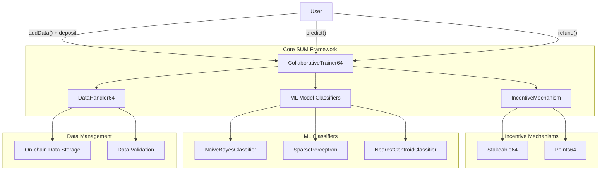
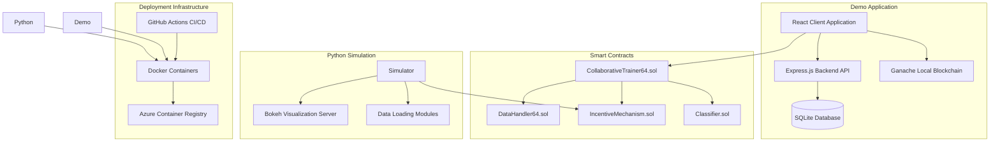
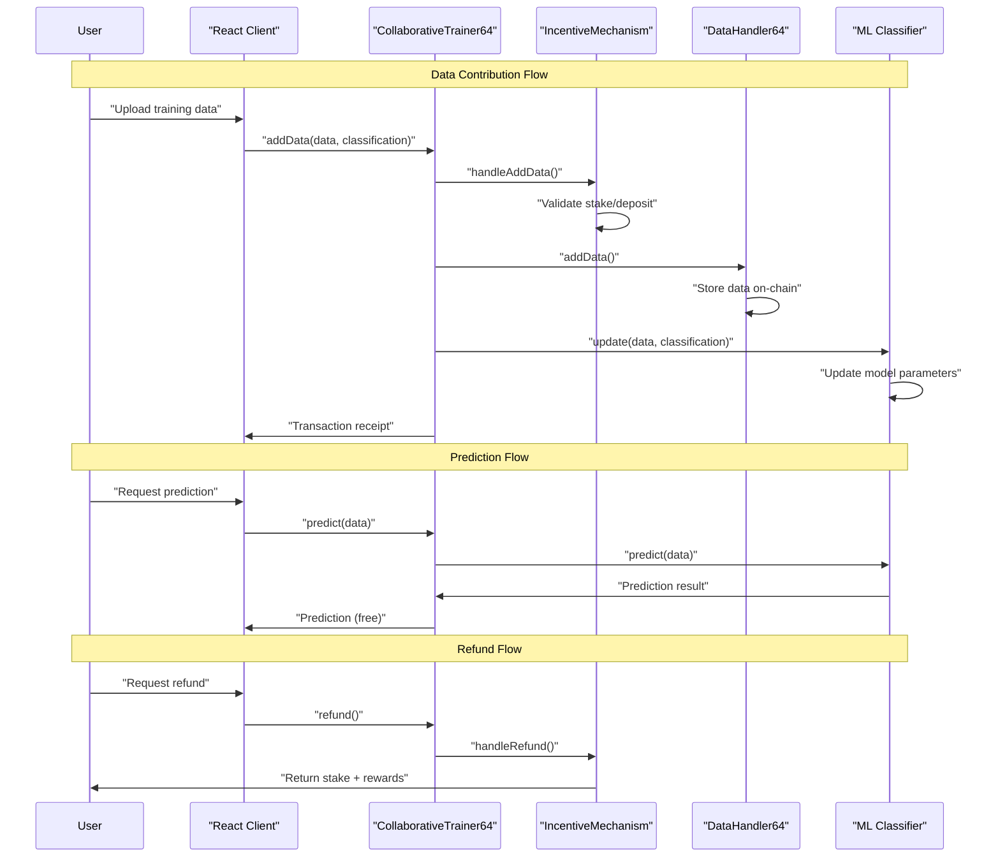

<!-- source: DeepWiki mcp.deepwiki.com · repo microsoft/0xDeCA10B · page 1 Overview · fetched 2026-10-26 -->

# Overview

Relevant source files

The following files were used as context for generating this wiki page:

- [.github/workflows/demo-prod.yml](.github/workflows/demo-prod.yml)
- [README.md](README.md)

## Purpose and Scope

This document provides a high-level introduction to the 0xDeCA10B project and its core Sharing Updatable Models (SUM) framework. It covers the fundamental concepts, system architecture, and main components that enable blockchain-based collaborative machine learning.

For detailed information about specific system components, see the [Demo Application](#2), [Smart Contracts](#3), and [Simulation System](#4) sections. For development setup and deployment guidance, see [Development and Deployment](#5).

## What is 0xDeCA10B

**0xDeCA10B** implements the **Sharing Updatable Models (SUM)** framework, a blockchain-based system for hosting and training publicly available machine learning models. The framework enables decentralized collaborative training where multiple participants can contribute data to improve shared models while receiving incentives for quality contributions.

The system operates on three core principles:
- **Free predictions**: Anyone can query deployed models for predictions at no cost
- **Incentivized data contribution**: Contributors provide training data with validation and potential rewards
- **Transparent model evolution**: All training data and model updates are recorded on the blockchain

**Sources:** [README.md:1-24]()

## Core Framework Architecture

The SUM framework consists of three primary validation components that process every data contribution:

### SUM Framework Core Components

**Sources:** [README.md:15-20]()

### Three-Step Validation Process

1. **IncentiveMechanism**: Validates data contribution requests, manages stakes/deposits, and handles reward distribution
2. **DataHandler**: Stores training data and metadata on-chain for permanent accessibility
3. **ML Model**: Updates model parameters using predefined training algorithms based on the new data

**Sources:** [README.md:17-19]()

## System Components Overview

The 0xDeCA10B repository contains three major system components:

### Complete System Architecture

**Sources:** [README.md:25-27]()

### Component Descriptions

| Component | Purpose | Key Technologies |
|-----------|---------|------------------|
| **Demo Application** | Full-stack web application showcasing SUM framework capabilities | React.js, Express.js, Web3.js, Ganache |
| **Smart Contracts** | Blockchain implementation of collaborative training logic | Solidity, Ethereum, Truffle |
| **Simulation System** | Python-based testing environment for incentive mechanisms | Python, Bokeh, NumPy, scikit-learn |
| **Deployment Infrastructure** | Containerization and CI/CD for cloud deployment | Docker, Azure, GitHub Actions |

**Sources:** [README.md:25-27]()

## Data Flow and Training Process

The collaborative training process follows a structured workflow where users interact with smart contracts through the demo application:

**Sources:** [README.md:15-20]()

## Machine Learning Models

The framework supports multiple on-chain machine learning algorithms optimized for blockchain execution:

- **NaiveBayesClassifier**: Probabilistic classifier using Bayes' theorem
- **SparsePerceptron**: Linear classifier with sparse weight updates
- **NearestCentroidClassifier**: Distance-based classification using class centroids

These models are designed to handle incremental updates efficiently, making them suitable for blockchain deployment where transaction costs are a consideration.

**Sources:** [README.md:35-42]()

## Incentive Mechanisms

The framework implements multiple incentive mechanisms to encourage quality data contributions:

- **Stakeable64**: Deposit-based mechanism where contributors stake tokens
- **Points64**: Reputation-based system using virtual karma points
- **Self-Assessment**: Contributors evaluate their own data quality
- **Prediction Market**: Market-based rewards for accurate contributions

**Sources:** [README.md:61-76]()

## Repository Structure

The codebase is organized into distinct modules:

- **`/demo`**: Full-stack web application with React frontend and Express backend
- **`/simulation`**: Python simulation environment with Bokeh visualization
- **`/contracts`**: Solidity smart contracts for blockchain deployment
- **`/.github`**: CI/CD workflows and automation scripts

**Sources:** [README.md:25-27]()

---

